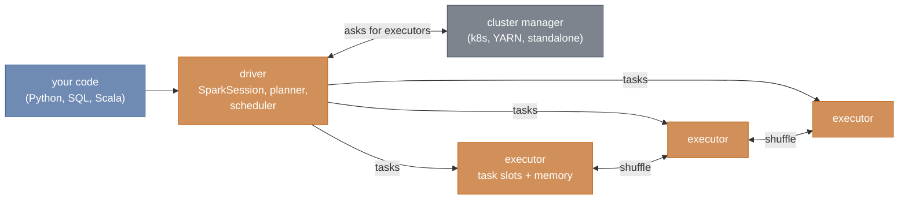
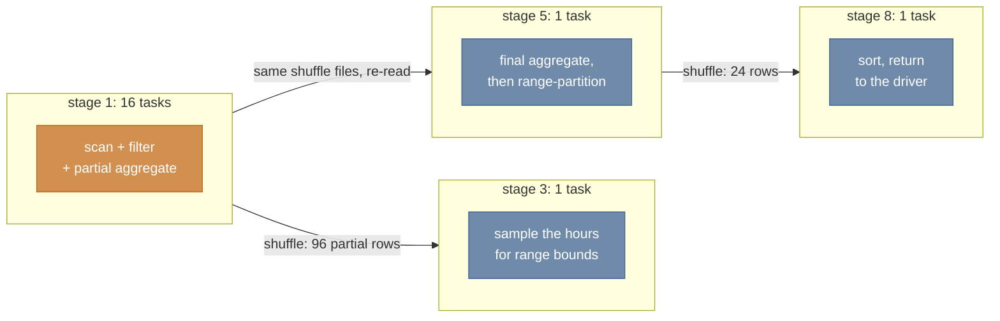
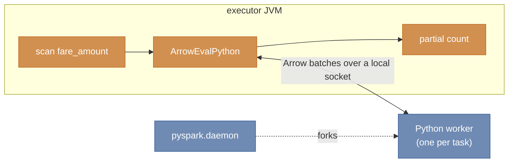

# Chapter 1: How Spark runs your code

Many new users think of Spark as a very large pandas. This model works until it fails. A query that you expect to take a second takes a minute. A filter that you wrote first runs last. A job that you expect to read one file starts sixteen tasks, and fifteen of them do nothing.

All of these problems have the same cause: Spark never runs the code that you wrote. Spark reads your code as a description of a result. It changes that description into a plan. It divides the plan into pieces that it can run in parallel, and then it runs the pieces. Your Python code is more like a query than a program.

**Spark changes every query into a plan, and then it changes the plan into jobs, stages and tasks. The shape of that plan sets the cost of a query, not the lines of code that describe it. The shape is how the input splits into tasks, where a shuffle cuts one stage from the next, and which processes do the work.** Most of what it means to understand Spark is to read that shape. The rest of this book uses this skill frequently. Thus, this chapter takes one question about New York taxi trips and follows it through all the levels.

All the code in this chapter runs on a laptop against Spark 4.3.0. The scripts are in [`code/ch01`](https://github.com/lisancao/spark-masterclass/tree/main/code/ch01). Each number in the chapter comes from their saved output in `code/ch01/output/`. If you did not install Spark yet, [Chapter 2](ch02-installing.md) shows how. You can read this chapter first and install Spark later. For the history of Spark and the reasons for its design, read the Background part, which starts with [Chapter 70](ch70-mapreduce-to-spark.md).

## The pieces of a Spark application

A Spark application has one **driver** and a number of **executors**. The driver is the process that holds your `SparkSession`. It parses and analyzes your queries, and it optimizes them. Then it makes a plan to run them, and it gives small units of work (tasks) to the executors. The executors are the processes that read the data and compute the results.

A **cluster manager** (Kubernetes, YARN or the standalone manager of Spark) starts the executors and gives them CPU and memory. Then the driver communicates with the executors directly.

This chapter uses these parts as boxes. [Chapter 71](ch71-inside-a-spark-application.md), in the Background part, opens each box. It shows the scheduler classes, the block manager, the shuffle files on disk and the memory model.



On a laptop, `local[*]` puts all of these parts into a single JVM. The driver and one executor share a process. The executor gets one task slot for each CPU core (16 on the machine that gave these numbers). Local mode does not change the plan. Thus, all that you learn here applies to a cluster without changes.

Only two things change in local mode. Tasks run as threads, not on other machines. Shuffles go through the local disk, not through the network.

Since Spark 3.4, there is a second method to connect to a driver: **Spark Connect**. With Spark Connect, your code runs in a thin client. The client sends plans over gRPC to a driver in a different location. This split is very important in practice, and all of [Chapter 4](ch04-spark-connect.md) is about it. For now, you only need to know that the driver does the same work in the two cases.

## Step 1: Build a query, and see that nothing occurs

Here is the question. In June 2026, how many yellow-cab trips started in each hour of the day, and what was their average cost? The data is the trip record file for that month from the NYC Taxi and Limousine Commission. It is one 65 MB Parquet file with 3,837,248 rows.

```python
trips = spark.read.parquet(str(TRIPS))
by_hour = (trips
           .where((F.col("tpep_pickup_datetime") >= MONTH_START) &
                  (F.col("tpep_pickup_datetime") < MONTH_END))
           .groupBy(F.hour("tpep_pickup_datetime").alias("hour"))
           .agg(F.count("*").alias("trips"),
                F.round(F.avg("total_amount"), 2).alias("avg_total"))
           .orderBy("hour"))
```

None of these lines reads a single trip. `spark.read.parquet` opens the footer of the file to get its schema. Each method after it (`where`, `groupBy`, `agg`, `orderBy`) returns a new DataFrame. The new DataFrame wraps the old one in one more node of a logical plan.

These methods are **transformations**, and Spark evaluates them lazily. Spark records the request, and it waits until an operation needs a real result. But you can ask Spark what it will do. `explain()` prints the physical plan that Spark will run:

```text
== Physical Plan ==
AdaptiveSparkPlan isFinalPlan=false
+- Sort [hour#22 ASC NULLS FIRST], true, 0
   +- Exchange rangepartitioning(hour#22 ASC NULLS FIRST, 200), ENSURE_REQUIREMENTS, [plan_id=22]
      +- HashAggregate(keys=[_groupingexpression#48], functions=[count(1), avg(total_amount#16)])
         +- Exchange hashpartitioning(_groupingexpression#48, 200), ENSURE_REQUIREMENTS, [plan_id=19]
            +- HashAggregate(keys=[_groupingexpression#48], functions=[partial_count(1), partial_avg(total_amount#16)])
               +- Project [total_amount#16, hour(tpep_pickup_datetime#1, Some(America/Los_Angeles)) AS _groupingexpression#48]
                  +- Filter ((isnotnull(tpep_pickup_datetime#1) AND (tpep_pickup_datetime#1 >= 2026-06-01 00:00:00)) AND ...
                     +- FileScan parquet [tpep_pickup_datetime#1,total_amount#16] Batched: true, DataFilters: [...],
                        PushedFilters: [IsNotNull(tpep_pickup_datetime), GreaterThanOrEqual(tpep_pickup_datetime,2026-06-01T00:00), Less...,
                        ReadSchema: struct<tpep_pickup_datetime:timestamp_ntz,total_amount:double>
```

Read the plan from the bottom to the top, because the data moves in that direction. Some items in the plan are already different from the code that you wrote:

- **The scan reads two columns, not 21.** `ReadSchema` lists only `tpep_pickup_datetime` and `total_amount`, because no later operator uses the other columns. Parquet keeps each column separately, so Spark does not read the other 19 columns from the disk. This optimization is column pruning, and Spark does it automatically.
- **Spark pushes the filter into the scan.** `PushedFilters` gives the date range to the Parquet reader. The reader can use the minimum and maximum statistics for each row group, and skip the groups that cannot match. In this file, it skips no groups, because each row group contains June trips. But on a year of trips, it can skip the row groups of the other eleven months, and it does not decode them.
- **The aggregation occurs two times.** The lower `HashAggregate` calculates `partial_count` and `partial_avg` in each task. Then the `Exchange` moves these partial results, so that all the rows for one hour go to the same location. Then the upper `HashAggregate` merges them. Spark keeps an average as a sum and a count, and it adds the sums and the counts together. That is why Spark can divide `avg` in this way.
- **There are two `Exchange` operators.** One is for the `groupBy`, with hash partitioning on the hour. The other is for the `orderBy`, with range partitioning. Range partitioning puts the earliest hours in partition 0, so the result has one sort order from start to end. An exchange is a **shuffle**, and most of the rest of this chapter is about shuffles.
- **`200` is the default for `spark.sql.shuffle.partitions`.** `isFinalPlan=false` tells you that Spark will not run this plan as it is. Adaptive query execution (AQE) will change the plan after it sees real data. Step 3 shows the changes.

You can also see `Some(America/Los_Angeles)` in `hour()`. This value is the session time zone, which here comes from the laptop that ran the script. The pickup column is a `timestamp_ntz` (a timestamp without a time zone), so the zone does not change the answer. But for a `timestamp` column, the zone changes the answer. Thus, it is a good practice to set `spark.sql.session.timeZone` explicitly.

## Step 2: Call an action, and count what it becomes

An **action** is an operation that needs a result: `collect()`, `count()`, `show()`, or a write to a file. When you call an action, the driver completes the plan and starts to schedule the work. The script calls `collect()`. Then it asks the monitoring REST API of the Spark UI what that one call became. This API is at `http://localhost:4040/api/v1`, and it gives the same data that the web UI shows:

```python
spark.sparkContext.setJobDescription("busiest hours")
rows = by_hour.collect()          # the action: now Spark schedules work

jobs = [j for j in ui_api("jobs") if j.get("description") == "busiest hours"]
```

```text
24 rows back, e.g.
  {'hour': 8, 'trips': 149208, 'avg_total': 29.12}
  {'hour': 18, 'trips': 264040, 'avg_total': 30.04}

job 1: SUCCEEDED, stages [1]
  stage  1  tasks  16  input rows 3,837,248  shuffle write     96  shuffle read      0
job 2: SUCCEEDED, stages [2, 3]
  stage  3  tasks   1  input rows         0  shuffle write      0  shuffle read     96
job 3: SUCCEEDED, stages [4, 5]
  stage  5  tasks   1  input rows         0  shuffle write     24  shuffle read     96
job 4: SUCCEEDED, stages [6, 7, 8]
  stage  8  tasks   1  input rows         0  shuffle write      0  shuffle read     24
```

<figure markdown>
  <video autoplay loop muted playsinline controls width="1280" height="720" poster="../../media/clips/ch01-jobs.webp">
    <source src="../../media/clips/ch01-jobs.mp4" type="video/mp4">
  </video>
  <figcaption><code>anatomy.py</code> runs against Spark 4.3.0. One <code>collect()</code> becomes jobs and stages, and the script reads them from the REST API of the Spark UI.</figcaption>
</figure>

The answer is what you can expect for New York. At 8 a.m. there were 149,208 trips, and at 6 p.m. there were 264,040. Evening trips cost a little more.

But the important part is below the answer. One `collect()` became four **jobs**. These jobs list eight **stages** in total, but only four of the stages ran. The other stages show as skipped.

These are the terms:

- A **task** is the unit of work that one task slot runs: one partition of data through the operators of one stage.
- A **stage** is a sequence of operators that can run without data movement between tasks. Spark divides stages at shuffle boundaries. The reason is that a shuffle needs all tasks on one side to complete their writes before a task on the other side can read.
- A **job** is a set of stages that Spark submits to the scheduler together. An action creates a job. Under AQE, a part of an action can also create a job.



The plan shows one job, but there are four. The reason is that AQE runs a query one **query stage** at a time. It materializes the first shuffle and measures the size of the output. Then it makes a new plan for the rest of the query, and it submits the next part as a new job. Each later job lists the earlier stages again, so job 4 names stages 6, 7 and 8. But the shuffle output of these stages is already on the disk, so the scheduler skips them, and a skipped stage costs nothing.

Job 2 is different from the other jobs. Before the range partitioning for the sort, Spark runs a small job that samples the keys. It uses the samples to choose the partition boundaries. This job is the cost of a global sort from `orderBy`. Without the job, each partition has only its own sorted run.

## Step 3: Where 200 partitions went

The plan showed `hashpartitioning(..., 200)`. But each stage after the first stage ran exactly one task. AQE is the cause again. After stage 1, the shuffle held 96 rows (a few kilobytes). With 200 reduce tasks for these rows, Spark schedules 200 tasks, and each task gets almost no work.

AQE partition coalescing (`spark.sql.adaptive.coalescePartitions.enabled`, on by default) merges shuffle partitions that are next to each other. It merges them until each partition has a useful size. For data this small, the result is one partition. You can see the result in a final plan as `AQEShuffleRead ... coalesced`, and [Chapter 3](ch03-quick-start.md) prints one.

The number 96 also gives information. Each of the 16 tasks in the first stage calculated partial counts for the hours in its data. Each task wrote these counts to the shuffle. If each task sees trips from all 24 hours, the shuffle gets 16 × 24 = 384 partial rows. There were 96, which is 4 × 24. Four tasks found data, and twelve found none.

## Step 4: Sixteen tasks, four row groups

The task list of the scan stage from the REST API shows which tasks found data:

```text
  task  0  rows         0   215 ms
  task  1  rows         0   214 ms
  task  2  rows 1,048,576   434 ms
  task  3  rows         0   211 ms
  ...
  task  6  rows 1,048,576   436 ms
  ...
  task 10  rows 1,048,576   430 ms
  ...
  task 13  rows   691,520   428 ms
  task 14  rows         0   210 ms
  task 15  rows         0   211 ms

4 of 16 tasks read any rows.
yellow_tripdata_2026-06.parquet: 65,465,637 bytes, 4 row groups, 3,837,248 rows
```

<figure markdown>
  <video autoplay loop muted playsinline controls width="1280" height="720" poster="../../media/clips/ch01-tasks.webp">
    <source src="../../media/clips/ch01-tasks.mp4" type="video/mp4">
  </video>
  <figcaption>The scan stage, task by task. Of the sixteen tasks, four read a row group.</figcaption>
</figure>

Spark plans file scans by size, before it reads data. It calculates a target split size of `min(spark.sql.files.maxPartitionBytes, max(spark.sql.files.openCostInBytes, totalBytes / cores))`. With the 128 MB default, 65 MB of input and 16 cores, this size is about 4 MB. Spark divides the file into 16 byte ranges of that size, and it gives one range to each task.

But Spark can decode a Parquet file only one **row group** at a time. A row group is a horizontal section of rows, with all its columns stored together. The writer of this file put 1,048,576 rows in each row group. Thus, the task that reads a row group is the task whose byte range contains the midpoint of the group.

Four row groups give four tasks with work. The other twelve tasks open the file, read its footer, find no row group of their own, and stop. But these empty tasks took about 210 ms each, and the busy tasks took about 430 ms. This was the first query in a new JVM.

A possible cause is start-up cost (the JVM loads classes and does JIT compilation), not I/O, because an empty task reads only a footer. This cause is not verified. But the empty tasks clearly show that the layout of the input sets parallelism in Spark, not the number of cores.

[Part IV](ch18-query-plans.md) gives the practical rules in detail. In summary:

- A scan cannot have more parallel tasks than row groups.
- Small files and very large row groups both decrease performance.
- If a stage is slow, first use the UI to find if its tasks did similar quantities of work.

## Step 5: The cost of a small query, and Project Feather

All of the work above is overhead from the scheduler. On large data, this overhead gives more value than it costs. On small data, the overhead is most of the cost. Spark 4.3 includes the first part of Project Feather, a set of changes for interactive and local workloads. The important part here is **single-task execution** (`spark.sql.optimizer.singleTaskExecution.enabled`, off by default in 4.3.0).

If the planner sees that the input of a query is small enough for one task, it plans the query as a single task. It also removes all the shuffles, because data movement between tasks has no purpose when there is only one task.

`feather.py` runs a query over the 265-row lookup file for zones twenty times with the flag off, and twenty times with the flag on. Before these runs, it does a warm-up run of the two settings. It counts jobs and tasks from the REST API:

```python
def zones_by_borough():
    # a fresh DataFrame each time, the way a notebook cell or a unit test builds one
    return (spark.read.option("header", True).csv(str(ZONES))
            .groupBy("Borough").count().orderBy("Borough"))
```

```text
spark.sql.optimizer.singleTaskExecution.enabled=false:   82.8 ms per query, 5.0 jobs, 5.0 tasks
spark.sql.optimizer.singleTaskExecution.enabled=true:    49.3 ms per query, 2.0 jobs, 2.0 tasks
```

<figure markdown>
  <video autoplay loop muted playsinline controls width="1280" height="720" poster="../../media/clips/ch01-feather.webp">
    <source src="../../media/clips/ch01-feather.mp4" type="video/mp4">
  </video>
  <figcaption><code>feather.py</code> runs the same small query with single-task execution off, and then on. The times change by a few milliseconds between runs.</figcaption>
</figure>

In three runs of the script, the default stayed between 82 and 87 ms. Single-task execution stayed between 48 and 50 ms. Both settings include one job that is not part of the query. When Spark reads a CSV file with `header=true`, it runs a one-task job that reads the first line to get the column names. A bare `spark.read.option("header", True).csv(...)` with no action after it runs exactly one job.

Thus, single-task execution changes the other four jobs into one job. These four jobs are the scan and the AQE stages for the aggregate and the sort, as in the taxi query above. Single-task execution saves 33 ms per query. This time is not important for a batch job. But it is important for a test suite that builds hundreds of small DataFrames, and Feather is for these users. The [Ultimate Guide to Spark 4.3](https://systemsnull.net/posts/data-engineering-ai/ultimate-guide-spark-43) gives the other parts of Feather, which include the Arrow-backed cache.

## Step 6: Where Python runs

Up to this point, the JVM executed each operator in the plan itself. Your Python code ran only on the driver side, where it built the plan. This changes when a query calls a Python function on its rows:

```python
@F.udf("string")
def fare_band(fare):              # plain Python, so it has to run in a Python process
    if fare is None or fare <= 0:
        return "invalid"
    return "under $10" if fare < 10 else "$10 to $30" if fare < 30 else "over $30"

banded = trips.groupBy(fare_band("fare_amount").alias("band")).count().orderBy("band")
```

```text
+- ArrowEvalPython [fare_band(fare_amount#10)#21], [pythonUDF0#48], 10
2.0 s; Python processes before the query: 0, at peak: 17
  $10 to $30   2,192,451
  invalid         16,815
  over $30       777,470
  under $10      850,512
```

The plan now has an `ArrowEvalPython` operator. While the query ran, the machine had 17 Python processes that did not exist before the query. One process is a `pyspark.daemon`, which the executor starts when it first needs it. The other 16 processes are workers that the daemon forks, one for each task that runs.

The executor streams the `fare_amount` values of each task to its worker in Arrow batches. The worker calls `fare_band` one row at a time, and the results come back in the same way. The operator name has Arrow in it because `spark.sql.execution.pythonUDF.arrow.enabled` is on by default in 4.3. Thus, even a plain `@udf` sends data across the boundary in Arrow batches, not in pickled rows.



This is the most important fact about PySpark performance, and [Chapter 20](ch20-python-udfs-arrow.md) is almost only about it. DataFrame operations with built-in functions run in the JVM, and Python does no part of the work. A Python UDF adds three costs: a process boundary, serialization in the two directions, and the speed of Python itself.

Here, the built-in equivalent is a `F.when(...)` chain, which does not go out of the JVM. Spark 4.3 also has an experimental optimizer rule that changes simple Python UDFs like this one into native expressions (`spark.sql.experimental.optimizer.transpilePyUDFs`). This rule clearly shows that the boundary is expensive.

## The whole chapter, on one page

- **Transformations make a plan, and actions run it.** Spark reads no data until an operation needs a result. That is why Spark can prune columns and push filters into the scan before you ask for a result.
- **Read plans from the bottom to the top.** The `ReadSchema` and `PushedFilters` of the scan show what Spark reads from the disk. Each `Exchange` is a shuffle.
- **Shuffles divide stages, stages contain tasks, and actions submit jobs.** Under AQE, one action becomes a number of jobs. Spark skips the stages that already ran, and it does not calculate them again.
- **AQE changes the plan after it sees data.** Here, partition coalescing changed 200 planned shuffle partitions into one partition.
- **The layout of the input sets the scan parallelism.** Sixteen tasks over a file with four row groups means that four tasks do the work.
- **Small queries are mostly overhead.** Single-task execution in Spark 4.3 removes most of this overhead when you enable it.
- **Python UDFs run in separate Python processes.** Built-in functions do not.

All of these points go back to the first point of the chapter. You describe a result, and Spark decides how to calculate it. Thus, the useful skill is to read what Spark decided. The next chapter installs Spark correctly. Then [Chapter 3](ch03-quick-start.md) asks a more difficult question of the same data, in DataFrames and in SQL.

## Further reading

- [Spark's cluster mode overview](https://spark.apache.org/docs/4.3.0/cluster-overview.html), the official description of drivers, executors and cluster managers.
- [The monitoring REST API](https://spark.apache.org/docs/4.3.0/monitoring.html#rest-api), the endpoints that the scripts in this chapter read.
- [Adaptive query execution](https://spark.apache.org/docs/4.3.0/sql-performance-tuning.html#adaptive-query-execution), with all the settings for partition coalescing.
- [NYC TLC trip record data](https://www.nyc.gov/site/tlc/about/tlc-trip-record-data.page), the source of the data, with the data dictionary for each column.
