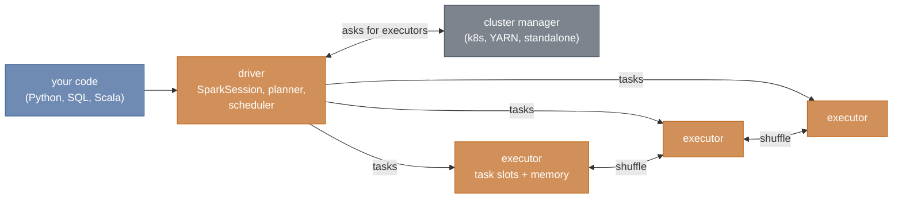
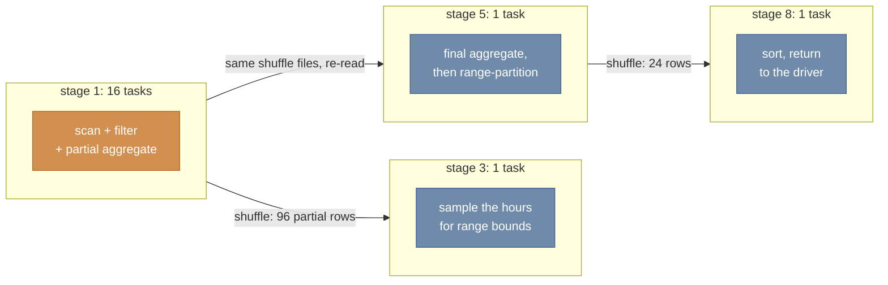
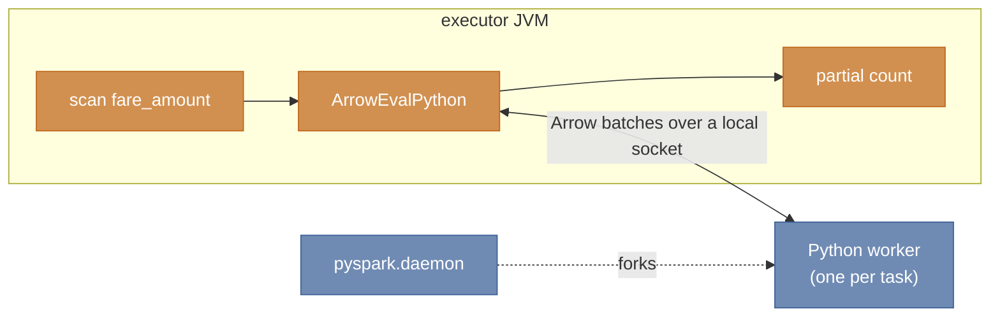

# Chapter 1: How Spark runs your code

When I first learned Spark I treated it like a very large pandas, which works right up until the moment it doesn't: a query that should take a second takes a minute, a filter you wrote first runs last, or a job you expected to read one file launches sixteen tasks and fifteen of them do nothing. All of those surprises have the same cause, which is that Spark never runs the code you wrote. It reads your code as a description of a result, turns that description into a plan, cuts the plan into pieces it can run in parallel, and runs the pieces; your Python is closer to a query than a program.

**Spark turns every query into a plan, and the plan into jobs, stages and tasks, so the cost of a query is set by the shape of that plan (how the input splits into tasks, where a shuffle cuts one stage from the next, and which processes do the work) rather than by the lines of code that describe it.** Reading that shape is most of what it means to understand Spark, and the rest of this book leans on it constantly, so this chapter takes one question about New York taxi trips and follows it all the way down.

Everything here runs on a laptop against Spark 4.3.0. The scripts are in [`code/ch01`](https://github.com/lisancao/spark-masterclass/tree/main/code/ch01), and every number in the chapter comes from their saved output in `code/ch01/output/`. If you haven't installed Spark yet, [Chapter 2](ch02-installing.md) does that; you can read this chapter first and come back.

## The pieces of a Spark application

A Spark application is one **driver** and some number of **executors**. The driver is the process that holds your `SparkSession`: it parses and analyzes your queries, optimizes them, plans how to run them, and then hands small units of work (tasks) to executors, which are the processes that actually read data and compute. A **cluster manager** (Kubernetes, YARN or Spark's own standalone manager) starts the executors and gives them CPU and memory; the driver then talks to them directly.



On a laptop, `local[*]` collapses all of this into a single JVM: the driver and one executor share a process, and the executor gets one task slot per CPU core (16 on the machine these numbers come from). Nothing about the plan changes in local mode, which is why everything you learn here carries straight over to a cluster; what changes is that tasks run as threads instead of on other machines, and that shuffles go through local disk instead of the network.

Since Spark 3.4 there's a second way to reach a driver, **Spark Connect**, in which your code runs in a thin client that sends plans over gRPC to a driver somewhere else. That split matters a lot in practice and gets [Chapter 4](ch04-spark-connect.md) to itself; for now it's enough to know that the driver does the same work either way.

## Step 1: Build a query, and notice that nothing happens

Here is the question: across June 2026, how many yellow-cab trips started in each hour of the day, and what did they cost on average? The data is the NYC Taxi and Limousine Commission's trip record file for that month, one 65 MB Parquet file with 3,837,248 rows.

```python
trips = spark.read.parquet(str(TRIPS))
by_hour = (trips
           .where((F.col("tpep_pickup_datetime") >= MONTH_START) &
                  (F.col("tpep_pickup_datetime") < MONTH_END))
           .groupBy(F.hour("tpep_pickup_datetime").alias("hour"))
           .agg(F.count("*").alias("trips"),
                F.round(F.avg("total_amount"), 2).alias("avg_total"))
           .orderBy("hour"))
```

None of these lines reads a single trip. `spark.read.parquet` opens the file's footer to learn its schema, and every method after it (`where`, `groupBy`, `agg`, `orderBy`) returns a new DataFrame that wraps the old one in one more node of a logical plan. These are **transformations**, and Spark evaluates them lazily: it records what you asked for and waits until something needs an actual result. You can still ask what it intends to do, and `explain()` prints the physical plan it would run:

```text
== Physical Plan ==
AdaptiveSparkPlan isFinalPlan=false
+- Sort [hour#22 ASC NULLS FIRST], true, 0
   +- Exchange rangepartitioning(hour#22 ASC NULLS FIRST, 200), ENSURE_REQUIREMENTS, [plan_id=22]
      +- HashAggregate(keys=[_groupingexpression#48], functions=[count(1), avg(total_amount#16)])
         +- Exchange hashpartitioning(_groupingexpression#48, 200), ENSURE_REQUIREMENTS, [plan_id=19]
            +- HashAggregate(keys=[_groupingexpression#48], functions=[partial_count(1), partial_avg(total_amount#16)])
               +- Project [total_amount#16, hour(tpep_pickup_datetime#1, Some(America/Los_Angeles)) AS _groupingexpression#48]
                  +- Filter ((isnotnull(tpep_pickup_datetime#1) AND (tpep_pickup_datetime#1 >= 2026-06-01 00:00:00)) AND ...
                     +- FileScan parquet [tpep_pickup_datetime#1,total_amount#16] Batched: true, DataFilters: [...],
                        PushedFilters: [IsNotNull(tpep_pickup_datetime), GreaterThanOrEqual(tpep_pickup_datetime,2026-06-01T00:00), Less...,
                        ReadSchema: struct<tpep_pickup_datetime:timestamp_ntz,total_amount:double>
```

Read it bottom up, because that's the direction data flows. A few things in it already differ from the code you wrote:

- **The scan reads two columns, not 21.** `ReadSchema` lists only `tpep_pickup_datetime` and `total_amount`, because nothing else is used downstream; Parquet stores each column separately, so the other 19 are never read from disk. This is column pruning, and you got it without asking.
- **The filter has been pushed into the scan.** `PushedFilters` hands the date range to the Parquet reader, which can use the min and max statistics stored for each row group to skip groups that can't match. It doesn't skip anything in this file (every row group contains June trips), but on a year of trips it would skip the row groups of the other eleven months without decoding them.
- **The aggregation happens twice.** The lower `HashAggregate` computes `partial_count` and `partial_avg` inside each task, the `Exchange` moves those partial results so that every row for one hour ends up in the same place, and the upper `HashAggregate` merges them. Averages are merged as a running sum and count, which is why `avg` can be split this way at all.
- **There are two `Exchange` operators**, one for the `groupBy` (hash partitioning on the hour) and one for the `orderBy` (range partitioning, so that partition 0 holds the earliest hours and the result is sorted end to end). An exchange is a **shuffle**, and shuffles are what the rest of this chapter is mostly about.
- **`200` is the default for `spark.sql.shuffle.partitions`**, and `isFinalPlan=false` says that this isn't the plan that will run; adaptive query execution (AQE) will revise it once it has seen real data, and Step 3 shows what it changes.

You might also notice `Some(America/Los_Angeles)` inside `hour()`, which is the session time zone, here inherited from my laptop. The pickup column is a `timestamp_ntz` (a timestamp without a time zone), so the zone doesn't change the answer, but for a `timestamp` column it would, and setting `spark.sql.session.timeZone` explicitly is a habit worth having.

## Step 2: Call an action, and count what it becomes

An **action** is anything that needs a result: `collect()`, `count()`, `show()`, writing a file. Calling one makes the driver finish planning and start scheduling work. The script calls `collect()` and then asks the Spark UI's monitoring REST API (`http://localhost:4040/api/v1`, the same data the web UI shows) what that one call turned into:

```python
spark.sparkContext.setJobDescription("busiest hours")
rows = by_hour.collect()          # the action: now Spark schedules work

jobs = [j for j in ui_api("jobs") if j.get("description") == "busiest hours"]
```

```text
24 rows back, e.g. {'hour': 8, 'trips': 149208, 'avg_total': 29.12}  {'hour': 18, 'trips': 264040, 'avg_total': 30.04}

job 1: SUCCEEDED, stages [1]
  stage  1  tasks  16  input rows 3,837,248  shuffle write     96  shuffle read      0
job 2: SUCCEEDED, stages [2, 3]
  stage  3  tasks   1  input rows         0  shuffle write      0  shuffle read     96
job 3: SUCCEEDED, stages [4, 5]
  stage  5  tasks   1  input rows         0  shuffle write     24  shuffle read     96
job 4: SUCCEEDED, stages [6, 7, 8]
  stage  8  tasks   1  input rows         0  shuffle write      0  shuffle read     24
```

The answer itself is what you'd guess about New York (8 a.m. had 149,208 trips, 6 p.m. had 264,040, and evening trips cost slightly more), but the interesting part is underneath it. One `collect()` became four **jobs**, and those jobs list eight **stages** between them, of which only four actually ran; the rest show up as skipped. The vocabulary:

- A **task** is the unit of work one task slot runs: one partition of data through one stage's operators.
- A **stage** is a run of operators that can execute without moving data between tasks. Stages are cut at shuffle boundaries, because a shuffle needs every task on one side to finish writing before any task on the other side can read.
- A **job** is a set of stages submitted to the scheduler together, and is what an action (or, under AQE, a piece of an action) creates.



The reason for four jobs where the plan suggests one is that AQE runs a query one **query stage** at a time: it materializes the first shuffle, looks at how big the output actually is, re-plans the rest, and submits the next piece as a new job. Each later job lists the earlier stages again (that's why job 4 names stages 6, 7 and 8), but their shuffle output already exists on disk, so the scheduler skips them; a skipped stage costs nothing. Job 2 is the odd one out: before range-partitioning for the sort, Spark runs a small job that samples the keys to choose partition boundaries, which is the price of `orderBy` producing a globally sorted result rather than one sorted run per partition.

## Step 3: Where 200 partitions went

The plan promised `hashpartitioning(..., 200)`, yet every stage after the first ran exactly one task. That's AQE again. After stage 1, the shuffle held 96 rows (a few kilobytes), so splitting them across 200 reduce tasks would have scheduled 200 tasks to process almost nothing each; AQE's partition coalescing (`spark.sql.adaptive.coalescePartitions.enabled`, on by default) merged adjacent shuffle partitions until each one reached a sensible size, which for data this small means one. You can see the result in a final plan as `AQEShuffleRead ... coalesced`, and [Chapter 3](ch03-quick-start.md) prints one.

That 96 is itself informative. The first stage's 16 tasks each computed partial counts for the hours they saw and wrote them to the shuffle, so if every task had seen trips from all 24 hours there would be 16 × 24 = 384 partial rows. There were 96, which is 4 × 24. Four tasks found data, and twelve found none.

## Step 4: Sixteen tasks, four row groups

Asking the REST API for the scan stage's task list shows exactly which:

```text
  task  0  rows         0   215 ms
  task  1  rows         0   214 ms
  task  2  rows 1,048,576   434 ms
  task  3  rows         0   211 ms
  ...
  task  6  rows 1,048,576   436 ms
  ...
  task 10  rows 1,048,576   430 ms
  ...
  task 13  rows   691,520   428 ms
  task 14  rows         0   210 ms
  task 15  rows         0   211 ms

4 of 16 tasks read any rows.
yellow_tripdata_2026-06.parquet: 65,465,637 bytes, 4 row groups, 3,837,248 rows
```

Spark plans file scans by size, before reading any data. It computes a target split size of `min(spark.sql.files.maxPartitionBytes, max(spark.sql.files.openCostInBytes, totalBytes / cores))`, which with the 128 MB default, 65 MB of input and 16 cores comes to about 4 MB, and slices the file into 16 byte ranges of that size, one task each. A Parquet file, though, can only be decoded a **row group** at a time (a row group is a horizontal chunk of rows with all its columns stored together, and this file was written with 1,048,576 rows per group), so each row group is read by whichever task's byte range contains the group's midpoint. Four row groups means four tasks with work and twelve that open the file, read its footer, find no row group of their own and finish. Those empty tasks still took around 210 ms each, against about 430 ms for the busy ones; this was the first query in a fresh JVM, and my suspicion is that most of that is start-up cost (class loading, JIT compilation) rather than I/O, since an empty task reads only a footer; but they're the clearest possible demonstration that parallelism in Spark is decided by how the input is laid out, not by how many cores you have.

The practical version of this, which [Part IV](../roadmap.md) works through properly: a scan can't be more parallel than its row groups, small files and huge row groups both hurt, and when a stage is slow the first thing to look at in the UI is whether its tasks did similar amounts of work.

## Step 5: The cost of a small query, and Project Feather

Everything above is scheduling overhead that pays for itself on large data. On small data it's most of the cost. Spark 4.3 ships the first part of Project Feather, a set of changes aimed at interactive and local workloads, and the piece that matters here is **single-task execution** (`spark.sql.optimizer.singleTaskExecution.enabled`, off by default in 4.3.0). When the planner can see that a query's input is small enough to process in one task, it plans it as a single task and drops the shuffles entirely, since moving data between tasks is pointless when there's only one.

`feather.py` runs a query over the 265-row zone lookup file twenty times with the flag off and twenty times with it on, after a warm-up of both, and counts jobs and tasks from the REST API:

```python
def zones_by_borough():
    # a fresh DataFrame each time, the way a notebook cell or a unit test builds one
    return (spark.read.option("header", True).csv(str(ZONES))
            .groupBy("Borough").count().orderBy("Borough"))
```

```text
spark.sql.optimizer.singleTaskExecution.enabled=false:   82.8 ms per query, 5.0 jobs, 5.0 tasks
spark.sql.optimizer.singleTaskExecution.enabled=true:    49.3 ms per query, 2.0 jobs, 2.0 tasks
```

Across three runs of the script the default stayed between 82 and 87 ms and single-task execution between 48 and 50 ms. Both settings include one job that has nothing to do with the query, because reading a CSV with `header=true` runs a one-task job to read the first line for the column names (a bare `spark.read.option("header", True).csv(...)` with no action after it runs exactly one job). What's left is four jobs (scan, then the AQE stages for the aggregate and the sort, like the taxi query above) collapsing into one. The 33 ms saved per query is nothing for a batch job and a lot for a test suite that builds hundreds of tiny DataFrames, which is exactly who Feather is for; the [Ultimate Guide to Spark 4.3](https://systemsnull.net/posts/data-engineering-ai/ultimate-guide-spark-43) covers the rest of it, including the Arrow-backed cache.

## Step 6: Where Python actually runs

So far every operator in the plan was something the JVM executes itself, and your Python code only ran on the driver side, building the plan. That changes as soon as a query calls a Python function on its rows:

```python
@F.udf("string")
def fare_band(fare):              # plain Python, so it has to run in a Python process
    if fare is None or fare <= 0:
        return "invalid"
    return "under $10" if fare < 10 else "$10 to $30" if fare < 30 else "over $30"

banded = trips.groupBy(fare_band("fare_amount").alias("band")).count().orderBy("band")
```

```text
+- ArrowEvalPython [fare_band(fare_amount#10)#21], [pythonUDF0#48], 10
2.0 s; Python processes before the query: 0, at peak: 17
  $10 to $30   2,192,451
  invalid         16,815
  over $30       777,470
  under $10      850,512
```

The plan now has an `ArrowEvalPython` operator, and while the query ran there were 17 Python processes on the machine that hadn't existed before it: a `pyspark.daemon` that the executor starts on first use, and 16 workers forked from it, one per running task. The executor streams each task's `fare_amount` values to its worker in Arrow batches, the worker calls `fare_band` row by row, and the results come back the same way. (The operator says Arrow because `spark.sql.execution.pythonUDF.arrow.enabled` is on by default in 4.3, so even a plain `@udf` crosses the boundary in Arrow batches rather than pickled rows.)



This is the single most important thing to know about PySpark performance, and [Chapter 20](../roadmap.md) is about little else: DataFrame operations written with built-in functions run in the JVM with no Python involved at all, and a Python UDF costs a process boundary, serialization in both directions, and Python's own speed. Here the built-in equivalent is a `F.when(...)` chain, which would never leave the JVM. Spark 4.3 also has an experimental optimizer rule that rewrites simple Python UDFs like this one into native expressions (`spark.sql.experimental.optimizer.transpilePyUDFs`), which is about as direct an admission as you'll get that the boundary is expensive.

## The whole chapter, on one page

- **Transformations build a plan; actions run it.** Nothing reads data until something needs a result, which is what lets Spark prune columns and push filters into the scan before you've asked.
- **Read plans bottom up.** The scan's `ReadSchema` and `PushedFilters` show what's read from disk; each `Exchange` is a shuffle.
- **Shuffles cut stages; stages contain tasks; actions submit jobs.** Under AQE one action becomes several jobs, and stages that already ran are skipped rather than recomputed.
- **AQE rewrites the plan once it has seen data**, and coalescing turned 200 planned shuffle partitions into one here.
- **Scan parallelism comes from the input's layout.** Sixteen tasks over a file with four row groups means four do the work.
- **Small queries are mostly overhead**, and Spark 4.3's single-task execution removes most of it when you turn it on.
- **Python UDFs run in separate Python processes**; built-in functions don't.

All of it comes back to the opening point: you describe a result, and Spark decides how to compute it, so the useful skill is reading what it decided. The next chapter installs Spark properly, and [Chapter 3](ch03-quick-start.md) asks a harder question of the same data in both DataFrames and SQL.

## Further reading

- [Spark's cluster mode overview](https://spark.apache.org/docs/4.3.0/cluster-overview.html), the official description of drivers, executors and cluster managers.
- [The monitoring REST API](https://spark.apache.org/docs/4.3.0/monitoring.html#rest-api), the endpoints the scripts in this chapter read.
- [Adaptive query execution](https://spark.apache.org/docs/4.3.0/sql-performance-tuning.html#adaptive-query-execution), including every partition-coalescing setting.
- [NYC TLC trip record data](https://www.nyc.gov/site/tlc/about/tlc-trip-record-data.page), where the data comes from, with the data dictionary for each column.
