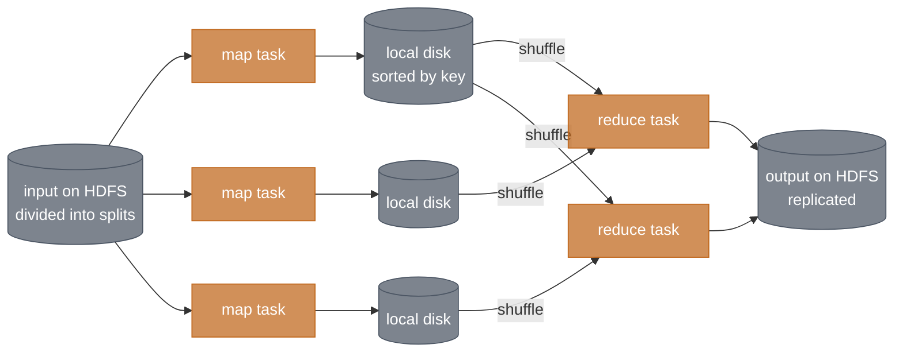
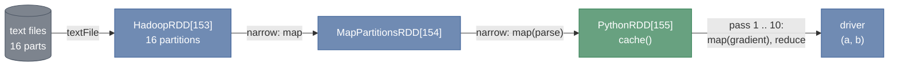

# Chapter 1: From MapReduce to Spark

Spark did not start as a general data platform. It started as a fix for one cost of an earlier system. In 2004, Google described MapReduce, a model that let ordinary programmers process data on thousands of machines. Hadoop made the model open source, and for some years it was the default tool for large data. But MapReduce wrote every intermediate result to disk. A job that used the same data many times read it from disk many times.

**Spark began as a different answer to one question: where does the data stay between two steps? MapReduce keeps it on disk, so each step pays for a full read and write. The resilient distributed dataset (RDD) keeps it in memory, and it uses lineage, not copies on disk, to recover from failure.** This chapter shows the problem and the idea. Then it runs the same iterative job in the two styles on Spark 4.3, and it measures the difference.

This chapter opens the Background part of the book. The next chapters continue the history:

- [Chapter 2](ch02-inside-a-spark-application.md) goes inside a Spark application.
- [Chapter 3](ch03-rdds-to-a-sql-engine.md) follows the move from RDDs to a SQL engine.
- [Chapter 4](ch04-one-engine-batch-and-streaming.md) shows how one engine came to do batch and streaming.

 The scripts are in [`code/ch01`](https://github.com/lisancao/spark-masterclass/tree/main/code/ch01). Each number in the chapter comes from their saved output in `code/ch01/output/`.

## Step 1: What MapReduce solved

The MapReduce paper ([Dean and Ghemawat, OSDI 2004](https://research.google/pubs/mapreduce-simplified-data-processing-on-large-clusters/)) gave programmers two functions to write:

- **map** takes one input record and returns zero or more key and value pairs.
- **reduce** takes one key and all the values for that key, and returns the result for the key.

The system does all the other work. It divides the input into splits, and it runs one map task on each split. It sorts the map output by key and writes it to the local disk of the machine. Then each reduce task fetches its keys from all the map tasks. This movement of data is the **shuffle**. The reduce tasks write the final output to a distributed file system (GFS at Google, HDFS in Hadoop), with copies on more than one machine.



This design solved two hard problems at the same time:

- **Scale.** The programmer writes two small functions. The same code runs on one machine or on thousands, because the system does the division of work.
- **Failure.** On thousands of machines, some machines fail during each large job. MapReduce writes each map output to disk and keeps the input on a replicated file system. Thus, if a task fails, the system runs the task again on a different machine. No other task must start again.

Disk is the key to the second point. Each task reads only data that is safe on disk, and it writes its result to disk before the next phase starts. A failure loses only the work of the task that failed.

## Step 2: The cost of disk between every step

The same design has a cost. A MapReduce job has exactly one map phase and one reduce phase. Many real computations need more steps than that:

- **A multi-step query** becomes a chain of jobs. Each job writes its full output to the replicated file system, and the next job reads it again.
- **An iterative algorithm** (logistic regression, k-means, PageRank) makes many passes over the same data. Each pass is a new job, and each job reads and parses the full input again.
- **Interactive analysis** asks many questions about one data set. Each question is a new job that reads the data from disk again.

The authors of Spark gave this problem a name in the first Spark paper: a *working set*. This is data that many parallel operations use again. The paper is [Zaharia et al., HotCloud 2010](https://www.usenix.org/legacy/event/hotcloud10/tech/full_papers/Zaharia.pdf). It says that in Hadoop, "each job must reload the data from disk". For interactive queries, it reports latencies of "tens of seconds" for each query, because each query is a separate MapReduce job.

<figure markdown>
  
  
  <figcaption>The data flow of an iterative job. In MapReduce, each pass is a job that reads its input from HDFS and writes its output to HDFS. With an RDD, the job parses the input one time, and each pass reads the cached partitions from memory.</figcaption>
</figure>

## Step 3: The AMPLab and the RDD

Spark came from the AMPLab at the University of California, Berkeley. Two papers describe the idea:

| Paper | Venue | What it adds |
|---|---|---|
| [Spark: Cluster Computing with Working Sets](https://www.usenix.org/legacy/event/hotcloud10/tech/full_papers/Zaharia.pdf) | HotCloud 2010 | The first Spark. RDDs as "a read-only collection of objects partitioned across a set of machines that can be rebuilt if a partition is lost". |
| [Resilient Distributed Datasets](https://www.usenix.org/conference/nsdi12/technical-sessions/presentation/zaharia) | NSDI 2012 | The full RDD model: coarse-grained transformations, narrow and wide dependencies, lineage for fault tolerance, and an evaluation. |

The two papers make claims about speed. The HotCloud paper says that Spark is up to 10 times faster than Hadoop for iterative machine learning jobs. The NSDI abstract says that data in memory can make iterative and interactive applications "an order of magnitude" faster. Step 5 measures the same kind of job on one laptop.

An RDD is a set of records in partitions. A program makes a new RDD from an old one with a **coarse-grained transformation**. This is one function, such as `map` or `filter`, that applies to all the records. A program cannot change one record in place.

This restriction is the main idea. Because each RDD comes from its parents through a known function, Spark does not need a copy of the data for recovery. It needs only the recipe. The recipe is the **lineage**.



The NSDI paper divides dependencies into two types:

- **A narrow dependency** means that each partition of the parent goes to at most one partition of the child. `map` and `filter` are narrow. Spark can run a chain of narrow transformations in one task, and it can recompute one lost partition from one parent partition.
- **A wide dependency** means that a partition of the child needs data from many parent partitions. `reduceByKey` and `join` are wide. A wide dependency is a shuffle, and it is the boundary between two stages. [Chapter 2](ch02-inside-a-spark-application.md) shows how the scheduler uses this boundary.

If an executor fails, Spark finds the lost partitions in the lineage graph. Then it recomputes only those partitions from their parents. For a cached RDD with narrow dependencies, this recovery is a new read of one input split and the same functions again. The cost of recovery is some recomputation, not a replicated write of each intermediate result.

## Step 4: One job, written two ways

To see the difference, `iterative.py` fits a straight line, `fare = a + b × distance`, to the June 2026 taxi trips. It uses batch gradient descent. Each pass reads every trip, computes the error of the current line for each trip, and adds the errors together. The RDD paper uses jobs of this shape, such as logistic regression, for its iterative tests.

The input is what a MapReduce job reads: lines of text, one point on each line. The script writes 3.8 million trips as 16 text files of 40 MB in total. Then it runs ten passes in each style.

=== "MapReduce style"

    ```python
    for i in range(1, passes + 1):
        a, b = json.loads(sc.textFile(str(state)).first())          # read the last pass's output
        g = (sc.textFile(str(points_dir), 16)                        # map: read and parse every line
             .map(parse)
             .map(lambda p, a=a, b=b: (0, gradient(p, a, b)))
             .reduceByKey(add)                                        # shuffle, then reduce
             .values().first())
        a, b = step(a, b, g)
        state = wdir / f"pass-{i}"
        sc.parallelize([json.dumps([a, b])], 1).saveAsTextFile(str(state))   # write the output
    ```

=== "RDD style"

    ```python
    points = sc.textFile(str(points_dir), 16).map(parse).cache()     # (1)!
    for i in range(1, passes + 1):
        g = points.map(lambda p, a=a, b=b: gradient(p, a, b)).reduce(add)
        a, b = step(a, b, g)
    ```

    1. `cache()` only marks the RDD. The first action fills the cache, one partition for each task.

The MapReduce version runs on Spark, but it follows the rules of MapReduce:

- Each pass is a separate job that reads the text input and parses each line again.
- Each pass has a map phase and a reduce phase, with a shuffle between them.
- The state (the two weights) goes from one pass to the next through a file on disk, as in a chain of Hadoop jobs.

The RDD version parses the input one time, and it keeps the parsed points in executor memory. The weights go to the tasks inside the function closure, and the result comes back to the driver from `reduce`.

## Step 5: The measurement

`iterative.py` ran under the book's benchmark lock on the 16-core laptop that gave all the numbers in this book:

```text
input: 16 text files, 40,062,050 bytes, 10 passes, 16 cores

pass  mapreduce s   input bytes   rdd s   input bytes
   1         2.61    40,375,293    0.79    40,375,266
   2         1.33    40,375,324    0.24    17,393,058
   3         1.30    40,375,322    0.23    17,393,058
   4         0.96    40,375,322    0.26    17,393,058
   5         1.14    40,375,322    0.24    17,393,058
   6         0.97    40,375,323    0.26    17,393,058
   7         1.02    40,375,322    0.33    17,393,058
   8         0.90    40,375,322    0.32    17,393,058
   9         1.03    40,375,322    0.32    17,393,058
  10         0.96    40,375,321    0.37    17,393,058
 sum        12.20   403,753,193    3.37   196,912,788

mapreduce: shuffle write 14,720 B, output files written 11
rdd:       shuffle write 0 B

mapreduce weights: a=1.030601 b=4.496045
rdd weights:       a=1.030601 b=4.496045

median of passes 2..10: mapreduce 1.02 s, rdd 0.26 s (3.9x)
```

<figure markdown>
  <video autoplay loop muted playsinline controls width="1280" height="720" poster="../../media/clips/ch01-passes.webp">
    <source src="../../media/clips/ch01-passes.mp4" type="video/mp4">
  </video>
  <figcaption><code>iterative.py</code> runs ten passes in the MapReduce style, and then ten passes with a cached RDD, on Spark 4.3.0. The film ran without the benchmark lock, so its times are different from the table.</figcaption>
</figure>

<figure markdown>
  
  
  <figcaption>Seconds for each pass, from <code>iterative.txt</code>. The two versions give the same weights. The cached version pays the cost of the parse one time, in pass 1.</figcaption>
</figure>

The two versions give the same weights to six decimal places, so they do the same arithmetic. These are the important points in the output:

- **Pass 1 costs almost the same in the two styles.** The RDD version also reads and parses all the text in pass 1, because that pass fills the cache.
- **Each later MapReduce pass reads 40 MB of text again.** The `input bytes` column stays at 40,375,322 for each pass. The extra bytes over the 40,062,050 bytes of input are the small state file.
- **Each later RDD pass reads 17,393,058 bytes from memory.** The REST API counts a read from the cache as input. This number is the size of the cached partitions, not a read from disk.
- **The median pass is 3.9 times faster with the cache.** In three runs of the script, the ratio stayed between 3.5 and 4.1 (`iterative-run2.txt` and `iterative-run3.txt`).

This laptop measurement is smaller than the 10x in the HotCloud paper, for reasons that this test can explain:

- The input files are in the page cache of the operating system after the first read. Thus, the "disk" read of the MapReduce passes is a read from memory, and the parse is most of the cost.
- Hadoop started a new JVM for each task, and it wrote job output to HDFS with copies on other machines. This test does neither of these.
- Spark here runs the MapReduce style with its own fast scheduler. The overhead of a Spark job is much smaller than the overhead of a Hadoop job.

Thus, the 3.9x is a lower limit on one machine. It shows only the cost of the read and the parse that each pass repeats.

<figure markdown>
  <video autoplay loop muted playsinline width="1280" height="720" poster="../../media/clips/ch01-anim-passes.webp">
    <source src="../../media/clips/ch01-anim-passes.mp4" type="video/mp4">
  </video>
  <figcaption>An animation of the two styles. In the MapReduce style, each pass reads from disk and writes to disk. With <code>cache()</code>, the passes after the first read from memory. The seconds come from <code>iterative.txt</code>.</figcaption>
</figure>

## Step 6: What each style leaves behind

The MapReduce style leaves a trail on disk. The script lists the first two state folders and the input:

```text
what the mapreduce passes left on disk (first two of the state folders):
weights/pass-0/
  _SUCCESS  (0 B)
  part-00000  (11 B)
weights/pass-1/
  _SUCCESS  (0 B)
  part-00000  (42 B)

the input folder:
  _SUCCESS  (0 B)
  part-00000-712306a0-dfdd-491e-b338-9696681d9eb1-c000.txt  (2503835 B)
  part-00001-712306a0-dfdd-491e-b338-9696681d9eb1-c000.txt  (2503723 B)
  ...
```

Each pass wrote a folder with a `_SUCCESS` marker and one part file. That is the output commit protocol of Hadoop, which Spark still uses for file output. The state is 42 bytes, but the job pays for a full output commit for it, 11 times. In a chain of real MapReduce jobs, the state can be gigabytes, and the file system writes each byte more than one time.

The RDD style leaves its working set in executor memory. The script reads it from the Storage endpoint of the REST API and from `toDebugString()`:

```text
cached RDD 155: 16/16 partitions, 17,393,058 B in memory, 0 B on disk

lineage of the cached points (toDebugString):
(16) PythonRDD[155] at RDD at PythonRDD.scala:59 [Memory Serialized 1x Replicated]
 |        CachedPartitions: 16; MemorySize: 16.6 MiB; DiskSize: 0.0 B
 |   data/work/ch01/points MapPartitionsRDD[154] at textFile at <unknown>:0 [Memory Serialized 1x Replicated]
 |   data/work/ch01/points HadoopRDD[153] at textFile at <unknown>:0 [Memory Serialized 1x Replicated]
```

Read the lineage from the bottom to the top:

- `HadoopRDD[153]` reads the text files with the Hadoop input format.
- `MapPartitionsRDD[154]` changes each Hadoop record into a line of text.
- `PythonRDD[155]` runs `parse` in Python workers, and it is the cached RDD. `Memory Serialized 1x Replicated` means that Spark keeps one copy, as bytes, in memory.

`1x Replicated` is the important part. Spark keeps only one copy of each cached partition. If an executor fails, Spark does not look for a second copy. It runs the lineage again for the lost partitions. It reads the same input splits, and it calls `parse` again.

A related case is in [Chapter 2](ch02-inside-a-spark-application.md). There, execution memory evicts cached blocks, and Spark must recompute them later.

The cached size, 16.6 MiB, is smaller than the 40 MB of text. Each Python partition is a pickled batch of float pairs, which is smaller than the same numbers as text. A cache in the JVM can be larger than its input. The format of the cache matters, and [Chapter 3](ch03-rdds-to-a-sql-engine.md) shows the binary format that DataFrames use.

## Step 7: What changed after the RDD

The RDD made Spark fast for iterative and interactive work, but it has one limit. Each transformation takes a function, and Spark cannot look inside a function. In this chapter, Spark does not know that `parse` reads two numbers, or that `gradient` uses only those numbers. It cannot skip columns, it cannot push a filter into the read, and it must call Python for each record.

The next steps of Spark's history removed this limit:

| Limit of the RDD | What came next | Chapter |
|---|---|---|
| Spark cannot see inside a function | DataFrames and Catalyst: queries as expressions that Spark can optimize | [Chapter 3](ch03-rdds-to-a-sql-engine.md) |
| Records are JVM or Python objects | Tungsten: binary rows, managed memory, generated code | [Chapter 3](ch03-rdds-to-a-sql-engine.md) |
| A batch API with a separate streaming API (DStreams) | Structured Streaming: one DataFrame API for batch and streaming | [Chapter 4](ch04-one-engine-batch-and-streaming.md) |
| The driver and your code share one process | Spark Connect: a thin client that sends plans | [Chapter 24](ch24-spark-connect.md) |

The RDD did not go away. Each DataFrame query still runs as RDDs of binary rows, as the `SQLExecutionRDD` in [Chapter 3](ch03-rdds-to-a-sql-engine.md) shows. But the RDD API is now a low-level tool. Spark Connect does not include it, and most new code uses DataFrames or SQL.

## The whole chapter, on one page

- **MapReduce solved scale and failure with disk.** Each task reads from disk and writes to disk. Thus, a failed task can run again without effect on other tasks.
- **The cost is a full read and write between every two steps.** A job has one map phase and one reduce phase. Iterative and interactive work becomes a chain of jobs that read the same data again.
- **The RDD keeps the working set in memory.** Coarse-grained transformations make lineage possible. Spark recovers a lost partition from its recipe, not from a copy.
- **Narrow dependencies run together in one task, and wide dependencies are shuffles.** This division is the base of Spark's stages.
- **Measured on Spark 4.3:** the same iterative job made ten passes over 3.8 million points. With `cache()`, each pass was 3.9 times faster, and the result was the same.
- **The RDD cannot see inside your functions.** That limit is the reason for DataFrames and Catalyst, which [Chapter 3](ch03-rdds-to-a-sql-engine.md) describes.

To run the measurement on your machine:

```bash
cd code
BOOK_DATA=$HOME/spark-masterclass/data uv run python ch01/iterative.py 10
```

## Further reading

- [MapReduce: Simplified Data Processing on Large Clusters](https://research.google/pubs/mapreduce-simplified-data-processing-on-large-clusters/), Dean and Ghemawat, OSDI 2004.
- [Spark: Cluster Computing with Working Sets](https://www.usenix.org/legacy/event/hotcloud10/tech/full_papers/Zaharia.pdf), Zaharia et al., HotCloud 2010.
- [Resilient Distributed Datasets: A Fault-Tolerant Abstraction for In-Memory Cluster Computing](https://www.usenix.org/conference/nsdi12/technical-sessions/presentation/zaharia), Zaharia et al., NSDI 2012.
- [RDD programming guide](https://spark.apache.org/docs/4.3.0/rdd-programming-guide.html), the RDD API in Spark 4.3.
