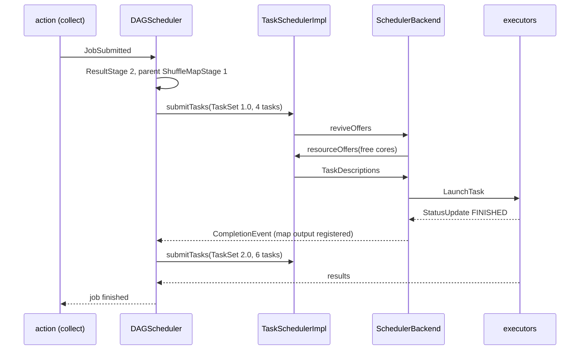
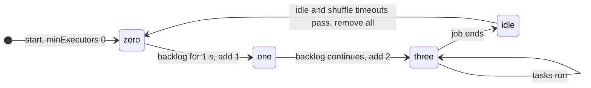

# Chapter 2: Inside a Spark application

[Chapter 5](ch05-how-spark-runs.md) followed one query from a plan to jobs, stages and tasks, and it read the result from the Spark UI. That chapter treats the driver and the executors as boxes. This chapter opens the boxes. It names the classes that do each part of the work in Spark 4.3. It also shows the evidence that each class leaves behind: log lines, REST records, files on disk and events in the event log.

**A Spark application is a small set of services that work together. In the driver, the DAGScheduler cuts a job into stages, and the TaskScheduler places each task on an executor. In each executor, a BlockManager keeps blocks, a memory manager divides the heap, and a shuffle manager writes and fetches files. Each slow job has its cause in one of these services, and each service leaves evidence that you can read.**

The scripts run on `local-cluster[2,2,1024]`. This master URL starts a standalone master and two workers in the driver JVM, and each worker starts one executor JVM. Thus, the driver and two executors are separate processes, and a shuffle moves data between processes, as on a real cluster. The scripts are in [`code/ch02`](https://github.com/lisancao/spark-masterclass/tree/main/code/ch02), and each number comes from `code/ch02/output/`. The source references are to the tag `v4.3.0` of [apache/spark](https://github.com/apache/spark/tree/v4.3.0).

## Step 1: The processes, and who starts them

An application has one driver and some executors. The driver holds the `SparkContext`. The executors run tasks and keep data. A **cluster manager** gives the application its executors. `anatomy.py` asks the REST API for the executors of its application:

```text
master: local-cluster[2,2,1024]   default parallelism: 4

executors (REST: /executors)
       0  127.0.0.1:45235      cores 2  storage memory  434.4 MiB
       1  127.0.0.1:43661      cores 2  storage memory  434.4 MiB
  driver  localhost:38521      cores 0  storage memory  434.4 MiB
```

Each executor has two cores, from `[2,2,1024]`. The driver has zero cores, because it runs no tasks in this mode. Each process has 434.4 MiB of storage memory, which Step 7 explains.

<figure markdown>
  
  
  <figcaption>The driver and two executors, with the classes in each process. The driver sends tasks and gets status. The executors fetch shuffle blocks from each other directly.</figcaption>
</figure>

The master URL selects the cluster manager. `SparkContext.createTaskScheduler` (`SparkContext.scala:3300`) matches the URL against a list of patterns, and each match makes one scheduler backend:

| Master URL | Cluster manager | Scheduler backend | Executors |
|---|---|---|---|
| `local`, `local[N]`, `local[*]` | none | `LocalSchedulerBackend` | threads in the driver JVM |
| `local-cluster[W,C,M]` | standalone, in the driver JVM | `StandaloneSchedulerBackend` | one JVM for each worker |
| `spark://host:7077` | Spark standalone | `StandaloneSchedulerBackend` | JVMs that workers start |
| `yarn` | Hadoop YARN | `YarnClientSchedulerBackend` or `YarnClusterSchedulerBackend` | YARN containers |
| `k8s://https://...` | Kubernetes | `KubernetesClusterSchedulerBackend` | pods |
| `mesos://...` | Apache Mesos, removed in 4.0 | none | none: `spark-submit` refuses the URL |

Spark 3.2 deprecated Mesos, and Spark 4.0 removed it. The [core migration guide](https://spark.apache.org/docs/4.3.0/core-migration-guide.html) records the removal in the section for 3.5 to 4.0. `mesos.sh` gives a Mesos URL to `spark-submit` 4.3.0:

```text
Exception in thread "main" org.apache.spark.SparkException: Master must either be yarn or start with spark, k8s, or local
	at org.apache.spark.deploy.SparkSubmit.error(SparkSubmit.scala:1068)
	at org.apache.spark.deploy.SparkSubmit.prepareSubmitEnvironment(SparkSubmit.scala:263)
```

[Chapter 80](ch80-submitting-applications.md) submits applications to the other cluster managers.

YARN and Kubernetes are not in the list of patterns. They are **external cluster managers**. Spark finds them with the Java `ServiceLoader`, and each one has a `canCreate(masterURL)` method (`YarnClusterManager.scala:28`, `KubernetesClusterManager.scala:38`). The pip package of Spark 4.3 ships both, as `spark-yarn_2.13-4.3.0.jar` and `spark-kubernetes_2.13-4.3.0.jar`. [Chapter 62](ch62-kubernetes-operator.md) runs Spark on Kubernetes.

All the backends except local mode use the same protocol. The driver runs a `CoarseGrainedSchedulerBackend` with a `DriverEndpoint`. Each executor runs a `CoarseGrainedExecutorBackend`, which registers with the driver over Spark's RPC layer. After the registration, the cluster manager has no part in the work. The driver sends `LaunchTask` messages to the executors, and the executors send `StatusUpdate` messages back.

When the `SparkContext` starts, it creates its parts in a fixed order. The order is in the constructor of `SparkContext.scala`:

1. `LiveListenerBus` (line 488), which carries every event to the UI, the event log and your listeners.
2. `AppStatusStore` (line 493), the store that the UI and the REST API read.
3. `SparkEnv` (line 497), which holds the RPC environment, the `BlockManager`, the `MemoryManager`, the `ShuffleManager` and the `MapOutputTracker`.
4. The Spark UI (line 515) and the heartbeat receiver (line 589).
5. The `TaskScheduler` and its backend (line 603), then the `DAGScheduler` (line 606).
6. The event logger (line 661), the context cleaner (line 673) and, if you enable it, the `ExecutorAllocationManager` (line 682).

## Step 2: The DAGScheduler cuts a job into stages

An action calls `SparkContext.runJob`, which posts a `JobSubmitted` event to the `DAGScheduler`. The `DAGScheduler` handles its events on one thread (`DAGSchedulerEventProcessLoop`, `DAGScheduler.scala:4756`). Thus, the decisions about stages occur one at a time.

`scheduler_log.py` runs one aggregation with six shuffle partitions and adaptive query execution (AQE) off, and it keeps the INFO lines of the scheduler. This is the `DAGScheduler` part of the log:

```text
INFO DAGScheduler: Registering RDD 5 (collect at scheduler_log.py:25) as input to shuffle 0
INFO DAGScheduler: Got job 1 (collect at scheduler_log.py:25) with 6 output partitions
INFO DAGScheduler: Final stage: ResultStage 2 (collect at scheduler_log.py:25)
INFO DAGScheduler: Parents of final stage: List(ShuffleMapStage 1)
INFO DAGScheduler: Missing parents: List(ShuffleMapStage 1)
INFO DAGScheduler: Missing parents found for ResultStage 2: List(ShuffleMapStage 1)
INFO DAGScheduler: Missing parents found for ShuffleMapStage 1: List()
INFO DAGScheduler: Submitting ShuffleMapStage 1 (MapPartitionsRDD[5] at collect at scheduler_log.py:25), which has no missing parents
```

The log follows the source. `handleJobSubmitted` (line 2100) makes the final stage, a `ResultStage`. To make it, the `DAGScheduler` walks back through the RDD graph. At each `ShuffleDependency`, it makes a `ShuffleMapStage` (`getOrCreateShuffleMapStage`, line 654). A narrow dependency stays in the same stage.

Then `submitStage` (line 2333) asks for the missing parents of the stage. `getMissingParentStages` (line 1074) is short:

```scala
dep match {
  case shufDep: ShuffleDependency[_, _, _] =>
    val mapStage = getOrCreateShuffleMapStage(shufDep, stage.firstJobId)
    if (!mapStage.isAvailable || !mapStage.shuffleDep.shuffleMergeFinalized) {
      missing += mapStage
    } else {
      mapStage.increaseAttemptIdOnFirstSkip()        // (1)!
    }
  case narrowDep: NarrowDependency[_] =>
    enqueue(narrowDep.rdd)                          // (2)!
}
```

1. A shuffle map stage whose output is already available is not missing. The job skips it. [Chapter 5](ch05-how-spark-runs.md) shows these skipped stages in the UI.
2. A narrow dependency adds the parent RDD to the same walk. Its operators run in the same task as the child.

The walk does not look at RDDs below a fully cached RDD (`getCacheLocs(rdd).contains(Nil)` must be true to go deeper). Thus, a cache can also remove whole stages from a job.



`submitMissingTasks` (line 2661) makes one task for each partition that has no output yet. A `ShuffleMapStage` makes `ShuffleMapTask` objects, and a `ResultStage` makes `ResultTask` objects. It serializes the RDD and the function of the stage one time, and it sends them to the executors as a broadcast. The log line `Created broadcast 2 from broadcast at DAGScheduler.scala:2796` is that broadcast. Then it gives the `TaskSet` to the `TaskScheduler`.

<figure markdown>
  <video autoplay loop muted playsinline width="1280" height="720" poster="../../media/clips/ch02-anim-scheduler.webp">
    <source src="../../media/clips/ch02-anim-scheduler.mp4" type="video/mp4">
  </video>
  <figcaption>One <code>collect()</code> goes through the DAGScheduler and the TaskScheduler to two executors. The executor and locality of each task come from <code>scheduler_log.txt</code>. The times are schematic.</figcaption>
</figure>

!!! note "New in 4.3: pipelined shuffle dependencies"
    The 4.3 `submitStage` has a second path. A stage with a missing parent normally waits in `waitingStages` until the parent ends.

    If the parent stage connects through a `PipelinedShuffleDependency` (SPARK-58185), the `DAGScheduler` can schedule the parent and the child at the same time. The child reads the shuffle output while the parent still writes it.

    Real-time Mode uses this path for stateful queries. [Chapter 42](ch42-real-time-mode.md) measures it.

## Step 3: The TaskScheduler places tasks

`TaskSchedulerImpl.submitTasks` (line 299) wraps each `TaskSet` in a `TaskSetManager`. Then it asks the backend for resources. The backend answers with **offers**: one offer for each executor with free cores. `resourceOffers` (line 573) gives the offers to the `TaskSetManager` objects in the order of the scheduling pool (FIFO by default).

The important decision is **locality**. For each task, the `TaskSetManager` knows the preferred locations: the executors that already hold the data of the task. The levels, from best to worst, are in `TaskLocality.scala`:

| Level | The data of the task is | Example |
|---|---|---|
| `PROCESS_LOCAL` | in the memory of this executor | a cached block on this executor |
| `NODE_LOCAL` | on this machine, but not in this process | an HDFS block on the local disk, shuffle output of another executor on the same host |
| `NO_PREF` | equally fast from any location | a task with no preferred location |
| `RACK_LOCAL` | on another machine in the same rack | an HDFS block on a rack neighbor |
| `ANY` | anywhere else | a remote read over the network |

The `TaskSetManager` starts at the best level that its tasks can use (`computeValidLocalityLevels`, line 1434). If no executor at that level has a free core, it waits. After `spark.locality.wait` (3 s by default), it allows the next level (`getAllowedLocalityLevel`, line 631). This wait trades a short delay for less data movement.

The `TaskSetManager` part of the log shows where each task went:

```text
INFO TaskSchedulerImpl: Adding task set 1.0 with 4 tasks resource profile 0
INFO TaskSetManager: Starting task 0.0 in stage 1.0 (TID 1) (127.0.0.1,executor 1, partition 0, PROCESS_LOCAL, 10274 bytes) 
INFO TaskSetManager: Starting task 1.0 in stage 1.0 (TID 2) (127.0.0.1,executor 0, partition 1, PROCESS_LOCAL, 10274 bytes) 
INFO TaskSetManager: Starting task 2.0 in stage 1.0 (TID 3) (127.0.0.1,executor 1, partition 2, PROCESS_LOCAL, 10274 bytes) 
INFO TaskSetManager: Starting task 3.0 in stage 1.0 (TID 4) (127.0.0.1,executor 0, partition 3, PROCESS_LOCAL, 10274 bytes) 
...
INFO TaskSetManager: Starting task 0.0 in stage 2.0 (TID 5) (127.0.0.1,executor 0, partition 0, NODE_LOCAL, 9635 bytes) 
INFO TaskSetManager: Starting task 1.0 in stage 2.0 (TID 6) (127.0.0.1,executor 1, partition 1, NODE_LOCAL, 9635 bytes) 
```

Two of these levels need an explanation:

- **The scan tasks show `PROCESS_LOCAL`, but no data was in memory.** A file split on a local disk has no useful host preference here, so these tasks go into the `noPrefs` list. The source returns a task from that list with the level `PROCESS_LOCAL`, not `NO_PREF` (`TaskSetManager.scala:422`). Thus, `PROCESS_LOCAL` in the UI does not always mean a cache hit.
- **The reduce tasks show `NODE_LOCAL`.** With `spark.shuffle.reduceLocality.enabled` (true by default), a reduce task prefers the hosts that hold most of its map output. Both executors are on `127.0.0.1`, so each reduce task is node-local.

The `10274 bytes` at the end of each line is the size of the serialized task. The task carries only its partition and a reference to the broadcast. It does not carry the RDD graph.

## Step 4: The BlockManager keeps the blocks

Each executor and the driver have a `BlockManager` (`BlockManager.scala:183`). It stores **blocks** in memory or on the local disk, and it serves them to other executors. A `BlockManagerMaster` on the driver keeps the location of each block. Each block has a name, and the name gives its type (`BlockId.scala`):

| Block ID | What it holds |
|---|---|
| `rdd_<rdd>_<partition>` | one cached partition |
| `shuffle_<shuffle>_<map>_<reduce>` | one reduce partition of one map output |
| `broadcast_<id>` and `broadcast_<id>_piece<n>` | a broadcast variable, in pieces |
| `taskresult_<task>` | a large task result that the driver fetches separately |
| `temp_shuffle_<uuid>`, `temp_local_<uuid>` | temporary files for spills |

`anatomy.py` caches two columns of the trips, then reads them again. The Storage endpoint lists each block and the executor that holds it:

```text
cache the two columns, then scan them again (BlockManager, PROCESS_LOCAL)
  cached: +- FileScan parquet [PULocationID#...  4 partitions, 37,125,896 B in memory
    block rdd_13_0   10,024,768 B  on executor(s) ['1']
    block rdd_13_1   10,031,392 B  on executor(s) ['0']
    block rdd_13_2   10,163,072 B  on executor(s) ['1']
    block rdd_13_3    6,906,664 B  on executor(s) ['0']
    read cache: task 0  executor 1  PROCESS_LOCAL
    read cache: task 1  executor 0  PROCESS_LOCAL
    read cache: task 2  executor 1  PROCESS_LOCAL
    read cache: task 3  executor 0  PROCESS_LOCAL
```

This time `PROCESS_LOCAL` is a real cache hit. The DAGScheduler asked the `BlockManagerMaster` for the locations of `rdd_13_*` (`getPreferredLocs`, `DAGScheduler.scala:4677`). Then the TaskScheduler sent each task to the executor that holds its block. Task 0 went to executor 1, where `rdd_13_0` is.

In the executor, a task reads a cached partition through `getOrElseUpdateRDDBlock` (`BlockManager.scala:1585`). If the block is in the local store, the task reads it. If the block is on another executor, the task fetches it. If the block is in no location, the task computes the partition from its lineage and stores it. That last case is how Spark recovers a lost cached partition, as [Chapter 1](ch01-mapreduce-to-spark.md) describes.

## Step 5: The shuffle, from write to fetch

A shuffle is the only place where one task reads the output of many other tasks. It has three parts:

- The map tasks write files.
- A tracker on the driver records the location of the files.
- The reduce tasks fetch their parts.

### The write

`SortShuffleManager` is the only shuffle manager that Spark includes. It picks one of three writers for each shuffle (`registerShuffle`, `SortShuffleManager.scala:91`):

| Writer | When the source picks it | How it writes |
|---|---|---|
| `BypassMergeSortShuffleWriter` | no map-side combine, and at most `spark.shuffle.sort.bypassMergeThreshold` (200) partitions | one temporary file for each reduce partition, then joins them into one file |
| `UnsafeShuffleWriter` | the serializer can move serialized records, no map-side combine, and at most 16,777,216 partitions | sorts serialized records by partition ID in managed memory |
| `SortShuffleWriter` | all other cases | sorts deserialized records, with an aggregation if the shuffle needs one |

A DataFrame aggregation does its partial aggregate in an operator before the `Exchange`, so its shuffle has no map-side combine. With six partitions, the rules select the bypass writer for this job. With the default 200 partitions, the rules also select it. With 201 partitions or more, they select `UnsafeShuffleWriter`, because `UnsafeRowSerializer` can move serialized records.

Each writer produces the same result on disk. `anatomy.py` lists the shuffle files under the local directory of each executor:

```text
shuffle files on disk (each map task writes one .data file and one .index file)
  executor-9b69.../blockmgr-689b.../15/shuffle_0_1_0.checksum.ADLER32     48 B
  executor-9b69.../blockmgr-689b.../15/shuffle_0_1_0.data           4,720 B
  executor-9b69.../blockmgr-689b.../0f/shuffle_0_1_0.index             56 B
  executor-67a2.../blockmgr-c5fe.../36/shuffle_0_2_0.checksum.ADLER32     48 B
  executor-67a2.../blockmgr-c5fe.../36/shuffle_0_2_0.data           4,876 B
  executor-67a2.../blockmgr-c5fe.../32/shuffle_0_2_0.index             56 B
  executor-9b69.../blockmgr-689b.../17/shuffle_0_3_0.checksum.ADLER32     48 B
  executor-9b69.../blockmgr-689b.../29/shuffle_0_3_0.data           4,992 B
  executor-9b69.../blockmgr-689b.../0d/shuffle_0_3_0.index             56 B
  executor-67a2.../blockmgr-c5fe.../38/shuffle_0_4_0.checksum.ADLER32     48 B
  executor-67a2.../blockmgr-c5fe.../38/shuffle_0_4_0.data           5,008 B
  executor-67a2.../blockmgr-c5fe.../0c/shuffle_0_4_0.index             56 B
```

Read the names and the folders:

- **`shuffle_0_1_0`** is shuffle 0, map ID 1, reduce ID 0. The reduce ID in a file name is always 0, because one file holds all the reduce partitions.
- **The map IDs are 1 to 4, not 0 to 3.** The map ID is the task attempt ID (`ShuffleMapTask.scala:101`), unless you set `spark.shuffle.useOldFetchProtocol`. The scan tasks were TIDs 1 to 4 in the log. Thus, a retried task writes new files with a new name, and it cannot overwrite the files of an earlier attempt.
- **Each executor has its own `blockmgr-*` folder.** Executor 1 holds maps 1 and 3, because it ran tasks 0 and 2. The two-character subfolders (`15`, `0f`) spread files over 64 folders by a hash of the name, so that no folder gets too many files.
- **The `.checksum.ADLER32` file** holds one checksum for each reduce partition. Spark uses it to find the cause of a corrupted block.

The `.index` file is a list of offsets. `anatomy.py` reads it as big-endian longs:

```text
reduce partition sizes in each map output, from the .index files:
  shuffle_0_1_0.index    [722, 902, 724, 845, 679, 848]  total 4,720 B
  shuffle_0_2_0.index    [751, 939, 777, 888, 652, 869]  total 4,876 B
  shuffle_0_3_0.index    [787, 972, 811, 888, 650, 884]  total 4,992 B
  shuffle_0_4_0.index    [823, 913, 795, 886, 700, 891]  total 5,008 B

shuffle_0_1_0.index: 7 big-endian longs = offsets of 6 reduce partitions
  offsets: [0, 722, 1624, 2348, 3193, 3872, 4720]
  bytes per reduce partition: [722, 902, 724, 845, 679, 848]

first 32 bytes of shuffle_0_1_0.index as hex:
  0000000000000000 00000000000002d2 0000000000000658 000000000000092c
```

An index file for R reduce partitions has R + 1 longs. Reduce partition `i` is the byte range from offset `i` to offset `i + 1` of the `.data` file. The hex shows the first offsets: `0x2d2` is 722 and `0x658` is 1624. To serve a block, `IndexShuffleBlockResolver.getBlockData` (line 615) reads two longs from the index, and it returns that range of the data file. No other lookup is necessary.

<figure markdown>
  
  
  <figcaption>The four map outputs of the shuffle, with the size of each reduce partition from the index files. Each reduce task reads one segment, of one color, from each of the four files.</figcaption>
</figure>

### The fetch

When a map task ends, the executor reports a `MapStatus` to the driver. It holds the location of the output and an estimate of the size of each reduce partition. The `MapOutputTracker` on the driver keeps these records. A reduce task asks the tracker for the locations of its partition. Then a `ShuffleBlockFetcherIterator` (`ShuffleBlockFetcherIterator.scala:86`) reads local blocks from the local disk, and it fetches remote blocks over the network. It keeps at most `spark.reducer.maxSizeInFlight` (48 MiB) of remote requests open at one time.

The task metrics show the split between local and remote bytes:

```text
  stage 2
    task  0  executor 1  NODE_LOCAL     118 ms  fetched local 1,509 B remote 1,574 B
    task  1  executor 0  NODE_LOCAL      79 ms  fetched local 1,852 B remote 1,874 B
    task  2  executor 1  NODE_LOCAL     117 ms  fetched local 1,535 B remote 1,572 B
    task  3  executor 0  NODE_LOCAL      79 ms  fetched local 1,774 B remote 1,733 B
    task  4  executor 0  NODE_LOCAL      20 ms  fetched local 1,352 B remote 1,329 B
    task  5  executor 0  NODE_LOCAL      19 ms  fetched local 1,760 B remote 1,732 B
```

The numbers agree with the index files. Reduce task 0 ran on executor 1, which holds maps 1 and 3. Its local bytes are 722 + 787 = 1,509, from those two files. Its remote bytes are 751 + 823 = 1,574, from maps 2 and 4 on executor 0. In this test, the "remote" fetch goes through the network stack of one machine. On a cluster, it goes over the network, and the remote part of a shuffle is often the largest cost of a stage.

<figure markdown>
  <video autoplay loop muted playsinline width="1280" height="720" poster="../../media/clips/ch02-anim-shuffle.webp">
    <source src="../../media/clips/ch02-anim-shuffle.mp4" type="video/mp4">
  </video>
  <figcaption>The shuffle of this job. The map tasks write their files, and each reduce task fetches its segment from every file. The bytes come from <code>anatomy.txt</code>. The times are schematic.</figcaption>
</figure>

The executor that wrote a shuffle file also serves it. If that executor stops, its files go with it, and the DAGScheduler must run the map tasks again. Spark has two ways to keep shuffle files available after an executor stops:

- **The external shuffle service** (`spark.shuffle.service.enabled`, false by default) is a separate process on each node that serves the files. YARN runs it as an auxiliary service.
- **Push-based shuffle** (`spark.shuffle.push.enabled`, false by default, from Spark 3.2) pushes and merges map output on remote shuffle services. It needs the external shuffle service.

[Chapter 63](ch63-orchestration.md) shows a third way, a remote shuffle service with Apache Celeborn.

## Step 6: The event log is the record of all of this

Each step above also goes into the event log. The `LiveListenerBus` sends every scheduler event to the `EventLoggingListener`, which writes one JSON object for each event. `anatomy.py` decodes the log of its own run:

```text
event log folder eventlog_v2_app-20261122104350-0000/
  .appstatus_app-20261122104350-0000.crc  (8 B)
  appstatus_app-20261122104350-0000  (0 B)
  events_1_app-20261122104350-0000.zstd  (70,698 B)

events_1_app-20261122104350-0000.zstd after zstd: 95 events
    26  SparkListenerTaskStart
    26  SparkListenerTaskEnd
     7  SparkListenerStageSubmitted
     7  SparkListenerStageCompleted
     5  SparkListenerDriverAccumUpdates
     4  SparkListenerJobStart
     4  SparkListenerJobEnd
     3  SparkListenerBlockManagerAdded
     3  SparkListenerSQLExecutionStart
     3  SparkListenerSQLExecutionEnd
     2  SparkListenerExecutorAdded
     1  SparkListenerLogStart
     1  SparkListenerResourceProfileAdded
     1  SparkListenerEnvironmentUpdate
     1  SparkListenerApplicationStart
     1  SparkListenerApplicationEnd
```

The log is a folder, not a single file, and Spark compresses it with zstd. These are the 4.3 defaults: `spark.eventLog.rolling.enabled` is true, `spark.eventLog.compress` is true, and `spark.eventLog.compression.codec` is `zstd` (`config/package.scala`). There are three `BlockManagerAdded` events, one for the driver and one for each executor. One `TaskEnd` event, trimmed, has the same fetch numbers as the REST API:

```text
{
 "Event": "SparkListenerTaskEnd",
 "Stage ID": 2,
 "Task Info": {
  "Task ID": 8,
  "Index": 3,
  "Executor ID": "0",
  "Host": "127.0.0.1",
  "Locality": "NODE_LOCAL"
 },
 "Shuffle Read Metrics": {
  "Remote Blocks Fetched": 2,
  "Local Blocks Fetched": 2,
  "Remote Bytes Read": 1733,
  "Local Bytes Read": 1774,
  "Total Records Read": 182
 }
}
```

Each reduce task fetched two local blocks and two remote blocks: one block from each of the four map outputs. The History Server rebuilds the whole UI from these events after the application stops. [Chapter 61](ch61-observability.md) reads event logs in depth.

<figure markdown>
  <video autoplay loop muted playsinline controls width="1280" height="720" poster="../../media/clips/ch02-tasks.webp">
    <source src="../../media/clips/ch02-tasks.mp4" type="video/mp4">
  </video>
  <figcaption><code>anatomy.py</code> runs on <code>local-cluster[2,2,1024]</code>. It lists the executors, the two stages and the task of each partition, then the sizes of the shuffle partitions from the index files. The film is a different run from the text, so the task times are different.</figcaption>
</figure>

## Step 7: The unified memory model

Each executor divides its heap with a `UnifiedMemoryManager`. [Chapter 33](ch33-partitions-caching-memory.md) measures the pool sizes for several heap sizes and shows spill. This step reads the rule that moves memory between the two halves of the pool, and it shows the rule at work.

The pool size comes from `getMaxMemory` (`UnifiedMemoryManager.scala:466`). The source subtracts `RESERVED_SYSTEM_MEMORY_BYTES = 300 * 1024 * 1024` (line 264) from the heap, and it multiplies the rest by `spark.memory.fraction` (0.6). For a 1 GiB heap, the result is the 434.4 MiB that the executors endpoint showed in Step 1.

Two users share the pool:

- **Storage** holds cached blocks and broadcasts.
- **Execution** holds the memory that operators use while a task runs: hash tables, sort buffers, shuffle buffers.

The boundary between them moves. If execution needs memory, `maybeGrowExecutionPool` (line 160) takes it from storage:

```scala
val memoryReclaimableFromStorage = math.max(
  storagePool.memoryFree,
  storagePool.poolSize - storageRegionSize)        // (1)!
if (memoryReclaimableFromStorage > 0) {
  val spaceToReclaim = storagePool.freeSpaceToShrinkPool(   // (2)!
    math.min(extraMemoryNeeded, memoryReclaimableFromStorage))
  storagePool.decrementPoolSize(spaceToReclaim)
  executionPool.incrementPoolSize(spaceToReclaim)
}
```

1. `storageRegionSize` is the pool multiplied by `spark.memory.storageFraction` (0.5). Execution can take free storage memory, and it can take used storage memory down to this size, but not below it.
2. `freeSpaceToShrinkPool` evicts cached blocks to make the free space.

Storage cannot take memory back from execution in the same way. A cached block that does not fit stays out of memory, or goes to disk if its storage level allows it.

`memory.py` shows the rule. It runs in local mode with a 1 GiB driver heap. It caches about 325 MiB with `MEMORY_ONLY`, which is more than half of the pool. Then it runs a large sort, which needs execution memory:

```text
unified pool (maxMemory): 434.4 MiB, storageFraction 0.5 protects 217.2 MiB
after the cache:  32/32 partitions cached, 325.6 MiB in memory   storage in use 325.8 MiB
after the sort:   21/32 partitions cached, 213.6 MiB in memory   storage in use 213.9 MiB
spill during the sort: 560.0 MiB (in memory size)
```

<figure markdown>
  
  
  <figcaption>The cache used 325.6 MiB of the 434.4 MiB pool. The sort evicted 11 of the 32 cached partitions, and storage stopped under the protected 217.2 MiB.</figcaption>
</figure>

The sort evicted 11 partitions. Storage went from 325.6 MiB to 213.6 MiB, which is just under the protected 217.2 MiB. The sort still spilled 560 MiB, because 434.4 MiB is not much memory for a sort of all June trips with four tasks. The 11 evicted partitions are not lost. The next action that needs them recomputes them from the Parquet file through their lineage.

This result is important in practice. A large cache does not protect itself. If a later job needs execution memory, the cache shrinks to `storageFraction` of the pool. Then the next use of the cache pays for the recomputation.

## Step 8: Dynamic allocation

With a fixed number of executors, an application keeps its executors when it has no work. **Dynamic allocation** changes the number of executors with the load. The `ExecutorAllocationManager` makes the decisions, and the `ExecutorMonitor` keeps the state of each executor.

`dynamic.py` starts on `local-cluster[3,2,1024]` with zero executors. It runs one job of 48 tasks, each of which sleeps for half a second, and then it waits. Then it reads the executor events from the event log:

```text
t=0: application started, executors: 0
t=14s: job done, [(0, 12), (1, 12), (2, 12), (3, 12)]
t=39s: after idling, executors: 0

executor and job events from the event log (seconds after application start):
     2.6  JobStart         job 0
     6.8  ExecutorAdded    executor 0
     8.6  ExecutorAdded    executor 2
     8.8  ExecutorAdded    executor 1
    16.1  JobEnd           job 0
    31.1  ExecutorRemoved  executor 2  reason: Executor killed by driver.
    31.1  ExecutorRemoved  executor 1  reason: Executor killed by driver.
    31.2  ExecutorRemoved  executor 0  reason: Executor killed by driver.
```



The events follow the rules in the source:

- **Ramp-up.** When tasks wait for longer than `spark.dynamicAllocation.schedulerBacklogTimeout` (1 s here and by default), the manager asks for executors. Each round asks for two times as many as the last round (`ExecutorAllocationManager.scala:457`). Thus, it added one executor, then two more, up to `maxExecutors` (3).
- **Release.** An executor with no task is idle. Its deadline is the largest of three timeouts (`ExecutorMonitor.scala:567`):
    - the idle timeout
    - the timeout for cached blocks, if it holds cached blocks
    - the shuffle tracking timeout, if it holds shuffle files

     Here the executors held shuffle files, so the 10 s shuffle timeout applied. The driver removed them about 15 s after the job ended. This run did not find the cause of the 5 s difference.
- **Shuffle tracking is on by default.** `spark.dynamicAllocation.shuffleTracking.enabled` is true in 4.3 (`config/package.scala:804`). It lets dynamic allocation work without an external shuffle service, because Spark keeps an executor while its shuffle files can still be necessary.

<figure markdown>
  <video autoplay loop muted playsinline controls width="1280" height="720" poster="../../media/clips/ch02-dynamic.webp">
    <source src="../../media/clips/ch02-dynamic.mp4" type="video/mp4">
  </video>
  <figcaption><code>dynamic.py</code> starts with zero executors. The backlog adds three executors, and after the job the driver removes them. The film is a different run from the text, so the times are different.</figcaption>
</figure>

The `t=14s` in the first lines comes from the clock of the Python script, and the `16.1` comes from the event log. The two clocks start at different moments, so they do not agree exactly.

## How the parts fit together

| Service | Process | What it decides | Where to see it |
|---|---|---|---|
| `DAGScheduler` | driver | the stages of a job, and which stages are missing | INFO log, `/jobs`, `StageSubmitted` events |
| `TaskSchedulerImpl` and `TaskSetManager` | driver | which executor runs each task, at which locality | INFO log, `taskLocality` in `/stages/{id}/{attempt}/taskList` |
| `BlockManager` and `BlockManagerMaster` | each JVM, master on the driver | where each block is | `/storage/rdd`, `BlockManagerAdded` events |
| `SortShuffleManager` and `MapOutputTracker` | executors, tracker on the driver | how map output is written and found | `blockmgr-*/` files, shuffle read metrics |
| `UnifiedMemoryManager` | each JVM | how execution and storage share the pool | `/executors`, spill metrics |
| `ExecutorAllocationManager` | driver | how many executors to keep | `ExecutorAdded` and `ExecutorRemoved` events |

## The whole chapter, on one page

- **The master URL selects the cluster manager.** After the executors register, the driver talks to them directly. The cluster manager has no part in the work.
- **The DAGScheduler cuts a job at each shuffle dependency.** It submits a stage only when its parents have output. Available map output and cached RDDs remove stages from a job.
- **The TaskScheduler places each task by locality.** It waits up to `spark.locality.wait` for a better slot. A task with no preference shows as `PROCESS_LOCAL`.
- **Each JVM has a BlockManager.** Cached partitions are `rdd_*` blocks on one executor, and tasks go to the executor that holds them.
- **A shuffle is two files for each map task.** The `.data` file holds all the reduce partitions, and the `.index` file holds R + 1 offsets. Each reduce task reads one range from every map output, from local disk or over the network.
- **Execution can evict storage, down to half of the pool.** A large cache shrinks when a sort or a join needs memory.
- **Dynamic allocation adds executors in larger and larger rounds, and it removes them after timeouts.** Shuffle tracking is on by default in 4.3.

To see all of it on your machine:

```bash
cd code
export BOOK_DATA=$HOME/spark-masterclass/data
uv run python ch02/anatomy.py
uv run python ch02/scheduler_log.py 2>&1 | grep -E 'DAGScheduler|TaskSchedulerImpl|TaskSetManager'
uv run python ch02/memory.py
uv run python ch02/dynamic.py
```

## Further reading

- [Cluster mode overview](https://spark.apache.org/docs/4.3.0/cluster-overview.html) and [job scheduling](https://spark.apache.org/docs/4.3.0/job-scheduling.html), which also describes dynamic allocation.
- [Tuning: memory management overview](https://spark.apache.org/docs/4.3.0/tuning.html#memory-management-overview), the official description of the unified pool.
- [`DAGScheduler.scala`](https://github.com/apache/spark/blob/v4.3.0/core/src/main/scala/org/apache/spark/scheduler/DAGScheduler.scala), [`TaskSetManager.scala`](https://github.com/apache/spark/blob/v4.3.0/core/src/main/scala/org/apache/spark/scheduler/TaskSetManager.scala) and [`SortShuffleManager.scala`](https://github.com/apache/spark/blob/v4.3.0/core/src/main/scala/org/apache/spark/shuffle/sort/SortShuffleManager.scala) at `v4.3.0`.
