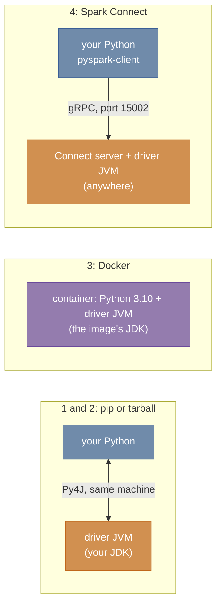

# Chapter 2: Installing Spark 4.3

Installing Spark used to be a small rite of passage (a tarball, a JDK that had to match, `SPARK_HOME`, `JAVA_HOME`, a Hadoop native-library warning everyone learned to ignore), and most of that is gone now; `pip install pyspark` has worked for years and the official Docker images are pretty good. What replaced the pain is choice. There are four reasonable ways to install Spark 4.3, they put different things on your machine, and they aren't interchangeable, so this chapter is mostly about picking.

**The four installs differ in one thing that decides everything else, which is where the driver lives and what it runs on: pip and the tarball put a driver JVM next to your Python, Docker puts both inside a container, and Spark Connect moves the driver into a server your code talks to over gRPC, so the right install follows from where your code runs rather than from which one is easiest to type.**

I ran every install here on Linux with OpenJDK 17 and Python 3.12, against Spark 4.3.0 (released at the end of October 2026), and each one ran the same five-line program against the book's taxi data. The book's own code uses the first option, so if you just want to follow along, do that one and skip ahead to [the data](#getting-the-data).

## The four options side by side



| | pip (`pyspark`) | Tarball | Docker (`apache/spark`) | Spark Connect (`pyspark-client`) |
|---|---|---|---|---|
| What you install | a Python package with Spark's jars inside | the full distribution | an image | an 11 MB client package |
| On disk | 484 MB (`pyspark/`, 280 jars) | 599 MB unpacked | 1.33 GB image | 11 MB (`pyspark/`) plus pandas, pyarrow, grpcio |
| Needs a local JDK | yes (17, 21 or 25) | yes | no (the image has Java 21) | no |
| Python | 3.11 or newer | 3.11 or newer for PySpark | 3.10.12 inside the image | 3.11 or newer |
| Your code reaches | everything, including the JVM through Py4J | everything, plus `spark-submit`, the shells and the scripts in `sbin/` | everything, inside the container | the DataFrame and SQL APIs over gRPC; no JVM objects |
| Good for | learning, notebooks, tests, single-machine work | clusters you run yourself, Scala and Java work | reproducible environments, CI, running the server for option 4 | applications, IDEs and notebooks that shouldn't host a driver |

## Option 1: pip (or uv)

```bash
python -m venv .venv && source .venv/bin/activate
pip install "pyspark[connect]==4.3.0"     # [connect] adds pandas, pyarrow and grpcio
```

The book's [`code/`](https://github.com/lisancao/spark-masterclass/tree/main/code) folder is a uv project pinned to exactly this, so from a clone the whole install is `cd code && uv sync`. PySpark 4.3.0 requires Python 3.11 or newer (uv refused to resolve the project until I raised `requires-python` from 3.10), and a JDK on your `PATH` or in `JAVA_HOME`; Spark 4.x supports Java 17, 21 and 25 and no longer runs on 8 or 11.

What you get is the entire Spark distribution's jars inside a Python package, and a `SparkSession` that starts a driver JVM as a child process of your Python and talks to it through Py4J. That's why the first `getOrCreate()` takes a few seconds, and why this install can do everything: your Python can reach JVM objects (`spark.sparkContext`, `df._jdf`) directly. `code/ch02/check_env.py` prints what you have:

```text
python  3.12.3
pyspark 4.3.0
java    openjdk version "17.0.21.1" 2026-11-17

Spark 4.3.0 on local[*], 16 cores, UI at http://192.168.50.13:4040

3,837,248 trips, 21 columns
```

## Option 2: the tarball

```bash
curl -fLO https://dlcdn.apache.org/spark/spark-4.3.0/spark-4.3.0-bin-hadoop3.tgz
curl -fLO https://downloads.apache.org/spark/spark-4.3.0/spark-4.3.0-bin-hadoop3.tgz.sha512
sha512sum -c spark-4.3.0-bin-hadoop3.tgz.sha512      # spark-4.3.0-bin-hadoop3.tgz: OK
tar xzf spark-4.3.0-bin-hadoop3.tgz
./spark-4.3.0-bin-hadoop3/bin/spark-submit --version  # version 4.3.0, Scala 2.13.18
```

Download from the mirror and the checksum from `downloads.apache.org`, never both from the same mirror, since a checksum served next to a tampered file proves nothing. The tarball has the same 280 jars as the pip package plus everything a cluster operator wants: `bin/spark-submit`, `spark-shell` and `spark-sql`, the `sbin/` scripts for standalone masters, workers, the history server and the Connect server, `conf/` templates and the examples. It's the install for running Spark yourself on machines you control, and for Scala or Java work. PySpark code runs through it with `spark-submit`, which sets up the Python path for you:

```bash
./spark-4.3.0-bin-hadoop3/bin/spark-submit --master "local[*]" code/ch02/hello.py data/nyc-taxi/yellow
# python 3.12.3, spark 4.3.0, 3,837,248 trips
```

## Option 3: the official Docker image

```bash
docker run --rm -v "$PWD/data:/data:ro" -v "$PWD/code/ch02:/work:ro" \
  apache/spark:4.3.0-python3 /opt/spark/bin/spark-submit /work/hello.py
# python 3.10.12, spark 4.3.0, 3,837,248 trips
```

The 4.3.0 images come in Java 17, 21 and 25 variants, with or without Python and R; `4.3.0-python3` is the same image as `4.3.0-scala2.13-java21-python3-ubuntu` (identical image IDs), so Java 21. Two things about it that I'd want to know before relying on it:

- **`python3 -c "import pyspark"` fails inside the container** with `ModuleNotFoundError`, because the image ships PySpark inside `/opt/spark/python` rather than installing it into the system Python. Use `spark-submit` or `/opt/spark/bin/pyspark`, which set `PYTHONPATH`, or set it yourself.
- **The image's Python is 3.10.12**, while PySpark 4.3.0 on PyPI requires 3.11. The bundled PySpark runs fine on it (the line above is proof), but if you mix the image with pip-installed PySpark elsewhere (executors in the image, a driver on your laptop), the driver and the workers will run different Python versions, and Spark refuses to run Python UDFs across a minor-version mismatch.

The image is also the easiest way to run the server for option 4. `start-connect-server.sh` normally daemonizes and returns, which would end the container, so tell it to stay in the foreground:

```bash
docker run --rm -e SPARK_NO_DAEMONIZE=1 -p 15002:15002 \
  apache/spark:4.3.0-python3 /opt/spark/sbin/start-connect-server.sh
```

That server answered a thin client within a few seconds of starting. [Chapter 4](ch04-spark-connect.md) runs the same server from the pip install instead (`code/ch04/server.sh`), which keeps the data paths identical on both sides.

## Option 4: Spark Connect with the thin client

```bash
pip install pyspark-client==4.3.0      # 11 MB of PySpark; no jars, no JVM
```

```python
from pyspark.sql import SparkSession
spark = SparkSession.builder.remote("sc://localhost:15002").getOrCreate()
```

```text
thin client: python 3.12.3, server spark 4.3.0, 3,837,248 trips
```

`pyspark-client` is PySpark with the JVM removed: the DataFrame, SQL, streaming and ML APIs, implemented as a client that serializes each query to a protobuf plan and sends it to a Connect server. It doesn't need Java, it starts instantly, and a crash in your code can't take the driver down with it. The cost is that nothing JVM-shaped exists on your side (`spark.sparkContext`, RDDs and `df._jdf` are gone), and that the server, not you, decides which Spark version and which jars your queries run with. [Chapter 4](ch04-spark-connect.md) goes through what that changes; most code written against DataFrames doesn't notice.

!!! warning "The thin client and `python -c`"
    Run the snippet above as a file and it works. Paste it into `python -c "..."` with `pyspark-client` 4.3.0 and Python exits with status 255 after printing *"Could not find valid SPARK_HOME"*. The client checks whether it's being imported by a doctest runner by looking for a `__main__` module with no `__spec__`, no `__file__` and no interactive prompt, which is exactly what `python -c` looks like; it then imports a test helper that searches for a Spark installation the thin client doesn't have, and exits. Scripts, `python - < file.py`, notebooks and the REPL are all fine.

## How to pick

The question that decides it is where your code runs, and whether it needs to share a process with the driver:

- **Learning, notebooks on your laptop, unit tests:** pip. One command, everything works, and the driver living next to your Python is what you want.
- **Running Spark on machines you manage:** the tarball, or the Docker image if those machines run containers.
- **Code that runs somewhere a JVM shouldn't** (an application server, an IDE plugin, an agent, a laptop pointed at a shared cluster): the thin client against a Connect server.
- **CI:** the Docker image, pinned by tag, so the Spark and Java versions are part of the build rather than of the runner.

## Getting the data

Every chapter in the first half of the book uses the NYC Taxi and Limousine Commission's yellow-cab trip records, which the TLC publishes as one Parquet file per month, plus a 265-row CSV mapping location IDs to zones and boroughs. The book pins June 2026 so that every number reproduces:

```bash
code/common/get_data.sh        # downloads into data/nyc-taxi/ and prints SHA-256 sums
```

```text
1a99e105092230f8620f301edcca7f80d3080642ff404d28ed957d3fa222c8ed  ./taxi_zone_lookup.csv
f340c62a18885c56176433c9db28e97d0a8a14e6e49869276ad8afb20ebf088b  ./yellow/yellow_tripdata_2026-06.parquet
```

If your sums differ, the TLC has republished the month (they occasionally do, with corrections), and your counts will be slightly off from the book's.

## A first look at the data

`check_env.py` ends by printing the schema and a summary, and the summary is the first lesson in not trusting data you didn't produce:

```text
+-------+------------------+-----------------+------------------+
|summary|     trip_distance|      fare_amount|   passenger_count|
+-------+------------------+-----------------+------------------+
|  count|           3837248|          3837248|           2823748|
|   mean|5.2017636519705865|21.43972443271672|1.2570296641201693|
| stddev| 532.8536966799546|19.17533535065736|0.6561344679942783|
|    min|               0.0|          -1683.7|                 0|
|    max|         311565.39|           7045.0|                 9|
+-------+------------------+-----------------+------------------+
```

A trip of 311,565 miles, a fare of minus $1,683.70, a quarter of the rows with no passenger count at all, and (from the [next chapter](ch03-quick-start.md)) pickups dated December 2008 in a June 2026 file. None of these are Spark's fault, and all of them change the answer to almost any question you ask, which is where Chapter 3 picks up.

## The whole chapter, on one page

- **Every install is a decision about where the driver lives.** pip and the tarball put it next to your code, Docker puts it in a container, Connect puts it behind gRPC.
- **pip is the default for learning and testing:** `pip install "pyspark[connect]==4.3.0"`, Python 3.11+, Java 17, 21 or 25.
- **The tarball is for running Spark yourself**; verify it against the checksum from `downloads.apache.org`.
- **The Docker image runs Python 3.10** and doesn't put PySpark on the system path; use `spark-submit`.
- **The thin client is 11 MB and needs no Java**, at the cost of every JVM-level API; don't test it with `python -c`.
- **The book's data is one pinned month of NYC taxi trips**, and it's messy on purpose.

## Further reading

- [Spark 4.3.0 downloads](https://spark.apache.org/downloads.html), with checksums and signatures.
- [Installation in the PySpark docs](https://spark.apache.org/docs/4.3.0/api/python/getting_started/install.html), including the optional extras.
- [Official Docker images](https://hub.docker.com/r/apache/spark/tags), every 4.3.0 variant.
