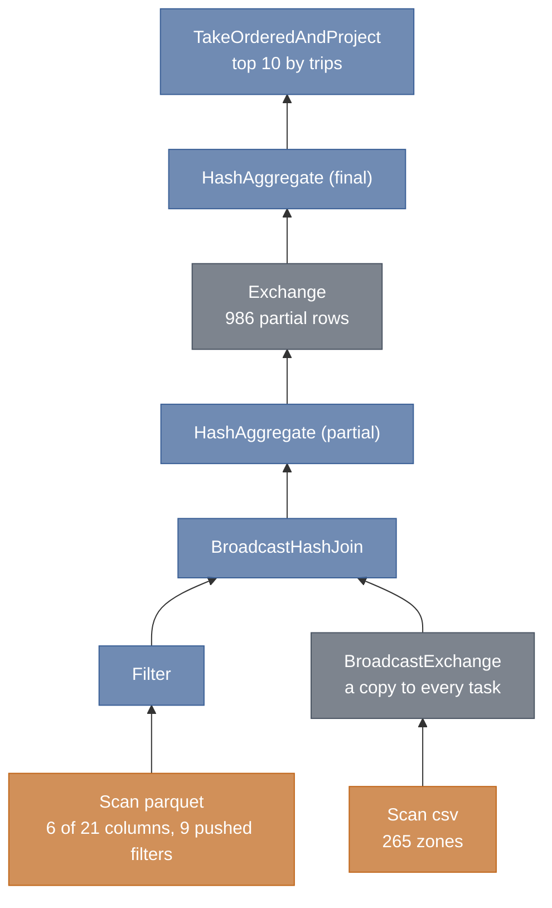

# Chapter 3: Quick start

Most quick starts count words in a text file. This teaches you the API, but it teaches you nothing about data. This quick start asks a real question. In which parts of New York do the most taxi trips start, and how much do those riders tip? It answers the question two times, once with the DataFrame API and once in SQL. The data is a month of real trip records, with all the problems of real data.

**DataFrames and SQL in Spark are two methods to write the same logical plan. Thus, choose the one that is easier to read for the person who maintains the code. The work that decides if the answer is correct is to clean the data before the aggregation. A month of real trips contains enough impossible rows to change each average that you calculate from it.**

The code is [`code/ch03/quickstart.py`](https://github.com/lisancao/spark-masterclass/tree/main/code/ch03). It runs on the pip install from [Chapter 2](ch02-installing.md) in about ten seconds. Each table below is its saved output.

## Step 1: Load the trips and the zones

```python
trips = spark.read.parquet(str(TRIPS))
zones = spark.read.option("header", True).option("inferSchema", True).csv(str(ZONES))
```

The two reads do very different quantities of work. Parquet keeps its schema in the file footer. Thus, `spark.read.parquet` knows that `tpep_pickup_datetime` is a `timestamp_ntz` and `fare_amount` is a `double`, before it reads any data. CSV keeps only text. Thus, `header=true` makes Spark run a small job that reads the first line to get the column names.

`inferSchema=true` makes Spark scan the full file a second time to infer the type of each column. On a 265-row lookup table, this costs nothing. On a large CSV file, it is a full extra pass. That is why production code gives an explicit schema.

Each trip has a pickup zone (`PULocationID`) and a drop-off zone (`DOLocationID`). These zones are integers, and the zone lookup maps them to names:

| LocationID | Borough | Zone | service_zone |
|---|---|---|---|
| 1 | EWR | Newark Airport | EWR |
| 2 | Queens | Jamaica Bay | Boro Zone |
| 3 | Bronx | Allerton/Pelham Gardens | Boro Zone |

## Step 2: Look before you aggregate

Before you ask a question of the data, find what the data contains:

```python
trips.select(F.min("tpep_pickup_datetime").alias("first_pickup"),
             F.max("tpep_pickup_datetime").alias("last_pickup"),
             F.min("fare_amount").alias("lowest_fare"),
             F.max("trip_distance").alias("longest_trip_miles")).show(truncate=False)
```

```text
+-------------------+-------------------+-----------+------------------+
|first_pickup       |last_pickup        |lowest_fare|longest_trip_miles|
+-------------------+-------------------+-----------+------------------+
|2008-12-31 23:03:25|2026-06-30 23:59:59|-1683.7    |311565.39         |
+-------------------+-------------------+-----------+------------------+
```

The June 2026 file contains a pickup from New Year's Eve 2008. Most likely, the clock in that meter was defective. The file contains a negative fare, because the TLC records refunds and voided trips as trips. It also contains a trip that is longer than twelve times around the Earth. `code/ch03/what_cleaning_drops.py` counts the rows that each problem affects, with each rule by itself:

```text
  all                                  3,837,248  100.0%
  pickup outside June 2026                    17    0.0%
  fare of zero or less                    16,815    0.4%
  distance outside 0.1 to 100 miles      160,940    4.2%
  no passenger count                   1,013,500   26.4%
  not paid by card (no tip recorded)   1,404,377   36.6%
```

The first three problems are errors, and the filter removes these rows. The last two problems are different, and they need more thought.

A trip with no passenger count is not an incorrect trip. A quarter of the rows in June have no passenger count. This quantity is too large for meter errors. Probably, it comes from the method that records some trips, and it is not a defect in the trips. The question does not use passengers. Thus, if you remove these rows, you lose a quarter of the month for no reason.

Card payment is important only for tips. The data dictionary of the TLC says that the `tip_amount` field contains credit-card tips, and that the TLC does not record cash tips. Thus, a tip percentage over all trips counts 36.6% of trips as trips with a tip of zero. The correct method is to keep these trips for the trip counts and the fares. Remove them only from the tip calculation.

## Step 3: The question, with DataFrames

```python
clean = trips.where(
    (F.col("tpep_pickup_datetime") >= MONTH_START) &
    (F.col("tpep_pickup_datetime") < MONTH_END) &
    (F.col("fare_amount") > 0) &
    F.col("trip_distance").between(0.1, 100))

card = F.col("payment_type") == 1          # tips are only recorded for card payments
by_zone = (clean
    .join(zones, clean.PULocationID == zones.LocationID)
    .groupBy("Borough", "Zone")
    .agg(F.count("*").alias("trips"),
         F.round(F.avg("fare_amount"), 2).alias("avg_fare"),
         F.round(100 * F.sum(F.when(card, F.col("tip_amount"))) /
                 F.sum(F.when(card, F.col("fare_amount"))), 1).alias("tip_pct"))
    .orderBy(F.desc("trips"))
    .limit(10))
by_zone.show(truncate=False)
```

Look carefully at the line for the tip percentage. `F.when(card, F.col("tip_amount"))` with no `otherwise` returns null for the trips without a card payment. `sum` ignores nulls. Thus, the numerator is the total of card tips, and the denominator is the total of card fares. The cash trips are still part of `trips` and `avg_fare` in the same aggregation. You do not need a second pass or a second DataFrame.

Also, the value is a ratio of sums, not an average of the ratios for each trip. Thus, the fare of each trip sets its weight. A $3 fare with a $3 tip does not count as a 100% tip.

```text
+---------+----------------------------+------+--------+-------+
|Borough  |Zone                        |trips |avg_fare|tip_pct|
+---------+----------------------------+------+--------+-------+
|Manhattan|Upper East Side South       |173550|14.03   |25.3   |
|Manhattan|Midtown Center              |156493|18.35   |24.2   |
|Manhattan|Upper East Side North       |152687|14.83   |24.8   |
|Queens   |JFK Airport                 |142209|62.27   |19.0   |
|Manhattan|Midtown East                |116289|17.27   |24.3   |
|Manhattan|Lincoln Square East         |108791|15.77   |25.0   |
|Manhattan|Times Sq/Theatre District   |106540|21.27   |23.7   |
|Manhattan|Penn Station/Madison Sq West|104614|18.71   |23.3   |
|Manhattan|Murray Hill                 |99467 |17.4    |24.1   |
|Queens   |LaGuardia Airport           |98621 |46.29   |23.9   |
+---------+----------------------------+------+--------+-------+
```

Eight of the ten busiest pickup zones are in Manhattan. The Upper East Side (south and north together) has more trips than Midtown. This result can be a surprise. But the Upper East Side is a dense residential area with many short trips, and its average fare is the lowest in the table.

The two airports have the largest fares. The average fare at JFK is more than four times the average fare of the Upper East Side. JFK is also the only zone where riders tip clearly less: 19.0%, against about 23 to 25% in all other zones. Many JFK pickups pay the flat airport fare to Manhattan. Possibly, riders tip a fixed fare plus tolls as a fixed price, and not as a meter fare.

## Step 4: The same question in SQL

You can register a DataFrame as a temporary view, and then query it with SQL in the same session:

```python
trips.createOrReplaceTempView("trips")
zones.createOrReplaceTempView("zones")
by_zone_sql = spark.sql(f"""
    SELECT z.Borough, z.Zone,
           count(*)                                            AS trips,
           round(avg(t.fare_amount), 2)                        AS avg_fare,
           round(100 * sum(CASE WHEN t.payment_type = 1 THEN t.tip_amount END) /
                       sum(CASE WHEN t.payment_type = 1 THEN t.fare_amount END), 1) AS tip_pct
    FROM trips t JOIN zones z ON t.PULocationID = z.LocationID
    WHERE t.tpep_pickup_datetime >= '{MONTH_START}' AND t.tpep_pickup_datetime < '{MONTH_END}'
      AND t.fare_amount > 0 AND t.trip_distance BETWEEN 0.1 AND 100
    GROUP BY z.Borough, z.Zone
    ORDER BY trips DESC
    LIMIT 10""")
```

A temporary view is only a name for the plan of a DataFrame in the catalog of this session. Spark does not copy or materialize data. Spark parses the SQL text into the same type of logical plan that the DataFrame calls built.

The f-string is safe here, because the values are constants in the code of the book. For values from a user, use the named parameters of `spark.sql`: `spark.sql("... WHERE fare_amount > :min_fare", args={"min_fare": 0})`. [Chapter 7](../roadmap.md) shows this method.

```text
Same answer: True
Same analyzed plan (sameSemantics): False
Same optimized plan (sameResult):   True
```

The rows are the same. But `sameSemantics` says that the two queries are different, and a comparison of the optimized plans says that they are the same. The difference is in the plan that each comparison examines. `sameSemantics` compares the **analyzed** plans. An analyzed plan is your query as you wrote it. Spark resolves the names and checks the types, but it does not change the sequence of the operators.

If you print the two trees without their arguments, you can see why they are different:

```text
dataframe, analyzed:                 sql, analyzed:
  GlobalLimit                          GlobalLimit
  +- LocalLimit                        +- LocalLimit
     +- Sort                              +- Sort
        +- Aggregate                         +- Aggregate
           +- Join                              +- Filter
              :- Filter                            +- Join
              :  +- Relation                          :- SubqueryAlias
              +- Relation                             :  +- SubqueryAlias
                                                      :     +- View
                                                      :        +- Relation
                                                      +- SubqueryAlias
                                                         +- SubqueryAlias
                                                            +- View
                                                               +- Relation
```

The DataFrame version filters the trips before the join, because the calls have that sequence in the code. The SQL version does the join first and filters after it, because `WHERE` has that position in a `SELECT`. The SQL version also puts each table in the view and alias nodes that `FROM trips t` added.

Then the **optimizer** changes the two plans:

- It pushes the filter below the join. A filter on 3.8 million rows before a join costs less than after the join.
- It removes the view and alias nodes. These nodes were necessary only to resolve names.
- It normalizes the sequence of operands in commutative expressions. In Python, `Column.__rmul__` builds `col * 100` from `100 * col`. After the optimizer normalizes it, this expression and `100 * sum(...)` in SQL are identical.

After these changes, the two plans pass `sameResult`. All the later parts (the physical plan, the generated code, the tasks) are the same.

Remember this general point: the sequence in which you write transformations is only a suggestion. Spark keeps what the query means, and it discards the sequence. Thus, you do not need to put a filter before a join manually for performance. Also, one API is not faster than the other.

## Step 5: What runs

```text
== Physical Plan ==
AdaptiveSparkPlan (28)
+- == Final Plan ==
   ResultQueryStage (17)
   +- TakeOrderedAndProject (16)
      +- * HashAggregate (15)
         +- AQEShuffleRead (14), coalesced
            +- ShuffleQueryStage (13), Statistics(sizeInBytes=89.9 KiB, rowCount=986)
               +- Exchange (12)
                  +- * HashAggregate (11)
                     +- * Project (10)
                        +- * BroadcastHashJoin Inner BuildRight (9)
                           :- * Project (4)
                           :  +- * Filter (3)
                           :     +- * ColumnarToRow (2)
                           :        +- Scan parquet  (1)
                           +- BroadcastQueryStage (8), Statistics(sizeInBytes=32.0 MiB, rowCount=265)
                              +- BroadcastExchange (7)
                                 +- * Filter (6)
                                    +- Scan csv  (5)
```



The formatted plan gives a number to each operator, and then it lists the details of each operator. Learn how to find these three details:

- **The scan reads 6 of the 21 columns, and it pushes 9 filters into Parquet** (`PushedFilters: [IsNotNull(tpep_pickup_datetime), ..., GreaterThan(fare_amount,0.0), GreaterThanOrEqual(trip_distance,0.1), ...]`). One of these filters is `IsNotNull(PULocationID)`, which is not in the query. An inner join never matches a null key, so the optimizer added this filter.
- **The join is a broadcast hash join.** The zones table is very small. Thus, Spark does not shuffle 3.6 million trips by zone ID to the zones. Spark sends the full zone table to each task, and each task does the join locally. That is why there is no exchange on the trips side of the join. The `32.0 MiB` estimate for 265 rows is the size of the hash table that Spark builds, not the size of the data. This hash table has a minimum allocation.
- **`ORDER BY ... LIMIT 10` became `TakeOrderedAndProject`.** This operator keeps only the top ten rows of each task, and then it merges them. It does not do a global sort of all the zone groups. The planner makes this change when a small limit follows a sort (a limit below `spark.sql.execution.topKSortFallbackThreshold`).

The `*` before an operator shows that the operator is part of whole-stage code generation. Spark fuses the operators in a stage into a single generated Java function. Thus, `ColumnarToRow`, `Filter`, `Project`, the join and the partial aggregate run as one loop over each batch of rows. There are no virtual calls between them.

Below the final plan, the formatted output also prints the initial plan, which is the plan before AQE saw data. Compare the two plans to see quickly what adaptive execution changed. Here, the change is the `AQEShuffleRead ... coalesced` node, which merged the 200 planned shuffle partitions into one.

## Which one to write

The plans are the same, so the choice is about the people who read the code. It is easier to give SQL to an analyst. SQL is also nearer to how most people think about a question like this one. The DataFrame API composes better. Each intermediate step is a Python value that you can name, test, give to a function or build in a loop. Also, errors such as an incorrect column name show as Python errors at the line that caused them.

Most real codebases mix the two APIs. You can write `spark.sql(...)` against views from DataFrames. You can also call `.where()` on the result of `spark.sql`.

## The whole chapter, on one page

- **Look at the data before you aggregate it.** A month of real trips has impossible dates, negative fares and incorrect distances, and each of these problems changes an average.
- **Filter the incorrect rows, and limit the scope of the partial rows.** The filter removes incorrect rows. Some rows do not have a value that one calculation needs (a passenger count, a cash tip). Keep these rows. Only the calculation that needs the value excludes them.
- **`F.when` without `otherwise` gives you conditional aggregates** in the same pass as unconditional aggregates.
- **DataFrames and SQL compile to the same optimized plan.** `sameSemantics` compares the plans as you wrote them, before the optimizer changes their sequence. Thus, it can say `False` for two queries that run identically.
- **Read the physical plan to see what runs.** It shows pruned columns, pushed filters, a broadcast in place of a shuffle, and a top-k in place of a sort.

The next chapter asks the same type of question through Spark Connect. With Spark Connect, the code that builds the plan and the driver that runs it are in different processes. They can also be on different machines.

## Further reading

- [The Spark SQL guide](https://spark.apache.org/docs/4.3.0/sql-programming-guide.html), with the two APIs side by side.
- [`EXPLAIN`](https://spark.apache.org/docs/4.3.0/sql-ref-syntax-qry-explain.html), with all modes and their output.
- [The TLC yellow-taxi data dictionary](https://www.nyc.gov/assets/tlc/downloads/pdf/data_dictionary_trip_records_yellow.pdf), which explains `payment_type`, the tip field and the surcharges.
