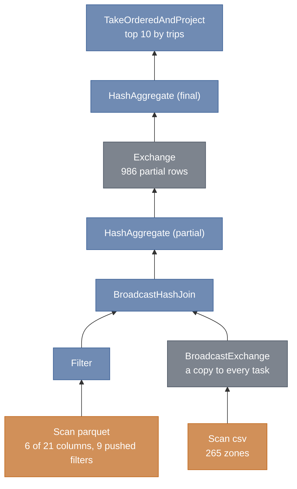

# Chapter 3: Quick start

Most quick starts count words in a text file, which teaches you the API and nothing about data. This one asks a question somebody might actually want answered (which parts of New York generate the most taxi trips, and how well do those riders tip?) and answers it twice, once with the DataFrame API and once in SQL, against a month of real trip records that have all the problems real data has.

**DataFrames and SQL in Spark are two ways of writing the same logical plan, so the choice between them is about which reads better for the person maintaining the code; the work that actually decides whether the answer is right is the cleaning in front of the aggregation, because a month of real trips contains enough impossible rows to move every average you compute from it.**

The code is [`code/ch03/quickstart.py`](https://github.com/lisancao/spark-masterclass/tree/main/code/ch03), it runs on the pip install from [Chapter 2](ch02-installing.md) in about ten seconds, and every table below is its saved output.

## Step 1: Load the trips and the zones

```python
trips = spark.read.parquet(str(TRIPS))
zones = spark.read.option("header", True).option("inferSchema", True).csv(str(ZONES))
```

Two reads, two very different amounts of work. Parquet stores its schema in the file footer, so `spark.read.parquet` knows that `tpep_pickup_datetime` is a `timestamp_ntz` and `fare_amount` a `double` without reading any data. CSV stores nothing but text, so `header=true` makes Spark run a small job to read the first line for column names, and `inferSchema=true` makes it scan the whole file a second time to guess each column's type; on a 265-row lookup table that costs nothing, and on a large CSV it's a full extra pass, which is why production code passes an explicit schema instead.

Each trip has a pickup zone (`PULocationID`) and a drop-off zone (`DOLocationID`), integers that the zone lookup maps to names:

| LocationID | Borough | Zone | service_zone |
|---|---|---|---|
| 1 | EWR | Newark Airport | EWR |
| 2 | Queens | Jamaica Bay | Boro Zone |
| 3 | Bronx | Allerton/Pelham Gardens | Boro Zone |

## Step 2: Look before you aggregate

Before asking anything of the data, ask what's in it:

```python
trips.select(F.min("tpep_pickup_datetime").alias("first_pickup"),
             F.max("tpep_pickup_datetime").alias("last_pickup"),
             F.min("fare_amount").alias("lowest_fare"),
             F.max("trip_distance").alias("longest_trip_miles")).show(truncate=False)
```

```text
+-------------------+-------------------+-----------+------------------+
|first_pickup       |last_pickup        |lowest_fare|longest_trip_miles|
+-------------------+-------------------+-----------+------------------+
|2008-12-31 23:03:25|2026-06-30 23:59:59|-1683.7    |311565.39         |
+-------------------+-------------------+-----------+------------------+
```

The June 2026 file contains a pickup from New Year's Eve 2008 (a meter with a dead clock, most likely), a negative fare (refunds and voided trips are recorded as trips), and a trip longer than twelve times around the Earth. `code/ch03/what_cleaning_drops.py` counts how many rows each problem affects, each rule on its own:

```text
  all                                  3,837,248  100.0%
  pickup outside June 2026                    17    0.0%
  fare of zero or less                    16,815    0.4%
  distance outside 0.1 to 100 miles      160,940    4.2%
  no passenger count                   1,013,500   26.4%
  not paid by card (no tip recorded)   1,404,377   36.6%
```

The first three are just wrong and get filtered out. The last two are different, and more interesting. A missing passenger count isn't a broken trip; a quarter of June's rows have it, which is far too many to be meter errors and probably reflects how some trips are recorded rather than a defect in them, so dropping them would throw away a quarter of the month for no reason when the question doesn't involve passengers at all. Card payment matters only for tips: the TLC's data dictionary notes that the `tip_amount` field is populated for credit-card tips, and cash tips aren't recorded, so a tip percentage computed over every trip would count 36.6% of trips as tipping nothing. The right move is to keep those trips for the trip counts and fares, and leave them out of the tip calculation only.

## Step 3: The question, with DataFrames

```python
clean = trips.where(
    (F.col("tpep_pickup_datetime") >= MONTH_START) &
    (F.col("tpep_pickup_datetime") < MONTH_END) &
    (F.col("fare_amount") > 0) &
    F.col("trip_distance").between(0.1, 100))

card = F.col("payment_type") == 1          # tips are only recorded for card payments
by_zone = (clean
    .join(zones, clean.PULocationID == zones.LocationID)
    .groupBy("Borough", "Zone")
    .agg(F.count("*").alias("trips"),
         F.round(F.avg("fare_amount"), 2).alias("avg_fare"),
         F.round(100 * F.sum(F.when(card, F.col("tip_amount"))) /
                 F.sum(F.when(card, F.col("fare_amount"))), 1).alias("tip_pct"))
    .orderBy(F.desc("trips"))
    .limit(10))
by_zone.show(truncate=False)
```

The tip percentage is the one line worth slowing down for. `F.when(card, F.col("tip_amount"))` with no `otherwise` returns null for non-card trips, and `sum` ignores nulls, so the numerator is the total of card tips and the denominator the total of card fares; the cash trips still count towards `trips` and `avg_fare` in the same aggregation, without a second pass or a second DataFrame. It's also a ratio of sums rather than an average of per-trip ratios, which weights each trip by its fare and keeps a $3 fare with a $3 tip from counting as a 100% tipper.

```text
+---------+----------------------------+------+--------+-------+
|Borough  |Zone                        |trips |avg_fare|tip_pct|
+---------+----------------------------+------+--------+-------+
|Manhattan|Upper East Side South       |173550|14.03   |25.3   |
|Manhattan|Midtown Center              |156493|18.35   |24.2   |
|Manhattan|Upper East Side North       |152687|14.83   |24.8   |
|Queens   |JFK Airport                 |142209|62.27   |19.0   |
|Manhattan|Midtown East                |116289|17.27   |24.3   |
|Manhattan|Lincoln Square East         |108791|15.77   |25.0   |
|Manhattan|Times Sq/Theatre District   |106540|21.27   |23.7   |
|Manhattan|Penn Station/Madison Sq West|104614|18.71   |23.3   |
|Manhattan|Murray Hill                 |99467 |17.4    |24.1   |
|Queens   |LaGuardia Airport           |98621 |46.29   |23.9   |
+---------+----------------------------+------+--------+-------+
```

Eight of the ten busiest pickup zones are in Manhattan, and the Upper East Side (south and north together) beats Midtown, which surprised me, though it's a dense residential neighbourhood with a lot of short trips (its average fare is the lowest in the table). The two airports are where the money is, with JFK's average fare more than four times the Upper East Side's, and JFK is also the one zone whose riders tip noticeably less, at 19.0% against roughly 23 to 25% everywhere else; a large share of JFK pickups pay the flat Manhattan airport fare, and a fixed fare with tolls on top seems to get tipped like a fixed price rather than like a meter.

## Step 4: The same question in SQL

A DataFrame can be registered as a temporary view and queried with SQL in the same session:

```python
trips.createOrReplaceTempView("trips")
zones.createOrReplaceTempView("zones")
by_zone_sql = spark.sql(f"""
    SELECT z.Borough, z.Zone,
           count(*)                                            AS trips,
           round(avg(t.fare_amount), 2)                        AS avg_fare,
           round(100 * sum(CASE WHEN t.payment_type = 1 THEN t.tip_amount END) /
                       sum(CASE WHEN t.payment_type = 1 THEN t.fare_amount END), 1) AS tip_pct
    FROM trips t JOIN zones z ON t.PULocationID = z.LocationID
    WHERE t.tpep_pickup_datetime >= '{MONTH_START}' AND t.tpep_pickup_datetime < '{MONTH_END}'
      AND t.fare_amount > 0 AND t.trip_distance BETWEEN 0.1 AND 100
    GROUP BY z.Borough, z.Zone
    ORDER BY trips DESC
    LIMIT 10""")
```

A temporary view is just a name for a DataFrame's plan in this session's catalog; nothing is copied or materialized, and the SQL text is parsed into the same kind of logical plan the DataFrame calls built. (The f-string is fine here because the values are constants in my own code; for anything that comes from a user, `spark.sql` takes named parameters, `spark.sql("... WHERE fare_amount > :min_fare", args={"min_fare": 0})`, which [Chapter 7](../roadmap.md) covers.)

```text
Same answer: True
Same analyzed plan (sameSemantics): False
Same optimized plan (sameResult):   True
```

Same rows, and yet `sameSemantics` says the two queries differ, while comparing the optimized plans says they're the same. The difference is which plan each comparison looks at. `sameSemantics` compares the **analyzed** plans, which are your query as you wrote it, with names resolved and types checked but nothing rearranged; printing the two trees with their arguments stripped shows why they disagree:

```text
dataframe, analyzed:                 sql, analyzed:
  GlobalLimit                          GlobalLimit
  +- LocalLimit                        +- LocalLimit
     +- Sort                              +- Sort
        +- Aggregate                         +- Aggregate
           +- Join                              +- Filter
              :- Filter                            +- Join
              :  +- Relation                          :- SubqueryAlias
              +- Relation                             :  +- SubqueryAlias
                                                      :     +- View
                                                      :        +- Relation
                                                      +- SubqueryAlias
                                                         +- SubqueryAlias
                                                            +- View
                                                               +- Relation
```

The DataFrame version filters the trips before joining them, because that's the order I chained the calls in; the SQL version joins first and filters afterwards, because that's where `WHERE` sits in a `SELECT`, and it wraps each table in the view and alias nodes that `FROM trips t` introduced. The **optimizer** then rewrites both: it pushes the filter below the join (filtering 3.8 million rows before a join is cheaper than after it), removes the view and alias nodes, which only existed to resolve names, and normalizes the order of operands in commutative expressions, which is why `100 * col` in Python (where `Column.__rmul__` builds `col * 100`) and `100 * sum(...)` in SQL end up identical. After that the two plans pass `sameResult`, and everything downstream (the physical plan, the generated code, the tasks) is the same.

The general point is worth keeping: the order you write transformations in is a suggestion. Spark keeps the meaning and throws away the order, so there's no performance reason to put a filter before a join by hand, and no reason to prefer one API over the other for speed.

## Step 5: What actually runs

```text
== Physical Plan ==
AdaptiveSparkPlan (28)
+- == Final Plan ==
   ResultQueryStage (17)
   +- TakeOrderedAndProject (16)
      +- * HashAggregate (15)
         +- AQEShuffleRead (14), coalesced
            +- ShuffleQueryStage (13), Statistics(sizeInBytes=89.9 KiB, rowCount=986)
               +- Exchange (12)
                  +- * HashAggregate (11)
                     +- * Project (10)
                        +- * BroadcastHashJoin Inner BuildRight (9)
                           :- * Project (4)
                           :  +- * Filter (3)
                           :     +- * ColumnarToRow (2)
                           :        +- Scan parquet  (1)
                           +- BroadcastQueryStage (8), Statistics(sizeInBytes=32.0 MiB, rowCount=265)
                              +- BroadcastExchange (7)
                                 +- * Filter (6)
                                    +- Scan csv  (5)
```



The formatted plan numbers each operator and then lists its details, and three of those details are worth knowing how to find:

- **The scan reads 6 of the 21 columns and pushes 9 filters into Parquet** (`PushedFilters: [IsNotNull(tpep_pickup_datetime), ..., GreaterThan(fare_amount,0.0), GreaterThanOrEqual(trip_distance,0.1), ...]`), including `IsNotNull(PULocationID)`, which nobody wrote: an inner join can never match a null key, so the optimizer added it.
- **The join is a broadcast hash join.** The zones table is tiny, so instead of shuffling 3.6 million trips by zone ID to meet the zones, Spark sends the whole zone table to every task and joins locally, which is why there's no exchange on the trips side of the join. (The `32.0 MiB` estimate for 265 rows is the size of the hash table it builds, which has a minimum allocation, not the data.)
- **`ORDER BY ... LIMIT 10` became `TakeOrderedAndProject`**, which keeps only the top ten per task and merges them, rather than sorting every zone's group globally. The planner makes this rewrite whenever a sort is followed by a small limit (below `spark.sql.execution.topKSortFallbackThreshold`).

The `*` in front of an operator means it's part of whole-stage code generation: Spark fuses the operators in a stage into a single generated Java function, so `ColumnarToRow`, `Filter`, `Project`, the join and the partial aggregate run as one loop over each batch of rows with no virtual calls between them. Under the final plan, the formatted output also prints the initial plan, the one before AQE saw any data, and diffing the two is the quickest way to see what adaptive execution changed; here it's the `AQEShuffleRead ... coalesced` node, which merged the planned 200 shuffle partitions down to one.

## Which one to write

Since the plans are the same, the choice is about the people reading the code. SQL is easier to hand to an analyst and closer to how most people think about a question like this one; the DataFrame API composes better, because each intermediate step is a Python value you can name, test, pass to a function or build in a loop, and mistakes like a misspelled column surface as Python errors at the line that made them. Most real codebases mix the two, and nothing stops you from writing `spark.sql(...)` against views built from DataFrames, or calling `.where()` on the result of `spark.sql`.

## The whole chapter, on one page

- **Look at the data before you aggregate it.** A month of real trips has impossible dates, negative fares and absurd distances, and each one moves an average.
- **Filter what's wrong, scope what's partial.** Broken rows go; rows that only lack something irrelevant to a calculation (a passenger count, a cash tip) stay, and the calculation that needs it excludes them on its own.
- **`F.when` without `otherwise` gives you conditional aggregates** in the same pass as unconditional ones.
- **DataFrames and SQL compile to the same optimized plan.** `sameSemantics` compares the plans as written, before the optimizer reorders them, so it can say `False` for two queries that run identically.
- **Read the physical plan for what actually runs:** columns pruned, filters pushed, a broadcast instead of a shuffle, a top-k instead of a sort.

The next chapter asks the same kind of question through Spark Connect, where the code that builds the plan and the driver that runs it are in different processes, and possibly on different machines.

## Further reading

- [The Spark SQL guide](https://spark.apache.org/docs/4.3.0/sql-programming-guide.html), for both APIs side by side.
- [`EXPLAIN`](https://spark.apache.org/docs/4.3.0/sql-ref-syntax-qry-explain.html), every mode and what it prints.
- [The TLC yellow-taxi data dictionary](https://www.nyc.gov/assets/tlc/downloads/pdf/data_dictionary_trip_records_yellow.pdf), which explains `payment_type`, the tip field and the surcharges.
