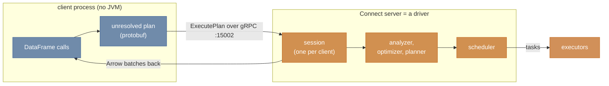
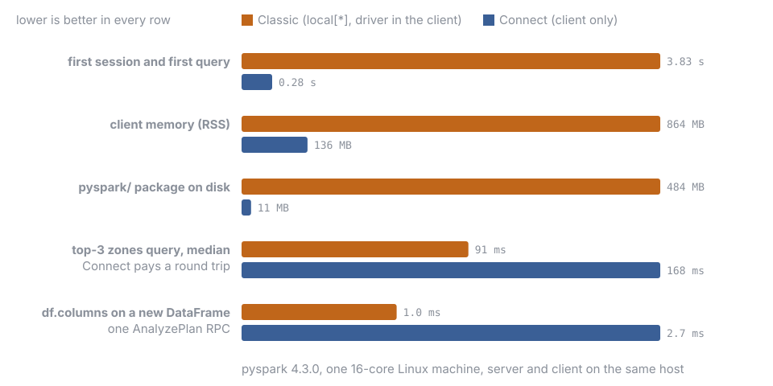
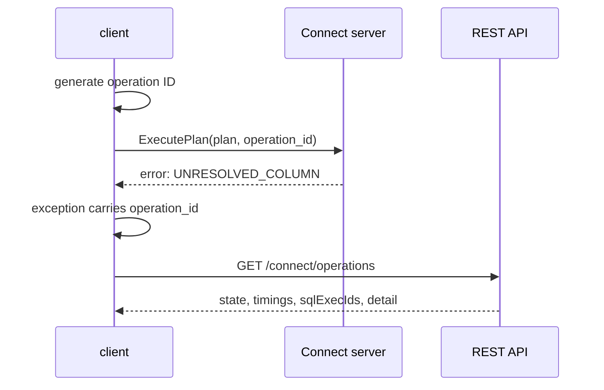

# Chapter 4: Why Spark Connect should be your default

In the first three chapters, the driver was always a child of your Python process. `getOrCreate()` started a JVM as a child process. Python communicated with it through Py4J, a bridge that Python uses to call methods on Java objects directly. This arrangement is why classic PySpark can do all that the JVM can do. It also puts the whole driver inside your program: its memory, its jars, its catalogs, its credentials and its life.

**Spark Connect separates the code that describes a query from the driver that runs it. The client builds an unresolved plan, serializes it as protobuf and sends it over gRPC. The server does all the analysis, optimization and execution, and it sends the rows back as Arrow batches. For most new work, this split is the better default today because the client is small and cannot stop the driver. You can write the client in any language, and upgrade the server without a change to the clients. The cost is that some work now occurs later and in a different location: name resolution, error checks and access to JVM objects.**

This chapter is the first chapter of the Connect part. It shows the architecture, measures what Connect changes on one machine, and lists the costs. Then, [Chapter 80](ch80-connect-protocol.md) opens the protocol and reads the bytes on the wire. After that, [Chapter 81](ch81-connect-observability.md) shows how to see and stop what each client runs. The deployment patterns are in [Chapter 46](ch46-connect-in-production.md).

!!! note "What the default is in Spark 4.3"
    In Spark 4.3, a local `pyspark` session is a Classic session. The configuration `spark.api.mode` selects the mode, and its default value is `classic` (`core/src/main/scala/org/apache/spark/internal/config/package.scala`). This chapter argues that you should select Connect yourself. Step 9 shows the three methods.

The code is [`code/ch04`](https://github.com/lisancao/spark-masterclass/tree/main/code/ch04). The scripts ran on pyspark 4.3.0, OpenJDK 17 and Python 3.12.3 on a 16-core Linux machine. The client and the server ran on the same machine. The author wrote a longer tour of Connect clients, with more opinions, in [An Idiot's Guide to Spark Connect Clients](https://systemsnull.net/posts/data-engineering-ai/idiots-guide-spark-connect-clients).

## The shape of a Connect application

<figure markdown>
  
  <figcaption>The application and the driver in Classic and in Connect. The sizes, the memory and the kill results come from <code>compare.txt</code> and <code>sizes.txt</code> (Step 5).</figcaption>
</figure>

A Connect server is a standard Spark driver with a gRPC service in front of it. Each client gets its own session on the server, with its own temporary views, configs and UDFs. Many clients can share one server and one set of executors. Results come back as Arrow record batches. The Python client changes them into `Row` objects or a pandas DataFrame.



The line between the two sides is the DataFrame API itself. A DataFrame program does not compute while you write it. It builds a description of a computation. Spark Connect sends that description, and the server puts it into the same analyzer and optimizer that a Classic session uses. Thus the server keeps all of the optimizations of Spark, and the client needs no JVM.

## Step 1: Start a server

The pip install from [Chapter 2](ch02-installing.md) includes the scripts that start a server. `code/ch04/server.sh` wraps these scripts. The wrapper puts the logs and PID files in the `data/` folder of the repo. It uses port 15002 for gRPC and port 4041 for the UI. The variables `CONNECT_PORT` and `CONNECT_UI_PORT` change the two ports, and more `--conf` arguments go to the server:

```bash
export SPARK_HOME=$(python -c "import pyspark, os; print(os.path.dirname(pyspark.__file__))")
"$SPARK_HOME/sbin/start-connect-server.sh" --conf spark.ui.port=$UI \
  --conf spark.connect.grpc.binding.port=$PORT "$@"
```

```text
Connect server up: sc://localhost:15002, UI http://localhost:4041
```

The client connects with `SparkSession.builder.remote(...)`. The client can also connect when you set `SPARK_REMOTE=sc://localhost:15002` and call `getOrCreate()` as usual. Thus, the same script can run in the two modes. The [Docker image](ch02-installing.md#option-3-the-official-docker-image) also works as a server. This chapter uses the pip install, so that the server reads the same `data/` paths as the client.

## Step 2: Build a query, and look at the plan that the client sends

```python
with SparkSession.builder.remote(f"sc://localhost:{PORT}").getOrCreate() as spark:   # 4.3: a context manager
    trips = spark.read.parquet(str(TRIPS))
    june = trips.where((F.col("tpep_pickup_datetime") >= MONTH_START) &
                       (F.col("tpep_pickup_datetime") < MONTH_END))
    busiest = june.groupBy("PULocationID").count().orderBy(F.desc("count")).limit(3)
```

The `with` block is new in 4.3 (SPARK-58159). When the block ends, Spark stops the session and releases its resources on the server. Before 4.3, you had to remember to call `spark.stop()`. The DataFrame code is the same as in Classic, and that is the purpose. But the result of the code is different.

Here is the plan that the client built, before the client sent it. `code/ch04/connect.py` prints it without the plan IDs and Python call sites that the client attaches to each node:

```text
root {
  limit {
    input {
      sort {
        input {
          aggregate {
            input {
              filter {
                input {
                  read {
                    data_source {
                      format: "parquet"
                      paths: "~/spark-masterclass/data/nyc-taxi/yellow"
                    }
                  }
                }
                condition {
                  unresolved_function {
                    function_name: "and"
                    arguments {
                      unresolved_function {
                        function_name: ">="
                        arguments { unresolved_attribute { unparsed_identifier: "tpep_pickup_datetime" } }
                        arguments { literal { string: "2026-06-01" } }
                      }
                    }
                    arguments { ... "<" ... "2026-07-01" ... }
                  }
                }
              }
            }
            group_type: GROUP_TYPE_GROUPBY
            grouping_expressions { unresolved_attribute { unparsed_identifier: "PULocationID" } }
            aggregate_expressions { alias { expr { unresolved_function { function_name: "count" arguments { literal { integer: 1 } } } } name: "count" } }
          }
        }
        order { child { unresolved_attribute { unparsed_identifier: "count" } } direction: SORT_DIRECTION_DESCENDING null_ordering: SORT_NULLS_LAST }
        is_global: true
      }
    }
    limit: 3
  }
}
```

The plan has no resolved names. The client does not know the schema of the file. It does not know if `tpep_pickup_datetime` exists, or what type it has. It does not know that `>=` between a timestamp and the string `"2026-06-01"` needs a cast. The client records the names and function calls as text. When the plan arrives, the analyzer on the server resolves all of them against the real data.

Even `count` and `and` go to the server as function names. The client also sends the path as a string, and the server resolves it on its own filesystem, not on the filesystem of the client. In this chapter, the path works because the client and the server are on the same machine. In a real deployment, use an object-store URL that the server can access. [Chapter 80](ch80-connect-protocol.md) reads the same kind of plan as bytes.

## Step 3: Run it, and break it

```python
    rows = busiest.collect()
    print("busiest pickup zones:", [(r.PULocationID, r["count"]) for r in rows])
    print("succeeded, operation", busiest.executionInfo.operation_id)

    bad = june.select("revenue")
    print("built a DataFrame over a column that doesn't exist; no error yet")
    try:
        bad.collect()
    except Exception as e:
        failed = e.operation_id
```

```text
busiest pickup zones: [(237, 177610), (161, 161198), (236, 157113)]
succeeded, operation 62b6c765-37cc-4832-abf3-743cae6f5509
built a DataFrame over a column that doesn't exist; no error yet
failed,    operation eb28b1ec-c374-4cdf-8564-1a27e17bd7d5
  AnalysisException: [UNRESOLVED_COLUMN.WITH_SUGGESTION] A column, variable, or function
  parameter with name `revenue` cannot be resolved. Did you mean one of the following?
  [`extra`, `VendorID`, `mta_tax`, `RatecodeID`, `fare_amount`]. SQLSTATE: 42703;
```

<figure markdown>
  <video autoplay loop muted playsinline controls width="1280" height="720" poster="../../media/clips/ch04-connect.webp">
    <source src="../../media/clips/ch04-connect.mp4" type="video/mp4">
  </video>
  <figcaption><code>connect.py</code> runs against a local Connect server. First, a query works. Then a query uses a column that does not exist, and the error occurs only when the plan arrives at the server.</figcaption>
</figure>

Zones 237, 161 and 236 are the Upper East Side South, Midtown Center and Upper East Side North. These are the same top three zones as in [Chapter 3](ch03-quick-start.md), with a little higher counts. The reason is that this query does not remove the bad fares and distances.

The failure shows the difference in behavior that you will see most. In Classic, `trips.select("revenue")` raises the `AnalysisException` on the line that calls `select`. The reason is that Spark analyzes a classic DataFrame immediately when you create it. Step 5 measures this behavior: Classic raises the error at `select()`.

Over Connect, `june.select("revenue")` succeeds, because Spark did not analyze anything yet. The error occurs only when an action sends the plan to the server. That can be many lines or a number of function calls later. Two practices help:

- During development, call `df.schema` or `df.columns` after a step with risk. This call makes a round trip to the analyzer on the server, but it does not run the query.
- Read the suggestions in the error. They come from the server, and they are usually correct.

Before the client raises the error, it also logs the error as a JSON line on stderr. The logger is `DataFrameQueryContextLogger`, and the line includes the full JVM stack trace of the server. This log is useful when a problem occurs deep in the server. But it adds noise when you expect the exception. For that reason, the scripts in this book send stderr to a different location.

## Step 4: What Connect fixes

The split between client and server removes six problems of a driver that lives in your process. Each item names the step or the chapter that shows it.

| Problem with the driver in your process | What Connect does | Shown in |
|---|---|---|
| The driver lives in your process. If the client stops, the driver stops. | The driver is a different process. A client that stops takes only its own session with it. | Step 5 (kill test) |
| Each client needs a JDK, 462 MB of jars, and the same catalog plugins and credentials as the cluster. | The client is `pyspark-client` (11 MB of package) or a client in another language. Jars, catalogs and credentials stay on the server. | Step 5 (sizes) |
| Clients and the cluster share one classpath and one Spark version. To upgrade Spark, you upgrade all clients at the same time. | The protocol is the contract. You upgrade the server, and the clients continue to send the same messages. | [Chapter 80](ch80-connect-protocol.md) |
| On a shared driver, one user can stop all users, for example with an out-of-memory error in the client code. | Each client has a session with its own state. Client code runs in the client process. | [Chapter 46](ch46-connect-in-production.md), Step 2 |
| Only Python, Scala, Java and R can drive Spark, because they must talk to the JVM. | Any language that can write protobuf and read Arrow can be a client. | Chapter 82 |
| Notebooks, IDEs, services and agents must start a JVM to use Spark. | They open a gRPC channel. A session costs one RPC on a server that already runs. | Step 5 (start time) |

Agents are the strongest case. An agent that writes Spark code must not own a driver. With Connect, each agent gets a session or a server of its own. The server keeps the credentials. An operator can see and stop each operation ([Chapter 81](ch81-connect-observability.md)). [Chapter 49](ch49-pipelines-with-agents.md) builds a harness on this sandbox.

## Step 5: Classic and Connect, measured

`code/ch04/compare.py` runs the same work in two new Python processes, one Classic and one Connect. It measures the start, a small query, a schema lookup and the memory of the client. Then it kills each client with `SIGKILL`, as an out-of-memory kill does, and examines the driver. It also runs two checks of behavior from the Spark guide [Eager vs Lazy: Spark Connect vs Spark Classic](https://spark.apache.org/docs/4.3.0/spark-connect-gotchas.html). The run took the book's benchmark lock, so no other script used the machine:

```python
spark.range(3).createOrReplaceTempView("v")
first = spark.table("v")
spark.range(7).createOrReplaceTempView("v")
x = 123
f = F.udf(lambda: x, "int")
df = spark.range(1).select(f().alias("x"))
x = 456
print(json.dumps({"view_rows": first.count(), "udf_value": df.first().x}))
```

```text
                                              Classic            Connect
first session and first query (s)                3.83               0.28
top-3 zones query, median (ms)                     91                168
df.columns, new DataFrame (ms)                    1.0                2.7
client memory, RSS (MB)                           864                136
bad column raises                         at select()       at collect()
client killed with SIGKILL         driver JVM stopped  server still runs
count of a replaced temp view                       3                  7
UDF closure value                                 123                456
```

`code/ch04/sizes.sh` measures the two client packages. Then it runs a query from an environment that has only `pyspark-client`:

```text
pyspark 4.3.0 (full):   pyspark/ 484 MB, jars/ 462 MB in 280 files
pyspark-client 4.3.0:   pyspark/ 11 MB, jars/ none
pyspark-client venv, all dependencies: 324 MB
pyspark-client 4.3.0
pyspark/jars exists: False | py4j importable: False
server 4.3.0 | trips: 3,837,248
```

<figure markdown>
  <video autoplay loop muted playsinline controls width="1280" height="720" poster="../../media/clips/ch04-thin.webp">
    <source src="../../media/clips/ch04-thin.mp4" type="video/mp4">
  </video>
  <figcaption><code>sizes.sh</code> installs <code>pyspark-client</code> 4.3.0 in a new environment and counts the 3,837,248 trips through the server. The environment has no jars and no Py4J.</figcaption>
</figure>

<figure markdown>
  
  <figcaption>The numbers of <code>compare.txt</code> and <code>sizes.txt</code>. Connect wins on start, memory and size. Classic wins on the small query and on the schema lookup, because Connect pays a round trip for each.</figcaption>
</figure>

The table shows these facts:

- **Start.** The Classic number includes the start of a JVM. The Connect number is one RPC to a server that already runs. In a deployment, the server starts once and many clients use it.
- **Memory.** The Classic client is a Python process and a driver JVM. The Connect client is only Python. The 136 MB is mostly pandas, PyArrow and gRPC.
- **The kill test.** When the Classic client stopped, its driver JVM stopped too. When the Connect client stopped, the server continued. The server also keeps the record of the operations of the stopped client.
- **The small query.** Connect is slower here, by 77 ms. Each action sends a plan, the server analyzes it again, and the result comes back over gRPC. For a dashboard that sends many small queries, measure this cost before you migrate.
- **The two checks of behavior.** They are the subject of Step 6.

The client environment is not small: 324 MB, because PyArrow, pandas and NumPy are dependencies of the client. The gain is that the client needs no JVM, no JDK and no jars.

## Step 6: What Connect costs

The measured table shows the costs. Each one has a cause in the architecture:

- **A round trip for each question.** An action, a schema lookup (`df.columns`, `df.schema`) and `explain()` each send an RPC. The client keeps the schema of a DataFrame after the first lookup. But each `withColumn` makes a new DataFrame with no schema. Thus a loop that reads `df.columns` after each `withColumn` sends one `AnalyzePlan` RPC for each pass. Read the schema one time, and add all columns in one `select`.
- **Errors occur later.** Step 3 showed it. Code that catches an `AnalysisException` around a transformation catches nothing over Connect. Put the `try` around the action, or call `df.columns` inside the `try`.
- **A temporary view is a name, not a plan.** In Classic, `first` kept the plan of the first view, so its count was 3. Over Connect, `first` kept only the name `v`. When the action ran, `v` meant the second view, so the count was 7. Give each temporary view a unique name.
- **A UDF uses the values at execution time.** Classic serialized the function when the code made the UDF, so it returned 123. Connect serialized it when the action sent the plan, so it returned 456. Give values to a UDF as arguments or as literal columns.
- **Python versions stay coupled.** The client serializes a Python UDF, and a Python worker on the server runs it. The two must have the same minor version of Python, or the worker raises `PYTHON_VERSION_MISMATCH`.

## Step 7: What is not available

```text
spark.sparkContext -> PySparkAttributeError: [JVM_ATTRIBUTE_NOT_SUPPORTED] Attribute
  `sparkContext` is not supported in Spark Connect as it depends on the JVM.
```

Spark Connect has no handles to JVM objects: `spark.sparkContext`, RDDs, `df.rdd`, `df._jdf`, broadcast variables and accumulators. This loss is smaller than it seems. Connect supports the DataFrame, SQL, streaming and ML APIs. Python UDFs, pandas UDFs and Python data sources also work, because the client sends the code of the function to the server.

But do a check of your code before you migrate. Much older PySpark code uses `sparkContext` to call `setJobDescription`, to set log levels, or to read the number of cores. Over Connect, these operations need a different method:

| Classic code | Over Connect |
|---|---|
| `sc.setJobDescription(...)` | Job tags with `spark.addTag(...)` ([Chapter 81](ch81-connect-observability.md)) |
| `sc.setLogLevel(...)` | The log configuration on the server |
| `sc.defaultParallelism` | The REST API of the server ([Chapter 45](ch45-observability.md)) |
| Accumulators | `DataFrame.observe()` with an `Observation` |
| `sc.broadcast(value)` | A literal column, or a join with `F.broadcast(df)` (a join hint, which works) |
| `sc.addPyFile(...)` | `spark.addArtifacts(path, pyfile=True)` ([Chapter 44](ch44-shipping-dependencies.md)) |

## Step 8: Find the failure on the server (new in 4.3)

Before 4.3, a Connect application with an error was difficult to debug. You had to match an exception on the client to a server that you possibly could not see. Spark 4.3 solves this problem on the two sides.

On the client, each `ExecutePlan` request now has an operation ID. The client makes this ID before it sends the request (SPARK-58547). The ID is available on success (`df.executionInfo.operation_id`). It is also available on the exception when the operation fails, and this case is more useful. A request that fails before its first response never gets an ID from the server.

On the server, sessions and operations are now part of the monitoring REST API (SPARK-57941). The endpoints are `/api/v1/applications/<app-id>/connect/sessions` and `/connect/operations`. Thus, the ID that the client printed leads directly to the record on the server:

```python
ops = ui_api("connect/operations", port=UI)
mine = next(o for o in ops if o["operationId"] == failed)
```

```json
{
  "jobTag": "SparkConnect_OperationTag_User_lnc_Session_e484384c-bb96-4337-99eb-37304e87a9cd_Operation_eb28b1ec-c374-4cdf-8564-1a27e17bd7d5",
  "operationId": "eb28b1ec-c374-4cdf-8564-1a27e17bd7d5",
  "sessionId": "e484384c-bb96-4337-99eb-37304e87a9cd",
  "userId": "lnc",
  "state": "CLOSED",
  "duration": 188,
  "executionTime": 183,
  "jobIds": [],
  "sqlExecIds": ["1"],
  "detail": "INTERNAL: [UNRESOLVED_COLUMN.WITH_SUGGESTION] A column, variable, or function parameter with name `revenue` cannot be resolved. ...\n'Project ['revenue]\n+- Filter ((tpep_pickup_datetime#2 >= cast(2026-06-01 as timestamp_ntz)) ...\n   +- Relation [VendorID#1, ...] parquet\n"
}
```

<figure markdown>
  <video autoplay loop muted playsinline controls width="1280" height="720" poster="../../media/clips/ch04-rest.webp">
    <source src="../../media/clips/ch04-rest.mp4" type="video/mp4">
  </video>
  <figcaption>The script finds the failed operation in the 4.3 REST API with the ID that the client printed.</figcaption>
</figure>

The record contains these items:

- The session and the user of the operation.
- The time that the operation took (183 ms, all of it for analysis). This time changes from run to run. In an earlier run of the same script, it was 6 ms.
- The SQL execution that the operation created. This execution links to the SQL tab of the UI and to its own REST endpoint.
- No job IDs, because the operation failed before Spark scheduled any work.
- The full error, with the unresolved plan as the server sees it.

The `jobTag` is the same tag that the server puts on each Spark job that the operation runs. With this tag, you can filter the jobs to one client operation. A listener, the history server and the job list of the Spark UI can all use it. Then, [Chapter 81](ch81-connect-observability.md) follows one operation through all of these records.



## Step 9: Make Connect your default

There are three methods. Use the first method for code that you deploy, and the third method on a laptop.

1. **A remote server.** Install `pyspark-client` in the client environment. Set `SPARK_REMOTE=sc://<host>:15002`. Call `SparkSession.builder.getOrCreate()` as usual.
2. **A connection in the code.** Call `SparkSession.builder.remote("sc://<host>:15002").create()`. Use `create()`, not `getOrCreate()`, when a process opens more than one session.
3. **A local server for each script.** With the full `pyspark` package, set `spark.api.mode` to `connect`. Spark starts a local Connect server for the application and stops it at the end.

`code/ch04/api_mode.py` uses the third method:

```python
spark = (SparkSession.builder.master("local[*]")
         .config("spark.api.mode", "connect")       # the default is "classic"
         .getOrCreate())
```

```text
session class: pyspark.sql.connect.session.SparkSession
trips: 3,837,248 | server-side session: 65f15f90
select('revenue') raised nothing: analysis waits for an action, as in any Connect session
```

The session is a Connect session, so the script gets the same behavior that it will get from a remote server. The laptop is the place to find the differences of Step 6, before the code goes to a shared server.

!!! warning "CAUTION"
    Do not use a local server for each script on a shared machine without a check of port 15002. The local server uses that port. If a different server already uses it, your client can connect to that server.

Classic is still the correct choice in a small number of cases:

- The code needs the JVM itself: RDD code, custom JVM listeners, or libraries that need a `SparkContext`.
- The workload sends many small queries, and the extra round trip of Step 5 is too much.

Most of the code in this book runs in the two modes when you set `SPARK_REMOTE`. When a script uses the JVM, a comment in the script says so. For example, Chapter 1 reads job descriptions through `sparkContext`, and Chapter 3 compares plans through `_jdf`.

## The whole chapter, on one page

- **A Connect server is a driver with a gRPC front door.** Clients send unresolved plans as protobuf, and they get Arrow batches back.
- **The client resolves nothing.** The server interprets names, types and paths, so the paths must be correct on the server.
- **Connect fixes the driver in your process.** On one machine, the client started in 0.28 s instead of 3.83 s, used 136 MB instead of 864 MB, and needed no jars. A killed client did not stop the server.
- **Connect costs a round trip.** A small query took 168 ms instead of 91 ms, and each schema lookup is an RPC.
- **Errors occur at the action, not at the transformation.** Temporary views resolve by name, and UDFs see values at execution time.
- **JVM handles are not available** (`sparkContext`, RDDs, `_jdf`). DataFrames, SQL, streaming, ML and Python UDFs all work.
- **Spark 4.3 gives each operation an ID on the two sides.** The client shows the ID on results and exceptions. The `/connect/operations` endpoint of the REST API returns the record of the server for that ID.
- **Make it your default:** `pyspark-client` and `SPARK_REMOTE` for deployed code, `spark.api.mode=connect` on a laptop.

That is the end of Part I. You know how Spark changes a query into work, and four methods to install Spark. You know how to ask a question in the two APIs and read the plan that answers it. You also know how to do all of this from a process that has no JVM. The next part, [Part II](ch05-dataframes-columns-schemas.md), gives more detail about the DataFrame and SQL APIs, and it starts with schemas and types.

## Further reading

- [Spark Connect overview](https://spark.apache.org/docs/4.3.0/spark-connect-overview.html), the official guide, with deployment options.
- [Eager vs Lazy: Spark Connect vs Spark Classic](https://spark.apache.org/docs/4.3.0/spark-connect-gotchas.html), the official list of the differences in behavior.
- [Application development with Spark Connect](https://spark.apache.org/docs/4.3.0/app-dev-spark-connect.html), with `spark.api.mode`.
- [SPARK-39375](https://issues.apache.org/jira/browse/SPARK-39375), the proposal for Spark Connect, with the four limits of the driver in your process that it set out to fix.
- [The Connect protocol definitions](https://github.com/apache/spark/tree/v4.3.0/sql/connect/common/src/main/protobuf/spark/connect), where `relations.proto` and `expressions.proto` define each node in the plan above.
- [The Ultimate Guide to Apache Spark 4.3](https://systemsnull.net/posts/data-engineering-ai/ultimate-guide-spark-43), with the other Connect changes in 4.3.
