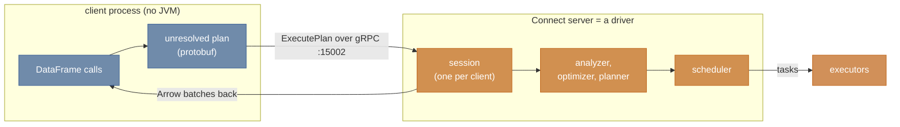
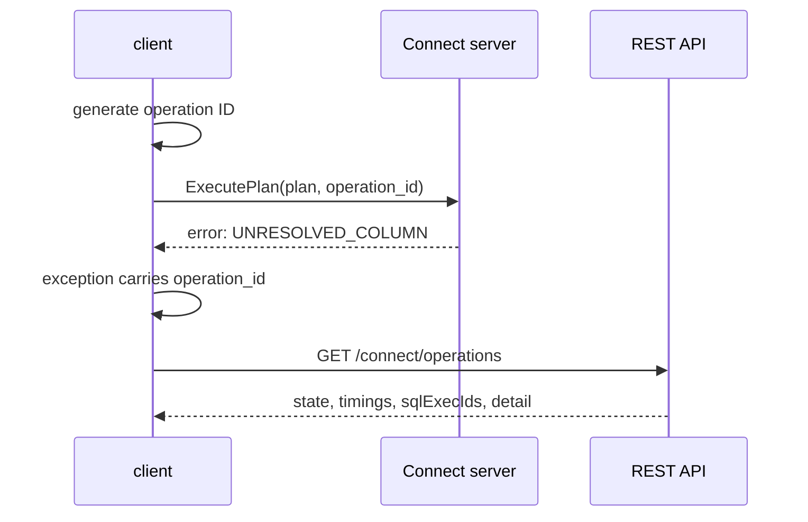

# Chapter 4: Spark Connect

Everything in the first three chapters ran with the driver inside my Python process's shadow: `getOrCreate()` started a JVM as a child process, and my Python talked to it through Py4J, a bridge that lets Python call methods on Java objects directly. That arrangement is why classic PySpark can do anything the JVM can, and also why a notebook that runs out of memory takes the driver down with it, why every Python environment that touches Spark needs a JDK, and why "upgrade Spark" means upgrading every client at once.

**Spark Connect separates the code that describes a query from the driver that runs it: the client builds an unresolved plan, serializes it as protobuf and sends it over gRPC, and the server does all the analysis, optimization and execution, so the client can be small, can be written in any language and can't crash the driver, and the price is that everything that used to happen eagerly in your process (name resolution, error checking, access to JVM objects) now happens later, somewhere else.** Spark 4.3 adds the part that was missing for living with that, which is a way to follow a single operation from the client's error message to the server's record of it.

The code is [`code/ch04`](https://github.com/lisancao/spark-masterclass/tree/main/code/ch04). I wrote a longer, more opinionated tour of how Connect clients work in [An Idiot's Guide to Spark Connect Clients](https://systemsnull.net/posts/data-engineering-ai/idiots-guide-spark-connect-clients), including what it takes to build one in another language; this chapter sticks to what you need to use it.

## The shape of a Connect application



A Connect server is an ordinary Spark driver with a gRPC service in front of it. Each client gets its own session on the server (its own temporary views, configs and UDFs), and many clients can share one server and one set of executors. Results come back as Arrow record batches, which the Python client turns into `Row` objects or a pandas DataFrame.

## Step 1: Start a server

The pip install from [Chapter 2](ch02-installing.md) includes the scripts to run one; `code/ch04/server.sh` wraps them so the logs and PID files land in the repo's `data/` folder and the UI uses port 4041:

```bash
export SPARK_HOME=$(python -c "import pyspark, os; print(os.path.dirname(pyspark.__file__))")
"$SPARK_HOME/sbin/start-connect-server.sh" --conf spark.ui.port=4041
```

```text
Connect server up: sc://localhost:15002, UI http://localhost:4041
```

The client connects with `SparkSession.builder.remote(...)`, or by setting `SPARK_REMOTE=sc://localhost:15002` and calling `getOrCreate()` as usual, which is how the same script can run either way. The [Docker image](ch02-installing.md#option-3-the-official-docker-image) works just as well as a server; I use the pip install here so the server reads the same `data/` paths as the client.

## Step 2: Build a query, and look at what will be sent

```python
with SparkSession.builder.remote("sc://localhost:15002").getOrCreate() as spark:   # 4.3: a context manager
    trips = spark.read.parquet(str(TRIPS))
    june = trips.where((F.col("tpep_pickup_datetime") >= MONTH_START) &
                       (F.col("tpep_pickup_datetime") < MONTH_END))
    busiest = june.groupBy("PULocationID").count().orderBy(F.desc("count")).limit(3)
```

The `with` block is new in 4.3 (SPARK-58159): leaving it stops the session and releases its resources on the server, which used to require remembering `spark.stop()`. The DataFrame code is unchanged from Classic, and that's the point; what it produces is not. Here's the plan the client built, before anything was sent (`code/ch04/connect.py` prints it with the plan IDs and Python call sites that the client attaches to every node removed):

```text
root {
  limit {
    input {
      sort {
        input {
          aggregate {
            input {
              filter {
                input {
                  read {
                    data_source {
                      format: "parquet"
                      paths: "/home/lnc/spark-masterclass/data/nyc-taxi/yellow"
                    }
                  }
                }
                condition {
                  unresolved_function {
                    function_name: "and"
                    arguments {
                      unresolved_function {
                        function_name: ">="
                        arguments { unresolved_attribute { unparsed_identifier: "tpep_pickup_datetime" } }
                        arguments { literal { string: "2026-06-01" } }
                      }
                    }
                    arguments { ... "<" ... "2026-07-01" ... }
                  }
                }
              }
            }
            group_type: GROUP_TYPE_GROUPBY
            grouping_expressions { unresolved_attribute { unparsed_identifier: "PULocationID" } }
            aggregate_expressions { alias { expr { unresolved_function { function_name: "count" arguments { literal { integer: 1 } } } } name: "count" } }
          }
        }
        order { child { unresolved_attribute { unparsed_identifier: "count" } } direction: SORT_DIRECTION_DESCENDING null_ordering: SORT_NULLS_LAST }
        is_global: true
      }
    }
    limit: 3
  }
}
```

Every name in it is unresolved. The client doesn't know the file's schema, doesn't know whether `tpep_pickup_datetime` exists or what type it is, and doesn't know that `>=` between a timestamp and the string `"2026-06-01"` needs a cast; it records the names and function calls as text, and the server's analyzer resolves all of them against the real data when the plan arrives. Even `count` and `and` travel as function names. The path is sent as a string, too, and it's resolved on the server's filesystem, not the client's: this works because my client and server share a machine, and on a real deployment it would be an object-store URL both sides can reach.

## Step 3: Run it, and break it

```python
    rows = busiest.collect()
    print("busiest pickup zones:", [(r.PULocationID, r["count"]) for r in rows])
    print("succeeded, operation", busiest.executionInfo.operation_id)

    bad = june.select("revenue")
    print("built a DataFrame over a column that doesn't exist; no error yet")
    try:
        bad.collect()
    except Exception as e:
        failed = e.operation_id
```

```text
busiest pickup zones: [(237, 177610), (161, 161198), (236, 157113)]
succeeded, operation 56ddc4ab-f162-4ea5-8bdf-92f3f071c6f2
built a DataFrame over a column that doesn't exist; no error yet
failed,    operation 18c06456-8661-4f65-af18-7d147dcd75c6
  AnalysisException: [UNRESOLVED_COLUMN.WITH_SUGGESTION] A column, variable, or function parameter
  with name `revenue` cannot be resolved. Did you mean one of the following? [`extra`, `VendorID`,
  `mta_tax`, `RatecodeID`, `fare_amount`]. SQLSTATE: 42703;
```

<figure markdown>
  <video autoplay loop muted playsinline controls width="1280" height="720" poster="../../media/clips/ch04-connect.webp">
    <source src="../../media/clips/ch04-connect.mp4" type="video/mp4">
  </video>
  <figcaption><code>connect.py</code> against a local Connect server: a query that works, then a column that doesn't exist, caught only when the plan reaches the server.</figcaption>
</figure>

Zones 237, 161 and 236 are the Upper East Side South, Midtown Center and Upper East Side North, the same top three as [Chapter 3](ch03-quick-start.md) with slightly higher counts, since this query doesn't drop the bad fares and distances.

The failure is the behavioural difference you'll actually notice. In Classic, `trips.select("revenue")` raises the `AnalysisException` on the line that calls `select`, because a classic DataFrame is analyzed the moment it's created (I checked: same error, raised at `select`). Over Connect, `june.select("revenue")` succeeds, because nothing has been analyzed; the error only appears when an action sends the plan to the server, which can be many lines or several function calls later. Two habits help: call `df.schema` or `df.columns` after a risky step when you're developing, which forces a round trip to the server's analyzer without running anything, and read the error's suggestions, which come from the server and are usually right.

The client also logs the error as a JSON line on stderr (from a logger called `DataFrameQueryContextLogger`) before raising it, with the server's full JVM stack trace attached. It's useful when something goes wrong deep in the server and noisy when you expected the exception, and the scripts in this book send stderr elsewhere for that reason.

## Step 4: What isn't there

```text
spark.sparkContext -> PySparkAttributeError: [JVM_ATTRIBUTE_NOT_SUPPORTED] Attribute `sparkContext`
is not supported in Spark Connect as it depends on the JVM.
```

Anything that's a handle to a JVM object is gone: `spark.sparkContext`, RDDs, `df.rdd`, `df._jdf`, broadcast variables and accumulators. That's less than it sounds like, since the DataFrame, SQL, streaming and ML APIs are all supported, and Python UDFs, pandas UDFs and Python data sources work because the client ships the function's code to the server. It's worth checking before you migrate, though, because a lot of older PySpark code reaches into `sparkContext` for things like `setJobDescription`, setting log levels, or reading the number of cores, and over Connect those need a different route (job tags with `spark.addTag`, server-side log configuration, and the REST API, respectively).

## Step 5: Find the failure on the server (new in 4.3)

Debugging a Connect application used to mean matching a client-side exception against a server you might not be able to see. Spark 4.3 fixes both ends of that.

On the client, every `ExecutePlan` request now carries an operation ID that the client generates before sending it (SPARK-58547), and the ID is available on success (`df.executionInfo.operation_id`) and, more usefully, on the exception when the operation fails, since a request that fails before its first response never learned a server-generated ID. On the server, sessions and operations are now part of the monitoring REST API (SPARK-57941), at `/api/v1/applications/<app-id>/connect/sessions` and `/connect/operations`, so the ID the client printed leads straight to the server's record:

```python
ops = ui_api("connect/operations", port=4041)
mine = next(o for o in ops if o["operationId"] == failed)
```

```json
{
  "jobTag": "SparkConnect_OperationTag_User_lnc_Session_8446...c35d6_Operation_18c06456-...-7d147dcd75c6",
  "operationId": "18c06456-8661-4f65-af18-7d147dcd75c6",
  "sessionId": "84463696-f3b0-4e74-9db0-f8a7d76c35d6",
  "userId": "lnc",
  "state": "CLOSED",
  "duration": 9,
  "executionTime": 7,
  "jobIds": [],
  "sqlExecIds": ["8"],
  "detail": "INTERNAL: [UNRESOLVED_COLUMN.WITH_SUGGESTION] A column, variable, or function parameter with name `revenue` cannot be resolved. ...\n'Project ['revenue]\n+- Filter ((tpep_pickup_datetime#99 >= cast(2026-06-01 as timestamp_ntz)) ...\n   +- Relation [VendorID#98, ...] parquet\n"
}
```

<figure markdown>
  <video autoplay loop muted playsinline controls width="1280" height="720" poster="../../media/clips/ch04-rest.webp">
    <source src="../../media/clips/ch04-rest.mp4" type="video/mp4">
  </video>
  <figcaption>The failed operation looked up in the 4.3 REST API by the ID the client printed. This take ran against a freshly started server, so the analysis took longer than in the listing above.</figcaption>
</figure>

The record has the session and user it belonged to, how long it took (7 ms, all of it analysis), the SQL execution it created (which links to the SQL tab of the UI and its own REST endpoint), no job IDs (it failed before scheduling anything), and the full error with the server's view of the unresolved plan. The `jobTag` is the same tag the server puts on every Spark job the operation runs, which is how a listener, the history server or the Spark UI's job list can be filtered down to one client operation. Because these events go to the event log, the same endpoints work in the history server after the server has stopped.



## When to use Connect

My rule of thumb is to use Connect whenever the code that builds queries isn't the code that should own a driver: applications and services that query Spark, notebooks and IDEs pointed at a shared cluster, agents that generate and run Spark code, and clients written in languages other than Python and Scala (there are Connect clients in Go, Rust, Swift and others, and I wrote one in OCaml, which was about as sensible as it sounds). Classic is still the simpler choice when you need the JVM itself, for RDD code, custom JVM listeners, or libraries that expect a `SparkContext`, and for a laptop install where the client and the driver being one process costs nothing. Most of this book's code runs either way, by setting `SPARK_REMOTE`; where a script reaches into the JVM (Chapter 1 reads job descriptions through `sparkContext`, and Chapter 3 compares plans through `_jdf`), it says so in a comment.

## The whole chapter, on one page

- **A Connect server is a driver with a gRPC front door.** Clients send unresolved plans as protobuf and get Arrow batches back.
- **The client resolves nothing.** Names, types and paths are interpreted on the server, so paths have to make sense there.
- **Errors arrive at the action, not at the transformation.** Check `df.columns` while developing if you want them earlier.
- **JVM handles are gone** (`sparkContext`, RDDs, `_jdf`); DataFrames, SQL, streaming, ML and Python UDFs all work.
- **Spark 4.3 gives every operation an ID on both sides.** The client exposes it on results and exceptions, and the REST API's `/connect/operations` endpoint returns the server's record for it.
- **Sessions are context managers in 4.3**, so `with ... as spark:` cleans up after itself.

That's Part I: you know how Spark turns a query into work, how to install it four ways, how to ask a question in either API and read the plan that answers it, and how to do all of that from a process that has no JVM in it. [Part II](../roadmap.md) goes deeper into the DataFrame and SQL APIs themselves, starting with schemas and types.

## Further reading

- [Spark Connect overview](https://spark.apache.org/docs/4.3.0/spark-connect-overview.html), the official guide, with deployment options.
- [The Connect protocol definitions](https://github.com/apache/spark/tree/v4.3.0/sql/connect/common/src/main/protobuf/spark/connect), where `relations.proto` and `expressions.proto` define every node in the plan above.
- [The Ultimate Guide to Apache Spark 4.3](https://systemsnull.net/posts/data-engineering-ai/ultimate-guide-spark-43), which covers the other Connect changes in 4.3 (the persistent local server, the JDBC driver, and the SQLSTATE change for session errors).
- [Building a Spark Connect Client in OCaml](https://systemsnull.net/posts/data-engineering-ai/build-a-spark-connect-client), on what a client actually has to implement.
