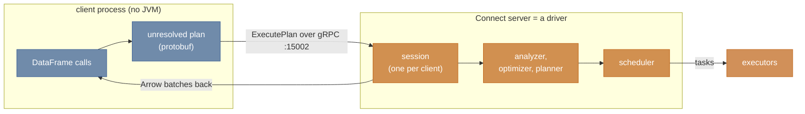
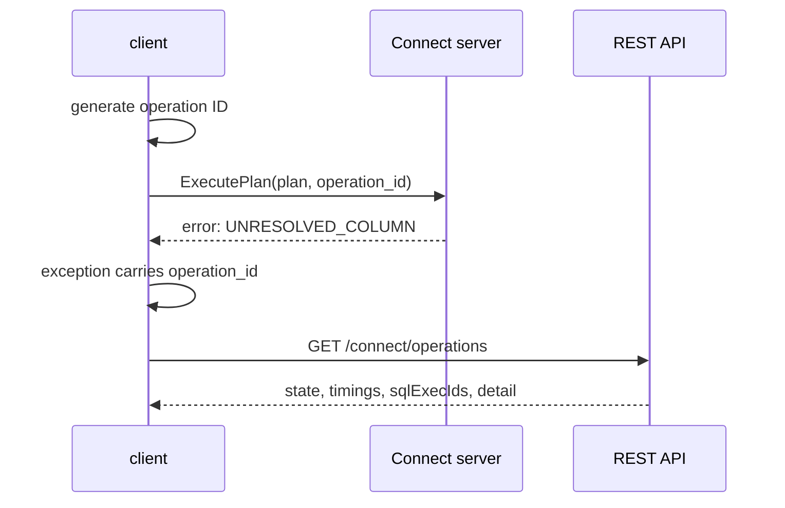

# Chapter 4: Spark Connect

In the first three chapters, the driver was always a child of your Python process. `getOrCreate()` started a JVM as a child process. Python communicated with it through Py4J, a bridge that Python uses to call methods on Java objects directly. This arrangement is why classic PySpark can do all that the JVM can do. It also causes three problems:

- If a notebook uses all of its memory, the driver stops with it.
- Each Python environment that uses Spark needs a JDK.
- To upgrade Spark, you must upgrade all clients at the same time.

**Spark Connect separates the code that describes a query from the driver that runs it. The client builds an unresolved plan, serializes it as protobuf and sends it over gRPC. The server does all the analysis, optimization and execution. Thus, the client can be small, you can write it in any language, and it cannot crash the driver. The cost is that some work now occurs later, in a different location. Before, this work occurred immediately in your process: name resolution, error checks and access to JVM objects.**

Spark 4.3 adds a part that this model did not have before. It gives a method to follow a single operation from the error message on the client to the record of the operation on the server.

The code is [`code/ch04`](https://github.com/lisancao/spark-masterclass/tree/main/code/ch04). The author wrote a longer tour of Connect clients, with more opinions, in [An Idiot's Guide to Spark Connect Clients](https://systemsnull.net/posts/data-engineering-ai/idiots-guide-spark-connect-clients). That tour also shows what is necessary to build a client in a different language. This chapter gives only what you need to use Connect.

## The shape of a Connect application



A Connect server is a standard Spark driver with a gRPC service in front of it. Each client gets its own session on the server, with its own temporary views, configs and UDFs. Many clients can share one server and one set of executors. Results come back as Arrow record batches. The Python client changes them into `Row` objects or a pandas DataFrame.

## Step 1: Start a server

The pip install from [Chapter 2](ch02-installing.md) includes the scripts that start a server. `code/ch04/server.sh` wraps these scripts. The wrapper puts the logs and PID files in the `data/` folder of the repo, and it sets the UI to port 4041:

```bash
export SPARK_HOME=$(python -c "import pyspark, os; print(os.path.dirname(pyspark.__file__))")
"$SPARK_HOME/sbin/start-connect-server.sh" --conf spark.ui.port=4041
```

```text
Connect server up: sc://localhost:15002, UI http://localhost:4041
```

The client connects with `SparkSession.builder.remote(...)`. The client can also connect when you set `SPARK_REMOTE=sc://localhost:15002` and call `getOrCreate()` as usual. Thus, the same script can run in the two modes. The [Docker image](ch02-installing.md#option-3-the-official-docker-image) also works as a server. This chapter uses the pip install, so that the server reads the same `data/` paths as the client.

## Step 2: Build a query, and look at the plan that the client sends

```python
with SparkSession.builder.remote("sc://localhost:15002").getOrCreate() as spark:   # 4.3: a context manager
    trips = spark.read.parquet(str(TRIPS))
    june = trips.where((F.col("tpep_pickup_datetime") >= MONTH_START) &
                       (F.col("tpep_pickup_datetime") < MONTH_END))
    busiest = june.groupBy("PULocationID").count().orderBy(F.desc("count")).limit(3)
```

The `with` block is new in 4.3 (SPARK-58159). When the block ends, Spark stops the session and releases its resources on the server. Before 4.3, you had to remember to call `spark.stop()`. The DataFrame code is the same as in Classic, and that is the purpose. But the result of the code is different.

Here is the plan that the client built, before the client sent it. `code/ch04/connect.py` prints it without the plan IDs and Python call sites that the client attaches to each node:

```text
root {
  limit {
    input {
      sort {
        input {
          aggregate {
            input {
              filter {
                input {
                  read {
                    data_source {
                      format: "parquet"
                      paths: "~/spark-masterclass/data/nyc-taxi/yellow"
                    }
                  }
                }
                condition {
                  unresolved_function {
                    function_name: "and"
                    arguments {
                      unresolved_function {
                        function_name: ">="
                        arguments { unresolved_attribute { unparsed_identifier: "tpep_pickup_datetime" } }
                        arguments { literal { string: "2026-06-01" } }
                      }
                    }
                    arguments { ... "<" ... "2026-07-01" ... }
                  }
                }
              }
            }
            group_type: GROUP_TYPE_GROUPBY
            grouping_expressions { unresolved_attribute { unparsed_identifier: "PULocationID" } }
            aggregate_expressions { alias { expr { unresolved_function { function_name: "count" arguments { literal { integer: 1 } } } } name: "count" } }
          }
        }
        order { child { unresolved_attribute { unparsed_identifier: "count" } } direction: SORT_DIRECTION_DESCENDING null_ordering: SORT_NULLS_LAST }
        is_global: true
      }
    }
    limit: 3
  }
}
```

All names in the plan are unresolved. The client does not know the schema of the file. It does not know if `tpep_pickup_datetime` exists, or what type it has. It does not know that `>=` between a timestamp and the string `"2026-06-01"` needs a cast. The client records the names and function calls as text. When the plan arrives, the analyzer on the server resolves all of them against the real data.

Even `count` and `and` go to the server as function names. The client also sends the path as a string, and the server resolves it on its own filesystem, not on the filesystem of the client. In this chapter, the path works because the client and the server are on the same machine. In a real deployment, the path must be an object-store URL that the two sides can access.

## Step 3: Run it, and break it

```python
    rows = busiest.collect()
    print("busiest pickup zones:", [(r.PULocationID, r["count"]) for r in rows])
    print("succeeded, operation", busiest.executionInfo.operation_id)

    bad = june.select("revenue")
    print("built a DataFrame over a column that doesn't exist; no error yet")
    try:
        bad.collect()
    except Exception as e:
        failed = e.operation_id
```

```text
busiest pickup zones: [(237, 177610), (161, 161198), (236, 157113)]
succeeded, operation 56ddc4ab-f162-4ea5-8bdf-92f3f071c6f2
built a DataFrame over a column that doesn't exist; no error yet
failed,    operation 18c06456-8661-4f65-af18-7d147dcd75c6
  AnalysisException: [UNRESOLVED_COLUMN.WITH_SUGGESTION] A column, variable, or function parameter
  with name `revenue` cannot be resolved. Did you mean one of the following? [`extra`, `VendorID`,
  `mta_tax`, `RatecodeID`, `fare_amount`]. SQLSTATE: 42703;
```

<figure markdown>
  <video autoplay loop muted playsinline controls width="1280" height="720" poster="../../media/clips/ch04-connect.webp">
    <source src="../../media/clips/ch04-connect.mp4" type="video/mp4">
  </video>
  <figcaption><code>connect.py</code> runs against a local Connect server. First, a query works. Then a query uses a column that does not exist, and the error occurs only when the plan arrives at the server.</figcaption>
</figure>

Zones 237, 161 and 236 are the Upper East Side South, Midtown Center and Upper East Side North. These are the same top three zones as in [Chapter 3](ch03-quick-start.md), with a little higher counts. The reason is that this query does not remove the bad fares and distances.

The failure shows the difference in behavior that you will see most. In Classic, `trips.select("revenue")` raises the `AnalysisException` on the line that calls `select`. The reason is that Spark analyzes a classic DataFrame immediately when you create it. A test confirmed this behavior: Classic raises the same error at `select`.

Over Connect, `june.select("revenue")` succeeds, because Spark did not analyze anything yet. The error occurs only when an action sends the plan to the server. That can be many lines or a number of function calls later. Two practices help:

- During development, call `df.schema` or `df.columns` after a step with risk. This call makes a round trip to the analyzer on the server, but it does not run the query.
- Read the suggestions in the error. They come from the server, and they are usually correct.

Before the client raises the error, it also logs the error as a JSON line on stderr. The logger is `DataFrameQueryContextLogger`, and the line includes the full JVM stack trace of the server. This log is useful when a problem occurs deep in the server. But it adds noise when you expect the exception. For that reason, the scripts in this book send stderr to a different location.

## Step 4: What is not available

```text
spark.sparkContext -> PySparkAttributeError: [JVM_ATTRIBUTE_NOT_SUPPORTED] Attribute `sparkContext`
is not supported in Spark Connect as it depends on the JVM.
```

Spark Connect has no handles to JVM objects: `spark.sparkContext`, RDDs, `df.rdd`, `df._jdf`, broadcast variables and accumulators. This loss is smaller than it seems. Connect supports the DataFrame, SQL, streaming and ML APIs. Python UDFs, pandas UDFs and Python data sources also work, because the client sends the code of the function to the server.

But do a check of your code before you migrate. Much older PySpark code uses `sparkContext` to call `setJobDescription`, to set log levels, or to read the number of cores. Over Connect, these operations need a different method:

- For `setJobDescription`, use job tags with `spark.addTag`.
- For log levels, use the log configuration on the server.
- For the number of cores, use the REST API.

## Step 5: Find the failure on the server (new in 4.3)

Before 4.3, a Connect application with an error was difficult to debug. You had to match an exception on the client to a server that you possibly could not see. Spark 4.3 solves this problem on the two sides.

On the client, each `ExecutePlan` request now has an operation ID. The client makes this ID before it sends the request (SPARK-58547). The ID is available on success (`df.executionInfo.operation_id`). It is also available on the exception when the operation fails, and this case is more useful. A request that fails before its first response never gets an ID from the server.

On the server, sessions and operations are now part of the monitoring REST API (SPARK-57941). The endpoints are `/api/v1/applications/<app-id>/connect/sessions` and `/connect/operations`. Thus, the ID that the client printed leads directly to the record on the server:

```python
ops = ui_api("connect/operations", port=4041)
mine = next(o for o in ops if o["operationId"] == failed)
```

```json
{
  "jobTag": "SparkConnect_OperationTag_User_lnc_Session_8446...c35d6_Operation_18c06456-...-7d147dcd75c6",
  "operationId": "18c06456-8661-4f65-af18-7d147dcd75c6",
  "sessionId": "84463696-f3b0-4e74-9db0-f8a7d76c35d6",
  "userId": "lnc",
  "state": "CLOSED",
  "duration": 9,
  "executionTime": 7,
  "jobIds": [],
  "sqlExecIds": ["8"],
  "detail": "INTERNAL: [UNRESOLVED_COLUMN.WITH_SUGGESTION] A column, variable, or function parameter with name `revenue` cannot be resolved. ...\n'Project ['revenue]\n+- Filter ((tpep_pickup_datetime#99 >= cast(2026-06-01 as timestamp_ntz)) ...\n   +- Relation [VendorID#98, ...] parquet\n"
}
```

<figure markdown>
  <video autoplay loop muted playsinline controls width="1280" height="720" poster="../../media/clips/ch04-rest.webp">
    <source src="../../media/clips/ch04-rest.mp4" type="video/mp4">
  </video>
  <figcaption>The script finds the failed operation in the 4.3 REST API with the ID that the client printed. This video ran against a new server, so the analysis took longer than in the output above.</figcaption>
</figure>

The record contains these items:

- The session and the user of the operation.
- The time that the operation took (7 ms, all of it for analysis).
- The SQL execution that the operation created. This execution links to the SQL tab of the UI and to its own REST endpoint.
- No job IDs, because the operation failed before Spark scheduled any work.
- The full error, with the unresolved plan as the server sees it.

The `jobTag` is the same tag that the server puts on each Spark job that the operation runs. With this tag, a listener, the history server or the job list of the Spark UI can filter the jobs to one client operation. These events go to the event log. Thus, the same endpoints also work in the history server after the server stops.



## When to use Connect

The author uses this general rule: use Connect when the code that builds queries must not own a driver. These are some examples:

- Applications and services that query Spark.
- Notebooks and IDEs that connect to a shared cluster.
- Agents that generate and run Spark code.
- Clients in languages other than Python and Scala. There are Connect clients in Go, Rust, Swift and other languages. The author also wrote one in OCaml, which is not a sensible choice for most people.

Classic is still the simpler choice in two cases. The first case is a need for the JVM itself: for RDD code, custom JVM listeners, or libraries that need a `SparkContext`. The second case is a laptop install, where one process for the client and the driver costs nothing.

Most of the code in this book runs in the two modes when you set `SPARK_REMOTE`. When a script uses the JVM, a comment in the script says so. For example, Chapter 1 reads job descriptions through `sparkContext`, and Chapter 3 compares plans through `_jdf`.

## The whole chapter, on one page

- **A Connect server is a driver with a gRPC front door.** Clients send unresolved plans as protobuf, and they get Arrow batches back.
- **The client resolves nothing.** The server interprets names, types and paths, so the paths must be correct on the server.
- **Errors occur at the action, not at the transformation.** If you want to see them earlier, examine `df.columns` during development.
- **JVM handles are not available** (`sparkContext`, RDDs, `_jdf`). DataFrames, SQL, streaming, ML and Python UDFs all work.
- **Spark 4.3 gives each operation an ID on the two sides.** The client shows the ID on results and exceptions. The `/connect/operations` endpoint of the REST API returns the record of the server for that ID.
- **Sessions are context managers in 4.3.** Thus, `with ... as spark:` releases the session automatically.

That is the end of Part I. You know how Spark changes a query into work, and four methods to install Spark. You know how to ask a question in the two APIs and read the plan that answers it. You also know how to do all of this from a process that has no JVM. The next part, [Part II](ch05-dataframes-columns-schemas.md), gives more detail about the DataFrame and SQL APIs, and it starts with schemas and types.

## Further reading

- [Spark Connect overview](https://spark.apache.org/docs/4.3.0/spark-connect-overview.html), the official guide, with deployment options.
- [The Connect protocol definitions](https://github.com/apache/spark/tree/v4.3.0/sql/connect/common/src/main/protobuf/spark/connect), where `relations.proto` and `expressions.proto` define each node in the plan above.
- [The Ultimate Guide to Apache Spark 4.3](https://systemsnull.net/posts/data-engineering-ai/ultimate-guide-spark-43), with the other Connect changes in 4.3. These changes include the persistent local server, the JDBC driver, and the SQLSTATE change for session errors.
- [Building a Spark Connect Client in OCaml](https://systemsnull.net/posts/data-engineering-ai/build-a-spark-connect-client), about what a client must implement.
