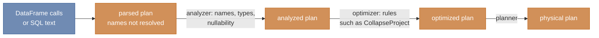
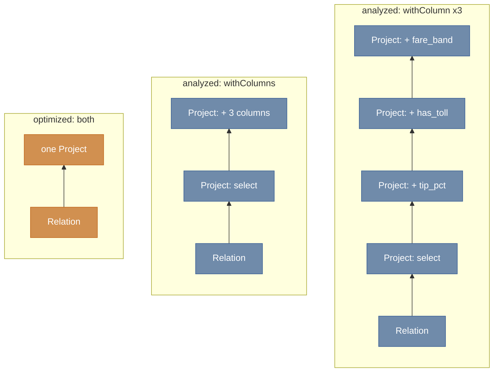
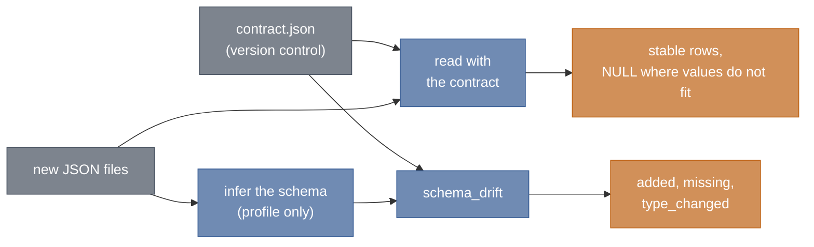
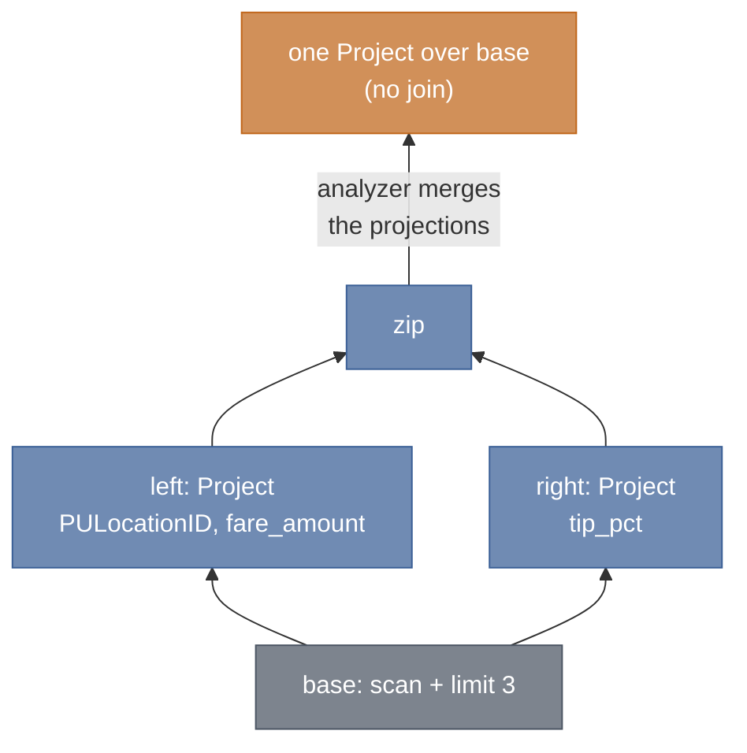

# Chapter 5: DataFrames, columns and schemas

Part I used DataFrames as a convenient way to write a query. This chapter looks at what a DataFrame is. A DataFrame holds no data. It holds a schema and a plan, and each method that you call adds one node to that plan. The schema is the contract between your code and the data, and data from other teams often breaks that contract.

**A DataFrame is an immutable pair of a schema and a logical plan. The analyzer resolves names, types and nullability in that plan before any task runs. Thus the shape of your code changes the work of the analyzer. The schema that you declare decides what the data can do to your job.**

The scripts are in [`code/ch05`](https://github.com/lisancao/spark-masterclass/tree/main/code/ch05), and each output block below comes from `code/ch05/output/`. The scripts use two data sets:

- `plans.py` and `type_system.py` use the June 2026 taxi trips from Part I.
- `drift.py` uses three days of order events from SparkTutor, copied to `code/data/events`. The shape of these events changes every day.

## Step 1: A DataFrame is a schema and a plan

The first lines of `plans.py` read the trips and select three columns:

```python
trips = spark.read.parquet(str(TRIPS))
fares = trips.select("fare_amount", "tip_amount", "tolls_amount")
print(fares.schema.simpleString())
print("jobs run by read + select:", [(j["name"], j["numTasks"]) for j in new_jobs])
print("same object after withColumn?", fares is fares.withColumn("x", F.lit(1)))
```

```text
== 1. a DataFrame is a schema and a plan
struct<fare_amount:double,tip_amount:double,tolls_amount:double>
jobs run by read + select: [('parquet at NativeMethodAccessorImpl.java:0', 1)]
same object after withColumn? False
```

The schema is known before Spark reads a row. Parquet keeps its schema in the file footer, and `spark.read.parquet` runs one job with one task to read that footer.

In the 4.3.0 source, `ParquetUtils.inferSchema` sends the files to `ParquetFileFormat.mergeSchemasInParallel`, and that function starts the job. Without `mergeSchema`, only one file is in that job. The `select` runs nothing. It returns a new DataFrame that wraps the old plan in a `Project` node.

A DataFrame is immutable. `withColumn` does not change `fares`. It returns a different object with a larger plan. This is not a copy of data, because there is no data to copy.

Immutability is important for a different reason. A plan that never changes is a full recipe for its result. Thus Spark can run the plan again for a lost partition, and it can compare two plans, as Chapter 3 did with `sameSemantics`.

## Step 2: The everyday operations

Most DataFrame code uses a small set of methods. `basics.py` shows them on the "blogs" table from the book *Learning Spark*. It is six rows with an explicit schema:

```python
schema = StructType([
    StructField("Id", IntegerType(), False),
    StructField("First", StringType()),
    StructField("Last", StringType()),
    StructField("Url", StringType()),
    StructField("Published", StringType()),
    StructField("Hits", IntegerType()),
    StructField("Campaigns", ArrayType(StringType())),
])
blogs = spark.createDataFrame(data, schema)
```

```text
== 1. the blogs table, with an explicit schema
root
 |-- Id: integer (nullable = false)
 |-- First: string (nullable = true)
 |-- Last: string (nullable = true)
 |-- Url: string (nullable = true)
 |-- Published: string (nullable = true)
 |-- Hits: integer (nullable = true)
 |-- Campaigns: array (nullable = true)
 |    |-- element: string (containsNull = true)
```

The schema says that `Id` cannot be NULL, and that `Campaigns` is an array of strings. `createDataFrame` makes sure that each Python row agrees with this schema (Step 11 shows the check). Then a chain of methods makes a report:

```python
report = (blogs
          .where(F.col("Hits") > 5000)
          .withColumns({"Big_Hitter": F.col("Hits") > 10000,
                        "Published_Date": F.to_date("Published", "M/d/yyyy"),
                        "Channels": F.size("Campaigns")})
          .drop("Url", "Published", "Campaigns")
          .withColumnRenamed("First", "first_name")
          .orderBy(F.desc("Hits")))
```

```text
== 2. select, where, withColumns, drop, rename, sort
+---+----------+-------+-----+----------+--------------+--------+
| Id|first_name|   Last| Hits|Big_Hitter|Published_Date|Channels|
+---+----------+-------+-----+----------+--------------+--------+
|  5|     Matei|Zaharia|40578|      true|    2014-05-14|       4|
|  6|   Reynold|    Xin|25568|      true|    2015-03-02|       2|
|  4| Tathagata|    Das|10568|      true|    2018-05-12|       2|
|  2|    Brooke|  Wenig| 8908|     false|    2018-05-05|       2|
|  3|     Denny|    Lee| 7659|     false|    2019-06-07|       4|
+---+----------+-------+-----+----------+--------------+--------+

columns: ['Id', 'first_name', 'Last', 'Hits', 'Big_Hitter', 'Published_Date', 'Channels']
drop a name that is not there: True
```

Each method returns a new DataFrame:

- `where` keeps the rows where the condition is true. `filter` is the same method with a different name.
- `withColumns` adds or replaces columns from a dictionary. `to_date` with the pattern `M/d/yyyy` changes the text `5/14/2014` into a `date`. `size` counts the elements of an array.
- `drop` removes columns. A name that is not in the DataFrame gives no error, so a misspelt name in `drop` keeps the column.
- `withColumnRenamed` changes one name. `withColumnsRenamed` (Step 16) changes many names with a dictionary.
- `orderBy` sorts. `F.desc` sorts from the largest value to the smallest.

You can also write an expression as SQL text. `selectExpr` takes one SQL expression for each column:

```python
tiers = blogs.selectExpr(
    "Id",
    "CASE WHEN Hits > 20000 THEN 'star' WHEN Hits > 8000 THEN 'regular' ELSE 'new' END AS tier",
    "Hits::STRING || ' hits' AS label",
    "array_contains(Campaigns, 'FB') AS on_fb")
```

```text
== 3. expr, selectExpr and SQL expressions
+---+-------+----------+-----+
| Id|   tier|     label|on_fb|
+---+-------+----------+-----+
|  1|    new| 4535 hits|false|
|  2|regular| 8908 hits|false|
|  3|    new| 7659 hits| true|
|  4|regular|10568 hits| true|
|  5|   star|40578 hits| true|
|  6|   star|25568 hits|false|
+---+-------+----------+-----+

expr vs when/otherwise, same optimized plan: True
```

`CASE WHEN` in SQL and `F.when(...).when(...).otherwise(...)` in Python make the same expression. The last line of the output compares the two optimized plans, and they are the same. The first condition that is true gives the value. A row that matches no condition and has no `ELSE` (or no `otherwise`) gets NULL. `Hits::STRING` is the cast syntax that Spark 4.0 added, and `||` joins two strings.

Choose the form that is easier to read. A long `CASE WHEN` is often clearer as SQL text. A condition that your program builds in a loop is easier as Python `Column` objects. An error in SQL text shows only when the driver parses it. But that also occurs before any task runs.

## Step 3: Three ways to name a column

A `Column` is an expression, not a set of values. You can make one in three ways:

```python
print(repr(F.col("fare_amount")), repr(fares["fare_amount"]), repr(F.expr("fare_amount * 2")))
print("F.col('no_such_column') ->", repr(F.col("no_such_column")))       # a name, not checked yet
try:
    fares["no_such_column"]                                               # Classic checks it now
except Exception as e:
    print("fares['no_such_column'] ->", str(e).splitlines()[0][:70])
```

```text
== 2. column references
Column<'fare_amount'> Column<'fare_amount'> Column<'fare_amount * 2'>
F.col('no_such_column') -> Column<'no_such_column'>
fares['no_such_column'] -> [UNRESOLVED_COLUMN.WITH_SUGGESTION] A column, variable, or function pa
```

The three forms are different:

- `F.col("x")` makes an unresolved attribute. It is only a name. Spark examines it later, when the column is part of a DataFrame.
- `df["x"]` asks the DataFrame for its column. In Classic PySpark, the driver resolves the name immediately, so a bad name fails on that line.
- `F.expr("...")` sends a SQL string to the SQL parser. Use it for SQL syntax that has no Python function, for example `TRIM(LEADING '0' FROM x)`.

On Spark Connect, `df["x"]` does not fail immediately. `basics.py` runs the same two lines in Classic mode and against the Part II Connect server:

```text
== 7. a bad column name, mode: Classic
df['typo']: ERROR [UNRESOLVED_COLUMN.WITH_SUGGESTION] A column, variable, or function parameter with n
df.select(df['typo']).collect(): ERROR [UNRESOLVED_COLUMN.WITH_SUGGESTION] A column, variable, or function parameter with n
== 7. a bad column name, mode: Connect
df['typo']: Column<'typo'>
df.select(df['typo']).collect(): ERROR [CANNOT_RESOLVE_DATAFRAME_COLUMN] Cannot resolve dataframe column "typo". It's proba
```

In Classic mode, `df["typo"]` fails on its line. On Connect, it returns a `Column` and no error occurs. The Connect client does not keep the schema. It puts the name in the plan, and the server finds the error when it analyzes the plan, at `collect()`. The error class is also different. [Chapter 4](ch04-spark-connect.md) showed this difference in more detail. Code that must run in the two modes cannot use the `df["x"]` line as a check.

## Step 4: What a withColumn chain adds to the plan

`plans.py` adds three columns with three `withColumn` calls. Then it prints three of the plans that Catalyst makes from the chain:

```python
chain = (fares
         .withColumn("tip_pct", F.col("tip_amount") / F.col("fare_amount"))
         .withColumn("has_toll", F.col("tolls_amount") > 0)
         .withColumn("fare_band", F.when(F.col("fare_amount") < 10, "short").otherwise("long")))
qe = chain._jdf.queryExecution()
```



The relation at the bottom of each plan has all 21 columns of the file. The text below shows these columns only in the first plan, because they do not change:

```text
== 3. withColumn x3: parsed (unresolved) plan
'Project [unresolvedstarwithcolumns(fare_band, CASE WHEN '`<`('fare_amount, 10) THEN short ELSE long END, None)]
+- Project [fare_amount#10, tip_amount#13, tolls_amount#14, tip_pct#23, (tolls_amount#14 > cast(0 as double)) AS has_toll#24]
   +- Project [fare_amount#10, tip_amount#13, tolls_amount#14, (tip_amount#13 / fare_amount#10) AS tip_pct#23]
      +- Project [fare_amount#10, tip_amount#13, tolls_amount#14]
         +- Relation [VendorID#0,tpep_pickup_datetime#1,...,request_source#20] parquet

== analyzed plan
Project [fare_amount#10, tip_amount#13, tolls_amount#14, tip_pct#23, has_toll#24, CASE WHEN (fare_amount#10 < cast(10 as double)) THEN short ELSE long END AS fare_band#25]
+- Project [fare_amount#10, tip_amount#13, tolls_amount#14, tip_pct#23, (tolls_amount#14 > cast(0 as double)) AS has_toll#24]
   +- Project [fare_amount#10, tip_amount#13, tolls_amount#14, (tip_amount#13 / fare_amount#10) AS tip_pct#23]
      +- Project [fare_amount#10, tip_amount#13, tolls_amount#14]
         +- Relation [...] parquet

== optimized plan
Project [fare_amount#10, tip_amount#13, tolls_amount#14, (tip_amount#13 / fare_amount#10) AS tip_pct#23, (tolls_amount#14 > 0.0) AS has_toll#24, CASE WHEN (fare_amount#10 < 10.0) THEN short ELSE long END AS fare_band#25]
+- Relation [...] parquet
```

Read the plans from the bottom to the top. Four facts are in them:

- **The parsed plan is almost resolved.** Only the top node has a quote mark (`'Project`), which means "not resolved". In Classic PySpark, each `withColumn` call makes a new DataFrame, and the driver analyzes each new DataFrame immediately. Thus the lower nodes already have attribute IDs such as `fare_amount#10`.
- **An attribute ID is the true name of a column.** `#10` is the `fare_amount` from the file in every node. The analyzer uses these IDs, not the text names, after resolution.
- **The analyzer adds casts.** `fare_amount < 10` compares a double with an integer literal. The analyzed plan shows `cast(10 as double)`. The optimizer then folds the cast into the constant `10.0`.
- **Each `withColumn` adds one `Project`.** Three calls give three new `Project` nodes on top of the `select`. The optimizer rule `CollapseProject` merges them into one node, because two projections, one on top of the other, are one projection.

`withColumns` takes a dictionary and makes one `Project` for all the new columns:

```text
== withColumns: analyzed plan
Project [fare_amount#10, tip_amount#13, tolls_amount#14, (tip_amount#13 / fare_amount#10) AS tip_pct#26, (tolls_amount#14 > cast(0 as double)) AS has_toll#27, CASE WHEN (fare_amount#10 < cast(10 as double)) THEN short ELSE long END AS fare_band#28]
+- Project [fare_amount#10, tip_amount#13, tolls_amount#14]
   +- Relation [...] parquet

same optimized plan: True
```

The two optimized plans are the same, so the two forms run the same tasks. The difference is in the analyzed plan, which is the plan that the driver must build and examine. The next step measures that difference.



## Step 5: The cost of a long chain

Many programs call `withColumn` in a loop, once for each new column. Each call makes a new DataFrame, and the driver analyzes each one. Thus the work of the analyzer increases with each call. `plans.py` builds DataFrames with `n` new columns in two ways, and measures the time to build, analyze and optimize each one:

```python
def build_loop(n):
    df = fares
    for i in range(n):
        df = df.withColumn(f"c{i}", F.col("fare_amount") + i)
    return df


def build_once(n):
    return fares.withColumns({f"c{i}": F.col("fare_amount") + i for i in range(n)})
```

```text
== 4. build + analyze + optimize, median of 7 after a warmup (ms)
 columns  withColumn loop  withColumns  Projects (loop)
      25             48.9         25.3               26
      50            101.1         47.4               51
     100            286.2        110.7              101
     200            957.4        285.9              201
     400           7582.4        703.5              401
```

The script ran under the shared bench lock on a quiet machine, with `local[*]` on 16 cores. Each number is the median of 7 runs after one warmup run. The loop leaves one `Project` for each call (plus the `select`), and `withColumns` leaves one.

The two curves do not have the same shape. From 200 to 400 columns, `withColumns` takes about 2.5 times longer. The loop takes about 8 times longer. Each loop call analyzes a plan that is one node deeper than the plan before it. Thus the total work increases faster than the number of columns.

No task runs in this measurement. All the time is driver time, before the first job starts. The loop also leaves one `Project` node per call in the analyzed plan, and the optimizer must collapse all of them.

With a few columns the difference is small. With hundreds of columns, the loop costs seconds for each DataFrame that you build. If you build such a DataFrame inside another loop, the cost multiplies. Use `withColumns` or one `select` when you add more than a few columns.

## Step 6: Spark's types

`typeof()` gives the SQL type of any value. `type_system.py` applies it to a literal of each main type:

```text
== 1. typeof over literals
  true                                     boolean
  1Y                                       tinyint
  1S                                       smallint
  1                                        int
  1L                                       bigint
  1.5F                                     float
  1.5D                                     double
  1.5                                      decimal(2,1)
  'x'                                      string
  X'00'                                    binary
  DATE'2026-06-01'                         date
  TIMESTAMP'2026-06-01 10:00:00'           timestamp
  TIMESTAMP_NTZ'2026-06-01 10:00:00'       timestamp_ntz
  INTERVAL 2 DAYS                          interval day
  INTERVAL '1-2' YEAR TO MONTH             interval year to month
  array(1, 2)                              array<int>
  map('a', 1)                              map<string,int>
  named_struct('id', 1, 'plan', 'pro')     struct<id:int,plan:string>
  parse_json('{"a": 1}')                   variant
  'x' COLLATE UTF8_LCASE                   string collate UTF8_LCASE
  TIME'10:07:00'                           time(6)
```

A literal with a decimal point and no suffix is a `decimal`, not a `double`. Thus `1.5` is `decimal(2,1)`. The table gives the DDL name, the PySpark class and the Python value for each type:

| DDL name | PySpark class | Holds | Python value |
|---|---|---|---|
| `BOOLEAN` | `BooleanType` | true or false | `bool` |
| `TINYINT`, `SMALLINT` | `ByteType`, `ShortType` | 1-byte and 2-byte integers | `int` |
| `INT` | `IntegerType` | 4-byte integers | `int` |
| `BIGINT` | `LongType` | 8-byte integers | `int` |
| `FLOAT`, `DOUBLE` | `FloatType`, `DoubleType` | binary floating point | `float` |
| `DECIMAL(p,s)` | `DecimalType(p, s)` | exact decimals, `p` digits, `s` after the point | `decimal.Decimal` |
| `STRING` | `StringType` | text, with an optional collation | `str` |
| `BINARY` | `BinaryType` | bytes | `bytes`, `bytearray` |
| `DATE` | `DateType` | a calendar day | `datetime.date` |
| `TIMESTAMP` | `TimestampType` | an instant | `datetime.datetime` |
| `TIMESTAMP_NTZ` | `TimestampNTZType` | a wall-clock date and time | `datetime.datetime` |
| `TIME(p)` | `TimeType` | a time of day (Step 8) | `datetime.time` |
| `INTERVAL ...` | `DayTimeIntervalType`, `YearMonthIntervalType` | a length of time | `datetime.timedelta` (day-time only) |
| `ARRAY<T>` | `ArrayType(T)` | an ordered list | `list` |
| `MAP<K,V>` | `MapType(K, V)` | key to value pairs | `dict` |
| `STRUCT<...>` | `StructType([...])` | named fields | `Row` |
| `VARIANT` | `VariantType` | any JSON-like value | `VariantVal` |

`VARIANT` holds a JSON-like value as one typed column. Spark keeps it in a binary form, so a query can get a field without a parse of the full text for each row. `basics.py` gives a first look:

```python
v.selectExpr("typeof(payload)", "variant_get(payload, '$.device.os', 'string') AS os",
             "payload:device.ver::int AS ver", "payload:tags[1]::string AS tag2")
```

```text
== 6. VARIANT
+---------------+---+---+----+
|typeof(payload)| os|ver|tag2|
+---------------+---+---+----+
|        variant|ios| 17|   b|
+---------------+---+---+----+
```

`variant_get` takes a JSON path and a target type. The `:` operator is a short form of the same path, and `::` casts the result. Part III gives `VARIANT` its own chapter, with the 4.3 functions that edit a value. [Chapter 6](ch06-cleaning-values.md) shows the collated string type. Spark 4.3 also has a preview of nanosecond timestamps, and Chapter 6 shows them.

## Step 7: Numbers: overflow, doubles and decimals

ANSI mode is on by default since Spark 4.0. Thus a number that does not fit its type causes an error. It does not wrap to a different value:

```text
== 2. numbers
  SELECT CAST(300 AS TINYINT)                  ERROR [CAST_OVERFLOW] The value 300 of the type "INT" cannot be cast to "TINYINT" due to an overflow. 
  SELECT 2147483647 + 1                        ERROR [ARITHMETIC_OVERFLOW] overflow. Use 'try_add' to tolerate overflow and return NULL instead. If n
  SELECT CAST(12345.678 AS DECIMAL(5,2))       ERROR [NUMERIC_VALUE_OUT_OF_RANGE.WITH_SUGGESTION]  12345.678 cannot be represented as Decimal(5, 2). 
   Row(dbl=0.30000000000000004, dec=Decimal('0.3'), rounded=Decimal('123.46'), too_big=None)
   DecimalType() is decimal(10,0)
```

The last two lines show three rules for money:

- **A `double` is a binary fraction.** `0.1D + 0.2D` is `0.30000000000000004`. This error is acceptable for a distance in miles. It is not acceptable for a sum of fares.
- **A `decimal` is exact, and it has a fixed scale.** `CAST(123.456 AS DECIMAL(5,2))` rounds to `123.46`. A value with too many digits before the point causes an error. `try_cast` returns NULL for that value.
- **`DecimalType()` without arguments is `decimal(10,0)`.** It has no digits after the point. Always give the precision and the scale for money, for example `DECIMAL(12,2)`.

Chapter 6 shows the full set of ANSI errors and the `try_` functions that return NULL.

## Step 8: Two timestamp types, intervals and TIME

Spark has two timestamp types. If you use the wrong type, the times can move by some hours.

- **`TIMESTAMP`**, also called `TIMESTAMP_LTZ`, is an instant on the world timeline. Spark keeps it as microseconds since 1970-01-01 00:00 UTC. Spark uses the session time zone (`spark.sql.session.timeZone`) to convert text to an instant and back.
- **`TIMESTAMP_NTZ`** is a wall-clock value with no time zone. It does not change with the session time zone. The taxi columns are this type, because the TLC records local New York time.

`type_system.py` parses the same text under two session time zones, and converts each value to seconds since 1970 UTC:

```python
q = ("SELECT TIMESTAMP '2026-06-01 10:00:00' AS ts, TIMESTAMP_NTZ '2026-06-01 10:00:00' AS ntz, "
     "unix_timestamp(TIMESTAMP '2026-06-01 10:00:00') AS ts_epoch, "
     "unix_seconds(TIMESTAMP_NTZ '2026-06-01 10:00:00') AS ntz_epoch")
for tz in ["UTC", "America/New_York"]:
    spark.conf.set("spark.sql.session.timeZone", tz)
```

```text
== 3. TIMESTAMP vs TIMESTAMP_NTZ under two session time zones
  UTC               ts_epoch=1780308000  ntz_epoch=1780308000
  America/New_York  ts_epoch=1780322400  ntz_epoch=1780308000
  python TZ=UTC               collect: datetime.datetime(2026, 6, 1, 10, 0) | toPandas: 2026-06-01 10:00:00
  python TZ=Asia/Ho_Chi_Minh  collect: datetime.datetime(2026, 6, 1, 17, 0) | toPandas: 2026-06-01 10:00:00
  interval day to second -> datetime.timedelta(days=2, seconds=7200)
  interval year to month -> ERROR [NOT_IMPLEMENTED] YearMonthIntervalType.fromInternal is not implemented.
  TIME literal           -> datetime.time(10, 7)
  CAST('10:07' AS TIME)  -> ERROR [UNSUPPORTED_TIME_TYPE] The data type TIME is not supported. SQLSTATE: 0A000
```

<figure markdown>
  <video autoplay loop muted playsinline controls width="1280" height="720" poster="../../media/clips/ch05-zones.webp">
    <source src="../../media/clips/ch05-zones.mp4" type="video/mp4">
  </video>
  <figcaption><code>type_system.py</code> runs against Spark 4.3.0. The same <code>TIMESTAMP</code> text gives two instants under two session time zones. The <code>TIMESTAMP_NTZ</code> text gives one.</figcaption>
</figure>

The `TIMESTAMP` text gives two instants, 14,400 seconds (four hours) apart. The `TIMESTAMP_NTZ` text gives the same number in both zones. (`unix_seconds` accepts `TIMESTAMP_NTZ` in 4.3, and it reads the wall clock as UTC.)

The next two lines show a trap in PySpark. `collect()` converts a `TIMESTAMP` to a naive `datetime` in the time zone of the Python process, not the session time zone. The script runs the same query in two child processes, with the session time zone set to UTC in both. The value that `collect()` gives changes with the `TZ` of the process. `toPandas()` uses the session time zone, so it gives the same value in both. Set `spark.sql.session.timeZone` in each job, and compare instants inside Spark, not after `collect()`.

A literal or a cast that says only `TIMESTAMP` gets the type from `spark.sql.timestampType`. The default is `TIMESTAMP_LTZ`:

```text
spark.sql.timestampType=TIMESTAMP_LTZ: typeof(TIMESTAMP'2026-06-01 10:00') = timestamp
spark.sql.timestampType=TIMESTAMP_NTZ: typeof(TIMESTAMP'2026-06-01 10:00') = timestamp_ntz
```

Do not change this configuration in one job only. The same SQL text then gives a different type in different jobs. Write `TIMESTAMP_NTZ` or `TIMESTAMP_LTZ` in the code when the difference is important.

Intervals are lengths of time. A day-time interval collects as a `timedelta`. In 4.3.0, a year-month interval still cannot go to Python. Cast it to a string first.

The `TIME` type is a time of day with no date. In 4.3.0 it is behind the internal configuration `spark.sql.timeType.enabled`, which is `false` by default. The output shows an inconsistency: the `TIME'10:07:00'` literal works and collects as `datetime.time`, but `CAST(... AS TIME)` fails with `UNSUPPORTED_TIME_TYPE`. Do not use `TIME` in production code until the configuration is public.

## Step 9: Write a schema down

You can write a schema as a DDL string or as a `StructType`. DDL is short. A `StructType` is better when a program makes or examines the schema:

```python
ddl = ("id BIGINT NOT NULL, name STRING, tags ARRAY<STRING>, "
       "address STRUCT<city: STRING, zip: STRING>, amount DOUBLE COMMENT 'order total in CAD'")
s = StructType.fromDDL(ddl)
built = StructType([
    StructField("id", LongType(), False),
    StructField("name", StringType()),
    StructField("tags", ArrayType(StringType())),
    StructField("address", StructType([StructField("city", StringType()), StructField("zip", StringType())])),
])
```

```text
== 4. DDL, StructType, JSON
struct<id:bigint,name:string,tags:array<string>,address:struct<city:string,zip:string>,amount:double>
id BIGINT NOT NULL,name STRING,tags ARRAY<STRING>,address STRUCT<city: STRING, zip: STRING>,amount DOUBLE COMMENT 'order total in CAD'
root
 |-- id: long (nullable = false)
 |-- name: string (nullable = true)
 |-- tags: array (nullable = true)
 |    |-- element: string (containsNull = true)
 |-- address: struct (nullable = true)
 |    |-- city: string (nullable = true)
 |    |-- zip: string (nullable = true)
 |-- amount: double (nullable = true)

comment lives in metadata: {'comment': 'order total in CAD'}
fromDDL == hand-built (without amount)? True
{"fields":[{"metadata":{},"name":"id","nullable":false,"type":"long"},{"metadata":{},"na
round trip equal: True
differ only in nullability: == False | simpleString equal True
```

The output shows the four forms of one schema:

- `simpleString()` gives the types only. It does not show nullability or comments.
- `toDDL()` gives DDL that you can put in a `CREATE TABLE` statement. `StructType.fromDDL` and `toDDL` use the SQL parser in the JVM, so they need an active session.
- `treeString()` gives the text that `printSchema()` prints. It uses the name `long`, and the other forms use `bigint`. The two names are for one type.
- `json()` gives a full JSON document. `StructType.fromJson` reads it back, and it does not need a session.

A comment is in the `metadata` dictionary of the field. The metadata goes through `json()`, through Parquet files and through most transformations.

`StructType` equality compares names, types, nullability, field order and metadata. Two schemas that differ only in nullability are not equal, but their `simpleString()` values are equal. Step 14 uses this fact.

The JSON form is the base of a **schema contract**. A schema contract is a file that holds the agreed shape of a source. Keep the file with your code in version control. Then code can load the file, compare it with the data that arrives, and read files through it.

## Step 10: Nested types and paths

Data from other systems usually contains nested values. A **struct** contains named fields, and each row has the same fields. An **array** holds a list of values of one type. A **map** holds key-value pairs whose keys are not known before you read the data. You use a path to get a value from each type:

```python
events = spark.read.json(str(EVENTS))
print(events.schema["user"].dataType["geo"])
print(events.schema.fieldNames())
nested.select(F.col("user.geo.country"), F.col("items")[0], F.col("tags")["color"]).show()
```

```text
== 5. nested types and paths
StructField('geo', StructType([StructField('country', StringType(), True)]), True)
['_corrupt_record', 'amount', 'event', 'event_type', 'items', 'ts', 'user', 'user_id']
+-------+--------+-----------+
|country|items[0]|tags[color]|
+-------+--------+-----------+
|     CA|      10|        red|
+-------+--------+-----------+
```

A `StructType` uses the same path. `schema["user"]` is a `StructField`, its `dataType` is the nested `StructType`, and you can index that type again. Part III teaches the complex types and the functions that operate on them.

## Step 11: Nullability: what the analyzer tracks and what file readers drop

Each field has a `nullable` flag. The analyzer calculates the flag for each expression, and the optimizer uses it. `plans.py` filters a non-nullable column for NULL, and then does the same on a nullable column:

```python
ids = spark.range(5)
print(plan(ids.where("id IS NULL"), "simple").strip())
print(plan(fares.where("fare_amount IS NULL"), "simple").strip())
```

```text
== 5. nullability in the plan
range: struct<id:bigint> False
== Physical Plan ==
LocalTableScan <empty>, [id#14404L]
--- the same filter on a nullable column
== Physical Plan ==
*(1) Filter isnull(fare_amount#10)
+- *(1) ColumnarToRow
   +- FileScan parquet [fare_amount#10,tip_amount#13,tolls_amount#14] Batched: true, DataFilters: [isnull(fare_amount#10)], ... PushedFilters: [IsNull(fare_amount)], ...
  a: bigint nullable=False
  b: double nullable=True
  c: int nullable=True
  d: int nullable=False
```

The `id` column of `spark.range` cannot be NULL. Thus the optimizer replaces `id IS NULL` with `false`, and it replaces the full query with an empty `LocalTableScan`. No task reads a row. On `fare_amount`, the filter stays, and Spark pushes it into the Parquet reader.

The four derived columns show how the analyzer calculates nullability:

- `id + 1` is not nullable, because its input is not nullable.
- `id / 0` is nullable, because division gives NULL when the divisor is zero, if ANSI mode is off. The type must allow both modes.
- `when(id > 2, 1)` without `otherwise` is nullable, because the rows that do not match get NULL.
- `coalesce(NULL, 0)` is not nullable, because its last argument is a constant that is not NULL.

File readers do not keep the promise of a schema. `type_system.py` reads the events with a schema that says `NOT NULL`:

```text
== 6. nullability
struct<event:string,user_id:bigint> [True, True]
events with no user_id: 41 of 61
createDataFrame with None: ERROR [FIELD_NOT_NULLABLE_WITH_NAME] field id: This field is not nullable, but got None.
verifySchema=False: [Row(id=1), Row(id=0)]
```

Both fields come back nullable, and 41 of the 61 events have no `user_id`. No error occurs. In the 4.3.0 source, `DataSource.resolveRelation` calls `dataSchema.asNullable` for file sources, because nothing guarantees that the files agree with the schema. Thus `NOT NULL` in a read schema is documentation, not a check. To enforce it, count the NULL values, or write to a table format that enforces constraints (Part VI).

`createDataFrame` does a check, because it converts Python objects. It rejects `None` for a non-nullable field. With `verifySchema=False`, it skips the check, and the `None` becomes `0`, a value that was not in the data.

!!! warning "CAUTION"
    Do not set `verifySchema=False` for data that you do not control. A `None` in a non-nullable field becomes `0`, and no error occurs.

## Step 12: Inference, and why the result changes

If you do not give a schema, the JSON reader reads all the records once to infer the schema. Then it reads them again for the query. The inferred schema depends on the records that the reader saw. `drift.py` reads each day of the events alone:

```text
== 1. inferred schema, one day at a time
01 struct<amount:double,event:string,ts:string,user_id:bigint>
02 struct<amount:string,event:string,items:array<struct<qty:bigint,sku:string>>,ts:string,user:struct<id:bigint,plan:string>>
03 struct<_corrupt_record:string,amount:struct<currency:string,value:double>,event_type:string,items:array<struct<qty:bigint,sku:string>>,ts:string,user:struct<geo:struct<country:string>,id:bigint,plan:string>>
```

Three days give three schemas. `amount` is a `double`, then a `string`, then a `struct`. A job that infers its schema changes its output schema each time a new kind of file arrives. The output also shows four rules of JSON inference:

- The reader sorts the fields by name.
- A whole number becomes `bigint`.
- If the types of a field do not agree, the field becomes `string`.
- A timestamp stays a `string`, unless you set `inferTimestamp` to `true`.

A number with a decimal point becomes `double`. The option `prefersDecimal` makes the reader infer a `decimal` when the value fits:

```text
JSON default:       struct<amount:double>
JSON prefersDecimal: struct<amount:decimal(4,2)>
```

Use `prefersDecimal` for money in JSON, because a `double` cannot hold `0.1` exactly (Step 7).

Day 3 has a truncated line, so the reader adds a `_corrupt_record` column. Chapter 13 shows the parse modes and the corrupt record column.

`samplingRatio` tells the reader to infer from a fraction of the records. This is faster, and the result is less stable:

```text
== 2. samplingRatio over the whole folder (local[4])
1.0   8 columns, 61 rows: struct<_corrupt_record:string,amount:string,event:string,event_type:string,it...
0.1   7 columns, 61 rows: struct<_corrupt_record:string,amount:string,event:string,event_type:string,it...
0.05  5 columns, 61 rows: struct<amount:double,event:string,items:array<struct<qty:bigint,sku:string>>,...
0.01  0 columns, 61 rows: struct<>
```

At 0.1, the `user_id` column is not in the schema. At 0.05, `amount` is a `double` again, so the string amounts of day 2 become NULL. At 0.01, the sample has no records, and the DataFrame has 61 rows and no columns. The sample uses a fixed seed, so the same files give the same result. But Spark takes the sample in each partition, so a different number of files or cores gives a different result.

## Step 13: Read through a schema that you chose

A schema that you give removes the inference pass, and it gives the same output shape on each run. Values that do not fit the declared type become NULL. The reader ignores the fields that the schema does not name:

```python
c = spark.read.schema("event STRING, amount DOUBLE").json(str(EVENTS))
(c.groupBy(F.col("_metadata.file_name").alias("file"))
  .agg(F.count("*").alias("rows"), F.count("amount").alias("amount_ok"))
  .orderBy("file").show(truncate=False))
```

```text
== 3. an enforced schema
+----------------------+----+---------+
|file                  |rows|amount_ok|
+----------------------+----+---------+
|events_2026-10-01.json|20  |20       |
|events_2026-10-02.json|20  |15       |
|events_2026-10-03.json|21  |0        |
+----------------------+----+---------+
```

`F.count("amount")` counts the values that are not NULL. `_metadata.file_name` is a hidden column that gives the source file of each row. The counts show how much data did not fit: five string amounts on day 2 and all the struct amounts on day 3. The schema protects the job. The counts tell you what the schema removed.

Parquet is different, because each file keeps the physical type of each column. A read schema that does not agree with a file causes an error, not NULL values. `drift.py` writes day 1 (`amount` is a double) and day 2 (`amount` is a string) to Parquet, and reads both with `amount DOUBLE`:

```text
== 4. Parquet: type mismatch and mergeSchema
double + string files: ERROR [FAILED_READ_FILE.PARQUET_COLUMN_DATA_TYPE_MISMATCH] Encountered
    Data type mismatches when reading Parquet column [amount]. Expected Spark type double, actual Parquet type BINARY.
default     struct<amount:double,event:string,ts:string,user_id:bigint,day:int>
mergeSchema struct<amount:double,event:string,ts:string,user_id:bigint,items:array<struct<qty:bigint,sku:string>>,user:struct<id:bigint,plan:string>,day:int>
merge double + string: ERROR [CANNOT_MERGE_SCHEMAS] Failed merging schemas:
    [CANNOT_MERGE_INCOMPATIBLE_DATA_TYPE] Failed to merge incompatible data types "DOUBLE" and "STRING".
```

Without `mergeSchema`, Spark takes the schema from one file (Step 1). Thus the columns that are only in other files are not in the result. `mergeSchema` reads the footer of each file and makes a union of the columns. `spark.sql.parquet.mergeSchema` is `false` by default, because the merge reads all footers. The merge adds columns, but it does not reconcile types. A `double` in one file and a `string` in another file stop the read.

## Step 14: Detect drift in code

**Drift** is a difference between the schema that you expect and the schema that arrives. There are three kinds of drift: a new field, a field that is not there, and a changed type. A small recursive function finds all three kinds:

```python
def schema_drift(expected, actual, prefix=""):
    """(kind, path, detail) for each field missing, added or changed; nullability ignored."""
    drift = []
    actual_fields = {f.name: f for f in actual.fields}
    for field in expected.fields:
        path = prefix + field.name
        if field.name not in actual_fields:
            drift.append(("missing", path, field.dataType.simpleString()))
            continue
        e, a = field.dataType, actual_fields[field.name].dataType
        if isinstance(e, StructType) and isinstance(a, StructType):
            drift.extend(schema_drift(e, a, path + "."))
        elif e.simpleString() != a.simpleString():
            drift.append(("type_changed", path, f"{e.simpleString()} -> {a.simpleString()}"))
    for field in actual.fields:
        if field.name not in {f.name for f in expected.fields}:
            drift.append(("added", prefix + field.name, field.dataType.simpleString()))
    return sorted(drift)
```

The function compares types with `simpleString()`, so a change of nullability is not drift. File readers change nullability anyway (Step 11). The function goes into structs, so a new field in `user` shows as `user.geo` and not as a change of all of `user`. `drift.py` compares the contract with day 1 and with day 3:

```text
== 5. drift against the contract
day 01:
   ('added', 'user_id', 'bigint')
   ('missing', 'items', 'array<struct<qty:bigint,sku:string>>')
   ('missing', 'user', 'struct<id:bigint,plan:string>')
day 03:
   ('added', '_corrupt_record', 'string')
   ('added', 'event_type', 'string')
   ('added', 'user.geo', 'struct<country:string>')
   ('missing', 'event', 'string')
   ('type_changed', 'amount', 'double -> struct<currency:string,value:double>')
```

<figure markdown>
  <video autoplay loop muted playsinline controls width="1280" height="720" poster="../../media/clips/ch05-drift.webp">
    <source src="../../media/clips/ch05-drift.mp4" type="video/mp4">
  </video>
  <figcaption><code>drift.py</code> runs against Spark 4.3.0. It compares each day of events with the schema contract and reports the fields that changed.</figcaption>
</figure>

Day 3 renamed `event` to `event_type`, so the report shows one field as `missing` and one field as `added`. A program cannot know that the two are the same field. A person must decide. Decide for each kind of drift what the job does:

- A new field is usually safe. Write it to the log.
- A field that is not there can be a renamed field. Send it to a person.
- A changed type loses data without an error (Step 13). Stop the job or send an alert.

Field order is part of a struct type, and JSON inference sorts fields by name. Thus a contract with `STRUCT<sku: STRING, qty: BIGINT>` has a different `simpleString()` from the inferred `struct<qty:bigint,sku:string>`. Write the nested fields of a contract in alphabetical order. The function compares top-level struct fields by name, but it compares a struct inside an array by its `simpleString()`.



## Step 15: Combine and reshape DataFrames

`union` combines two DataFrames by column position, not by name. `unionByName` matches the names. Both fail on the events:

```text
== 6. union, unionByName, allowMissingColumns
union      : ERROR [NUM_COLUMNS_MISMATCH] UNION can only be performed on inputs with the same number of columns, but the first input has 4 columns and the second input h
unionByName: ERROR [UNRESOLVED_COLUMN_AMONG_FIELD_NAMES] Cannot resolve column name "event" among (_corrupt_record, amount, event_type, items, ts, user). SQLSTATE: 42703
d1+d2 allowMissing: double
+- *(1) Project [cast(amount#16 as double) AS amount#221, event#17, ts#19, null AS user_id#218L, items#18, use
d1+d3 allowMissing: ERROR [INCOMPATIBLE_COLUMN_TYPE] UNION can only be performed on tables with compatible column types. The first column of the second table is "STRUCT<currenc
```

`allowMissingColumns=True` fills a column that one side does not have with NULL. With day 1 and day 2, it works. But day 2 has a string `amount`, and the result has a `double` `amount`. The plan shows the reason.

The union found a common type, and it added `cast(amount as double)` to the day 2 side. Under ANSI mode, this cast is strict. One amount such as `'n/a'` stops the full query with `CAST_INVALID_INPUT` at run time. With day 1 and day 3, the union fails at analysis, because a struct and a double have no common type.

Thus reshape each source to one target before you combine sources. Spark gives two tools, and each has limits:

- `try_cast` returns NULL for a value that does not convert. It cannot convert between types that have no conversion. A struct cannot become a double:

```text
== 7. try_cast and DataFrame.to
struct try_cast double: ERROR [DATATYPE_MISMATCH.CAST_WITHOUT_SUGGESTION] Cannot resolve "TRY_CAST(amount AS DOUBLE)" due to data type mismatch: cannot cast "STRUCT<currency: STRIN
```

- `DataFrame.to(schema)` puts the columns in the order of the schema. It removes the columns that the schema does not name, and it casts where the cast is safe. `drift.py` applies it to a four-column DataFrame (`id BIGINT, name STRING, amount DOUBLE, extra STRING`) with eight target schemas:

```text
  columns in another order   Row(name='b', id=2, amount=1.5)
  extra column dropped       Row(id=2, name='b')
  bigint to int              Row(id=2, name='b')
  double to string           Row(id=2, amount='1.5')
  string to double           ERROR [INVALID_COLUMN_OR_FIELD_DATA_TYPE] Column or field `name` is of type "STRING" while it's r...
  nullable to NOT NULL       ERROR [NULLABLE_COLUMN_OR_FIELD] Column or field `id` is nullable while it's required to be non-n...
  missing nullable column    Row(id=2, missing=None)
  missing NOT NULL column    ERROR [UNRESOLVED_COLUMN.WITH_SUGGESTION] A column, variable, or function parameter with name `mi...
```

The "missing nullable column" row does not agree with the 4.3.0 docstring of `DataFrame.to`. The docstring says that a column that is not in the DataFrame causes a failure. The 4.3.0 behaviour fills them with NULL. Make a test for this behaviour if your code relies on it.

For data that you do not control, a `select` that you build from the target schema is the most predictable tool. For each target column, it does one of four things:

- If the type is the same, it keeps the column.
- If both types are structs, it builds the target struct field by field.
- If both types are plain types, it uses `try_cast`.
- In all other cases, it uses a NULL of the target type (`F.lit(None).cast(type)`).

```python
def align_column(col, actual, expected):
    """An expression that turns `col` (of type `actual`) into `expected`, NULL where it can't."""
    if actual.simpleString() == expected.simpleString():
        return col
    if isinstance(actual, StructType) and isinstance(expected, StructType):
        have = {f.name: f.dataType for f in actual.fields}
        parts = [align_column(col.getField(f.name), have[f.name], f.dataType).alias(f.name) if f.name in have
                 else F.lit(None).cast(f.dataType).alias(f.name) for f in expected.fields]
        return F.when(col.isNull(), F.lit(None)).otherwise(F.struct(*parts)).cast(expected)
    plain = lambda t: not isinstance(t, (StructType, ArrayType, MapType))
    if plain(actual) and plain(expected):
        return col.try_cast(expected)
    return F.lit(None).cast(expected)
```

```text
aligned day 1 + day 3: 41 rows, struct<event:string,user:struct<id:bigint,plan:string>,amount:double,i...
+----------+-----------+-----+
|event_null|amount_null|count|
+----------+-----------+-----+
|     false|      false|   20|
|      true|       true|   21|
+----------+-----------+-----+
```

The union now works, and the counts show the cost. All 21 rows of day 3 have no `event` (the field is now `event_type`) and no `amount` (the struct cannot become a double). The aligned DataFrame does not hide this loss. The drift report from Step 14 tells you why it occurred.

## Step 16: Column names from other systems

Other systems use names that Spark reads in a special way:

```text
== 8. column names from the wild
  select('order id')         ['order id']
  selectExpr('order id')     ERROR [UNRESOLVED_COLUMN.WITH_SUGGESTION] A column, variable, or fu...
  selectExpr('`order id`')   ['order id']
  select('user.name')        ERROR [UNRESOLVED_COLUMN.WITH_SUGGESTION] A column, variable, or fu...
  select('`user.name`')      ['user.name']
  select('amount')           ['amount']
  withColumnsRenamed         ['order_id', 'user_name', 'Amount']
  JSON amount + Amount       ERROR [COLUMN_ALREADY_EXISTS] The column `amount` already exists. C...
  CSV header                 ['id', 'name1', 'name2', '_c3', 'total amount']
```

Each line shows one rule:

- **A space** is valid in the DataFrame API. A SQL expression needs backticks around the name.
- **A dot** means "a field of a struct". A column with a dot in its name needs backticks in the DataFrame API too.
- **Case** does not matter, because `spark.sql.caseSensitive` is `false` by default. `select("amount")` finds `Amount`. But a JSON record with both `amount` and `Amount` fails with `COLUMN_ALREADY_EXISTS`.
- **`withColumnsRenamed`** takes a dictionary. It ignores a name that does not exist (`"nope"` here) and gives no error.
- **A CSV header** with duplicate names gets numbers (`name1`, `name2`), and an empty name gets its position (`_c3`).

A join can also give two columns with one name. `basics.py` joins the blogs table to itself:

```text
== 4. the same column name on two sides
pairs.columns has 2 columns named Hits
select('Hits'): ERROR [AMBIGUOUS_REFERENCE] Reference `Hits` is ambiguous, could be: [`a`.`Hits`, `b`.`Hit
select('a.Hits', 'b.Hits'): 15 rows
```

The result has two `Hits` columns. A plain name fails with `AMBIGUOUS_REFERENCE`, and the message lists the two candidates. Give each side an alias with `DataFrame.alias`, and then use the qualified names `a.Hits` and `b.Hits`. Another method is to rename the columns of one side before the join.

Rename all columns to plain `snake_case` names immediately after you read a source. Use `withColumnsRenamed` with a dictionary, or `toDF(*names)` to replace all the names.

## Step 17: From Python data to a DataFrame and back

`createDataFrame` accepts a list of `Row` objects, a pandas DataFrame or a PyArrow table:

```text
== 7. createDataFrame and toArrow
struct<zone:string,trips:bigint>
struct<zone:string,fare:double>
struct<zone:string,fare:double>
Table id: int64 not null
arrow for pandas conversions: true
```

A NumPy array also works. Each row of a two-dimensional array becomes a row, and the columns get the names `_1`, `_2` and so on:

```text
from a NumPy array: struct<_1:double,_2:double>
```

From `Row` objects, Spark infers the types from the Python values, so a Python `int` becomes `bigint`. From pandas and PyArrow, Spark takes the types from the source. `spark.sql.execution.arrow.pyspark.enabled` is `true` by default in 4.3.0, so pandas conversions in both directions use Arrow. `DataFrame.toArrow()` (since 4.0) gives a `pyarrow.Table`, and it keeps the nullability: `id` is `not null`. Part IV measures these conversions.

## Step 18: DataFrame.zip

**New in 4.3:** `DataFrame.zip` (SPARK-55886, with Spark Connect support in SPARK-57247) puts the columns of two DataFrames side by side, row by row. The two DataFrames must come from the same plan. Only chains of projections (`select`, `withColumn` and similar calls) can make them different. Anything below those chains, such as a filter, a sort, a join or an aggregation, must be the same on both sides. These rules make sure that row *n* on the left is row *n* on the right.

```python
base = trips.select("PULocationID", "fare_amount", "tip_amount").limit(3)
left = base.select("PULocationID", "fare_amount")
right = base.select((F.col("tip_amount") / F.col("fare_amount")).alias("tip_pct"))
zipped = left.zip(right)
```

```text
== 6. DataFrame.zip (4.3)
+------------+-----------+-------------------+
|PULocationID|fare_amount|            tip_pct|
+------------+-----------+-------------------+
|         140|       16.3|0.39263803680981596|
|         138|       16.3| 0.4380368098159509|
|         138|       39.4|0.12690355329949238|
+------------+-----------+-------------------+

== Physical Plan ==
CollectLimit 3
+- *(1) Project [PULocationID#7, fare_amount#10, (tip_amount#13 / fare_amount#10) AS tip_pct#14412]
   +- *(1) ColumnarToRow
      +- FileScan parquet [PULocationID#7,fare_amount#10,tip_amount#13] ...
zip with a filtered side: [ZIP_PLANS_NOT_MERGEABLE] The two DataFrames in zip() cannot be merged. They must produc
zip with a different source: [ZIP_PLANS_NOT_MERGEABLE] The two DataFrames in zip() cannot be merged. They must produc
```

The physical plan has no join. The analyzer removes the two projection chains, finds the same plan below them, and makes one `Project` with the columns of both sides. Thus `zip` costs the same as one `select`. A filtered side or a different source fails with `ZIP_PLANS_NOT_MERGEABLE`, because Spark cannot prove that the rows align.



Use `zip` when two parts of a program compute columns from one DataFrame, and you want them in one DataFrame again. Before 4.3, the usual method was `zipWithIndex` (or `monotonically_increasing_id`) on both sides and a join on the index. That method costs a shuffle. A join on a key is still the correct tool when the two sides come from different sources.

## The whole chapter, on one page

- **A DataFrame is a schema and a plan.** Methods return new DataFrames with one more plan node. Only `spark.read` can run a job before an action, and for Parquet that job reads one footer.
- **The everyday methods (`where`, `withColumns`, `drop`, `withColumnRenamed`, `orderBy`, `selectExpr`) each return a new DataFrame.** `drop` ignores a name that is not there. A self join needs aliases.
- **The analyzer resolves names, types and nullability.** It adds casts and attribute IDs. In Classic PySpark it runs for each new DataFrame. On Connect it runs on the server when the plan arrives.
- **`withColumn` adds one `Project` per call.** The optimizer collapses them, so the tasks are the same. But a loop of `withColumn` calls increases the driver time quickly. Use `withColumns` or one `select`.
- **Use `DECIMAL(p,s)` for money and `TIMESTAMP_NTZ` for wall-clock times.** Set `spark.sql.session.timeZone` in each job, and compare instants in Spark, not after `collect()`.
- **Nullability is information for the optimizer, not a check on files.** File readers make all fields nullable. `createDataFrame` checks nullability unless you disable the check.
- **Inference changes with the data.** Read with a schema contract, infer only to find drift, and count the values that the contract changed to NULL.
- **Reshape each source to the contract before a union.** `unionByName(allowMissingColumns=True)` can add a strict cast. `try_cast` protects values, not types.
- **`DataFrame.zip` (4.3) combines projections of one DataFrame without a join.**

All of these points come from one fact. A DataFrame is a description. Spark examines that description before it runs anything. [Chapter 6](ch06-cleaning-values.md) uses the same expressions to clean values that do not fit their types.

## Further reading

- [PySpark DataFrame API](https://spark.apache.org/docs/4.3.0/api/python/reference/pyspark.sql/dataframe.html), with `zip`, `to`, `withColumns` and `unionByName`.
- [Data types](https://spark.apache.org/docs/4.3.0/sql-ref-datatypes.html), the official list of types and their Python and Java values.
- [Datetime patterns and time zones](https://spark.apache.org/docs/4.3.0/sql-ref-datetime-pattern.html), to parse and print timestamps.
- [JSON data source options](https://spark.apache.org/docs/4.3.0/sql-data-sources-json.html), with `samplingRatio`, `inferTimestamp` and `prefersDecimal`.
