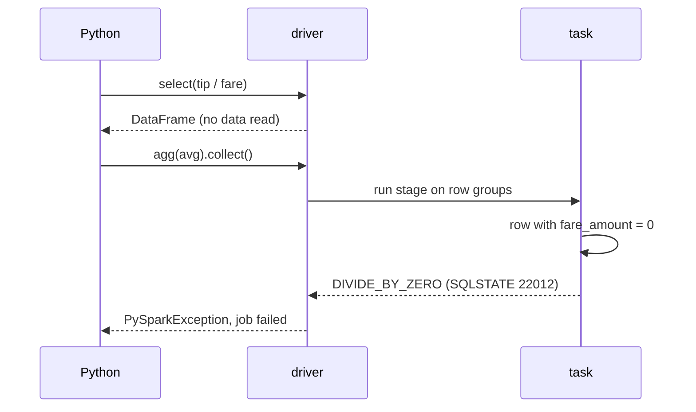
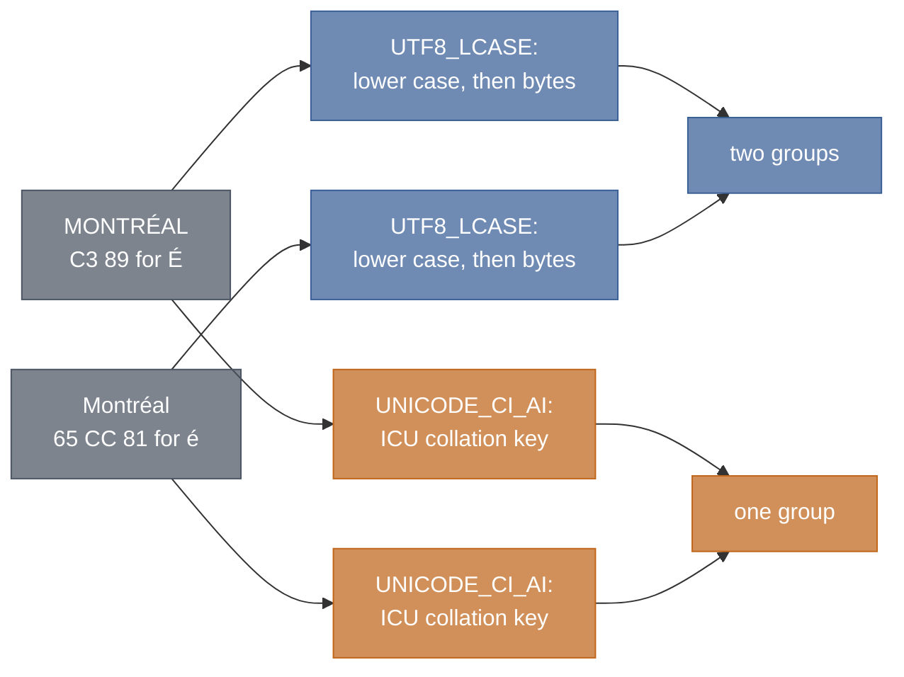
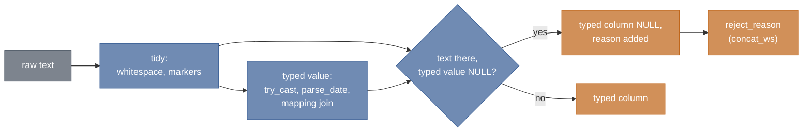
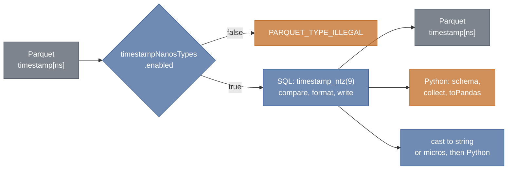

# Chapter 6: Cleaning values: ANSI, try_ functions, strings and time

Chapter 3 calculated a tip percentage after a filter that removed bad trips. This chapter starts with the same calculation without that filter. On the full June 2026 file, `tip_amount / fare_amount` stops the job, because 3,167 trips have a fare of zero. Spark 4 does not return a wrong number or a NULL for that division. It gives an error.

**Since Spark 4.0, ANSI mode stops a job at the first value that an expression cannot process. The `try_` functions change that error into a NULL. Thus each cleaning expression is a decision: stop the job, or keep a NULL and record a reason. ANSI mode does not catch all problems. Strings, money and dates have errors that give a valid but wrong value, and only a test finds them.**

The scripts are in [`code/ch06`](https://github.com/lisancao/spark-masterclass/tree/main/code/ch06), and each output block below comes from `code/ch06/output/`. The scripts use three data sets:

- `ansi.py` uses the June 2026 taxi trips.
- `strings.py` uses 166 deliveries from SparkTutor (`code/data/geo_deliveries`). Couriers typed the city names in 29 different ways.
- `values.py` uses a customer export from SparkTutor (`code/data/cleaning`). All 40 rows are text, and each column has problems.

## Step 1: A division that stops the job

`ansi.py` divides the tip by the fare on every June trip:

```python
trips = spark.read.parquet(str(TRIPS))
ratio = trips.select((F.col("tip_amount") / F.col("fare_amount")).alias("r"))
print("defined the DataFrame:", ratio.columns)
try:
    ratio.agg(F.avg("r")).collect()
except PySparkException as e:
    print("avg(tip / fare):", e.getCondition(), "SQLSTATE", e.getSqlState())
```

```text
== 1. tip / fare over every June trip
defined the DataFrame: ['r']
avg(tip / fare): DIVIDE_BY_ZERO SQLSTATE 22012
trips with fare_amount = 0: 3167
avg(try_divide(tip, fare)) = 0.1732 over 3,834,081 trips
```

The DataFrame definition succeeds. The error occurs in a task, when the task reads a trip with a fare of zero. Then the job fails. The columns are `double`, and under ANSI mode a `double` division by zero is also an error. It does not give `Infinity` or `NaN`.

`try_divide` returns NULL for those trips, and `avg` ignores NULL values. Thus the average uses 3,834,081 trips, which is all trips except the 3,167 with a zero fare. The result is a decision that you can see in the code: the trips with no fare do not have a tip ratio.



## Step 2: ANSI on and off

`spark.sql.ansi.enabled` is `true` by default since Spark 4.0 (SPARK-44444). `ansi.py` runs ten queries with ANSI mode on and then off:

```text
== 2. ANSI on and off
  query                                        ANSI on                              ANSI off
  SELECT 10 / 0                                DIVIDE_BY_ZERO                       None
  SELECT 10.0D / 0                             DIVIDE_BY_ZERO                       None
  SELECT 7 % 0                                 REMAINDER_BY_ZERO                    None
  SELECT 2147483647 + 1                        ARITHMETIC_OVERFLOW                  -2147483648
  SELECT CAST(3000000000 AS INT)               CAST_OVERFLOW                        -1294967296
  SELECT CAST('12a' AS INT)                    CAST_INVALID_INPUT                   None
  SELECT element_at(array(1, 2), 5)            INVALID_ARRAY_INDEX_IN_ELEMENT_AT    None
  SELECT array(1, 2)[5]                        INVALID_ARRAY_INDEX                  None
  SELECT to_date('2026-06-04', 'dd/MM/yyyy')   CANNOT_PARSE_TIMESTAMP               None
  SELECT CAST('2026-02-30' AS DATE)            CAST_INVALID_INPUT                   None
```

With ANSI mode off, each query succeeds. Seven queries return NULL, and two return a wrong number. `2147483647 + 1` becomes `-2147483648`, because the integer wraps. `CAST(3000000000 AS INT)` becomes `-1294967296`. A job with ANSI mode off completes, and its numbers are wrong.

!!! warning "CAUTION"
    Do not set `spark.sql.ansi.enabled` to `false` to make a job complete. The job will complete with wrong values. Use a `try_` function on the expression that fails.

## Step 3: Where the error occurs, and what it tells you

An expression fails when an action runs, not on the line that defines it. `ansi.py` casts the `age` column of the customer export:

```python
raw = spark.read.option("header", True).csv(str(CLEANING / "customers_raw.csv"))
ages = raw.select("customer_id", F.col("age").cast("int").alias("age"))
print("defined:", ages.columns)
try:
    ages.collect()
except PySparkException as e:
    print("collect():", e.getCondition(), e.getSqlState())
    print("  ", error_line(e)[:110])
    print("  parameters:", e.getMessageParameters())
```

```text
== 6. where the error appears
defined: ['customer_id', 'age']
collect(): CAST_INVALID_INPUT 22018
   [CAST_INVALID_INPUT] The value 'thirty' of the type "STRING" cannot be cast to "INT" because it is malformed. 
  parameters: {'expression': "'thirty'", 'sourceType': '"STRING"', 'targetType': '"INT"', 'ansiConfig': '"spark.sql.ansi.enabled"'}
+-----------+------+-------+
|customer_id|   age|age_int|
+-----------+------+-------+
|       C001|    34|     34|
|       c002|   41 |     41|
|       C003|  NULL|   NULL|
|       C004|    -3|     -3|
|       C005|    29|     29|
|       C006|thirty|   NULL|
|       C007|   200|    200|
|       C008|    52|     52|
+-----------+------+-------+
only showing top 8 rows
```

Each Spark error has three parts that a program can read:

- `getCondition()` gives the error class, for example `CAST_INVALID_INPUT`. Use it in an `except` block to decide what to do.
- `getSqlState()` gives the SQL standard code. `22018` is "invalid character value for cast".
- `getMessageParameters()` gives the values in the message. Here it gives the bad value, `'thirty'`.

The table shows `try_cast` on the same column. `thirty` becomes NULL. But `-3` and `200` are valid integers, so `try_cast` keeps them. A cast checks the type, not the range. Step 15 adds the range check.

The last part of `ansi.py` shows an error that is not from Spark but from Python:

```text
== 7. conditions
ERROR [CANNOT_CONVERT_COLUMN_INTO_BOOL] Cannot convert column into bool (offending column: >(age, and(city, 30))): p
parenthesized: 2
```

The code was `F.col("age") > 30 & F.col("city") == "Paris"`. In Python, `&` binds more strongly than `>` and `==`. Thus Python calculates `30 & F.col("city")` first, and the column in the message shows this order. Put parentheses around each comparison. Use `&`, `|` and `~`, not `and`, `or` and `not`.

## Step 4: The try_ family

Each `try_` function does the work of its plain function, but it returns NULL when the plain function gives an error:

```python
spark.sql("""SELECT try_divide(10, 0) AS a, try_add(2147483647, 1) AS b, try_cast('12a' AS INT) AS c,
             '12'::INT + 1 AS d, try_element_at(array(1, 2), 5) AS e, try_mod(7, 0) AS f,
             try_to_date('2026-02-30') AS g, try_to_timestamp('noon') AS h,
             try_to_number('$1,234.50', '$9,999.99') AS i, try_parse_url('not a url', 'HOST') AS j""").show()
```

```text
== 3. try_ functions
+----+----+----+---+----+----+----+----+-------+----+
|   a|   b|   c|  d|   e|   f|   g|   h|      i|   j|
+----+----+----+---+----+----+----+----+-------+----+
|NULL|NULL|NULL| 13|NULL|NULL|NULL|NULL|1234.50|NULL|
+----+----+----+---+----+----+----+----+-------+----+

27 try_ functions in 4.3.0:
  try_add                 try_aes_decrypt         try_avg                 try_divide              try_element_at
  try_make_interval       try_make_timestamp      try_make_timestamp_ltz  try_make_timestamp_ntz  try_mod
  try_multiply            try_parse_json          try_parse_url           try_reflect             try_subtract
  try_sum                 try_to_binary           try_to_date             try_to_number           try_to_time
  try_to_timestamp        try_url_decode          try_validate_utf8       try_variant_array_append  try_variant_get
  try_variant_insert      try_variant_set
```

`'12'::INT` is the `::` cast syntax from Spark 4.0 (SPARK-45574). It is a plain cast, so it fails on bad input. `Column.try_cast` is the DataFrame form of `try_cast` (since 4.0). The list contains four `try_variant_` functions. `try_variant_insert`, `try_variant_set` and `try_variant_array_append` change VARIANT values. They are new in 4.3, and Part III shows them.

A NULL from a `try_` function means "a value was there, and it did not convert". A NULL in the source means "no value". The two NULL values look the same. Keep the raw value next to the converted value, so that you can tell them apart. Step 15 uses this rule.

## Step 5: What a cast from text accepts

A cast from text to a number is more strict than many people expect:

```text
== 4. what a cast accepts
+--------------+------+---------+----------+
|             s|as_int|as_double|as_decimal|
+--------------+------+---------+----------+
|  {"s":" 12 "}|    12|     12.0|     12.00|
|   {"s":"+12"}|    12|     12.0|     12.00|
|  {"s":"0012"}|    12|     12.0|     12.00|
|  {"s":"12.7"}|  NULL|     12.7|     12.70|
|   {"s":"1e3"}|  NULL|   1000.0|   1000.00|
| {"s":"1,234"}|  NULL|     NULL|      NULL|
|   {"s":" 12"}|  NULL|     NULL|      NULL|
|{"s":"\t12\n"}|    12|     12.0|     12.00|
+--------------+------+---------+----------+
```

The `s` column shows each input as JSON, so that you can see the whitespace. The rows give five rules:

- The cast removes spaces, tabs and newlines around the number.
- The cast does not remove the non-breaking space (U+00A0) in the seventh row. JSON shows it as a space, but it is a different character.
- `12.7` is not an `INT` under ANSI mode. Cast to `DOUBLE` or `DECIMAL` first if you want to round it.
- A thousands separator always stops the cast. Remove separators first (Step 11).
- Leading zeros go away in all number types. Keep IDs, postal codes and phone numbers as strings.

A cast to `BOOLEAN` accepts a small set of words, with any case and with spaces around them:

```text
== 5. booleans
+------+-----+
|     x|    b|
+------+-----+
|   yes| true|
|     Y| true|
|     t| true|
|     1| true|
| TRUE | true|
|    no|false|
|     n|false|
|     0|false|
| false|false|
|    on| NULL|
| maybe| NULL|
+------+-----+
```

`true`, `t`, `yes`, `y` and `1` become true. `false`, `f`, `no`, `n` and `0` become false. Other words, such as `on`, become NULL with `try_cast`. With `cast`, they cause `CAST_INVALID_INPUT`. If a source uses other words, map them with `when` before the cast.

## Step 6: Whitespace and case

`F.trim` removes the space character (U+0020) from the two ends of a string. It removes no other character:

```python
names = spark.createDataFrame([("  ana   maria  ",), ("\tBinh\n",), (" Chloé ",)], "s STRING")
names.select(F.to_json(F.struct("s")).alias("s"), F.length("s").alias("len"),
             F.length(F.trim("s")).alias("trim"),
             F.length(F.trim(F.regexp_replace("s", r"\s+", " "))).alias("re_s"),
             F.length(F.trim(F.regexp_replace("s", r"[\s ]+", " "))).alias("re_nbsp"),
             F.length(F.trim(F.regexp_replace("s", r"(?U)\s+", " "))).alias("re_unicode")).show()
```

```text
== 1. whitespace
+--------------------+---+----+----+-------+----------+
|                   s|len|trim|re_s|re_nbsp|re_unicode|
+--------------------+---+----+----+-------+----------+
|{"s":"  ana   mar...| 15|  11|   9|      9|         9|
|    {"s":"\tBinh\n"}|  6|   6|   4|      4|         4|
|     {"s":" Chloé "}|  7|   7|   7|      5|         5|
+--------------------+---+----+----+-------+----------+

trim(s, ' \t\n') with a string: ERROR [UNRESOLVED_COLUMN.WITH_SUGGESTION] A column, variable, or function pa
trim(s, lit(...)): ['ana   maria', 'Binh', 'Chloé']
Row(a='120', b='hi')
```

The lengths show what each method removes:

- `trim` does not touch the tab, the newline or the non-breaking spaces. It also keeps the three spaces inside `ana   maria`.
- `regexp_replace` with `\s+` changes each run of whitespace to one space. But Spark uses Java regular expressions, and in Java `\s` is only `[ \t\n\x0B\f\r]`. Thus `Chloé` keeps its non-breaking spaces (length 7).
- `[\s ]+` adds the non-breaking space to the class. `(?U)\s+` makes `\s` use the Unicode definition. Both give length 5.

`trim` accepts a second argument with the characters to remove. That argument must be a `Column`. A Python string is a column name, so `F.trim("s", " \t\n")` fails. Use `F.lit(...)`. In SQL, `TRIM(LEADING '0' FROM '000120')` removes leading zeros, and `btrim(str, chars)` removes characters from both ends.

`initcap` makes the first letter after each space upper case and all other letters lower case:

```text
== 2. case
+------------------+------------------+------------------+
|                 s|        initcap(s)|          lower(s)|
+------------------+------------------+------------------+
|         BINH TRAN|         Binh Tran|         binh tran|
|            o'neil|            O'neil|            o'neil|
|mary-jane van dyke|Mary-jane Van Dyke|mary-jane van dyke|
|          McDONALD|          Mcdonald|          mcdonald|
+------------------+------------------+------------------+
```

`O'neil`, `Mary-jane` and `Mcdonald` are not correct names. Use `initcap` for display only. For a comparison or a group, do not change the stored value. Use a key in lower case, or a collation (Step 8).

## Step 7: Regular expressions, translate and accents

`regexp_replace` replaces each match of a Java regular expression. `translate` replaces single characters. Each character of the second argument becomes the character at the same position in the third argument. If the third argument is shorter, the extra characters go away.

```text
== 3. regexp_replace and translate
+---------------+-----------+-----------+
|              p|     digits| translated|
+---------------+-----------+-----------+
| (416) 555-0199| 4165550199| 4165550199|
|   416.555.0123| 4165550123| 4165550123|
|+1 416 555 0147|14165550147|14165550147|
|            n/a|           |        n/a|
+---------------+-----------+-----------+

Row(swapped='Linh Nguyen')
```

`[^0-9]` means "each character that is not a digit". It is more reliable than a list of characters to remove, because it also removes separators that you did not expect. But look at `n/a`. It becomes an empty string, not NULL. Change markers such as `n/a` to NULL before you remove characters. A replacement can use capture groups as `$1` and `$2`: the last line changes `Nguyen, Linh` to `Linh Nguyen`.

To test a pattern, and not to change the text, Spark has three operators:

```python
inv.select("s", F.col("s").like("INV-%").alias("like"), F.col("s").ilike("inv%").alias("ilike"),
           F.expr(r"s LIKE 'inv\\_%'").alias("like_esc"), F.expr("s LIKE 'INV_2026%'").alias("like_any1"),
           F.col("s").rlike(r"^INV-\d{4}-\d{3}$").alias("rlike"),
           F.regexp_extract("s", r"(\d{4})", 1).alias("year")).show()
```

```text
== 7. LIKE, ILIKE, RLIKE
+------------+-----+-----+--------+---------+-----+----+
|           s| like|ilike|like_esc|like_any1|rlike|year|
+------------+-----+-----+--------+---------+-----+----+
|INV-2026-001| true| true|   false|     true| true|2026|
|inv_2026_002|false| true|    true|    false|false|2026|
|    INV-26-3| true| true|   false|    false|false|    |
|    INVX2026|false| true|   false|     true|false|2026|
+------------+-----+-----+--------+---------+-----+----+

Row(dot_any=True, dot_x=True, escaped=False, rlike_finds_inside=True, like_whole=False)
```

The rows show how the three operators are different:

- **`LIKE` matches the full string.** `%` is any sequence of characters, and `_` is exactly one character. Thus `INV_2026%` also matches `INVX2026`. To match a literal `_`, write `\_`.
- **`ILIKE` is `LIKE` without case.** It matches all four rows.
- **`RLIKE` is a Java regular expression, and it finds a match anywhere in the string.** Add `^` and `$` to match the full string. In a regular expression, `.` is any character, so `a.b` matches `axb`. Write `a\.b` for a literal dot.

`regexp_extract(col, pattern, group)` returns the text of one capture group, or an empty string when there is no match. It does not return NULL. `regexp_substr(col, pattern)` returns the first match, or NULL when there is no match:

```text
Row(extract='', substr=None)
```

If an empty string and "no match" must stay different, use `regexp_substr`, or wrap `regexp_extract` in `nullif(..., '')`.

`Montréal`, `Montreal` and `MONTRÉAL` are one city for a person, and three strings for `==`. Spark 4.3 has no built-in function that removes accents. `strings.py` searches the function list, and the only match is `vector_normalize`, which is a vector function. There are two methods to change the text:

```python
@F.udf(StringType())
def strip_accents(s):
    if s is None:
        return None
    return "".join(ch for ch in unicodedata.normalize("NFKD", s) if not unicodedata.combining(ch))
```

```text
== 4. accents
+-------------+-------------+-------------+
|            s|     udf_nfkd|    translate|
+-------------+-------------+-------------+
|     Montréal|     Montreal|     Montreal|
|Nguyễn Thị Hà|Nguyen Thi Ha|Nguyen Thi Ha|
|          Zoë|          Zoe|          Zoe|
|         Đặng|         Đang|         Dang|
|        fiancé|       fiance|        fiance|
|         NULL|         NULL|         NULL|
+-------------+-------------+-------------+

built-in unaccent/normalize: ['vector_normalize']
+- ArrowEvalPython [strip_accents(s#57)#73], [pythonUDF0#75], 101
```

The two methods fail on different characters:

- The Python UDF uses Unicode normalization form NFKD. NFKD divides `é` into `e` and a combining accent, and the UDF removes the accent. NFKD also divides the ligature `fi` into `fi`. But `Đ` is a separate letter in Unicode, not `D` with a mark, so it stays.
- `translate` changes only the characters in its list. The list has `Đ`, so `Đặng` becomes `Dang`. The list does not have `fi`, so `fiancé` keeps it.

The UDF also has a cost. The plan has an `ArrowEvalPython` node. Each value goes to a Python worker process and back, and the optimizer cannot look into the function (Chapter 1, Step 6). Spark 4.3 has an experimental optimizer rule that changes simple Python UDFs into Catalyst expressions (`spark.sql.experimental.optimizer.transpilePyUDFs`, `false` by default). A function that calls `unicodedata` is not a simple UDF. Part IV measures this rule.

For a comparison, a group or a join, you do not need to change the text. A collation does the comparison without a change.

## Step 8: Collations

A collation is a set of rules to compare and sort strings. Spark 4.0 added collations (SPARK-46830). You add a collation to a string with `F.collate(col, name)` or with `COLLATE name` in SQL:

```text
== 5. collations
+-----+-----+----+-----+
|plain|lcase|  ci|ci_ai|
+-----+-----+----+-----+
|false| true|true| true|
+-----+-----+----+-----+
```

The name of a collation tells you its rules:

- `UTF8_BINARY` is the default. It compares bytes.
- `UTF8_LCASE` compares bytes after it changes the letters to lower case.
- `UNICODE` uses the ICU library and the Unicode sort order.
- The suffix `_CI` ignores case, `_AI` ignores accents, and `_RTRIM` ignores trailing spaces.

The deliveries file has 166 rows and 29 spellings of 9 cities. `strings.py` counts the distinct values under each collation, without and with `trim`:

```python
for coll in ["UTF8_BINARY", "UTF8_LCASE", "UNICODE_CI", "UNICODE_CI_AI", "UNICODE_CI_AI_RTRIM"]:
    a = deliveries.select(F.collate("city", coll)).distinct().count()
    b = deliveries.select(F.collate(F.trim("city"), coll)).distinct().count()
```

```text
deliveries: 166 rows, 29 raw spellings
  collation            distinct  trim first
  UTF8_BINARY                29          26
  UTF8_LCASE                 20          15
  UNICODE_CI                 18          13
  UNICODE_CI_AI              15           9
  UNICODE_CI_AI_RTRIM        11           9
```

Only an accent-insensitive collation on trimmed values finds the 9 cities. Each other row shows one problem.

**The same letters, different bytes.** `UTF8_LCASE` leaves three groups for Montréal. The bytes show why:

```text
the same letters, different bytes:
+----------+---+--------------------+
|utf8_lcase|n  |bytes               |
+----------+---+--------------------+
|MONTRÉAL  |9  |4D4F4E5452C389414C  |
|Montréal |5  |4D6F6E747265CC81616C|
|montreal  |4  |6D6F6E747265616C20  |
+----------+---+--------------------+
```

The first two rows show the same word, but the bytes are different. The first has `C3 89`, the single character `É`. The second has `65 CC 81`, a plain `e` followed by a combining accent. Unicode calls these two forms "canonically equivalent".

Text from macOS file names, PDF files and some keyboards often uses the second form. `UTF8_LCASE` compares bytes, so it sees two words. The `UNICODE` collations compare canonically equivalent strings as equal.

The second row is narrower in the table, because `show()` counts the combining accent as one character. For text from many sources, use a `UNICODE` collation, even if you only want to ignore case.



**Trailing and leading spaces.** `_RTRIM` ignores trailing spaces only:

```text
+--------+-------+
|trailing|leading|
+--------+-------+
|    true|  false|
+--------+-------+
```

This is why `UNICODE_CI_AI_RTRIM` stops at 11 groups: ` Vancouver` and ` Toronto ` keep their leading space. `_RTRIM` exists because SQL pads `CHAR` columns with trailing spaces. No collation ignores leading spaces. Apply `trim` first, and then the collation.

**Language rules.** Spark has a collation for each language that ICU knows, with the same suffixes:

```text
+-----+-----+-------+-----+-----+
|   ci|ci_ai|root_ai|vi_ai|vi_ci|
+-----+-----+-------+-----+-----+
|false| true|   true|false| true|
+-----+-----+-------+-----+-----+
```

Two rules show in this output:

- `ß` and `ss` are equal only when the collation ignores accents.
- In the neutral rules, `Đ` is a `D` with a mark, so `Đà Nẵng` equals `da nang` under `UNICODE_CI_AI`. In Vietnamese, `đ` is a separate letter. Thus `vi_CI_AI` keeps `Đà Nẵng` and `da nang` apart, but it still ignores case.

The correct collation depends on the question. To find the deliveries to Đà Nẵng, the neutral rules agree with what people type on an English keyboard. To sort a Vietnamese customer list for a Vietnamese reader, use `vi`. The sort order also changes:

```text
ORDER BY bytes:   ['A', 'B', 'a', 'b', 'e', 'f', 'é']
ORDER BY UNICODE: ['a', 'A', 'b', 'B', 'e', 'é', 'f']
collations(): 1164 | ICU 78.3.0.0
+-------------------+--------+-------+------------------+----------------+-------------+-----------+
|NAME               |LANGUAGE|COUNTRY|ACCENT_SENSITIVITY|CASE_SENSITIVITY|PAD_ATTRIBUTE|ICU_VERSION|
+-------------------+--------+-------+------------------+----------------+-------------+-----------+
|UNICODE_CI         |NULL    |NULL   |ACCENT_SENSITIVE  |CASE_INSENSITIVE|NO_PAD       |78.3.0.0   |
|UNICODE_CI_AI      |NULL    |NULL   |ACCENT_INSENSITIVE|CASE_INSENSITIVE|NO_PAD       |78.3.0.0   |
|UNICODE_CI_AI_RTRIM|NULL    |NULL   |ACCENT_INSENSITIVE|CASE_INSENSITIVE|RTRIM        |78.3.0.0   |
|UNICODE_CI_RTRIM   |NULL    |NULL   |ACCENT_SENSITIVE  |CASE_INSENSITIVE|RTRIM        |78.3.0.0   |
+-------------------+--------+-------+------------------+----------------+-------------+-----------+
```

Spark 4.3.0 has 1164 collations, from ICU 78.3. `SHOW COLLATIONS LIKE ...` (since 4.2, SPARK-49543) and the `collations()` table function (since 4.0) list them. The `ICU_VERSION` column is important when you upgrade. A new ICU version can change which strings are equal.

## Step 9: Where collations stop, and what they cost

A collated string is a different type (`string collate UNICODE_CI_AI`). Not all functions accept it in 4.3.0:

```text
where collations stop:
  collect_set              ERROR [DATATYPE_MISMATCH.UNSUPPORTED_INPUT_TYPE] Cannot resolve "collect_set(collate(city,
  LIKE, UNICODE_CI_AI      ERROR [DATATYPE_MISMATCH.UNEXPECTED_INPUT_TYPE] Cannot resolve "collate(Montréal, UNICODE_
  LIKE, UTF8_LCASE         Row(collate(Montréal, UTF8_LCASE) LIKE mont%=True)
  two explicit collations  ERROR [COLLATION_MISMATCH.EXPLICIT] Could not determine which collation to use for string 
  misspelt name            ERROR [COLLATION_INVALID_NAME] The value UNICODE_CIAI does not represent a correct collati
  hash equal?              Row((hash(collate(Montréal, UNICODE_CI_AI)) = hash(collate(MONTREAL, UNICODE_CI_AI)))=False)
```

Each line is a rule:

- `collect_set` does not accept a collated string. Collect the original column.
- `LIKE` accepts `UTF8_BINARY` and `UTF8_LCASE`, but not the `UNICODE` collations.
- Two different explicit collations cannot meet in one comparison. Give both sides the same collation.
- A wrong name fails with `COLLATION_INVALID_NAME`, and the message suggests a correct name.
- `hash()` ignores the collation. `Montréal` and `MONTREAL` are equal under `UNICODE_CI_AI`, but their hashes are different. Groups, joins and shuffles are correct, because Spark uses a collation key inside. Only your own `hash()` calls see the difference.

A group gets one of its original spellings as its label, and Spark chooses that spelling:

```text
+-----------+-----+
|       city|count|
+-----------+-----+
|    Calgary|    2|
|    ĐÀ NẴNG|   13|
|     Ha Noi|   33|
|HỒ CHÍ MINH|   27|
|        Huế|    2|
|  Montréal|   18|
|     Ottawa|    2|
|    TORONTO|   23|
|  Vancouver|   46|
+-----------+-----+
```

The labels are a mix of upper case, lower case, accents and no accents. If you need one correct name per group, join the groups to a reference list, or apply `min` to the original column.

A table can have a default collation for its string columns, and Parquet keeps the collation in the file metadata:

```python
spark.sql("CREATE TABLE delivery_cities (city STRING, n INT) USING parquet DEFAULT COLLATION UNICODE_CI_AI")
spark.sql("INSERT INTO delivery_cities VALUES ('Montréal', 1), ('MONTREAL', 2), ('Hà Nội', 3), ('ha noi', 4)")
```

```python
spark.sql("SELECT city, sum(n) AS n FROM delivery_cities GROUP BY city ORDER BY n").show()
```

```text
+--------+---+
|    city|  n|
+--------+---+
|Montréal|  3|
|  Hà Nội|  7|
+--------+---+

WHERE city = 'montreal': [('Montréal', 1), ('MONTREAL', 2)]
schema read back: StringType('UNICODE_CI_AI')
```

The four rows became two groups. A filter with `city = 'montreal'` finds `Montréal` and `MONTREAL`, and the schema that Spark reads back from the table is `StringType('UNICODE_CI_AI')`. The `DEFAULT COLLATION` clause gives the collation to each string column that does not declare its own collation.

All queries on this column now compare without accents and case, also the filters that you did not want to be fuzzy. Use a default collation for columns that contain names, not codes.

`strings.py` also joins the deliveries to the store list on the city, under `UNICODE_CI_AI`. It sets `spark.sql.autoBroadcastJoinThreshold` to `-1`, so the plan shows a shuffle join and not a broadcast:

```text
['+- SortMergeJoin [collate(trim(city#111, None), UNICODE_CI_AI)], [collate(store_city#405, UNICODE_CI_AI)], Lef', ':  +- Exchange hashpartitioning(collate(trim(city#111, None), UNICODE_CI_AI), 200), ENSURE_REQUIREMENTS, [plan']
matched: 160 of 166
```

The `Exchange` partitions both sides by the collated value. In the 4.3.0 source, `HashPartitioning` builds its partition ID with `CollationAwareMurmur3Hash` (`partitioning.scala`). This hash uses the collation key, so `Montréal` and `MONTREAL` go to the same partition. The `hash()` function from the last step does not do this. 160 of the 166 deliveries find a store city.

The cost is in each comparison and each hash. `collation_cost.py` groups 20,000,000 cached rows of 8 city spellings under four collations. It builds a new DataFrame for each run, because a second `collect()` on the same DataFrame reuses its shuffle files:

```text
cost of grouping 20,000,000 cached rows (median of 5 after a warmup)
  UTF8_BINARY    8 groups  0.35 s
  UTF8_LCASE     5 groups  9.54 s
  UNICODE        8 groups  17.74 s
  UNICODE_CI_AI  3 groups  13.47 s
```

The binary collation took 0.35 seconds. Each other collation took between 27 and 50 times as long. The plans show one reason:

```text
aggregate operators of groupBy(collate(city, c)).count():
  UTF8_BINARY    ['HashAggregate', 'HashAggregate']
  UTF8_LCASE     ['SortAggregate', 'SortAggregate']
  UNICODE        ['SortAggregate', 'SortAggregate']
  UNICODE_CI_AI  ['SortAggregate', 'SortAggregate']
```

A hash aggregate needs keys that are equal only when their bytes are equal. In the 4.3.0 source, `Aggregate.supportsHashAggregate` checks `UnsafeRowUtils.isBinaryStable` for each grouping key. A non-binary collation is not binary stable, because two different byte sequences can be equal. Thus Spark uses a `SortAggregate`. It sorts all rows by the key, with a collation comparison for each pair of rows, and then it counts each run of equal keys.

`UNICODE` is case-sensitive, but it is not binary stable either. Its comparison uses the ICU rules, not the bytes.

For a cleaning step or a small dimension table, this cost is small. For a join key or a group key on billions of rows, calculate a normalized key one time. For example, use `lower` and the accent removal of Step 7. Store it, and group or join on the stored key with the binary collation.

## Step 10: Invalid UTF-8

Spark strings are UTF-8. A file in Latin-1 that Spark reads as UTF-8 can put invalid bytes into a string. Four functions find and repair them:

```text
== 6. invalid UTF-8
+----------+-----+----------+---------+
|     bytes|valid|made_valid|try_valid|
+----------+-----+----------+---------+
|  436166E9|false|      Caf�|     NULL|
|436166C3A9| true|      Café|     Café|
+----------+-----+----------+---------+

validate_utf8: ERROR [INVALID_UTF8_STRING] Invalid UTF8 byte sequence found in string: \x43\x61\x66\xE9.
```

`E9` is `é` in Latin-1, and it is not valid UTF-8. `make_valid_utf8` replaces it with U+FFFD (`�`), so the letter is lost. `try_validate_utf8` returns NULL, and `validate_utf8` gives an error. No function can recover the original letter. For that, read the file with the correct encoding (Part III).

## Step 11: Money

`to_number(col, format)` (since 3.5) parses text with a format, and `try_to_number` returns NULL when the text does not fit. The result is a `DECIMAL`. The format uses these characters:

- `9` or `0` is a digit.
- `.` is the decimal point, and `,` is a group separator.
- `$` is a dollar sign, and `S` is a sign.
- `MI` is a trailing minus.
- `PR` means angle brackets for a negative number.

```text
== 1. money
+---------+---------+--------+--------+
|        s|to_number|stripped|      eu|
+---------+---------+--------+--------+
|$1,234.50|  1234.50| 1234.50|    NULL|
|      $12|    12.00|   12.00|    NULL|
|   1234.5|     NULL| 1234.50|12345.00|
|   -$5.00|     NULL|   -5.00|    NULL|
|   $7.25 |     NULL|    7.25|    NULL|
| 1.234,50|     NULL|    1.23| 1234.50|
|      abc|     NULL|    NULL|    NULL|
+---------+---------+--------+--------+

Row(to_char='$1,234.50', fmt='1,234,567.89', mi=Decimal('-5.00'), pr=Decimal('-5.00'))
```

The three columns show three methods:

- **`to_number` is strict.** The text must agree with the format. `1234.5` has no `$`, and ` $7.25 ` has spaces, so both fail. Use `to_number` for machine output in one known format.
- **Remove and cast** (`stripped`) removes `$`, commas and spaces, and then applies `try_cast` to `DECIMAL(12,2)`. It accepts more inputs. But `1.234,50` becomes `1.23`, a valid and wrong number, and no error occurs.
- **The European form** (`eu`) removes dots and changes the comma to a dot. It gives `1234.50` for `1.234,50`. But on `1234.5` it gives `12345.00`, again with no error.

No single rule accepts both conventions. A thousands separator in one country is the decimal point in another. Decide the convention for each source, and apply one method to that source. To print numbers, `to_char` and `format_number` do the opposite conversion.

## Step 12: Dates in many formats

`try_to_date(col)` without a format accepts ISO dates. With a format, it accepts that format only. When a column has many formats, try each format in sequence, and keep the first result that is not NULL:

```python
DATE_PATTERNS = ["yyyy/MM/dd", "dd/MM/yyyy", "d MMM yyyy", "MMMM d, yyyy", "yyyyMMdd"]


def parse_date(c):
    """The first pattern that parses wins; NULL if none does."""
    return F.coalesce(F.try_to_date(c), *[F.try_to_date(c, p) for p in DATE_PATTERNS])
```

```text
== 2. dates
+-------------------+------------+----------+
|s                  |default_only|parsed    |
+-------------------+------------+----------+
|2025-03-04         |2025-03-04  |2025-03-04|
|2025/03/05         |NULL        |2025-03-05|
|05/03/2025         |NULL        |2025-03-05|
|4 Mar 2025         |NULL        |2025-03-04|
|March 4, 2025      |NULL        |2025-03-04|
|20250306           |NULL        |2025-03-06|
|2025-03-09T14:30:00|2025-03-09  |2025-03-09|
|2025-02-30         |NULL        |NULL      |
|unknown            |NULL        |NULL      |
+-------------------+------------+----------+
```

`parse_date` is a Python function that returns a `Column`. It runs once, when it builds the plan, and it costs nothing at run time. `coalesce` stops at the first argument that is not NULL. Thus Spark does not try the other patterns for a row that already has a date. 30 February is not a date in any format, so it stays NULL.

The pattern letters are case-sensitive, and some errors give a valid date:

```text
+----------+-----------+------------+------------+------------+----------+
| day_first|month_first|minutes_trap|dd_needs_two|d_takes_both|     yy_69|
+----------+-----------+------------+------------+------------+----------+
|2026-03-04| 2026-04-03|  2026-01-04|        NULL|  2026-03-04|2069-03-04|
+----------+-----------+------------+------------+------------+----------+

YYYY: ERROR [INCONSISTENT_BEHAVIOR_CROSS_VERSION.DATETIME_PATTERN_RECOGNITION] You may get a different
```

Each column is a trap:

- **`04/03/2026` is two dates.** It is 4 March with `dd/MM/yyyy` and 3 April with `MM/dd/yyyy`. In a `coalesce`, the first pattern that matches gives the date, and no error occurs. Find the convention of each source, and use only that pattern.
- **`mm` is minutes.** `yyyy-mm-dd` reads `03` as a minute, and the month becomes January.
- **`dd` needs two digits.** `d` accepts one or two digits, so `d/M/yyyy` accepts more inputs.
- **`yy` gives a year from 2000 to 2099.** Thus `69` becomes 2069. A birth date needs a different rule.
- **`YYYY` is the week-based year.** Spark rejects it, also in `try_to_date`. Use `yyyy`.

## Step 13: Timestamps, with and without an offset

Text with an offset, such as `2026-03-04T09:30:00-05:00`, is a full instant. Text without an offset is local time in the session time zone. `values.py` parses both kinds under two session time zones:

```python
q = """SELECT date_format(try_to_timestamp('2026-03-04 09:30'), 'yyyy-MM-dd HH:mm XXX') AS no_offset,
  date_format(try_to_timestamp('2026-03-04T09:30:00-05:00'), 'yyyy-MM-dd HH:mm XXX') AS with_offset,
  cast(to_timestamp_ntz('2026-03-04 09:30') AS string) AS ntz"""
```

```text
== 3. timestamps
UTC              Row(no_offset='2026-03-04 09:30 Z', with_offset='2026-03-04 14:30 Z', ntz='2026-03-04 09:30:00')
America/Toronto  Row(no_offset='2026-03-04 09:30 -05:00', with_offset='2026-03-04 09:30 -05:00', ntz='2026-03-04 09:30:00')
Row(from_epoch='2026-03-04 09:30:00')
```

The text without an offset became a different instant when the session time zone changed. The text with an offset stayed the same instant (14:30 UTC is 09:30 in Toronto). `to_timestamp_ntz` keeps the wall-clock value in both zones. If a source writes local times without an offset, use one of two methods:

1. Set the session time zone to the zone of the source while you parse.
2. Parse to `TIMESTAMP_NTZ`, and convert to an instant later, when you know the zone.

A number of seconds since 1970 is a third format. `timestamp_seconds(1772616600)` is `2026-03-04 09:30:00` UTC.

## Step 14: NULL, empty strings, markers and NaN

Four different values can mean "no correct value":

```text
== 4. NULL, empty, markers, NaN
+---+-----+-----+
|  k| city|score|
+---+-----+-----+
|  a| NULL|  NaN|
|  b|     |  1.0|
|  c|  N/A| NULL|
|  d|Paris|  2.0|
+---+-----+-----+

city != 'Paris': 2 | city == None: 0 | isNull: 1
```

- `NULL` is the SQL value for "unknown". It is not equal to any value, also not to another NULL.
- `""` is a string with length 0.
- `"N/A"` is a string that a person wrote to mean "no value". Spark does not know this.
- `NaN` ("not a number") is a floating-point value.

A comparison with NULL gives NULL, and `filter` removes the rows where the condition is NULL. Thus `city != 'Paris'` returns 2 rows, not 3: the NULL row is not in the result. `F.col("city") == None` makes the SQL `city = NULL`, which is never true. Use `isNull()` and `isNotNull()`.

```text
+----+---------+----+------+------+---------+
|  eq|null_safe|  fn|not_in|concat|concat_ws|
+----+---------+----+------+------+---------+
|NULL|     true|true|  NULL|  NULL|      a-b|
+----+---------+----+------+------+---------+
```

`<=>`, `equal_null` and `Column.eqNullSafe` compare two NULL values as equal. `NOT IN` with a NULL in the list gives NULL for all values, so a filter with it returns no rows. This is a frequent error when the list comes from data. `concat` gives NULL if one part is NULL, and `concat_ws` ignores NULL parts. Step 15 uses `concat_ws` to make a list of reasons.

Change all markers to NULL early, one time, so that the rest of the code has only one case:

```text
+---+-----+--------+------------+---------------+
|  k| city|coalesce|nullif_empty|markers_to_null|
+---+-----+--------+------------+---------------+
|  a| NULL| unknown|        NULL|           NULL|
|  b|     |        |        NULL|           NULL|
|  c|  N/A|     N/A|         N/A|           NULL|
|  d|Paris|   Paris|       Paris|          Paris|
+---+-----+--------+------------+---------------+

coalesce(date, 'n/a'): ERROR [CAST_INVALID_INPUT] The value 'n/a' of the type "STRING" cannot be cast to "DAT
```

`coalesce` replaces only NULL, so `""` and `N/A` stay. `nullif(a, b)` gives NULL when `a = b`. A `when` with `isin` changes a list of markers. The last line shows a trap: `coalesce` needs one result type. With a date and the string `'n/a'`, Spark casts `'n/a'` to `DATE`, and the cast fails. Keep "no value" as NULL in a typed column, and put the reason in a different column.

NaN is not NULL, and Spark has its own rules for it:

```text
+---+-----+-----+------+-----------+
|  k|score|isnan|isnull|nan_to_null|
+---+-----+-----+------+-----------+
|  a|  NaN| true| false|       NULL|
|  b|  1.0|false| false|        1.0|
|  c| NULL|false|  true|       NULL|
|  d|  2.0|false| false|        2.0|
+---+-----+-----+------+-----------+

NaN = NaN: True | sorted: [None, 1.0, 2.0, nan]
aggregates with NaN:    Row(count(score)=3, avg(score)=nan, max(score)=nan)
after nanvl:            Row(count(s)=2, avg(s)=1.5, max(s)=2.0)
fillna(0.0): [0.0, 1.0, 0.0, 2.0]
```

- `isNull` is false for NaN. Use `F.isnan` or `Column.isNaN`.
- In Spark, `NaN = NaN` is true, and NaN is larger than all other numbers. Thus it sorts last, and `max` returns it.
- Aggregates do not ignore NaN. One NaN makes `avg` and `max` NaN. `nanvl(score, NULL)` changes NaN to NULL, and then the aggregates ignore it.
- `fillna` replaces NULL and NaN in number columns.

## Step 15: Mapping tables, reject reasons and the full cleanup

`values.py` ends with a full cleanup of the customer export. Five rows show the problems:

```text
== 5. clean the customer export
raw: 40 rows, all strings: {'string'}
+-----------+----------------------+-----------+--------------+----------+------+--------+
|customer_id|full_name             |signup_date|lifetime_value|newsletter|age   |country |
+-----------+----------------------+-----------+--------------+----------+------+--------+
|C001       |  ana   maria  nguyen |2025-03-04 |$1,234.50     |yes       |34    |Canada  |
| c002      |BINH TRAN             |2025/03/05 |1234.5        |Y         | 41   | usa    |
|C003       |Zoë Tremblay          |05/03/2025 |$12           |0         |NULL  |U.S.    |
|C004       |José\tGarcía          |4 Mar 2025 |-$5.00        |N         |-3    |Viet Nam|
|C006       |Emma Smith            |2025-02-30 |abc           |maybe     |thirty|Mars    |
+-----------+----------------------+-----------+--------------+----------+------+--------+
```

The cleanup has three parts.

**1. Tidy each column one time.** `tidy` changes each run of whitespace to one space, applies `trim`, and changes the markers to NULL:

```python
NULL_TOKENS = ["", "N/A", "NA", "NULL", "NONE", "-"]


def tidy(c):
    """Every run of whitespace (with U+00A0) to one space, trimmed, NULL markers to NULL."""
    squeezed = F.trim(F.regexp_replace(c, r"[\s ]+", " "))
    return F.when(F.upper(squeezed).isin(NULL_TOKENS), None).otherwise(squeezed)
```

**2. Map categories with a table, not with a long `CASE WHEN`.** The country column has many spellings of four countries. A `when` chain needs a code change for each new spelling, and a spelling that the chain does not have gives NULL with no error. A mapping table (`country_codes.csv`, with the columns `raw` and `code`) is data. A person can add a spelling without a code change. The cleanup joins to it:

```python
mapped = typed.join(F.broadcast(countries), F.col("country_key") == F.col("raw"), "left")
```

The join is a `left` join, so a row with no match stays, with a NULL code. An inner join removes such rows and gives no error. `F.broadcast` tells Spark to send the small table to each task, so the large side does not shuffle (Chapter 9). A join does not keep the order of the rows. Sort the result if the order is important.

**3. Keep each row, and record what was wrong.** A value is bad when the tidied text is there, but its typed value is NULL. Each check is a `when` that gives a reason or NULL, and `concat_ws` joins the reasons that are not NULL:

```python
    checks = {
        "missing_name": F.col("name").isNull(),
        "bad_email": F.col("email").isNotNull() & ~F.col("email_ok"),
        "bad_phone": F.col("phone").isNotNull() & ~F.col("phone_ok"),
        "bad_country": F.col("country").isNotNull() & F.col("code").isNull(),
        "bad_date": F.col("signup_date").isNotNull() & F.col("signup").isNull(),
        "bad_ltv": F.col("lifetime_value").isNotNull() & F.col("ltv").isNull(),
        "bad_newsletter": F.col("newsletter").isNotNull() & F.col("news").isNull(),
        "bad_age": F.col("age").isNotNull() & ~F.coalesce(F.col("age_ok"), F.lit(False))}
    reasons = F.concat_ws(",", *[F.when(checks[r], F.lit(r)) for r in REASONS])
```

The result has columns with types and a `reject_reason`:

```text
+-----------+----------------+-------+-----------+--------------+----------+----+-------------------------------------------------------------+
|customer_id|name            |country|signup_date|lifetime_value|newsletter|age |reject_reason                                                |
+-----------+----------------+-------+-----------+--------------+----------+----+-------------------------------------------------------------+
|C001       |Ana Maria Nguyen|CA     |2025-03-04 |1234.50       |true      |34  |NULL                                                         |
|C002       |Binh Tran       |US     |2025-03-05 |1234.50       |true      |41  |NULL                                                         |
|C003       |Zoë Tremblay    |US     |2025-03-05 |12.00         |false     |NULL|NULL                                                         |
|C004       |José García     |VN     |2025-03-04 |-5.00         |false     |NULL|bad_email,bad_phone,bad_age                                  |
|C006       |Emma Smith      |NULL   |NULL       |NULL          |NULL      |NULL|bad_email,bad_country,bad_date,bad_ltv,bad_newsletter,bad_age|
+-----------+----------------+-------+-----------+--------------+----------+----+-------------------------------------------------------------+

rows kept: 40 | rows with a reject reason: 5
+--------------+-----+
|        reason|count|
+--------------+-----+
|       bad_age|    3|
|      bad_date|    2|
|     bad_email|    2|
|   bad_country|    1|
|       bad_ltv|    1|
|bad_newsletter|    1|
|     bad_phone|    1|
|  missing_name|    1|
+--------------+-----+

unmapped countries: ['Mars']
```

C003 has no age in the source, so its age is NULL and it has no reason. C004 has an age of `-3`, which is a valid integer, so its age is NULL and its reason is `bad_age`. The two NULL values have different causes, and `reject_reason` keeps the difference.

All 40 rows stay. You can count the problems for each check. You can send the rows with a reason to a quarantine table. You can still load the good columns of a row that is partly bad. A left anti join finds the values that need a new mapping entry: only `Mars` here.



The cleanup uses only built-in expressions, and the plan shows it:

```text
the plan of the cleanup: one Project per side of one broadcast join
== Physical Plan ==
AdaptiveSparkPlan isFinalPlan=false
+- Project [customer_id#308, name#309, CASE WHEN email_ok#310 THEN email_clean#311 END AS email#321,
   +- Project [customer_id#308, city#307, name#309, email_ok#310, email_clean#311, phone_ok#312, pho
      +- BroadcastHashJoin [country_key#314], [raw#252], LeftOuter, BuildRight, false, false
         :- Project [upper(customer_id#298) AS customer_id#308, email#300, phone#301, country#302, s
         :  +- Project [CASE WHEN upper(trim(regexp_replace(customer_id#225, [\s ]+,  , 1), None)) I
         :     +- FileScan csv [customer_id#225,full_name#226,email#227,phone#228,country#229,signup
         +- BroadcastExchange HashedRelationBroadcastMode(List(input[0, string, false]),false), [pla
            +- Filter isnotnull(raw#252)
               +- FileScan csv [raw#252,code#253] Batched: false, DataFilters: [isnotnull(raw#252)],
```

The left side of the join has two `Project` nodes, one for `tidy` and one for the typed values. In Chapter 5, `CollapseProject` merged two projections, one on top of the other, into one. Here it does not. In the 4.3.0 source, `CollapseProject` merges two projections only if one of two conditions is true:

- The upper projection uses each value from the lower projection one time.
- The value is cheap to calculate.

The typed values use each tidied column more than once, and `tidy` contains `regexp_replace`. A merge would calculate the regular expression several times for each row, so the optimizer keeps two nodes.

## Step 16: Nanosecond timestamps

**New in 4.3 (preview):** Spark 4.3 adds the types `TIMESTAMP_NTZ(p)` and `TIMESTAMP_LTZ(p)` with a precision `p` from 7 to 9, under SPARK-56822. They are a preview behind the internal configuration `spark.sql.timestampNanosTypes.enabled`, which is `false` by default. The unparameterized `TIMESTAMP` types stay microsecond types.

This preview is important for a common case. pandas and PyArrow write `timestamp[ns]` to Parquet by default. `nanos.py` writes such a file, with two events one nanosecond apart:

```text
== the file
  event_ts      INT64 Timestamp(isAdjustedToUTC=false, timeUnit=nanoseconds, is_from_converted_type=false, force_set_converted_type=false)
  event_ts_utc  INT64 Timestamp(isAdjustedToUTC=true, timeUnit=nanoseconds, is_from_converted_type=false, force_set_converted_type=false)
  id            INT64 None

== 1. preview flag off (the default)
spark.sql.timestampNanosTypes.enabled = false
read: ERROR [PARQUET_TYPE_ILLEGAL] Illegal Parquet type: INT64 (TIMESTAMP(NANOS,false)). SQLSTATE: 42846
CAST to TIMESTAMP_NTZ(9): ERROR [FEATURE_NOT_ENABLED] The feature Nanosecond-precision timestamp types is not enabled. Consider setting the config spark
```

With the default configuration, Spark cannot read the file. With the configuration on, the SQL side works:

```text
== 2. preview flag on
Row(typeof(event_ts)='timestamp_ntz(9)', typeof(event_ts_utc)='timestamp_ltz(9)')
+---+-----------------------------+------------------+----------------+
|id |event_ts                     |fraction          |micros          |
+---+-----------------------------+------------------+----------------+
|1  |2026-06-01 10:00:00.123456789|10:00:00.123456789|1780308000123456|
|2  |2026-06-01 10:00:00.12345679 |10:00:00.123456790|1780308000123456|
+---+-----------------------------+------------------+----------------+

Row(nanos=2, micros=1)
Row(later=True, diff=datetime.timedelta(0))
Row(t='timestamp_ltz(9)', v='2026-06-01 10:00:00.123456789')
Row(literal_type='timestamp_ntz(9)')
```

The output shows what the preview keeps and what it loses:

- A `isAdjustedToUTC=false` column becomes `timestamp_ntz(9)`, and a `true` column becomes `timestamp_ltz(9)`.
- The cast to string and `date_format` with `SSSSSSSSS` keep all nine digits.
- `count(DISTINCT event_ts)` is 2, but after a cast to the microsecond type it is 1. The two events become one value.
- `max > min` is true, but `max - min` is a zero interval, because a day-time interval has microsecond precision.
- `timestamp_nanos` (SPARK-57526) makes a nanosecond timestamp from a number. A literal with nine digits becomes `timestamp_ntz(9)`.

The Python side does not work. PySpark 4.3.0 has no Python type for these columns, in Classic and on Spark Connect:

```text
== 3. what PySpark (Classic) can bring back
  df.schema                  ERROR [CANNOT_PARSE_DATATYPE] Unable to parse datatype. [CANNOT_PARSE_DATATY
  collect()                  ERROR [CANNOT_PARSE_DATATYPE] Unable to parse datatype. timestamp_ntz(9).
  toPandas()                 ERROR [CANNOT_PARSE_DATATYPE] Unable to parse datatype. timestamp_ntz(9).
  toArrow()                  ERROR [CANNOT_PARSE_DATATYPE] Unable to parse datatype. [CANNOT_PARSE_DATATY
  cast to string, collect()  [Row(s='2026-06-01 10:00:00.123456789'), Row(s='2026-06-01 10:00:00.12345679')]
  cast to micros, collect()  [Row(t=datetime.datetime(2026, 6, 1, 10, 0, 0, 123456)), Row(t=datetime.datetime(2026, 6, 1, 10,
```

```text
Spark Connect client 4.3.0
  df.schema    ERROR [UNSUPPORTED_OPERATION] data type timestamp_ntz_nanos {
  collect()    ERROR [UNSUPPORTED_OPERATION] data type timestamp_ntz_nanos {
  toPandas()   ERROR [UNSUPPORTED_OPERATION] data type timestamp_ntz_nanos {
  toArrow()    ERROR [UNSUPPORTED_OPERATION] data type timestamp_ntz_nanos {
```

Even `df.schema` fails, because the Python client cannot parse the type name. The data types page of the 4.3.0 docs lists the nanosecond types for Scala and Java. Its Python table does not list them. In PySpark, cast a nanosecond column to a string, or to a microsecond type, before it goes to Python.



Spark keeps nanoseconds when it writes the data back to Parquet:

```text
== 4. writing it back keeps nanoseconds
  event_ts      INT64 Timestamp(isAdjustedToUTC=false, timeUnit=nanoseconds, is_from_converted_type=false, force_set_converted_type=false)
  event_ts_utc  INT64 Timestamp(isAdjustedToUTC=true, timeUnit=nanoseconds, is_from_converted_type=false, force_set_converted_type=false)
  id            INT64 None
  values: [Timestamp('2026-06-01 10:00:00.123456789'), Timestamp('2026-06-01 10:00:00.123456790')]
time_bucket on nanos: ERROR [DATATYPE_MISMATCH.UNEXPECTED_INPUT_TYPE] Cannot resolve "ti
```

Thus a SQL job can read nanosecond Parquet, transform it and write it with no loss. `time_bucket` does not accept the nanosecond types in 4.3.0 ([Chapter 10](ch10-time-series-geospatial.md)). The preview is not ready for Python code that collects the values. Use it in SQL jobs, and test each function that you need.

## The whole chapter, on one page

- **ANSI mode stops the job at the first bad value, at the action.** If you turn it off, the job gives wrong numbers. Catch `PySparkException`, and read `getCondition()`, `getSqlState()` and `getMessageParameters()`.
- **A `try_` function changes one error into NULL.** Keep the raw value next to the result, so that "did not convert" and "no value" stay different.
- **Casts are strict.** Separators, non-breaking spaces and `12.7` to `INT` fail. Leading zeros go away.
- **`trim` removes only U+0020, and Java `\s` does not match U+00A0.** Use `[\s ]+` or `(?U)\s+`.
- **Use a collation to compare, group and join without a change to the data.** Use `UNICODE_CI_AI` after `trim`. Know its limits (`collect_set`, `LIKE`, `hash`) and its cost.
- **Money and dates have errors that give valid values.** `1.234,50` becomes `1.23`, `mm` is minutes, and `yy` gives 2069. Decide one convention for each source.
- **NULL, `""`, markers and NaN are four different values.** Change markers to NULL early. Watch `NOT IN` with NULL, and NaN in aggregates.
- **Map categories with a table and a left join, and keep each row with a `reject_reason`.**
- **Nanosecond timestamps (4.3 preview) work in SQL and Parquet, not in PySpark.** Cast them before they go to Python.

These rules all have one source. ANSI mode makes errors visible, and a `try_` function makes them data. Some values convert to a wrong value with no error. These values still need a test. [Chapter 7](ch07-spark-sql-in-depth.md) uses these clean values in SQL, with window functions, pipe syntax and `QUALIFY`.

## Further reading

- [ANSI compliance](https://spark.apache.org/docs/4.3.0/sql-ref-ansi-compliance.html), with the full rules for casts, arithmetic and the `try_` functions.
- [SHOW COLLATIONS](https://spark.apache.org/docs/4.3.0/sql-ref-syntax-aux-show-collations.html), the command that lists the collations and their properties.
- [Datetime patterns](https://spark.apache.org/docs/4.3.0/sql-ref-datetime-pattern.html), the pattern letters for `to_date`, `to_timestamp` and `date_format`.
- [Data types](https://spark.apache.org/docs/4.3.0/sql-ref-datatypes.html), with the preview nanosecond types.
- [Error conditions](https://spark.apache.org/docs/4.3.0/sql-error-conditions.html), the list of error classes and SQLSTATE codes.
