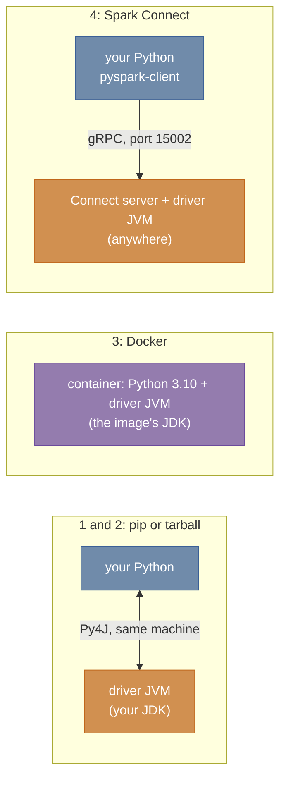

# Chapter 6: Installing Spark 4.3

In the past, the installation of Spark had many small difficulties. You needed a tarball, a JDK with the correct version, `SPARK_HOME` and `JAVA_HOME`. You also got a Hadoop native-library warning that all users learned to ignore. Most of these problems are gone now. `pip install pyspark` became reliable years ago, and the official Docker images are good.

Now the problem is the choice. There are four reasonable methods to install Spark 4.3. They put different things on your machine, and you cannot use one in place of another. Thus, this chapter is mostly about how to choose.

**The four installs are different in one thing, and that thing decides all the other differences: where the driver is and what it runs on. The pip install and the tarball put a driver JVM next to your Python. Docker puts the two in a container. Spark Connect moves the driver into a server, and your code communicates with that server over gRPC. Thus, choose the install from where your code runs, not from which command is the easiest to type.**

Each install in this chapter ran on Linux with OpenJDK 17 and Python 3.12, against Spark 4.3.0 (released at the end of October 2026). Each install ran the same five-line program against the taxi data of the book. The code of the book uses the first option. To follow the book, do only the first option. Then go to [the data](#get-the-data).

## The four options side by side



The animation shows the same program on each install. Only the location of the driver changes.

<figure markdown>
  <video autoplay loop muted playsinline controls width="1280" height="720" poster="../../media/clips/ch06-anim-drivers.webp">
    <source src="../../media/clips/ch06-anim-drivers.mp4" type="video/mp4">
  </video>
  <figcaption>Animation: the same program runs on the four installs. pip and the tarball start the driver next to your Python. Docker puts the two in a container. Spark Connect sends the plan over gRPC. Each install counts 3,837,248 trips.</figcaption>
</figure>


| | pip (`pyspark`) | Tarball | Docker (`apache/spark`) | Spark Connect (`pyspark-client`) |
|---|---|---|---|---|
| What you install | a Python package with the jars of Spark in it | the full distribution | an image | an 11 MB client package |
| On disk | 484 MB (`pyspark/`, 280 jars) | 599 MB unpacked | 1.33 GB image | 11 MB (`pyspark/`) plus pandas, pyarrow, grpcio |
| Needs a local JDK | yes (17, 21 or 25) | yes | no (the image has Java 21) | no |
| Python | 3.11 or newer | 3.11 or newer for PySpark | 3.10.12 in the image | 3.11 or newer |
| Your code can use | all APIs, and also the JVM through Py4J | all APIs, and also `spark-submit`, the shells and the scripts in `sbin/` | all APIs, in the container | the DataFrame and SQL APIs over gRPC, but no JVM objects |
| Use it for | study, notebooks, tests, work on one machine | clusters that you operate, Scala and Java work | reproducible environments, CI, the server for option 4 | applications, IDEs and notebooks that must not hold a driver |

<figure markdown>


<figcaption>Size on disk of each install, from the table above. The thin client is small because it has no jars. It also needs pandas, pyarrow and grpcio.</figcaption>
</figure>


## Option 1: pip (or uv)

```bash
python -m venv .venv && source .venv/bin/activate
pip install "pyspark[connect]==4.3.0"     # (1)!
```

1.  The `[connect]` extra adds pandas, pyarrow and grpcio. The Connect client and the pandas API need these packages.

The [`code/`](https://github.com/open-lakehouse/spark-masterclass/tree/main/code) folder of the book is a uv project that pins exactly this version. Thus, from a clone, the full install is `cd code && uv sync`. PySpark 4.3.0 needs Python 3.11 or newer. uv did not resolve the project until the book increased `requires-python` from 3.10. PySpark also needs a JDK on your `PATH` or in `JAVA_HOME`. Spark 4.x supports Java 17, 21 and 25, and it does not run on Java 8 or 11.

With this install, you get all the jars of the Spark distribution in a Python package. You also get a `SparkSession` that starts a driver JVM as a child process of your Python. The session communicates with the JVM through Py4J. That is why the first `getOrCreate()` takes a few seconds. It is also why this install can do everything: your Python can use JVM objects (`spark.sparkContext`, `df._jdf`) directly. `code/ch06/check_env.py` prints what you have:

```text
python  3.12.3
pyspark 4.3.0
java    openjdk version "17.0.21.1" 2026-11-17

Spark 4.3.0 on local[*], 16 cores, UI at http://127.0.0.1:4040

3,837,248 trips, 21 columns
```

## Option 2: the tarball

```bash
curl -fLO https://dlcdn.apache.org/spark/spark-4.3.0/spark-4.3.0-bin-hadoop3.tgz
curl -fLO https://downloads.apache.org/spark/spark-4.3.0/spark-4.3.0-bin-hadoop3.tgz.sha512
sha512sum -c spark-4.3.0-bin-hadoop3.tgz.sha512      # spark-4.3.0-bin-hadoop3.tgz: OK
tar xzf spark-4.3.0-bin-hadoop3.tgz
./spark-4.3.0-bin-hadoop3/bin/spark-submit --version  # version 4.3.0, Scala 2.13.18
```

Download the tarball from the mirror. Download the checksum from `downloads.apache.org`. Do not download the two files from the same mirror. If a mirror serves a changed file, a checksum from the same mirror proves nothing.

The tarball has the same 280 jars as the pip package. It also has all the items that a cluster operator needs:

- `bin/spark-submit`, `spark-shell` and `spark-sql`
- the `sbin/` scripts for standalone masters, workers, the history server and the Connect server
- the `conf/` templates
- the examples

Use this install to run Spark yourself on machines that you control, and for Scala or Java work. PySpark code runs through it with `spark-submit`, which sets the Python path for you:

```bash
./spark-4.3.0-bin-hadoop3/bin/spark-submit --master "local[*]" code/ch06/hello.py data/nyc-taxi/yellow
# python 3.12.3, spark 4.3.0, 3,837,248 trips
```

## Option 3: the official Docker image

```bash
docker run --rm -v "$PWD/data:/data:ro" -v "$PWD/code/ch06:/work:ro" \
  apache/spark:4.3.0-python3 /opt/spark/bin/spark-submit /work/hello.py
# python 3.10.12, spark 4.3.0, 3,837,248 trips
```

The 4.3.0 images have variants for Java 17, 21 and 25, with or without Python and R. `4.3.0-python3` is the same image as `4.3.0-scala2.13-java21-python3-ubuntu` (the image IDs are identical), so it has Java 21. Know these two facts before you use the image:

- **`python3 -c "import pyspark"` fails in the container** with `ModuleNotFoundError`. The reason is that the image keeps PySpark in `/opt/spark/python`, and it does not install PySpark into the system Python. Use `spark-submit` or `/opt/spark/bin/pyspark`, which set `PYTHONPATH`. Or, set `PYTHONPATH` yourself.
- **The Python in the image is 3.10.12**, but PySpark 4.3.0 on PyPI needs 3.11. The PySpark in the image runs correctly on it, as the output above shows. But you can mix the image with PySpark from pip in a different location. For example, you can put the executors in the image and the driver on your laptop. In this case, the driver and the workers run different Python versions. Spark does not run Python UDFs when the minor versions are different.

The image is also the easiest method to run the server for option 4. `start-connect-server.sh` usually runs as a daemon and returns. If the script returns, the container stops. Thus, tell the script to stay in the foreground:

```bash
docker run --rm -e SPARK_NO_DAEMONIZE=1 -p 15002:15002 \
  apache/spark:4.3.0-python3 /opt/spark/sbin/start-connect-server.sh
```

That server answered a thin client a few seconds after it started. [Chapter 24](ch24-spark-connect.md) runs the same server from the pip install (`code/ch24/server.sh`). With that server, the data paths are identical on the two sides.

## Option 4: Spark Connect with the thin client

```bash
pip install pyspark-client==4.3.0      # 11 MB of PySpark; no jars, no JVM
```

```python
from pyspark.sql import SparkSession
spark = SparkSession.builder.remote("sc://localhost:15002").getOrCreate()
```

```text
thin client: python 3.12.3, server spark 4.3.0, 3,837,248 trips
```

`pyspark-client` is PySpark without the JVM. It contains the DataFrame, SQL, streaming and ML APIs. These APIs are a client that serializes each query to a protobuf plan, and sends the plan to a Connect server. The client does not need Java, and it starts immediately. A crash in your code cannot stop the driver.

But the thin client has two costs. First, no JVM objects exist on your side: `spark.sparkContext`, RDDs and `df._jdf` are not available. Second, the server decides which Spark version and which jars your queries use, not you. [Chapter 24](ch24-spark-connect.md) shows what this changes. Most code that uses DataFrames sees no difference.

!!! warning "Do not use `python -c` with the thin client"
    Do not paste thin-client code into `python -c "..."`. With `pyspark-client` 4.3.0, Python prints *"Could not find valid SPARK_HOME"* and stops with status 255.

    The client examines if a doctest runner imports it. It looks for a `__main__` module with no `__spec__`, no `__file__` and no interactive prompt. `python -c` gives exactly these conditions. Then the client imports a test helper. The helper searches for a Spark installation, which the thin client does not have, and the process stops.

    The snippet above works when you run it as a file. Scripts, `python - < file.py`, notebooks and the REPL also work correctly.

## How to choose

The decision depends on where your code runs, and on whether your code must share a process with the driver:

| Where your code runs | Install | Why |
|---|---|---|
| Study, notebooks on your laptop, unit tests | pip | It is one command, and everything works. Here, you want the driver next to your Python. |
| Spark on machines that you manage | the tarball, or the Docker image if these machines run containers | You get `spark-submit`, the shells and the `sbin/` scripts. |
| A location where a JVM must not run: an application server, an IDE plugin, an agent, or a laptop that connects to a shared cluster | the thin client with a Connect server | The driver stays on the server. |
| CI | the Docker image, pinned by tag | The Spark and Java versions are part of the build, not part of the runner. |

The figure shows what each install puts on your machine, from your code down to the JDK.

<figure markdown>


<figcaption>What each install puts on your machine. Only the thin client has no JVM and no JDK. Its driver is on a Connect server.</figcaption>
</figure>


## The version minimums of Spark 4.3

Each install has a floor for Java, Python and the Python libraries. The floors come from three places in 4.3.0: the docs, the metadata of the pip package and the checks in the PySpark code. `minimums.py` reads the metadata of the installed `pyspark` and compares each floor with what this machine has:

```text
pyspark 4.3.0   Requires-Python >=3.11   this Python 3.12.3
java on PATH: openjdk version "17.0.21.1" 2026-11-17

package                   pyspark asks for      installed here  extras
googleapis-common-protos  >=1.71.0              1.76.0          connect, pipelines
grpcio                    >=1.76.0              1.85.3          connect, pipelines
grpcio-status             >=1.76.0              1.85.3          connect, pipelines
numpy                     >=1.23.2              2.5.5           ml, mllib, sql, pandas-on-spark, connect, pipelines
pandas                    >=2.2.0               2.3.3           sql, pandas-on-spark, connect, pipelines
py4j                      <0.10.9.10,>=0.10.9.7 0.10.9.9        (always)
pyarrow                   >=18.0.0              26.0.1          sql, pandas-on-spark, connect, pipelines
pyyaml                    >=3.11                -               pipelines
zstandard                 >=0.25.0              0.25.0          connect, pipelines
```

Py4J is the only package that `pip install pyspark` always installs. The other packages come with an extra, for example `pip install "pyspark[sql]"` or `pip install "pyspark[connect]"`. The full table of floors in 4.3.0:

| Part | Minimum in 4.3.0 | Source |
|---|---|---|
| Java | 17. Spark runs on Java 17, 21 and 25. Java 25 before 25.0.3 is deprecated since 4.2.0 | `docs/index.md`, `<java.version>17</java.version>` in `pom.xml` |
| Scala | 2.13 only (since 4.0) | `docs/index.md` |
| Python | 3.11 (`python_requires=">=3.11"`) | `python/packaging/classic/setup.py` |
| PyArrow | 18.0.0 | `setup.py`, and `require_minimum_pyarrow_version` in `pyspark/sql/pandas/utils.py` |
| pandas | 2.2.0 | `setup.py`, and `require_minimum_pandas_version` |
| NumPy | 1.23.2 | `setup.py`, and `require_minimum_numpy_version` |
| gRPC (`grpcio`, `grpcio-status`) | 1.76.0, for Spark Connect | `setup.py` |
| R | 4.0, and SparkR is deprecated | `docs/index.md` |

The PySpark install page of 4.3.0 lists pandas as `>=2.2.0,<3.0.0`. The package metadata above has no upper limit for pandas. Thus pip can install a pandas 3 that the docs do not list as supported. Pin pandas below 3 if you want to stay inside the documented range.

The official Docker image of Option 3 is an exception to the Python floor. Its Python is 3.10.12, and the PySpark in the image runs on it.

## Get the data

Each chapter in the first half of the book uses the yellow-cab trip records of the NYC Taxi and Limousine Commission (TLC). The TLC publishes these records as one Parquet file for each month. The book also uses a 265-row CSV file that maps location IDs to zones and boroughs. The book pins June 2026, so that you get the same numbers when you run the code again:

```bash
code/common/get_data.sh        # downloads into data/nyc-taxi/ and prints SHA-256 sums
```

```text
1a99e105092230f8620f301edcca7f80d3080642ff404d28ed957d3fa222c8ed  ./taxi_zone_lookup.csv
f340c62a18885c56176433c9db28e97d0a8a14e6e49869276ad8afb20ebf088b  ./yellow/yellow_tripdata_2026-06.parquet
```

If your sums are different, the TLC published the month again. The TLC sometimes does this, with corrections. In this case, your counts will be a little different from the counts in the book.

## A first look at the data

At the end, `check_env.py` prints the schema and a summary. The summary gives the first lesson about data that you did not make: do not trust it.

```text
+-------+------------------+-----------------+------------------+
|summary|     trip_distance|      fare_amount|   passenger_count|
+-------+------------------+-----------------+------------------+
|  count|           3837248|          3837248|           2823748|
|   mean|5.2017636519705865|21.43972443271672|1.2570296641201693|
| stddev| 532.8536966799546|19.17533535065736|0.6561344679942783|
|    min|               0.0|          -1683.7|                 0|
|    max|         311565.39|           7045.0|                 9|
+-------+------------------+-----------------+------------------+
```

The data has these problems:

- A trip of 311,565 miles.
- A fare of minus $1,683.70.
- A quarter of the rows with no passenger count.
- Pickups with dates in December 2008 in a June 2026 file. The [next chapter](ch07-quick-start.md) shows them.

<figure markdown>


<figcaption>The `describe()` summary as a picture. A quarter of the passenger counts are null. One distance and one fare are far outside the usual range.</figcaption>
</figure>

Spark did not cause these problems. But each problem changes the answer to almost all questions that you can ask. [Chapter 7](ch07-quick-start.md) starts from this point.


## The whole chapter, on one page

- **Each install is a decision about where the driver is.** The pip install and the tarball put it next to your code. Docker puts it in a container. Connect puts it behind gRPC.
- **pip is the default for study and tests:** `pip install "pyspark[connect]==4.3.0"`, Python 3.11+, Java 17, 21 or 25.
- **The tarball is for Spark that you operate yourself.** Do a check of the tarball with the checksum from `downloads.apache.org`.
- **The Docker image runs Python 3.10**, and it does not put PySpark on the system path. Use `spark-submit`.
- **The floors of 4.3.0** are Java 17, Python 3.11, PyArrow 18.0.0, pandas 2.2.0 and NumPy 1.23.2. `minimums.py` compares them with your machine.
- **The thin client is 11 MB and needs no Java**, but you cannot use the APIs at the JVM level. Do not test it with `python -c`.
- **The data of the book is one pinned month of NYC taxi trips**, and this data has problems on purpose.

## Further reading

- [Spark 4.3.0 downloads](https://spark.apache.org/downloads.html), with checksums and signatures.
- [Installation in the PySpark docs](https://spark.apache.org/docs/4.3.0/api/python/getting_started/install.html), with the optional extras.
- [Official Docker images](https://hub.docker.com/r/apache/spark/tags), with all 4.3.0 variants.
