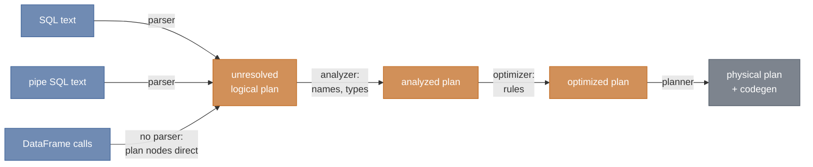
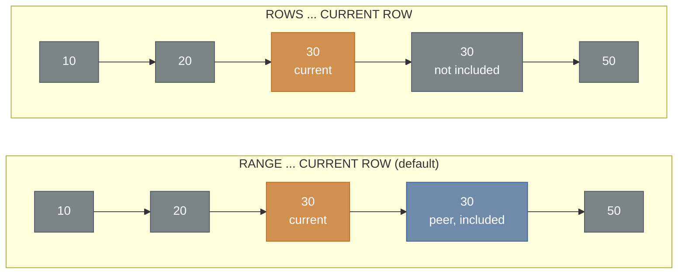
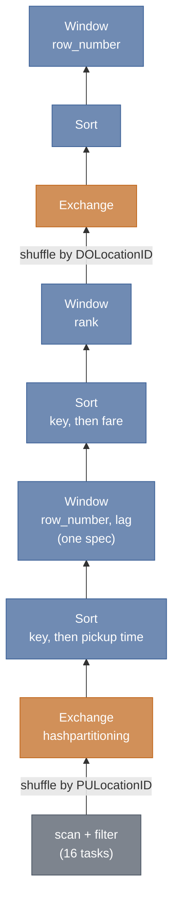
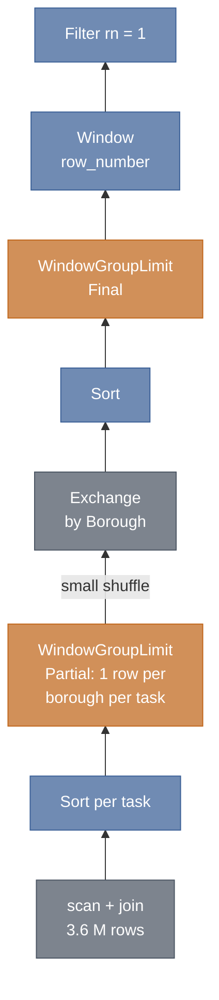

# Chapter 7: Spark SQL in depth: windows, pipe syntax and QUALIFY

Chapter 3 wrote one query two times, in Python and in SQL, and showed that the two plans were the same. This chapter goes further into SQL. It starts with the path from SQL text to a plan. Then it teaches window functions from the start, because many later chapters use them. Last, it shows two newer forms of SQL: pipe syntax (Spark 4.0) and `QUALIFY` (Spark 4.2).

**The DataFrame API, standard SQL and pipe SQL are three surfaces on one engine. They all become one logical plan, and the optimizer cannot see which surface you used. A window function is different, because it adds real work to the plan: a shuffle by the partition key, a sort, and a `Window` operator. When you know that shape, you can write windows that cost one sort, not three.**

The scripts are in [`code/ch07`](https://github.com/lisancao/spark-masterclass/tree/main/code/ch07), and each output block below comes from `code/ch07/output/`. They use the June 2026 taxi trips and the zone lookup from Part I. `windows.py` also uses an 8-row table, so that you can check each window value by eye.

- `syntaxes.py`: one question in three syntaxes, the plans, `explain` modes, constant folding and parameters.
- `windows.py`: window functions, frames and the plans that they make.
- `qualify.py`: top-N for each group with `QUALIFY`, pipes and aggregates, and the pipe operators.

## Step 1: One question, three syntaxes

The question: for June trips with a valid fare and distance, how many trips started in each borough, and what was the average fare? Show only the boroughs with more than 10,000 trips. `syntaxes.py` writes it with the DataFrame API, in standard SQL and in pipe SQL. This is the pipe version:

```python
PIPE = f"""
FROM trips AS t
|> WHERE t.tpep_pickup_datetime >= '{MONTH_START}' AND t.tpep_pickup_datetime < '{MONTH_END}'
|> WHERE t.fare_amount > 0 AND t.trip_distance BETWEEN 0.1 AND 100
|> JOIN zones AS z ON t.PULocationID = z.LocationID
|> AGGREGATE count(*) AS trips, round(avg(t.fare_amount), 2) AS avg_fare GROUP BY z.Borough
|> WHERE trips > 10000
|> ORDER BY trips DESC"""
```

```text
== 1. one question, three syntaxes
+---------+-------+--------+
|  Borough|  trips|avg_fare|
+---------+-------+--------+
|Manhattan|3241273|   18.03|
|   Queens| 304954|   51.62|
| Brooklyn|  98710|   31.96|
|    Bronx|  13638|   29.59|
+---------+-------+--------+

same rows: True
same optimized plan, DataFrame vs SQL: True
same optimized plan, SQL vs pipe:      True
```

The three queries return the same rows. The script also compares their optimized logical plans with `sameResult`. This method compares two plans after it removes the differences in names and IDs. The three plans are the same plan.

A pipe query reads from top to bottom. Each `|>` takes the result of the line above it and applies one operator. Standard SQL has a fixed order (`SELECT`, `FROM`, `WHERE`, `GROUP BY`, `HAVING`, `ORDER BY`) that is not the order of the work.

The DataFrame API already works like a pipe: each method takes a DataFrame and returns a new one. Pipe syntax gives SQL the same property.

## Step 2: From text to a plan

The plans are the same at the end, but they do not start the same. `syntaxes.py` prints the node names of the parsed plan of each query, before the analyzer runs:

```text
== 2. parsed plans (node names only)
--- sql
Sort
  UnresolvedHaving
    Aggregate
      Filter
        Join
          SubqueryAlias
            UnresolvedRelation
          SubqueryAlias
            UnresolvedRelation
--- pipe
Sort
  PipeOperator
    Filter
      PipeOperator
        Aggregate
          Join
            Filter
              PipeOperator
                Filter
                  PipeOperator
                    SubqueryAlias
                      UnresolvedRelation
            SubqueryAlias
              UnresolvedRelation
```

The parser makes a tree that follows the text. Standard SQL gives one `Filter` for the `WHERE`, and an `UnresolvedHaving` for the `HAVING`. The pipe query gives one node for each operator, in the order of the text, with a `PipeOperator` marker between them. The relations are still `UnresolvedRelation`: the parser knows the name `trips`, but it does not know the table or its columns.

Then the same four phases from Chapter 1 occur for all three queries:



- **The analyzer** finds `trips` in the catalog and resolves each column to an attribute with a type. It removes `PipeOperator` and changes `UnresolvedHaving` into a `Filter` over the `Aggregate`.
- **The optimizer** applies rules. It pushes filters down, prunes columns and folds constants. After this phase, the pipe query, the SQL query and the DataFrame query have the same tree.
- **The planner** selects physical operators (a join strategy, a hash aggregate) and makes the whole-stage code.

The DataFrame API does not use the parser. Each method adds a plan node directly. Over Spark Connect, the client sends these nodes as an unresolved plan. A call to `spark.sql(...)` sends the text, and the server parses it (Chapter 4).

## Step 3: Each prefix of a pipe query is a query

A pipe query has one more property. Remove the last lines, and the rest is still a valid query. `syntaxes.py` runs each prefix:

```text
== 3. each prefix of the pipe query
  1 operators: 21 columns, 3,837,248 rows   FROM trips AS t
  2 operators: 21 columns, 3,837,231 rows   |> WHERE t.tpep_pickup_datetime >= '2026-06-01
  3 operators: 21 columns, 3,663,191 rows   |> WHERE t.fare_amount > 0 AND t.trip_distance
  4 operators: 25 columns, 3,663,191 rows   |> JOIN zones AS z ON t.PULocationID = z.Locat
  5 operators:  3 columns,         8 rows   |> AGGREGATE count(*) AS trips, round(avg(t.fa
  6 operators:  3 columns,         4 rows   |> WHERE trips > 10000
  7 operators:  3 columns,         4 rows   |> ORDER BY trips DESC
```

Thus you can examine a pipe query one step at a time. The date filter removes 17 rows. The fare and distance filter removes 174,040 rows. The join adds the four columns of the zone table. The aggregate makes 8 rows, one for each borough value in the zone table.

The `WHERE` after `AGGREGATE` does the work of `HAVING`. Pipe syntax has no `HAVING` clause, because a `WHERE` always filters the result of the line above it.

## Step 4: The explain modes, and constant folding

`explain` has five modes. `syntaxes.py` counts the lines and the section headers that each mode prints for the SQL query:

```text
== 4. explain modes
  simple       41 lines  == Physical Plan ==
  extended     80 lines  == Parsed Logical Plan == == Analyzed Logical Plan == == Optimized Log
  formatted   199 lines  == Physical Plan ==
  cost         54 lines  == Optimized Logical Plan == == Physical Plan ==
  codegen     821 lines  == Subtree 1 / 4 (maxMethodCodeSize:181; maxConstantPoolSize:118(0.18%
  cost mode, first operator lines:
    Sort [trips#73L DESC NULLS LAST], true, Statistics(sizeInBytes=35.5 GiB)
    +- Filter (trips#73L > 10000), Statistics(sizeInBytes=35.5 GiB)
    +- Aggregate [Borough#39], [Borough#39, count(1) AS trips#73L, round(avg(fare_amount#10), 2) AS avg_
```

- **`simple`** prints the physical plan. Use it first.
- **`extended`** prints the four plans of Step 2: parsed, analyzed, optimized and physical.
- **`formatted`** prints a short tree with numbers, and then the details of each operator. It is the longest readable form.
- **`cost`** adds a `Statistics` estimate to each node of the optimized plan.
- **`codegen`** prints the Java source that whole-stage code generation made. This plan has four subtrees, one for each group of operators that runs as one function.

The `cost` estimate shows a problem. The estimate for the aggregate output is 35.5 GiB, but the result has 4 rows.

Without table statistics, Spark estimates the size of a join from the sizes of its inputs, and it cannot estimate the size of an aggregate. `ANALYZE TABLE ... COMPUTE STATISTICS` gives better estimates for catalog tables. The cost-based optimizer (`spark.sql.cbo.enabled`) uses those statistics to order joins. Chapter 18 shows how the planner and AQE use sizes.

The optimizer also calculates constant expressions one time, when it makes the plan. This rule is `ConstantFolding`:

```text
== 5. constant folding
['Project [7 AS x#302, NYC AS y#303]']
defined a query with 1/0 and WHERE false: ['x']
collect(): DIVIDE_BY_ZERO: Division by zero. Use `try_divide` to tolerate divisor being 0 and ret
  first Spark frames:
    org.apache.spark.sql.catalyst.expressions.DivModLike.eval
    org.apache.spark.sql.catalyst.expressions.DivModLike.eval$
    org.apache.spark.sql.catalyst.expressions.Divide.eval
    org.apache.spark.sql.catalyst.optimizer.ConstantFolding$.tryFold
```

`1 + 2 * 3` became `7`, and `upper('nyc')` became `NYC`, before a task ran. The second query has `1/0` in its `SELECT` and `WHERE false`. It returns no rows, so you can expect no error.

But the optimizer folds `1/0` before it removes the rows. Under ANSI mode, the fold fails with `DIVIDE_BY_ZERO`, and the stack shows `ConstantFolding.tryFold`. The query fails at `collect()`, because the optimizer runs when an action needs the plan. Use `try_divide` (Chapter 6) when a constant can be zero.

## Step 5: Parameters, not string formats

A query that contains a value from a user needs a parameter. `spark.sql` accepts named markers (`:name`) with a dict, and positional markers (`?`) with a list:

```python
named = spark.sql("SELECT count(*) AS n FROM trips WHERE fare_amount > :min_fare AND PULocationID = :zone",
                  args={"min_fare": 100, "zone": 132})
pos = spark.sql("SELECT count(*) AS n FROM trips WHERE fare_amount > ? AND PULocationID = ?", args=[100, 132])
spark.sql("SELECT count(*) AS n FROM IDENTIFIER(:tbl)", args={"tbl": "zones"})
spark.sql("SELECT count(*) AS n FROM {t} WHERE Borough = {b}", t=zones, b="Queens")
```

```text
== 6. parameters
named   :min_fare, :zone  -> 5216
positional ?, ?            -> 5216
IDENTIFIER(:tbl)           -> 265
DataFrame as {t}           -> 69
f-string with user input   -> 3837248
the same input as :v       -> CAST_INVALID_INPUT: The value '0 OR 1 = 1' of the type "STRING" cannot be cast to "DOUBLE"
IDENTIFIER with a bad name -> PARSE_SYNTAX_ERROR: Syntax error at or near ';'. SQLSTATE: 42601
```

The analyzer replaces each marker with a literal value. The value never becomes SQL text. The f-string row shows the risk of the other method. The input `0 OR 1 = 1` became a part of the condition, and the query counted all 3,837,248 rows. The same input as a parameter is a string, and the cast of that string to a number fails.

A marker can only replace a value. To use a parameter for a table or column name, wrap it in `IDENTIFIER(...)`. The parser reads the value as one name, so `zones; DROP TABLE trips` is a syntax error, not a second statement. The `{t}` form is a PySpark feature. It replaces `{t}` with a temporary view of the DataFrame `t`, and a value such as `{b}` becomes a literal.

## Step 6: A window function keeps every row

An aggregate with `groupBy` returns one row for each group. A window function calculates a value over a group of rows, but it returns one value for each input row. The group of rows is the **window**. `windows.py` uses 8 rows of daily trip counts for two boroughs:

```python
w_all = Window.partitionBy("borough")
sales.select("borough", "day", "trips",
             F.sum("trips").over(w_all).alias("borough_total"),
             F.round(F.col("trips") / F.sum("trips").over(w_all), 2).alias("share")).show()
```

```text
== 1. groupBy against a window
groupBy rows: 2 | input rows: 8
+-------+----------+-----+-------------+-----+
|borough|       day|trips|borough_total|share|
+-------+----------+-----+-------------+-----+
|  Bronx|2026-06-01|    5|           35| 0.14|
|  Bronx|2026-06-02|   15|           35| 0.43|
|  Bronx|2026-06-05|   15|           35| 0.43|
| Queens|2026-06-01|   10|          140| 0.07|
| Queens|2026-06-02|   30|          140| 0.21|
| Queens|2026-06-03|   30|          140| 0.21|
| Queens|2026-06-04|   20|          140| 0.14|
| Queens|2026-06-06|   50|          140| 0.36|
+-------+----------+-----+-------------+-----+
```

Each row keeps its own columns and gets the total of its borough. Thus you can divide a row by its group total in one expression, with no join back to an aggregate.

A window specification has three parts:

- **`PARTITION BY`** divides the rows into independent groups. A window never looks across two partitions.
- **`ORDER BY`** sorts the rows in each partition. Ranks, offsets and running totals need an order.
- **The frame** selects which rows of the partition each row uses, relative to the current row. Step 9 explains frames.

In SQL, these parts go in `OVER (...)`. In Python, `Window.partitionBy(...).orderBy(...)` makes the specification, and `.over(w)` applies a function to it.

## Step 7: Ranking functions and ties

Six functions give a position in the sorted partition. The Bronx has a tie (two days with 15 trips), and Queens has a tie (two days with 30):

```python
w_rank = Window.partitionBy("borough").orderBy(F.desc("trips"))
```

```text
== 2. ranking functions
+-------+----------+-----+----------+----+----------+--------+---------+------+
|borough|       day|trips|row_number|rank|dense_rank|pct_rank|cume_dist|ntile2|
+-------+----------+-----+----------+----+----------+--------+---------+------+
|  Bronx|2026-06-02|   15|         1|   1|         1|     0.0|     0.67|     1|
|  Bronx|2026-06-05|   15|         2|   1|         1|     0.0|     0.67|     1|
|  Bronx|2026-06-01|    5|         3|   3|         2|     1.0|      1.0|     2|
| Queens|2026-06-06|   50|         1|   1|         1|     0.0|      0.2|     1|
| Queens|2026-06-02|   30|         2|   2|         2|    0.25|      0.6|     1|
| Queens|2026-06-03|   30|         3|   2|         2|    0.25|      0.6|     1|
| Queens|2026-06-04|   20|         4|   4|         3|    0.75|      0.8|     2|
| Queens|2026-06-01|   10|         5|   5|         4|     1.0|      1.0|     2|
+-------+----------+-----+----------+----+----------+--------+---------+------+
```

The functions are different only on ties:

- **`row_number`** gives each row a different number. For tied rows, the order is not defined. Two runs can give the two Queens 30s different numbers. Add a second `ORDER BY` column (here `day`) if the result must be stable.
- **`rank`** gives tied rows the same number and then skips. Queens goes 1, 2, 2, 4.
- **`dense_rank`** gives tied rows the same number and does not skip: 1, 2, 2, 3.
- **`percent_rank`** is `(rank - 1) / (rows - 1)`, from 0 to 1.
- **`cume_dist`** is the fraction of rows with a value that is the same or better. For the Queens 30s, that is 3 of 5 rows, so 0.6.
- **`ntile(n)`** divides the partition into `n` groups of almost equal size.

## Step 8: lag and lead

`lag` and `lead` read a value from another row of the same partition, a number of rows before or after the current row:

```python
w_day = Window.partitionBy("borough").orderBy("day")
sales.select("borough", "day", "trips",
             F.lag("trips").over(w_day).alias("prev"),
             (F.col("trips") - F.lag("trips").over(w_day)).alias("change"),
             F.lead("day").over(w_day).alias("next_day"),
             F.lag("trips", 1, 0).over(w_day).alias("prev_or_0"))
```

```text
== 3. lag and lead
+-------+----------+-----+----+------+----------+---------+
|borough|       day|trips|prev|change|  next_day|prev_or_0|
+-------+----------+-----+----+------+----------+---------+
|  Bronx|2026-06-01|    5|NULL|  NULL|2026-06-02|        0|
|  Bronx|2026-06-02|   15|   5|    10|2026-06-05|        5|
|  Bronx|2026-06-05|   15|  15|     0|      NULL|       15|
| Queens|2026-06-01|   10|NULL|  NULL|2026-06-02|        0|
| Queens|2026-06-02|   30|  10|    20|2026-06-03|       10|
| Queens|2026-06-03|   30|  30|     0|2026-06-04|       30|
| Queens|2026-06-04|   20|  30|   -10|2026-06-06|       30|
| Queens|2026-06-06|   50|  20|    30|      NULL|       20|
+-------+----------+-----+----+------+----------+---------+
```

The first row of each partition has no previous row, so `lag` returns NULL. The third argument gives a default value. Be careful with the default: `prev_or_0` says that there were 0 trips before 1 June, and the data does not say that.

`lag` counts rows, not days. For the Bronx, the row before 5 June is 2 June. If a gap between dates is important, calculate it with `datediff(day, lag(day))`, and do not assume that the previous row is the previous day.

## Step 9: Frames, and the default frame

The frame is the set of rows that an aggregate such as `sum` uses for each row. If you give an `ORDER BY` and no frame, Spark uses `RANGE BETWEEN UNBOUNDED PRECEDING AND CURRENT ROW`. This default has two effects that surprise many users. `windows.py` shows both:

```sql
SELECT borough, day, trips,
  sum(trips)        OVER (PARTITION BY borough ORDER BY trips)                    AS default_frame,
  sum(trips)        OVER (PARTITION BY borough ORDER BY trips
                          ROWS BETWEEN UNBOUNDED PRECEDING AND CURRENT ROW)       AS rows_frame,
  last_value(trips) OVER (PARTITION BY borough ORDER BY day)                      AS last_default,
  last_value(trips) OVER (PARTITION BY borough ORDER BY day
                          ROWS BETWEEN UNBOUNDED PRECEDING AND UNBOUNDED FOLLOWING) AS last_whole
FROM sales WHERE borough = 'Queens' ORDER BY trips, day
```

```text
== 4. frames
+-------+----------+-----+-------------+----------+------------+----------+
|borough|       day|trips|default_frame|rows_frame|last_default|last_whole|
+-------+----------+-----+-------------+----------+------------+----------+
| Queens|2026-06-01|   10|           10|        10|          10|        50|
| Queens|2026-06-04|   20|           30|        30|          20|        50|
| Queens|2026-06-02|   30|           90|        60|          30|        50|
| Queens|2026-06-03|   30|           90|        90|          30|        50|
| Queens|2026-06-06|   50|          140|       140|          50|        50|
+-------+----------+-----+-------------+----------+------------+----------+

(borough#0, day#3 ASC NULLS FIRST, specifiedwindowframe(RangeFrame, unboundedpreceding$(), curre
```

<figure markdown>
  <video autoplay loop muted playsinline controls width="1280" height="720" poster="../../media/clips/ch07-frames.webp">
    <source src="../../media/clips/ch07-frames.mp4" type="video/mp4">
  </video>
  <figcaption><code>windows.py</code> runs against Spark 4.3.0. With the default frame, the two rows with 30 trips both get 90, and <code>last_value</code> returns the current row.</figcaption>
</figure>

- **A `RANGE` frame includes the peers of the current row.** Peers are rows with the same `ORDER BY` value. The two rows with 30 trips both get 90, because each one includes the other. The `ROWS` frame counts physical rows, so it gives 60 and then 90. A running total with ties needs `ROWS`, or a second sort column that makes each value different.
- **`last_value` with the default frame returns the current row.** The frame ends at the current row, so the last value in the frame is the current value. To get the last value of the partition, give the frame `UNBOUNDED FOLLOWING`. The same applies to `max`, `avg` and the other aggregates.

The last line of the output is from the plan. The analyzer wrote the default frame into the plan as `specifiedwindowframe(RangeFrame, unboundedpreceding$(), currentrow$())`.



## Step 10: Moving windows: ROWS against RANGE

A moving window has a fixed size. With `ROWS`, the size is a count of rows. With `RANGE`, the size is a distance on the `ORDER BY` value. For a date, that distance is an interval. Queens has no row for 5 June, and the Bronx has no rows for 3 and 4 June:

```sql
SELECT borough, day, trips,
  sum(trips) OVER (PARTITION BY borough ORDER BY day
                   ROWS BETWEEN 2 PRECEDING AND CURRENT ROW)                      AS last_3_rows,
  sum(trips) OVER (PARTITION BY borough ORDER BY day
                   RANGE BETWEEN INTERVAL 2 DAYS PRECEDING AND CURRENT ROW)       AS last_3_days
FROM sales ORDER BY borough, day
```

```text
== 5. moving windows: ROWS against RANGE
+-------+----------+-----+-----------+-----------+
|borough|       day|trips|last_3_rows|last_3_days|
+-------+----------+-----+-----------+-----------+
|  Bronx|2026-06-01|    5|          5|          5|
|  Bronx|2026-06-02|   15|         20|         20|
|  Bronx|2026-06-05|   15|         35|         15|
| Queens|2026-06-01|   10|         10|         10|
| Queens|2026-06-02|   30|         40|         40|
| Queens|2026-06-03|   30|         70|         70|
| Queens|2026-06-04|   20|         80|         80|
| Queens|2026-06-06|   50|        100|         70|
+-------+----------+-----+-----------+-----------+

DataFrame rangeBetween on seconds, same answer: [5, 20, 15, 10, 40, 70, 80, 70]
```

On 5 June, the Bronx `last_3_rows` is 35, because it adds 1, 2 and 5 June. These are three rows, but they cover five days. `last_3_days` is 15, because no other Bronx row is in the range from 3 to 5 June. For "the last three days", use `RANGE`, because data often has days with no rows.

The DataFrame API has `rowsBetween` and `rangeBetween`. `rangeBetween` takes numbers, not intervals. Thus the script orders by the date as seconds, and it uses `-2 * 86400` as the start. The result is the same as the SQL.

Spark has constants for the boundaries: `Window.unboundedPreceding`, `Window.currentRow` and `Window.unboundedFollowing`. Thus a running total in Python is `w.rowsBetween(Window.unboundedPreceding, Window.currentRow)`.

## Step 11: The WINDOW clause, and what the analyzer refuses

When a query uses one specification many times, give it a name with a `WINDOW` clause:

```sql
SELECT borough, day, trips, sum(trips) OVER w AS running, avg(trips) OVER w AS running_avg,
       row_number() OVER (w2) AS n
FROM sales
WINDOW w AS (PARTITION BY borough ORDER BY day ROWS UNBOUNDED PRECEDING),
       w2 AS (PARTITION BY borough ORDER BY trips DESC)
ORDER BY borough, day
```

```text
== 6. the WINDOW clause
+-------+----------+-----+-------+------------------+---+
|borough|       day|trips|running|       running_avg|  n|
+-------+----------+-----+-------+------------------+---+
|  Bronx|2026-06-01|    5|      5|               5.0|  3|
|  Bronx|2026-06-02|   15|     20|              10.0|  1|
|  Bronx|2026-06-05|   15|     35|11.666666666666666|  2|
| Queens|2026-06-01|   10|     10|              10.0|  5|
| Queens|2026-06-02|   30|     40|              20.0|  2|
| Queens|2026-06-03|   30|     70|23.333333333333332|  3|
| Queens|2026-06-04|   20|     90|              22.5|  4|
| Queens|2026-06-06|   50|    140|              28.0|  1|
+-------+----------+-----+-------+------------------+---+
```

`ROWS UNBOUNDED PRECEDING` is a short form of `ROWS BETWEEN UNBOUNDED PRECEDING AND CURRENT ROW`. In Python, a `Window` object does the same work as a named window: make it one time, and use it in many `.over()` calls.

The analyzer checks each window before the query runs. These four errors are frequent:

```text
== 7. errors
  rank() with no ORDER BY        WINDOW_FUNCTION_FRAME_NOT_ORDERED: Window function rank requires the window to be ordered. You need to add an ORDER
  window in WHERE                WINDOW_FUNCTION_NOT_ALLOWED_IN_CLAUSE: It is not allowed to use window functions inside WHERE clause. SQLSTATE: 42601
  RANGE with two ORDER BY keys   DATATYPE_MISMATCH.RANGE_FRAME_MULTI_ORDER: Cannot resolve "(ORDER BY borough ASC NULLS FIRST, day ASC NULLS FIRST RANGE BET
  row_number() with a frame      _LEGACY_ERROR_TEMP_1036: Window Frame specifiedwindowframe(RowFrame, -1, currentrow$()) must match the re
```

- A ranking function needs an order.
- `WHERE` runs before the window functions, so it cannot filter on them. Step 13 shows the solution.
- A `RANGE` frame with value boundaries measures a distance on one value. Thus it needs exactly one `ORDER BY` expression.
- Ranking and offset functions set their own frame. You cannot give them a different frame.

## Step 12: What a window costs

A `Window` operator needs all rows of one partition key in one task, sorted by the `ORDER BY` columns. `windows.py` calculates the time between two pickups in the same zone, on the 3.8 million June trips:

```python
w_zone = Window.partitionBy("PULocationID").orderBy("tpep_pickup_datetime")
gaps = trips.select("PULocationID", "tpep_pickup_datetime",
                    F.timestamp_diff("SECOND", F.lag("tpep_pickup_datetime").over(w_zone),
                                     "tpep_pickup_datetime").alias("gap_s"))
```

```text
== 8. the physical plan of a window, on the June trips
== Physical Plan ==
AdaptiveSparkPlan isFinalPlan=false
+- Project [PULocationID#244, tpep_pickup_datetime#238, timestampdiff(SECOND, cast(_we0#260 as timestamp
   +- Window [lag(tpep_pickup_datetime#238, -1, null) windowspecdefinition(PULocationID#244, tpep_pickup
      +- Sort [PULocationID#244 ASC NULLS FIRST, tpep_pickup_datetime#238 ASC NULLS FIRST], false, 0
         +- Exchange hashpartitioning(PULocationID#244, 200), ENSURE_REQUIREMENTS, [plan_id=753]
            +- Filter ((isnotnull(tpep_pickup_datetime#238) AND (tpep_pickup_datetime#238 >= 2026-06-01 
               +- FileScan parquet [tpep_pickup_datetime#238,PULocationID#244] Batched: true, DataFilter

same spec, two functions -> 1 Window operator(s)
three specs -> 3 Window, 3 Sort, 2 Exchange
```

Read the plan from the bottom:

1. **`Exchange hashpartitioning(PULocationID, 200)`** is a shuffle. It sends all rows of one zone to one partition. The planner adds it, because `Window` needs all rows of one `PARTITION BY` key in one partition.
2. **`Sort [PULocationID, tpep_pickup_datetime]`** sorts each partition by the key and then by the `ORDER BY` column. The `false` means that the sort is local to each partition, not global.
3. **`Window`** reads the sorted rows one partition key at a time. For `lag`, it keeps a small buffer. For a frame that ends at `UNBOUNDED FOLLOWING`, it must buffer all the rows of the key before it can return the first row. A very large key can then spill to disk.

The two counts at the end show how to keep this cost low. Two functions over the same specification share one `Window` operator, so `row_number` and `lag` cost one shuffle and one sort. Each different specification adds work:

- A different `ORDER BY` with the same `PARTITION BY` adds a `Sort` and a `Window`, but no shuffle.
- A different `PARTITION BY` adds an `Exchange`, a `Sort` and a `Window`.

The three specifications in the script give three `Window` operators, three sorts and two shuffles. When you write many window columns, use as few different specifications as possible.



A window with no `PARTITION BY` has one partition, the full table:

```text
== 9. no PARTITION BY
['+- Exchange SinglePartition, ENSURE_REQUIREMENTS, [plan_id=836]']
partitions of the result: 1
```

`Exchange SinglePartition` moves all 3.8 million rows to one task, and Spark sorts them there. Spark also logs a warning about this plan: "No Partition Defined for Window operation". A global row number on a large table is a single-task job. For a unique ID, use `monotonically_increasing_id()`. That ID is unique, but it is not continuous.

The real question of this section has a short answer. In the five busiest zones, the median time between two pickups is 7 to 11 seconds:

```text
== 10. median gap between pickups, five busiest zones
+---------------------+-------+------------+
|Zone                 |pickups|median_gap_s|
+---------------------+-------+------------+
|Upper East Side South|177609 |7           |
|Midtown Center       |161197 |7           |
|Upper East Side North|157112 |7           |
|JFK Airport          |148168 |9           |
|Midtown East         |119614 |11          |
+---------------------+-------+------------+
```

## Step 13: QUALIFY

The most frequent window question is "the top row in each group". `WHERE` cannot filter on a window function (Step 11). The usual solution puts the window in a subquery, and filters the rank outside it. `QUALIFY` (Spark 4.2) is a `WHERE` that runs after the window functions. `qualify.py` finds the longest trip from each borough in three ways:

```sql
-- 1. a subquery
SELECT Borough, Zone, trip_distance FROM (
  SELECT Borough, Zone, trip_distance,
         row_number() OVER (PARTITION BY Borough ORDER BY trip_distance DESC) AS rn
  FROM june) WHERE rn = 1 ORDER BY Borough

-- 2. QUALIFY
SELECT Borough, Zone, trip_distance FROM june
QUALIFY row_number() OVER (PARTITION BY Borough ORDER BY trip_distance DESC) = 1
ORDER BY Borough

-- 3. a pipe
FROM june
|> EXTEND row_number() OVER (PARTITION BY Borough ORDER BY trip_distance DESC) AS rn
|> WHERE rn = 1
|> SELECT Borough, Zone, trip_distance
|> ORDER BY Borough
```

```text
== 1. longest trip per borough, three ways
+-------------+-----------------------+-------------+
|Borough      |Zone                   |trip_distance|
+-------------+-----------------------+-------------+
|Bronx        |Allerton/Pelham Gardens|83.2         |
|Brooklyn     |East New York          |77.6         |
|EWR          |Newark Airport         |65.56        |
|Manhattan    |Upper East Side South  |99.26        |
|N/A          |Outside of NYC         |91.02        |
|Queens       |JFK Airport            |94.78        |
|Staten Island|West Brighton          |41.39        |
|Unknown      |N/A                    |59.1         |
+-------------+-----------------------+-------------+

same rows: True
same optimized plan, subquery vs QUALIFY: True
same optimized plan, QUALIFY vs pipe:     False
same operators, QUALIFY vs pipe:          True
the one difference: ['+- Project [trip_distance#4, Borough#39, Zone#40]', ':- Project [trip_distance#4, PULocationID#7]']
```

`june` is a temporary view of the clean June trips, joined to the zones. The subquery and `QUALIFY` give the same optimized plan. `QUALIFY` is a short form for the analyzer, not a new operator.

The pipe plan has the same operators. Only the column order of one `Project` is different, because `FROM june |> EXTEND` keeps all columns in their order in the view. `sameResult` compares the column order too, so it returns `False`. In a pipe, `EXTEND` and then `WHERE` does the work of `QUALIFY`, so pipe queries do not need `QUALIFY`.

In a standard query, the clauses run in this order: `FROM`, `WHERE`, `GROUP BY`, `HAVING`, window functions, `QUALIFY`, `SELECT` (the output), `ORDER BY`. Thus `QUALIFY` can use aliases of window functions from the `SELECT` list. It can also rank the result of an aggregate:

```text
== 4. QUALIFY rules
  alias of a window      ok, 13 rows, first ('Bronx', 'Mott Haven/Port Morris', 1765, 1)
  no window function     QUALIFY_REQUIRES_WINDOW_FUNCTION: The QUALIFY clause requires at least one window function in the current 
  aggregate in QUALIFY   QUALIFY_AGGREGATE_NOT_ALLOWED: Aggregate functions are not supported in QUALIFY: "count(1)". SQLSTATE: 
```

The first query groups by borough and zone, ranks the zones of each borough by `count(*)`, and keeps `QUALIFY r <= 2`. It uses the alias `r` from the `SELECT` list. The other two rows are the rules. `QUALIFY` needs at least one window function, in the clause or in the `SELECT` list. It cannot contain an aggregate directly: use `HAVING` for that.

Ties change the size of the result:

```text
== 5. ties
  row_number() = 1 on passenger_count: 8 rows
  rank() = 1 on passenger_count: 4,498 rows
```

The ranking by `passenger_count` has many ties at the top. `row_number() = 1` keeps one row for each borough, and the row that it keeps is not defined. `rank() = 1` keeps all tied rows.

## Step 14: How Spark runs a top-N filter

A top-N query does not need to sort all rows of each group. Since Spark 3.5, the optimizer rule `InferWindowGroupLimit` adds a `WindowGroupLimit` operator below the `Window`. This is the plan of the `QUALIFY` query after it ran:

```text
== 2. the physical plan of the QUALIFY query
AdaptiveSparkPlan isFinalPlan=true
+- == Final Plan ==
   ResultQueryStage 3
   +- *(5) Sort [Borough#39 ASC NULLS FIRST], true, 0
      +- AQEShuffleRead coalesced
         +- ShuffleQueryStage 2
            +- Exchange rangepartitioning(Borough#39 ASC NULLS FIRST, 200), ENSURE_REQUIREMENTS, [pl
               +- *(4) Project [Borough#39, Zone#40, trip_distance#4]
                  +- *(4) Filter (row_number() OVER (PARTITION BY june.Borough ORDER BY june.trip_di
                     +- Window [row_number() windowspecdefinition(Borough#39, trip_distance#4 DESC N
                        +- WindowGroupLimit [Borough#39], [trip_distance#4 DESC NULLS LAST], row_num
                           +- *(3) Sort [Borough#39 ASC NULLS FIRST, trip_distance#4 DESC NULLS LAST
                              +- AQEShuffleRead coalesced
with windowGroupLimitThreshold = -1: ['Window']
```

`WindowGroupLimit` reads the sorted rows of each key, and it stops after the first row (the limit is 1). The `Window` and the `Filter` then see one row for each borough, not 3.6 million rows.

The physical planner makes two copies of this operator, a `Partial` copy and a `Final` copy (`WindowGroupLimitExec.scala`). The `Partial` copy runs before the shuffle, in each scan task. Each task sends at most one row for each borough to the shuffle. The `Final` copy runs after the shuffle, as in the plan above. When the script sets `spark.sql.optimizer.windowGroupLimitThreshold` to `-1`, the rule does not run, and only `Window` stays.



The rule does not apply to all filters. `qualify.py` counts the `WindowGroupLimit` operators for five filters:

```text
== 3. which rank filters get a WindowGroupLimit
  row_number() = 1   WindowGroupLimit x2
  rank() <= 3        WindowGroupLimit x2
  dense_rank() < 4   WindowGroupLimit x2
  row_number() > 1   WindowGroupLimit x0
  ntile(4) = 1       WindowGroupLimit x0
```

In the 4.3.0 source, the rule accepts only `row_number`, `rank` and `dense_rank`. The filter must give an upper limit (`=`, `<` or `<=` with an integer). The limit must not be more than the threshold, which is 1000 by default. `row_number() > 1` has no upper limit, and `ntile` is not a rank function, so these two filters get no limit.

## Step 15: Top-N without a window

For "the value of one column at the maximum of another column", a window is not necessary. `max_by(x, y)` returns the `x` of the row with the largest `y`. Since Spark 4.2, a third argument `k` returns the top `k` values as an array:

```sql
SELECT Borough, max_by(Zone, trip_distance) AS zone_of_longest,
       max_by(round(trip_distance, 1), trip_distance, 3) AS top3
FROM june GROUP BY Borough ORDER BY Borough
```

<figure markdown>
  <video autoplay loop muted playsinline controls width="1280" height="720" poster="../../media/clips/ch07-topn.webp">
    <source src="../../media/clips/ch07-topn.mp4" type="video/mp4">
  </video>
  <figcaption><code>qualify.py</code> runs against Spark 4.3.0. Upper limits on <code>row_number</code>, <code>rank</code> and <code>dense_rank</code> get a <code>WindowGroupLimit</code> before and after the shuffle.</figcaption>
</figure>

```text
== 6. top-N without a window
+-------------+-----------------------+------------------+
|Borough      |zone_of_longest        |top3              |
+-------------+-----------------------+------------------+
|Bronx        |Allerton/Pelham Gardens|[83.2, 82.3, 67.6]|
|Brooklyn     |East New York          |[77.6, 63.4, 62.7]|
|EWR          |Newark Airport         |[65.6, 36.9, 27.2]|
|Manhattan    |Upper East Side South  |[99.3, 98.6, 98.5]|
|N/A          |Outside of NYC         |[91.0, 86.7, 73.4]|
|Queens       |JFK Airport            |[94.8, 93.8, 91.6]|
|Staten Island|West Brighton          |[41.4, 32.9, 30.3]|
|Unknown      |N/A                    |[59.1, 37.2, 35.5]|
+-------------+-----------------------+------------------+

plan nodes: ['SortAggregate(key=[Borough#39],', 'Exchange', 'SortAggregate(key=[Borough#39],', 'BroadcastExchange']
```

The zones are the same as in Step 13. This plan is an aggregate with a partial step and a final step, with no `Window`. The aggregate is a `SortAggregate`, not a `HashAggregate`, because the `k` form keeps an array of rows in its buffer. Chapter 6 showed the same fallback for collated keys. Use `max_by` when you need values, and `QUALIFY` when you need full rows.

## Step 16: The pipe operators

Pipe syntax has an operator for each clause of standard SQL, and some more. `qualify.py` uses most of them in one query. The question: in the three largest boroughs, which two payment types have the most trips, and what is their average tip share?

```sql
FROM june
|> WHERE Borough IN ('Manhattan', 'Queens', 'Brooklyn')
|> EXTEND tip_amount / fare_amount AS tip_share
|> SET tip_share = round(tip_share, 3)
|> AGGREGATE count(*) AS trips, avg(tip_share) AS avg_tip_share GROUP BY Borough, payment_type
|> WHERE trips > 1000
|> EXTEND rank() OVER (PARTITION BY Borough ORDER BY trips DESC) AS r
|> WHERE r <= 2
|> DROP r
|> AS t
|> SELECT t.Borough, t.payment_type, t.trips, round(t.avg_tip_share, 3) AS avg_tip_share
|> ORDER BY Borough, trips DESC
```

```text
== 7. pipe operators
+---------+------------+-------+-------------+
|  Borough|payment_type|  trips|avg_tip_share|
+---------+------------+-------+-------------+
| Brooklyn|           0|  87202|        0.012|
| Brooklyn|           1|   9197|        0.233|
|Manhattan|           1|2183587|        0.263|
|Manhattan|           0| 759665|        0.018|
|   Queens|           1| 207275|        0.218|
|   Queens|           2|  52960|          0.0|
+---------+------------+-------+-------------+
```

| Operator | What it does | Standard SQL |
|---|---|---|
| `WHERE` | Filters the rows of the line above | `WHERE`, `HAVING` or `QUALIFY` |
| `EXTEND` | Adds columns, and keeps all columns | `SELECT *, expr` |
| `SET` | Replaces the value of a column | `SELECT * REPLACE` in other engines |
| `DROP` | Removes columns | `SELECT` with a list of columns |
| `AS` | Gives the result a table alias | a subquery alias |
| `SELECT` | Selects and calculates columns | `SELECT` |
| `AGGREGATE` | Aggregates, with or without `GROUP BY` | `SELECT ... GROUP BY` |
| `JOIN` | Joins a table to the result | `JOIN` |
| `ORDER BY`, `LIMIT` | Sorts and limits | the same |
| `UNION`, `INTERSECT`, `EXCEPT` | Set operations | the same |
| `PIVOT`, `UNPIVOT` | Columns from values, values from columns | the same |
| `TABLESAMPLE` | A random sample | the same |

The result also shows a fact about the data. Payment type 0 is a large group in Brooklyn and Manhattan, and it has almost no recorded tips. The TLC data dictionary says that the tip column contains only card tips. Thus cash trips (type 2) have a tip share of 0.0.

`PIVOT` and `UNPIVOT` work as pipe operators too:

```text
== 11. PIVOT and UNPIVOT
+---------+-------+------+
|  Borough|   card|  cash|
+---------+-------+------+
|Manhattan|2183587|283543|
|   Queens| 207275| 52960|
+---------+-------+------+

+---------+------+-------+
|  Borough|method|  trips|
+---------+------+-------+
|Manhattan|  card|2183587|
|Manhattan|  cash| 283543|
|   Queens|  card| 207275|
|   Queens|  cash|  52960|
+---------+------+-------+
```

## Step 17: Pipe details that change results

`AGGREGATE` puts the grouping columns first, and then the aggregates. Since Spark 4.2, a pipe `SELECT` can also contain aggregates:

```text
== 8. AGGREGATE against SELECT with an aggregate
AGGREGATE columns: ['Borough', 'trips'] | SELECT columns: ['Borough', 'trips']
pipe SELECT count(*), no GROUP BY: 3663191
pipe SELECT with a bare column and an aggregate: MISSING_GROUP_BY: The query does not include a GROUP BY clause. Add GROUP BY or turn it in
```

The pipe `SELECT` keeps the order of its list. `AGGREGATE` always puts the `GROUP BY` columns first. Here, the two orders are the same, because `Borough` is first in the `SELECT` list. A pipe `SELECT` with a bare column and an aggregate, and no `GROUP BY`, fails as in standard SQL.

Since Spark 4.2, a single `|` is also a pipe. The config `spark.sql.parser.singleCharacterPipeOperator.enabled` controls it, and it is `true` by default. The parser uses the position to choose between a pipe and a bitwise OR:

```text
== 9. | as a pipe
  FROM zones | WHERE Borough = 'Queens' | AGGREGATE count(*) AS n    -> 69
  SELECT 1 | 2 AS bits                                               -> 3
```

A pipe can follow any query, and a pipe query can be a CTE or a view:

```sql
WITH busy AS (SELECT Zone, count(*) AS n FROM june GROUP BY Zone |> WHERE n > 100000)
SELECT * FROM busy |> ORDER BY n DESC |> LIMIT 3
```

```text
== 10. pipes after a query, in a CTE
[Row(Zone='Upper East Side South', n=173550), Row(Zone='Midtown Center', n=156493), Row(Zone='Upper East Side North', n=152687)]
```

Thus you can add pipe operators to the SQL that you have, one line at a time. You do not need to rewrite a query to use them.

## Step 18: Aggregates that replace a window or a subquery

Two more aggregates replace work that once needed a window or a subquery. `listagg` (Spark 4.0) joins strings in a group, in the order that `WITHIN GROUP` gives. `approx_top_k` (Spark 4.1) returns the most frequent values and their counts, from a sketch:

```text
== 12. listagg and approx_top_k
+-------------+----------------------+
|Borough      |zones                 |
+-------------+----------------------+
|Bronx        |Boro Zone             |
|Brooklyn     |Boro Zone             |
|EWR          |EWR                   |
|Manhattan    |Boro Zone, Yellow Zone|
|N/A          |N/A                   |
|Queens       |Airports, Boro Zone   |
|Staten Island|Boro Zone             |
|Unknown      |N/A                   |
+-------------+----------------------+

[Row(item='Upper East Side South', count=173550), Row(item='Midtown Center', count=156493), Row(item='Upper East Side North', count=152687)]
```

On this data, the `approx_top_k` counts are the same as the exact counts in Step 17. The result is approximate in general, because the sketch keeps a limited number of values. Chapter 41 explains sketches.

## The whole chapter, on one page

- **DataFrame code, SQL and pipe SQL make the same optimized plan.** The parser gives different trees, and the analyzer and the optimizer remove the differences.
- **Each prefix of a pipe query is a query.** Use this to examine a query one step at a time. A `WHERE` after `AGGREGATE` is a `HAVING`.
- **Use `explain("extended")` for the four plans, and `explain("cost")` for the size estimates.** Without statistics, the estimates can be very wrong.
- **The optimizer folds constants before the rows exist.** Under ANSI mode, `1/0` fails even with `WHERE false`.
- **Put values in parameters, and names in `IDENTIFIER(:name)`.** Never format user input into SQL text.
- **A window function returns one value for each row.** `PARTITION BY` gives groups, `ORDER BY` gives order, and the frame gives the rows for each value.
- **The default frame is `RANGE ... CURRENT ROW`.** It includes ties, and it makes `last_value` return the current row. Write the frame when it matters.
- **Use `RANGE` with an interval for "the last N days", and `ROWS` for "the last N rows".**
- **Each different window specification costs a sort, and each different `PARTITION BY` costs a shuffle.** A window with no `PARTITION BY` runs in one task.
- **`QUALIFY` (4.2) filters on window functions.** For `row_number`, `rank` and `dense_rank` with an upper limit, Spark adds a `WindowGroupLimit` before and after the shuffle.
- **`max_by(x, y, k)` (4.2) gives top values without a window.**

[Chapter 8](ch08-procedural-sql.md) adds the procedural parts of SQL: variables, loops, handlers, SQL functions and recursive queries.

## Further reading

- [SQL pipe syntax](https://spark.apache.org/docs/4.3.0/sql-pipe-syntax.html), with the full list of operators.
- [Window functions](https://spark.apache.org/docs/4.3.0/sql-ref-syntax-qry-select-window.html), with the frame grammar.
- [QUALIFY clause](https://spark.apache.org/docs/4.3.0/sql-ref-syntax-qry-select-qualify.html).
- [Parameterized SQL](https://spark.apache.org/docs/4.3.0/api/python/reference/pyspark.sql/api/pyspark.sql.SparkSession.sql.html), the `args` argument of `SparkSession.sql`.
- [EXPLAIN](https://spark.apache.org/docs/4.3.0/sql-ref-syntax-qry-explain.html), the five modes.
