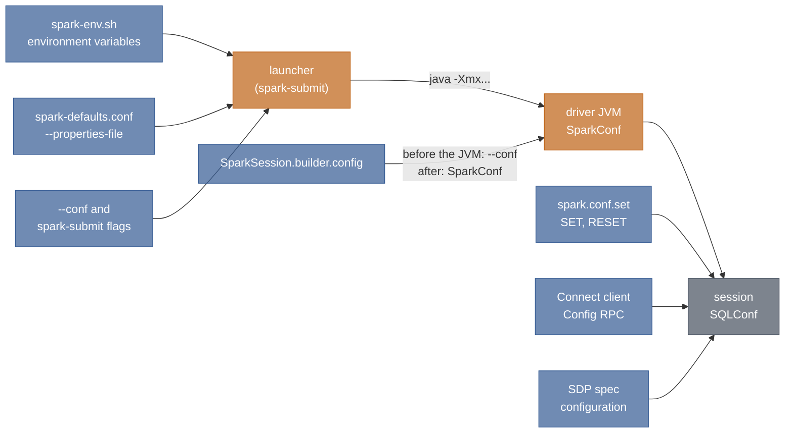
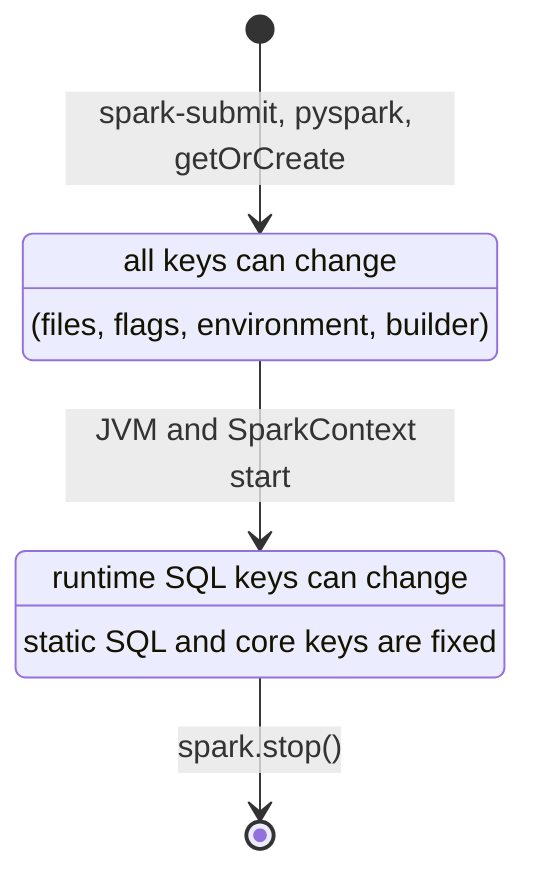
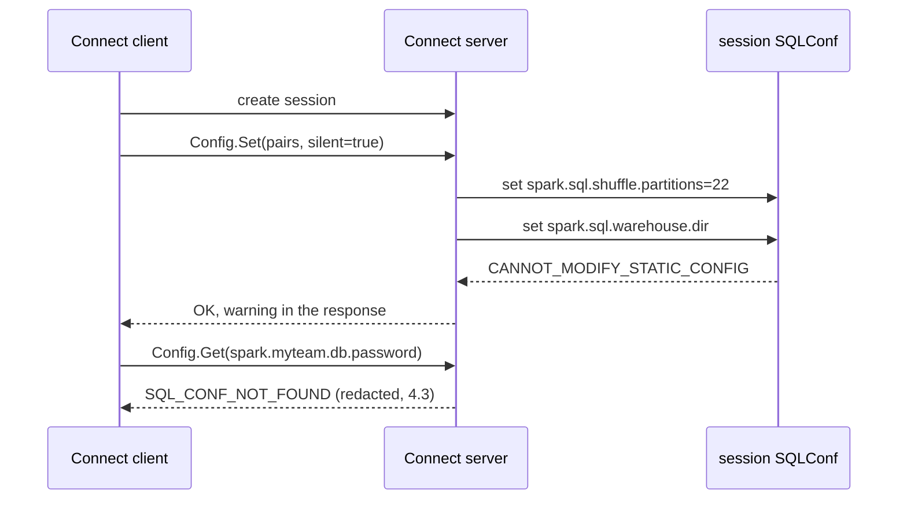

# Chapter 8: Setting Spark configurations

Each Spark job reads hundreds of configurations. Most of them keep their default values. Some of them you must set: the memory of the driver, the number of shuffle partitions, a catalog, a package. Spark accepts a configuration from many places. These are a file, the command line, the environment, your code, a SQL statement, a Spark Connect client and a pipeline spec. When two places set the same key, Spark uses only one value.

**A configuration value comes from a stack of sources, and the highest source that sets the key wins. But the stack is not the full rule. Some configurations take effect only when a process starts. Spark ignores or refuses a value that arrives later. Thus, to set a configuration correctly, you must know two things: which source wins, and when Spark reads the key.**

This chapter sets one key in each place and reads the value that Spark uses. Then it shows these items:

- The configurations that you can change at runtime.
- How to find a configuration and its default.
- What a Spark Connect client can set.
- A reference table of the configurations that you will set most frequently. The table gives each default in 4.3.0 and the chapter that explains the configuration.

The scripts are in [`code/ch08`](https://github.com/lisancao/spark-masterclass/tree/main/code/ch08), and each output block below comes from `code/ch08/output/`.

| Script | What it shows |
|---|---|
| `layers.py` | One key in each source, a new session for each row, then runtime changes |
| `env_vars.py` | An environment variable that sets a default |
| `static_runtime.py` | Static and runtime configurations, SQL and core configurations |
| `find_configs.py` | `SET`, `SET -v`, `spark.conf` and the REST API |
| `source_counts.sh`, `defaults.py` | Configurations in the Spark source, and their defaults |
| `connect_conf.py` | What a Spark Connect client can set and read |
| `sdp_conf.sh` | The `configuration` key of a pipeline spec |

## The sources, and the process that reads each one

A Classic PySpark application has three stages. Each configuration source belongs to one stage:



- **The launcher** is `spark-submit`. It reads `spark-env.sh`, `spark-defaults.conf` and the command line. It then starts the driver JVM. Some configurations, such as the heap size of the driver, become options of the `java` command.
- **The driver JVM** keeps the core configurations in a `SparkConf`. All sessions on that driver share it.
- **The session** keeps the SQL configurations in a `SQLConf`. Each session has its own copy, and you can change the runtime keys in it.

A source that writes to a later stage cannot change a decision that an earlier stage made. Step 2 shows the result of this rule.

## Step 1: One key, set in more places each time

`layers.py` starts a new Classic session in a child process for each row. Each row adds one source to the sources of the row above it. The child prints three values:

- `spark.sql.shuffle.partitions`, a runtime SQL configuration.
- `spark.driver.memory`, as the `SparkConf` of the driver reports it.
- The maximum heap of the driver JVM, from `Runtime.maxMemory()`. This is what `spark.driver.memory` really did.

The sources are a temporary `SPARK_CONF_DIR` with `spark-env.sh` and `spark-defaults.conf`, the variable `PYSPARK_SUBMIT_ARGS` for the `--conf` and `--driver-memory` flags, and `SparkSession.builder.config`:

```python
(conf / "spark-env.sh").write_text("export SPARK_DRIVER_MEMORY=3g\n")
(conf / "spark-defaults.conf").write_text(f"{KEY}  11\nspark.driver.memory  1g\n")
args = f"--conf {KEY}=12 --conf spark.driver.memory=2g --driver-memory 1500m pyspark-shell"
run("+ builder.config (13, 4g)", conf, args, {KEY: "13", "spark.driver.memory": "4g"})
```

```text
== 1. one key, more sources each time (a new session for each row)
  sources                                       shuffle  driver.memory    JVM heap
  built-in defaults only                            200      (not set)    1024 MiB
  + spark-env.sh (SPARK_DRIVER_MEMORY=3g)           200             3g    3072 MiB
  + spark-defaults.conf (11, 1g)                     11             1g    1024 MiB
  + --conf (12, 2g)                                  12             2g    2048 MiB
  + --driver-memory 1500m                            12          1500m    1500 MiB
  + builder.config (13, 4g)                          13             4g    1500 MiB
```

<figure markdown>
  <video autoplay loop muted playsinline controls width="1280" height="720" poster="../../media/clips/ch08-layers.webp">
    <source src="../../media/clips/ch08-layers.mp4" type="video/mp4">
  </video>
  <figcaption><code>layers.py</code> starts a new session for each row. Each row adds one configuration source, and the script prints the values that Spark uses. The middle of the video plays at four times the real speed.</figcaption>
</figure>

For `spark.sql.shuffle.partitions`, each new source wins over the sources below it:

1. The built-in default is 200. It comes from `SQLConf.scala`.
2. `spark-defaults.conf` wins over the default.
3. A `--conf` flag wins over `spark-defaults.conf`.
4. `SparkSession.builder.config` wins over the flags.

The [configuration page of the Spark docs](https://spark.apache.org/docs/4.3.0/configuration.html#dynamically-loading-spark-properties) gives the same order. A value in the `SparkConf` has the highest precedence. Then come `--conf` flags and `--properties-file`. Then comes `spark-defaults.conf`.

The environment variable is different. `SPARK_DRIVER_MEMORY` gave a heap of 3072 MiB in row 2. In row 3, `spark-defaults.conf` set `spark.driver.memory` to `1g`, and the heap became 1024 MiB. Thus, the variable is a fallback that the launcher uses only when no configuration sets the key. Step 3 shows a second variable of this type.

A flag such as `--driver-memory` is a short form of a configuration key. The launcher changes `--driver-memory 1500m` into `spark.driver.memory=1500m`, and the flag wins over a `--conf` for the same key. The table below gives the flags that you will use most frequently. The map is in `SparkSubmit.scala` (`OptionAssigner`).

| `spark-submit` flag | Configuration key |
|---|---|
| `--master` | `spark.master` |
| `--name` | `spark.app.name` |
| `--driver-memory` | `spark.driver.memory` |
| `--executor-memory` | `spark.executor.memory` |
| `--executor-cores` | `spark.executor.cores` |
| `--num-executors` | `spark.executor.instances` (YARN, Kubernetes) |
| `--jars` | `spark.jars` |
| `--packages` | `spark.jars.packages` |
| `--py-files` | `spark.submit.pyFiles` |
| `--archives` | `spark.archives` |
| `--properties-file` | a file in the format of `spark-defaults.conf` |

!!! note "New in 4.0: `--load-spark-defaults`"
    When you give `--properties-file`, Spark does not read `conf/spark-defaults.conf`. Spark 4.0 added the flag `--load-spark-defaults`, which reads the two files. Then the properties file wins over `spark-defaults.conf`. The flag is not in `SparkSubmitArguments.scala` at v3.5.0, and it is at v4.0.0.

## Step 2: A value in the SparkConf is not always the value that the JVM used

Look again at the last row of Step 1. The builder set `spark.driver.memory` to `4g`, and the `SparkConf` reports `4g`. But the heap of the JVM is 1500 MiB. The `SparkConf` shows a value that did not occur.

<figure markdown>
  
  
  <figcaption>The same rows as the output of Step 1. The last column shows what the JVM used. In the last row, the SparkConf and the JVM do not agree.</figcaption>
</figure>

The reason is the order of the stages. In PySpark, `getOrCreate()` gives the builder configurations to `spark-submit` as `--conf` flags (`java_gateway.py`). Then it adds the text of `PYSPARK_SUBMIT_ARGS` after them. The launcher reads the arguments in that order, so the later `--driver-memory 1500m` wins, and the JVM starts with a heap of 1500 MiB. After the JVM is up, the Python `SparkContext` copies the builder configurations into the `SparkConf` again. Now the `SparkConf` says `4g`, but the heap cannot change.

Two more rows of `layers.py` show this:

```text
  -- the same builder.config, with fewer sources under it
  --conf (12, 2g) + builder.config                   13             4g    2048 MiB
  builder.config (13, 4g) only                       13             4g    4096 MiB
```

With no other source, the builder value reaches the launcher, and the heap is 4096 MiB. With a `--conf` in `PYSPARK_SUBMIT_ARGS`, the `--conf` reaches the launcher after the builder value and wins.

The same problem occurs in each notebook. When the JVM of a notebook already runs, a builder value for `spark.driver.memory` cannot change the heap.

!!! warning "CAUTION"
    Do not set `spark.driver.memory`, `spark.driver.extraJavaOptions` or other launch configurations in code in client mode. Set them in `spark-defaults.conf` or on the `spark-submit` command line. A value that you set in code can show in the `SparkConf` and in the Environment tab of the UI. But the JVM did not use it.

## Step 3: An environment variable that sets a default

`spark-env.sh` is a shell script that the launcher scripts read before they start a Spark process. It sets environment variables. The template in `conf/spark-env.sh.template` lists them. Most of them control a process and not a configuration key: `SPARK_LOCAL_IP`, `SPARK_LOCAL_DIRS`, `SPARK_CONF_DIR`, `SPARK_LOG_DIR`, `HADOOP_CONF_DIR`, `PYSPARK_PYTHON`. Some of them are fallbacks for a key, as `SPARK_DRIVER_MEMORY` was in Step 1.

One variable sets the default of a SQL configuration. The definition of `spark.sql.ansi.enabled` in `SQLConf.scala` at v4.3.0 is:

```scala
  val ANSI_ENABLED = buildConf(SqlApiConfHelper.ANSI_ENABLED_KEY)
    ...
    .createWithDefault(!sys.env.get("SPARK_ANSI_SQL_MODE").contains("false"))
```

`env_vars.py` starts three sessions:

```text
== the environment sets a default, not a value
  no variable                                          spark.sql.ansi.enabled = true
  SPARK_ANSI_SQL_MODE=false                            spark.sql.ansi.enabled = false
  SPARK_ANSI_SQL_MODE=false + builder.config(..., true) spark.sql.ansi.enabled = true
```

The variable changes the default, and an explicit value wins over it. This is the same rule as for `SPARK_DRIVER_MEMORY`. Use the variable when you cannot change the code or the configuration files. A test environment is an example. [Chapter 10](ch10-cleaning-values.md) explains what ANSI mode changes.

## Step 4: Runtime changes, SET and RESET

After a session starts, you can change a runtime SQL configuration in three ways:

- `spark.conf.set`.
- The SQL statement `SET key=value`.
- `SparkSession.builder.config(...).getOrCreate()` on the session that exists.

 The second half of `layers.py` starts a session with the builder value 13, and then it changes the key:

```python
spark.conf.set(KEY, "14")
spark.sql(f"SET {KEY}=15")
spark.sql(f"RESET {KEY}")
spark.conf.set(KEY, "16")
spark.sql("RESET")
spark.conf.unset(KEY)
```

```text
== 2. runtime changes in one session (the builder set 13)
  after getOrCreate                            13
  after spark.conf.set(..., 14)                14
  after SET spark.sql.shuffle.partitions=15    15
+----------------------------+-----+
|key                         |value|
+----------------------------+-----+
|spark.sql.shuffle.partitions|15   |
+----------------------------+-----+

  after RESET spark.sql.shuffle.partitions     13
  after RESET (all keys)                       13
  after spark.conf.unset                       200
```

<figure markdown>
  <video autoplay loop muted playsinline controls width="1280" height="720" poster="../../media/clips/ch08-anim-layers.webp">
    <source src="../../media/clips/ch08-anim-layers.mp4" type="video/mp4">
  </video>
  <figcaption>The configuration sources stack. The value at the top wins. <code>RESET</code> removes the runtime changes, and <code>spark.conf.unset</code> goes back to the built-in default. The values come from one run of <code>layers.py</code>.</figcaption>
</figure>

The output shows four rules:

- **`spark.conf.set` and `SET` do the same thing.** The last change wins. `SET key` with no value shows the current value as a row.
- **`RESET` goes back to the value at the start of the session, not to the built-in default.** The builder set 13 before the session started, so `RESET` gives 13. `RESET` with no key does this for all keys.
- **`spark.conf.unset` removes the value from the session.** Then Spark uses the built-in default, 200. It does not go back to the builder value. Thus, `RESET` and `unset` are different operations.
- **Each session has its own runtime values.** The last part of `layers.py` sets 17 in the first session. A session from `spark.newSession()` on the same `SparkContext` still has 13:

```text
== 3. a second session on the same SparkContext
  first session : 17
  newSession()  : 13
```

The new session starts from the `SparkConf`, which contains the builder value 13. The runtime value 17 stays in the session that set it.

## Step 5: Static and runtime configurations, SQL and core configurations

Spark divides its configurations in two ways:

- **SQL configurations** (`spark.sql.*`) have their definitions in `SQLConf.scala` and `StaticSQLConf.scala`. Each session has its own values.
- **Core configurations** (`spark.executor.*`, `spark.driver.*`, `spark.memory.*` and most other keys) have their definitions in `core/src/main/scala/org/apache/spark/internal/config/`. The `SparkContext` reads them one time, when it starts.

A SQL configuration is **runtime** or **static**. The source declares a static SQL configuration with `buildStaticConf`. Spark reads it when the first session starts. Examples are `spark.sql.warehouse.dir`, `spark.sql.extensions` and `spark.sql.catalogImplementation`.

`static_runtime.py` asks `spark.conf.isModifiable` about seven keys. Then it tries to set each one:

```text
== 1. spark.conf.isModifiable
  spark.sql.shuffle.partitions     runtime SQL          True
  spark.sql.ansi.enabled           runtime SQL          True
  spark.sql.warehouse.dir          static SQL           False
  spark.sql.extensions             static SQL           False
  spark.executor.memory            core                 False
  spark.default.parallelism        core (special case)  False
  spark.myteam.owner               not registered       False

== 2. spark.conf.set on each key
  spark.sql.shuffle.partitions     accepted
  spark.sql.ansi.enabled           accepted
  spark.sql.warehouse.dir          refused
  AnalysisException: [CANNOT_MODIFY_STATIC_CONFIG] Cannot modify the value of the static
  Spark config: "spark.sql.warehouse.dir". SQLSTATE: 46110
  spark.sql.extensions             refused
  AnalysisException: [CANNOT_MODIFY_STATIC_CONFIG] Cannot modify the value of the static
  Spark config: "spark.sql.extensions". SQLSTATE: 46110
  spark.executor.memory            refused
  AnalysisException: [CANNOT_MODIFY_CONFIG] Cannot modify the value of the Spark config:
  "spark.executor.memory".
  spark.default.parallelism        accepted
  spark.myteam.owner               accepted
```

<figure markdown>
  <video autoplay loop muted playsinline controls width="1280" height="720" poster="../../media/clips/ch08-static.webp">
    <source src="../../media/clips/ch08-static.mp4" type="video/mp4">
  </video>
  <figcaption><code>static_runtime.py</code> tries to change a runtime, a static and a core configuration in a session that already runs.</figcaption>
</figure>

There are two different errors. The check is in `RuntimeConfig.requireNonStaticConf` (`sql/core/.../classic/RuntimeConfig.scala`):

- `CANNOT_MODIFY_STATIC_CONFIG` is for a static SQL configuration.
- `CANNOT_MODIFY_CONFIG` is for a core configuration. Spark gives this error because the internal configuration `spark.sql.legacy.setCommandRejectsSparkCoreConfs` is `true` by default.

The output also shows two special cases:

- **`spark.default.parallelism`** is a core configuration, and `isModifiable` says `False`. But `spark.conf.set` accepts it. A comment in `requireNonStaticConf` says why: the docs listed this key as a session configuration, so Spark keeps the old behavior. The value goes into the session, but the `SparkContext` already read its value. Do not expect a change.
- **Spark accepts a key that it does not know** (`spark.myteam.owner`). Spark keeps it as a string. You can use such keys to give values to your own code. But Spark does not examine the name of a key. Spark also accepts a Spark key with an incorrect name, such as `spark.sql.shufle.partitions`. The key has no effect.

The SQL statement `SET` follows the same rules:

```text
== 3. SQL SET follows the same rules
  SET spark.sql.extensions=x               refused: AnalysisException
  SET spark.executor.memory=8g             refused: AnalysisException
```

The builder is different. On a session that already exists, `getOrCreate()` applies only the runtime SQL configurations, and it ignores the rest with no error:

```text
== 5. builder.config on a session that already exists
  same session object:        True
  spark.sql.shuffle.partitions = 9
  spark.sql.warehouse.dir      = file:/tmp/ch08-warehouse
```

For this case, the JVM logs a warning from `SparkSession.scala`:

```text
Using an existing Spark session; only runtime SQL configurations will take effect.
```

The book scripts set the log level to `ERROR`, so the warning does not show in the output above.

<figure markdown>
  
  
  <figcaption>Who can change each type of configuration, and when. Each cell comes from <code>static_runtime.txt</code> or <code>connect_conf.txt</code>.</figcaption>
</figure>



## Step 6: Find a configuration and its value

There are five places to find a configuration. `find_configs.py` uses four of them in one session.

**`SET -v`** gives each public SQL configuration with its value, a description and the version that added it:

```text
== 1. SET -v: every public SQL config, with its meaning
  columns: ['key', 'value', 'meaning', 'Since version']
  rows:    324
+-----------------------------------------------------------------+-----------+-------------+
|key                                                              |value      |Since version|
+-----------------------------------------------------------------+-----------+-------------+
|spark.sql.adaptive.coalescePartitions.enabled                    |true       |3.0.0        |
|spark.sql.adaptive.coalescePartitions.initialPartitionNum        |<undefined>|3.0.0        |
|spark.sql.adaptive.coalescePartitions.maxReducerPartitionsPerTask|2147483647 |4.3.0        |
|spark.sql.adaptive.coalescePartitions.minPartitionSize           |1MB        |3.2.0        |
|spark.sql.adaptive.coalescePartitions.parallelismFirst           |true       |3.2.0        |
+-----------------------------------------------------------------+-----------+-------------+
```

`SET -v` is a DataFrame, so you can filter it. The `Since version` column shows how many public SQL configurations each 4.x release added:

```text
== 1b. SET -v rows by the version that added the config
+-----+-----+
|since|count|
+-----+-----+
|  4.0|   43|
|  4.1|   25|
|  4.2|   24|
|  4.3|   25|
+-----+-----+
```

The 4.3 rows include `spark.sql.optimizer.singleTaskExecution.enabled` ([Chapter 37](ch37-project-feather.md)), `spark.sql.experimental.optimizer.transpilePyUDFs` ([Chapter 34](ch34-python-udfs-arrow.md)) and `spark.sql.files.archive.reader.enabled` ([Chapter 25](ch25-files-as-files.md)). The full list is in `find_configs.txt`. You can also find a word in the `meaning` column:

```text
== 2. SET -v, searched for a word in the meaning
+----------------------------------------------------+-----------+
|key                                                 |value      |
+----------------------------------------------------+-----------+
|spark.sql.adaptive.autoBroadcastJoinThreshold       |<undefined>|
|spark.sql.adaptive.localShuffleReader.enabled       |true       |
|spark.sql.autoBroadcastJoinThreshold                |10MB       |
|spark.sql.broadcastTimeout                          |300        |
|spark.sql.maxBroadcastTableSize                     |8589934592b|
|spark.sql.optimizer.pushDownJoinThroughUnion.enabled|false      |
|spark.sql.statistics.fallBackToHdfs                 |false      |
+----------------------------------------------------+-----------+
```

**`SET`** with no argument gives only the keys that a source set, not all keys. Spark hides the values of keys that match `spark.redaction.regex`:

```text
== 3. SET with no argument: only the keys that something set
  rows: 19
+----------------------------+----------------------------------------------------------------------+
|key                         |value                                                                 |
+----------------------------+----------------------------------------------------------------------+
|spark.app.name              |ch08-find                                                             |
|spark.myteam.db.password    |*********(redacted)                                                   |
|spark.sql.shuffle.partitions|16                                                                    |
|spark.sql.warehouse.dir     |file:~/spark-masterclass-parts/config-sql/code/spark-warehouse|
+----------------------------+----------------------------------------------------------------------+
```

**`spark.conf.get`** gives one value. The value of a key that nothing set is its default, in the format of the definition (`134217728b` for `128MB`). A key that Spark does not know and that nothing set raises `SQL_CONF_NOT_FOUND`, unless you give a default. In Classic, `spark.conf.get` gives the real value of a redacted key:

```text
== 5. spark.conf.get with and without a default
  spark.conf.get('spark.sql.files.maxPartitionBytes') = 134217728b
  spark.conf.get('spark.myteam.none', 'fallback')      = fallback
  spark.conf.get('spark.myteam.none')                  -> [SQL_CONF_NOT_FOUND]
  spark.conf.get('spark.myteam.db.password')           = hunter2
```

**The Environment tab** of the Spark UI shows the `SparkConf`, the Hadoop configuration, the JVM system properties and the classpath. The REST API gives the same data at `/api/v1/applications/<app-id>/environment`:

```text
== 6. the REST API: /environment (the Environment tab, as JSON)
  sections: ['runtime', 'sparkProperties', 'hadoopProperties', 'systemProperties', 'metricsProperties', 'classpathEntries', 'resourceProfiles']
  sparkProperties: 19 entries
    spark.sql.shuffle.partitions   16
    spark.myteam.db.password       *********(redacted)
    spark.master                   local[*]
    spark.app.id                   local-1795370773811
  a SQL config set only at runtime is absent here:
    spark.sql.ansi.enabled in sparkProperties: False
```

The Environment tab shows the `SparkConf`, not the configurations of a session. A runtime change with `spark.conf.set` is not in it. To see the runtime values of a session, use `SET` in that session. [Chapter 61](ch61-observability.md) shows the other endpoints of the REST API.

**The source** is the last authority. Each SQL configuration is a `buildConf` call in `SQLConf.scala`, with its documentation, its version, its type, a check and its default:

```text
== 1. one config, as the source declares it (v4.3.0, sql/catalyst/src/main/scala/org/apache/spark/sql/internal/SQLConf.scala)
  1190:  val SHUFFLE_PARTITIONS = buildConf("spark.sql.shuffle.partitions")
  1191-    .doc("The default number of partitions to use when shuffling data for joins or aggregations.")
  1192-    .version("1.1.0")
  1193-    .intConf
  1194-    .checkValue(_ > 0, "The value of spark.sql.shuffle.partitions must be positive")
  1195-    .createWithDefault(200)
```

`source_counts.sh` counts the declarations at v4.3.0. A declaration followed by `.internal()` is internal. Internal configurations are not in `SET -v` and not in the docs:

```text
== 2. how many configs each file declares
  file                                                            total  internal
  sql/catalyst/src/main/scala/org/apache/spark/sql/internal/SQLConf.scala    789       478
  sql/catalyst/src/main/scala/org/apache/spark/sql/internal/StaticSQLConf.scala     36        21
  core/src/main/scala/org/apache/spark/internal/config/*.scala      559        62

== 3. the files that declare configs, outside those three places (top 10)
    93  resource-managers/kubernetes/core/src/main/scala/org/apache/spark/deploy/k8s/Config.scala
    62  resource-managers/yarn/src/main/scala/org/apache/spark/deploy/yarn/config/package.scala
    46  sql/connect/server/src/main/scala/org/apache/spark/sql/connect/config/Connect.scala
    29  streaming/src/main/scala/org/apache/spark/streaming/StreamingConf.scala
    18  sql/hive/src/main/scala/org/apache/spark/sql/hive/HiveUtils.scala
    ...
```

The script counts lines with a text search, and it finds `.internal()` only in the three lines after a declaration. Thus, the counts are approximate. More than half of the SQL configurations are internal. An internal configuration can change or disappear in any release, so do not use one in production code without a reason that you write down.

The fifth place is the [configuration page](https://spark.apache.org/docs/4.3.0/configuration.html) of the docs. The tables of SQL configurations on that page come from the same `SET -v` data.

## Step 7: Configurations over Spark Connect

A Spark Connect client has no `SparkConf` and no JVM. It sends configurations to the server in a `Config` RPC, and the server applies them to the session of that client. `connect_server.sh` starts a server with three configurations on its command line:

```bash
"$SPARK_HOME/sbin/start-connect-server.sh" \
  --conf spark.connect.grpc.binding.port=$PORT --conf spark.ui.port=$UI \
  --conf spark.sql.shuffle.partitions=21 \
  --conf spark.sql.warehouse.dir=/tmp/ch08-server-warehouse \
  --conf spark.myteam.db.password=hunter2
```

`connect_conf.py` makes two client sessions. The first session gives the builder a runtime, a static and a core configuration:

```python
a = (SparkSession.builder.remote(URL)
     .config(K, "22")                                       # runtime SQL: applied
     .config("spark.sql.warehouse.dir", "/tmp/client-wants")  # static SQL: refused, no error
     .config("spark.executor.memory", "8g")                 # core: refused, no error
     .create())
```

```text
== 1. the builder sends its configs after the session starts
  spark.sql.shuffle.partitions   22
  spark.sql.warehouse.dir        file:/tmp/ch08-server-warehouse
  spark.executor.memory          (not set)

== 2. each client session has its own runtime configs
  session a: spark.sql.shuffle.partitions = 22
  session b: spark.sql.shuffle.partitions = 21   (the server's --conf value)
  after b sets 23 and ANSI off: a = 22, true | b = 23, false
  after RESET in b: b = 21
```

<figure markdown>
  <video autoplay loop muted playsinline controls width="1280" height="720" poster="../../media/clips/ch08-connect.webp">
    <source src="../../media/clips/ch08-connect.mp4" type="video/mp4">
  </video>
  <figcaption><code>connect_conf.py</code> makes two sessions on one Connect server. The builder of a client can set only runtime SQL configurations, and each session keeps its own values.</figcaption>
</figure>

The Python client applies the builder configurations after the session exists on the server (`_apply_options` in `pyspark/sql/connect/session.py`). It sends them in one request with `silent=True`. The server then changes each refused key into a warning, not an error. Thus, the static and core values disappear with no message to you. The comment in the source says: "If the configurations are static, it might throw an exception so simply ignore it for now."



`spark.conf.set` over Connect does not use `silent`, so a refused key raises the same errors as in Classic:

```text
== 3. spark.conf.set of a static or core config fails, as in Classic
  spark.sql.warehouse.dir:
  AnalysisException: [CANNOT_MODIFY_STATIC_CONFIG] Cannot modify the value of the static
  Spark config: "spark.sql.warehouse.dir". SQLSTATE: 46110
  spark.executor.memory:
  AnalysisException: [CANNOT_MODIFY_CONFIG] Cannot modify the value of the Spark config:
  "spark.executor.memory".
```

A Connect client can also read less than a Classic program. In Spark 4.3, the `Config` RPC does not return a configuration that matches `spark.redaction.regex` (SPARK-58658). The client gets the same error as for a key that does not exist:

```text
== 4. a client cannot read a redacted config (new in 4.3)
  SparkNoSuchElementException: [SQL_CONF_NOT_FOUND] The SQL config
  "spark.myteam.db.password" cannot be found. Please verify that the config exists. ...
  with a default: (hidden)
  in SET: *********(redacted)
```

Compare this with Step 6: in Classic, `spark.conf.get` gave `hunter2`. The 4.3 check is in `SparkConnectConfigHandler.isRedacted`. It matches the key and the value, so a password in a JDBC URL is also hidden.

```text
== 5. what the client can find out about the server
  spark.master                     local[*]
  spark.app.name                   Spark Connect server
  spark.connect.grpc.binding.port  15102
  SET -v rows: 345
  isModifiable(spark.sql.shuffle.partitions): True
  isModifiable(spark.sql.warehouse.dir):      False
```

The client can read the other server configurations, and `isModifiable` tells it what it can change. `SET -v` gives 345 rows here and 324 in Classic in Step 6. The server loads the Connect module, which registers more SQL configurations.

| Configuration | Classic | Connect client |
|---|---|---|
| Runtime SQL (`spark.sql.shuffle.partitions`) | builder, `spark.conf.set`, `SET` | builder, `spark.conf.set`, `SET` |
| Static SQL (`spark.sql.warehouse.dir`) | before the JVM starts | no, set it on the server |
| Core (`spark.executor.memory`) | before the JVM starts | no, set it on the server |
| A redacted key (4.3) | `spark.conf.get` returns it | `SQL_CONF_NOT_FOUND` |
| Scope of a runtime change | one session | one client session |

Thus, in a Connect deployment, the person who starts the server owns the static and core configurations. The client owns only the runtime SQL configurations of its own session. [Chapter 24](ch24-connect-in-production.md) shows how to plan servers with this rule.

## Step 8: The `configuration` key of a pipeline spec

A Spark Declarative Pipelines project has a spec file, `spark-pipeline.yml`. Its `configuration` key holds configurations for the pipeline ([Chapter 49](ch49-declarative-pipelines.md)). Pipeline code must not call `spark.conf.set`. Chapter 49 shows the error. `sdp_conf.sh` runs a pipeline with this spec:

```text
== spark-pipeline.yml
  | name: conf_layers
  | storage: file://@WORK@/pipeline-storage
  | configuration:
  |   spark.sql.shuffle.partitions: "7"
  | libraries:
  |   - glob:
  |       include: transformations/**
```

The pipeline has two materialized views with the same aggregation. The second view also sets a value for its own flow with `spark_conf`:

```python
@dp.materialized_view
def by_key_spec():
    """Uses the configuration of the spec."""
    return spark.range(1000).groupBy((F.col("id") % 10).alias("k")).count()


@dp.materialized_view(spark_conf={"spark.sql.shuffle.partitions": "5"})
def by_key_flow():
    """Sets its own value for this flow only."""
    return spark.range(1000).groupBy((F.col("id") % 10).alias("k")).count()
```

The CLI (`pyspark/pipelines/cli.py`) sends the spec configurations two times. First, it gives them to the builder of its Connect session. Then it sends them with the `CreateDataflowGraph` command as the SQL configurations of the graph. The script reads the plan of each flow from the event log of the server:

```text
== run
module scope: spark.sql.shuffle.partitions = 7
Flow spark_catalog.default.by_key_flow has COMPLETED.
Flow spark_catalog.default.by_key_spec has COMPLETED.
Run is COMPLETED.
== shuffle partitions in each flow's initial plan (from the event log)
  by_key_spec  Exchange hashpartitioning(..., 7)
  by_key_flow  Exchange hashpartitioning(..., 7)
```

The spec value reached the session, and the first flow planned 7 shuffle partitions. The second flow also planned 7, not 5. In this run, the `spark_conf` of the decorator did not reach the plan of the batch flow. A second run without the spec value gave 200 for the two flows. The notes file of this part records this result as an open problem, with a minimal project that shows it.

!!! warning "CAUTION"
    In Spark 4.3.0, do a check of the plan before you depend on the `spark_conf` argument of a materialized view. Put configurations that must apply to all flows in the `configuration` key of the spec.

Static configurations, such as `spark.sql.catalogImplementation`, must go to the server when the server starts. Chapter 49 shows this with the Hive metastore.

## Step 9: A reference table of frequent configurations

`defaults.py` asks the configuration registry of Spark 4.3.0 for the default of each key, with `ConfigEntry.findEntry`. Thus, the defaults in the table come from the jars, not from memory. The full output, with the version that added each key, is in `defaults.txt`. Three keys are not registered entries, because Spark reads them as plain strings: `spark.master`, `spark.app.name` and `spark.local.dir`. The table gives their documented behavior.

| Key | Default in 4.3.0 | Type | Explained in |
|---|---|---|---|
| `spark.master` | none (PySpark uses `local[*]`) | core, launch | [Chapter 6](ch06-installing.md), [Chapter 62](ch62-kubernetes-operator.md) |
| `spark.app.name` | none | core | [Chapter 5](ch05-how-spark-runs.md) |
| `spark.driver.memory` | `1g` | core, launch | [Chapter 33](ch33-partitions-caching-memory.md), Step 2 |
| `spark.driver.maxResultSize` | `1g` | core | [Chapter 33](ch33-partitions-caching-memory.md) |
| `spark.executor.memory` | `1g` | core | [Chapter 33](ch33-partitions-caching-memory.md) |
| `spark.executor.cores` | `1` | core | [Chapter 62](ch62-kubernetes-operator.md) |
| `spark.executor.instances` | `<undefined>` | core | [Chapter 62](ch62-kubernetes-operator.md) |
| `spark.memory.fraction` | `0.6` | core | [Chapter 33](ch33-partitions-caching-memory.md) |
| `spark.default.parallelism` | `<undefined>` | core | [Chapter 33](ch33-partitions-caching-memory.md) |
| `spark.serializer` | `org.apache.spark.serializer.JavaSerializer` | core | [Chapter 33](ch33-partitions-caching-memory.md) |
| `spark.ui.port` | `4040` | core | [Chapter 61](ch61-observability.md) |
| `spark.eventLog.enabled` | `false` | core | [Chapter 61](ch61-observability.md) |
| `spark.jars.packages` | empty | core, launch | [Chapter 44](ch44-tables-delta-iceberg.md) |
| `spark.submit.pyFiles`, `spark.archives` | empty | core, launch | [Chapter 60](ch60-shipping-dependencies.md) |
| `spark.sql.shuffle.partitions` | `200` | runtime SQL | [Chapter 32](ch32-query-plans.md) |
| `spark.sql.adaptive.enabled` | `true` | runtime SQL | [Chapter 32](ch32-query-plans.md) |
| `spark.sql.adaptive.coalescePartitions.enabled` | `true` | runtime SQL | [Chapter 32](ch32-query-plans.md) |
| `spark.sql.adaptive.advisoryPartitionSizeInBytes` | `64MB` (from `spark.sql.adaptive.shuffle.targetPostShuffleInputSize`) | runtime SQL | [Chapter 32](ch32-query-plans.md) |
| `spark.sql.adaptive.skewJoin.enabled` | `true` | runtime SQL | [Chapter 11](ch11-joins.md) |
| `spark.sql.autoBroadcastJoinThreshold` | `10MB` | runtime SQL | [Chapter 11](ch11-joins.md) |
| `spark.sql.files.maxPartitionBytes` | `128MB` | runtime SQL | [Chapter 33](ch33-partitions-caching-memory.md) |
| `spark.sql.ansi.enabled` | `true` (`false` if `SPARK_ANSI_SQL_MODE=false`) | runtime SQL | [Chapter 10](ch10-cleaning-values.md) |
| `spark.sql.session.timeZone` | the time zone of the JVM | runtime SQL | [Chapter 10](ch10-cleaning-values.md) |
| `spark.sql.caseSensitive` | `false` | runtime SQL | [Chapter 9](ch09-dataframes-columns-schemas.md) |
| `spark.sql.timestampType` | `TIMESTAMP_LTZ` | runtime SQL | [Chapter 9](ch09-dataframes-columns-schemas.md) |
| `spark.sql.execution.arrow.pyspark.enabled` | `true` (from `spark.sql.execution.arrow.enabled`) | runtime SQL | [Chapter 34](ch34-python-udfs-arrow.md) |
| `spark.sql.execution.pythonUDF.arrow.enabled` | `true` | runtime SQL | [Chapter 34](ch34-python-udfs-arrow.md) |
| `spark.sql.execution.arrow.maxRecordsPerBatch` | `10000` | runtime SQL | [Chapter 34](ch34-python-udfs-arrow.md) |
| `spark.sql.parquet.compression.codec` | `snappy` | runtime SQL | [Chapter 36](ch36-parquet-inside.md) |
| `spark.sql.sources.partitionOverwriteMode` | `STATIC` | runtime SQL | [Chapter 59](ch59-determinism-retries.md) |
| `spark.sql.optimizer.singleTaskExecution.enabled` | `false` (new in 4.3) | runtime SQL | [Chapter 37](ch37-project-feather.md) |
| `spark.sql.streaming.stateStore.providerClass` | `org.apache.spark.sql.execution.streaming.state.HDFSBackedStateStoreProvider` | runtime SQL | [Chapter 43](ch43-checkpoints-and-state-store.md) |
| `spark.sql.defaultCatalog` | `spark_catalog` | runtime SQL | [Chapter 12](ch12-spark-sql.md) |
| `spark.sql.warehouse.dir` | `spark-warehouse` in the working directory | static SQL | [Chapter 12](ch12-spark-sql.md) |
| `spark.sql.catalogImplementation` | `in-memory` (`hive` in `spark-sql` and the Thrift server) | static SQL | [Chapter 12](ch12-spark-sql.md), [Chapter 49](ch49-declarative-pipelines.md) |
| `spark.sql.extensions` | `<undefined>` | static SQL | [Chapter 45](ch45-iceberg.md), [Chapter 71](ch71-catalyst-extensions.md) |
| `spark.connect.grpc.binding.port` | `15002` | static (server) | [Chapter 18](ch18-spark-connect.md), [Chapter 24](ch24-connect-in-production.md) |

!!! note "New in 4.2: Arrow by default for PySpark"
    The defaults of `spark.sql.execution.arrow.pyspark.enabled` and `spark.sql.execution.pythonUDF.arrow.enabled` are `true` in 4.2 and 4.3. They were `false` in 4.1. The PySpark migration guide records the change, and `SQLConf.scala` at v4.1.0 and v4.2.0 shows it.

!!! note "New in 4.0: ANSI mode"
    Since Spark 4.0, `spark.sql.ansi.enabled` is `true` by default (SPARK-44444). [Chapter 10](ch10-cleaning-values.md) and [Chapter 12](ch12-spark-sql.md) show the changes.

## Which source to use

| You want to set | Use |
|---|---|
| A launch configuration (driver memory, JVM options, packages) | `spark-defaults.conf` or the `spark-submit` command line |
| A value for all jobs on one machine or one image | `spark-defaults.conf` in `SPARK_CONF_DIR` |
| A value for one job | `--conf` on the command line, or the builder before the first session |
| A value for one query or one step | `spark.conf.set` or `SET`, then `RESET` |
| A value for a Connect client | the builder or `spark.conf.set`, runtime SQL keys only |
| A static or core value for Connect clients | the command line of the server |
| A value for a pipeline | the `configuration` key of the spec |

## The whole chapter, on one page

- **Sources stack.** From low to high, they are the built-in default, an environment fallback, `spark-defaults.conf`, `--conf` and a `spark-submit` flag. Above them are the builder before the JVM starts, then `spark.conf.set` and `SET` in a session.
- **A launch configuration takes effect only at launch.** A builder value for `spark.driver.memory` can show in the `SparkConf` and still not be the heap that the JVM has. Set launch configurations in files or on the command line.
- **Environment variables give defaults.** `SPARK_DRIVER_MEMORY` and `SPARK_ANSI_SQL_MODE` lose to an explicit value.
- **`RESET` goes back to the start of the session, `unset` goes back to the built-in default.** Each session has its own runtime values.
- **Static SQL and core configurations do not change after the start.** `spark.conf.set` raises `CANNOT_MODIFY_STATIC_CONFIG` or `CANNOT_MODIFY_CONFIG`. The builder on a session that exists ignores them with no error. Spark accepts a key with an incorrect name with no error.
- **Find a configuration with `SET -v`, `SET`, the Environment tab or the REST API, and the source.** The Environment tab does not show runtime changes. More than half of the SQL configurations are internal.
- **A Connect client sets only runtime SQL configurations.** The builder drops other keys with no error. In 4.3, a client cannot read a redacted configuration.
- **A pipeline takes configurations from its spec.** In this 4.3.0 run, the per-flow `spark_conf` did not reach the plan of a batch flow.

```bash
# The scripts of this chapter, in order. Run from code/.
uv run python ch08/layers.py
uv run python ch08/env_vars.py
uv run python ch08/static_runtime.py
uv run python ch08/find_configs.py
ch08/source_counts.sh
uv run python ch08/defaults.py
ch08/connect_server.sh start && uv run python ch08/connect_conf.py; ch08/connect_server.sh stop
ch08/sdp_conf.sh
```

The next part of the book is about Spark SQL. Its first chapter is [Chapter 12](ch12-spark-sql.md). It uses three static configurations of this chapter: the warehouse directory, the catalog implementation and the catalogs that you register with `spark.sql.catalog.<name>`.

## Further reading

- [Spark configuration](https://spark.apache.org/docs/4.3.0/configuration.html), with the precedence rules, `spark-env.sh` and the tables of keys.
- [`SET`](https://spark.apache.org/docs/4.3.0/sql-ref-syntax-aux-conf-mgmt-set.html) and [`RESET`](https://spark.apache.org/docs/4.3.0/sql-ref-syntax-aux-conf-mgmt-reset.html) in the SQL reference.
- [`SQLConf.scala`](https://github.com/apache/spark/blob/v4.3.0/sql/catalyst/src/main/scala/org/apache/spark/sql/internal/SQLConf.scala) and [`StaticSQLConf.scala`](https://github.com/apache/spark/blob/v4.3.0/sql/catalyst/src/main/scala/org/apache/spark/sql/internal/StaticSQLConf.scala), with the definition of each SQL configuration.
- [The PySpark migration guide](https://spark.apache.org/docs/4.3.0/api/python/migration_guide/pyspark_upgrade.html), with the default changes of each release.
