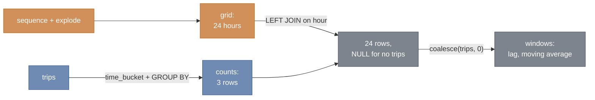
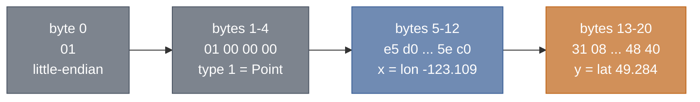
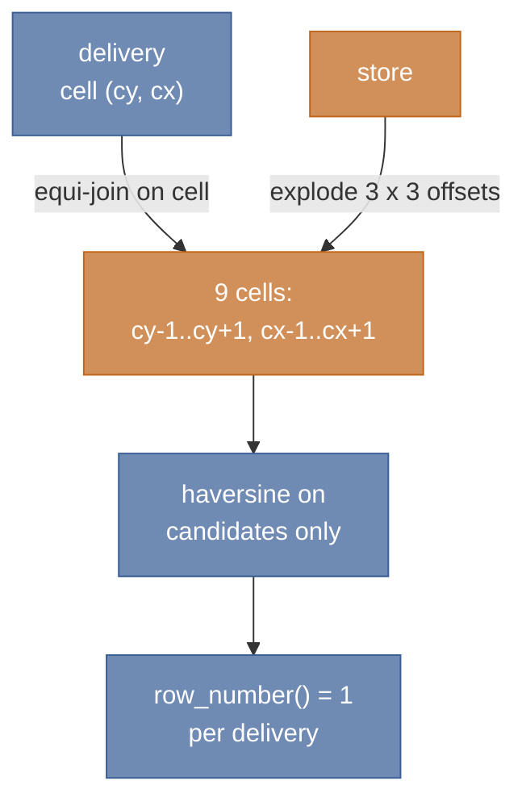

# Chapter 10: Time series and geospatial data

Two kinds of data need more than a plain `GROUP BY`. Time series data needs buckets: trips per 15 minutes, per day, per week. It also needs the buckets that have no rows. Geospatial data needs a type that knows that a point has two coordinates, a reference system and a distance that is not a straight line. Spark 4.2 added `time_bucket`. Spark 4.1 added the `GEOMETRY` and `GEOGRAPHY` types behind a flag, and Spark 4.2 enabled them by default.

**A time bucket is one expression in the projection, and a gap in a time series is a row that the data does not have. You must make that row. The geospatial types of Spark 4.3 store points correctly and keep the reference system in the type. But they do not yet measure, compare or index. Thus the work of a spatial join is still your SQL, and its cost is the number of pairs that you compare.**

The scripts are in [`code/ch10`](https://github.com/lisancao/spark-masterclass/tree/main/code/ch10), and each output block below comes from `code/ch10/output/`.

- `timeseries.py` uses the June 2026 taxi trips.
- `geo.py` uses SparkTutor's courier data, copied to `code/data/geo_deliveries`: 166 deliveries with messy coordinates in Canada and Vietnam, and 12 stores.

## Step 1: Three ways to make a bucket

Spark has three functions that put a timestamp into a bucket:

```sql
SELECT ts,
       date_trunc('HOUR', ts)                          AS trunc_hour,
       window(ts, '15 minutes').start                  AS window_15m,
       time_bucket(INTERVAL 15 MINUTES, ts)            AS bucket_15m,
       time_bucket(INTERVAL 15 MINUTES, ts, TIMESTAMP_NTZ'2026-06-01 00:05:00') AS bucket_15m_at_05
FROM VALUES (TIMESTAMP_NTZ'2026-06-03 08:07:30'), (TIMESTAMP_NTZ'2026-06-03 08:21:00') AS v(ts)
```

```text
== 1. date_trunc, window and time_bucket
+-------------------+-------------------+-------------------+-------------------+-------------------+
|                 ts|         trunc_hour|         window_15m|         bucket_15m|   bucket_15m_at_05|
+-------------------+-------------------+-------------------+-------------------+-------------------+
|2026-06-03 08:07:30|2026-06-03 08:00:00|2026-06-03 08:00:00|2026-06-03 08:00:00|2026-06-03 08:05:00|
|2026-06-03 08:21:00|2026-06-03 08:00:00|2026-06-03 08:15:00|2026-06-03 08:15:00|2026-06-03 08:20:00|
+-------------------+-------------------+-------------------+-------------------+-------------------+

types: [('w', 'struct<start:timestamp_ntz,end:timestamp_ntz>'), ('b', 'timestamp_ntz')]
```

- **`date_trunc(unit, ts)`** sets all fields below the unit to zero. It accepts only calendar units: `'MINUTE'`, `'HOUR'`, `'DAY'`, `'WEEK'`, `'MONTH'` and some more. It cannot make 15-minute buckets.
- **`window(ts, duration)`** comes from Structured Streaming. It returns a struct with `start` and `end`, and it can make sliding windows (Step 4).
- **`time_bucket(size, ts[, origin])`** returns the start of the bucket as a timestamp of the same type. The optional origin moves the bucket boundaries. With an origin at `00:05`, the buckets start at `08:05` and `08:20`.

The bucket is a timestamp, not a struct. Thus you can join on it, sort by it and compare it with other timestamps directly.

## Step 2: Sizes and origins

The default origin is 1970-01-01 00:00:00. For buckets of a day or less, this origin is correct, because each day starts at a multiple of the bucket size. For a week, it is not:

```sql
SELECT d,
       date_trunc('WEEK', d)                                       AS trunc_week,
       time_bucket(INTERVAL 7 DAYS, d)                             AS bucket_7d_epoch,
       time_bucket(INTERVAL 7 DAYS, d, TIMESTAMP_NTZ'2026-06-07')   AS bucket_7d_sunday,
       time_bucket(INTERVAL 1 MONTH, d, TIMESTAMP_NTZ'2026-01-15') AS month_from_15th
FROM VALUES (TIMESTAMP_NTZ'2026-06-10 12:00'), (TIMESTAMP_NTZ'2026-06-14 09:00') AS v(d)
```

```text
== 2. bucket sizes and origins
+-------------------+-------------------+-------------------+-------------------+-------------------+
|                  d|         trunc_week|    bucket_7d_epoch|   bucket_7d_sunday|    month_from_15th|
+-------------------+-------------------+-------------------+-------------------+-------------------+
|2026-06-10 12:00:00|2026-06-08 00:00:00|2026-06-04 00:00:00|2026-06-07 00:00:00|2026-05-15 00:00:00|
|2026-06-14 09:00:00|2026-06-08 00:00:00|2026-06-11 00:00:00|2026-06-14 00:00:00|2026-05-15 00:00:00|
+-------------------+-------------------+-------------------+-------------------+-------------------+

1970-01-01 was a Thursday
  window with a month             _LEGACY_ERROR_TEMP_3231: Intervals greater than a month is not supported (1 month).
  time_bucket with 0 minutes      DATATYPE_MISMATCH.VALUE_OUT_OF_RANGE: Cannot resolve "time_bucket(INTERVAL '00' MINUTE, TIMESTAMP_NTZ '2026-06
  time_bucket with a column size  DATATYPE_MISMATCH.NON_FOLDABLE_INPUT: Cannot resolve "time_bucket(make_dt_interval(0, 0, id, 0.000000), TIMEST
  time_bucket on a DATE           DATATYPE_MISMATCH.UNEXPECTED_INPUT_TYPE: Cannot resolve "time_bucket(INTERVAL '1' DAY, DATE '2026-06-10', TIMESTA
```

- **`date_trunc('WEEK', ...)` starts each week on Monday.** 8 June 2026 is a Monday.
- **`time_bucket(INTERVAL 7 DAYS, ...)` with the default origin starts each week on Thursday,** because 1 January 1970 was a Thursday. Give an origin on the first day of the week that you want. With a Sunday origin, the weeks start on 7 and 14 June.
- **`time_bucket` accepts year-month intervals.** `INTERVAL 1 MONTH` with an origin on 15 January gives months that start on the 15th. `window()` does not accept months.

The bucket size must be positive and constant. A size from a column fails with `NON_FOLDABLE_INPUT`, because Spark must know the size when it makes the plan. `time_bucket` takes a `TIMESTAMP` or a `TIMESTAMP_NTZ`. For a `DATE`, cast it to a timestamp first.

## Step 3: Time zones and the DST change

A `TIMESTAMP_NTZ` is a wall-clock time with no zone. A `TIMESTAMP` is an instant, shown in the session time zone (Chapter 5). The docstring of `time_bucket` in the 4.3.0 source gives the rule: for `TIMESTAMP_NTZ`, Spark makes the buckets in UTC. For `TIMESTAMP`, month buckets and the day part of day-time buckets align to the session time zone. `timeseries.py` uses the night in March 2026 when New York changed to summer time:

```text
== 3. daily buckets over the March DST change, session zone America/New_York
+-------------------+-------------------+-------------------+-------------------+
|local_time         |ltz_bucket         |ntz_bucket         |ltz_6h             |
+-------------------+-------------------+-------------------+-------------------+
|2026-03-08 01:30:00|2026-03-08 00:00:00|2026-03-08 00:00:00|2026-03-08 00:00:00|
|2026-03-08 03:30:00|2026-03-08 00:00:00|2026-03-08 00:00:00|2026-03-08 00:00:00|
|2026-03-09 05:00:00|2026-03-09 00:00:00|2026-03-09 00:00:00|2026-03-09 01:00:00|
+-------------------+-------------------+-------------------+-------------------+
```

The daily buckets are correct for both types. 8 March has 23 hours in New York, and its bucket starts at local midnight.

The 6-hour buckets are different. Before the change, they start at 00:00, 06:00, 12:00 and 18:00. After the change, the bucket for 05:00 starts at 01:00. A bucket in hours has a fixed length in real time, counted from the origin in New York winter time. When the clocks move one hour, the local bucket boundaries move too. For hour buckets in local time, use `TIMESTAMP_NTZ` columns, or use day buckets and the hour of the day.

## Step 4: What each function adds to the plan

`timeseries.py` groups the month by each method and lists the operators of the plan:

```text
== 4. what each one adds to the plan
  time_bucket 15 min        ['HashAggregate', 'HashAggregate', 'Project', 'Filter']  rows: 2,880
  window 15 min             ['HashAggregate', 'HashAggregate', 'Project', 'Filter']  rows: 2,880
  window 1 h, slide 15 min  ['HashAggregate', 'HashAggregate', 'Expand', 'Filter']  rows: 2,883
```

A tumbling `window()` and `time_bucket` give the same plan and the same 2,880 buckets (30 days of 96). Each one is an expression in a `Project`. A sliding window is different. A one-hour window that moves every 15 minutes puts each row into four windows. Spark does this with an `Expand` operator, which makes four copies of each row before the aggregate. The three extra buckets are the windows at the start of the month that begin before 1 June.

Use `time_bucket` for fixed buckets in batch queries. Use `window()` for sliding windows, and in streaming queries, where watermarks need it (Chapter 25).

## Step 5: The buckets with no rows

A `GROUP BY` returns a row only for a bucket that has data. `timeseries.py` counts the pickups per hour in zone 108 (Gravesend) on 1 June:

```text
== 5. buckets with no trips, zone 108 (Gravesend), first day
hours with a row: 3 of 24
after the fill: 24 rows
+-------------------+-----+------+------+
|               hour|trips|avg_3h|change|
+-------------------+-----+------+------+
|2026-06-01 00:00:00|    1|   1.0|  NULL|
|2026-06-01 01:00:00|    0|   0.5|    -1|
|2026-06-01 02:00:00|    1|  0.67|     1|
|2026-06-01 03:00:00|    0|  0.33|    -1|
|2026-06-01 04:00:00|    0|  0.33|     0|
|2026-06-01 05:00:00|    0|   0.0|     0|
|2026-06-01 06:00:00|    0|   0.0|     0|
|2026-06-01 07:00:00|    1|  0.33|     1|
|2026-06-01 08:00:00|    0|  0.33|    -1|
+-------------------+-----+------+------+

hours where the average over 3 rows is not the average over 3 hours: 2
```

<figure markdown>
  <video autoplay loop muted playsinline controls width="1280" height="720" poster="../../media/clips/ch10-gaps.webp">
    <source src="../../media/clips/ch10-gaps.mp4" type="video/mp4">
  </video>
  <figcaption><code>timeseries.py</code> runs against Spark 4.3.0. A quiet zone has 3 rows for 24 hours, and the fill makes the other 21.</figcaption>
</figure>

Only 3 of the 24 hours have a row. A chart of that result draws a line from 00:00 to 02:00 to 07:00, and it shows no hours with zero trips. To fill the gaps, make one row for each bucket, and join the counts to it:

```python
grid = spark.sql("""SELECT explode(sequence(TIMESTAMP_NTZ'2026-06-01 00:00:00',
                                    TIMESTAMP_NTZ'2026-06-02 00:00:00' - INTERVAL 1 HOUR,
                                    INTERVAL 1 HOUR)) AS hour""")
filled = grid.join(counts, "hour", "left").select("hour", F.coalesce("trips", F.lit(0)).alias("trips"))
```

`sequence(start, stop, step)` makes an array of timestamps, and `explode` makes one row for each element. After the left join, the hours with no trips have a NULL count, and `coalesce` changes it to 0.

Fill the gaps before you calculate a window over the buckets. The moving average `avg_3h` uses `rowsBetween(-2, 0)`. On the filled rows, three rows are three hours. On the rows before the fill, three rows can cover many hours. The script compares the two, and 2 of the 3 hours with data get a different average. A `RANGE` frame with an interval (Chapter 7) also gives the correct average without a fill, but the chart still needs the rows.



## Step 6: Sessions

A session is a group of events with no long gap between them. `session_window(ts, gap)` makes these groups. `timeseries.py` groups the pickups at Newark Airport (zone 1) into sessions with gaps of 10 minutes or more:

```text
== 6. sessions: bursts of pickups at Newark Airport (zone 1), gaps over 10 minutes
+--------+-------+-----------+-------------+
|sessions|largest|avg_minutes|single_pickup|
+--------+-------+-----------+-------------+
|     423|      8|       11.2|          323|
+--------+-------+-----------+-------------+

sessions with lag + running sum: 423
```

Newark has 423 sessions in June. 323 of them have one pickup, and the largest has 8. A session window ends 10 minutes after its last event. Thus a session with one pickup is 10 minutes long, and the average is 11.2 minutes. Taxi pickups at Newark come one at a time, with long gaps between them.

The same sessions come from two window functions. `lag` finds the gap before each pickup. A gap of 10 minutes or more marks the start of a new session. A running `sum` of the marks gives each row a session number:

```python
gap = Window.orderBy("tpep_pickup_datetime")
manual = (pickups
          .withColumn("new", F.coalesce((F.timestamp_diff("MINUTE", F.lag("tpep_pickup_datetime").over(gap),
                                                          "tpep_pickup_datetime") >= 10).cast("int"), F.lit(1)))
          .withColumn("session_id", F.sum("new").over(gap.rowsBetween(Window.unboundedPreceding, 0))))
```

The two methods give the same count. The window method is longer, but you can change the rule. For example, you can start a new session when the zone changes, or when the gap is more than three times the median gap.

## Step 7: Percentiles in each bucket

An average hides the slow trips. `percentile_approx` gives the median and the 90th percentile of the trip time in each hour of the day:

```text
== 7. trip minutes by hour of day (all June)
+----+------+------------------+------------------+
|hour| trips|           p50_min|           p90_min|
+----+------+------------------+------------------+
|   4| 31726|13.133333333333333|              26.6|
|   8|147003|              13.7|31.633333333333333|
|  13|193764|15.116666666666667| 37.13333333333333|
|  17|250959|15.266666666666667| 37.28333333333333|
|  22|212386|14.233333333333333|29.366666666666667|
+----+------+------------------+------------------+
```

The median trip time changes by about 2 minutes over the day. The 90th percentile changes by more than 10 minutes. Traffic changes the slow trips more than the typical trip. `percentile_approx` keeps a small summary for each group, so it costs much less than the exact `percentile`. Chapter 41 shows how these summaries work.

Nanosecond timestamps (Chapter 6) do not work with `time_bucket` in 4.3.0:

```text
== 8. time_bucket on a nanosecond timestamp (4.3 preview type)
DATATYPE_MISMATCH.UNEXPECTED_INPUT_TYPE: Cannot resolve "time_bucket(INTERVAL '01' SECOND, CAST(2026-06-01 08:00:
```

Cast a nanosecond column to `TIMESTAMP_NTZ` before you make buckets.

## Step 8: A point in WKB

The geospatial types keep each value as **well-known binary** (WKB), the standard binary form of the Open Geospatial Consortium. A 2D point is 21 bytes. `geo.py` writes the point for a store in Vancouver with Python's `struct`:

```python
wkb = struct.pack("<BIdd", 1, 1, -123.1090, 49.2840)          # Gastown, Vancouver: x = lon, y = lat
g = spark.createDataFrame([(wkb,)], "wkb BINARY").select(
    F.st_geogfromwkb("wkb").alias("geog"), F.st_geomfromwkb("wkb").alias("geom"))
```

```text
== 1. a point in WKB
bytes: 21 01 01 00 00 00 e5 d0 22 db f9 c6 5e c0 31 08 ac 1c 5a a4 48 40
      order=01 (little-endian) | type=01000000 (Point) | x: 8 bytes | y: 8 bytes
schema: [('geog', 'geography(4326)'), ('geom', 'geometry(0)')]
Row(geog_srid=4326, geom_srid=0, back_to_wkb='0101000000E5D022DBF9C65EC03108AC1C5AA44840')
Python value: Geography(bytearray(b'\x01\x01\x00\x00\x00\xe5\xd0"\xdb\xf9\xc6^\xc01\x08\xac\x1cZ\xa4H@'), 4326)
```



- **The first byte is the byte order.** `01` is little-endian, and `00` is big-endian.
- **The next four bytes are the geometry type.** 1 is a point. Polygons and lines have other numbers and more bytes.
- **The coordinates are 8-byte doubles, x first.** For longitude and latitude, x is the longitude. Many people write "lat, lon", so swapped coordinates are a frequent error (Step 10).

`st_geogfromwkb` makes a `GEOGRAPHY(4326)`, and `st_geomfromwkb` makes a `GEOMETRY(0)`. The number is the **SRID**, the spatial reference identifier. 4326 is WGS 84, longitude and latitude on the Earth. SRID 0 means "no reference system": plain x and y on a plane. `st_asbinary` returns the same 21 bytes. In Python, a value is a `Geography` or `Geometry` object that holds the WKB bytes and the SRID.

## Step 9: The SRID is a part of the type

A `GEOGRAPHY` is on a sphere, and its edges are great circles. A `GEOMETRY` is on a plane, and its edges are straight lines. The SRID is in the type, so Spark can refuse operations that mix reference systems:

```text
== 2. SRIDs
  st_setsrid(geom, 3857)             GeometryType(3857)
  st_setsrid(geog, 3857)             ST_INVALID_SRID_VALUE: Invalid or unsupported SRID (spatial reference identifier) value: 
  st_setsrid(geom, 99999)            ST_INVALID_SRID_VALUE: Invalid or unsupported SRID (spatial reference identifier) value: 
  CAST(geog AS GEOMETRY(4326))       GeometryType(4326)
  CAST(geom AS GEOGRAPHY(4326))      DATATYPE_MISMATCH.CAST_WITHOUT_SUGGESTION: Cannot resolve "CAST(geom AS GEOGRAPHY(4326))" due to data type mi
```

- **`st_setsrid` changes the label, not the coordinates.** It gives a `GEOMETRY` the SRID 3857 (Web Mercator), but it does not convert degrees to metres. Spark 4.3.0 has no function to transform coordinates.
- **A `GEOGRAPHY` accepts only geographic reference systems.** 3857 is a projection on a plane, so it fails. An SRID that Spark does not know also fails.
- **A `GEOGRAPHY(4326)` casts to `GEOMETRY(4326)`, but not the other way.** A cast to a plane is always possible. A plane geometry with SRID 0 has no defined position on the Earth.

## Step 10: Validate coordinates before you build points

The parsers check the WKB structure, but they check few values:

```text
== 3. what st_geogfromwkb and st_geomfromwkb accept
  GEOGRAPHY, lat 123                 WKB_PARSE_ERROR: Error parsing WKB: Invalid coordinate value found at position 5 SQ
  GEOMETRY, lat 123                  01010000009A99999999
  GEOGRAPHY, NaN                     01010000000000000000
  GEOMETRY, NaN                      01010000000000000000
  GEOGRAPHY, 3 bytes                 WKB_PARSE_ERROR: Error parsing WKB: Unexpected end of WKB buffer at position 0 SQLS
```

A `GEOGRAPHY` refuses a latitude of 123, but it accepts NaN. A `GEOMETRY` accepts both, because a plane has no range. A `WKB_PARSE_ERROR` stops the job, as an ANSI error does (Chapter 6). Thus validate the coordinates as numbers first, and build points only from rows that pass.

The raw coordinates are text, and `try_cast` lets some bad values through:

```text
== 4. raw coordinates
166 deliveries; 12 stores
+----------+--------+--------+
|         s|try_cast| trimmed|
+----------+--------+--------+
| 16.01392 |16.01392|16.01392|
|       NaN|     NaN|     NaN|
|      1.5d|     1.5|     1.5|
|     49,25|    NULL|    NULL|
|          |    NULL|    NULL|
|  Infinity|Infinity|Infinity|
+----------+--------+--------+
```

`NaN`, `Infinity` and `1.5d` (a Java double literal) all cast to a double. A decimal comma (`49,25`) does not. A range check is necessary, and `isnan` is necessary. `geo.py` uses a ladder of rules. The first rule that matches gives the status:

```python
status = (F.when(lat_s.isNull() | lon_s.isNull() | (lat_s == "") | (lon_s == ""), "missing")
          .when(lat.isNull() | lon.isNull() | F.isnan(lat) | F.isnan(lon), "unparseable")
          .when((lat == 0) & (lon == 0), "null_island")
          .when(in_area(lat, lon), "ok")
          .when(in_area(lon, lat), "swapped")
          .when(lat.between(-90, 90) & lon.between(-180, 180), "outside_area")
          .otherwise("out_of_range"))
```

```text
== 5. the validation ladder
+------------+-----+
|      status|count|
+------------+-----+
|          ok|  134|
|     swapped|   15|
| unparseable|    7|
|outside_area|    4|
| null_island|    3|
|out_of_range|    2|
|     missing|    1|
+------------+-----+

+-----------+---------+----------+------------+
|delivery_id|      lat|       lon|      status|
+-----------+---------+----------+------------+
|       D050|        0|         0| null_island|
|       D040| 20.98566|-105.85173|outside_area|
|       D015|-79.39139|  43.71964|     swapped|
|       D008| 45.4767N|  73.5301W| unparseable|
+-----------+---------+----------+------------+
```

The service areas (a box around Canada and a box around Vietnam) do the most important work. D015 has a latitude of -79.4, which is a valid latitude in Antarctica. A range check accepts it. The service area rejects it, and the swapped pair (43.7, -79.4) is in Toronto.

D040 is valid, but in Mexico. Its longitude has the wrong sign for Hanoi, so the ladder keeps it out, and it does not guess. `0, 0` ("null island") is a valid point in the sea, and it almost always means that the value is not known.

The ladder repairs the 15 swapped rows, so 149 of the 166 deliveries get a point.

## Step 11: Build the points without Python

`st_geogfromwkb` needs WKB bytes. `struct.pack` in a Python UDF makes them, but a UDF needs a Python worker. `geo.py` also builds the bytes with SQL functions. `doubleToRawLongBits` gives the 64 bits of a double, `hex` writes them, and the script reverses the byte order to little-endian:

```python
def double_le(c):
    """The 8 bytes of a double, little-endian, as hex text."""
    h = F.lpad(F.hex(F.expr(f"reflect('java.lang.Double', 'doubleToRawLongBits', {c})").cast("bigint")), 16, "0")
    return F.concat(*[F.substring(h, 15 - 2 * i, 2) for i in range(8)])

wkb_col = F.unhex(F.concat(F.lit("0101000000"), double_le("lon"), double_le("lat")))
geo = points.where(F.col("lat").isNotNull()).withColumn("geo", F.st_geogfromwkb(wkb_col))
```

```text
== 6. WKB from SQL functions, no Python
rows with a GEOGRAPHY: 149
rows where the SQL bytes and the struct.pack bytes are different: 0
```

The bytes are the same as the bytes from `struct.pack` for all 149 rows. `reflect` calls a static Java method for each row. It is slower than a built-in function, but it stays in the JVM.

## Step 12: Distance without ST_Distance

Spark 4.3.0 has five `ST` functions:

```text
== 7. distance with built-in functions
ST functions in 4.3.0: ['st_asbinary', 'st_geogfromwkb', 'st_geomfromwkb', 'st_setsrid', 'st_srid']
Montreal to Toronto: Spark 504.262 km, Python 504.262 km
planar degrees, Vancouver to Hanoi, as if the map were flat: 230.7 degrees; great circle: 10825 km
```

The functions convert values and read or set the SRID. There is no function for distance, area, containment or a point from two numbers. The FunctionRegistry of 4.2.0 had the same five functions. For a distance, use the haversine formula with built-in functions:

```python
def haversine_km(la1, lo1, la2, lo2):
    dlat, dlon = F.radians(la2 - la1), F.radians(lo2 - lo1)
    a = F.pow(F.sin(dlat / 2), 2) + F.cos(F.radians(la1)) * F.cos(F.radians(la2)) * F.pow(F.sin(dlon / 2), 2)
    return 2 * EARTH_RADIUS_KM * F.asin(F.sqrt(a))
```

The result is the same as the Python formula, 504.262 km from Montréal to Toronto. The formula assumes a sphere with a radius of 6,371 km. Thus the error against the real shape of the Earth can be up to about 0.5 percent.

The last line shows why a plane is wrong for long distances. On a flat map, Vancouver to Hanoi is 230.7 degrees to the west. The great circle goes over the Pacific, 10,825 km. A flat calculation can go the wrong direction around the Earth.

## Step 13: The nearest store, three ways

Each delivery needs its nearest store. `geo.py` gets the answer in three ways:

1. **All pairs.** Cross join the deliveries and the stores, calculate each distance, and keep the best with `row_number()`.
2. **A grid.** Give each point a cell of 0.5 degrees. Compare each delivery only with the stores in its cell and the eight cells around it.
3. **`NEAREST BY`.** `JOIN ... EXACT NEAREST 1 BY DISTANCE <haversine>` (Chapter 9).

```text
== 8. the nearest store for each delivery
pairs compared: all pairs 1788, grid 320
deliveries with a store: all pairs 149 | grid 145 | NEAREST BY 149
NEAREST BY and all pairs choose a different store: 0
grid finds no store (no store within one cell): 4
+---------+----------+------+
|     name|deliveries|max_km|
+---------+----------+------+
|Metrotown|        22| 667.6|
| Cầu Giấy|        14|   5.6|
| Hải Châu|        14|  81.3|
|Hoàn Kiếm|        13|   6.9|
|Thảo Điền|        13|   6.8|
+---------+----------+------+
only showing top 5 rows
plans:
  all pairs  ['BroadcastNestedLoopJoin', 'Window']
  grid       ['BroadcastHashJoin', 'Generate', 'Window']
  NEAREST BY ['BroadcastNestedLoopJoin', 'Generate', 'SortAggregate']
```

<figure markdown>
  <video autoplay loop muted playsinline controls width="1280" height="720" poster="../../media/clips/ch10-nearest.webp">
    <source src="../../media/clips/ch10-nearest.mp4" type="video/mp4">
  </video>
  <figcaption><code>geo.py</code> runs against Spark 4.3.0. All pairs and <code>NEAREST BY</code> compare 1,788 pairs, the grid compares 320 and misses 4 deliveries.</figcaption>
</figure>

All pairs and `NEAREST BY` give the same store for each of the 149 deliveries. Both compare 149 × 12 = 1,788 pairs. The plans show it: `NEAREST BY` is a `BroadcastNestedLoopJoin` and a top-K aggregate, as in Chapter 9.

The grid compares 320 pairs, and the join is a `BroadcastHashJoin` on the cell. The `Generate` makes the nine neighbor cells of each store. But the grid finds no store for 4 deliveries, because the nearest store is more than one cell away. The `max_km` of 667.6 for Metrotown shows a delivery far from all stores. A grid needs a fallback, for example a second pass with all pairs for the rows with no candidate.

With 12 stores, each method is fast. With a million deliveries and ten thousand stores, all pairs is 10 billion distances. Of the three methods, only the grid scales. Libraries such as Apache Sedona give Spark spatial indexes and spatial joins. This chapter did not do a check for a Sedona release for Spark 4.3.



## Step 14: GEOGRAPHY in Parquet

Spark writes a `GEOGRAPHY` column to Parquet with the Parquet geospatial logical type:

```text
== 9. GEOGRAPHY in a Parquet file
read back: geography(4326) 149 rows
footer: geo BYTE_ARRAY Geography(crs=OGC:CRS84, algorithm=spherical)
  write GEOMETRY(ANY)                UNSUPPORTED_DATA_TYPE_FOR_DATASOURCE: The Parquet datasource doesn't support the column `g` of the type 
```

The column is a `BYTE_ARRAY` of WKB values. The footer records the reference system and the edge algorithm.

`OGC:CRS84` is WGS 84 with longitude first, and `spherical` means great-circle edges. Thus other readers, such as PyArrow, know what the bytes mean. Spark reads the type back as `geography(4326)`. A `GEOMETRY(ANY)` has no fixed SRID, and Parquet refuses it. Give a column one SRID before you write it.

## Step 15: What the types do not do in 4.3.0

```text
== 10. limits in 4.3.0
  GROUP BY geo                       Py4JJavaError, task failed, caused by scala.MatchError
  ORDER BY geo                       DATATYPE_MISMATCH.INVALID_ORDERING_TYPE: Cannot resolve "geo ASC NULLS FIRST" due to data type mismatch: Th
  geo = geo                          DATATYPE_MISMATCH.INVALID_ORDERING_TYPE: Cannot resolve "(geo = geo)" due to data type mismatch: The `=` do
  DISTINCT on WKB bytes              149
  cache()                            Py4JJavaError (SparkException) not support type: GeographyType(4326).
  cache() of the WKB bytes           149
```

- **A geospatial value has no order and no equality.** `ORDER BY` and `=` fail in the analyzer.
- **`GROUP BY` on a `GEOGRAPHY` column passes the analyzer, and then the tasks fail** with a `scala.MatchError`. Group by `st_asbinary(geo)`, which is a `BINARY` with equality.
- **The in-memory cache does not accept the types.** Cache the WKB bytes, and call `st_geogfromwkb` after you read the cache.

The rule for 4.3.0: keep `BINARY` WKB for the work. Use the geospatial types at the edges, to validate a point and to store it with its reference system.

## The whole chapter, on one page

- **`time_bucket(size, ts[, origin])` (4.2) returns the start of a bucket as a timestamp.** It accepts any constant interval, also months. A tumbling `window()` gives the same plan, and a sliding window adds an `Expand`.
- **Give weekly buckets an origin.** The default origin is a Thursday.
- **Hour buckets on a `TIMESTAMP` move with a DST change.** Day and month buckets follow the session time zone.
- **A gap is a row that you must make.** Use `sequence` and `explode` for the grid, a left join, and `coalesce`. Fill before you calculate windows.
- **`session_window` groups events by gaps.** `lag` and a running `sum` give the same result with rules that you can change.
- **`GEOGRAPHY(4326)` and `GEOMETRY(srid)` hold WKB with the SRID in the type.** `st_setsrid` changes the label, not the coordinates.
- **Validate coordinates before you build points.** `try_cast` accepts `NaN` and `Infinity`. Service areas find swapped coordinates that a range check accepts.
- **Spark 4.3.0 has five `ST` functions and no distance.** Use the haversine formula with built-in functions.
- **A spatial join costs the number of pairs.** `NEAREST BY` compares all pairs. A grid compares fewer pairs, but it needs a fallback.
- **Do not group, sort, compare or cache the geospatial types in 4.3.0.** Use the WKB bytes for that work.

This chapter ends Part II. Part III goes back to the files that the data comes from: text, CSV, JSON, XML and binary formats, and the messy data inside them.

## Further reading

- [Datetime functions](https://spark.apache.org/docs/4.3.0/api/sql/index.html#time_bucket), with `time_bucket`, `window` and `session_window`.
- [Data types](https://spark.apache.org/docs/4.3.0/sql-ref-datatypes.html), with `GEOMETRY` and `GEOGRAPHY`.
- [OGC Simple Features](https://www.ogc.org/standard/sfa/), the standard for WKB.
- [Parquet geospatial types](https://github.com/apache/parquet-format/blob/master/Geospatial.md), the logical types in the file footer.
