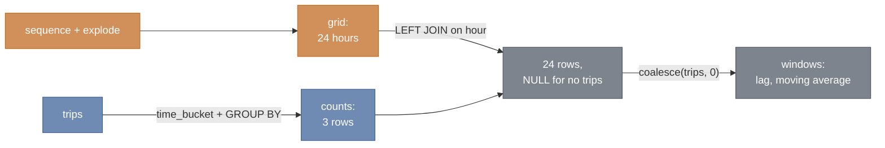

# Chapter 10: Time series

Time series data needs more than a plain `GROUP BY`. It needs buckets: trips per 15 minutes, per day, per week. It also needs the buckets that have no rows, and sessions that the data does not mark. Spark 4.2 added `time_bucket` for the buckets.

**A time bucket is one expression in the projection, and a gap in a time series is a row that the data does not have. You must make that row. Fill the gaps before you calculate windows, because a `ROWS` frame counts rows, not time.**

The scripts are in [`code/ch10`](https://github.com/lisancao/spark-masterclass/tree/main/code/ch10), and each output block below comes from `code/ch10/output/`.

- `timeseries.py` uses the June 2026 taxi trips.

Geospatial data (the `GEOMETRY` and `GEOGRAPHY` types, the `ST` functions and spatial joins) has its own chapter: [Chapter 76](ch76-geospatial.md).

## Step 1: Three ways to make a bucket

Spark has three functions that put a timestamp into a bucket:

```sql
SELECT ts,
       date_trunc('HOUR', ts)                          AS trunc_hour,
       window(ts, '15 minutes').start                  AS window_15m,
       time_bucket(INTERVAL 15 MINUTES, ts)            AS bucket_15m,
       time_bucket(INTERVAL 15 MINUTES, ts, TIMESTAMP_NTZ'2026-06-01 00:05:00') AS bucket_15m_at_05
FROM VALUES (TIMESTAMP_NTZ'2026-06-03 08:07:30'), (TIMESTAMP_NTZ'2026-06-03 08:21:00') AS v(ts)
```

```text
== 1. date_trunc, window and time_bucket
+-------------------+-------------------+-------------------+-------------------+-------------------+
|                 ts|         trunc_hour|         window_15m|         bucket_15m|   bucket_15m_at_05|
+-------------------+-------------------+-------------------+-------------------+-------------------+
|2026-06-03 08:07:30|2026-06-03 08:00:00|2026-06-03 08:00:00|2026-06-03 08:00:00|2026-06-03 08:05:00|
|2026-06-03 08:21:00|2026-06-03 08:00:00|2026-06-03 08:15:00|2026-06-03 08:15:00|2026-06-03 08:20:00|
+-------------------+-------------------+-------------------+-------------------+-------------------+

types: [('w', 'struct<start:timestamp_ntz,end:timestamp_ntz>'), ('b', 'timestamp_ntz')]
```

- **`date_trunc(unit, ts)`** sets all fields below the unit to zero. It accepts only calendar units: `'MINUTE'`, `'HOUR'`, `'DAY'`, `'WEEK'`, `'MONTH'` and some more. It cannot make 15-minute buckets.
- **`window(ts, duration)`** comes from Structured Streaming. It returns a struct with `start` and `end`, and it can make sliding windows (Step 4).
- **`time_bucket(size, ts[, origin])`** returns the start of the bucket as a timestamp of the same type. The optional origin moves the bucket boundaries. With an origin at `00:05`, the buckets start at `08:05` and `08:20`.

The bucket is a timestamp, not a struct. Thus you can join on it, sort by it and compare it with other timestamps directly.

## Step 2: Sizes and origins

The default origin is 1970-01-01 00:00:00. For buckets of a day or less, this origin is correct, because each day starts at a multiple of the bucket size. For a week, it is not:

```sql
SELECT d,
       date_trunc('WEEK', d)                                       AS trunc_week,
       time_bucket(INTERVAL 7 DAYS, d)                             AS bucket_7d_epoch,
       time_bucket(INTERVAL 7 DAYS, d, TIMESTAMP_NTZ'2026-06-07')   AS bucket_7d_sunday,
       time_bucket(INTERVAL 1 MONTH, d, TIMESTAMP_NTZ'2026-01-15') AS month_from_15th
FROM VALUES (TIMESTAMP_NTZ'2026-06-10 12:00'), (TIMESTAMP_NTZ'2026-06-14 09:00') AS v(d)
```

```text
== 2. bucket sizes and origins
+-------------------+-------------------+-------------------+-------------------+-------------------+
|                  d|         trunc_week|    bucket_7d_epoch|   bucket_7d_sunday|    month_from_15th|
+-------------------+-------------------+-------------------+-------------------+-------------------+
|2026-06-10 12:00:00|2026-06-08 00:00:00|2026-06-04 00:00:00|2026-06-07 00:00:00|2026-05-15 00:00:00|
|2026-06-14 09:00:00|2026-06-08 00:00:00|2026-06-11 00:00:00|2026-06-14 00:00:00|2026-05-15 00:00:00|
+-------------------+-------------------+-------------------+-------------------+-------------------+

1970-01-01 was a Thursday
  window with a month             _LEGACY_ERROR_TEMP_3231: Intervals greater than a month is not supported (1 month).
  time_bucket with 0 minutes      DATATYPE_MISMATCH.VALUE_OUT_OF_RANGE: Cannot resolve "time_bucket(INTERVAL '00' MINUTE, TIMESTAMP_NTZ '2026-06
  time_bucket with a column size  DATATYPE_MISMATCH.NON_FOLDABLE_INPUT: Cannot resolve "time_bucket(make_dt_interval(0, 0, id, 0.000000), TIMEST
  time_bucket on a DATE           DATATYPE_MISMATCH.UNEXPECTED_INPUT_TYPE: Cannot resolve "time_bucket(INTERVAL '1' DAY, DATE '2026-06-10', TIMESTA
```

- **`date_trunc('WEEK', ...)` starts each week on Monday.** 8 June 2026 is a Monday.
- **`time_bucket(INTERVAL 7 DAYS, ...)` with the default origin starts each week on Thursday,** because 1 January 1970 was a Thursday. Give an origin on the first day of the week that you want. With a Sunday origin, the weeks start on 7 and 14 June.
- **`time_bucket` accepts year-month intervals.** `INTERVAL 1 MONTH` with an origin on 15 January gives months that start on the 15th. `window()` does not accept months.

The bucket size must be positive and constant. A size from a column fails with `NON_FOLDABLE_INPUT`, because Spark must know the size when it makes the plan. `time_bucket` takes a `TIMESTAMP` or a `TIMESTAMP_NTZ`. For a `DATE`, cast it to a timestamp first.

## Step 3: Time zones and the DST change

A `TIMESTAMP_NTZ` is a wall-clock time with no zone. A `TIMESTAMP` is an instant, shown in the session time zone (Chapter 5). The docstring of `time_bucket` in the 4.3.0 source gives the rule: for `TIMESTAMP_NTZ`, Spark makes the buckets in UTC. For `TIMESTAMP`, month buckets and the day part of day-time buckets align to the session time zone. `timeseries.py` uses the night in March 2026 when New York changed to summer time:

```text
== 3. daily buckets over the March DST change, session zone America/New_York
+-------------------+-------------------+-------------------+-------------------+
|local_time         |ltz_bucket         |ntz_bucket         |ltz_6h             |
+-------------------+-------------------+-------------------+-------------------+
|2026-03-08 01:30:00|2026-03-08 00:00:00|2026-03-08 00:00:00|2026-03-08 00:00:00|
|2026-03-08 03:30:00|2026-03-08 00:00:00|2026-03-08 00:00:00|2026-03-08 00:00:00|
|2026-03-09 05:00:00|2026-03-09 00:00:00|2026-03-09 00:00:00|2026-03-09 01:00:00|
+-------------------+-------------------+-------------------+-------------------+
```

The daily buckets are correct for both types. 8 March has 23 hours in New York, and its bucket starts at local midnight.

The 6-hour buckets are different. Before the change, they start at 00:00, 06:00, 12:00 and 18:00. After the change, the bucket for 05:00 starts at 01:00. A bucket in hours has a fixed length in real time, counted from the origin in New York winter time. When the clocks move one hour, the local bucket boundaries move too. For hour buckets in local time, use `TIMESTAMP_NTZ` columns, or use day buckets and the hour of the day.

## Step 4: What each function adds to the plan

`timeseries.py` groups the month by each method and lists the operators of the plan:

```text
== 4. what each one adds to the plan
  time_bucket 15 min        ['HashAggregate', 'HashAggregate', 'Project', 'Filter']  rows: 2,880
  window 15 min             ['HashAggregate', 'HashAggregate', 'Project', 'Filter']  rows: 2,880
  window 1 h, slide 15 min  ['HashAggregate', 'HashAggregate', 'Expand', 'Filter']  rows: 2,883
```

A tumbling `window()` and `time_bucket` give the same plan and the same 2,880 buckets (30 days of 96). Each one is an expression in a `Project`. A sliding window is different. A one-hour window that moves every 15 minutes puts each row into four windows. Spark does this with an `Expand` operator, which makes four copies of each row before the aggregate. The three extra buckets are the windows at the start of the month that begin before 1 June.

Use `time_bucket` for fixed buckets in batch queries. Use `window()` for sliding windows, and in streaming queries, where watermarks need it (Chapter 25).

## Step 5: The buckets with no rows

A `GROUP BY` returns a row only for a bucket that has data. `timeseries.py` counts the pickups per hour in zone 108 (Gravesend) on 1 June:

```text
== 5. buckets with no trips, zone 108 (Gravesend), first day
hours with a row: 3 of 24
after the fill: 24 rows
+-------------------+-----+------+------+
|               hour|trips|avg_3h|change|
+-------------------+-----+------+------+
|2026-06-01 00:00:00|    1|   1.0|  NULL|
|2026-06-01 01:00:00|    0|   0.5|    -1|
|2026-06-01 02:00:00|    1|  0.67|     1|
|2026-06-01 03:00:00|    0|  0.33|    -1|
|2026-06-01 04:00:00|    0|  0.33|     0|
|2026-06-01 05:00:00|    0|   0.0|     0|
|2026-06-01 06:00:00|    0|   0.0|     0|
|2026-06-01 07:00:00|    1|  0.33|     1|
|2026-06-01 08:00:00|    0|  0.33|    -1|
+-------------------+-----+------+------+

hours where the average over 3 rows is not the average over 3 hours: 2
```

<figure markdown>
  <video autoplay loop muted playsinline controls width="1280" height="720" poster="../../media/clips/ch10-gaps.webp">
    <source src="../../media/clips/ch10-gaps.mp4" type="video/mp4">
  </video>
  <figcaption><code>timeseries.py</code> runs against Spark 4.3.0. A quiet zone has 3 rows for 24 hours, and the fill makes the other 21.</figcaption>
</figure>

Only 3 of the 24 hours have a row. A chart of that result draws a line from 00:00 to 02:00 to 07:00, and it shows no hours with zero trips. To fill the gaps, make one row for each bucket, and join the counts to it:

```python
grid = spark.sql("""SELECT explode(sequence(TIMESTAMP_NTZ'2026-06-01 00:00:00',
                                    TIMESTAMP_NTZ'2026-06-02 00:00:00' - INTERVAL 1 HOUR,
                                    INTERVAL 1 HOUR)) AS hour""")
filled = grid.join(counts, "hour", "left").select("hour", F.coalesce("trips", F.lit(0)).alias("trips"))
```

`sequence(start, stop, step)` makes an array of timestamps, and `explode` makes one row for each element. After the left join, the hours with no trips have a NULL count, and `coalesce` changes it to 0.

Fill the gaps before you calculate a window over the buckets. The moving average `avg_3h` uses `rowsBetween(-2, 0)`. On the filled rows, three rows are three hours. On the rows before the fill, three rows can cover many hours. The script compares the two, and 2 of the 3 hours with data get a different average. A `RANGE` frame with an interval (Chapter 7) also gives the correct average without a fill, but the chart still needs the rows.



## Step 6: Sessions

A session is a group of events with no long gap between them. `session_window(ts, gap)` makes these groups. `timeseries.py` groups the pickups at Newark Airport (zone 1) into sessions with gaps of 10 minutes or more:

```text
== 6. sessions: bursts of pickups at Newark Airport (zone 1), gaps over 10 minutes
+--------+-------+-----------+-------------+
|sessions|largest|avg_minutes|single_pickup|
+--------+-------+-----------+-------------+
|     423|      8|       11.2|          323|
+--------+-------+-----------+-------------+

sessions with lag + running sum: 423
```

Newark has 423 sessions in June. 323 of them have one pickup, and the largest has 8. A session window ends 10 minutes after its last event. Thus a session with one pickup is 10 minutes long, and the average is 11.2 minutes. Taxi pickups at Newark come one at a time, with long gaps between them.

The same sessions come from two window functions. `lag` finds the gap before each pickup. A gap of 10 minutes or more marks the start of a new session. A running `sum` of the marks gives each row a session number:

```python
gap = Window.orderBy("tpep_pickup_datetime")
manual = (pickups
          .withColumn("new", F.coalesce((F.timestamp_diff("MINUTE", F.lag("tpep_pickup_datetime").over(gap),
                                                          "tpep_pickup_datetime") >= 10).cast("int"), F.lit(1)))
          .withColumn("session_id", F.sum("new").over(gap.rowsBetween(Window.unboundedPreceding, 0))))
```

The two methods give the same count. The window method is longer, but you can change the rule. For example, you can start a new session when the zone changes, or when the gap is more than three times the median gap.

## Step 7: Percentiles in each bucket

An average hides the slow trips. `percentile_approx` gives the median and the 90th percentile of the trip time in each hour of the day:

```text
== 7. trip minutes by hour of day (all June)
+----+------+------------------+------------------+
|hour| trips|           p50_min|           p90_min|
+----+------+------------------+------------------+
|   4| 31726|13.133333333333333|              26.6|
|   8|147003|              13.7|31.633333333333333|
|  13|193764|15.116666666666667| 37.13333333333333|
|  17|250959|15.266666666666667| 37.28333333333333|
|  22|212386|14.233333333333333|29.366666666666667|
+----+------+------------------+------------------+
```

The median trip time changes by about 2 minutes over the day. The 90th percentile changes by more than 10 minutes. Traffic changes the slow trips more than the typical trip. `percentile_approx` keeps a small summary for each group, so it costs much less than the exact `percentile`. Chapter 41 shows how these summaries work.

Nanosecond timestamps (Chapter 6) do not work with `time_bucket` in 4.3.0:

```text
== 8. time_bucket on a nanosecond timestamp (4.3 preview type)
DATATYPE_MISMATCH.UNEXPECTED_INPUT_TYPE: Cannot resolve "time_bucket(INTERVAL '01' SECOND, CAST(2026-06-01 08:00:
```

Cast a nanosecond column to `TIMESTAMP_NTZ` before you make buckets.

## The whole chapter, on one page

- **`time_bucket(size, ts[, origin])` (4.2) returns the start of a bucket as a timestamp.** It accepts any constant interval, also months. A tumbling `window()` gives the same plan, and a sliding window adds an `Expand`.
- **Give weekly buckets an origin.** The default origin is a Thursday.
- **Hour buckets on a `TIMESTAMP` move with a DST change.** Day and month buckets follow the session time zone.
- **A gap is a row that you must make.** Use `sequence` and `explode` for the grid, a left join, and `coalesce`. Fill before you calculate windows.
- **`session_window` groups events by gaps.** `lag` and a running `sum` give the same result with rules that you can change.

For points, polygons and spatial joins, go to [Chapter 76](ch76-geospatial.md).

This chapter ends Part II. Part III goes back to the files that the data comes from: text, CSV, JSON, XML and binary formats, and the messy data inside them.

## Further reading

- [Datetime functions](https://spark.apache.org/docs/4.3.0/api/sql/index.html#time_bucket), with `time_bucket`, `window` and `session_window`.
