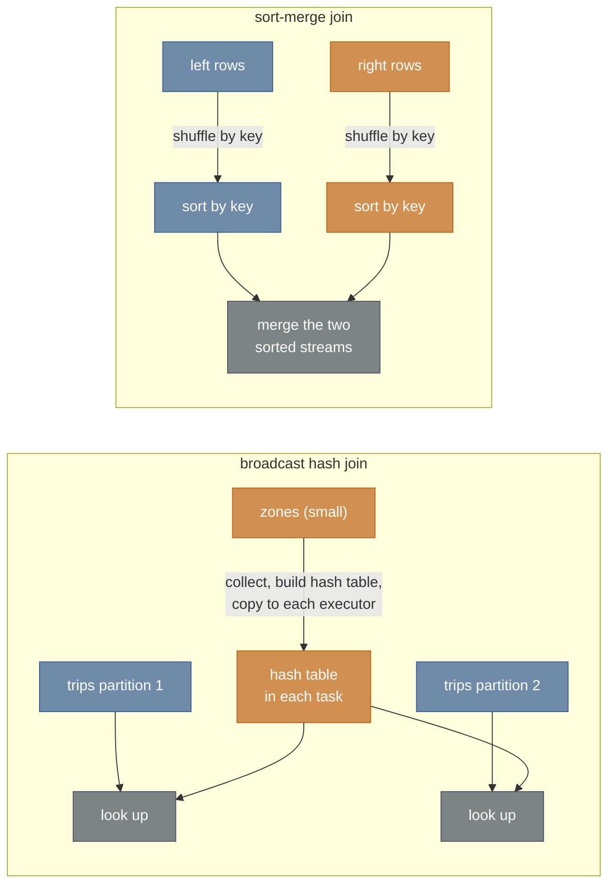
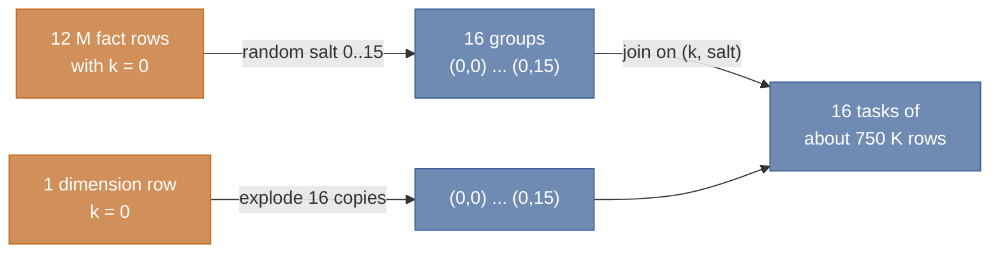

# Chapter 11: Joins: strategies, skew and the time-aware joins

A join looks like one operation in the code. Spark has five ways to run it, and the cost of a join changes by orders of magnitude between them. Spark selects the method from the sizes that it estimates, the type of the join condition and your hints. The sizes can be wrong, and adaptive query execution (AQE) can change the method after it sees real data. Spark 4.2 and 4.3 added two joins that are not equality joins at all: `NEAREST BY` and `ASOF JOIN`.

**A join strategy is a decision about data movement. A broadcast join copies the small side to every task, and a shuffle join moves both sides by the key. A nested loop compares all pairs. The data decides which one is cheap: the size of each side, the skew of the keys, and whether the condition is an equality. The new time-aware joins follow the same rule. Their cost is the number of rows that each row must look at.**

The scripts are in [`code/ch11`](https://github.com/open-lakehouse/spark-masterclass/tree/main/code/ch11), and each output block below comes from `code/ch11/output/`. They use the June 2026 taxi trips and the zone lookup.

- `strategies.py`: join types, the five strategies, how Spark selects one, and the time of each.
- `skew.py`: a skewed key, the AQE skew join, salting and bucketed tables.
- `asof.py`: `ASOF JOIN`, `NEAREST BY` and `LATERAL`.

The timings are medians of 3 runs after a warmup, on 16 cores in `local[*]` mode. Each run builds a new DataFrame, because a second `collect()` on the same DataFrame reuses its shuffle files.

## Step 1: Join types

A join type says which rows the result keeps. `strategies.py` uses two small tables with a NULL key on each side:

```python
a = spark.createDataFrame([(1, "a1"), (2, "a2"), (3, "a3"), (None, "a_null")], "k INT, a STRING")
b = spark.createDataFrame([(2, "b2"), (3, "b3"), (3, "b3x"), (4, "b4"), (None, "b_null")], "k INT, b STRING")
```

```text
== 1. join types
  inner     [(2, 'a2', 'b2'), (3, 'a3', 'b3'), (3, 'a3', 'b3x')]
  left      [(None, 'a_null', None), (1, 'a1', None), (2, 'a2', 'b2'), (3, 'a3', 'b3'), (3, 'a3', 'b3x')]
  right     [(None, None, 'b_null'), (2, 'a2', 'b2'), (3, 'a3', 'b3'), (3, 'a3', 'b3x'), (4, None, 'b4')]
  full      [(None, None, 'b_null'), (None, 'a_null', None), (1, 'a1', None), (2, 'a2', 'b2'), (3, 'a3', 'b3'), (3, 'a3', 'b3x'), (4, None, 'b4')]
  left_semi [(2, 'a2'), (3, 'a3')]
  left_anti [(None, 'a_null'), (1, 'a1')]
  cross     20 rows
  k = k     3 rows | k <=> k: 4 rows
  select('k') after a.k == b.k: AMBIGUOUS_REFERENCE: Reference `k` is ambiguous, could be: [`k`, `k`]. SQLSTATE: 42704
  columns after join on 'k': ['k', 'a', 'b'] | on a.k == b.k: ['k', 'a', 'k', 'b']
```

- **`inner`** keeps the pairs that match. Key 3 matches two rows on the right, so it gives two rows.
- **`left`** and **`right`** also keep the rows of one side with no match, with NULL for the other side.
- **`full`** keeps the rows of both sides.
- **`left_semi`** keeps the left rows that have a match, without the columns of the right side, and each left row at most one time. It is `WHERE EXISTS`.
- **`left_anti`** keeps the left rows that have no match. It is `WHERE NOT EXISTS`.

<figure markdown>


<figcaption>The rows that each join type keeps, from the output above. Each column is one possible result row. A dot shows that the join type keeps that row.</figcaption>
</figure>


The NULL keys never match. `NULL = NULL` is NULL, not true, so `a.k == b.k` gives 3 rows. The null-safe operator `eqNullSafe` (`<=>` in SQL) treats two NULLs as equal, and it gives 4 rows. Use it when NULL is a real value of the key, for example "no zone".

A join with a column expression keeps both key columns. Then `select("k")` is ambiguous, and the analyzer refuses it. A join on a column name (`"k"` or a list of names) keeps one key column. Use the name form when the key columns have the same name.

## Step 2: The default strategy

`strategies.py` joins the 3.8 million trips to the 265 zones:

```python
j = trips.join(zones, trips.PULocationID == zones.LocationID)
```

```text
== 2. the default strategy
zones estimated size: 12331 bytes | threshold: 10485760b
trips x zones -> ['BroadcastHashJoin']
AdaptiveSparkPlan isFinalPlan=false
+- BroadcastHashJoin [PULocationID#7], [LocationID#38], Inner, BuildRight, false, false
   :- Filter isnotnull(PULocationID#7)
   :  +- FileScan parquet [VendorID#0,tpep_pickup_datetime#1,tpep_dropoff_datetime#2,passenger_count
   +- BroadcastExchange HashedRelationBroadcastMode(List(cast(input[0, int, false] as bigint)),false
      +- Filter isnotnull(LocationID#38)
         +- FileScan csv [LocationID#38,Borough#39,Zone#40,service_zone#41] Batched: false, DataFilt
```

<figure markdown>
  <video autoplay loop muted playsinline controls width="1280" height="720" poster="../../media/clips/ch11-types.webp">
    <source src="../../media/clips/ch11-types.mp4" type="video/mp4">
  </video>
  <figcaption><code>strategies.py</code> runs against Spark 4.3.0. The zones are 12 KB by the estimate, under the 10 MB threshold, so the planner selects a broadcast hash join.</figcaption>
</figure>

The estimated size of `zones` is less than `spark.sql.autoBroadcastJoinThreshold` (10 MB). Thus the planner selects a **broadcast hash join**. The plan shows the two parts:

- **`BroadcastExchange`** collects the zones to the driver, builds a hash table, and sends a copy of it to each executor.
- **`BroadcastHashJoin`** runs in the tasks that scan the trips. Each task looks up each trip in its copy of the hash table. The trips do not move.

There is no `Exchange hashpartitioning` for the trips. A broadcast join is the cheapest join when one side is small, because the large side stays where it is.



The animation shows the data movement of the two strategies.

<figure markdown>
  <video autoplay loop muted playsinline controls width="1280" height="720" poster="../../media/clips/ch11-anim-movement.webp">
    <source src="../../media/clips/ch11-anim-movement.mp4" type="video/mp4">
  </video>
  <figcaption>Animation: the broadcast hash join sends a copy of the zones to each task, and the trips stay. The sort-merge join shuffles both sides by the key. The times are from Step 3. The dots and the partitions are schematic.</figcaption>
</figure>


## Step 3: The five strategies on the same join

A hint forces a strategy. `strategies.py` runs the same count by borough with each hint:

```sql
SELECT /*+ {hint} */ z.Borough, count(*) AS n
FROM trips t JOIN zones z ON t.PULocationID = z.LocationID GROUP BY z.Borough
```

```text
== 3. trips x zones, each strategy (count per borough; median of 3 after a warmup)
  BROADCAST(z)             ['BroadcastHashJoin']  0.17 s
  SHUFFLE_HASH(z)          ['ShuffledHashJoin']  0.54 s
  MERGE(z)                 ['SortMergeJoin']  0.75 s
  SHUFFLE_REPLICATE_NL(z)  ['CartesianProduct']  8.61 s
```

<figure markdown>


<figcaption>The time of the same join with each hint, from the output above. The Cartesian product compares all pairs.</figcaption>
</figure>


| Strategy | Hint | Data movement | Needs |
|---|---|---|---|
| Broadcast hash join | `BROADCAST` | copy the small side to each task | an equality, one small side |
| Shuffled hash join | `SHUFFLE_HASH` | shuffle both sides, build a hash table of one side in each task | an equality |
| Sort-merge join | `MERGE` | shuffle both sides, sort both, merge | an equality, sortable keys |
| Broadcast nested loop join | (no equality, one small side) | copy the small side, compare all pairs | any condition |
| Cartesian product | `SHUFFLE_REPLICATE_NL` | copy blocks of both sides, compare all pairs | any condition |

On these sizes, the broadcast hash join is the fastest, at 0.17 seconds. The shuffled hash join takes 0.54 seconds and the sort-merge join 0.75 seconds, because both shuffle the 3.8 million trips. The sort-merge join also sorts both sides. The Cartesian product takes 8.61 seconds, about 50 times as long as the broadcast join. It compares each trip with each of the 265 zones, about a billion pairs, and it evaluates the condition on each pair.

## Step 4: A join with no equality

A condition with no equality has no key to hash or sort. `strategies.py` joins each trip to a fare band with a range condition:

```python
bands = spark.createDataFrame([("short", 0.0, 15.0), ("medium", 15.0, 40.0), ("long", 40.0, 1e9)],
                              "band STRING, lo DOUBLE, hi DOUBLE")
nj = trips.join(bands, (trips.fare_amount >= bands.lo) & (trips.fare_amount < bands.hi))
```

```text
== 4. a non-equi join
bands estimated size: 9223372036854775807 bytes (local Python data becomes an RDD with no statistics)
fare in [lo, hi) -> ['CartesianProduct'] 2.04 s
same, broadcast(bands) -> ['BroadcastNestedLoopJoin'] 0.17 s
bands as SQL VALUES, size: 132 bytes -> ['BroadcastNestedLoopJoin']
```

The bands DataFrame has three rows, but its estimated size is 9,223,372,036,854,775,807 bytes, the largest `long`. `spark.createDataFrame` from local Python data makes a plan over an RDD in Classic mode, and Spark has no statistics for it. Thus the planner cannot broadcast it, and the join becomes a `CartesianProduct` (2.05 seconds).

With `F.broadcast(bands)`, the join is a `BroadcastNestedLoopJoin`: each task compares its trips with the three bands, and the query takes 0.20 seconds. The same three rows from a SQL `VALUES` clause are a local relation with a size of 132 bytes. The planner selects the broadcast without a hint.

A range join on a large right side has no good strategy. Add an equality if the data has one, for example a day or a bucket. Spark can hash on it, and the range stays as an extra condition.

## Step 5: Two large sides

When both sides are large, a broadcast is not possible or not cheap. `strategies.py` joins each trip to a second table with one row for each trip, on a trip ID (`_metadata.row_index`):

```text
== 5. two large sides (3.8 M x 3.8 M rows on a trip id)
  merge         ['SortMergeJoin']  0.55 s
  shuffle_hash  ['ShuffledHashJoin']  0.48 s
  no hint       ['BroadcastHashJoin']  ERROR Not enough memory to build and broadcast the table to all work
  broadcast     ['BroadcastHashJoin']  ERROR Not enough memory to build and broadcast the table to all work
```

The result shows that the size estimate can be dangerous:

- **With no hint, the planner selects a broadcast hash join, and the driver runs out of memory.** The estimate for the right side comes from the size of the Parquet file, scaled by the share of the selected columns. The result is under the 10 MB threshold. In memory, the same 3.8 million rows are much larger, and the broadcast does not fit the default driver memory.
- **A broadcast hint fails in the same way.**
- **The sort-merge join and the shuffled hash join both work,** in 0.55 and 0.48 seconds. Each of the 200 partitions is small, so the hash tables fit in memory, and the sort costs little.

The script runs the two broadcasts last. An earlier run had the broadcasts first. The failed broadcasts left the driver heap full, and the sort-merge join after them also failed with `java.lang.OutOfMemoryError`. In local mode, the driver and the executor share one JVM heap.

If the estimate is wrong for your data, set `spark.sql.autoBroadcastJoinThreshold` lower, or give the large side a `MERGE` hint. `ANALYZE TABLE ... COMPUTE STATISTICS` gives better estimates for catalog tables.

## Step 6: How Spark selects a strategy

The planner rule is `JoinSelection` in `SparkStrategies.scala`. For an equality join, it tries the strategies in this order:

1. **A hint.** `BROADCAST`, then `MERGE`, then `SHUFFLE_HASH`, then `SHUFFLE_REPLICATE_NL`. If a hint cannot apply, the planner ignores it and writes a warning to the log.
2. **A broadcast hash join** if one side is smaller than `spark.sql.autoBroadcastJoinThreshold` (10 MB by default), and the join type allows a broadcast of that side.
3. **A shuffled hash join** if `spark.sql.join.preferSortMergeJoin` is `false`, and one side is small enough to build a hash table in each partition. The default is `true`, so this step usually does not apply.
4. **A sort-merge join** if Spark can sort the keys.
5. **A Cartesian product** for an inner join, and otherwise a broadcast nested loop join.

For a condition with no equality, only the last two strategies are possible. A broadcast nested loop join needs one side that it can broadcast.

The join type limits which side can be broadcast. A left outer join can broadcast only the right side, because each left row must stay in its task to produce its NULL row. A full outer join cannot use a broadcast hash join:

```text
== 7. a hint that cannot apply
BROADCAST(t) on a FULL join -> ['SortMergeJoin']
```

`BROADCAST(t)` asks for a broadcast of the trips in a full join. The planner ignores the hint and uses a sort-merge join.

## Step 7: AQE changes the strategy at run time

The estimates come before the query runs. AQE ([Chapter 40](ch40-query-plans.md)) plans again after each shuffle stage, with the real sizes. To show this, `strategies.py` turns off the broadcast for the static planner (`spark.sql.autoBroadcastJoinThreshold = -1`). It gives AQE its own threshold of 10 MB (`spark.sql.adaptive.autoBroadcastJoinThreshold`). Then it joins the trips to two small results:

```python
def busy_join():   # zones with more than 100,000 pickups: the HAVING runs in the same stage as the join
    busy = trips.groupBy("PULocationID").count().where("count > 100000").select(F.col("PULocationID").alias("z"))
    return trips.join(busy, trips.PULocationID == F.col("z")).agg(F.count("*"))

def big_fare_join():   # pickups in zones that had a fare over 400: the filtered side is its own shuffle stage
    big = trips.where(F.col("fare_amount") > 400).select(F.col("PULocationID").alias("z"))
    return trips.join(big, trips.PULocationID == F.col("z")).agg(F.count("*"))
```

```text
== 6. AQE changes the strategy at run time
autoBroadcastJoinThreshold: -1 | adaptive.autoBroadcastJoinThreshold: 10MB
  busy zones (HAVING)      initial ['SortMergeJoin']  final ['SortMergeJoin']  [':  +- AQEShuffleRead coalesced', '+- AQEShuffleRead coalesced']
  fares over 400 (filter)  initial ['SortMergeJoin']  final ['BroadcastHashJoin']  [':- AQEShuffleRead local', '+- AQEShuffleRead local']
  fares over 400, AQE off: 0.33 s
  fares over 400, AQE on:  0.46 s
```

Both joins start as a sort-merge join. Only the second one changes:

- **The fares over 400.** The filtered trips are a separate shuffle stage. When that stage ends, AQE sees that its output is small. It plans again, and it changes the join into a broadcast hash join. `AQEShuffleRead local` means that the tasks read the shuffle files of the large side where the map tasks wrote them, with no exchange by key.
- **The busy zones.** The `HAVING` filter runs after the final aggregate, in the same stage as the join. AQE gets sizes only at the end of a shuffle stage. Thus it never sees the size of the small result, and the join stays a sort-merge join.

The conversion did not make this query faster: 0.46 seconds with AQE against 0.33 seconds without it. Both shuffles had already run when AQE changed the join. The conversion saves the sort and the merge, but it cannot give back the shuffle of the large side. AQE helps most in two cases. In the first, the small side finishes before Spark shuffles the large side. In the second, the static estimate was so wrong that the planner chose a much slower strategy.

## Step 8: A skewed key

A shuffle sends all rows of one key to one task. If one key has many rows, that task takes much longer than the other tasks, and the stage waits for it. The pickups per zone show skew:

```text
== 1. skew in the trips
zones: 258, median pickups per zone: 576, largest zone: 177,610
```

The median zone has 576 pickups in the file, and the largest zone has 177,610, more than 300 times as many. A shuffle by pickup zone puts the largest zone into one task.

To measure the effect, `skew.py` makes a join with one very hot key. It writes 30 million fact rows, and 40 percent of them have the key 0. The dimension side has 200,000 keys. Broadcast is off (`spark.sql.autoBroadcastJoinThreshold = -1`), so the plan is a sort-merge join, as it is for two large tables.

## Step 9: AQE skew join

```text
== 2. a sort-merge join with one hot key
  AQE skew join off  sum=5401520998929  join stage: 17 tasks, task time median 1390 ms, max 4919 ms, rows read median 1,196,603, max 12,093,305
                     median of 3: 3.71 s
  AQE skew join on   sum=5401520998929  join stage: 18 tasks, task time median 679 ms, max 2114 ms, rows read median 1,197,487, max 9,070,277
                     median of 3: 2.73 s
  final plan: ['+- *(5) SortMergeJoin(skew=true) [k#81L], [k#83L], Inner', ':  +- AQEShuffleRead coalesced and skewed', '+- AQEShuffleRead coalesced']
```

`skew.py` runs the join with `spark.sql.adaptive.skewJoin.enabled` off and on. It reads the task times of the join stage from the Spark UI REST API (`taskSummary` with the 0.5 and 1.0 quantiles).

- **Skew join off.** The median task takes 1,390 ms, and the slowest takes 4,919 ms. The slowest task reads 12,093,305 rows: the 12 million rows with key 0. The other tasks wait for it.
- **Skew join on.** AQE finds the large partition after the shuffle, and splits it. It copies the partition of the other side to each split. The plan shows `SortMergeJoin(skew=true)` and `AQEShuffleRead coalesced and skewed`. The slowest task takes 2,114 ms, and the query takes 2.73 seconds against 3.71 seconds.

A skewed partition is larger than `skewedPartitionFactor` (5) times the median partition. It is also larger than `skewedPartitionThresholdInBytes` (256 MB by default). Both keys start with `spark.sql.adaptive.skewJoin.`. The data of this example is smaller than 256 MB. Thus the script sets the threshold to 16 MB. It also sets the target size of a split (`spark.sql.adaptive.advisoryPartitionSizeInBytes`) to 16 MB.

The split is not complete here. The slowest task still reads 9,070,277 rows. AQE splits a skewed partition at the boundaries of the map outputs. Thus a split cannot be smaller than the part of the key that one map task wrote.


## Step 10: Salting

```text
== 3. salting with AQE skew join off
  sum: 5401520998929
  join stage: 17 tasks, task time median 1730 ms, max 1887 ms, rows read median 1,837,320, max 2,140,324
  median of 3: 2.26 s
```

Salting spreads the hot key by hand. The fact rows with key 0 get a random salt from 0 to 15. The script copies the dimension row for key 0 16 times, one copy for each salt. The join key becomes `(k, salt)`:

```python
f = facts.withColumn("salt", F.when(F.col("k") == 0, (F.rand(7) * S).cast("int")).otherwise(F.lit(0)))
d = dims.withColumn("salt", F.explode(F.when(F.col("k") == 0, F.sequence(F.lit(0), F.lit(S - 1)))
                                      .otherwise(F.array(F.lit(0)))))
f.join(d, ["k", "salt"])
```

With AQE skew join off, the salted join has an even stage. The slowest task takes 1,887 ms against a median of 1,730 ms, and it reads 2,140,324 rows. The sum is the same as before. The query takes 2.26 seconds, the fastest of the three.

<figure markdown>


<figcaption>The median task and the slowest task of the join stage, from the outputs of Steps 9 and 10. The stage waits for the slowest task. Salting gives the most even stage.</figcaption>
</figure>



Salting costs work: a copy of each hot dimension row for each salt, and code that must know the hot keys. AQE needs no code change. Use AQE first, and salt when AQE cannot split enough, or for an aggregate on a hot key, where the skew join does not apply.

## Step 11: NULL keys and bucketed tables

```text
== 4. NULL keys
  inner join on a key that is 40% NULL, filter in the plan: ['+- Filter isnotnull(k#83L)']
```

```text
== 5. bucketed tables
  Exchange operators: 1 | join: ['SortMergeJoin']
  scan: [':     +- FileScan parquet spark_catalog.default.trips_b[PULocationID#307,fare_amount#308] ']
  the same join on plain DataFrames, Exchange operators: 3
  bucketed: 0.16 s | not bucketed: 0.35 s
```

Some hot keys should not join at all. NULL keys never match an equality, and the optimizer knows this. For an inner join, it adds `isnotnull(k)` to each side, so the 12 million NULL rows go away before the shuffle. For a left join, the NULL rows of the left side must stay. Then a NULL key is a hot key for the shuffle, and a filter or a salt by hand is necessary.

A bucketed table keeps its rows partitioned by a key in the files. `skew.py` writes the trips and a per-zone average with `bucketBy(16, "PULocationID")` and `saveAsTable`. The join of the two tables has one `Exchange`, the one for the final aggregate. The same join on plain DataFrames has three.

The two tables have the same number of buckets on the same key. Thus each task reads one bucket of each table, and the rows of one key are already together. The bucketed join took 0.16 seconds against 0.35 seconds.

Buckets cost work when you write the data, and they help only joins and aggregates on the bucket key. Table formats such as Iceberg give the same effect with storage-partitioned joins ([Chapter 55](ch55-iceberg.md)).

## Step 12: ASOF JOIN

Some questions join on time, and an equality cannot express them. An example: for each pickup, what was the last drop-off in the same zone before it? The answer is the row with the largest drop-off time before the pickup. `ASOF JOIN` (Spark 4.3) is this join. In 4.3.0 it is behind a flag:

```text
== 1. ASOF JOIN needs a flag
default config: UNSUPPORTED_FEATURE.ASOF_JOIN: The feature is not supported: SQL ASOF JOIN syntax. Set "spark.sql.join.
```

The flag is `spark.sql.join.asofJoin.enabled`, an internal config with the default `false` (`SQLConf.scala`). The docs page for `ASOF JOIN` says the same. `asof.py` sets it, and it makes two event streams from the trips of 1 June: pickups (zone, time) and drop-offs (zone, time).

```sql
SELECT p.zone, p.t AS pickup, d.t AS last_dropoff
FROM pickups p
ASOF JOIN dropoffs d
  MATCH_CONDITION (p.t >= d.t)
  ON p.zone = d.zone
```

```text
== 2. the last drop-off before each pickup, in the same zone (1 June)
+----+-------------------+-------------------+
|zone|             pickup|       last_dropoff|
+----+-------------------+-------------------+
| 132|2026-06-01 00:13:37|2026-06-01 00:13:34|
| 132|2026-06-01 00:13:41|2026-06-01 00:13:34|
| 132|2026-06-01 00:13:53|2026-06-01 00:13:34|
| 132|2026-06-01 00:13:54|2026-06-01 00:13:34|
| 132|2026-06-01 00:14:08|2026-06-01 00:13:34|
+----+-------------------+-------------------+

+---------------------+-------+-------------+
|Zone                 |pickups|median_wait_s|
+---------------------+-------+-------------+
|Upper East Side South|6116   |7.0          |
|JFK Airport          |5665   |50.0         |
|Midtown Center       |5514   |10.0         |
|Upper East Side North|5497   |7.0          |
|Midtown East         |3989   |13.0         |
+---------------------+-------+-------------+
```

<figure markdown>
  <video autoplay loop muted playsinline controls width="1280" height="720" poster="../../media/clips/ch11-asof.webp">
    <source src="../../media/clips/ch11-asof.mp4" type="video/mp4">
  </video>
  <figcaption><code>asof.py</code> runs against Spark 4.3.0. <code>ASOF JOIN</code> finds the last drop-off in the same zone before each pickup on 1 June.</figcaption>
</figure>

`MATCH_CONDITION` gives the order comparison, and `ON` gives the equality. For each pickup, Spark returns at most one drop-off: the closest one that satisfies `p.t >= d.t`. At JFK Airport (zone 132), the median time from the last drop-off to the next pickup is 50 seconds. In Upper East Side South it is 7 seconds.

## Step 13: How ASOF JOIN runs

```text
== 3. the plan of ASOF JOIN
AdaptiveSparkPlan isFinalPlan=false
+- Project [zone#158, t#159 AS pickup#154, t#163 AS last_dropoff#155]
   +- SortMergeAsOfJoin [zone#158], [zone#162], [t#159], [t#163], (t#159 >= t#163), (t#159 - t#163), Inn
      :- Sort [zone#158 ASC NULLS FIRST, t#159 ASC NULLS FIRST], false, 0
      :  +- Exchange hashpartitioning(zone#158, 200), ENSURE_REQUIREMENTS, [plan_id=595]
      :     +- Project [PULocationID#28 AS zone#158, tpep_pickup_datetime#22 AS t#159]
      :        +- Filter (((((isnotnull(tpep_pickup_datetime#22) AND isnotnull(tpep_dropoff_datetime#23)
      :           +- FileScan parquet [tpep_pickup_datetime#22,tpep_dropoff_datetime#23,PULocationID#28]
```

The plan has a new operator, `SortMergeAsOfJoin`. It needs both sides clustered by the `ON` keys, and sorted by the keys and the time. Thus the plan has an `Exchange` and a `Sort` on each side, as a sort-merge join has. A SQL `ASOF JOIN` always uses this operator in 4.3.0. (For the DataFrame form, which pandas-on-Spark uses, the optimizer writes a correlated subquery with `min_by`, unless `spark.sql.join.sortMergeAsOfJoin.enabled` is `true`. Both rules are in `RewriteAsOfJoin.scala` and `SQLConf.scala`.)

The direction comes from the operator, and `LEFT ASOF JOIN` keeps the rows with no match:

```text
== 4. direction, LEFT ASOF and NULL
  e.t >= r.t (last at or before   ): [('07:30', None), ('09:00', '09:00'), ('09:40', '09:00'), (None, None)]
  e.t >  r.t (last strictly before): [('07:30', None), ('09:00', '08:00'), ('09:40', '09:00'), (None, None)]
  e.t <= r.t (first at or after   ): [('07:30', '08:00'), ('09:00', '09:00'), ('09:40', '10:00'), (None, None)]
  INNER drops unmatched rows: 2 of 4
  = in MATCH_CONDITION   ASOF_JOIN_MATCH_CONDITION_INVALID_OPERATOR: The MATCH_CONDITION operator must be one of >=, >, <=, <. Got: =. SQLSTA
  RIGHT ASOF JOIN        PARSE_SYNTAX_ERROR: Syntax error at or near 'ASOF': extra input 'ASOF'. SQLSTATE: 42601 (lin
```

- **`>=`** gives the last row at or before. At 09:00, the reading of 09:00 matches.
- **`>`** gives the last row strictly before, so 09:00 gets the 08:00 reading.
- **`<=`** gives the first row at or after.
- **A NULL time never matches.** `LEFT` keeps the row with NULL columns. The inner form drops it, and it also drops 07:30, which has no reading before it.
- **`=` is not allowed**, and there is no `RIGHT ASOF JOIN`.

## Step 14: ASOF JOIN against the methods before it

Before 4.3, the same answer needed a window or a range join. `asof.py` runs three methods on 1 June:

```text
== 5. the same answer three ways, 1 June (median of 3 after a warmup)
  ASOF JOIN                  n=  109,379  s=    13,818,273    6.44 s  ['HashAggregate', 'SortMergeAsOfJoin']
  window over a union        n=  109,379  s=    13,818,273    0.47 s  ['HashAggregate']
  range join + max (10 min)  n=  102,503  s=     5,204,506   10.24 s  ['BroadcastHashJoin', 'HashAggregate']
  (pickups may share a timestamp, so the range join groups fewer rows; and it misses waits over 10 minutes)
```

The three methods are:

1. **`ASOF JOIN`**, as in Step 12.
2. **A window over a union.** Put the drop-offs and the pickups in one stream, and sort by zone and time. Carry the last drop-off time forward with `last(..., ignorenulls=True)`, over a frame that ends one row before the current row ([Chapter 18](ch18-spark-sql-in-depth.md)).
3. **A range join and a `max`.** Join each pickup to the drop-offs in the same zone in the 10 minutes before it, and keep the latest.

The window gives the same 109,379 matches and the same sum of waits as `ASOF JOIN`. The range join gives a different answer, for two reasons. It misses each wait of more than 10 minutes. It also groups by zone and time, so two pickups at the same second become one row.

The window is the fastest: 0.47 seconds against 6.44 seconds for `ASOF JOIN`. The range join is the slowest. Each pickup first joins to all the drop-offs in its 10 minutes, and only then `max` keeps one of them.

```text
== 5b. one busy zone (237), more days: ASOF JOIN against the window (median of 3)
  1 day(s),  6,121 pickups:  ASOF   0.71 s   window  0.15 s
  2 day(s), 13,477 pickups:  ASOF   2.63 s   window  0.19 s
  4 day(s), 28,745 pickups:  ASOF  10.76 s   window  0.17 s
```

The second measurement explains why `ASOF JOIN` is slow. It runs one busy zone (237, Upper East Side South) for 1, 2 and 4 days. Two times the data takes 3.7 times as long, and four times the data takes 15 times as long. The window takes almost the same time for each size.

The reason is in the 4.3.0 source. `SortMergeAsOfJoinScanner` buffers all the right rows of one `ON` key. For each left row, `findBestBackwardForward` starts again at the first row of that buffer, and it reads forward until the condition becomes false. Thus the work for one key is about the number of left rows times half the number of right rows. A sort-merge join reads each buffer one time.

Thus, in 4.3.0, use `ASOF JOIN` when each `ON` group is small: a sensor, a stock symbol, a zone on one day. For a few large groups, the window over a union is faster. This behavior is in the open findings of the part notes. It can change in a later release.

## Step 15: NEAREST BY

`NEAREST BY` (Spark 4.2) is a different time-aware join, and a general one. For each left row, it returns the `k` right rows with the smallest distance (or the largest similarity) by any expression, in both directions:

```sql
SELECT t.fare_amount, r.rule, r.fare AS rule_fare
FROM (SELECT DISTINCT fare_amount FROM trips WHERE fare_amount IN (4.4, 19.8, 52.0, 69.9)) t
JOIN fare_rules r EXACT NEAREST 2 BY DISTANCE abs(t.fare_amount - r.fare)
ORDER BY t.fare_amount, abs(t.fare_amount - r.fare)
```

```text
== 6. NEAREST BY
+-----------+---------+---------+
|fare_amount|     rule|rule_fare|
+-----------+---------+---------+
|        4.4|  minimum|      3.0|
|        4.4|    short|     10.0|
|       19.8|crosstown|     25.0|
|       19.8|    short|     10.0|
|       52.0|  airport|     70.0|
|       52.0|crosstown|     25.0|
|       69.9|  airport|     70.0|
|       69.9|crosstown|     25.0|
+-----------+---------+---------+

plan of APPROX NEAREST BY: ['BroadcastNestedLoopJoin', 'SortAggregate']
plan of EXACT NEAREST BY:  ['BroadcastNestedLoopJoin', 'SortAggregate']
DataFrame API: [(30.0, 'crosstown', Decimal('25.0')), (95.0, 'airport', Decimal('70.0'))]
  k = 0      NEAREST_BY_JOIN.NUM_RESULTS_OUT_OF_RANGE: Invalid nearest-by join. The number of results 0 must be between 1 and 1
  FULL join  NEAREST_BY_JOIN.UNSUPPORTED_JOIN_TYPE: Invalid nearest-by join. Unsupported nearest-by join type FULL OUTER. Su
```

Each fare gets its two nearest rules. The plan is a `BroadcastNestedLoopJoin` and a `SortAggregate` with `min_by(..., k)` for each left row: all pairs, and then a top-K. `APPROX` and `EXACT` give the same plan. The PySpark docstring of `nearestByJoin` says it directly: "The current implementation evaluates the full cross-product of left and right." The rewrite is `RewriteNearestByJoin.scala`. `k` must be from 1 to 100,000. Only inner and left joins work.

Thus `NEAREST BY` on two large sides is a Cartesian product. For "the nearest time", use `ASOF JOIN`, which uses the order of the time. Use `NEAREST BY` for a small right side, or for a distance that has no order, such as the geographic distance in [Chapter 21](ch21-time-series.md).

## Step 16: LATERAL

A `LATERAL` subquery can read the columns of the row on its left. It is a join where the right side changes for each left row. `asof.py` finds the three longest trips from each of three zones:

```sql
SELECT z.Zone, l.trip_distance, l.fare_amount
FROM zones z,
LATERAL (SELECT trip_distance, fare_amount FROM trips t
         WHERE t.PULocationID = z.LocationID AND fare_amount > 0 AND trip_distance < 100
         ORDER BY trip_distance DESC LIMIT 3) l
WHERE z.LocationID IN (132, 138, 161)
ORDER BY z.Zone, l.trip_distance DESC
```

```text
== 7. LATERAL: the three longest trips from each of three zones
+-----------------+-------------+-----------+
|Zone             |trip_distance|fare_amount|
+-----------------+-------------+-----------+
|JFK Airport      |94.78        |605.0      |
|JFK Airport      |93.76        |648.4      |
|JFK Airport      |91.6         |300.0      |
|LaGuardia Airport|81.21        |569.3      |
|LaGuardia Airport|80.49        |562.3      |
|LaGuardia Airport|74.4         |269.0      |
|Midtown Center   |58.75        |200.0      |
|Midtown Center   |56.05        |225.0      |
|Midtown Center   |50.93        |261.3      |
+-----------------+-------------+-----------+
```

The same result comes from `QUALIFY row_number() ... <= 3` ([Chapter 18](ch18-spark-sql-in-depth.md)). The `LATERAL` form reads as "for each zone, a query", and it can use a different `LIMIT` or filter for each row. The filter on the fare and the distance removes rows with errors in the source data, such as negative fares.

## The whole chapter, on one page

- **A join type says which rows stay. A strategy says how the rows move.** NULL keys never match with `=`. Use `<=>` when NULL is a real key value.
- **A broadcast hash join copies the small side, and the large side does not move.** Spark selects it when a side is under `spark.sql.autoBroadcastJoinThreshold` (10 MB) and the join type allows it.
- **A sort-merge join shuffles and sorts both sides.** It is the default for two large sides. A shuffled hash join skips the sort, but it needs memory for a hash table in each task.
- **A condition with no equality compares all pairs.** It becomes a broadcast nested loop join or a Cartesian product. Keep one side small, or add an equality.
- **Hints come first in `JoinSelection`, and the planner ignores a hint that cannot apply.** A full outer join cannot broadcast.
- **AQE changes a sort-merge join into a broadcast join when a side turns out small after a shuffle.**
- **A skewed key makes one task long.** AQE splits a skewed partition of a sort-merge join. Salting does the same work by hand, and it also works without AQE.
- **Bucketed tables with the same bucket count join without a shuffle.**
- **`ASOF JOIN` (4.3, behind `spark.sql.join.asofJoin.enabled`) finds the last or next row by time for each row.** In 4.3.0 its cost grows with the square of the size of each equi-key group. Keep the `ON` groups small.
- **`NEAREST BY` (4.2) compares all pairs and keeps the top K.** Use it for a small right side.
- **`LATERAL` runs a subquery for each left row.**

All these rules come from one question. How many rows must move, and how many pairs must Spark compare? [Chapter 21](ch21-time-series.md) uses the same question for time buckets and spatial joins.

## Further reading

- [Join hints](https://spark.apache.org/docs/4.3.0/sql-ref-syntax-qry-select-hints.html#join-hints).
- [Performance tuning: join strategies, AQE and skew](https://spark.apache.org/docs/4.3.0/sql-performance-tuning.html).
- [ASOF JOIN](https://spark.apache.org/docs/4.3.0/sql-ref-syntax-qry-select-asof-join.html), new in 4.3.
- [JOIN](https://spark.apache.org/docs/4.3.0/sql-ref-syntax-qry-select-join.html), with `NEAREST BY` and `LATERAL`.
