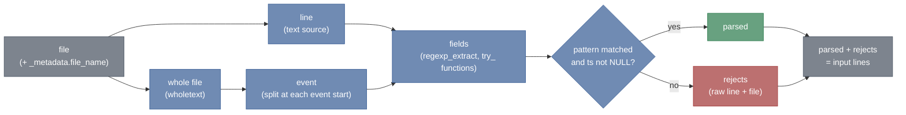
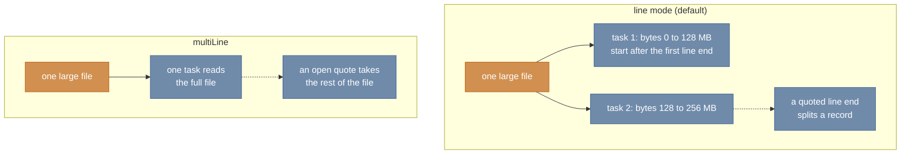
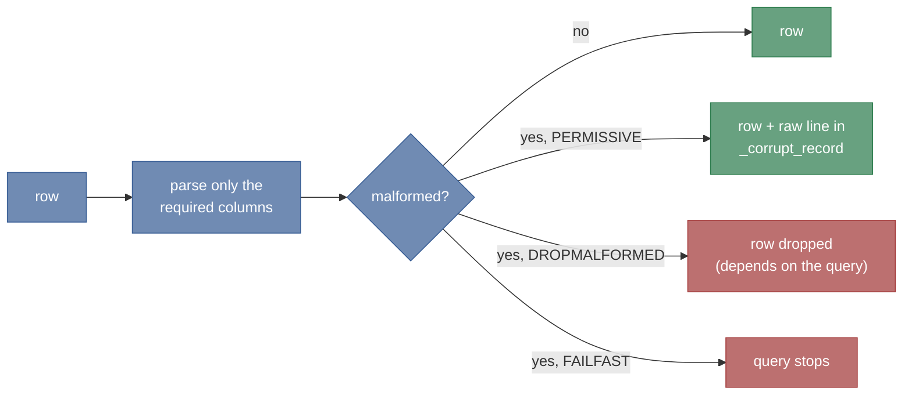

# Chapter 12: Text, logs and CSV

A Parquet file contains its schema. A log file or a CSV export does not. It contains only characters, and a person or a program must tell Spark what the characters mean.

In Spark, that information is in the reader options and in your regular expressions. Most problems with text data come from an option that has the wrong value for the file. In most cases, the result is not an error. The result is a `NULL`, a value in the wrong column, or a number that is 100 times too large.

**Text formats have no schema in the file, so the reader options are the schema. A default that does not fit the file usually gives a `NULL` or a wrong value, not an error. Thus a safe text read has three parts:**

- **explicit options,**
- **a corrupt record column or a "did it parse" flag,**
- **a quarantine that you count against the input.**

The first half of the chapter is about logs, with the `text` source and regular expressions. The second half is about CSV, with the CSV reader and its options. The data is SparkTutor's `logs/` and `delimited/` folders in [`code/data/messy`](https://github.com/lisancao/spark-masterclass/tree/main/code/data/messy). The scripts are [`code/ch12/logs.py`](https://github.com/lisancao/spark-masterclass/tree/main/code/ch12), `csv_options.py` and `csv_drift.py`. All output is from `code/ch12/output/`, on Spark 4.3.0 with `spark.sql.session.timeZone=UTC`.

## The life of a log line



## Step 1: The `text` source gives one row for each line

```python
lines = spark.read.text(str(LOGS / "app.log"))
lines.printSchema()
```

```text
root
 |-- value: string (nullable = true)

app.log lines: 134  scan tasks: 1
app.log.gz lines: 134 (decompressed by its extension)
maxPartitionBytes=1KB  : app.log -> 10 tasks, app.log.gz -> 1 task
maxPartitionBytes=128MB: app.log ->  1 tasks, app.log.gz -> 1 task
```

Each line becomes one row in the string column `value`, without the line end. By default, the source splits on `\n`, `\r\n` or `\r`. The option `lineSep` sets a different separator. The source decompresses a file by its extension, so `app.log.gz` gives the same 134 lines with no option.

The task counts show why line mode is good for large logs. With `spark.sql.files.maxPartitionBytes` set to 1 KB, Spark cuts the 10 KB `app.log` into 10 byte ranges, and 10 tasks read it at the same time. Each task starts at the first line end after the start of its range. The gzip file always gives one task, because a gzip stream cannot start in the middle. The `text` source also accepts all the listing options and the `_metadata` column from [Chapter 11](ch11-files-as-files.md).

## Step 2: `wholetext` and a trap in the PySpark API

Some text has meaning only as a full file: a Markdown document, or a log in which one event has several lines. The option `wholetext` reads each file as one row. There are three ways to set it, and they do not give the same result:

```python
spark.read.option("wholetext", True).text(p).count()
spark.read.text(p, wholetext=True).count()
spark.read.format("text").option("wholetext", True).load(p).count()
```

```text
option("wholetext", True).text(p)          -> 134
text(p, wholetext=True)                    -> 1
format("text").option("wholetext", True)   -> 1
```

The PySpark method `text()` has a keyword argument `wholetext` with the default `False`. The method always sends this keyword to the reader. Thus it replaces the value that `.option("wholetext", True)` set before. The PySpark source of 4.3.0 still has `wholetext: bool = False` in `DataFrameReader.text`. Use the keyword, or use `format("text")` with `.option()`. The option `lineSep` does not have this problem, because its keyword default is `None`, and `text()` does not send a `None` value.

A full file in one string is also one task and one value in memory. Use `wholetext` only for files of some megabytes or less.

## Step 3: Get fields from a line with a regular expression

An Apache access log line has a fixed layout. One pattern with a capture group for each field describes it:

```python
ACCESS_RE = r'^(\S+) \S+ \S+ \[([^\]]+)\] "(\S+) (\S+) (\S+)" (\d{3}) (\d+)'
sample.select(F.regexp_extract("value", ACCESS_RE, 1).alias("ip"),
              F.regexp_extract("value", ACCESS_RE, 2).alias("raw_ts"),
              F.regexp_extract("value", ACCESS_RE, 4).alias("url"),
              F.regexp_extract("value", ACCESS_RE, 6).try_cast("int").alias("status"))
```

```text
+----------+--------------------------+------------+------+
|ip        |raw_ts                    |url         |status|
+----------+--------------------------+------------+------+
|10.0.2.238|01/Oct/2026:10:00:00 +0000|/?session=s1|404   |
|          |                          |            |NULL  |
+----------+--------------------------+------------+------+
```

Spark uses Java regular expressions. Write the patterns as Python raw strings (`r'...'`), so that the backslashes go to Spark without a change. The second row is the line `garbage line`. It did not match, and each function gave its "no match" value. These values are different for each function, and a bad line hides in them:

```text
  regexp_extract       -> ''
  regexp_extract_all   -> []
  regexp_substr        -> None
  regexp_count         -> 0
  rlike                -> False
  cast("int") on ""     -> [CAST_INVALID_INPUT] The value '' of the type "STRING" cannot be cast to "INT" because it is malformed. Correct the value
  pattern as a plain str -> [UNRESOLVED_COLUMN.WITH_SUGGESTION] A column, variable, or function parameter with name `status=(\d+)` cannot be resolved. Did you mean 
```

| Function | No match | Use it for |
|---|---|---|
| `regexp_extract(col, pattern, i)` | `''` (an empty string) | one capture group |
| `regexp_extract_all(col, pattern, i)` | `[]` | each match of a group |
| `regexp_substr(col, pattern)` | `NULL` | the first full match |
| `regexp_count(col, pattern)` | `0` | the number of matches |
| `col.rlike(pattern)` | `false` | a test: did the line match? |

The empty string from `regexp_extract` is dangerous when you convert it. Spark 4 uses ANSI mode by default.

Thus `.cast("int")` on `''` does not give `NULL`. It stops the query with `CAST_INVALID_INPUT`. `.try_cast("int")` gives `NULL` for a value that is not a number. With `try_cast`, a bad line becomes a row of empty strings and `NULL`s. Thus you must use `rlike` to find the lines that did not parse.

The last line of the output shows a second trap. `regexp_extract` accepts the pattern as a Python string. But `regexp_extract_all`, `regexp_substr` and `regexp_count` accept the pattern as a column. A plain string for a column argument is the name of a column. Thus Spark looks for a column with the name `status=(\d+)`. Put the pattern in `F.lit(...)` for these functions.

## Step 4: Timestamps need a pattern, and `try_to_timestamp`

Spark cannot guess the format `01/Oct/2026:10:00:00 +0000`. Give it the pattern:

```python
F.try_to_timestamp("raw", F.lit("dd/MMM/yyyy:HH:mm:ss Z"))
```

```text
+--------------------------+-------------------+
|raw                       |try_to_timestamp   |
+--------------------------+-------------------+
|01/Oct/2026:10:00:00 +0000|2026-10-01 10:00:00|
|31/Sep/2026:11:00:00 +0000|NULL               |
+--------------------------+-------------------+

to_timestamp -> [CANNOT_PARSE_TIMESTAMP] Text '31/Sep/2026:11:00:00 +0000' could not be parsed: Invalid date 'SEPTEMBER 31'. Use `try_to_time
```

The pattern letters are Spark's datetime patterns. `dd` is the day, `MMM` is a short month name such as `Oct`, `yyyy` is the year and `HH` is the 24-hour clock. `Z` is an offset such as `+0000`, and `SSS` is milliseconds. The application log in Step 6 uses `yyyy-MM-dd HH:mm:ss,SSS`. Its JSON half uses ISO text that `variant_get` reads directly.

With ANSI mode, `to_timestamp` stops the full query at the first value that it cannot parse. Here that value is 31 September, a date that does not exist. `try_to_timestamp` gives `NULL`, which is the correct behaviour for a parser. You count the `NULL`s, you put those lines into the quarantine, and the job continues.

A Spark `TIMESTAMP` is an instant. The session time zone controls how Spark shows it, and how Spark reads text without an offset. The access log has `+0000`, so Spark stores 10:00 UTC correctly. The text half of `app.log` has no offset, so `10:00:00,123` is 10:00 in the session time zone. Set `spark.sql.session.timeZone` explicitly, and know which logs have an offset.

## Step 5: Split a URL

```python
F.split_part("url", F.lit("?"), F.lit(1))
F.try_parse_url("url", F.lit("QUERY"), F.lit("session"))
```

```text
+-------------------------+--------------+-------+
|url                      |path          |session|
+-------------------------+--------------+-------+
|/api/orders/42?session=s9|/api/orders/42|s9     |
|/cart?session=s12&x=1    |/cart         |s12    |
|http://[bad              |http://[bad   |NULL   |
+-------------------------+--------------+-------+
```

`split_part(str, delimiter, n)` gives the piece number `n`, from 1. Its delimiter is plain text, not a regular expression, so `?` needs no escape. `parse_url` gets a part of a URL (`HOST`, `PATH`, `QUERY`), or one query parameter when you give a key. It accepts a path without a host. On a bad URL, `parse_url` fails with `INVALID_URL`, and `try_parse_url` gives `NULL`, as the third row shows.

## Step 6: Put multi-line events together again

When the application fails, it writes one event on four lines:

```text
2026-10-01 10:02:00,123 ERROR [worker-2] order.Service - processed order=2 ms=769
java.lang.IllegalStateException: inventory negative for sku=P3
	at order.Inventory.reserve(Inventory.java:88)
	at order.Service.process(Service.java:41)
```

In line mode, these are four rows with no connection. Step 1 showed that two tasks can read the lines of one file. Thus a rule such as "add this line to the line before it" does not work reliably. For files of a usual size, read the full file, then split it where a new event starts. A regular expression lookahead does this. It matches the line end, but it does not use the start of the next line:

```python
EVENT_START = r"\n(?=\d{4}-\d{2}-\d{2} |\{)"
recs = (spark.read.text(p, wholetext=True)
        .select(F.explode(F.split("value", EVENT_START)).alias("rec")))
errors.select(
    F.regexp_extract("rec", r"\n([\w.$]+(?:Exception|Error)):", 1).alias("exception"),
    F.regexp_extract_all("rec", F.lit(r"\tat ([\w.$]+)\("), F.lit(1)).alias("frames"))
```

```text
lines: 134  events: 80
+-------------------------------+------------------------------------------------+
|exception                      |frames                                          |
+-------------------------------+------------------------------------------------+
|java.lang.IllegalStateException|[order.Inventory.reserve, order.Service.process]|
|java.lang.IllegalStateException|[order.Inventory.reserve, order.Service.process]|
+-------------------------------+------------------------------------------------+
```

`(?=...)` means "followed by". A line end that a date or `{` follows is the end of an event. The exception and its `at` lines never start in that way, so they stay with their event. The 134 lines become 80 events.

This method needs each file in the memory of one task. For larger logs, there are better solutions:

- Change the source. A JSON line for each event, with the stack trace in one field, is the best change for log analysis.
- Rotate the logs into smaller files.
- Use a reader that keeps events together across splits, such as a Python data source ([Part IX](ch50-python-data-sources-readers.md)).

A line-mode solution with `_metadata.file_block_start` and a window over an "event start" flag is possible. But it is correct only when no event crosses the boundary between two splits, and you cannot make sure of that for a large file.

## Step 7: A log that changes from text to JSON

At 11:00 the team changed the logger to JSON:

```text
{"ts": "2026-10-01T11:00:00Z", "level": "INFO", "logger": "order.Service", "msg": "processed", "order": 100, "ms": 91}
```

Now one file contains two formats. Find the format for each event, and parse each format in its own way:

```python
is_json = F.col("rec").startswith("{")
j = F.try_parse_json("rec")
events = recs.select(
    F.when(is_json, "json").otherwise("text").alias("fmt"),
    F.when(is_json, F.try_variant_get(j, "$.ts", "timestamp"))
     .otherwise(F.try_to_timestamp(F.regexp_extract("rec", r"^(\S+ \S+)", 1),
                                   F.lit("yyyy-MM-dd HH:mm:ss,SSS"))).alias("ts"),
    F.when(is_json, F.try_variant_get(j, "$.level", "string"))
     .otherwise(F.regexp_extract("rec", r"^\S+ \S+ (\w+)", 1)).alias("level"),
    F.when(is_json, F.try_variant_get(j, "$.ms", "int"))
     .otherwise(F.regexp_extract("rec", r"ms=(\d+)", 1).try_cast("int")).alias("ms"))
```

```text
+----+-----+---+------+-----------------------+-----------------------+
|fmt |level|n  |avg_ms|first                  |last                   |
+----+-----+---+------+-----------------------+-----------------------+
|json|INFO |20 |415.0 |2026-10-01 11:00:00    |2026-10-01 11:19:00    |
|text|ERROR|18 |535.0 |2026-10-01 10:02:00.123|2026-10-01 10:58:00.123|
|text|INFO |26 |410.0 |2026-10-01 10:01:00.123|2026-10-01 10:57:00.123|
|text|WARN |16 |477.0 |2026-10-01 10:00:00.123|2026-10-01 10:59:00.123|
+----+-----+---+------+-----------------------+-----------------------+
```

`try_parse_json` changes a string into a `VARIANT`, or gives `NULL` if the string is not valid JSON. `try_variant_get` reads one field as a type. It gives `NULL` if the field is not there or has a different type. [Chapter 15](ch15-variant.md) explains `VARIANT` in full. Here these two functions read some fields from JSON without a schema.

The result has a question in it. The JSON half has 20 `INFO` events and no `WARN` or `ERROR` events. Maybe the hour after 11:00 had no problems. Or maybe the new logger writes its errors to a different place. The data alone cannot tell you which. A change of format is a good time to ask this question.

## Step 8: A quarantine must balance

A parser that loses lines without a message is worse than a parser that fails. The script reads the real `access.log` and a second file with three lines. The lines are a good line, a truncated line, and a line with the date 31 September. Each field uses a tolerant function. One flag decides if the line parsed:

```python
good = F.col("value").rlike(ACCESS_RE) & F.col("ts").isNotNull()
parsed, rejects = cand.where(good), cand.where(~good).select("file", "value")
```

```text
input 203, parsed 201, rejects 2, balanced: True
+----------------+------------------------------------------------------------+
|file            |value                                                       |
+----------------+------------------------------------------------------------+
|access_extra.log|10.0.9.9 - - [01/Oct/2026:12:00:01 +0000] "GET /ca          |
|access_extra.log|10.0.9.9 - - [31/Sep/2026:12:00:02 +0000] "GET /cart?session|
+----------------+------------------------------------------------------------+

+--------------+----+------+
|path          |hits|errors|
+--------------+----+------+
|/             |38  |8     |
|/api/orders   |27  |8     |
|/api/orders/42|43  |6     |
|/login        |35  |6     |
|/cart         |26  |5     |
+--------------+----+------+
```

The truncated line fails the pattern. The impossible date matches the pattern, but its timestamp is `NULL`. Both go into `rejects` with their file name. Then the count check proves that the job lost no line: 201 + 2 = 203. Write `rejects` to a place where people look at it. A sudden increase in rejects is often the first sign that a format changed at the source.

<figure markdown>
  <video autoplay loop muted playsinline controls width="1280" height="720" poster="../../media/clips/ch12-quarantine.webp">
    <source src="../../media/clips/ch12-quarantine.mp4" type="video/mp4">
  </video>
  <figcaption><code>logs.py</code> on Spark 4.3.0. Each input line is parsed or rejected, and the two counts add up to the input.</figcaption>
</figure>

With typed timestamps, analysis by time is ordinary Spark. `session_window` puts the hits of each IP address into sessions. A session closes after 30 seconds without a hit:

```text
+----------+-------------------+-------------------+----+
|ip        |start              |end                |hits|
+----------+-------------------+-------------------+----+
|10.0.0.170|2026-10-01 10:02:43|2026-10-01 10:03:18|2   |
|10.0.2.12 |2026-10-01 10:00:08|2026-10-01 10:00:54|2   |
|10.0.2.197|2026-10-01 10:00:43|2026-10-01 10:01:32|2   |
+----------+-------------------+-------------------+----+
```

Unlike a fixed `window()`, each session has its own length. The end is 30 seconds after the last hit of that IP. The same function works on a stream with a watermark ([Part V](ch25-structured-streaming.md)).

## Step 9: The `text` source always decodes UTF-8

The file `notes_latin1.txt` is in ISO-8859-1 (Latin-1). The `text` source damages its accented letters, and the `encoding` option does not help:

```text
text                          -> 'Caf� cr�me, r�sum�: d�j� vu.'
text, encoding=ISO-8859-1     -> 'Caf� cr�me, r�sum�: d�j� vu.'
binaryFile + decode           -> 'Café crème, résumé: déjà vu.\n'
+-------------+----------------------------+
|is_valid_utf8|make_valid_utf8             |
+-------------+----------------------------+
|false        |Caf� cr�me, r�sum�: d�j� vu.|
+-------------+----------------------------+
```

In 4.3.0, the `encoding` option of the `text` source changes only how Spark converts a custom `lineSep` to bytes. The content is always UTF-8. The CSV and JSON sources use `encoding` for the content, but `text` does not. The correct method is to read the bytes and decode them yourself, with `binaryFile` and `F.decode(content, "ISO-8859-1")`. `is_valid_utf8` finds a string that is not valid UTF-8. `make_valid_utf8` replaces each bad byte with U+FFFD.

Spark Connect makes this difference more visible. A string column can hold bytes that are not valid UTF-8. The Connect client decodes results strictly.

Thus a `collect()` of the bad string can raise a Python `UnicodeDecodeError`, but `show()` works because the server makes the text. SparkTutor recorded this behaviour on 4.2.0. This chapter did not run it again on 4.3.0. Fix the text on the server before you collect it.

## The CSV reader: options are the schema

CSV has an official description, RFC 4180, but most CSV files do not obey all of it. The CSV reader has many options. The table gives the defaults from `CSVOptions.scala` that cause most problems:

| Option | Default | Meaning |
|---|---|---|
| `sep` (alias `delimiter`) | `,` | the field separator |
| `header` | `false` | the first line is data, and the columns are `_c0`, `_c1`, ... |
| `inferSchema` | `false` | all columns are `STRING` |
| `enforceSchema` | `true` | a schema that you give wins over the header, by position |
| `quote` | `"` | the quote character |
| `escape` | `\` | the escape character inside quotes (RFC 4180 uses `""`) |
| `multiLine` | `false` | one record for each line |
| `nullValue` | empty string | the text that means `NULL` |
| `emptyValue` | empty string | what a quoted `""` becomes |
| `nanValue`, `positiveInf`, `negativeInf` | `NaN`, `Inf`, `-Inf` | special floating-point values |
| `ignoreLeadingWhiteSpace`, `ignoreTrailingWhiteSpace` | `false` for read, `true` for write | trim the values |
| `encoding` (alias `charset`) | `UTF-8` | the text encoding |
| `comment` | off | skip the lines that start with this character |
| `mode` | `PERMISSIVE` | what to do with a malformed row |
| `locale` | `en-US` | month names and decimal numbers |
| `unescapedQuoteHandling` | `STOP_AT_DELIMITER` | quotes inside a value without an escape |
| `maxColumns`, `maxCharsPerColumn` | `20480`, `-1` (no limit) | parser limits |

There are three ways to write the same read: `.option()` calls, keywords of `csv()`, or `format("csv")` with `load()`. Each keyword of `csv()` has the default `None`, so you can mix keywords and options safely. This is different from `text()` in Step 2. The option names are not case-sensitive.

## Step 10: Headers and `enforceSchema`

```text
header=false: ['_c0', '_c1', '_c2', '_c3', '_c4']
header=true:  ['id0', 'name', 'id2', '_c3', '  city  ']
ID,id:        ['ID0', 'id1']
select("e.mail") -> [UNRESOLVED_COLUMN.WITH_SUGGESTION] A column, variable, or function parameter wi
select("`e.mail`") -> a@x.ca
```

The header was `id,name,id,,  city  `. Spark makes the names unique. A name that occurs twice gets its position as a suffix (`id0`, `id2`). Because `spark.sql.caseSensitive` is `false`, `ID` and `id` are also the same name.

A blank name becomes `_c` and its position, and Spark keeps the spaces in `'  city  '`. A name with a dot needs backticks, because a dot is the path to a struct field. `df.toDF(*names)` renames all columns by position, which is the fastest way to replace a bad header.

When you give a schema **and** `header=True`, Spark skips the header line and does not use it. It takes the columns by position:

```text
+----+----+
|id  |name|
+----+----+
|NULL|1   |
|NULL|2   |
+----+----+

enforceSchema=false -> CSV header does not conform to the schema.
    Header: name, id
    Schema: id, name
    Expected: id but found: name
```

The file was `name,id`. The names went into `id`, which is an `INT`, so they became `NULL`. The IDs went into `name`. There was no error.

With `enforceSchema` set to `false`, Spark compares the header of each file with the schema and stops the read. It does not change the order of the columns for you. It refuses to read them incorrectly, and this is the correct behaviour for a production job.

## Step 11: `inferSchema` and its cost

```text
struct<sku:int,zip:int,qty:int,price:double,day:date,ts:timestamp,flag:boolean,mixed:string,padded:double>
+---+-----+---+-----+----------+-------------------+-----+-----+------+
|sku|zip  |qty|price|day       |ts                 |flag |mixed|padded|
+---+-----+---+-----+----------+-------------------+-----+-----+------+
|123|2139 |1  |1.5  |2026-01-05|2026-01-05 10:00:00|true |7    |7.0   |
|456|10001|2  |2.25 |2026-01-06|2026-01-06 11:30:00|false|x    |8.0   |
+---+-----+---+-----+----------+-------------------+-----+-----+------+
```

Inference made four errors in two rows:

- **The leading zeros are gone.** The SKU `00123` became `123`, and the ZIP code `02139` became `2139`. An identifier that looks like a number must stay a string.
- **One bad value makes a column a string.** The value `x` made `mixed` a `STRING`. In a large file, that value can be in row 9 million.
- **A number with spaces becomes a double.** ` 7 ` became `7.0`, because the integer test is stricter than the double test.
- **Only ISO dates become dates.** The option `preferDate` (on by default) makes `2026-01-05` a `DATE`. A date such as `05/01/2026` stays a string unless you give `dateFormat`.

Inference also costs time before your query starts. The script counts the jobs that each read starts with a job group and the status tracker. It does no action:

```text
schema given        : 0 jobs
header only         : 1 jobs
header + inferSchema: 2 jobs
samplingRatio=1.0: n is string and the row 'hello' reads as 'hello'
samplingRatio=0.1: n is int    and the row 'hello' reads as None
```

The header needs one job to read the first line. Inference needs a second job that reads the full input. `samplingRatio` makes inference less expensive, but it adds risk.

The column with 1000 numbers and one `hello` is a `STRING` with full inference. With a sample of 10%, the sample did not contain `hello`, so the column is an `INT`, and `hello` becomes `NULL` with no error. Use inference to examine a new file. Then copy the schema (`df.schema.simpleString()`), correct the wrong types, and give that schema to the real job.

## Step 12: Separators, quotes and stray quotes

```text
default sep: [Row(a;b='1')]
sep=';'    : [Row(a='1,5', b='2')]
sep='||'   : [Row(_c0='1|x', _c1='2')]
sep=''     : Delimiter cannot be empty
```

The wrong separator does not give an error. The file `a;b` / `1,5;2` with the default comma gives one column with the name `a;b`. The comma in `1,5` split the line.

A file with semicolons is often a European export, in which the comma is the decimal point (Step 15). A separator can have more than one character (`||`). It can also be any single character, such as a tab (`"\t"`) or the U+0001 character of Hive. An empty separator fails.

Inside quotes there are two conventions for a quote character. RFC 4180 (Excel, the Python `csv` module, most databases) writes it twice, `""`. Spark's default writes a backslash, `\"`:

```text
+---+-----------------+
|id |note             |
+---+-----------------+
|1  |hello, world     |
|2  |"she said ""hi"""|
|3  |back"slash       |
+---+-----------------+

+---+-------------+
|id |note         |
+---+-------------+
|1  |hello, world |
|2  |she said "hi"|
|3  |"back\"slash"|
+---+-------------+
```

The first table uses the default `escape`. Row 2, in RFC style, keeps all its quotes. The second table uses `escape='"'`. Row 2 is correct, and row 3, in backslash style, is wrong. No setting reads both. Find the convention of the producer (for files from other tools, it is almost always `""`) and set `escape` to match it.

Some files have quotes with no escape at all. `unescapedQuoteHandling` selects what the parser does. On the line `2,"x"y,z",8` with the header `id,note,n`:

```text
  STOP_AT_DELIMITER      -> note='"x"y', n='z"'
  STOP_AT_CLOSING_QUOTE  -> note='x"y,z', n='8'
  BACK_TO_DELIMITER      -> note='xy,z', n='8'
  SKIP_VALUE             -> note=None, n='z"'
  RAISE_ERROR            -> fails: Unescaped quote character '"' inside quoted value of CSV field. To allow un
```

No mode gives the correct result in all cases. With the default, the value `8` is lost. Use `RAISE_ERROR` in a check job to find if a feed has this problem, and correct the producer if you can.

## Step 13: Line breaks inside quoted fields

`products.csv` has 15 products. Two descriptions have a line break inside the quotes:

```text
line mode rows: 17
+---------------+-------------+---------------------+
|sku            |name         |description          |
+---------------+-------------+---------------------+
|00042          |Kettle, steel|Boils 1.7 L.         |
|Auto shut-off."|39.99        |yes                  |
|00107          |Tea mug      |"The ""classic"" mug"|
+---------------+-------------+---------------------+

multiLine + escape rows: 15
+-----+-------------+----------------------------+
|sku  |name         |description                 |
+-----+-------------+----------------------------+
|00042|Kettle, steel|Boils 1.7 L.\nAuto shut-off.|
|00107|Tea mug      |The "classic" mug           |
|00230|Spoon set    |NULL                        |
+-----+-------------+----------------------------+

unterminated quote, line mode: [Row(id='1', note='never closed'), Row(id='2', note='b'), Row(id='3', note='c')]
unterminated quote, multiLine: [Row(id='1', note='never closed\n2,b\n3,c\n')]
```

By default, the CSV reader reads line by line, so that it can split a large file into byte ranges (Step 1). A task that starts in a byte range cannot know if it starts inside a quote. Thus a quoted line break cuts the record into two rows. `multiLine` reads each file from the start to the end in one task, and the parser then sees the quotes correctly. The cost is that one task reads each file.

`multiLine` also has a risk. A quote that never closes takes **all of the rest of the file** into one value. Line mode gives three rows, and `multiLine` gives one row. When you turn on `multiLine`, compare the row count with an independent number, such as a trailer record or a count from the producer.



## Step 14: NULL, empty strings, NaN and spaces

```text
raw line        default s          x   nullValue=NA s          x
1,,1.5               None        1.5             None        1.5
2,"",NaN             None        nan               ''        nan
3,NA,NA              'NA'       None             None       None
4,  ,-Inf            '  '       -inf             '  '       -inf
5,null,Inf         'null'        inf           'null'        inf
6,N/A,inf           'N/A'       None            'N/A'       None
```

The schema is `id INT, s STRING, x DOUBLE`. The output shows four rules:

- By default, you cannot tell `,,` from `,"",`. Both are `NULL`, because `nullValue` and `emptyValue` are both the empty string.
- With `nullValue="NA"`, `NA` becomes `NULL`, an empty field stays `NULL`, and `""` becomes a real empty string (row 2). `emptyValue` sets the value for `""`.
- `null`, `N/A` and spaces are only text. You must change them to `NULL` after the read.
- In a `DOUBLE` column, `NaN`, `Inf` and `-Inf` become the special values. The lowercase `inf` is not one of them, so row 6 is a malformed value and becomes `NULL`. Row 3's `NA` in `x` is `NULL` for the same reason, not because of `nullValue`.

The parsers of the different types also do not agree about spaces:

```text
default: [Row(a=None, b=2.5, c=datetime.date(2026, 1, 1))]
trimmed: [Row(a=7, b=2.5, c=datetime.date(2026, 1, 1))]
SQL CAST(' 7 ' AS INT): 7
```

The line was ` 7 , 2.5 , 2026-01-01 `. The integer with spaces is `NULL`, but the double and the date parse. With `ignoreLeadingWhiteSpace` and `ignoreTrailingWhiteSpace`, all three parse. This is the CSV parser's own rule. A SQL `CAST(' 7 ' AS INT)` removes the spaces and gives 7.

## Step 15: Dates, locales and decimal commas

`orders_eu.csv` is an export from a European cash register. It has a byte order mark, two `#` comment lines, `;` as the separator, decimal commas and dates as `dd.MM.yyyy`. Without `dateFormat`, Spark parses only ISO dates. Each other date becomes `NULL` without an error:

```text
+--------+--------+----------+
|order_id|amount  |order_date|
+--------+--------+----------+
|1001    |1.234,50|NULL      |
|1002    |12,50   |NULL      |
|1003    |7,00    |NULL      |
+--------+--------+----------+

+--------+--------+----------+
|order_id|amount  |order_date|
+--------+--------+----------+
|1001    |1.234,50|2026-10-01|
|1002    |12,50   |2026-10-02|
|1003    |7,00    |NULL      |
+--------+--------+----------+

'6 janv. 2026', dateFormat='d MMM yyyy', locale=en-US: None
'6 janv. 2026', dateFormat='d MMM yyyy', locale=fr-FR: 2026-01-06
```

With `dateFormat="dd.MM.yyyy"`, orders 1001 and 1002 get dates. Order 1003 has the date `31.09.2026`, which does not exist, so it stays `NULL`. Month names follow `locale`. The French date `6 janv. 2026` parses only with `locale="fr-FR"`.

Text without an offset uses the session time zone, or the `timeZone` option if you set it. A `TIMESTAMP_NTZ` column keeps the wall-clock text with no zone:

```text
'2026-01-05 10:00:00' as TIMESTAMP, timeZone=America/Toronto: 2026-01-05 15:00:00 (session time zone UTC)
'2026-01-05 10:00:00' as TIMESTAMP_NTZ, same option:           2026-01-05 10:00:00
```

10:00 in Toronto is 15:00 UTC. The script casts the value to a string in Spark before it prints it. A `collect()` gives a Python `datetime` in the local time zone of the Python process. On the machine for this book, that was 07:00 in Los Angeles. Thus do not use a collected `datetime` to examine a time zone.

The `locale` option also controls how Spark parses a `DECIMAL`. The result with the default locale is the most dangerous output in this chapter:

```text
DECIMAL(10,2) en-US: ['1.23', '1250.00', '700.00', '25.00']
DECIMAL(10,2) de-DE: ['1234.50', '12.50', '7.00', '25.00']
DOUBLE        en-US: [None, None, None, '25.0']
DOUBLE        de-DE: [None, None, None, '25.0']
file says:      ['1.234,50', '12,50', '7,00', '25']
```

With `en-US`, the `DECIMAL` parser reads the comma as a thousands separator. Thus `12,50` became 1250.00 and `7,00` became 700.00, which is 100 times too large. `1.234,50` became 1.23.

There is no error and no `NULL`. With `locale="de-DE"`, all four values are correct. A `DOUBLE` column does not use the locale. It refuses the comma, and gives `NULL`. For money in CSV, use `DECIMAL`, set `locale` to the locale of the producer, and do a test on a row with a known value.

<figure markdown>
  <video autoplay loop muted playsinline controls width="1280" height="720" poster="../../media/clips/ch12-decimal.webp">
    <source src="../../media/clips/ch12-decimal.mp4" type="video/mp4">
  </video>
  <figcaption><code>csv_options.py</code>: European amounts read as <code>DECIMAL</code> and <code>DOUBLE</code> with two locales. With <code>en-US</code>, 12,50 becomes 1250.00.</figcaption>
</figure>

## Step 16: Encodings, byte order marks and comments

Unlike the `text` source, the CSV reader uses `encoding` for the content:

```text
+-----+---------+
|name1|city     |
+-----+---------+
|Zo�  |Montr�al |
|Jos� |S�o Paulo|
+-----+---------+

+-----+---------+
|name1|city     |
+-----+---------+
|Zoë  |Montréal |
|José |São Paulo|
+-----+---------+

UTF-16, line mode: [Row(id='1', name='Zoë�'), Row(id='2', name='NguyÅṮ�'), Row(id='�', name=None)]
UTF-16, multiLine: [Row(id='1', name='Zoë'), Row(id='2', name='Nguyễn')]
windows-1252: [INVALID_PARAMETER_VALUE.CHARSET] The value of parameter(s) `charset` in `CSVOptions` is invalid: expects one of the iso-8859-1, us-ascii, utf-16, utf-16be, utf-16le, utf-32, utf-8, but got windows-1252. SQLSTATE: 22023
as ISO-8859-1: '\x93quoted\x94 \x805'
```

`legacy_latin1.tsv` is correct with `encoding="ISO-8859-1"`. UTF-16 and UTF-32 need `multiLine`. In line mode, Spark finds a line end from the byte `0x0A`. In UTF-16, that byte is only half of a character, so Spark cuts the lines at the wrong positions.

Since Spark 4.0 (SPARK-48857), the CSV reader accepts only a fixed list of charsets, so that the result does not change with the JVM. Windows-1252 is not on the list. It is almost the same as Latin-1, so a read as `ISO-8859-1` gives the letters correctly. But the typographic quotes and the euro sign become control characters (`\x93`, `\x94`, `\x80`). The internal setting `spark.sql.legacy.javaCharsets=true` gives back the full JVM list.

```text
first bytes: b'\xef\xbb\xbfid,'  columns: ['id', 'name']  len(columns[0]): 2
wholetext keeps it: 'id'
no comment option: ['# Export Kassensystem 2026-10-05']
comment='//': [OPTION_VALUE_EXCEEDS_ONE_CHARACTER] The value of comment cannot be more than on
```

Excel and other Windows tools often start a UTF-8 file with a byte order mark, `EF BB BF`. The CSV reader removes it, so the first column name is `id` with a length of 2. But `text(..., wholetext=True)` keeps it as the character ``, so examine the start if you split full files yourself. Without `comment="#"`, the first comment line of `orders_eu.csv` became the header. `comment` accepts one character only, and Spark skips a line only if that character is the first character of the line.

## Step 17: Parse modes and the corrupt record column

Spark calls a CSV row malformed in two cases. A value does not parse as the type of its column, or the row has too few or too many fields. The option `mode` decides what happens:

```text
+---+------+----------+
|id |amount|day       |
+---+------+----------+
|1  |2.5   |2026-01-01|
|2  |NULL  |2026-01-02|
|3  |4.0   |NULL      |
|4  |5.0   |2026-01-04|
|5  |6.0   |NULL      |
+---+------+----------+

+---+------+----------+----------------------+
|id |amount|day       |_corrupt_record       |
+---+------+----------+----------------------+
|1  |2.5   |2026-01-01|NULL                  |
|2  |NULL  |2026-01-02|2,abc,2026-01-02      |
|3  |4.0   |NULL      |3,4.0                 |
|4  |5.0   |2026-01-04|4,5.0,2026-01-04,EXTRA|
|5  |6.0   |NULL      |5,6.0,2026-02-30      |
+---+------+----------+----------------------+

count the corrupt rows -> UNSUPPORTED_FEATURE.QUERY_ONLY_CORRUPT_RECORD_COLUMN
after cache()          -> 4
_corrupt_record INT    -> INVALID_CORRUPT_RECORD_TYPE
mode=FAILFAST          -> FAILED_READ_FILE.NO_HINT / MALFORMED_RECORD_IN_PARSING.WITHOUT_SUGGESTION
```

The first table is the default `PERMISSIVE` mode with no corrupt column. Rows 2 to 5 have a bad number, a field that is not there, an extra field and an impossible date. But you cannot tell them from rows with real `NULL` values.

In the second table, the schema has a `_corrupt_record STRING` column. Spark puts the raw line of each malformed row in it, and keeps the fields that did parse. CSV inference never adds this column. You must declare it as a nullable `STRING`, with the name `_corrupt_record` or the name in `columnNameOfCorruptRecord`. A different type fails with `INVALID_CORRUPT_RECORD_TYPE`.

A query that uses only the corrupt column fails with `UNSUPPORTED_FEATURE.QUERY_ONLY_CORRUPT_RECORD_COLUMN`. Spark fills the corrupt column only while it parses the other columns. A query that needs no data column parses nothing, so the corrupt column would always be empty. Thus Spark refuses the query. `cache()`, or a query that also uses a data column, fixes this. `FAILFAST` stops at the first malformed row.

`DROPMALFORMED` drops the malformed rows. But the CSV parser parses only the columns that a query needs (`spark.sql.csv.parser.columnPruning.enabled` is `true` by default). Thus the set of malformed rows changes with the query:

```text
len(collect())           1
count()                  5
select("id").count()     5
count(), pruning off     3
count() after cache()    1
```

`collect()` needs all columns, so Spark drops rows 2 to 5. `count()` needs no column, so Spark parses nothing and drops nothing. With column pruning off, `count()` drops rows 3 and 4, which have the wrong number of fields. But it does not convert the bad values in rows 2 and 5.

After `cache()`, Spark parses all columns. The CSV documentation says this directly: corrupt records can be different for a different set of required fields. Thus `DROPMALFORMED` with `count()` cannot measure the good rows. Use `PERMISSIVE` with a corrupt record column, and count the quarantine.



<figure markdown>
  <video autoplay loop muted playsinline controls width="1280" height="720" poster="../../media/clips/ch12-modes.webp">
    <source src="../../media/clips/ch12-modes.mp4" type="video/mp4">
  </video>
  <figcaption><code>csv_drift.py</code>: the corrupt record column catches four kinds of bad rows, and <code>DROPMALFORMED</code> gives a different count for each query.</figcaption>
</figure>

## Step 18: A folder whose columns move

The `sales` feed changed its layout two times. Day 2 has the columns in a different order. Day 3 has a new column:

```text
  sales_2026-10-01.csv: id,amount,day
  sales_2026-10-02.csv: day,id,amount
  sales_2026-10-03.csv: id,amount,day,currency
+----------+------+-----+--------+--------------------+
|id        |amount|day  |currency|file                |
+----------+------+-----+--------+--------------------+
|2026-10-02|6     |12.00|NULL    |sales_2026-10-02.csv|
|2026-10-02|7     |n/a  |NULL    |sales_2026-10-02.csv|
+----------+------+-----+--------+--------------------+

enforceSchema=false -> sales_2026-10-01.csv 
    Number of column in CSV header is not equal to number of fields in the schema: 
    Header length: 3, schema size: 4
```

Spark took the column names from **one** file (the day 3 file, with four columns). It skipped the first line of each file, and it put the values of the other files into columns **by position**.

Thus the day 2 dates are in `id`. Nothing failed. With `enforceSchema=false`, the read fails on the first file that does not agree with the schema. That is better, because you then know about the problem. There are two ways to match the columns by name.

**Fix 1: read each file with its own header, then use `unionByName`.**

```python
files = [r.path for r in spark.read.format("binaryFile").load(folder).select("path").collect()]
parts = []
for p in sorted(files):
    names = spark.read.text(p).first().value.split(",")
    schema = ", ".join(f"`{n}` STRING" for n in names) + ", _corrupt_record STRING"
    parts.append(spark.read.schema(schema).option("header", True).csv(p)
                 .withColumn("file", F.col("_metadata.file_name")))
by_name = reduce(lambda a, b: a.unionByName(b, allowMissingColumns=True), parts)
```

```text
+---+------+----------+--------+---------------+--------------------+
|id |amount|day       |currency|_corrupt_record|file                |
+---+------+----------+--------+---------------+--------------------+
|1  |10.50 |2026-10-01|NULL    |NULL           |sales_2026-10-01.csv|
|2  |11.00 |2026-10-01|NULL    |NULL           |sales_2026-10-01.csv|
|3  |4.00  |NULL      |NULL    |3,4.00         |sales_2026-10-01.csv|
|4  |8.25  |2026-10-01|NULL    |NULL           |sales_2026-10-01.csv|
|5  |3.10  |2026-10-01|NULL    |NULL           |sales_2026-10-01.csv|
|6  |12.00 |2026-10-02|NULL    |NULL           |sales_2026-10-02.csv|
|7  |NULL  |2026-10-02|NULL    |NULL           |sales_2026-10-02.csv|
|8  |9.99  |2026-10-02|NULL    |NULL           |sales_2026-10-02.csv|
|9  |1.01  |2026-10-02|NULL    |NULL           |sales_2026-10-02.csv|
|10 |13.00 |2026-10-03|EUR     |NULL           |sales_2026-10-03.csv|
|11 |2.50  |2026-10-03|CAD     |NULL           |sales_2026-10-03.csv|
|12 |6.75  |2026-10-03|CAD     |NULL           |sales_2026-10-03.csv|
|13 |20.00 |2026-10-03|USD     |NULL           |sales_2026-10-03.csv|
+---+------+----------+--------+---------------+--------------------+
```

`binaryFile` lists the files without their content ([Chapter 11](ch11-files-as-files.md)). Each file gets a schema from its own header, with all columns as `STRING` and a corrupt column. `unionByName(..., allowMissingColumns=True)` matches the columns by name and puts `NULL` in a column that a file does not have. All 13 rows are now correct. The short row of day 1 is in `_corrupt_record`, and the `n/a` amount of order 7 is `NULL` after `try_cast`. This method starts a small read for each file, so it is good for some hundreds of files, not for millions.

**Fix 2: one `VARIANT` column for each row.** The option `singleVariantColumn` (SPARK-51298, Spark 4.1) reads each row into one `VARIANT` value. The field names come from **the header of each file**:

```python
v = spark.read.option("header", True).option("singleVariantColumn", "v").csv(folder)
v.select(F.try_variant_get("v", "$.id", "int").alias("id"),
         F.try_variant_get("v", "$.amount", "decimal(10,2)").alias("amount"),
         F.try_variant_get("v", "$.day", "date").alias("day"),
         F.try_variant_get("v", "$.currency", "string").alias("currency"))
```

```text
+-----------------------------------------+--------------------+
|v                                        |file                |
+-----------------------------------------+--------------------+
|{"amount":10.5,"day":"2026-10-01","id":1}|sales_2026-10-01.csv|
|{"amount":11,"day":"2026-10-01","id":2}  |sales_2026-10-01.csv|
|{"amount":4,"id":3}                      |sales_2026-10-01.csv|
|{"amount":8.25,"day":"2026-10-01","id":4}|sales_2026-10-01.csv|
|{"amount":3.1,"day":"2026-10-01","id":5} |sales_2026-10-01.csv|
|{"amount":12,"day":"2026-10-02","id":6}  |sales_2026-10-02.csv|
+-----------------------------------------+--------------------+
```

The day 2 columns are in the correct fields, and `currency` is present where the file has it. The output of `try_variant_get` is the same as the table from Fix 1. But this method has four limits:

- **Inference gives the type of each value in the variant.** The SKU `00042` of `products.csv` became the number 42:

  ```text
  products.csv sku 00042 inside the variant: {"description":"Boils 1.7 L.","name":"Kettle, steel","sku":42}
  ```

- **The type of a value depends on the rows before it.** In day 2, order 6 has `"amount":12` (a number), but orders 8 and 9 have `"amount":"9.99"` and `"amount":"1.01"` (strings). Order 7 with `n/a` came between them. In the 4.3.0 source, `UnivocityParser` keeps one `VariantValueConverter` for each column position, and its type only gets wider. After a string, all later values in that position are strings. `try_variant_get` with a type hides this, but `to_json` and a profile of types show it.
- **The schema can only be the variant column, or the variant column and a `STRING` corrupt column.** Anything else fails with `INVALID_SINGLE_VARIANT_COLUMN`. With the corrupt column, the short row `3,4.00` keeps its raw text.
- **The 4.3.0 CSV options page does not list the option.** It is in `CSVOptions.scala`.

**New in 4.3: the same feed in a zip.** With the archive reader from [Chapter 11](ch11-files-as-files.md), the three files can come in one `sales.zip`:

```text
columns: ['id', 'amount', 'day']  rows: 13
singleVariantColumn from the zip: ['{"amount":"1.01","day":"2026-10-02","id":9}', '{"amount":"9.99","day":"2026-10-02","id":8}', '{"amount":"n/a","day":"2026-10-02","id":7}']
```

The zip has the same positional problem, with one more loss. Spark takes the header from the first entry (three columns), so the `currency` column of day 3 is not in the result at all. `singleVariantColumn` still uses the header of each entry, so it keeps the names correct inside an archive too.

## Step 19: CSV inside a column, and fixed-width records

CSV also occurs inside other data, such as a Kafka message or a database column. `from_csv` parses a string column with a schema and gives a struct:

```text
schema_of_csv: STRUCT<_c0: INT, _c1: DOUBLE, _c2: DATE>
+----+----+-----+----------+----------------+
|id  |qty |price|day       |_corrupt_record |
+----+----+-----+----------+----------------+
|evt1|42  |19.99|2026-10-01|NULL            |
|evt2|7   |NULL |2026-10-02|7;abc;2026-10-02|
|evt3|NULL|NULL |NULL      |NULL            |
|evt4|1   |2.0  |NULL      |1;2             |
+----+----+-----+----------+----------------+

schema_of_csv(column)    -> DATATYPE_MISMATCH.NON_FOLDABLE_INPUT
from_csv DROPMALFORMED   -> PARSE_MODE_UNSUPPORTED
to_csv: evt1|42;19.99;2026-10-01
```

The rules of the file reader apply, with the options as a dictionary and the corrupt column in the schema. `schema_of_csv` needs a literal example, not a column. `from_csv` accepts only `PERMISSIVE` and `FAILFAST`. A `NULL` input gives a `NULL` struct (`evt3`). A malformed input gives a struct of `NULL` fields, so do a test on the fields, not on the struct. `to_csv` does the conversion in the other direction.

Banks and government systems still make files in which each column is a fixed range of characters. Spark has no reader for fixed-width files. Read the lines with `text`, and cut them with `substring`, which counts characters from 1:

```python
stores = recs.select(
    F.substring("value", 1, 4).alias("store_id"),
    F.trim(F.substring("value", 5, 20)).alias("name"),
    F.trim(F.substring("value", 25, 12)).alias("city"),
    F.try_to_date(F.substring("value", 37, 8), "yyyyMMdd").alias("opened"),
    (F.substring("value", 45, 10).try_cast("decimal(12,0)") / 100).cast("decimal(12,2)").alias("sales"),
    F.length("value").alias("chars"),
    F.octet_length("value").alias("bytes"))
```

```text
+--------+---------------+--------+----------+--------+-----+-----+
|store_id|name           |city    |opened    |sales   |chars|bytes|
+--------+---------------+--------+----------+--------+-----+-----+
|0001    |Corner Store   |Toronto |2019-03-01|12500.50|54   |54   |
|0002    |Le Petit Marché|Montréal|2020-06-15|9.99    |54   |56   |
|0003    |Pho Kitchen    |Hà Nội  |2021-11-01|73422.10|54   |57   |
|0004    |Harbour Books  |Halifax |2023-01-20|0.00    |54   |54   |
|0005    |Broken Line    |        |NULL      |NULL    |15   |15   |
+--------+---------------+--------+----------+--------+-----+-----+

trailer says 4, full-width records: 4, quarantined: 1
```

A layout description usually does not tell you four things:

- **The header and trailer records** (`HDR...`, `TRL000004`) contain batch data. Remove them by their prefix, and use the count in the trailer as a check.
- **Validate the length.** `substring` after the end of a line gives `''`, so a truncated line becomes a row of empty values (store `0005`). Keep the lines with the full record width, and put the others into the quarantine.
- **Implied decimals.** `0001250050` with two implied decimals is 12500.50. Cast to `DECIMAL` and divide. Do not use `DOUBLE`.
- **Characters or bytes?** `substring` counts characters. The `Marché` line has 54 characters but 56 bytes in UTF-8, and the `Hà Nội` line has 57 bytes. If the file is UTF-8 and the layout counts bytes, each accented letter moves all the columns after it. For a layout in bytes, read with `binaryFile`, cut the `binary` value with `substring`, and then use `decode`.

## Step 20: The CSV writer has different defaults

```python
df = spark.createDataFrame([(1, "  padded  ", 'say "hi"', "a,b", "", None, "two\nlines")], ...)
df.coalesce(1).write.option("header", True).csv(str(out))
```

```text
['._SUCCESS.crc', '.part-00000-<uuid>-c000.csv.crc', '_SUCCESS', 'part-00000-<uuid>-c000.csv']
id,pad,q,comma,empty,nul,nl
1,padded,"say \"hi\"","a,b","",,"two
lines"
python csv reads row 1 as: ['1', 'padded', 'say \\hi\\""', 'a,b', '', '', 'two\nlines']
```

The output is a folder of part files, as in [Chapter 11](ch11-files-as-files.md). The part file shows three problems:

- **The writer trimmed the spaces** (`padded`). For a write, `ignoreLeadingWhiteSpace` and `ignoreTrailingWhiteSpace` are `true`.
- **The writer escaped the quotes with a backslash.** The Python `csv` module reads the value as `say \hi\""`.
- **The writer wrote the empty string as `""` and `NULL` as nothing.** The writer keeps them different, but the reader does not, by default (Step 14).

For files that other tools must read exactly, write RFC 4180:

```python
(df.coalesce(1).write.option("header", True).option("escape", '"')
 .option("ignoreLeadingWhiteSpace", False).option("ignoreTrailingWhiteSpace", False)
 .option("nullValue", "NULL").csv(str(rfc)))
```

```text
id,pad,q,comma,empty,nul,nl
1,  padded  ,"say ""hi""","a,b","",NULL,"two
lines"
python csv reads row 1 as: ['1', '  padded  ', 'say "hi"', 'a,b', '', 'NULL', 'two\nlines']
round trip equal: True
struct column -> UNSUPPORTED_DATA_TYPE_FOR_DATASOURCE
```

The Python `csv` module now reads each value correctly. Spark reads the file back to the same rows with `multiLine`, `escape='"'` and `nullValue="NULL"`.

Use the `NULL` marker only if the reader of the file knows it. CSV has no nested types, so a struct column fails with `UNSUPPORTED_DATA_TYPE_FOR_DATASOURCE`. Change it to text with `to_json` first. Other writer options are:

- `quoteAll`, to quote each field.
- `dateFormat` and `timestampFormat`, for the write format of dates.
- `compression="gzip"`, for a `.csv.gz` file that one task must read ([Chapter 11](ch11-files-as-files.md)).

 `coalesce(1)` gives one part file, but one task then writes all the data. The file is still a `part-` file in a folder.

## Under the CSV reader

- **The parser** is univocity-parsers, with settings from `CSVOptions.asParserSettings`. Some failures, such as `TextParsingException`, come from this library and have no Spark error condition.
- **Splits.** In line mode, Spark cuts a large file into ranges of `spark.sql.files.maxPartitionBytes` (128 MB by default). `multiLine` turns off splits for correctness.
- **Column pruning** sends only the required columns to the parser. It is the cause of the `DROPMALFORMED` counts in Step 17, and `multiLine` turns it off.
- **Limits.** `maxColumns` (20480) and `maxCharsPerColumn` protect the parser. A quote that never closes in a large `multiLine` file can make a very large value. A `maxCharsPerColumn` limit makes this an error, and not a task that runs out of memory.
- **Inference** (`CSVInferSchema`) tries, for each value, integer, long, decimal, double, date (with `preferDate`), timestamp without a time zone, timestamp and boolean. Then it uses string. It then merges the types of each column across all rows.

## The whole chapter, on one page

- **`text` gives one row for each line and splits large files.** A gzip file is one task. Pass `wholetext=True` to `text()`, or use `format("text").option(...)`, because `option("wholetext", True).text(p)` has no effect.
- **Know the "no match" value of each regex function**: `''`, `[]`, `NULL`, `0` or `false`. Use `try_cast` and `try_to_timestamp`, and put patterns in `F.lit` for the newer functions.
- **Split full files at each event start** to put multi-line events together. For large logs, write JSON lines at the source.
- **Find the format for each record** with `F.when`, and use `try_parse_json` and `try_variant_get` for the JSON part.
- **A quarantine must balance**: parsed + rejects = input.
- **`text` always decodes UTF-8.** Read other encodings as bytes and `decode` them.
- **The CSV defaults cause most CSV bugs.** Give a schema and set `enforceSchema=false`. Set `escape='"'` for RFC 4180, `multiLine` for line breaks in quotes, and `nullValue` for the producer's marker.
- **`inferSchema` costs a full pass**, removes leading zeros, and with `samplingRatio` can change bad values to `NULL`.
- **Set `locale` for `DECIMAL` money**, or a decimal comma gives a value 100 times too large.
- **Use `PERMISSIVE` with a `_corrupt_record STRING` column.** `DROPMALFORMED` gives a different count for each query.
- **Spark reads a folder with different layouts by position.** Read each file with its own header and use `unionByName`, or use `singleVariantColumn` and know its inference limits.
- **The CSV writer trims and uses backslash escapes by default.** Set the RFC 4180 options for files that other tools read.

Each step in this chapter has the same idea. The file does not tell Spark what it means, so your options must tell it. [Chapter 13](ch13-json.md) moves to JSON. JSON has names in each record, and these names bring a different set of problems.

## Further reading

- [Text files](https://spark.apache.org/docs/4.3.0/sql-data-sources-text.html) and [CSV files](https://spark.apache.org/docs/4.3.0/sql-data-sources-csv.html), the official option lists for both sources.
- [Datetime patterns](https://spark.apache.org/docs/4.3.0/sql-ref-datetime-pattern.html), the pattern letters for `to_timestamp`, `dateFormat` and `timestampFormat`.
- [`CSVOptions.scala`](https://github.com/apache/spark/blob/v4.3.0/sql/catalyst/src/main/scala/org/apache/spark/sql/catalyst/csv/CSVOptions.scala), the defaults and the options that the documentation does not list.
- [RFC 4180](https://www.rfc-editor.org/rfc/rfc4180), the CSV description that most other tools follow.
