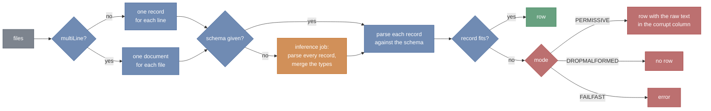
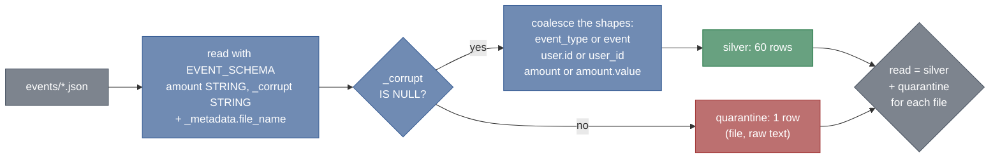

# Chapter 13: JSON: inference, drift and quarantine

A JSON record carries its field names, so a JSON file looks as if it has a schema. It does not. Each record has its own shape, and nothing makes the next record agree with it. A producer adds a field, changes a number into a string, or puts a flat value into an object. The file still contains valid JSON, and a reader that guesses the schema guesses again.

Spark can guess, and its guess is good. But the guess costs a full read of the data, and it changes when the data changes.

**A JSON read without a schema is two jobs. The first job guesses a schema that changes each time the producer changes.**

**A JSON read for a pipeline needs three parts. It needs a schema that you write. It needs a corrupt record column for each record that does not fit. It needs a count that shows that each input record is in the clean table or in the quarantine.** Spark 4.3 adds `JSON_TABLE`, a SQL function that changes JSON text into rows with typed columns. It also adds a reader option for files that hold all their records in one array.

The data is SparkTutor's `events/` folder in [`code/data/messy`](https://github.com/lisancao/spark-masterclass/tree/main/code/data/messy): three days of order events. The shape of the events changes each day, and the last line of the third day is cut off. The chapter also uses the JSON lines at the end of `logs/app.log` from [Chapter 12](ch12-text-logs-csv.md). The scripts are [`code/ch13/infer.py`](https://github.com/lisancao/spark-masterclass/tree/main/code/ch13), `infer_cost.py`, `drift.py` and `functions.py`. All output is from `code/ch13/output/`, on Spark 4.3.0 with `spark.sql.session.timeZone=UTC`.

## The three days of events

Each day of the sample data has a different shape:

| Day | Shape of one line | What changed |
|---|---|---|
| 2026-10-01 | `{"event", "user_id", "amount": 6.13, "ts"}` | the first shape |
| 2026-10-02 | `{"event", "user": {"id", "plan"}, "amount": "32.83", "items": [...], "ts"}` | `user_id` moved into an object, `amount` is sometimes a string, `items` is new |
| 2026-10-03 | `{"event_type", "user": {..., "geo": {"country"}}, "amount": {"value", "currency"}, ...}` | `event` has a new name, `amount` is an object, `geo` is new, the last line is cut off |

These are the five usual kinds of drift: a type change, a move, a new name, a new field and a truncated record. Real producers make all of them. A reader for this folder must give one clean table from all three shapes, and it must not lose a record without a count.

## How the JSON reader makes rows



The rest of the chapter goes through the boxes from left to right.

## Step 1: JSON Lines, and `multiLine` for documents

By default, the JSON reader expects JSON Lines: one complete JSON value on each line. A pretty-printed file breaks this rule, because one record uses many lines. The reader then reads each line as a record, and each line is not valid JSON:

```text
== a pretty-printed array without multiLine, and with it ==
[
  {
    "id": 1,
    "name": "a"
  },
  {
    "id": 2,
    "name": "b"
  }
]
columns: ['_corrupt_record']
cache().count(): [UNSUPPORTED_FEATURE.QUERY_ONLY_CORRUPT_RECORD_COLUMN]
+---+----+
|id |name|
+---+----+
|1  |a   |
|2  |b   |
+---+----+
```

Without an option, inference finds no record that parses. Thus the only column is `_corrupt_record`. This DataFrame is not useful. Spark does not even let you count it, because Spark does not allow a query on the corrupt column alone (Step 6 shows why). With `multiLine` set to `true`, the reader parses each file as one JSON document. A top-level array gives one row for each element.

The cost of `multiLine` is parallelism:

```text
JSON Lines folder, scan tasks: 16
one 6.8 MB array file, multiLine, scan tasks: 1
```

A JSON Lines file is splittable. A task can start in the middle of the file at the next line end, as for the `text` source in [Chapter 12](ch12-text-logs-csv.md). A JSON document is not splittable, because a task cannot find the start of a record without a parse from the first byte. Thus each file in `multiLine` mode is one task, and the full file must go through one parser. For a large export that is one big array, Step 12 shows a better option in Spark 4.3.

## Step 2: Inference is a separate job

When you do not give a schema, `spark.read.json` reads the data before it returns a DataFrame. The script counts the jobs that each call starts, from the monitoring REST API:

```text
== inference is a job of its own ==
read.json(events), no schema:       1 job(s) before any action
read.schema(ddl).json(events):      0 job(s)
samplingRatio=0.1:                  1 job(s)
```

The inference job parses every record and merges the types that it finds. Then the first action reads all the data a second time, to make the rows. The option `samplingRatio` makes the inference job read only a part of the records. But it is still a job, and it can miss a rare shape.

On one million taxi trips written as JSON Lines, the cost of the extra pass is easy to see:

```text
input: 1,000,000 trips as JSON Lines, 450.6 MB, 16 cores, local[*]
  spark.read.json(path)                     (inference only)     0.60 s
  spark.read.option(samplingRatio=0.1).json  (inference only)    0.19 s
  spark.read.json(path).count()                                  0.94 s
  spark.read.schema(schema).json(path).count()                   0.39 s
  spark.read.json(path).agg(sum(fare_amount))                    1.19 s
  spark.read.schema(schema).json.agg(sum(fare_amount))           0.42 s
inferred == parquet types: {'DOLocationID': 'bigint', 'PULocationID': 'bigint', 'VendorID': 'bigint', 'tpep_dropoff_datetime': 'string', 'tpep_pickup_datetime': 'string'}
```

Each time is the median of five runs after one warm-up run, on 16 cores in `local[*]`. A lock made sure that no other benchmark ran at the same time.

- Inference alone (0.60 s) costs more than the full count with a schema (0.39 s). Inference is a full parse of the data, and it also merges a type for each value.
- The sum without a schema (1.19 s) costs almost three times the sum with a schema (0.42 s). It is an inference pass and a second parse.
- `samplingRatio=0.1` makes inference cheaper (0.19 s), but the job still reads all the lines. It parses only the lines of the sample.

The inferred types are also not the types of the source. The trips came from Parquet, where the timestamps are `timestamp_ntz`. In JSON they are strings, and inference keeps them as strings. The last line of the output shows each column whose inferred type is different from the Parquet type.

## Step 3: How inference merges the types of one field

Inference parses each record into a type, and then merges the types of all records into one type for each field. The merge uses a fixed order. The script reads two-record files and prints the type that Spark selects:

```text
== how inference merges two values of one field ==
  int + int          -> bigint
  int + double       -> double
  int + big int      -> decimal(20,0)
  number + string    -> string
  number + bool      -> string
  number + object    -> string
  object + object    -> struct<x:bigint,y:string>
  array + scalar     -> string
  null + int         -> bigint
  only null          -> string
  empty array        -> array<string>
  ISO time           -> string
  ISO date           -> string
```

The rules are these:

- **Integers become `bigint`.** A JSON number without a decimal point is always `bigint`, never `int`. A number that is too large for `bigint` becomes a `decimal`.
- **Two numeric types merge into the wider type.** `bigint` and `double` give `double`.
- **Two types of different kinds become `string`.** A number and a string, a number and a boolean, or a number and an object all give `string`. Spark keeps the original text of each value. Thus the information is still there, but the type is gone.
- **Two objects merge field by field.** The result has all the fields of the two objects. A field that one record does not have is `NULL` in that record.
- **`null` has no type.** A field that is always `null` becomes `string`, and an empty array becomes `array<string>`.
- **Strings stay strings.** By default, inference does not look for dates and timestamps in strings.

Now look at the schema of the three days:

```text
== the schema that inference gives the three days ==
root
 |-- _corrupt_record: string (nullable = true)
 |-- amount: string (nullable = true)
 |-- event: string (nullable = true)
 |-- event_type: string (nullable = true)
 |-- items: array (nullable = true)
 |    |-- element: struct (containsNull = true)
 |    |    |-- qty: long (nullable = true)
 |    |    |-- sku: string (nullable = true)
 |-- ts: string (nullable = true)
 |-- user: struct (nullable = true)
 |    |-- geo: struct (nullable = true)
 |    |    |-- country: string (nullable = true)
 |    |-- id: long (nullable = true)
 |    |-- plan: string (nullable = true)
 |-- user_id: long (nullable = true)
```

Each drift from the table above is in this schema:

- `amount` is a number on day 1, a number or a string on day 2, and an object on day 3. The merge gives `string`.
- `event` and `event_type` are two columns. Inference cannot know that they have one meaning.
- `user_id` and `user.id` are two columns for the same reason.
- `ts` is a `string`, not a `timestamp`.
- `_corrupt_record` is there because the truncated line of day 3 did not parse.
- The fields are in alphabetical order, not in the order of the file.

If a fourth day adds a field, the schema changes again, and each job that reads the folder gets a different DataFrame. That is the main reason for a schema that you write yourself.

## Step 4: Options that change inference and the parser

Some options change the type that inference selects:

```text
== options that change inference ==
  defaults                       struct<i:bigint,n:string,t:string,v:double>
  {'prefersDecimal': True}       struct<i:bigint,n:string,t:string,v:decimal(2,1)>
  {'primitivesAsString': True}   struct<i:string,n:string,t:string,v:string>
  {'inferTimestamp': True}       struct<i:bigint,n:string,t:timestamp,v:double>
  {'dropFieldIfAllNull': True}   struct<i:bigint,t:string,v:double>
```

- `prefersDecimal` reads `1.5` as an exact `decimal`, not as a `double`. Use it for money.
- `primitivesAsString` makes every value a `string`. You then cast each field yourself.
- `inferTimestamp` compares each string with `timestampFormat`, and gives `timestamp` when all values match. The default is `false`, because a test of each string costs time.
- `dropFieldIfAllNull` removes a field that is always `null` or an empty array, instead of a `string` column of `NULL` values.

Other options change what the parser accepts. JSON has a strict grammar, and many producers do not obey it. The script reads one line with each option set to `false` and to `true`:

```text
== options that make the parser accept non-standard JSON ==
  allowComments                       /* note */ {"v": 1}    false: corrupt  true: v=1      default: corrupt
  allowUnquotedFieldNames             {v: 1}                 false: corrupt  true: v=1      default: corrupt
  allowSingleQuotes                   {'v': 1}               false: corrupt  true: v=1      default: v=1
  allowNumericLeadingZeros            {"v": 007}             false: corrupt  true: v=007    default: corrupt
  allowNonNumericNumbers              {"v": NaN}             false: corrupt  true: v=NaN    default: v=NaN
  allowBackslashEscapingAnyCharacter  {"v": "a\$b"}          false: corrupt  true: v=a$b    default: corrupt
```

Two of these options are `true` by default: `allowSingleQuotes` and `allowNonNumericNumbers`. Thus the reader accepts `{'v': 1}` and `NaN` with no option, although they are not valid JSON. The other options are `false` by default. Set an option only for a producer that you know. Each option makes the reader accept more text, and thus it can hide a real error.

The reader also has `dateFormat`, `timestampFormat` and `timestampNTZFormat` for typed date fields, and `locale` and `timeZone`. They work as for CSV in [Chapter 12](ch12-text-logs-csv.md).

## Step 5: The three parse modes

A record that does not fit the schema goes to one of three places. The option `mode` selects which one:

```text
== the three modes, with inference ==
  PERMISSIVE    schema ok, rows: 61
  DROPMALFORMED schema ok, rows: 60
  FAILFAST      fails at read time: MALFORMED_RECORD_IN_PARSING.WITHOUT_SUGGESTION

== the three modes, with an explicit schema ==
  PERMISSIVE    read() returns a DataFrame; rows: 61
  DROPMALFORMED read() returns a DataFrame; rows: 60
  FAILFAST      read() returns a DataFrame; the action fails: FAILED_READ_FILE.NO_HINT
```

| Mode | The truncated line | Rows |
|---|---|---|
| `PERMISSIVE` (default) | a row with `NULL` fields and the raw text in the corrupt column | 61 |
| `DROPMALFORMED` | no row, and no count of the loss | 60 |
| `FAILFAST` | an error for the full job | none |

The place of the `FAILFAST` error depends on the schema. Without a schema, the inference job finds the bad line, so `spark.read.json` fails before it returns. With a schema, the read returns a DataFrame, and the first action fails. The error of the action is `FAILED_READ_FILE.NO_HINT`, with `MALFORMED_RECORD_IN_PARSING` as its cause.

`DROPMALFORMED` is the dangerous mode. The record goes away, and nothing records that it went away. Use `PERMISSIVE` and send the bad records to a quarantine yourself. Then you can count them.

## Step 6: The corrupt record column

In `PERMISSIVE` mode, the corrupt record column holds the full text of each record that did not fit. Its default name is `_corrupt_record`. The option `columnNameOfCorruptRecord` gives it a different name. With an explicit schema, Spark fills the column only if the schema has a field with that name:

```python
EVENT_SCHEMA = """
    event STRING,
    event_type STRING,
    user_id BIGINT,
    user STRUCT<id: BIGINT, plan: STRING, geo: STRUCT<country: STRING>>,
    amount STRING,
    items ARRAY<STRUCT<sku: STRING, qty: INT>>,
    ts TIMESTAMP,
    _corrupt STRING
"""
raw = spark.read.schema(EVENT_SCHEMA).option("columnNameOfCorruptRecord", "_corrupt").json(EVENTS)
```

A query that uses only the corrupt column fails:

```text
== query only the corrupt column ==
without cache: UNSUPPORTED_FEATURE.QUERY_ONLY_CORRUPT_RECORD_COLUMN
cached, with a data column next to it: 1 corrupt
+----------------------+-------------------------------------------+
|file                  |_corrupt                                   |
+----------------------+-------------------------------------------+
|events_2026-10-03.json|{"event_type": "purchase", "user": {"id": 9|
+----------------------+-------------------------------------------+
```

The reason is column pruning. The scan gives the parser only the columns that the query uses. If the query uses only `_corrupt`, the parser has no field to convert. Thus no record can fail, and `_corrupt` is always `NULL`. Spark stops this query because its answer is wrong, not because it is slow.

The fix is to make the parser see the data columns. You can `cache()` the DataFrame, so that the cache stores the full rows, or you can select a data column next to the corrupt column. Step 1 showed the limit of this fix: when the corrupt column is the only column, even `cache()` does not help.

The corrupt column must be a nullable `STRING`. A different type fails at analysis with `INVALID_CORRUPT_RECORD_TYPE`.

A strict schema also uses the corrupt column. If a field has a type that does not fit the value, the full record goes to the corrupt column. But the fields that did parse keep their values:

```text
== a strict schema marks a whole record, and keeps the fields that parsed ==
rows: 20  with _corrupt_record: 5
+--------+------+-------------------+------------------------------------------------+
|event   |amount|ts                 |_corrupt_record (first 48)                      |
+--------+------+-------------------+------------------------------------------------+
|purchase|NULL  |2026-10-02 11:00:00|{"event": "purchase", "user": {"id": 0, "plan": |
|purchase|NULL  |2026-10-02 11:04:00|{"event": "purchase", "user": {"id": 4, "plan": |
|purchase|NULL  |2026-10-02 11:08:00|{"event": "purchase", "user": {"id": 3, "plan": |
+--------+------+-------------------+------------------------------------------------+
```

Here `amount` is `DOUBLE`, and five records of day 2 have the amount as a string, such as `"32.83"`. Each of these records is in the corrupt column. `event` and `ts` still have their values, and only `amount` is `NULL`. Thus a filter on `_corrupt_record IS NULL` removes these records from the clean table. But a query that ignores the corrupt column sees rows with a `NULL` amount. Decide which of the two behaviors you want, and write the filter for it.

## Step 7: Absorb the drift with `STRING` and `coalesce`

A strict schema rejects the string amounts of day 2. A schema that accepts all three days must use a type that holds every shape. For a field that changes its type, that type is `STRING`. The JSON reader puts the original text of a number, a string or a full object into a `STRING` field:

```text
amount shapes in raw text:
+------------------------+----------------------+-----+
|shape                   |file                  |count|
+------------------------+----------------------+-----+
|number or numeric string|events_2026-10-01.json|20   |
|number or numeric string|events_2026-10-02.json|20   |
|object                  |events_2026-10-03.json|20   |
+------------------------+----------------------+-----+
```

Then one expression reads each shape, and `coalesce` takes the first one that gives a value:

```python
amount = F.coalesce(
    F.col("amount").try_cast("double"),                           # 12.5 or "12.5"
    F.get_json_object("amount", "$.value").try_cast("double"),   # {"value": 12.5, ...}
)
silver = (raw.where(F.col("_corrupt").isNull())
          .select(F.coalesce("event_type", "event").alias("event_type"),
                  F.coalesce(F.col("user.id"), F.col("user_id")).alias("user_id"),
                  F.col("user.plan").alias("plan"),
                  F.col("user.geo.country").alias("country"),
                  amount.alias("amount"), "ts", "items", "file"))
quarantine = raw.where(F.col("_corrupt").isNotNull()).select("file", "_corrupt")
```

`Column.try_cast` gives `NULL` for a value that does not cast, and it does not stop the query under ANSI mode. For an object, the text `{"value": 29.93, ...}` does not cast to `double`, so `try_cast` gives `NULL`. Then `get_json_object` takes the field `value` from the text. The same `coalesce` pattern handles the new name (`event_type` or `event`) and the move (`user.id` or `user_id`):

```text
+----------+-------+----+-------+------+-------------------+----------------------+
|event_type|user_id|plan|country|amount|ts                 |file                  |
+----------+-------+----+-------+------+-------------------+----------------------+
|view      |0      |NULL|NULL   |6.13  |2026-10-01 10:00:00|events_2026-10-01.json|
|purchase  |1      |NULL|NULL   |16.02 |2026-10-01 10:01:00|events_2026-10-01.json|
+----------+-------+----+-------+------+-------------------+----------------------+
+----------+-------+----+-------+------+-------------------+----------------------+
|event_type|user_id|plan|country|amount|ts                 |file                  |
+----------+-------+----+-------+------+-------------------+----------------------+
|purchase  |0      |pro |US     |29.93 |2026-10-03 12:00:00|events_2026-10-03.json|
|purchase  |1      |pro |CA     |8.19  |2026-10-03 12:01:00|events_2026-10-03.json|
+----------+-------+----+-------+------+-------------------+----------------------+
```

The two shapes now give one table. The fields that a day does not have, such as `plan` and `country` on day 1, are `NULL`.



There are other designs for drift, and each one moves the work to a different place:

- **A version field.** The producer writes `"v": 3` in each record, and the reader selects a schema for each version. This design works only if the producer agrees.
- **VARIANT.** The reader keeps each record as a `VARIANT` value and reads the fields later. [Chapter 15](ch15-variant.md) reads the same three days in this way.
- **A source contract.** A schema registry or a test in the producer stops the drift early. [Chapter 16](ch16-xml-avro-protobuf.md) shows the registry format of Kafka producers.

Databricks has a `rescuedDataColumn` option that keeps the fields that do not fit the schema. That option is not part of Apache Spark. The 4.3.0 source has no reference to it.

## Step 8: The books must balance

A quarantine is useful only if you can prove that it contains each record that is not in the clean table. The `file` column from `_metadata.file_name` makes this proof possible for each file:

```text
== the books must balance, file by file ==
+----------------------+----+------+----------+
|file                  |read|silver|quarantine|
+----------------------+----+------+----------+
|events_2026-10-01.json|20  |20    |0         |
|events_2026-10-02.json|20  |20    |0         |
|events_2026-10-03.json|21  |20    |1         |
+----------------------+----+------+----------+

read == silver + quarantine: True
sum(amount): 1573.4  NULL amounts: 0
```

Each of the 61 records is in one of the two tables, and the one quarantined record is the truncated line of day 3. No amount is `NULL`, so the `coalesce` read each shape. The SparkTutor exercise computes the same numbers with Python's `json` module, line by line. That is a good test design for a pipeline: compute the expected counts with a second, simple tool, and compare.

<figure markdown>
  <video autoplay loop muted playsinline controls width="1280" height="720" poster="../../media/clips/ch13-quarantine.webp">
    <source src="../../media/clips/ch13-quarantine.mp4" type="video/mp4">
  </video>
  <figcaption><code>drift.py</code> on Spark 4.3.0. The three parse modes, the corrupt column, and a quarantine whose counts agree with the input, file by file.</figcaption>
</figure>

## Step 9: Arrays to rows

The `items` field is an array of objects. Four generator functions change an array into rows, and they do not give the same number of rows:

```text
== arrays to rows: explode, explode_outer, inline, inline_outer ==
  explode        rows:  61  columns: ['user_id', 'col']
  explode_outer  rows:  81  columns: ['user_id', 'col']
  inline         rows:  61  columns: ['user_id', 'sku', 'qty']
  inline_outer   rows:  81  columns: ['user_id', 'sku', 'qty']
```

- `explode` gives one row for each element, in one column with the name `col`.
- `inline` does the same for an array of structs, but it makes one column for each struct field.
- The `_outer` forms keep a row with `NULL` values for an event with no items, or with an empty array.

The day 1 events have no `items`. Thus `explode` and `inline` remove all 20 of them, and the `_outer` forms keep them. If a later step counts events from the item rows, only the `_outer` forms give the correct count. The optimized plan shows why the plain forms remove rows:

```text
Generate explode(items#121), [1], false, [col#4794]
+- Project [coalesce(user#119.id, user_id#118L) AS user_id#1048L, items#121]
   +- Filter (isnull(_corrupt#123) AND ((size(items#121, false) > 0) AND isnotnull(items#121)))
```

The optimizer adds `size(items) > 0 AND isnotnull(items)` to the filter, because a row that fails this test cannot give an output row from `explode`. The filter runs before the generator. [Chapter 14](ch14-complex-types.md) gives more detail about generators. It also shows the higher-order functions, which work on an array and keep one row.

## Step 10: JSON inside a column

JSON often arrives inside another format: a log line, a CSV field, or a Kafka value. The functions for JSON in a column are the same tools as the reader, at the level of one value. The 20 JSON lines at the end of `app.log` are the example.

`from_json` parses a string column with a schema. `schema_of_json` gives the schema of one sample, but it accepts only a literal:

```text
== schema_of_json needs a literal sample ==
schema_of_json(lit(sample)): STRUCT<level: STRING, logger: STRING, ms: BIGINT, msg: STRING, order: BIGINT, ts: STRING>
schema_of_json('processed'): the string is the JSON text, not a column name:
   : com.fasterxml.jackson.core.JsonParseException: Unrecognized token 'processed': was exp
schema_of_json(col('line')): DATATYPE_MISMATCH.NON_FOLDABLE_INPUT
one sample hides the keys it does not have: STRUCT<a: BIGINT> for {"a": 1, "b": 2} rows too
```

These lines show three traps:

- In Python, `F.schema_of_json("processed")` reads the string as JSON text, not as a column name. The word `processed` is not valid JSON.
- A column is not allowed, because Spark computes the schema once, at analysis, before it reads a row.
- The result describes only the sample. A key that the sample does not have is not in the schema, and `from_json` then removes that key from every row.

Thus use `schema_of_json` to start a schema, and then write the schema yourself.

On text that does not fit, `from_json` behaves like the reader in `PERMISSIVE` mode:

```text
+--------------------------+------------+
|line                      |j           |
+--------------------------+------------+
|{"order": 1, "ms": 20}    |{1, 20}     |
|{"order": 2, "ms": "slow"}|{2, NULL}   |
|{"order": 3               |{NULL, NULL}|
+--------------------------+------------+

+-----+----+--------------------------+
|order|ms  |_corrupt_record           |
+-----+----+--------------------------+
|1    |20  |NULL                      |
|2    |NULL|{"order": 2, "ms": "slow"}|
|NULL |NULL|{"order": 3               |
+-----+----+--------------------------+

mode=DROPMALFORMED: PARSE_MODE_UNSUPPORTED
mode=FAILFAST: MALFORMED_RECORD_IN_PARSING.WITHOUT_SUGGESTION
```

Text that is not JSON gives a struct of `NULL` values, not a `NULL` struct. A field that does not fit is `NULL`, and the other fields keep their values. If the schema has a `_corrupt_record STRING` field, `from_json` puts the raw text there. A function cannot remove a row, so `DROPMALFORMED` is not supported. `FAILFAST` stops the query.

!!! note "Fixed in 4.3"
    Before Spark 4.3, a query that selected only the corrupt field of `from_json` got `NULL` for every record. The optimizer removed the other fields from the schema of `from_json`, and then the parser had no field that could fail. Spark 4.3 does not remove the fields in this case (SPARK-58707):

    ```text
    +--------------------------+
    |_corrupt_record           |
    +--------------------------+
    |NULL                      |
    |{"order": 2, "ms": "slow"}|
    |{"order": 3               |
    +--------------------------+
    ```

Two functions read JSON with no schema at all. `get_json_object` takes one value at a JSON path, and `json_tuple` takes several top-level fields in one parse:

```text
+-----+-----+-------+
|level|order|missing|
+-----+-----+-------+
|INFO |100  |NULL   |
|INFO |101  |NULL   |
+-----+-----+-------+
+----+---+---+
|c0  |c1 |c2 |
+----+---+---+
|INFO|100|91 |
|INFO|101|521|
+----+---+---+
+-----------+-------------------+
|line       |get_json_object $.a|
+-----------+-------------------+
|{"a": null}|NULL               |
|{}         |NULL               |
+-----------+-------------------+
```

Both functions give strings. `json_tuple` names its columns `c0`, `c1` and so on, unless you give aliases. The last table shows a limit of `get_json_object`. A key that is not there and a JSON `null` both give `NULL`, so you cannot tell them apart.

## Step 11: New in 4.3: `JSON_TABLE`

`JSON_TABLE` is the table-valued function of the SQL:2016 standard. It takes a JSON string, a row path, and a list of typed columns. It gives one row for each item at the row path, with each column cast to its type:

```python
jt = spark.sql("""
    SELECT t.*
    FROM app_json, LATERAL
         JSON_TABLE(line, '$'
                    COLUMNS (ts TIMESTAMP PATH '$.ts',
                             level STRING PATH '$.level',
                             order_id BIGINT PATH '$.order',
                             ms INT PATH '$.ms',
                             has_error BOOLEAN EXISTS PATH '$.error')) AS t
""")
```

```text
root
 |-- ts: timestamp (nullable = true)
 |-- level: string (nullable = true)
 |-- order_id: long (nullable = true)
 |-- ms: integer (nullable = true)
 |-- has_error: boolean (nullable = true)

+-------------------+-----+--------+---+---------+
|ts                 |level|order_id|ms |has_error|
+-------------------+-----+--------+---+---------+
|2026-10-01 11:00:00|INFO |100     |91 |false    |
|2026-10-01 11:01:00|INFO |101     |521|false    |
|2026-10-01 11:02:00|INFO |102     |666|false    |
+-------------------+-----+--------+---+---------+
rows: 20
```

In one expression, `JSON_TABLE` does the work of `from_json`, a `select` of each field, and a cast. Unlike the schema from `schema_of_json`, the column list says what you want, and keys that are not in the list have no effect. The `ts` column is a real `timestamp`, because the column type sets the cast. An `EXISTS` column is `true` if the path is in the document.

A row path that ends in `[*]` gives one row for each element of an array. Here, it changes the `items` array of each event into rows, with a `FOR ORDINALITY` column that numbers the items of each event from 1:

```python
items = spark.sql("""
    SELECT get_json_object(e.line, '$.ts') AS ts, i.*
    FROM event_lines e, LATERAL
         JSON_TABLE(e.line, '$.items[*]'
                    COLUMNS (n FOR ORDINALITY,
                             sku STRING PATH '$.sku',
                             qty INT PATH '$.qty')) AS i
""")
```

```text
+-------------------+---+---+---+
|ts                 |n  |sku|qty|
+-------------------+---+---+---+
|2026-10-03T12:00:00|1  |P4 |1  |
|2026-10-03T12:01:00|1  |P1 |1  |
|2026-10-03T12:02:00|1  |P1 |1  |
|2026-10-03T12:03:00|1  |P4 |1  |
|2026-10-03T12:04:00|1  |P4 |1  |
+-------------------+---+---+---+
item rows: 61
item rows from inline(items) in drift.py: 61
```

The result has the 61 item rows of `inline` in Step 9, but it starts from the raw lines, with no reader schema. The truncated line gives no rows and no error. `JSON_TABLE` is a generator, so a document with no item at the row path gives no row, as `inline` does. Use a `LEFT JOIN LATERAL ... ON true` if you must keep those rows.

`JSON_TABLE` separates a path that is not there from a JSON `null`. `get_json_object` cannot do this:

```text
+-----------+----+--------+
|doc        |a   |a_exists|
+-----------+----+--------+
|{"a": 1}   |1   |true    |
|{"a": null}|NULL|true    |
|{}         |NULL|false   |
+-----------+----+--------+

a value that does not cast, with the default NULL ON ERROR: CAST_INVALID_INPUT
ERROR ON ERROR on bad text: MALFORMED_RECORD_IN_PARSING.WITHOUT_SUGGESTION
a wildcard that is not at the end of the row path: DATATYPE_MISMATCH.INVALID_JSON_TABLE_PATH
```

The error rules are different from `from_json`:

- **Text that is not JSON** gives no rows with the default `NULL ON ERROR`. With `ERROR ON ERROR`, the query fails.
- **A value that does not cast** is a different error. `{"a": "x"}` with an `INT` column fails under ANSI mode, even with `NULL ON ERROR`. That clause applies to the JSON text, not to the casts. Use a `STRING` column and `try_cast` for a field that can drift.
- **Spark supports only the flat form.** The 4.3.0 grammar has no `NESTED PATH` clause, and a path can have a wildcard only at the end of the row path. For an array inside an array, use one `JSON_TABLE` for each level.

In the plan, `JSON_TABLE` is a `Generate` node, the same physical operator as `explode`:

```text
== Physical Plan ==
* Project (4)
+- Generate (3)
   +- * Project (2)
      +- Scan text  (1)
(3) Generate Arguments: json_table(line#320, $.items[*], JsonTableColumn(n,LongType,None,Ordinality),
```

The 4.3.0 source (`jsonExpressions.scala`) says why: `JsonTable` is a `Generator`, so Spark uses the `Generate` operator that it already has. It is also a `CodegenFallback` expression, so the generator itself does not get generated code.

<figure markdown>
  <video autoplay loop muted playsinline controls width="1280" height="720" poster="../../media/clips/ch13-json-table.webp">
    <source src="../../media/clips/ch13-json-table.mp4" type="video/mp4">
  </video>
  <figcaption><code>functions.py</code> on Spark 4.3.0: <code>JSON_TABLE</code> changes the JSON lines of a log, and the item arrays of the events, into typed rows.</figcaption>
</figure>

## Step 12: New in 4.3: `explodeEmbeddedArray`

Some services write a file as one object with one large array inside it. AWS CloudTrail writes `{"Records": [...]}`. With `multiLine`, each file is one row with one large array column, and then you must `explode` it:

```text
multiLine, no option: rows 2  columns ['Records']
```

The new option `explodeEmbeddedArray` (SPARK-57678) names the array field. The reader then gives one row for each element of that array, as a `VARIANT` value:

```python
rec = spark.read.option("explodeEmbeddedArray", "Records").json(str(trail))
```

```text
root
 |-- Records: variant (nullable = true)

rows: 3
+------------+------+
|eventName   |bucket|
+------------+------+
|GetObject   |logs  |
|PutObject   |logs  |
|DeleteObject|logs  |
+------------+------+

with singleVariantColumn too: EXPLODE_EMBEDDED_ARRAY_CONFLICTING_OPTION
```

The comment for this option in `JSONOptions.scala` gives the details:

- The reader streams the elements out of the array one at a time. It does not keep the full document in memory.
- It ignores all fields outside the array.
- The inferred schema names the column after the array field. A schema that you give can use a different name.
- The reader decodes the file as UTF-8 unless you set `encoding`.
- You cannot use the option together with `singleVariantColumn`.

Each file is still one task, because the reader must start at the first byte. But one task no longer needs memory for the full document. [Chapter 15](ch15-variant.md) shows how to read the fields of a `VARIANT` value.

## Step 13: Writing JSON

The JSON writer leaves out `NULL` fields by default:

```text
default:               {"ts":"2026-10-01T11:00:00Z","level":"INFO","order":100,"ms":91}
ignoreNullFields=false: {"ts":"2026-10-01T11:00:00Z","level":"INFO","order":100,"ms":91,"note":null}
+---------------------+
|to_json              |
+---------------------+
|{"order":100,"ms":91}|
+---------------------+
```

The field `note` is `NULL`, so the default output does not contain it. A reader that infers the schema of this output then has no `note` column at all. Set `ignoreNullFields` to `false` if the consumer must see every field. `to_json` makes the same JSON text from a struct inside a query. The writer formats `date` and `timestamp` values with `dateFormat` and `timestampFormat`, in the session time zone. Like all file writers, it writes a folder of part files ([Chapter 11](ch11-files-as-files.md), Step 9).

## The whole chapter, on one page

```python
from pyspark.sql import functions as F

EVENT_SCHEMA = """event STRING, event_type STRING, user_id BIGINT,
                  user STRUCT<id: BIGINT, plan: STRING, geo: STRUCT<country: STRING>>,
                  amount STRING, items ARRAY<STRUCT<sku: STRING, qty: INT>>,
                  ts TIMESTAMP, _corrupt STRING"""

raw = (spark.read.schema(EVENT_SCHEMA)                      # no inference job, no surprise columns
       .option("mode", "PERMISSIVE")                        # keep bad records, do not drop them
       .option("columnNameOfCorruptRecord", "_corrupt")
       .json("events/")
       .withColumn("file", F.col("_metadata.file_name"))
       .cache())                                            # so _corrupt can be queried alone

amount = F.coalesce(F.col("amount").try_cast("double"),
                    F.get_json_object("amount", "$.value").try_cast("double"))
silver = (raw.where("_corrupt IS NULL")
          .select(F.coalesce("event_type", "event").alias("event_type"),
                  F.coalesce("user.id", "user_id").alias("user_id"),
                  amount.alias("amount"), "ts", "items", "file"))
quarantine = raw.where("_corrupt IS NOT NULL").select("file", "_corrupt")
items = silver.select("user_id", F.inline_outer("items"))  # _outer keeps events with no items

# Spark 4.3: the same item rows in SQL, from the raw text
spark.sql("""SELECT i.* FROM event_lines e, LATERAL
             JSON_TABLE(e.line, '$.items[*]'
                        COLUMNS (n FOR ORDINALITY, sku STRING PATH '$.sku', qty INT PATH '$.qty')) AS i""")
```

- **JSON Lines is splittable, and `multiLine` is not.** A document file is one task.
- **A read without a schema runs an inference job** that parses all the data before the first action.
- **Inference merges types in a fixed order.** Different kinds become `string`, objects merge field by field, and strings stay strings.
- **`PERMISSIVE` keeps bad records in the corrupt column, `DROPMALFORMED` loses them without a count, and `FAILFAST` stops the job.**
- **The corrupt column is a nullable `STRING`.** A query on that column alone is not allowed, because of column pruning. Cache the DataFrame or select a data column too.
- **Declare a field that drifts as `STRING`,** and read each shape with `try_cast`, `get_json_object` and `coalesce`.
- **Count the books for each file:** read = clean + quarantine.
- **`explode` and `inline` remove rows with no elements.** The `_outer` forms keep them.
- **`schema_of_json` needs a literal and describes only its sample.**
- **New in 4.3:** `JSON_TABLE` makes typed rows from JSON text in SQL, and separates a path that is not there from a JSON `null`. `explodeEmbeddedArray` streams the elements of one large array as `VARIANT` rows.

[Chapter 14](ch14-complex-types.md) works on the nested values that this chapter read: the `user` struct, the `items` array, and maps.

## Further reading

- [JSON files](https://spark.apache.org/docs/4.3.0/sql-data-sources-json.html), the reader and writer options.
- [`JSON_TABLE`](https://spark.apache.org/docs/4.3.0/sql-ref-syntax-qry-select-json-table.html), the SQL reference page for the function.
- [`JsonInferSchema.scala`](https://github.com/apache/spark/blob/v4.3.0/sql/catalyst/src/main/scala/org/apache/spark/sql/catalyst/json/JsonInferSchema.scala), the merge rules of inference.
- [`jsonExpressions.scala`](https://github.com/apache/spark/blob/v4.3.0/sql/catalyst/src/main/scala/org/apache/spark/sql/catalyst/expressions/jsonExpressions.scala), the `JsonTable` generator.
