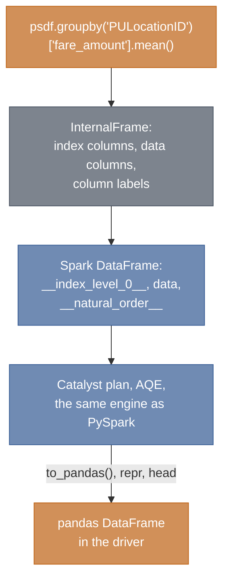
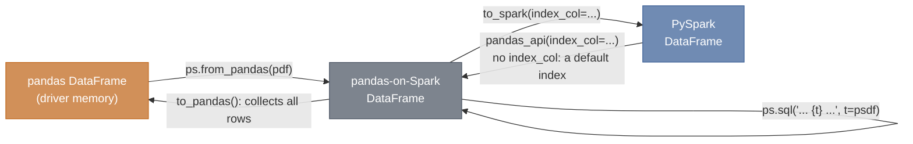
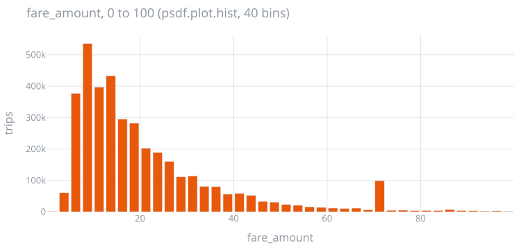

# Chapter 13: pandas API on Spark

pandas is the DataFrame library that most Python data work starts with. Its API has labels for rows, an order of rows, and hundreds of methods. The pandas API on Spark, `pyspark.pandas`, gives the same API on a Spark DataFrame. It arrived in Spark 3.2 from the Koalas project ([Chapter 4](ch04-one-engine-batch-and-streaming.md)). Code that worked in pandas on one machine can then run on a cluster with few changes.

**A pandas-on-Spark DataFrame is a Spark DataFrame with an index column and a map of labels to columns. Each pandas method becomes a Spark plan. The index is the part that costs: Spark rows have no labels and no order, so the pandas API must make them. Choose the index, and know which methods collect data to the driver. Then the pandas API on Spark is a good tool for pandas code that has outgrown one machine.**

This chapter opens a pandas-on-Spark DataFrame and shows what it maps to. It measures the three default index types, and it compares five operations in pandas, in the pandas API on Spark and in PySpark. Then it shows the options and the conversions to and from Spark and pandas. The last steps show functions with type hints, plots, the limits, and Spark Connect support in 4.3.

The scripts are in [`code/ch13`](https://github.com/lisancao/spark-masterclass/tree/main/code/ch13), and each output block comes from `code/ch13/output/`. `api.py` ran on Spark Classic and on Spark Connect.

## Step 1: What a pandas-on-Spark DataFrame is

`internals.py` reads four columns of the June 2026 trips with `ps.read_parquet`. Then it opens the internal frame, which holds the state of each pandas-on-Spark DataFrame:

```python
import pyspark.pandas as ps

psdf = ps.read_parquet(str(TRIPS), columns=COLS)
internal = psdf._internal                                        # (1)!
print("spark_frame columns:", internal.spark_frame.columns)
print("index columns:      ", internal.index_spark_column_names)
print("data columns:       ", internal.data_spark_column_names)
```

1. `_internal` is not a public API. The script reads it only to show the layers.

```text
== 1. one pandas-on-Spark DataFrame, three layers
type: pyspark.pandas.frame.DataFrame  shape: (3837248, 4)
spark_frame columns: ['__index_level_0__', 'VendorID', 'tpep_pickup_datetime', 'tpep_dropoff_datetime', 'passenger_count', 'trip_distance', 'RatecodeID', 'store_and_fwd_flag', 'PULocationID', 'DOLocationID', 'payment_type', 'fare_amount', 'extra', 'mta_tax', 'tip_amount', 'tolls_amount', 'improvement_surcharge', 'total_amount', 'congestion_surcharge', 'Airport_fee', 'cbd_congestion_fee', 'request_source', '__natural_order__']
index columns:       ['__index_level_0__']
data columns:        ['PULocationID', 'payment_type', 'fare_amount', 'tip_amount']
spark.frame():       ['PULocationID', 'payment_type', 'fare_amount', 'tip_amount'] (drops the index)
spark.frame(index_col='idx'): ['idx', 'PULocationID'] ...
   PULocationID  payment_type  fare_amount  tip_amount
0           140             1         16.3        6.40
1           138             1         16.3        7.14
2           138             1         39.4        5.00
```

The pandas-on-Spark DataFrame has three layers:

- **A Spark DataFrame** (`spark_frame`). It has all 21 columns of the file, plus two columns that the pandas API added. The optimizer removes the columns that a query does not use, so the extra columns cost nothing until a plan reads them.
- **The index.** `__index_level_0__` holds the row labels `0`, `1`, `2`. The Parquet file has no such column. The pandas API made it, and Step 2 shows how.
- **The column map.** The four data columns are the pandas columns. `__natural_order__` keeps the order of the rows for the methods that need it.

`psdf.spark.frame()` returns the Spark DataFrame without the index. To keep the index, give it a name with `index_col`.



## Step 2: The default index, and its cost

pandas gives each row a label. Spark rows have no label, so `read_parquet` without `index_col` attaches a default index. It also prints a `PandasAPIOnSparkAdviceWarning` about the cost of the default index. The option `compute.default_index_type` selects one of three types. `internals.py` prints the physical plan of each type:

=== "sequence"

    ```text
    -- sequence
    AdaptiveSparkPlan isFinalPlan=false
    +- Project [(cast(_we0#63 as bigint) - 1) AS idx#65L, PULocationID#45, payment_type#47L, fare_amount#48, tip_amount#51]
       +- Window [row_number() windowspecdefinition(_w0#62L ASC NULLS FIRST, specifiedwindowframe(RowFrame, unboundedpreceding$(), currentrow$())) AS _we0#63], [_w0#62L ASC NULLS FIRST]
          +- Sort [_w0#62L ASC NULLS FIRST], false, 0
             +- Exchange SinglePartition, ENSURE_REQUIREMENTS, [plan_id=76]
                +- Project [PULocationID#45, payment_type#47L, fare_amount#48, tip_amount#51, monotonically_increasing_id() AS _w0#62L]
                   +- FileScan parquet [PULocationID#45,payment_type#47L,fare_amount#48,tip_amount#51]
    ```

=== "distributed-sequence"

    ```text
    -- distributed-sequence
    *(2) Project [distributed_sequence_id#89L AS idx#91L, PULocationID#73, payment_type#75L, fare_amount#76, tip_amount#79]
    +- AttachDistributedSequence[distributed_sequence_id#89L, PULocationID#73, payment_type#75L, fare_amount#76, tip_amount#79] Index: distributed_sequence_id#89L
       +- *(1) ColumnarToRow
          +- FileScan parquet [PULocationID#73,payment_type#75L,fare_amount#76,tip_amount#79]
    ```

=== "distributed"

    ```text
    -- distributed
    *(1) Project [__index_level_0__#113L AS idx#116L, PULocationID#99, payment_type#101L, fare_amount#102, tip_amount#105]
    +- *(1) Project [distributed_id() AS __index_level_0__#113L, PULocationID#99, payment_type#101L, fare_amount#102, tip_amount#105]
       +- *(1) ColumnarToRow
          +- FileScan parquet [PULocationID#99,payment_type#101L,fare_amount#102,tip_amount#105]
    ```

Each plan makes the index in a different way:

| Type | How the plan numbers the rows | Numbers | Where the rows go |
|---|---|---|---|
| `sequence` | `row_number()` over a window with no partition | 0, 1, 2 ... with no gaps | `Exchange SinglePartition`: all rows go to one task |
| `distributed-sequence` (default) | `AttachDistributedSequence`: cache the rows, count each partition, then add the offset of the partition | 0, 1, 2 ... with no gaps | the rows stay in their partitions |
| `distributed` | `distributed_id()`, which is `monotonically_increasing_id` | increasing, with gaps between partitions | the rows stay in their partitions |

`AttachDistributedSequenceExec` persists the rows at the level that `compute.default_index_cache` sets (`MEMORY_AND_DISK_SER` by default). Then it calls `zipWithIndex` on the RDD (`AttachDistributedSequenceExec.scala`). This is the same `zipWithIndex` as in [Chapter 12](ch12-rdds-today.md): one job counts the rows of each partition, and a second pass adds the offsets. `distributed_id()` is a name for `MonotonicallyIncreasingID` (`FunctionRegistry.scala`). It puts the partition ID in the upper bits, so the numbers of two partitions have a large gap.

<figure markdown>
  <video autoplay loop muted playsinline width="1280" height="720" poster="../../media/clips/ch13-anim-index.webp">
    <source src="../../media/clips/ch13-anim-index.mp4" type="video/mp4">
  </video>
  <figcaption>Animation: <code>sequence</code> moves all rows into one partition. <code>distributed-sequence</code> counts each partition, then numbers the partitions in parallel. <code>distributed</code> numbers at once, with gaps. The times are from <code>internals.txt</code>. The partitions and rows on screen are schematic.</figcaption>
</figure>

`internals.py` measures each type, under the benchmark lock. It writes all rows with the index to the `noop` sink, it takes `head(5)`, and it computes the mean fare:

```text
== 3. the cost of each default index (median of 5 runs after a warmup)
  index                               all rows (noop write)   head(5)  fare mean
  sequence                                            1.57s     0.20s      0.13s
  distributed-sequence                                0.96s     0.68s      0.10s
  distributed                                         0.15s     0.13s      0.10s
  index_col='PULocationID'                            0.11s     0.09s      0.09s
  (PySpark DataFrame, no index)                       0.08s     0.04s      0.08s
```

<figure markdown>
  
  
  <figcaption>The same three operations with each index type. A full pass that needs the index costs the most with <code>sequence</code>. A mean of one column costs the same with each type, because the optimizer removes the unused index. Numbers from <code>internals.txt</code>.</figcaption>
</figure>

The measurements give three rules:

- **An operation that does not read the index does not pay for it.** The mean fare took 0.09 to 0.13 s with each type. The optimizer removed the index column from the plan.
- **An operation that reads the index pays for it on every row.** A full write took 1.57 s with `sequence` and 0.96 s with `distributed-sequence`, against 0.15 s with `distributed`. The 3.8 million rows went through one task for `sequence`. On a cluster with a larger table, that one task is the limit of the job.
- **`distributed-sequence` has a fixed cost for each new DataFrame.** `head(5)` took 0.68 s, the slowest of the four, because the count and the cache run before the first row returns.

Use `index_col` when the data has a natural key, as the `index_col='PULocationID'` line shows. Use `distributed` when the code never reads the index values, for example for groupby and aggregation work. Keep `distributed-sequence` when the code needs consecutive labels, for example for `iloc` or for a join with another DataFrame on the index. Use `sequence` only for small data.

## Step 3: The same operations in pandas, pandas API on Spark and PySpark

`compare.py` runs five operations three ways on the same four columns. pandas reads the Parquet file one time into the driver. Its times do not include the read. The two Spark APIs read the file in each run. The script ran under the benchmark lock:

=== "pandas API on Spark"

    ```python
    psdf.groupby("PULocationID")["fare_amount"].mean().sort_index().to_pandas()
    psdf["payment_type"].value_counts().to_pandas()
    psdf[["fare_amount", "tip_amount"]].describe().to_pandas()
    psdf.nlargest(5, "fare_amount").to_pandas()
    psdf[psdf.fare_amount > 0].assign(pct=lambda d: d.tip_amount / d.fare_amount)["pct"].mean()
    ```

=== "PySpark"

    ```python
    sdf.groupBy("PULocationID").agg(F.avg("fare_amount")).orderBy("PULocationID").toPandas()
    sdf.groupBy("payment_type").count().orderBy(F.desc("count")).toPandas()
    sdf.select("fare_amount", "tip_amount").summary().toPandas()
    sdf.orderBy(F.desc("fare_amount")).limit(5).toPandas()
    sdf.where("fare_amount > 0").select(F.avg(F.col("tip_amount") / F.col("fare_amount"))).first()[0]
    ```

=== "pandas"

    ```python
    pdf.groupby("PULocationID")["fare_amount"].mean().sort_index()
    pdf["payment_type"].value_counts()
    pdf[["fare_amount", "tip_amount"]].describe()
    pdf.nlargest(5, "fare_amount")
    pdf[pdf.fare_amount > 0].assign(pct=lambda d: d.tip_amount / d.fare_amount)["pct"].mean()
    ```

```text
pandas read_parquet: 0.08 s, 3,837,248 rows, 102.5 MiB in the driver

answers agree (filter + new column): True

  operation                pandas  pandas on Spark   PySpark
  groupby mean             0.052s           0.246s    0.170s
  value_counts             0.016s           0.163s    0.176s
  describe                 0.231s           1.508s    1.345s
  nlargest(5)              0.076s           1.169s    0.263s
  filter + new column      0.129s           0.202s    0.128s

median of 5 runs after a warmup, local[*], 16 cores; pandas times exclude its read
```

<figure markdown>
  
  
  <figcaption>The same five operations in three APIs. On data that fits in the memory of one machine, pandas is the fastest. The pandas API on Spark is close to PySpark, except for <code>nlargest</code>. Numbers from <code>compare.txt</code>.</figcaption>
</figure>

Three results are important:

- **On 102.5 MiB, pandas is the fastest.** The data fits in the memory of the driver, and pandas has no plan, no tasks and no shuffle. Spark starts to pay back when the data does not fit in one machine, or when the read is part of the cost.
- **The pandas API on Spark is close to PySpark for most operations.** Both APIs make a Spark plan. `groupby mean`, `value_counts` and `describe` took about the same time in the two APIs. `describe` is the slowest in both, because it computes percentiles.
- **Some pandas methods cost more on Spark.** `nlargest(5)` took 1.169 s in the pandas API on Spark and 0.263 s in PySpark. Read the plan with `psdf.spark.explain()` when a method is slower than you expect.

## Step 4: Options

The pandas API on Spark has its own options, separate from the Spark configuration. `api.py` prints the important ones:

```text
== 1. options
  compute.default_index_type   distributed-sequence
  compute.ops_on_diff_frames   True
  compute.shortcut_limit       1000
  compute.max_rows             1000
  compute.ansi_mode_support    True
  display.max_rows             1000
  plotting.backend             plotly
  inside option_context('display.max_rows', 3): 3
```

| Option | Default in 4.3 | What it controls |
|---|---|---|
| `compute.default_index_type` | `distributed-sequence` | the index of Step 2 |
| `compute.default_index_cache` | `MEMORY_AND_DISK_SER` | the storage level that `distributed-sequence` uses |
| `compute.ops_on_diff_frames` | `True` (since 4.0) | operations between two different DataFrames (Step 7) |
| `compute.shortcut_limit` | `1000` | the number of rows that a function runs on to infer a schema (Step 6) |
| `compute.max_rows` | `1000` | the limit for a shortcut that collects the data and uses pandas |
| `compute.ordered_head` | `False` | if `head` sorts by the natural order first |
| `compute.ansi_mode_support` | `True` (since 4.1) | the pandas API works with ANSI mode on |
| `display.max_rows` | `1000` | the rows that `repr` shows |
| `plotting.backend` | `plotly` | the plotting library (Step 8) |

Set an option for the session with `ps.set_option(key, value)`. Set it for one block with `ps.option_context(key, value)`, as the last line shows. The defaults come from `pyspark/pandas/config.py` at `v4.3.0`. The PySpark migration guide records two changes. `compute.ops_on_diff_frames` became `True` in 4.0. Since 4.1, the pandas API on Spark works under ANSI mode when `compute.ansi_mode_support` is `True`.

## Step 5: Between pandas on Spark, PySpark and pandas

The pandas API on Spark is a layer, so you can move between the three APIs at any point:

```text
== 2. interop: to_spark, pandas_api, to_pandas, from_pandas, ps.sql
  to_spark() columns:             ['PULocationID', 'payment_type', 'fare_amount', 'tip_amount', 'trip_distance']
  to_spark(index_col='row'):      ['row', 'PULocationID'] ...
  pandas_api(index_col='row'):    DataFrame row
  pandas_api() with no index:     +- AttachDistributedSequence[distributed_seq
  to_pandas():                    pandas.core.frame.DataFrame (1000, 5)
  ps.from_pandas(pdf):            DataFrame
  ps.sql(... {t} ...):            [[237, 177610], [161, 161198], [236, 157113]]
```



- **`to_spark()` drops the index**, unless you name it with `index_col`.
- **`pandas_api()` attaches a default index**, unless you name an `index_col`. The plan shows `AttachDistributedSequence`, so each conversion back from Spark pays the cost of Step 2. Give `index_col` when the Spark DataFrame has a column for it.
- **`to_pandas()` collects all rows into the driver.** The script took `head(1000)` first. A `to_pandas()` on the full table copies all of it into the memory of the driver.
- **`ps.sql` accepts DataFrames as parameters** in braces. The query runs on Spark.

## Step 6: Functions with type hints

`apply_batch`, `transform_batch` and `apply` run a pandas function on batches of rows. `apply_batch` can change the number of rows. `transform_batch` must keep the same length. Spark must know the schema of the result before it runs the function. The type hint on the return value gives it:

```python
def tip_pct(pdf):                                              # no hints
    return pdf.assign(pct=pdf.tip_amount / pdf.fare_amount.where(pdf.fare_amount > 0))


def tip_pct_hinted(pdf) -> ps.DataFrame[COLS[0]: int, "pct": float]:   # (1)!
    return pd.DataFrame({"PULocationID": pdf.PULocationID,
                         "pct": pdf.tip_amount / pdf.fare_amount.where(pdf.fare_amount > 0)})
```

1. `ps.DataFrame[name: type, ...]` declares the names and types of the columns that the function returns.

```text
== 3. functions: apply_batch and transform_batch, with and without type hints
  no return hint:   defined in 0.72 s (runs the function on a sample to infer the schema)
  with return hint: defined in 0.03 s, schema struct<PULocationID:bigint,pct:double>
  mean pct, both: 0.1738 0.1738
  plan of the hinted version: ['MapInPandas <lambda>(__index_level_0__#21L, PULocationID#7, ']
```

Without a hint, the call took 0.72 s before any action ran. The pandas API took `compute.shortcut_limit + 1` rows (1,001) to the driver, and it ran the function on them to see the result schema (`accessors.py`). A schema from a sample can also be wrong: a column that is all NULL in the first 1,001 rows gets the wrong type. With the hint, the definition took 0.03 s and ran no job. In the two cases, the plan runs the function as a `MapInPandas`, the same operator as the PySpark `mapInPandas` ([Chapter 43](ch43-python-udfs-arrow.md)). The script times the second of two rounds, so the Python workers are already up. It ran under the benchmark lock.

## Step 7: Operations between two DataFrames

In pandas, `a.x + b.y` aligns the two Series on their index. The pandas API on Spark does the same with a join on the index columns:

```text
== 4. operations on two different DataFrames
  a.fare_amount + b.tip_amount: ok, the plan joins on the index: True
  same with ops_on_diff_frames=False       ValueError 
                                           Cannot combine the series or dataframe because i
```

The plan of `a.fare_amount + b.tip_amount` has a `Join`, because `a` and `b` are two different DataFrames with two indexes. Since 4.0, `compute.ops_on_diff_frames` is `True` by default, and the join occurs with no message. With the option set to `False`, the same line fails with a `ValueError`. Set it to `False` in a test to find the hidden joins in your code.

!!! warning "CAUTION"
    Do not combine two different pandas-on-Spark DataFrames on the default index unless the index labels mean the same row on the two sides. A `distributed` index has different values for each read. A join on it gives wrong pairs or no pairs.

## Step 8: Plotting

`psdf.plot` uses plotly by default (`plotting.backend`). The pandas API on Spark computes the numbers in Spark and sends only the result to the plotting library:

```python
fig = psdf["fare_amount"][(psdf.fare_amount > 0) & (psdf.fare_amount < 100)].plot.hist(bins=40, title="fare_amount")
```

```text
== 6. plotting (plotly)
  hist type: plotly.graph_objs._figure.Figure  bars: 40
  barh rows: 8
  RatecodeID 2 (JFK) trips: 92,624, most common fare: [70.0]
  wrote book/media/figures/ch13-fare-hist.svg
```

<figure markdown>
  
  <figcaption>The histogram that <code>psdf.plot.hist</code> made, with 40 bins of the fares between 0 and 100. Spark computed the 40 counts. The peak near 70 is the trips with <code>RatecodeID</code> 2 (JFK), and their most common fare is 70.0.</figcaption>
</figure>

The result is a plotly `Figure`, so you can change it and save it like any plotly figure. The script saved this one with `write_image`, which needs the `kaleido` package. Spark computes the numbers of histograms, box plots and density plots. Plots of points, such as `line` and `scatter`, use a sample. Bar and pie plots use the first `plotting.max_rows` rows. PySpark DataFrames have the same plotting API since 4.0 ([Chapter 9](ch09-dataframes-columns-schemas.md)).

## Step 9: Limits, and Spark Connect

The pandas API on Spark does not implement all of pandas. The pandas 2 release removed some methods, and Spark 4.0 removed them from the pandas API on Spark:

```text
== 5. limits
  psdf.append (removed in 4.0)             AttributeError 
                                           'DataFrame' object has no attribute 'append'
  psdf.iteritems (removed in 4.0)          AttributeError 
                                           'DataFrame' object has no attribute 'iteritems'
  ps.Int64Index (removed in 4.0)           AttributeError 
                                           module 'pyspark.pandas' has no attribute 'Int64I
  psdf.values (collects to the driver)     ok: ndarray
  psdf.iloc[5] (row by position)           ok: [141.0, 1.0, 5.8, 2.16, 0.9]
  psdf.iloc[:3] (a slice is fine)          ok: (3, 5)
  psdf.fare_amount.rolling(3).mean()       ok: [nan, nan, 24.0, 20.96666666666667, 20.5]
```

The PySpark migration guide gives the replacements: `ps.concat` for `append`, `items` for `iteritems`, and `Index` for `Int64Index` and `Float64Index`. Other limits come from the design, not from the API:

| Method or pattern | What happens | Use instead |
|---|---|---|
| `to_pandas()`, `values`, `to_numpy()` | collect all rows to the driver | do the work in Spark, and collect only the result |
| `iloc` by position | needs consecutive labels, so it reads the index | `distributed-sequence` or `sequence`, on small data |
| operations on two DataFrames | a join on the index | one DataFrame with all the columns |
| a function with no return hint | a job on 1,001 rows to infer the schema | a return type hint |
| row order | not kept after a shuffle, unless a method sorts | `sort_values` or `sort_index` before `head` |

**Spark Connect.** `api.py` ran without a change against the Connect server of this book (`SPARK_REMOTE=sc://localhost:15117`). The output `api-connect.txt` is the same as `api.txt`, except for the session type, the times and the attribute IDs in the plan:

```text
session: pyspark.sql.connect.session
...
  no return hint:   defined in 0.54 s (runs the function on a sample to infer the schema)
  with return hint: defined in 0.01 s, schema struct<PULocationID:bigint,pct:double>
  ...
  RatecodeID 2 (JFK) trips: 92,624, most common fare: [70.0]
```

The options, the conversions, the functions with type hints, the operations on two DataFrames and the plots gave the same results over Connect. The pandas API on Spark builds Spark DataFrames, and a Connect client can send any Spark DataFrame plan. Thus pandas code can run as a thin client against a shared server, as in [Chapter 24](ch24-spark-connect.md).

<figure markdown>
  <video autoplay loop muted playsinline controls width="1280" height="720" poster="../../media/clips/ch13-pandas.webp">
    <source src="../../media/clips/ch13-pandas.mp4" type="video/mp4">
  </video>
  <figcaption><code>internals.py</code> prints the layers and the plan of each default index. <code>compare.py</code> times five operations in three APIs. <code>api.py</code> runs over Spark Connect. The film ran without the benchmark lock, so its times are different from the text.</figcaption>
</figure>

## The whole chapter, on one page

- **A pandas-on-Spark DataFrame is a Spark DataFrame, an index column and a column map.** Each pandas method becomes a Spark plan.
- **The default index costs on each operation that reads it.** `sequence` moves all rows to one task (1.57 s for a full pass here). `distributed-sequence` caches and counts the partitions first (0.96 s, and 0.68 s for `head(5)`). `distributed` is cheap (0.15 s) but has gaps. Use `index_col` when the data has a key.
- **On data that fits in the driver, pandas is faster.** The pandas API on Spark is close to PySpark for most operations, and it can be slower for some methods, such as `nlargest`.
- **Options:** `compute.default_index_type`, `compute.ops_on_diff_frames` (`True` since 4.0), `compute.shortcut_limit`, `plotting.backend`.
- **Move between the APIs** with `to_spark(index_col=...)`, `pandas_api(index_col=...)`, `to_pandas()` and `ps.from_pandas()`. Without `index_col`, each conversion back attaches a default index.
- **Give functions a return type hint.** Without one, a job runs the function on 1,001 rows to infer the schema.
- **Spark computes the numbers of a plot**, and plotly draws it.
- **Spark 4.0 removed `append`, `iteritems` and `Int64Index`.** The pandas API on Spark works over Spark Connect in 4.3.

To run the chapter:

```bash
cd code
export BOOK_DATA=$HOME/spark-masterclass/data
flock $BOOK_DATA/.bench.lock uv run python ch13/internals.py
flock $BOOK_DATA/.bench.lock uv run python ch13/compare.py
uv run --with plotly==6.5.0 --with kaleido==1.2.0 python ch13/api.py
ch12/connect_server.sh start
SPARK_REMOTE=sc://localhost:15117 uv run --with plotly==6.5.0 --with kaleido==1.2.0 python ch13/api.py
ch12/connect_server.sh stop
```

## Further reading

- [pandas API on Spark user guide](https://spark.apache.org/docs/4.3.0/api/python/user_guide/pandas_on_spark/index.html), with the options, the default index types and the best practices.
- [pandas API on Spark reference](https://spark.apache.org/docs/4.3.0/api/python/reference/pyspark.pandas/index.html), every supported method.
- [PySpark migration guide](https://spark.apache.org/docs/4.3.0/api/python/migration_guide/pyspark_upgrade.html), with the removals and the changed defaults of 4.0 and 4.1.
- [`AttachDistributedSequenceExec.scala`](https://github.com/apache/spark/blob/v4.3.0/sql/core/src/main/scala/org/apache/spark/sql/execution/python/AttachDistributedSequenceExec.scala) at `v4.3.0`, the operator of the default index.
