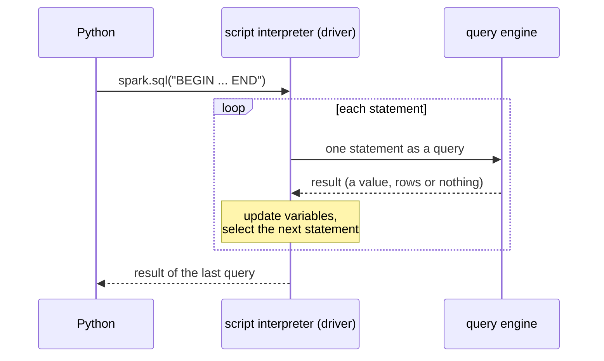
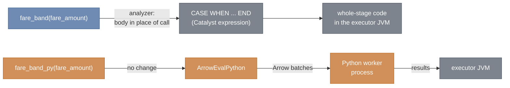
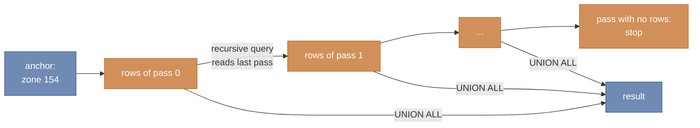

# Chapter 14: Procedural SQL: scripting, SQL UDFs and recursive CTEs

A SQL query describes one result. Real jobs often need more than one result. A value from one query can control the next query. A job can loop over a list of tables. An error must not always stop the job.

Before Spark 4, this logic went into Python, and SQL was only a string inside it. Spark 4 added the procedural parts of SQL: variables, control flow, condition handlers, `EXECUTE IMMEDIATE`, SQL functions and recursive CTEs.

**SQL scripting moves control flow into SQL, but not into the engine. The driver runs a script one statement at a time. Each query in the script has its own plan and jobs. SQL functions and recursive CTEs stay inside one plan. Thus the rule for fast procedural SQL is the same as for Python. Use the procedural parts for control, and put the work on the data into as few queries as possible.**

The scripts are in [`code/ch14`](https://github.com/lisancao/spark-masterclass/tree/main/code/ch14), and each output block below comes from `code/ch14/output/`. They use the June 2026 taxi trips and the zone lookup.

- `scripting.py`: variables, control flow, `FOR`, handlers, cursors, `EXECUTE IMMEDIATE`, and the jobs that a script runs.
- `functions.py`: SQL UDFs, the plans that they make, the SQL path and recursive CTEs.

## Step 1: Session variables

A session variable holds one value for the life of a session. `DECLARE VARIABLE` makes it, and `SET VAR` changes it. A query uses it by name:

```python
spark.sql("DECLARE OR REPLACE VARIABLE min_fare DOUBLE DEFAULT 50")
spark.sql("SELECT count(*) AS n FROM trips WHERE fare_amount > min_fare")
spark.sql("SET VAR min_fare = 100")
spark.sql("SELECT count(*) AS n FROM trips WHERE fare_amount > session.min_fare")
spark.sql("SET VAR min_fare = (SELECT percentile(fare_amount, 0.99) FROM trips)")
```

```text
== 1. session variables
count with min_fare = 50: Row(n=269258)
count with min_fare = 100: Row(n=15202)
the variable after SET VAR = (query): Row(min_fare=83.5)
```

The full name of a session variable is `system.session.<name>`, and `session.min_fare` is a short form. Use the qualified name if a column of the table can have the same name. A column wins over a variable with the same unqualified name.

`SET VAR ... = (query)` stores the result of a scalar subquery. The query runs one time, when the `SET VAR` runs. Thus `min_fare` is now 83.5, the 99th percentile of the June fares, and later queries use that value as a literal.

A session variable is not a parameter ([Chapter 13](ch13-spark-sql-in-depth.md)). A parameter belongs to one call of `spark.sql`. A variable stays in the session, and many statements can read it and change it.

## Step 2: A script and its result

A script is a compound statement: `BEGIN`, a list of statements with a `;` after each one, and `END`. You run it with one call to `spark.sql`. This script calculates a Fibonacci number with a `WHILE` loop:

```sql
BEGIN
  DECLARE a BIGINT DEFAULT 0;
  DECLARE b BIGINT DEFAULT 1;
  DECLARE i INT DEFAULT 0;
  WHILE i < :n DO
    SET (a, b) = (SELECT b, a + b);
    SET i = i + 1;
  END WHILE;
  SELECT :n AS n, a AS fib;
END
```

```text
== 2. a script, its control flow and its result
fib(10) with WHILE: Row(n=10, fib=55)
fib(90): Row(n=90, fib=2880067194370816120)
```

- **`DECLARE` in a script makes a local variable.** It exists only inside its `BEGIN ... END` block, and it hides a session variable with the same name.
- **`SET (a, b) = (SELECT ...)` sets two variables from one row.** Without this form, the second assignment would see the new value of `a`.
- **Parameter markers work in a script.** `:n` gets its value from `args={"n": 10}`, as in a single query.
- **The script returns the result of its last query.** Here that is the final `SELECT`. A statement that returns no result, such as `SET`, does not change the result of the script.

Spark 4.0 added SQL scripting as a preview. In 4.3.0, `spark.sql.scripting.enabled` is `true` by default (`SQLConf.scala`).

## Step 3: Control flow

Scripts have the usual control statements. `IF` and `CASE` select a branch:

```sql
BEGIN
  DECLARE n BIGINT;
  DECLARE label STRING;
  SET n = (SELECT count(*) FROM trips WHERE PULocationID = 132);
  IF n > 100000 THEN SET label = 'very busy';
  ELSEIF n > 10000 THEN SET label = 'busy';
  ELSE SET label = 'quiet';
  END IF;
  CASE WHEN label = 'very busy' THEN SELECT 'JFK' AS zone, n, label;
       ELSE SELECT 'other' AS zone, n, label;
  END CASE;
END
```

```text
IF / ELSEIF and CASE: Row(zone='JFK', n=148172, label='very busy')
```

Zone 132 is JFK Airport, with 148,172 pickups in the file. The `CASE` statement chooses which query runs. It is different from the `CASE` expression, which chooses a value in a query.

There are three more loops. `REPEAT ... UNTIL` runs its body at least one time. `LOOP` runs until a `LEAVE`. `ITERATE` starts the next pass of a labeled loop:

```sql
BEGIN
  DECLARE i INT DEFAULT 0;
  DECLARE odd_sum INT DEFAULT 0;
  DECLARE r INT DEFAULT 0;
  REPEAT SET r = r + 1; UNTIL r >= 3 END REPEAT;
  lbl: LOOP
    SET i = i + 1;
    IF i > 9 THEN LEAVE lbl; END IF;
    IF i % 2 = 0 THEN ITERATE lbl; END IF;
    SET odd_sum = odd_sum + i;
  END LOOP lbl;
  SELECT r AS repeats, odd_sum;
END
```

```text
REPEAT, LOOP, LEAVE and ITERATE: Row(repeats=3, odd_sum=25)
```

`odd_sum` is 1 + 3 + 5 + 7 + 9 = 25. `LEAVE` and `ITERATE` need the label of a loop or a block.

## Step 4: FOR over a query

`FOR` runs its body one time for each row of a query. The loop variable is a row, and its fields are the columns of the query:

```sql
BEGIN
  FOR b AS SELECT Borough AS name, count(*) AS zones FROM zones
           WHERE Borough NOT IN ('N/A', 'Unknown') GROUP BY Borough DO
    INSERT INTO borough_summary
      SELECT b.name, b.zones, count(*) FROM trips t JOIN zones z ON t.PULocationID = z.LocationID
      WHERE z.Borough = b.name;
  END FOR;
  SELECT * FROM borough_summary ORDER BY trips DESC;
END
```

```text
== 3. FOR over a query: one summary row per borough
FOR loop: [Row(borough='Manhattan', zones=69, trips=3385945), Row(borough='Queens', zones=69, trips=322053), Row(borough='Brooklyn', zones=61, trips=106869), Row(borough='Bronx', zones=43, trips=15006), Row(borough='EWR', zones=1, trips=569), Row(borough='Staten Island', zones=20, trips=237)]
```

The answer is correct, but the method is slow. The loop runs six `INSERT` statements, and each one scans all the trips. One `INSERT ... SELECT ... GROUP BY Borough` gives the same table with one scan. The next step shows why this difference is important.

## Step 5: How a script runs

A script is not one plan. The driver has an interpreter for scripts (`SqlScriptingExecution` in the 4.3.0 source). The interpreter takes one statement, runs it as a normal query, reads the result, and then selects the next statement. `scripting.py` runs a loop with five passes, and it counts the SQL executions and jobs in the Spark UI:

```sql
BEGIN
  DECLARE i INT DEFAULT 0;
  DECLARE total BIGINT DEFAULT 0;
  WHILE i < 5 DO
    SET total = total + (SELECT count(*) FROM trips WHERE PULocationID = 132 + i);
    SET i = i + 1;
  END WHILE;
  SELECT total;
END
```

```text
== 4. how a script runs
one spark.sql() call with a 5-pass loop -> 20 SQL executions, 27 jobs
    executions that scan the trips: 5, executions with no scan: 15
the same total as one query: 149702 (2 jobs)
```

<figure markdown>
  <video autoplay loop muted playsinline controls width="1280" height="720" poster="../../media/clips/ch14-loop.webp">
    <source src="../../media/clips/ch14-loop.mp4" type="video/mp4">
  </video>
  <figcaption><code>scripting.py</code> runs against Spark 4.3.0. One script with a 5-pass loop becomes 20 SQL executions and 27 jobs. The same total as one query runs 2 jobs.</figcaption>
</figure>

One call to `spark.sql` became 20 SQL executions and 27 jobs. Only 5 of the executions scan the trips. The other 15 are the loop condition, `SET i`, the declarations and the final `SELECT`. Each one is a full query: Spark parses it, analyzes it, optimizes it and runs it. The same total from one query with `BETWEEN 132 AND 136` runs 2 jobs.

<figure markdown>


<figcaption>The SQL executions of the script and of one query, from the output above. Each square is one SQL execution. The two forms give the same total.</figcaption>
</figure>




Thus a loop in a script has the same cost as a loop in Python that calls `spark.sql` for each pass. The script is a better place for the control logic, because the logic stays with the SQL and runs on the server over Spark Connect. But it is not faster. Use loops for control: one pass for each table, each day or each step of a job. Do not use them for the rows of a table.

## Step 6: Condition handlers

A handler catches an error in its block. An `EXIT` handler runs its body, and then the block that contains it stops:

```sql
BEGIN
  DECLARE result STRING DEFAULT 'not set';
  BEGIN
    DECLARE EXIT HANDLER FOR DIVIDE_BY_ZERO SET result = 'caught DIVIDE_BY_ZERO';
    SET result = CAST(1 / 0 AS STRING);
    SET result = 'after the error';
  END;
  SELECT result;
END
```

```text
== 5. condition handlers
EXIT handler for DIVIDE_BY_ZERO: Row(result='caught DIVIDE_BY_ZERO')
the most specific handler wins: Row(result='DIVIDE_BY_ZERO')
a named condition: CAST_INVALID_INPUT: The value 'n/a' of the type "STRING" cannot be cast to "INT" because it is mal
no handler: the script stops: CAST_INVALID_INPUT: The value 'n/a' of the type "STRING" cannot be cast to "INT" because it is mal
rows after the failed script: Row(borough='test')
```

The second `SET` never runs, because the inner block stops after the handler. The outer block continues, and its `SELECT` returns the value that the handler set.

A handler can name an error condition (`DIVIDE_BY_ZERO`), a SQLSTATE (`SQLSTATE '22012'`), `SQLEXCEPTION` or `NOT FOUND`. The second script declares three handlers for the same error. The handler for the error condition wins over the handler for its SQLSTATE, and both win over `SQLEXCEPTION`. In the 4.3.0 source, `SqlScriptingExecutionScope.findHandler` checks in this order:

1. The error condition, for example `DIVIDE_BY_ZERO`. For a condition with a subclass, such as `DATATYPE_MISMATCH.CAST_WITHOUT_SUGGESTION`, the main class also matches.
2. The SQLSTATE.
3. `NOT FOUND`, for a SQLSTATE that starts with `02` (no data).
4. `SQLEXCEPTION`, for each other SQLSTATE except the `XX` class (internal errors).

If the block has no handler for the error, the search continues in the blocks around it.

The third script uses `DECLARE bad_cast CONDITION FOR SQLSTATE '22018'`, and a handler `FOR bad_cast`. `CAST_INVALID_INPUT` has SQLSTATE `22018`, but the handler does not catch it. A handler `FOR SQLSTATE '22018'` catches the same error. In the 4.3.0 source, `SqlScriptingInterpreter` stores the handler under the name `BAD_CAST`. The search above compares that name with the name of the error, and it does not use the SQLSTATE of the declaration. In 4.3.0, write the SQLSTATE in the handler.

The last two lines show that a script has no transaction. The script inserts a row, fails on the next statement, and stops. The row that it inserted stays in the table.

!!! warning
    A failed script does not undo its earlier statements. Make each step of a script safe to run again. For example, use `INSERT OVERWRITE` or `MERGE`, not `INSERT INTO`. Or use a table format with transactions ([Chapter 44](ch44-tables-delta-iceberg.md)).

## Step 7: CONTINUE handlers and cursors

A `CONTINUE` handler runs its body, and then the script continues with the next statement. A cursor reads the rows of a query one at a time. The grammar of 4.3.0 has both, but each one is behind a configuration flag:

```text
a CONTINUE handler (default config): Py4JJavaError (SqlScriptingException) UNSUPPORTED_FEATURE.CONTINUE_EXCEPTION_HANDLER: The feature is not supported: CONTINUE exception handler is 
a CONTINUE handler (flag on): Row(errors=2, status='reached the end')

== 6. cursors
cursor (default config): Py4JJavaError (SqlScriptingException) UNSUPPORTED_FEATURE.SQL_CURSOR: The feature is not supported: SQL cursor operations (DECLARE
cursor (both flags on): Row(total_of_5_fares=483.0)
check with one query: Row(round(sum(fare_amount), 2)=483.0)
```

The flags are `spark.sql.scripting.continueHandlerEnabled` and `spark.sql.scripting.cursorEnabled`. In 4.3.0, both are internal configs, and both are `false` by default. With the flags on, the `CONTINUE` handler counts two errors, and the script reaches its last statement. The cursor sums five fares, and one query gives the same sum.

```sql
DECLARE c CURSOR FOR SELECT fare_amount FROM trips WHERE PULocationID = 1 AND fare_amount > 0 LIMIT 5;
DECLARE CONTINUE HANDLER FOR NOT FOUND SET done = true;
OPEN c;
REPEAT
  FETCH c INTO f;
  IF NOT done THEN SET total = total + f; END IF;
UNTIL done END REPEAT;
CLOSE c;
```

The cursor needs the `NOT FOUND` handler. After the last row, `FETCH` raises `CURSOR_NO_MORE_ROWS` with SQLSTATE `02000`. A SQLSTATE in class `02` means "no data", not an error. The handler sets `done`, and the loop stops. Without the handler, the 4.3.0 interpreter does not stop the script for an unhandled `02` condition (`SqlScriptingExecution.scala`). Thus the loop never ends.

!!! caution
    Do not use features behind internal flags in a production job. Internal configs can change or go away in any release. The error messages call them "not supported".

The errors in the output also show a gap in PySpark 4.3.0. A `SqlScriptingException` arrives in Python as a `Py4JJavaError`, not as a `PySparkException`. Thus `getCondition()` is not available, and the script reads the error class from the message text.

## Step 8: EXECUTE IMMEDIATE

`EXECUTE IMMEDIATE` runs SQL text that the job makes at run time. `INTO` stores the result in variables, and `USING` gives values to parameter markers:

```python
spark.sql("DECLARE OR REPLACE VARIABLE tbl STRING DEFAULT 'zones'")
spark.sql("EXECUTE IMMEDIATE 'SELECT count(*) FROM ' || tbl INTO n")
spark.sql("EXECUTE IMMEDIATE 'SELECT count(*) AS n FROM trips WHERE PULocationID = :zone AND fare_amount > :fare' "
          "USING 132 AS zone, 70 AS fare")
```

```text
== 7. EXECUTE IMMEDIATE
count of a table named at run time: Row(tbl='zones', n=265)
USING with named markers: Row(n=20943)
USING with positional markers: Row(n=20943)
in a script, one count per table: Row(counts='zones=265 borough_summary=7')
INTO with two rows: Py4JJavaError (SparkException) ROW_SUBQUERY_TOO_MANY_ROWS: More than one row returned by a subquery used as a row. SQLS
```

In a script, `EXECUTE IMMEDIATE` and `FOR` together give "the same statement for each table in a list". The script counts the rows of two tables. `borough_summary` has 7 rows: the six boroughs from Step 4 and the `test` row from Step 6.

`INTO` needs exactly one row. With two rows, it fails with `ROW_SUBQUERY_TOO_MANY_ROWS`. With no rows, the variables become NULL.

The text of `EXECUTE IMMEDIATE` is SQL, so the same risk as in [Chapter 13](ch13-spark-sql-in-depth.md) applies. Put values in `USING`, not in the text. If a table name comes from a user, check it against a list before you add it to the text. Or use `IDENTIFIER(:name)` in the text.

## Step 9: A scalar SQL UDF

A SQL UDF is a function with a body in SQL. A scalar function returns one value:

```sql
CREATE OR REPLACE TEMPORARY FUNCTION fare_band(fare DOUBLE)
RETURNS STRING
COMMENT 'Fare band of a trip'
RETURN CASE WHEN fare IS NULL OR fare <= 0 THEN 'invalid'
            WHEN fare < 15 THEN 'short'
            WHEN fare < 40 THEN 'medium'
            ELSE 'long' END
```

```text
== 1. a scalar SQL UDF
+-------+-------+
|   band|      n|
+-------+-------+
|  short|1803039|
| medium|1571902|
|   long| 445492|
|invalid|  16815|
+-------+-------+

analyzed plan mentions the function: ["+- 'Aggregate [unresolvedordinal(1)], ['fare_band('fare_amount) AS band#44, 'count(1) AS n"]
optimized plan lines with the name: ['+- Aggregate [fare_band#47], [fare_band#47 AS band#44, count(1) AS n#4', '+- Project [CASE WHEN (isnull(fare_amount#10) OR (fare_amount#10 <= 0.']
optimized plan: ['+- Project [CASE WHEN (isnull(fare_amount#10) OR (fare_amount#10 <= 0.0)) THEN invalid WHEN (far']
```

The parsed plan contains a call to `fare_band`. The optimized plan contains no call. It contains the `CASE WHEN` expression of the body, with `fare_amount` in the place of the parameter. The name `fare_band` stays only as the name of the column that holds the result. Catalyst replaced the call with its body. Thus the optimizer can apply all its rules to the body, as if you wrote the expression in the query.



<figure markdown>
  <video autoplay loop muted playsinline controls width="1280" height="720" poster="../../media/clips/ch14-udf.webp">
    <source src="../../media/clips/ch14-udf.mp4" type="video/mp4">
  </video>
  <figcaption><code>functions.py</code> runs against Spark 4.3.0. The SQL UDF becomes a <code>CASE WHEN</code> in the plan, and the Python UDF adds <code>ArrowEvalPython</code>. The timings on screen come from a run without the bench lock.</figcaption>
</figure>

`functions.py` compares the SQL UDF with a Python UDF that has the same logic. It filters on `= 'long'`, and it takes the median of three runs after a warmup:

```text
== 2. the same logic as a Python UDF
  fare_band     445,492 rows  median 0.35 s  ['PushedFilters: []']
  fare_band_py  445,492 rows  median 1.13 s  ['ArrowEvalPython', 'PushedFilters: []']
```

The Python UDF adds an `ArrowEvalPython` operator. Spark sends the fares to a Python worker process in Arrow batches, and it reads the results back. The SQL UDF runs in the executor JVM, in the generated code. On this machine, the Python UDF took about three times as long. Spark 4.3 can change some simple Python UDFs into Catalyst expressions ([Chapter 34](ch34-python-udfs-arrow.md)). This UDF did not change, because the plan still has `ArrowEvalPython`.

<figure markdown>


<figcaption>The median times from the output above. The SQL UDF becomes a <code>CASE WHEN</code> in the generated code. The Python UDF sends Arrow batches to a Python worker.</figcaption>
</figure>


`PushedFilters` is empty in both rows. A filter on the result of a function cannot go into the Parquet reader, because the reader only accepts filters on plain columns.

## Step 10: A SQL table function

A SQL table function returns a table. It works as a view with parameters:

```sql
CREATE OR REPLACE TEMPORARY FUNCTION zone_trips(zone_name STRING, min_fare DOUBLE DEFAULT 0)
RETURNS TABLE (pickup TIMESTAMP_NTZ, dropoff_zone STRING, fare DOUBLE)
RETURN SELECT t.tpep_pickup_datetime, d.Zone, t.fare_amount
       FROM trips t
       JOIN zones p ON t.PULocationID = p.LocationID
       JOIN zones d ON t.DOLocationID = d.LocationID
       WHERE p.Zone = zone_name AND t.fare_amount > min_fare
         AND t.tpep_pickup_datetime >= '2026-06-01' AND t.tpep_pickup_datetime < '2026-07-01'
```

```text
== 3. a SQL table function
+--------------------+----+--------+
|        dropoff_zone|   n|avg_fare|
+--------------------+----+--------+
|      Outside of NYC|6597|  112.06|
|Times Sq/Theatre ...|6203|    70.8|
|         JFK Airport|3974|   76.26|
|       Midtown South|3197|   70.56|
+--------------------+----+--------+

plan of the table function: ['+- BroadcastHashJoin [DOLocationID#8], [LocationID#128], Inner, BuildRight, fals', ':  +- BroadcastHashJoin [PULocationID#7], [LocationID#38], Inner, BuildRight, fa', ':     :  +- FileScan parquet [tpep_pickup_datetime#1,PULocationID#7,DOLocationID']
```

The query calls `zone_trips('JFK Airport', min_fare => 20)`. The second argument uses a name, and an argument that you do not give takes its `DEFAULT`. The plan has the two joins and the scan of the body, with no function node. Catalyst inlines a table function as it inlines a scalar function.

The most frequent drop-off zone for trips from JFK is "Outside of NYC". A JFK trip that stays in the city goes to Times Square most often.

## Step 11: What a SQL UDF refuses

The analyzer checks a SQL UDF when you make it. These are frequent errors:

```text
== 4. what a SQL UDF refuses
a SQL UDF named like a built-in: USER_DEFINED_FUNCTIONS.CANNOT_REPLACE_NON_SQL_UDF_WITH_SQL_UDF: User defined function is invalid: Cannot replace the non-SQL function up
a non-constant LIMIT: INVALID_LIMIT_LIKE_EXPRESSION.IS_UNFOLDABLE: The limit like expression "outer(top_fares.n)" is invalid. The limit exp
a parameter used as a table name: NOT_A_CONSTANT_STRING.NOT_CONSTANT: The expression outer(cnt.t) used for the routine or clause IDENTIFIER mu
a wrong argument type: CAST_INVALID_INPUT: The value 'ten' of the type "STRING" cannot be cast to "INT" because it 
a scalar UDF with a subquery: []
  ... and its use: Row(z='JFK Airport', missing=None)
```

- **A temporary SQL function cannot replace a built-in function.** The error names `upper`.
- **A parameter is not a constant.** `LIMIT n` and `IDENTIFIER(t)` need a value that is known when Spark makes the plan. Inside the body, a parameter is a reference to the outer query, `outer(top_fares.n)`. For a table name that changes, use `EXECUTE IMMEDIATE`.
- **Arguments are cast to the parameter types.** `doubled('ten')` fails at run time with the cast error from [Chapter 10](ch10-cleaning-values.md).
- **A scalar function can contain a scalar subquery.** `zone_name(132)` returns `JFK Airport`. An ID with no zone returns NULL.

## Step 12: Persistent functions

A function without `TEMPORARY` goes into the catalog, in a schema. It stays after the session ends, and other sessions can use it:

```sql
CREATE OR REPLACE FUNCTION default.tip_pct(tip DOUBLE, fare DOUBLE) RETURNS DOUBLE
DETERMINISTIC RETURN round(100 * tip / nullif(fare, 0), 1)
```

```text
== 5. a persistent SQL function
   Function:      spark_catalog.default.tip_pct
   Type:          SCALAR
   Input:         tip  DOUBLE
   Returns:       DOUBLE
   Deterministic: true
   Body:          round(100 * tip / nullif(fare, 0), 1)
tip_pct(5, 20): Row(pct=25.0, div0=None)
```

`DESCRIBE FUNCTION EXTENDED` shows the catalog record, with the body as text. Spark keeps the text and analyzes it again for each query. `DETERMINISTIC` tells the optimizer that the same inputs always give the same result. `nullif(fare, 0)` changes a zero fare to NULL, so the division returns NULL and not an error.

## Step 13: The SQL path

An unqualified function name such as `tip_pct` needs a search order. That order is the **SQL path**:

```text
== 6. the SQL path
current_path() by default: Row(current_path()='system.builtin,system.session,spark_catalog.default')
SET PATH, default config: UNSUPPORTED_FEATURE.SET_PATH_WHEN_DISABLED: The feature is not supported: SET PATH is disabled. Set spark.sql.path.e
current_path() with spark.sql.path.enabled: Row(current_path()='system.builtin,system.session,spark_catalog.default')
unqualified tip_pct, default path: Row(spark_catalog.default.tip_pct(5, 20)=25.0)
after SET PATH = spark_catalog.finance, ...: Row(path='spark_catalog.finance,system.builtin,system.session', tip=0.25)
after SET PATH = DEFAULT_PATH: Row(path='system.builtin,system.session,spark_catalog.default', tip=25.0)
```

The default path has three entries, in this order:

1. `system.builtin`: the built-in functions.
2. `system.session`: temporary functions and session variables.
3. The current schema, here `spark_catalog.default`.

Thus a built-in function always wins over a function in a schema. `SET PATH` changes the order. It came in Spark 4.2, and in 4.3.0 it needs `spark.sql.path.enabled`, which is `false` by default. Each entry needs at least two parts, such as `spark_catalog.finance`.

The script puts a second `tip_pct` in a schema `finance`. This one returns a fraction, not a percentage. After `SET PATH = spark_catalog.finance, ...`, the same text `tip_pct(5, 20)` returns 0.25, not 25.0. `SET PATH = DEFAULT_PATH` puts the default order back.

With a path, the result of a query depends on a session config. Use it to select between schemas with the same functions, for example a test schema and a production schema. In code that other people read, a qualified name such as `finance.tip_pct` is clearer.

## Step 14: A recursive CTE

A recursive CTE refers to itself. It starts with an **anchor** query, and then it runs the **recursive** query again and again on the rows of the last pass. Spark 4.1 added it. `functions.py` uses it on a graph: for each pickup zone, `next_zone` gives the most frequent drop-off zone. The CTE starts at zone 154, and follows that edge until the path comes back to a zone that it already has:

```sql
WITH RECURSIVE chain(step, zone_id, path) AS (
  SELECT 0, 154, array(154)
  UNION ALL
  SELECT c.step + 1, n.dst, array_append(c.path, n.dst)
  FROM chain c JOIN next_zone n ON n.src = c.zone_id
  WHERE NOT array_contains(c.path, n.dst)
)
SELECT c.step, z.Zone FROM chain c JOIN zones z ON z.LocationID = c.zone_id ORDER BY step
```

```text
== 7. a recursive CTE
+----+-------------------------------+
|step|Zone                           |
+----+-------------------------------+
|0   |Marine Park/Floyd Bennett Field|
|1   |Marine Park/Mill Basin         |
|2   |Flatlands                      |
|3   |Flatbush/Ditmas Park           |
|4   |Park Slope                     |
|5   |Crown Heights North            |
|6   |Bushwick South                 |
+----+-------------------------------+
```

The trips move north through Brooklyn, one zone at a time. After Bushwick South, the next zone is already in `path`, so the `WHERE` returns no row, and the recursion stops.

<figure markdown>


<figcaption>The chain from the output above. Each arrow is one pass of the recursive query. The pass after step 6 returns no row.</figcaption>
</figure>


The physical operator is `UnionLoop`, and `UnionLoopRef` marks the place where the recursive query reads the last pass. In the 4.3.0 source, `UnionLoopExec` runs the anchor, materializes it, and then runs the recursive query with the last result in place of `UnionLoopRef`. It stops when a pass returns no rows. Each pass is a separate job, as in a script loop. But the loop is in the engine, and a small result becomes a local relation, so a pass on a few rows costs little.



The animation shows the passes of `UnionLoop` on the zone chain.

<figure markdown>
  <video autoplay loop muted playsinline controls width="1280" height="720" poster="../../media/clips/ch14-anim-recursion.webp">
    <source src="../../media/clips/ch14-anim-recursion.mp4" type="video/mp4">
  </video>
  <figcaption>Animation: the anchor gives the first row. Each pass of the recursive query reads only the rows of the last pass. A pass with no rows stops the loop. The zone names are from the output above.</figcaption>
</figure>


## Step 15: When a recursion does not stop

Without the cycle check, the chain goes round a cycle for ever. Spark stops it at a limit:

```text
no cycle check: Py4JJavaError RECURSION_LEVEL_LIMIT_EXCEEDED: Recursion level limit 100 reached but query has not exhauste
no cycle check, MAX RECURSION LEVEL 20: Py4JJavaError RECURSION_LEVEL_LIMIT_EXCEEDED: Recursion level limit 20 reached but query has not exhausted
a LIMIT stops the recursion: Row(count(1)=12)
plan nodes: ['UnionLoop', 'UnionLoopRef']
```

| Limit | Default or value | Where you set it |
|---|---|---|
| levels | 100 | `spark.sql.cteRecursionLevelLimit` (internal config in 4.3.0) |
| rows | 1,000,000 | `spark.sql.cteRecursionRowLimit` (internal config in 4.3.0) |
| levels for one CTE | `n` | `MAX RECURSION LEVEL n`, after the column list |
| rows of the result | here 12 | a `LIMIT` on the outer query. The planner gives the limit to `UnionLoop`, and the recursion stops early. |

The limit is an error, not a silent stop. This is correct behavior: a result that a limit cut is not the answer to the query. Write the stop condition in the recursive query.

A recursive CTE also makes a series of values with no table. This calendar finds the June days with no pickup in zone 108:

```sql
WITH RECURSIVE days(d) AS (
  SELECT DATE'2026-06-01' UNION ALL SELECT d + 1 FROM days WHERE d + 1 < DATE'2026-07-01')
SELECT count(*) AS days, count_if(n IS NULL) AS days_with_no_trip FROM days
LEFT JOIN (SELECT to_date(tpep_pickup_datetime) AS d, count(*) AS n FROM trips
           WHERE PULocationID = 108 GROUP BY 1) USING (d)
```

```text
== 8. a calendar from a recursive CTE
days in June with no trip from zone 108: Row(days=30, days_with_no_trip=6)
```

A `GROUP BY` on the trips cannot show a day with no trips, because that day has no rows. The calendar gives each day a row, and the left join shows the 6 days with no pickup. For this case, `sequence(start, end)` with `explode` gives the same calendar without recursion. Use a recursive CTE when each row depends on the row before it, as in the zone chain.

## The whole chapter, on one page

- **Session variables (`DECLARE VARIABLE`, `SET VAR`) keep a value for the session.** `SET VAR = (query)` runs the query one time.
- **A script (`BEGIN ... END`) returns the result of its last query.** It has local variables, `IF`, `CASE`, `WHILE`, `REPEAT`, `LOOP`, `FOR`, `LEAVE` and `ITERATE`.
- **The driver runs a script one statement at a time.** Each statement is a separate query. A loop with five passes ran 20 SQL executions and 27 jobs. Use loops for control, not for rows.
- **`EXIT` handlers catch errors by condition, SQLSTATE, `NOT FOUND` or `SQLEXCEPTION`, in that order.** In 4.3.0, a handler for a declared condition name does not catch by SQLSTATE. Write the SQLSTATE in the handler.
- **A script has no transaction.** A failed script keeps the changes of its earlier statements.
- **`CONTINUE` handlers and cursors are behind internal flags in 4.3.0.** `SET PATH` needs `spark.sql.path.enabled`.
- **`EXECUTE IMMEDIATE` runs SQL text from a string.** Give values with `USING`, and read one row with `INTO`.
- **Catalyst puts the body of a SQL UDF (scalar or table) into the plan.** The optimizer sees the body. A Python UDF with the same logic adds a Python worker, and it took about three times as long here.
- **A recursive CTE runs in the engine, one pass at a time, until a pass returns no rows.** Write the stop condition. The limits are an error, not a result.

[Chapter 11](ch11-joins.md) goes back to set-based work. It shows how Spark joins two tables, and why the size of each side changes the plan.

## Further reading

- [SQL scripting](https://spark.apache.org/docs/4.3.0/sql-ref-scripting.html), the statements and the handler rules.
- [CREATE FUNCTION (SQL)](https://spark.apache.org/docs/4.3.0/sql-ref-syntax-ddl-create-sql-function.html), for scalar and table functions.
- [EXECUTE IMMEDIATE](https://spark.apache.org/docs/4.3.0/sql-ref-syntax-aux-exec-imm.html).
- [Common table expressions](https://spark.apache.org/docs/4.3.0/sql-ref-syntax-qry-select-cte.html), with `WITH RECURSIVE`.
- [Variables](https://spark.apache.org/docs/4.3.0/sql-ref-syntax-ddl-declare-variable.html), `DECLARE VARIABLE` and `SET VAR`.
