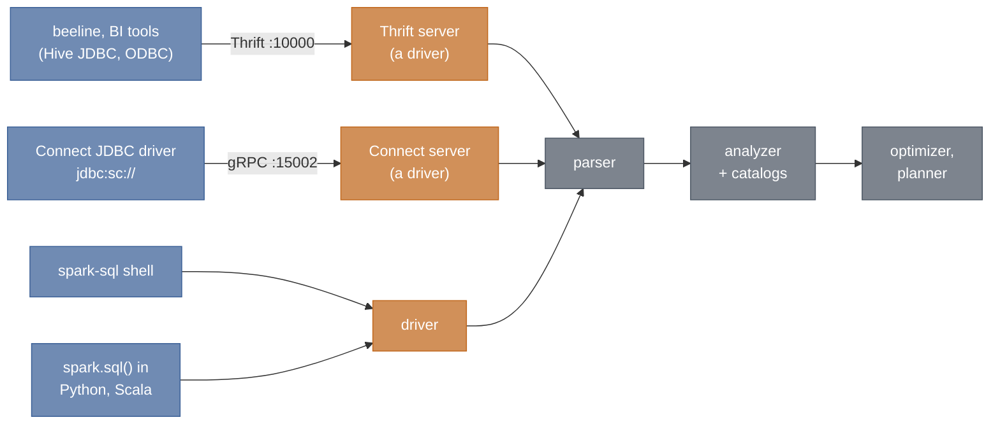
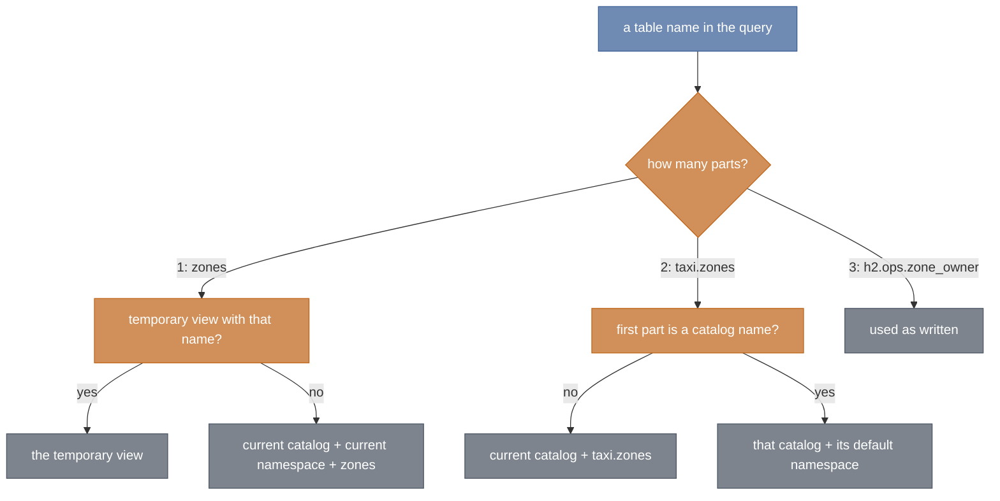
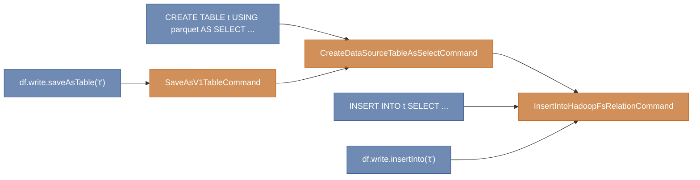

# Chapter 15: Spark SQL: the language, the catalog and the tools

Many people use Spark only through SQL. An analyst types queries into a shell. A BI tool sends them through JDBC. A pipeline keeps them in `.sql` files.

These people never see a DataFrame. For them, Spark SQL is a database. It has a catalog of tables and views, a type system, a library of functions and a set of rules for bad data.

**Spark SQL is a database interface in front of the same engine that runs DataFrames. Each tool (the `spark-sql` shell, the Thrift server, the Connect JDBC driver, `spark.sql()`) sends text to one parser. Each name in the text goes to a catalog. Each statement becomes the same plan that the DataFrame API makes. Thus, to use Spark SQL well, learn the parts around the query. Learn where names go, what a table owns, which types and functions exist, and what ANSI mode changes.**

This chapter opens the Spark SQL part of the book. The next chapters teach the query language itself, and this chapter does not repeat them:

- [Chapter 18](ch18-spark-sql-in-depth.md) teaches windows, pipe syntax and `QUALIFY`.
- [Chapter 20](ch20-procedural-sql.md) teaches SQL scripts, SQL functions and recursive CTEs.
- [Chapter 21](ch21-time-series.md) teaches the geospatial types.
- [Chapter 16](ch16-tables-ddl-writes.md) teaches table DDL and writes: `ALTER TABLE`, defaults, view schema modes, `writeTo` and partition overwrite.
- [Chapter 17](ch17-hive-tables-metastore.md) teaches Hive tables and the Hive metastore.

The scripts are in [`code/ch15`](https://github.com/open-lakehouse/spark-masterclass/tree/main/code/ch15), and each output block below comes from `code/ch15/output/`.

| Script | What it shows |
|---|---|
| `sql_cli.sh` | The `spark-sql` shell, two processes on one metastore |
| `thrift.sh`, `thrift_demo.sh`, `thrift_client.py` | The Thrift JDBC/ODBC server, with beeline and PyHive |
| `ConnectJdbc.java`, `connect_jdbc.sh` | The Spark Connect JDBC driver |
| `catalogs.py` | Catalogs, namespaces, `USE` and three-part names |
| `tables_views.py` | Managed and external tables, CTAS, `DESCRIBE`, views |
| `type_system.py` | The SQL types of 4.3.0 |
| `functions.py`, `function_groups.sh` | The built-in function library |
| `ansi_changes.py` | What ANSI mode changes, other than errors |
| `same_plan.py` | A statement and a DataFrame call, for queries and commands |

## The tools and the engine



Each tool ends in a driver. The `spark-sql` shell and `spark.sql()` run the driver in their own process. The Thrift server and the Connect server are drivers that accept SQL from other processes. After the parser, all paths are the same.

## Step 1: The spark-sql shell

`spark-sql` is in the `bin/` folder of the pip install and of the tarball. It starts a driver and reads SQL from the command line, from a file or from a prompt. `sql_cli.sh` runs it two times against one metastore folder:

```bash
CONF=(--master "local[2]" --conf spark.ui.port=${SPARK_UI_PORT:-4142}
      --conf "spark.sql.warehouse.dir=$W/warehouse"
      --conf "spark.hadoop.javax.jdo.option.ConnectionURL=jdbc:derby:;databaseName=$W/metastore_db;create=true"
      --driver-java-options "-Dderby.system.home=$W")
```

```text
== 1. spark-sql -e: one shell, a few statements
$ spark-sql -e "SHOW CATALOGS; CREATE DATABASE taxi; ..."
spark_catalog
Time taken: 0.851 seconds, Fetched 1 row(s)
spark_catalog	default
Time taken: 0.478 seconds, Fetched 1 row(s)
Time taken: 0.17 seconds
Time taken: 2.065 seconds
Queens	69
Manhattan	69
Brooklyn	61
Bronx	43
Staten Island	20
EWR	1
Unknown	1
N/A	1
Time taken: 1.924 seconds, Fetched 8 row(s)
```

<figure markdown>
  <video autoplay loop muted playsinline controls width="1280" height="720" poster="../../media/clips/ch15-cli.webp">
    <source src="../../media/clips/ch15-cli.mp4" type="video/mp4">
  </video>
  <figcaption><code>sql_cli.sh</code> runs <code>spark-sql -e</code>. The shell starts a driver, makes a database and a table, and prints each result as tab-separated text. The video does not show the wait while the driver starts.</figcaption>
</figure>

The shell prints rows as tab-separated text, and a `Time taken` line after each statement. A second `spark-sql` process finds the table that the first process made:

```text
== 2. a second spark-sql process: the table is still in the metastore
$ spark-sql --database taxi -e "SHOW TABLES; DESCRIBE TABLE EXTENDED zones"
zones
Time taken: 0.433 seconds, Fetched 1 row(s)
Catalog             	spark_catalog       	                    
Database            	taxi                	                    
Table               	zones               	                    
Owner               	user                	                    
Type                	EXTERNAL            	                    
Provider            	csv                 	                    
Location            	file:~/spark-masterclass/data/nyc-taxi/taxi_zone_lookup.csv	                    
Time taken: 0.463 seconds, Fetched 20 row(s)
```

The table stays because the shell uses the Hive catalog. `SparkSQLEnv.scala` calls `enableHiveSupport()` unless you set `spark.sql.catalogImplementation=in-memory`. The Hive metastore keeps its data in an embedded Derby database, here `metastore_db`. A PySpark session uses the `in-memory` catalog by default ([Chapter 8](ch08-setting-configurations.md)), and its tables disappear when the session stops. For the Hive catalog and the metastore in detail, read [Chapter 17](ch17-hive-tables-metastore.md).

The table is `EXTERNAL`, because the `CREATE TABLE` statement gave a `path`. Step 5 explains managed and external tables.

`-f` runs a file, and `--hivevar` replaces a `${name}` variable in the text before the parser reads it:

```text
== 3. spark-sql -f: a file of statements, with a variable from --hivevar
$ spark-sql --hivevar borough=Bronx -f top_zones.sql
Allerton/Pelham Gardens
Bedford Park
Belmont
Time taken: 2.599 seconds, Fetched 3 row(s)
```

| `spark-sql` option | What it does |
|---|---|
| `-e "<sql>"` | Runs the statements, then stops |
| `-f <file>` | Runs the statements in a file, then stops |
| `-i <file>` | Runs a file first, then opens the prompt |
| `--database <name>` | Sets the current namespace |
| `--hivevar k=v`, `--define k=v` | Gives a value to `${k}` in the text |
| `--conf`, `--master` and the other `spark-submit` options | The same as for `spark-submit` |

!!! warning "CAUTION"
    An embedded Derby metastore accepts one process at a time. Do not open a second shell or a Thrift server on the same `metastore_db` while a first process uses it. For more than one user, use a metastore service or a different catalog ([Chapter 55](ch55-iceberg.md)).

## Step 2: The Thrift JDBC/ODBC server

The Thrift server is a driver that speaks the protocol of HiveServer2. Each JDBC or ODBC tool that can connect to Hive can connect to it: beeline, BI tools, and Python libraries such as PyHive.

The tarball has `sbin/start-thriftserver.sh`. The pip package has the server class and `bin/beeline`, but not the start script. `thrift.sh` calls `spark-submit` as the start script does:

```bash
"$SPARK_HOME/bin/spark-submit" --class org.apache.spark.sql.hive.thriftserver.HiveThriftServer2 \
  --name "Thrift JDBC/ODBC Server" --master "local[2]" \
  --conf spark.ui.port=${SPARK_UI_PORT:-4142} \
  --conf "spark.sql.warehouse.dir=$W/warehouse" \
  --conf "spark.hadoop.javax.jdo.option.ConnectionURL=jdbc:derby:;databaseName=$W/metastore_db;create=true" \
  --hiveconf hive.server2.thrift.port=$PORT --hiveconf hive.server2.thrift.bind.host=127.0.0.1 \
  spark-internal > "$W/thrift.log" 2>&1 &
```

The default port is 10000. The book uses its own port, 15102. The server opens the metastore of Step 1, so it sees the table `taxi.zones`. `thrift_demo.sh` connects with beeline, the JDBC shell of Hive:

```text
== 1. beeline, a JDBC client
$ beeline -u jdbc:hive2://localhost:15102 -n $USER -e "..."
+------------+------------+--------------+
| namespace  | tableName  | isTemporary  |
+------------+------------+--------------+
| taxi       | zones      | false        |
+------------+------------+--------------+
+------------+--------+
|  Borough   | zones  |
+------------+--------+
| Queens     | 69     |
| Manhattan  | 69     |
| Brooklyn   | 61     |
+------------+--------+
```

Each JDBC connection gets its own Spark session on the server. A temporary view in one connection is not visible in a second connection:

```text
== 2. each connection is its own session
+---------+
| Result  |
+---------+
+---------+
+------------+-----------+--------------+
| namespace  | viewName  | isTemporary  |
+------------+-----------+--------------+
|            | mine      | true         |
+------------+-----------+--------------+
-- a second connection:
+------------+-----------+--------------+
| namespace  | viewName  | isTemporary  |
+------------+-----------+--------------+
+------------+-----------+--------------+
```

A Python program can query the server with no JVM and no PySpark. `thrift_client.py` uses PyHive, with a parameter in the query and a `SET` for its own session:

```python
conn = hive.connect(host="127.0.0.1", port=int(os.environ.get("THRIFT_PORT", "15102")),
                    username=getpass.getuser())
cur = conn.cursor()
cur.execute("SELECT Zone FROM taxi.zones WHERE Borough = %(b)s ORDER BY Zone LIMIT 3", {"b": "EWR"})
```

```text
== 3. PyHive, a Python client with no JVM
session: ('spark_catalog', 'default', '4.3.0 98bc0212c94705434471627068f41e374ccab143')
columns: ['Zone']
rows:    [('Newark Airport',)]
a SET in this connection: [('spark.sql.shuffle.partitions', '4')]
```

<figure markdown>
  <video autoplay loop muted playsinline controls width="1280" height="720" poster="../../media/clips/ch15-thrift.webp">
    <source src="../../media/clips/ch15-thrift.mp4" type="video/mp4">
  </video>
  <figcaption><code>thrift_demo.sh</code> starts the Thrift server. Two beeline connections get two sessions, and PyHive queries the same server from Python. The video does not show the wait while the driver starts.</figcaption>
</figure>

!!! note "New in 4.3: `set:system:`"
    Since Spark 4.3, the Thrift server refuses a JVM system property in the `set:system:` part of the session configuration. A JDBC URL can contain this part. The SQL migration guide gives the legacy configuration that restores the old behavior.

PyHive replaces `%(b)s` with a quoted value on the client, before it sends the text. Spark receives only text. Spark's own named parameters (`:name`) are a feature of `spark.sql()`. [Chapter 18](ch18-spark-sql-in-depth.md) shows them.

## Step 3: The Spark Connect JDBC driver (new in 4.1)

Spark 4.1 added a second JDBC driver. It connects to a Spark Connect server with a URL that starts with `jdbc:sc://`. The driver is not in `sql/connect/client/jdbc` at v4.0.0, and it is at v4.1.0. The tarball of 4.3.0 has the driver in `jars/connect-repl/`, and Maven Central has it as `org.apache.spark:spark-connect-client-jdbc_2.13:4.3.0`.

`ConnectJdbc.java` is a plain JDBC program. `connect_jdbc.sh` starts the Connect server of [Chapter 8](ch08-setting-configurations.md) and runs the program with Java's single-file launcher:

```java
try (Connection c = DriverManager.getConnection(url)) {
  DatabaseMetaData md = c.getMetaData();
  System.out.println("driver:  " + md.getDriverName() + " " + md.getDriverVersion());
  ...
  ResultSet r = s.executeQuery(
    "SELECT current_catalog() AS cat, typeof(array(1, 2)) AS t, array(1, 2) AS a, " +
    "named_struct('x', 1) AS st")
```

```text
$ java --add-opens=java.base/java.nio=ALL-UNNAMED -cp <driver jars> ConnectJdbc.java jdbc:sc://localhost:15102
driver:  Apache Spark Connect JDBC Driver 4.3.0
product: Apache Spark Connect Server 4.3.0
column 1: cat  STRING     VARCHAR
column 2: t    STRING     VARCHAR
column 3: a    ARRAY<INT> ARRAY
column 4: st   STRUCT<x: INT NOT NULL> STRUCT
row:     spark_catalog | array<int> | [1,2] | {"x":1}
prepareStatement: SQLFeatureNotSupportedException
```

The output shows three facts about the driver in 4.3.0:

- It maps the Spark types to JDBC types, also the complex types `ARRAY` and `STRUCT`.
- It does not support `prepareStatement`. Use `createStatement` with a SQL text that you build safely.
- It needs Arrow, so the JVM needs `--add-opens=java.base/java.nio=ALL-UNNAMED`, as Spark itself does on Java 17. The script also puts the `jars/` folder of the tarball on the classpath, because the driver needs Spark's common jars. A Maven or sbt build gets them from the POM of the driver.

The Spark docs of 4.3.0 have no page for this driver. The notes file of this part records this gap.

| | Thrift server | Connect server with the Connect JDBC driver |
|---|---|---|
| Protocol | HiveServer2 Thrift | Spark Connect gRPC |
| Clients | each Hive JDBC or ODBC client, beeline, PyHive | the Connect JDBC driver, and all Spark Connect clients |
| Catalog by default | Hive | the `spark.sql.catalogImplementation` of the server |
| Session | one for each JDBC connection | one for each client session |
| Also runs DataFrame code | no | yes |

## Step 4: Catalogs and namespaces

Each table name in Spark SQL has three parts: `catalog.namespace.table`. A **catalog** is a plugin that stores tables. A **namespace** is a group of tables in a catalog. A namespace is the same thing as a database or a schema, and Spark accepts the three words. `catalogs.py` starts a session with a second catalog: Spark's own `JDBCTableCatalog` over an H2 database file.

```python
"spark.sql.catalog.h2": "org.apache.spark.sql.execution.datasources.v2.jdbc.JDBCTableCatalog",
"spark.sql.catalog.h2.url": f"jdbc:h2:file:{W}/h2db",
"spark.sql.catalog.h2.driver": "org.h2.Driver"})
```

A new session starts in the session catalog, `spark_catalog`, and the namespace `default`:

```text
== 1. where am I
> SELECT current_catalog(), current_database(), current_schema()
+-----------------+----------------+----------------+
|current_catalog()|current_schema()|current_schema()|
+-----------------+----------------+----------------+
|spark_catalog    |default         |default         |
+-----------------+----------------+----------------+

> SHOW CATALOGS
+-------------+
|catalog      |
+-------------+
|spark_catalog|
+-------------+
```

`current_database()` and `current_schema()` are the same function. The column names show it. `SHOW CATALOGS` does not list `h2` yet. Spark loads a catalog plugin when a statement uses it for the first time, and `SHOW CATALOGS` lists only the loaded catalogs:

```text
== 4. a second catalog: SHOW CATALOGS lists it only after first use
> SHOW CATALOGS
+-------------+
|catalog      |
+-------------+
|spark_catalog|
+-------------+

> CREATE NAMESPACE IF NOT EXISTS h2.ops
> SHOW CATALOGS
+-------------+
|catalog      |
+-------------+
|h2           |
|spark_catalog|
+-------------+
```

With the three parts, one query can join tables from two catalogs. The zones are a Parquet table in the warehouse. The owners are a table in the H2 database:

```text
== 5. one query, two catalogs
> SELECT z.Zone, o.owner
     FROM spark_catalog.taxi.zones AS z JOIN h2.ops.zone_owner AS o USING (LocationID)
     ORDER BY z.Zone
+-----------------+------------+
|Zone             |owner       |
+-----------------+------------+
|JFK Airport      |airport team|
|LaGuardia Airport|airport team|
|Midtown Center   |midtown team|
+-----------------+------------+
```

<figure markdown>
  <video autoplay loop muted playsinline controls width="1280" height="720" poster="../../media/clips/ch15-catalogs.webp">
    <source src="../../media/clips/ch15-catalogs.mp4" type="video/mp4">
  </video>
  <figcaption><code>catalogs.py</code> joins a table in the session catalog to a table in an H2 database, with three-part names.</figcaption>
</figure>

<figure markdown>
  
  
  <figcaption>The catalogs, namespaces and tables of <code>catalogs.py</code>, from its output.</figcaption>
</figure>

A name with fewer than three parts gets the other parts from the current catalog and the current namespace. `USE` changes them. `USE taxi` changes only the namespace. `USE h2.ops` changes the catalog and the namespace:

```text
== 6. USE a catalog, and unqualified names follow it
> USE h2.ops
> SELECT current_catalog(), current_database()
+-----------------+----------------+
|current_catalog()|current_schema()|
+-----------------+----------------+
|h2               |ops             |
+-----------------+----------------+

> SHOW TABLES
+---------+----------+-----------+
|namespace|tableName |isTemporary|
+---------+----------+-----------+
|ops      |zone_owner|false      |
+---------+----------+-----------+
```

<figure markdown>
  <video autoplay loop muted playsinline controls width="1280" height="720" poster="../../media/clips/ch15-anim-names.webp">
    <source src="../../media/clips/ch15-anim-names.mp4" type="video/mp4">
  </video>
  <figcaption>Spark adds the current catalog and namespace to a short name. <code>USE</code> changes them, and a three-part name does not depend on them. Names and results come from one run of <code>catalogs.py</code>.</figcaption>
</figure>



Two-part names need care. When the current catalog is `h2`, `taxi.zones` means `h2.taxi.zones`, not the table in the session catalog. In code that other people run, use three-part names.

The Catalog API reads the same catalogs. `spark.catalog` is the Python form of `SHOW CATALOGS`, `SHOW TABLES` and `USE`:

```text
== 7. the Catalog API reads the same catalog
  spark.catalog.currentCatalog(): spark_catalog
  spark.catalog.listCatalogs():   ['h2', 'spark_catalog']
  spark.catalog.listTables('taxi'): [('zones', 'MANAGED')]
```

[Chapter 55](ch55-iceberg.md) registers Iceberg catalogs in the same way, with `spark.sql.catalog.<name>`. A catalog name is a static configuration of the session ([Chapter 8](ch08-setting-configurations.md)), so register catalogs before the session starts.

## Step 5: Tables: managed, external and CTAS

A table in the session catalog has one of two types:

- A **managed** table keeps its files in the warehouse folder (`spark.sql.warehouse.dir`), in a folder with the name of the table. Spark owns the files.
- An **external** table has a `LOCATION` or a `path` that you give. Spark owns only the entry in the catalog.

`USING <format>` makes a data source table: Spark reads it with its own Parquet, ORC, CSV, JSON or Delta reader. `tables_views.py` makes a managed table with `CREATE TABLE ... AS SELECT` (CTAS), and an external table over a copy of the same files:

```sql
CREATE TABLE daily USING parquet AS
SELECT to_date(tpep_pickup_datetime) AS day, count(*) AS trips, round(sum(fare_amount), 2) AS fares
FROM trips_raw
WHERE tpep_pickup_datetime >= '2026-06-01' AND tpep_pickup_datetime < '2026-07-01'
GROUP BY 1;

CREATE TABLE daily_ext USING parquet LOCATION '.../external/daily_copy';
```

```text
== 1. a managed table: CTAS into the warehouse
> SELECT * FROM daily ORDER BY day LIMIT 3
+----------+------+----------+
|day       |trips |fares     |
+----------+------+----------+
|2026-06-01|111546|2398758.25|
|2026-06-02|126260|2646475.71|
|2026-06-03|140184|2974062.81|
+----------+------+----------+
```

The external table needs no schema in the statement. Spark reads it from the Parquet footers. `DESCRIBE TABLE EXTENDED` shows the difference between the two tables:

```text
== 3. DESCRIBE TABLE EXTENDED, the rows that differ
  daily
    Catalog   spark_catalog
    Database  taxi
    Table     daily
    Type      MANAGED
    Provider  parquet
    Location  file:~/spark-masterclass/data/work/ch15-tables/warehouse/taxi.db/daily
  daily_ext
    Catalog   spark_catalog
    Database  taxi
    Table     daily_ext
    Type      EXTERNAL
    Provider  parquet
    Location  file:~/spark-masterclass/data/work/ch15-tables/external/daily_copy
```

The two types are different when you drop them:

```text
== 6. DROP TABLE: managed deletes the data, external keeps it
  daily     before: exists, 1 parquet files
  daily_ext before: exists, 1 parquet files
> DROP TABLE daily
> DROP TABLE daily_ext
  daily     after : gone, 0 parquet files
  daily_ext after : exists, 1 parquet files
```

<figure markdown>
  
  
  <figcaption>What <code>DROP TABLE</code> removes, from section 6 of <code>tables_views.txt</code>.</figcaption>
</figure>

!!! warning "WARNING"
    `DROP TABLE` on a managed table deletes its data files. Before you drop a table, do a check of its `Type` with `DESCRIBE TABLE EXTENDED`. If other jobs or people own the files, make the table external.

`DESCRIBE TABLE ... AS JSON` (new in 4.0) gives the same information as one JSON document, which a program can read without a parse of text rows. Spark 4.3 adds `AS JSON` to `SHOW TABLES`, `SHOW TABLE EXTENDED` and `SHOW PARTITIONS`. The grammar file `SqlBaseParser.g4` has `AS JSON` only on `DESCRIBE` at v4.2.0, and on the four statements at v4.3.0.

```text
== 4. DESCRIBE TABLE ... AS JSON (a document a program can read)
  keys: ['catalog_name', 'collation', 'columns', 'created_by', 'created_time', 'last_access', 'location', 'namespace', 'provider', 'schema_name', 'table_name', 'type']
  columns: [('day', 'date'), ('trips', 'bigint'), ('fares', 'double')]

== 5. SHOW TABLES ... AS JSON (new in 4.3)
  {"tables":[{"name":"daily","namespace":["taxi"],"isTemporary":false},{"name":"daily_ext","namespace":["taxi"],"isTemporary":false},{"name":"trips_raw","namespace":[],"isTemporary":true}]}
```

The session catalog is not a table format. It does not give transactions, time travel or `MERGE` to a Parquet table. For these features, use Delta Lake or Apache Iceberg ([Chapter 54](ch54-tables-delta-iceberg.md)). In this session, `CREATE OR REPLACE TABLE` on a Parquet table failed with `UNSUPPORTED_FEATURE.TABLE_OPERATION`, so `tables_views.py` uses `DROP TABLE` and `CREATE TABLE`. For the DDL and writes that the session catalog supports, read [Chapter 16](ch16-tables-ddl-writes.md).

## Step 6: Views, temporary views and global temporary views

A view is a name for a query. Spark has three kinds:

| Kind | Statement | Where it is | Who can see it | When it goes |
|---|---|---|---|---|
| Temporary view | `CREATE TEMPORARY VIEW`, `df.createOrReplaceTempView` | the session | one session | the session stops |
| Global temporary view | `CREATE GLOBAL TEMPORARY VIEW`, `df.createOrReplaceGlobalTempView` | the namespace `global_temp` | all sessions of one application | the application stops |
| View | `CREATE VIEW` | a catalog namespace | each session that uses the catalog | `DROP VIEW` |

`tables_views.py` makes each kind. Then it asks a second session from `spark.newSession()` to read each one:

```text
== 8. which session can see which view
  newSession() reads june                 no: [TABLE_OR_VIEW_NOT_FOUND]
  newSession() reads global_temp.june_g   no: [TABLE_OR_VIEW_NOT_FOUND]
  newSession() reads global_temp.june_df  yes
  newSession() reads taxi.zone_names      yes
```

The second row can be a surprise. `june_g` is a global temporary view, but the second session cannot read it. The view was made with SQL text that reads the temporary view `june`. The second session does not have `june`, so the text fails. The global temporary view `june_df` was made from a DataFrame, which keeps the resolved plan. Thus, it works in all sessions.

A persistent view keeps its text in the catalog, not data. It cannot refer to a temporary view, because the temporary view does not exist in other sessions:

```text
== 9. a persistent view stores text, not data
  Type                       VIEW
  View Text                  SELECT LocationID, upper(Zone) AS zone FROM zones_t
  View Original Text         SELECT LocationID, upper(Zone) AS zone FROM zones_t
  View Schema Mode           COMPENSATION
  View Query Output Columns  [`LocationID`, `zone`]
  a persistent view cannot use a temporary view:
  AnalysisException: [INVALID_TEMP_OBJ_REFERENCE] Cannot create the persistent object
  `spark_catalog`.`taxi`.`bad` of the type VIEW because it references to the temporary ...
```

Spark 4.0 added `WITH SCHEMA` to `CREATE VIEW`, with the modes `BINDING`, `COMPENSATION`, `EVOLUTION` and `TYPE EVOLUTION`. The default mode in this run is `COMPENSATION`. A view with `SCHEMA EVOLUTION` follows a change in the columns of its table. A view with the default mode keeps its columns:

```text
> CREATE OR REPLACE VIEW zones_all WITH SCHEMA EVOLUTION AS SELECT * FROM zones_t
> CREATE OR REPLACE VIEW zones_bound AS SELECT * FROM zones_t
> DROP TABLE zones_t
> CREATE TABLE zones_t USING parquet AS SELECT 1 AS LocationID, 'x' AS Zone, 'EWR' AS Borough
> SELECT * FROM zones_all
+----------+----+-------+
|LocationID|Zone|Borough|
+----------+----+-------+
|1         |x   |EWR    |
+----------+----+-------+

> SELECT * FROM zones_bound
+----------+----+
|LocationID|Zone|
+----------+----+
|1         |x   |
+----------+----+
```

## Step 7: The type system in 4.3

[Chapter 9](ch09-dataframes-columns-schemas.md) gives each type with its PySpark class and its Python value. This step shows what Spark 4.x added, and what is behind a flag in 4.3.0. `type_system.py` makes a value of each DDL type with `CAST(NULL AS <type>)`, and it prints the type name and the PySpark class:

```text
== 1. CAST(NULL AS <type>): the SQL type name and the PySpark class
  DDL                         typeof()                    PySpark class
  BOOLEAN                     boolean                     BooleanType
  TINYINT                     tinyint                     ByteType
  SMALLINT                    smallint                    ShortType
  INT                         int                         IntegerType
  BIGINT                      bigint                      LongType
  FLOAT                       float                       FloatType
  DOUBLE                      double                      DoubleType
  DECIMAL(10,2)               decimal(10,2)               DecimalType
  STRING                      string                      StringType
  STRING COLLATE UTF8_LCASE   string collate UTF8_LCASE   StringType
  CHAR(3)                     string                      StringType
  VARCHAR(10)                 string                      StringType
  BINARY                      binary                      BinaryType
  DATE                        date                        DateType
  TIMESTAMP                   timestamp                   TimestampType
  TIMESTAMP_NTZ               timestamp_ntz               TimestampNTZType
  TIME(6)                     error: UNSUPPORTED_TIME_TYPE
  TIMESTAMP_NTZ(9)            error: FEATURE_NOT_ENABLED
  INTERVAL DAY TO SECOND      interval day to second      DayTimeIntervalType
  INTERVAL YEAR TO MONTH      interval year to month      YearMonthIntervalType
  ARRAY<INT>                  array<int>                  ArrayType
  MAP<STRING,INT>             map<string,int>             MapType
  STRUCT<a:INT,b:STRING>      struct<a:int,b:string>      StructType
  VARIANT                     variant                     VariantType
  GEOMETRY(4326)              geometry(4326)              GeometryType
  GEOGRAPHY(4326)             geography(4326)             GeographyType
```

The table below adds the version that added each type. The versions come from the type classes in `sql/api/src/main/scala/org/apache/spark/sql/types/` at each release tag, and from the grammar for collations.

| Type | Added in | State in 4.3.0 | Chapter |
|---|---|---|---|
| `BOOLEAN`, integers, `FLOAT`, `DOUBLE`, `DECIMAL`, `STRING`, `BINARY`, `DATE`, `TIMESTAMP` | before 3.0 | available | [Chapter 9](ch09-dataframes-columns-schemas.md) |
| `CHAR(n)`, `VARCHAR(n)` | 3.1 | available in tables, `string` in a cast | this step |
| `TIMESTAMP_NTZ` | 3.4 | available | [Chapter 9](ch09-dataframes-columns-schemas.md) |
| `INTERVAL DAY TO SECOND`, `INTERVAL YEAR TO MONTH` | 3.2 | available | [Chapter 9](ch09-dataframes-columns-schemas.md) |
| `VARIANT` | 4.0 | available | [Chapter 35](ch35-variant.md) |
| `STRING COLLATE <name>` | 4.0 | available | [Chapter 10](ch10-cleaning-values.md) |
| `GEOMETRY(srid)`, `GEOGRAPHY(srid)` | 4.1 | available | [Chapter 21](ch21-time-series.md) |
| `TIME(p)` | 4.1 | literals work, the type name needs `spark.sql.timeType.enabled` | [Chapter 9](ch09-dataframes-columns-schemas.md) |
| `TIMESTAMP_NTZ(p)`, `TIMESTAMP_LTZ(p)`, `p` from 7 to 9 | 4.3 (preview) | needs `spark.sql.timestampNanosTypes.enabled` | [Chapter 10](ch10-cleaning-values.md) |

The `VariantType` class is new at v4.0.0. `GeometryType`, `GeographyType` and `TimeType` are new at v4.1.0. `TimestampNTZNanosType` and `TimestampLTZNanosType` are new at v4.3.0. The versions before 4.0 come from two places. The SQL migration guide gives `CHAR` and `VARCHAR` in 3.1 and ANSI intervals in 3.2. The `version` field of `spark.sql.timestampType` gives 3.4.0.

Two rows need more detail. A `CHAR` or `VARCHAR` in a cast becomes `string`. In a table, Spark keeps the length and checks it:

```text
== 2. CHAR and VARCHAR in a table keep their length and check it
+--------+----------+-------+
|col_name|data_type |comment|
+--------+----------+-------+
|code    |char(3)   |NULL   |
|label   |varchar(5)|NULL   |
+--------+----------+-------+

  read back: [('A  ', 3)] (CHAR pads to its length)
  insert 'ABCD' into CHAR(3): EXCEED_LIMIT_LENGTH
```

`TIME` and the nanosecond types are behind internal flags in 4.3.0. A `TIME` literal works with the flag off, but the type name in a cast or a table needs the flag:

```text
== 3. TIME and the nanosecond types sit behind internal flags in 4.3.0
  TIME literal, flags off:      TIME'10:07:00' -> time(6)
  spark.sql.timeType.enabled             = false
  after SET spark.sql.timeType.enabled=true: CAST(NULL AS TIME(6)) -> time(6)
  spark.sql.timestampNanosTypes.enabled  = false
  after SET spark.sql.timestampNanosTypes.enabled=true: CAST(NULL AS TIMESTAMP_NTZ(9)) -> timestamp_ntz(9)
```

The default of `spark.sql.timeType.enabled` in `SQLConf.scala` is `Utils.isTesting`. Thus, it is `true` in Spark's own tests and `false` in an install.

!!! warning "CAUTION"
    Do not use an internal flag such as `spark.sql.timeType.enabled` in production code without a test. An internal flag can change in a release without a migration note.

## Step 8: The built-in function library

`SHOW FUNCTIONS` lists the functions that a query can call. `DESCRIBE FUNCTION EXTENDED` gives the documentation of one function, with examples and the version that added it:

```text
== 1. SHOW FUNCTIONS, and its filters
  SHOW FUNCTIONS                    591 rows
  SHOW SYSTEM FUNCTIONS             591 rows
  SHOW USER FUNCTIONS                 0 rows
  SHOW FUNCTIONS LIKE 'try_*'        27 rows
  SHOW FUNCTIONS LIKE 'st_*'          5 rows
```

```text
== 2. DESCRIBE FUNCTION EXTENDED
  Function: try_divide
  Class: org.apache.spark.sql.catalyst.expressions.TryDivide
  Usage: try_divide(dividend, divisor) - Returns `dividend`/`divisor`. It always performs floating point division. Its result is always null if `expr2` is 0. `dividend` must be a numeric or an interval. `divisor` must be a numeric.
  Extended Usage:
      ...
      Examples:
        > SELECT try_divide(3, 2);
         1.5
        ...
      Since: 3.2.0
```

Each built-in function has a group in its `ExpressionInfo`. The group comes from the `@ExpressionDescription` annotation in the source. `functions.py` reads the registry of the JVM and counts the functions in each group:

<figure markdown>
  
  
  <figcaption>The built-in functions of Spark 4.3.0 by group, from section 3 of <code>functions.txt</code>.</figcaption>
</figure>

```text
  total                   581
  in SHOW FUNCTIONS but not in this registry: ['!=', '<>', 'case', 'collations', 'python_worker_logs', 'range', 'sql_keywords', 'variant_explode', 'variant_explode_outer', '||']

  by the 'since' field: {'4.0': 45, '4.1': 45, '4.2': 43, '4.3': 17, 'before 4.0': 431}
```

The registry has 581 names. `SHOW FUNCTIONS` shows ten more:

- Operator names that are not in the registry: `!=`, `<>`, `case` and `||`.
- Table functions that are only in the table function registry: `range`, `collations`, `sql_keywords`, `python_worker_logs`, `variant_explode` and `variant_explode_outer`.

The `since` field of each function shows that the 4.x releases added 150 of the 581 functions. The orange groups in the figure belong to features of 4.x: `variant_funcs` for `VARIANT`, `vector_funcs` and `st_funcs` for geospatial data.

A count of the annotations in the source gives a different number. `function_groups.sh` counts `group = "..."` in the source at v4.3.0:

```text
  datetime_funcs         85
  agg_funcs              77
  string_funcs           66
  math_funcs             63
  ...
  total                 536
```

One annotation is one expression class, and one class can have more than one SQL name. For example, `avg` and `mean` share a class. Also, the cast functions (`int()`, `string()` and the others) share one annotation. That is why `conversion_funcs` has 14 names in the registry and one annotation in the source. To count what a user can call, use the registry. To find the code of a function, use the `Class` line of `DESCRIBE FUNCTION`.

Most of these functions are also in `pyspark.sql.functions` for the DataFrame API. To call a function from Python that is only in SQL, use `F.expr` or `F.call_function`.

The SQL path decides where Spark looks for an unqualified function name (`system.builtin`, `system.session`). [Chapter 20](ch20-procedural-sql.md) shows it.

## Step 9: ANSI mode is the default

Since Spark 4.0, `spark.sql.ansi.enabled` is `true` by default (SPARK-44444). [Chapter 10](ch10-cleaning-values.md) shows the runtime errors that ANSI mode adds. Examples are division by zero, overflow, a cast that fails and an index out of range. ANSI mode also changes results that are not errors. `ansi_changes.py` runs ten expressions with ANSI mode on and off:

```text
== 1. expressions, ANSI on and off
  expression                           ANSI on                            ANSI off
  '1' + 1                              2 (bigint)                         2.0 (double)
  '1.5' + 1                            CAST_INVALID_INPUT                 2.5 (double)
  1 = '1.0'                            CAST_INVALID_INPUT                 True (boolean)
  size(NULL)                           None (int)                         -1 (int)
  CAST(1.9 AS INT)                     1 (int)                            1 (int)
  7 / 2                                3.5 (double)                       3.5 (double)
  CAST('yes' AS BOOLEAN)               True (boolean)                     True (boolean)
  CAST('2026-06-01 10:00' AS DATE)     2026-06-01 (date)                  2026-06-01 (date)
  map('a', 1)['b']                     None (int)                         None (int)
  element_at(map('a', 1), 'b')         None (int)                         None (int)
```

- **A string in arithmetic or a comparison changes type differently.** With ANSI mode off, Spark casts the string to `double`. With ANSI mode on, Spark casts the string to the type of the other side. Thus, `'1' + 1` is a `bigint`, and `'1.5' + 1` fails, because `'1.5'` is not an integer.
- **`size(NULL)` is `NULL`, not `-1`.**
- **Some results do not change.** A cast from `1.9` to `INT` truncates in the two modes. `/` always gives a `double`. A map key that does not exist gives `NULL` in the two modes in 4.3.0.

`INSERT` has its own rule. `spark.sql.storeAssignmentPolicy` decides what an `INSERT` does with a value that does not fit the column, and its default is `ANSI` in the two modes:

```text
== 2. INSERT follows spark.sql.storeAssignmentPolicy, not ansi.enabled
  spark.sql.storeAssignmentPolicy = ANSI
  ansi.enabled=true  INSERT 3000000000   -> CAST_OVERFLOW_IN_TABLE_INSERT
  ansi.enabled=true  INSERT '12a'        -> INCOMPATIBLE_DATA_FOR_TABLE.CANNOT_SAFELY_CAST
  ansi.enabled=false INSERT 3000000000   -> CAST_OVERFLOW_IN_TABLE_INSERT
  ansi.enabled=false INSERT '12a'        -> INCOMPATIBLE_DATA_FOR_TABLE.CANNOT_SAFELY_CAST
```

ANSI mode does not make SQL keywords reserved. `spark.sql.ansi.enforceReservedKeywords` is a separate configuration, and it is `false` by default:

```text
== 3. reserved keywords: off by default, also under ANSI
  enforceReservedKeywords=false SELECT 1 AS select -> accepted
  enforceReservedKeywords=true  SELECT 1 AS select -> PARSE_SYNTAX_ERROR
```

| Configuration | Default in 4.3.0 | What it controls |
|---|---|---|
| `spark.sql.ansi.enabled` | `true` | runtime errors, implicit casts, `size(NULL)` |
| `spark.sql.storeAssignmentPolicy` | `ANSI` | what `INSERT` does with a value that does not fit |
| `spark.sql.ansi.enforceReservedKeywords` | `false` | if keywords such as `select` can be names |

!!! warning "CAUTION"
    Do not set `spark.sql.ansi.enabled` to `false` to make old SQL run. Some expressions give a different type or a different value in the two modes. Find each expression that fails, and change it with a `try_` function or an explicit `CAST`.

## Step 10: A SQL statement and a DataFrame call reach the same plan

[Chapter 7](ch07-quick-start.md) and [Chapter 18](ch18-spark-sql-in-depth.md) showed that a SQL query and a DataFrame query become the same optimized plan. `same_plan.py` compares them at each phase, and then it does the same for commands and for the catalog.

```python
sql = spark.sql(f"""SELECT PULocationID, count(*) AS trips FROM taxi.trips
                    WHERE tpep_pickup_datetime >= '{MONTH_START}' GROUP BY PULocationID""")
dfa = (spark.table("taxi.trips").where(F.col("tpep_pickup_datetime") >= MONTH_START)
       .groupBy("PULocationID").agg(F.count("*").alias("trips")))
```

```text
== 1. one query, two APIs, compared at each phase
  parsed    same node names: False
      Aggregate                            Aggregate
      Filter                               Filter
      UnresolvedRelation                   SubqueryAlias
                                           Relation
  analyzed  same node names: True
  optimized same node names: True
  sameSemantics (analyzed): True
  sameResult (optimized):   True
```

The parsed plans are different only at the leaf. The parser of the SQL text makes an `UnresolvedRelation` for `taxi.trips`. `spark.table` in Classic looks up the table immediately, so the DataFrame already has a `Relation`. After the analyzer resolves the name, the two plans have the same nodes, and `sameSemantics` is `True`. Here the two queries have their filter in the same position, so the analyzed plans also agree. The query of [Chapter 7](ch07-quick-start.md) had a different position, and only the optimized plans agreed.

Commands follow the same rule. The script runs a CTAS and an `INSERT` in SQL and with `DataFrameWriter`. Then it reads the command nodes of the new SQL executions from the REST API:

```text
== 2. a command in SQL and in the DataFrame API
  CREATE TABLE ... AS SELECT  -> CreateDataSourceTableAsSelectCommand, InsertIntoHadoopFsRelationCommand
  df.write.saveAsTable(...)   -> SaveAsV1TableCommand, CreateDataSourceTableAsSelectCommand, InsertIntoHadoopFsRelationCommand
  INSERT INTO ... SELECT      -> InsertIntoHadoopFsRelationCommand, InsertIntoHadoopFsRelationCommand
  df.write.insertInto(...)    -> InsertIntoHadoopFsRelationCommand, InsertIntoHadoopFsRelationCommand
```

`saveAsTable` adds a `SaveAsV1TableCommand` around the same `CreateDataSourceTableAsSelectCommand` that the SQL statement uses. `insertInto` and `INSERT INTO` run the same command.



The Catalog API and the SQL commands use one catalog. A table that `spark.catalog.createTable` makes is visible to `SHOW CREATE TABLE`, and a `DROP TABLE` in SQL removes it from `spark.catalog`:

```text
== 3. the Catalog API and the SQL commands read one catalog
  SHOW TABLES IN taxi:           ['june_df', 'june_sql', 'trips']
  spark.catalog.listTables:      ['june_df', 'june_sql', 'trips']
  after spark.catalog.createTable('taxi.notes'):
+-------------------------------------------------------------------------------------------------------+
|createtab_stmt                                                                                         |
+-------------------------------------------------------------------------------------------------------+
|CREATE TABLE spark_catalog.taxi.notes (\n  id INT,\n  note STRING COLLATE UTF8_BINARY)\nUSING parquet\n|
+-------------------------------------------------------------------------------------------------------+

  spark.catalog.tableExists('taxi.notes'): True
  after DROP TABLE in SQL:                 False
```

`SHOW CREATE TABLE` writes `STRING COLLATE UTF8_BINARY`, the default collation of 4.x, as part of the type ([Chapter 10](ch10-cleaning-values.md)).

Over Spark Connect, `spark.sql(...)` sends the SQL text to the server, and the server parses it. A DataFrame call sends plan nodes ([Chapter 24](ch24-spark-connect.md)). After the parser, the path is the same.

## What is new in 4.x for Spark SQL

| Release | Change | Where |
|---|---|---|
| 4.0 | ANSI mode by default (SPARK-44444) | Step 9, [Chapter 10](ch10-cleaning-values.md) |
| 4.0 | `VARIANT` and collations | Step 7, [Chapter 35](ch35-variant.md), [Chapter 10](ch10-cleaning-values.md) |
| 4.0 | `DESCRIBE TABLE ... AS JSON` | Step 5 |
| 4.0 | `CREATE VIEW ... WITH SCHEMA` | Step 6 |
| 4.0 | Pipe syntax, SQL scripting, session variables | [Chapter 18](ch18-spark-sql-in-depth.md), [Chapter 20](ch20-procedural-sql.md) |
| 4.0 | `--load-spark-defaults` for `spark-submit` and `spark-sql` | [Chapter 8](ch08-setting-configurations.md) |
| 4.1 | The Spark Connect JDBC driver | Step 3 |
| 4.1 | `GEOMETRY`, `GEOGRAPHY` and `TIME` (behind a flag) | Step 7, [Chapter 21](ch21-time-series.md) |
| 4.0 to 4.3 | 150 new built-in functions | Step 8 |
| 4.3 | `SHOW TABLES`, `SHOW TABLE EXTENDED`, `SHOW PARTITIONS ... AS JSON` | Step 5 |
| 4.3 | Nanosecond timestamp types (preview, behind a flag) | Step 7, [Chapter 10](ch10-cleaning-values.md) |

## The whole chapter, on one page

- **Each SQL tool ends in a driver.** `spark-sql` and `spark.sql()` run one in their process. The Thrift server and the Connect server accept SQL from other processes. Clients use the Hive JDBC protocol or the Connect JDBC driver (new in 4.1).
- **`spark-sql` and the Thrift server use the Hive catalog.** PySpark uses the in-memory catalog by default. An embedded Derby metastore accepts one process at a time.
- **A table name has three parts.** Spark completes a short name with the current catalog and namespace, which `USE` sets. `SHOW CATALOGS` lists a catalog only after its first use. Use three-part names in shared code.
- **Managed tables own their files, external tables do not.** `DROP TABLE` on a managed table deletes the data. `DESCRIBE TABLE EXTENDED` shows the type. `AS JSON` gives the same data as a document.
- **Temporary views belong to a session, global temporary views to an application, views to a catalog.** A view made from SQL text keeps the text, so its names must resolve where the view runs.
- **4.x added `VARIANT`, collations, geospatial types, `TIME` and nanosecond timestamps.** In 4.3.0, `TIME` in a cast and the nanosecond types need internal flags.
- **The registry has 581 functions in 27 groups, and the 4.x releases added 150 of them.** Use `SHOW FUNCTIONS LIKE` and `DESCRIBE FUNCTION EXTENDED` to find them.
- **ANSI mode changes implicit casts and `size(NULL)`, not only errors.** `INSERT` follows `storeAssignmentPolicy`, and reserved keywords have their own flag.
- **SQL and the DataFrame API reach the same plans and the same commands, over one catalog.**

```bash
# The scripts of this chapter, in order. Run from code/.
ch15/sql_cli.sh
ch15/thrift_demo.sh
ch15/connect_jdbc.sh
uv run python ch15/catalogs.py
uv run python ch15/tables_views.py
uv run python ch15/type_system.py
uv run python ch15/functions.py && ch15/function_groups.sh
uv run python ch15/ansi_changes.py
uv run python ch15/same_plan.py
```

[Chapter 16](ch16-tables-ddl-writes.md) and [Chapter 17](ch17-hive-tables-metastore.md) go deeper into tables and the Hive metastore. [Chapter 18](ch18-spark-sql-in-depth.md) goes into the query language: the path from text to a plan, window functions, pipe syntax and `QUALIFY`.

## Further reading

- [The Spark SQL reference](https://spark.apache.org/docs/4.3.0/sql-ref.html), with the syntax of each statement in this chapter.
- [The Spark SQL CLI](https://spark.apache.org/docs/4.3.0/sql-distributed-sql-engine-spark-sql-cli.html) and [the distributed SQL engine](https://spark.apache.org/docs/4.3.0/sql-distributed-sql-engine.html), for `spark-sql` and the Thrift server.
- [ANSI compliance](https://spark.apache.org/docs/4.3.0/sql-ref-ansi-compliance.html), with the full list of what ANSI mode changes.
- [Data types](https://spark.apache.org/docs/4.3.0/sql-ref-datatypes.html) and [built-in functions](https://spark.apache.org/docs/4.3.0/sql-ref-functions-builtin.html).
