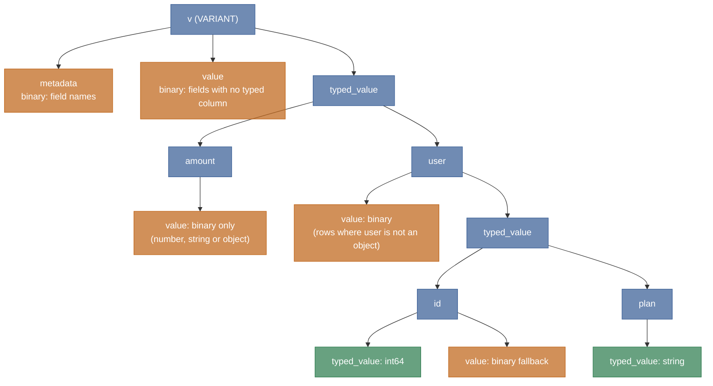
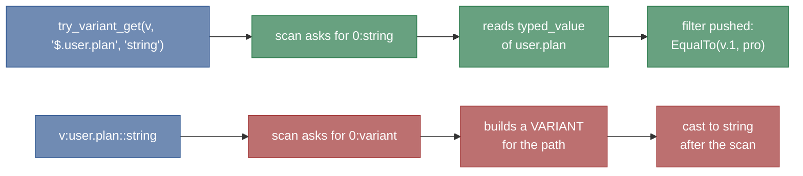

# Chapter 15: VARIANT: landing, profiling and editing

[Chapter 13](ch13-json.md) read three days of drifting events with a schema that you write. That method works, but the schema must know each shape before the read. When a producer adds a field on day four, the schema does not have it, and the field is lost until someone changes the code.

`VARIANT` is the other method. A `VARIANT` column keeps each record as a typed value with its full structure, and it needs no schema. You land the data first. Then you find which shapes the data has, and you select the fields that you need.

**A `VARIANT` value is not JSON text. Spark parses the JSON one time, at the read, into a binary form with a dictionary of field names and typed values. Each later extraction reads that binary form, and it does not parse text again. In Parquet, Spark also shreds the common fields of each file into typed columns. Then a typed extraction reads only one column, and a filter on it goes into the scan.** Spark 4.3 adds functions that edit a `VARIANT` value in place.

The data is the `events/` folder from Chapter 13, in [`code/data/messy`](https://github.com/lisancao/spark-masterclass/tree/main/code/data/messy): three days of order events with five kinds of drift and one cut-off line. Step 13 also uses one million NYC taxi trips. The scripts are [`code/ch15/land.py`](https://github.com/lisancao/spark-masterclass/tree/main/code/ch15), `edit.py`, `shred.py` and `speed.py`. All output is from `code/ch15/output/`, on Spark 4.3.0 with `spark.sql.session.timeZone=UTC`.

## Three ways to keep a JSON record

| Column type | Schema | Each read of a field | A new field from the producer |
|---|---|---|---|
| `STRING` (the JSON text) | none | parses the text again | kept in the text |
| `STRUCT` (from a schema) | you write it before the read | reads one typed column | lost, until you change the schema |
| `VARIANT` | none | reads the binary form, no text parse | kept, with its type |

A `STRING` column keeps all the data, but each query pays for a parse of each record. A `STRUCT` column is fast, but it is strict. `VARIANT` keeps the data like a string, and reads it almost like a struct.

## Step 1: `parse_json` and `try_parse_json`

`parse_json` changes JSON text into a `VARIANT` value:

```text
== parse_json and try_parse_json ==
  parse_json('{"a": 1}')                       -> {"a":1}
  parse_json('{"a": ')                         -> MALFORMED_RECORD_IN_PARSING.WITHOUT_SUGGESTION
  try_parse_json('{"a": ')                     -> None
  parse_json('{"a": '), ANSI off               -> MALFORMED_RECORD_IN_PARSING.WITHOUT_SUGGESTION
  collected: VariantVal  toPython(): {'amount': '12.50', 'items': [{'sku': 'P1'}, {'sku': 'P2'}], 'note': None, 'odd key': 1, 'user': {'id': 7, 'plan': 'pro'}}
```

- `parse_json` stops the query on text that is not valid JSON. This occurs also when ANSI mode is off. The ANSI setting does not change it.
- `try_parse_json` gives `NULL` for text that is not valid JSON. Use it on data that you do not control.
- In Python, a collected `VARIANT` value is a `VariantVal`. `toPython()` changes it into Python dictionaries and lists. `toJson()` gives JSON text.

## Step 2: Paths and casts

A path reads a part of a `VARIANT` value. SQL has a short form with `:` for the path and `::` for a cast. The functions `variant_get` and `try_variant_get` take a JSON path and a type:

```text
== paths and casts ==
  v:user.id                                    -> 7
  typeof(v:user.id)                            -> variant
  v:user.id::int                               -> 7
  v:items[1].sku::string                       -> P2
  v:['odd key']                                -> 1
  v:User.id (case)                             -> None
  v:missing                                    -> None
  variant_get(v, '$.user.plan', 'string')      -> pro
  v:amount::double  (a string)                 -> 12.5
  v:user.plan::int                             -> INVALID_VARIANT_CAST
  try_variant_get(v, '$.user.plan', 'int')     -> None
  parse_json('12.5')::int                      -> 12
  parse_json('"12.5"')::int                    -> INVALID_VARIANT_CAST
  v:items::array<variant>                      -> 2
  v:user::map<string,string>                   -> {'plan': 'pro', 'id': '7'}
```

The rules are these:

- **A path gives a `VARIANT`.** `v:user.id` is still a `VARIANT`, not a number. Cast it to get a typed value.
- **Names are case-sensitive.** `v:User.id` is `NULL`. Put a name with a space or a dot in brackets: `v:['odd key']`.
- **A path that is not there gives `NULL`**, not an error. Thus an incorrect path gives a column of `NULL` values.
- **A cast that cannot work is an error, `INVALID_VARIANT_CAST`.** The string `"pro"` cannot become an `int`. `try_variant_get` gives `NULL` for the same value.
- **Some casts change the value without an error.** The number `12.5` becomes the `int` 12, and the decimal part is lost. The string `"12.50"` becomes the `double` 12.5. But the string `"12.5"` cannot become an `int`.
- **An array or an object can become a typed array or a map.** `v:items::array<variant>` gives an array with one `VARIANT` value for each element. `v:user::map<string,string>` gives a map.

## Step 3: A JSON `null` is not a missing key

JSON has its own `null` value. In a `VARIANT`, a JSON `null` is a value, and a missing key is no value. The two are different:

```text
== JSON null and a missing key ==
+----------------+-----------------+-------------------+--------------------+--------------+
|note_is_sql_null|note_is_json_null|missing_is_sql_null|missing_is_json_null|note_as_string|
+----------------+-----------------+-------------------+--------------------+--------------+
|false           |true             |true               |false               |NULL          |
+----------------+-----------------+-------------------+--------------------+--------------+
```

`v:note` is a `VARIANT` that holds a JSON `null`. Thus `v:note IS NULL` is `false`. `is_variant_null` finds it. `v:missing` is a SQL `NULL`, because there is no value. After a cast to a type, the two cases give the same SQL `NULL`. If "the producer sent `null`" and "the producer did not send the field" have different meanings for you, test them before the cast.

## Step 4: `schema_of_variant` describes the shape

`schema_of_variant` gives the type of one value. `schema_of_variant_agg` merges the types of many values into one schema:

```text
== schema_of_variant and schema_of_variant_agg ==
+--------------------------------------------------------------------------------------------------------------------------------+
|one_row                                                                                                                         |
+--------------------------------------------------------------------------------------------------------------------------------+
|OBJECT<amount: STRING, items: ARRAY<OBJECT<sku: STRING>>, note: VOID, `odd key`: BIGINT, user: OBJECT<id: BIGINT, plan: STRING>>|
+--------------------------------------------------------------------------------------------------------------------------------+

OBJECT<a: VARIANT, b: ARRAY<BIGINT>>
OBJECT<a: DECIMAL(21,1)>
```

A JSON `null` has the type `VOID`. When the values of a field have types that do not merge, the merged type is `VARIANT`. Here `a` is a number in two records and a string in one. Two numbers of different sizes merge into a type that holds both: `1`, `123456789012` and `2.5` give `DECIMAL(21,1)`.

These functions describe the data. They do not change it. Each value keeps its own type. This is the main difference from JSON schema inference in [Chapter 13](ch13-json.md), Step 3, which changes each conflict into `string`.

## Step 5: Land the three days as `VARIANT`

The JSON reader option `singleVariantColumn` puts each record into one `VARIANT` column. Together with a corrupt record column, the read keeps all the data and needs no schema for the content:

```python
ev = (spark.read
      .option("singleVariantColumn", "v")
      .option("columnNameOfCorruptRecord", "_bad")
      .schema("v VARIANT, _bad STRING")
      .json(EVENTS)
      .withColumn("file", F.col("_metadata.file_name"))
      .cache())
```

```text
== land the three days as VARIANT ==
root
 |-- v: variant (nullable = true)
 |-- _bad: string (nullable = true)
 |-- file: string (nullable = false)

rows: 61  malformed: 1
+----+-------------------------------------------+----------------------+
|v   |_bad                                       |file                  |
+----+-------------------------------------------+----------------------+
|NULL|{"event_type": "purchase", "user": {"id": 9|events_2026-10-03.json|
+----+-------------------------------------------+----------------------+

only singleVariantColumn, no schema: ['v']  NULL rows: 1
  schema() before the options (classic)        -> INVALID_SINGLE_VARIANT_COLUMN
no inference job: the read gives the schema without a pass over the data
```

All 61 lines are rows. The cut-off line has `NULL` in `v` and its text in `_bad`. Without the schema and the corrupt record option, the bad line is only a row with `NULL` in `v`, and its text is lost. As in Chapter 13, cache the DataFrame before you query `_bad` alone.

The read starts no inference job, because the schema of the column is always `VARIANT`. A day with a new field gives the same DataFrame schema as before.

!!! caution
    In classic PySpark 4.3.0, the order of the reader calls is important. If you call `.schema()` before `.option("singleVariantColumn", ...)`, the read fails with `INVALID_SINGLE_VARIANT_COLUMN`. Each `.schema()` and `.option()` call checks the schema against the options that are set at that time. Set the options first, and call `.schema()` last.

## Step 6: Profile the keys and their types

With the data in one column, a query can find which shapes occur. `variant_explode` is a table-valued function. It gives one row for each field of an object, with the columns `pos`, `key` and `value`:

```sql
SELECT key, count(*) AS n,
       sort_array(collect_set(regexp_extract(schema_of_variant(value), '^[A-Z]+', 0))) AS types,
       sort_array(collect_set(schema_of_variant(value))) AS exact
FROM ev, LATERAL variant_explode(v)
GROUP BY key ORDER BY key
```

```text
== profile: every top-level key, how often, and its types ==
+----------+---+-------------------------+-------------------------------------------------------------------------------------------------------------------------------------------------------------------------------------------------------------+
|key       |n  |types                    |exact                                                                                                                                                                                                        |
+----------+---+-------------------------+-------------------------------------------------------------------------------------------------------------------------------------------------------------------------------------------------------------+
|amount    |60 |[DECIMAL, OBJECT, STRING]|[DECIMAL(2,1), DECIMAL(3,1), DECIMAL(3,2), DECIMAL(4,2), OBJECT<currency: STRING, value: DECIMAL(3,1)>, OBJECT<currency: STRING, value: DECIMAL(3,2)>, OBJECT<currency: STRING, value: DECIMAL(4,2)>, STRING]|
|event     |40 |[STRING]                 |[STRING]                                                                                                                                                                                                     |
|event_type|20 |[STRING]                 |[STRING]                                                                                                                                                                                                     |
|items     |40 |[ARRAY]                  |[ARRAY<OBJECT<qty: BIGINT, sku: STRING>>]                                                                                                                                                                    |
|ts        |60 |[STRING]                 |[STRING]                                                                                                                                                                                                     |
|user      |40 |[OBJECT]                 |[OBJECT<geo: OBJECT<country: STRING>, id: BIGINT, plan: STRING>, OBJECT<id: BIGINT, plan: STRING>]                                                                                                           |
|user_id   |20 |[BIGINT]                 |[BIGINT]                                                                                                                                                                                                     |
+----------+---+-------------------------+-------------------------------------------------------------------------------------------------------------------------------------------------------------------------------------------------------------+

+----------------------+---------------------------------------------+
|file                  |amount_schema                                |
+----------------------+---------------------------------------------+
|events_2026-10-01.json|DECIMAL(4,2)                                 |
|events_2026-10-02.json|VARIANT                                      |
|events_2026-10-03.json|OBJECT<currency: STRING, value: DECIMAL(4,2)>|
+----------------------+---------------------------------------------+
```

This one query finds all five kinds of drift from Chapter 13:

- `amount` has three kinds of type: a number, a string and an object.
- `event` and `event_type` are in 40 and 20 rows. They are one field with two names.
- `user_id` and `user` are in 20 and 40 rows. The user ID moved into an object.
- `user` has two shapes, one with `geo` and one without.

The `exact` column shows a problem with the profile. Each JSON number with a decimal point is a `DECIMAL` with its own precision, so one field gives many `DECIMAL(p,s)` types. `regexp_extract(..., '^[A-Z]+', 0)` keeps only the name of the kind, and the `types` column is easy to read.

The second table groups by file. Day 1 has one type, day 2 mixes numbers and strings (the merge gives `VARIANT`), and day 3 has an object. This tells you when the producer changed.

`variant_explode` gives one row for each field of an object, and one row for each element of an array (with a `NULL` key). For a scalar it gives no rows:

```text
== variant_explode: what it gives for an object, an array and a scalar ==
+------+---+----+-----+
|input |pos|key |value|
+------+---+----+-----+
|object|0  |a   |1    |
|object|1  |b   |2    |
|array |0  |NULL|"x"  |
|array |1  |NULL|"y"  |
+------+---+----+-----+

variant_explode_outer(v:items): 82  variant_explode(v:items): 61
```

The object rows come out in key order (`a` before `b`), not in the order of the text. `variant_explode_outer` keeps the rows with no items. It gives 61 item rows, and 21 rows for the records with no `items`. These are the 20 records of day 1 and the bad line.

## Step 7: Normalize the shapes into typed columns

The profile tells you each shape. For each field, try each shape with `try_variant_get`, and take the first value that is not `NULL`:

```python
def get(path, type_):
    return F.try_variant_get("v", path, type_)


silver = (ev.where("_bad IS NULL")
          .select(F.coalesce(get("$.event_type", "string"), get("$.event", "string")).alias("event_type"),
                  F.coalesce(get("$.user.id", "bigint"), get("$.user_id", "bigint")).alias("user_id"),
                  get("$.user.plan", "string").alias("plan"),
                  F.coalesce(get("$.amount", "double"), get("$.amount.value", "double")).alias("amount"),
                  get("$.ts", "timestamp").alias("ts"),
                  "file"))
```

```text
+----------------------+----+------+----------+------------+
|file                  |rows|amount|null_users|null_amounts|
+----------------------+----+------+----------+------------+
|events_2026-10-01.json|20  |530.03|0         |0           |
|events_2026-10-02.json|20  |609.83|0         |0           |
|events_2026-10-03.json|20  |433.54|0         |0           |
+----------------------+----+------+----------+------------+
```

No user and no amount is `NULL` in any file. `try_variant_get(v, '$.amount', 'double')` reads the number and the string forms, and gives `NULL` for the object. Then `coalesce` takes `$.amount.value`. `try_variant_get(..., 'timestamp')` parses the ISO text of `ts` into a `timestamp`.

This is the same normalization as in Chapter 13, Step 7. The difference is the order of the work. Chapter 13 needed a schema that listed each shape before the read. Here the read takes everything, and the code that handles the shapes comes after the profile.

The `items` arrays become rows with `variant_explode_outer` in SQL:

```sql
SELECT item.value:sku::string AS sku, item.value:qty::int AS qty
FROM ev, LATERAL variant_explode_outer(v:items) AS item
```

```text
+---+---+
|sku|qty|
+---+---+
|P1 |8  |
|P2 |12 |
|P3 |3  |
|P4 |18 |
|P5 |7  |
|P6 |11 |
|P7 |14 |
|P8 |11 |
|P9 |14 |
+---+---+

items via explode(try_variant_get(v, '$.items', 'array<variant>')): 61
```

In the DataFrame API, cast the array to `array<variant>` and use `explode` ([Chapter 14](ch14-complex-types.md), Step 9).

## Step 8: The rules of the type

`VARIANT` has rules that a string or a struct does not have:

```text
== the rules of the type ==
  GROUP BY v                                   -> GROUP_EXPRESSION_TYPE_IS_NOT_ORDERABLE
  ORDER BY v                                   -> DATATYPE_MISMATCH.INVALID_ORDERING_TYPE
  v = v                                        -> DATATYPE_MISMATCH.INVALID_ORDERING_TYPE
  DISTINCT v                                   -> UNSUPPORTED_FEATURE.SET_OPERATION_ON_VARIANT_TYPE
  GROUP BY to_json(v)                          -> 60
  to_json sorts keys: {"a":2,"b":1}
  number types: ['DECIMAL(4,2)', 'DOUBLE', 'BIGINT', 'DECIMAL(20,0)']
  0.1 + 0.2 as DECIMAL: 0.30  as DOUBLE: 0.30000000000000004
  to_variant_object(struct): {"a":1,"b":[1,2]}
  CAST(named_struct('a', 1) AS VARIANT)        -> DATATYPE_MISMATCH.CAST_WITHOUT_SUGGESTION
  CAST(map('a', 1) AS VARIANT)                 -> DATATYPE_MISMATCH.CAST_WITHOUT_SUGGESTION
```

- **You cannot compare, group, sort or deduplicate on a `VARIANT`.** Spark has no order and no equality for the type. Extract a typed field first. If you must compare full values, `to_json(v)` gives a key for the comparison.
- **`to_json` sorts the keys of each object.** The JSON text that you get back is not the text that came in. Two records with the same fields in a different order give the same text. This is why `to_json` works as a key for the comparison.
- **JSON numbers keep their exact form.** A number with a decimal point is a `DECIMAL`, so `0.1 + 0.2` is exactly `0.30`. A number with an exponent (`1e3`) is a `DOUBLE`. An integer is a `BIGINT`, and an integer that is too large becomes a `DECIMAL`. Cast money to `DECIMAL`, not to `DOUBLE`.
- **A struct or a map does not cast to `VARIANT`.** Use `to_variant_object`, which changes structs and maps into `VARIANT` objects.

## Step 9: New in 4.3: edit a `VARIANT` value in place

Before Spark 4.3, there was only one method to change a field in a `VARIANT` value. You changed the value into JSON text, edited the text, and parsed it again. Spark 4.3 adds functions that change a value at a path:

| Function | What it does | If the field is already there |
|---|---|---|
| `variant_set(v, path, val[, create_if_missing])` | sets a value | replaces it |
| `variant_insert(v, path, val)` | adds a field, or puts an element into an array | error |
| `variant_delete(v, path1, path2, ...)` | removes fields or elements | (removes it) |
| `variant_array_append(v, path, val)` | adds an element at the end of an array | (adds it) |
| `variant_strip_nulls(v[, include_arrays])` | removes the JSON `null` values, at all levels | (removes them) |

Each function except `variant_delete` and `variant_strip_nulls` also has a `try_` form. The `try_` form gives `NULL` where the plain form gives an error. The script calls each function on one value:

```text
== the five edit functions on one value ==
  variant_set(v, '$.amount', 12.5)                     -> {"amount":12.5,"note":null,"tags":["a"],"user":{"geo":{"country":"CA"},"id":7}}
  variant_set(v, '$.user.plan', 'pro')                 -> {"amount":"12.50","note":null,"tags":["a"],"user":{"geo":{"country":"CA"},"id":7,"plan":"pro"}}
  variant_set(v, '$.user.plan', 'pro', false)          -> {"amount":"12.50","note":null,"tags":["a"],"user":{"geo":{"country":"CA"},"id":7}}
  variant_insert(v, '$.user.plan', 'pro')              -> {"amount":"12.50","note":null,"tags":["a"],"user":{"geo":{"country":"CA"},"id":7,"plan":"pro"}}
  variant_insert(v, '$.amount', 1)                     -> VARIANT_DUPLICATE_KEY
  try_variant_insert(v, '$.amount', 1)                 -> None
  variant_insert(v, '$.tags[0]', 'z')                  -> {"amount":"12.50","note":null,"tags":["z","a"],"user":{"geo":{"country":"CA"},"id":7}}
  variant_delete(v, '$.user.geo', '$.note')            -> {"amount":"12.50","tags":["a"],"user":{"id":7}}
  variant_delete(v, '$.nothing')                       -> {"amount":"12.50","note":null,"tags":["a"],"user":{"geo":{"country":"CA"},"id":7}}
  variant_array_append(v, '$.tags', 'b')               -> {"amount":"12.50","note":null,"tags":["a","b"],"user":{"geo":{"country":"CA"},"id":7}}
  variant_array_append(v, '$.amount', 'b')             -> VARIANT_PATH_TYPE_MISMATCH
  try_variant_array_append(v, '$.amount', 'b')         -> None
  variant_strip_nulls(v)                               -> {"amount":"12.50","tags":["a"],"user":{"geo":{"country":"CA"},"id":7}}
  variant_set(v, '$.amount.value', 1)                  -> VARIANT_PATH_TYPE_MISMATCH
  try_variant_set(v, '$.amount.value', 1)              -> None
  variant_set(v, '$', 1)  (the root)                   -> INVALID_VARIANT_PATH
  variant_set(v, '$.x', NULL)                          -> None
  variant_set(v, '$.x', parse_json('null'))            -> {"amount":"12.50","note":null,"tags":["a"],"user":{"geo":{"country":"CA"},"id":7},"x":null}
  variant_set(v, '$.x', named_struct('a', 1))          -> DATATYPE_MISMATCH.CAST_WITHOUT_SUGGESTION
  variant_set(v, '$.tags[3]', 'd')                     -> {"amount":"12.50","note":null,"tags":["a",null,null,"d"],"user":{"geo":{"country":"CA"},"id":7}}
  variant_set with a path from a column                -> {"a":1,"amount":"12.50","note":null,"tags":["a"],"user":{"geo":{"country":"CA"},"id":7}}
  variant_set with a column create_if_missing          -> DATATYPE_MISMATCH.NON_FOLDABLE_INPUT
  variant_strip_nulls(v, false)  (keep array NULLs)    -> {"a":[1,null,{}]}
  variant_strip_nulls(v)  (default)                    -> {"a":[1,{}]}
```

The rules that follow from this output:

- **`variant_set` makes missing parts of the path.** `$.user.plan` adds `plan` to `user`. With `create_if_missing` set to `false`, the value stays the same. This argument must be a constant.
- **`variant_insert` refuses to replace.** Use it when a field that is already there is an error in your data.
- **A path through the wrong kind of value is an error**, `VARIANT_PATH_TYPE_MISMATCH`. `amount` is a string, so `$.amount.value` cannot go through it. The `try_` form gives `NULL`. Then the function gives `NULL` for the full value, not the value without the change. Keep the original with `coalesce(try_variant_set(...), v)` if that is what you want.
- **The root `$` is not a valid target.**
- **A SQL `NULL` value makes the full result `NULL`.** To store a JSON `null`, give `parse_json('null')`.
- **An index past the end of an array adds JSON `null` elements** up to the index.
- **A struct is not a valid value.** Use `to_variant_object` first, as in Step 8.
- **The path can come from a column.** This is useful when a table holds a list of edits.
- **`variant_strip_nulls` works at all levels, and in arrays by default.** It does not remove the empty object that is left.

These functions are also in `pyspark.sql.functions`: `F.variant_set`, `F.variant_delete` and the others. In Python, give the path as `F.lit("$.a")`.

### Fix the events in place

Now the three days can become one shape inside the `VARIANT` column. The code sets one form for `amount`, one place for the user ID and one name for the event. It adds a version field and removes the old fields and the `geo` data:

```python
amount = F.coalesce(F.try_variant_get("v", "$.amount", "decimal(10,2)"),
                    F.try_variant_get("v", "$.amount.value", "decimal(10,2)"))
user_id = F.coalesce(F.try_variant_get("v", "$.user.id", "bigint"), F.try_variant_get("v", "$.user_id", "bigint"))
event = F.coalesce(F.try_variant_get("v", "$.event_type", "string"), F.try_variant_get("v", "$.event", "string"))
v = F.col("v")
v = F.variant_set(v, F.lit("$.amount"), amount)          # one shape: a decimal number
v = F.variant_set(v, F.lit("$.user.id"), user_id)        # move user_id into user
v = F.variant_set(v, F.lit("$.event_type"), event)       # one name for the event
v = F.variant_set(v, F.lit("$.v"), F.lit(2))             # a schema version
v = F.variant_delete(v, F.lit("$.user.geo"), F.lit("$.user_id"), F.lit("$.event"))
fixed = ev.select("file", v.alias("v"))
```

```text
== fix the events in place: one shape for amount, no geo, a schema version ==
+----------------------+---------------------------------------------------------------------------------------------------------------------------------------------------------------+
|file                  |schema                                                                                                                                                         |
+----------------------+---------------------------------------------------------------------------------------------------------------------------------------------------------------+
|events_2026-10-01.json|OBJECT<amount: DECIMAL(4,2), event_type: STRING, ts: STRING, user: OBJECT<id: BIGINT>, v: BIGINT>                                                              |
|events_2026-10-02.json|OBJECT<amount: DECIMAL(4,2), event_type: STRING, items: ARRAY<OBJECT<qty: BIGINT, sku: STRING>>, ts: STRING, user: OBJECT<id: BIGINT, plan: STRING>, v: BIGINT>|
|events_2026-10-03.json|OBJECT<amount: DECIMAL(4,2), event_type: STRING, items: ARRAY<OBJECT<qty: BIGINT, sku: STRING>>, ts: STRING, user: OBJECT<id: BIGINT, plan: STRING>, v: BIGINT>|
+----------------------+---------------------------------------------------------------------------------------------------------------------------------------------------------------+

sum of amounts after the edit: 1573.40
```

All three files now have `amount` as a `DECIMAL`, `user.id` inside `user`, and one `event_type` field. The sum, 1573.40, is the sum of the three days in Step 7 (530.03 + 609.83 + 433.54). No amount was lost. The fields that only some days have, such as `items` and `plan`, stay in the value. A typed table would need a column for each of them.

The edit functions are normal expressions in a `Project`, and they take part in whole-stage code generation:

```text
plan of the edit:
  *(1) Project [_metadata#26.file_name AS file#27, variant_delete(variant_set(variant_set(variant_set(variant_set(v#25, $.amount, coalesce(try_vari ...
```

Use these functions for a fix that must keep the data in `VARIANT` form. Some examples:

- Remove personal data from a bronze table.
- Give a field a new name.
- Give a field one shape before you shred it (Step 11).

## Step 10: How Parquet stores a `VARIANT` column

A `VARIANT` value has two parts, as the Parquet `VARIANT` logical type defines them:

- **`metadata`**: a dictionary of the field names in the value. Each name is in the dictionary one time.
- **`value`**: the data. Each object refers to its field names by their position in the dictionary. Each scalar has a type tag in front of its bytes.

Chapter 61 shows these bytes one by one. Here the important point is that the value is already parsed. To read `user.id`, Spark finds `user` in the dictionary, jumps to its offset, and reads the type tag and the bytes of `id`. There is no text parse.

With shredding off, a Parquet file has exactly these two binary columns:

```text
== shredding off: two binary columns ==
required group field_id=-1 spark_schema {
  optional group field_id=-1 v (Variant(1)) {
    required binary field_id=-1 value;
    required binary field_id=-1 metadata;
  }
}
```

A query that needs one field must read the full `value` column. Parquet column pruning cannot help, because the column is one binary blob. The binary column also has no useful minimum and maximum statistics, so the reader cannot skip row groups.

## Step 11: Shredding puts common fields into typed columns

**Shredding** splits a `VARIANT` column on write. For each field that most rows have with one type, the writer makes a typed Parquet column, `typed_value`. A row whose value does not fit that type keeps the value in a binary `value` column next to it. The data does not change. Only the storage changes. Shredding is on by default (`spark.sql.variant.writeShredding.enabled`).

The footer of the three-day file shows the result. The script reads it with `pyarrow`:

```text
== shredding on (the default): the footer of the three-day file ==
25 leaf columns, for example:
  v.metadata
  v.value
  v.typed_value.amount.value
  v.typed_value.user.value
  v.typed_value.user.typed_value.geo.value
  v.typed_value.user.typed_value.geo.typed_value.country.value
  v.typed_value.user.typed_value.geo.typed_value.country.typed_value
  v.typed_value.user.typed_value.id.value
  v.typed_value.user.typed_value.id.typed_value
  v.typed_value.user.typed_value.plan.value
  v.typed_value.user.typed_value.plan.typed_value
  v.typed_value.user_id.value
  v.typed_value.user_id.typed_value
shredded fields: ['event', 'event_type', 'items[].qty', 'items[].sku', 'ts', 'user.geo.country', 'user.id', 'user.plan', 'user_id']
```



Each field gets a pair: `typed_value` with a real Parquet type, and `value` for the rows that do not fit. `user.id` is an `int64` column. `amount` has only a `value` column. In this file, its values are a number, a string or an object, and no one type fits enough rows.

### How the writer selects the shredding schema

The writer selects a separate shredding schema for each file. The rules are in `ParquetOutputWriterWithVariantShredding.scala` and `InferVariantShreddingSchema.scala`:

- The writer keeps the first 4096 rows of the file in memory, or fewer rows if they use more than 64 MB. It infers the schema from those rows only.
- A field must be in at least 10% of the non-null values. A field that fewer rows have stays in the binary `value`.
- The values of a field must have one kind of scalar type. Integer and decimal sizes widen, but a number and a string do not merge.
- The schema has at most 300 fields (`spark.sql.variant.shredding.maxSchemaWidth`) and 50 levels (`spark.sql.variant.shredding.maxSchemaDepth`).

The script tests each rule:

```text
== one file for each day: each file gets its own shredding schema ==
  10-01: ['amount', 'event', 'ts', 'user_id']
  10-02: ['event', 'items[].qty', 'items[].sku', 'ts', 'user.id', 'user.plan']
  10-03: ['amount.currency', 'amount.value', 'event_type', 'items[].qty', 'items[].sku', 'ts', 'user.geo.country', 'user.id', 'user.plan']

== a field in fewer than 10% of the rows is not shredded ==
  rare in 9% of rows:  ['a']
  rare in 11% of rows: ['a', 'rare']
  a: half BIGINT, half STRING: []
  late appears after row 5000: ['a']
```

- **A file of one day shreds `amount`.** Day 1 has only numbers, so `amount` gets a typed column. Day 3 has only objects, so `amount.value` and `amount.currency` get typed columns. Day 2 mixes numbers and strings, so `amount` stays binary. In the file with all three days, `amount` stays binary too.
- **The 10% limit is exact.** A field in 9% of 1000 rows stays binary. At 11%, it gets a column.
- **A field with two kinds of type gets no column.**
- **A field that first occurs after the sample is not shredded.** The field `late` is in half of the 10,000 rows, but not in the first 4096.

This has consequences for the layout of a table. A file that mixes old and new shapes shreds less than a file with one shape. A `coalesce(1)` across all days gives the worst case. Write each day, or each shape, to its own files. Or fix the shape first with the edit functions of Step 9, and then write. The shredding configurations are internal, and the writer has no public option to give it a shredding schema in Spark 4.3.0.

## Step 12: Which extractions the scan can push down

When Spark reads a `VARIANT` column from Parquet, the optimizer rule `PushVariantIntoScan` changes the scan. The scan does not read the full value. It reads a struct with one field for each extraction that the query uses. The `ReadSchema` of the scan shows that struct:

```text
== what the scan reads: try_variant_get against a path and a cast ==
  select v                                       ReadSchema: struct<v:struct<0:variant>>
  try_variant_get(v, '$.user.plan', 'string')    ReadSchema: struct<v:struct<0:string>>
  v:user.plan::string                            ReadSchema: struct<v:struct<0:variant>>
  variant_get(v, '$.user.plan', 'string')        ReadSchema: struct<v:struct<0:string>>
  v:user.plan  (a VARIANT)                       ReadSchema: struct<v:struct<0:variant>>

  where try_variant_get(...) = 'pro'     PushedFilters: [IsNotNull(v), EqualTo(v.`1`,pro)]
  where v:user.plan::string = 'pro'      PushedFilters: [IsNotNull(v)]
```

There are two kinds of extraction:

- **`variant_get` and `try_variant_get` ask the scan for a typed field.** The field `0` is a `string`. The reader reads the shredded `typed_value` column for `user.plan` directly. A filter on the result goes into the scan as `EqualTo(v.`1`,pro)`, and the reader can use the column statistics.
- **`v:user.plan::string` asks the scan for a `VARIANT`.** The `:` path gives a `VARIANT`, and the cast runs after the scan. The reader must build a `VARIANT` value for the path, and no filter goes into the scan.

The two forms give the same answer, but they do not have the same cost. In code that reads Parquet, use `variant_get` or `try_variant_get` with a type, not the `::` form.



### New in 4.3: extractions inside aggregates and joins

Before Spark 4.3, the rule pushed an extraction into the scan only from a `Project` or a `Filter` directly above it. An extraction inside an aggregate function, a join condition or a sort key made the scan read the full `VARIANT`. Spark 4.3 extends the rule (SPARK-58089). The internal configuration `spark.sql.variant.pushVariantIntoScan.pullOutExtractions` controls it, and it is on by default:

```text
== new in 4.3: extractions inside an aggregate are pushed into the scan too ==
+----+-----+
|plan|count|
+----+-----+
|NULL|21   |
|free|9    |
|pro |31   |
+----+-----+

  sum(...), count_if(...): pullOutExtractions=true  ReadSchema: struct<v:struct<0:string,1:double>>
  sum(...), count_if(...): pullOutExtractions=false ReadSchema: struct<v:struct<0:variant,1:string>>
  result: Row(amount=1139.8599999999997, pro=31)
```

The query computes `sum(try_variant_get(v, '$.amount', 'double'))` and a `count_if` on the plan, in one aggregate. With the 4.3 behavior, the scan reads two typed fields. With the configuration off, it reads the full value (`0:variant`) for the sum. The sum is less than 1573.40, because the day 3 amounts are objects, and `try_variant_get(..., 'double')` gives `NULL` for them.

### A strict cast that fails inside the scan

```text
== a strict cast that fails inside the scan ==
  exception: Py4JJavaError
  conditions in the message: ['FAILED_READ_FILE.NO_HINT', 'INVALID_VARIANT_CAST']
```

`variant_get(v, '$.amount', 'double')` cannot cast the object amounts of day 3. Because the cast runs in the scan, the error comes from the file reader. The top error is `FAILED_READ_FILE.NO_HINT`, and the real cause, `INVALID_VARIANT_CAST`, is lower in the message. In classic PySpark, the exception is a raw `Py4JJavaError`, not a `PySparkException`. If a query on a `VARIANT` table fails with a file read error, look for `INVALID_VARIANT_CAST` in the full message.

## Step 13: What an extraction costs

The script stores one million taxi trips with nine columns in four ways. It uses typed Parquet columns, JSON text in a `STRING` column, and `VARIANT` without and with shredding. Then it runs one query on each: the average fare of card trips. It uses two fields, one for the filter and one for the aggregate:

```text
input: 1,000,000 taxi trips, 9 columns, 16 cores, local[*]
  typed             9.0 MB on disk
  json             30.1 MB on disk
  variant_plain    19.8 MB on disk
  variant_shred     9.0 MB on disk
query: avg(fare_amount) WHERE payment_type = 1
  typed columns                              0.33 s
  JSON text, get_json_object                 5.40 s
  JSON text, from_json                       5.19 s
  VARIANT unshredded, v:path::type           1.15 s
  VARIANT unshredded, try_variant_get        1.40 s
  VARIANT shredded, v:path::type             2.85 s
  VARIANT shredded, try_variant_get          0.31 s
all answers equal: True [19.769948]
```

Each time is the median of five runs after one warm-up run, on 16 cores in `local[*]`, under the benchmark lock. All seven queries give the same answer. The results show four points:

- **JSON text is the slowest by far.** `get_json_object` and `from_json` parse the text of each row for each query, and they take more than 5 seconds. The JSON text is also the largest file, at 30.1 MB.
- **An unshredded `VARIANT` is about four times faster than JSON text.** The value is already parsed, so an extraction is a lookup in the binary form. But each query still reads the full binary column (19.8 MB).
- **A shredded `VARIANT` with `try_variant_get` is as fast as typed columns:** 0.31 s against 0.33 s. The scan reads only the two typed Parquet columns. The shredded file is also as small as the typed file (9.0 MB), because the typed columns get the normal Parquet encodings and compression.
- **A shredded `VARIANT` with the `::` form is slower than an unshredded one.** The scan must build a `VARIANT` value for each path from the shredded columns, and then cast it (Step 12). This one choice changes the time of the query by a factor of nine.

These numbers are for one query shape on one machine. The order of the results is the important part, not the exact times.

## When to promote a field to a column

`VARIANT` is the correct type for the bronze layer, where the data arrives in many shapes. For the fields that each query uses, a typed column is still better. It has a fixed type, it has statistics, and a reader of the table sees it in the schema. The usual design is a silver table with both:

- typed columns for the stable fields that queries use in filters, groups and joins (`event_type`, `user_id`, `amount`, `ts`). Make them with `coalesce` over each shape, as in Step 7.
- the full record as a `VARIANT` column (`payload`). It keeps the fields that only some queries need, and the fields that the producer adds later.

When the profile of Step 6 shows that a field in `payload` is now common and stable, promote it to a column.

## The whole chapter, on one page

```python
from pyspark.sql import functions as F

ev = (spark.read
      .option("singleVariantColumn", "v")                   # options first, schema last (classic)
      .option("columnNameOfCorruptRecord", "_bad")
      .schema("v VARIANT, _bad STRING")
      .json("events/")
      .withColumn("file", F.col("_metadata.file_name"))
      .cache())
ev.createOrReplaceTempView("ev")

profile = spark.sql("""SELECT key, count(*) AS n,
                              sort_array(collect_set(regexp_extract(schema_of_variant(value), '^[A-Z]+', 0))) AS types
                       FROM ev, LATERAL variant_explode(v) GROUP BY key""")

def get(path, t):                                           # typed: pushes into a Parquet scan
    return F.try_variant_get("v", path, t)

silver = (ev.where("_bad IS NULL")
          .select(F.coalesce(get("$.event_type", "string"), get("$.event", "string")).alias("event_type"),
                  F.coalesce(get("$.user.id", "bigint"), get("$.user_id", "bigint")).alias("user_id"),
                  F.coalesce(get("$.amount", "decimal(10,2)"), get("$.amount.value", "decimal(10,2)")).alias("amount"),
                  get("$.ts", "timestamp").alias("ts"),
                  F.variant_delete("v", F.lit("$.user.geo")).alias("payload")))   # 4.3: edit in place

silver.write.parquet("silver/events")                       # payload is shredded for each file
```

- **`VARIANT` keeps each record with its types, and needs no schema.** The read starts no inference job.
- **`:` paths give a `VARIANT`.** Cast them, or use `variant_get` and `try_variant_get` with a type.
- **A missing path is `NULL`. A JSON `null` is a value**, which `is_variant_null` finds.
- **Profile with `variant_explode` and `schema_of_variant`,** and keep only the kind of each type.
- **Normalize with `coalesce` over `try_variant_get` for each shape.**
- **You cannot compare, group or sort `VARIANT` values.** Extract a typed field, or use `to_json`.
- **New in 4.3:** `variant_set`, `variant_insert`, `variant_delete`, `variant_array_append` and `variant_strip_nulls` edit a value in place.
- **Parquet shreds each file separately,** from its first 4096 rows, for fields in at least 10% of rows with one kind of type.
- **`try_variant_get(v, path, type)` pushes a typed read and a filter into the scan. `v:path::type` does not.** In 4.3, extractions inside aggregates and joins also go into the scan.

[Chapter 16](ch16-xml-avro-protobuf.md) reads XML, where the same field can be one element or many, and uses `VARIANT` to handle it.

## Further reading

- [Semi-structured data with VARIANT](https://spark.apache.org/docs/4.3.0/sql-ref-datatypes.html), the data type reference.
- [Variant functions](https://spark.apache.org/docs/4.3.0/sql-ref-functions-builtin.html), the SQL reference for `parse_json`, `variant_get`, `variant_set` and the others.
- [`variantExpressions.scala`](https://github.com/apache/spark/blob/v4.3.0/sql/catalyst/src/main/scala/org/apache/spark/sql/catalyst/expressions/variant/variantExpressions.scala), the extraction and edit functions.
- [`InferVariantShreddingSchema.scala`](https://github.com/apache/spark/blob/v4.3.0/sql/core/src/main/scala/org/apache/spark/sql/execution/datasources/parquet/InferVariantShreddingSchema.scala), the shredding rules.
- [Parquet Variant shredding specification](https://github.com/apache/parquet-format/blob/master/VariantShredding.md), the file layout.
