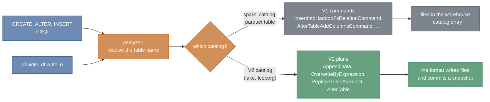
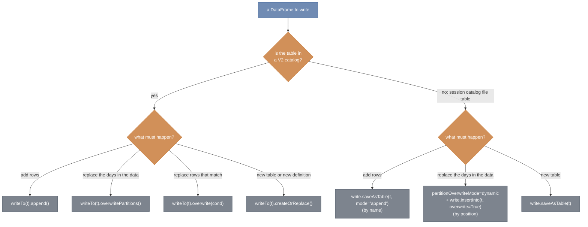
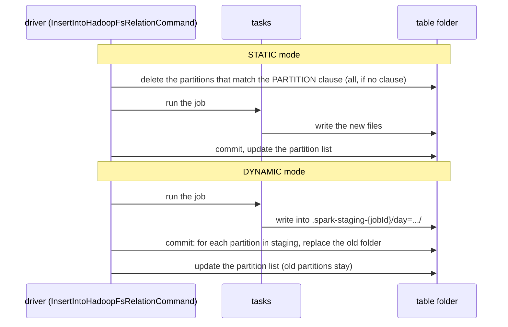

# Chapter 16: Tables, DDL and writes

[Chapter 15](ch15-spark-sql.md) made managed and external tables, a CTAS and three kinds of view. That is enough to read data. A pipeline must do more. It must add columns and replace one day of data. It must fill values that the source does not send. It must also keep a view correct after its table changes.

Each of these jobs has a statement in Spark SQL, and most of them also have a DataFrame call. The text of the statement is the same for each table. The result is not.

**A DDL statement or a write in Spark is a request to a catalog. The catalog behind the table name decides if the request works and what it does to the files. Thus, before you write DDL or a write job, find the catalog of the table. Then look at the files that each statement leaves on disk.**

The session catalog stores plain Parquet, ORC, CSV and JSON tables through the old (V1) path. It supports `DEFAULT` values, `ADD COLUMNS`, partition DDL, `TRUNCATE`, `COMMENT ON` and `INSERT OVERWRITE`. It refuses `REPLACE TABLE`, column renames, constraints and most `writeTo` calls. A V2 catalog, such as Iceberg, accepts most of those.

This chapter runs each statement on Spark 4.3.0 and lists the files after it. For Hive tables and the metastore, read [Chapter 17](ch17-hive-tables-metastore.md). For the table formats, read [Chapter 54](ch54-tables-delta-iceberg.md) and [Chapter 55](ch55-iceberg.md).

The scripts are in [`code/ch16`](https://github.com/open-lakehouse/spark-masterclass/tree/main/code/ch16), and each output block below comes from `code/ch16/output/`.

| Script | What it shows |
|---|---|
| `create_variants.py` | `CREATE TABLE ... USING` with partitions, buckets and options, CTAS, `LIKE`, `IF NOT EXISTS`, `EXTERNAL`, `REPLACE` |
| `defaults_constraints.py` | `DEFAULT` values, `NOT NULL`, generated and identity columns, `CHECK` and key constraints |
| `alter_comment.py` | `ALTER TABLE` on the session catalog, partition DDL, `TRUNCATE`, `COMMENT ON` |
| `view_schema.py` | The four `WITH SCHEMA` modes of a view, after five changes to its table |
| `writers.py` | `DataFrameWriter` save modes, `saveAsTable` and `insertInto`, `DataFrameWriterV2` |
| `partition_overwrite.py` | Static and dynamic partition overwrite, file by file |
| `insert_forms.py` | The forms of `INSERT`, the command that each one becomes, `REPLACE WHERE`, `BY NAME`, schema evolution |

Some steps compare the session catalog with a V2 catalog. The V2 catalog is an Iceberg Hadoop catalog named `lake`.

No Iceberg release supports Spark 4.3 on the date of this run. Thus, the scripts use the same unreleased build as [Chapter 55](ch55-iceberg.md). It is `iceberg-spark-runtime-4.3_2.13`, built from apache/iceberg PR #18749 at commit `b1eab64`. The Iceberg results show what a V2 catalog does. They are not a statement about a released Iceberg version.

## Where a statement goes



The two paths are different code. A V1 command such as `InsertIntoHadoopFsRelationCommand` writes files and then changes the catalog entry. A V2 plan such as `AppendData` gives the rows to the connector of the catalog, and the connector commits the change. Step 11 shows the command that each `INSERT` becomes on each path.

## Step 1: CREATE TABLE ... USING

`CREATE TABLE ... USING <format>` makes a data source table in the session catalog. The clauses after `USING` can come in any order. `create_variants.py` uses most of them in one statement:

```sql
CREATE TABLE trips_by_day (
  vendor INT COMMENT 'VendorID from the source',
  pu_zone INT,
  fare DECIMAL(10,2),
  day DATE)
USING parquet
PARTITIONED BY (day)
CLUSTERED BY (pu_zone) INTO 4 BUCKETS
OPTIONS ('compression' = 'zstd')
COMMENT 'one row per trip, partitioned by pickup day'
TBLPROPERTIES ('owner.team' = 'ops')
```

`DESCRIBE TABLE EXTENDED` shows where each clause went:

```text
  Type                MANAGED
  Provider            parquet
  Num Buckets         4
  Bucket Columns      [`pu_zone`]
  Comment             one row per trip, partitioned by pickup day
  Table Properties    [owner.team=ops]
  Storage Properties  [compression=zstd]
  Partition Provider  Catalog
```

The two kinds of key-value list have different jobs:

- `OPTIONS` become **storage properties**. The data source reads them each time that it reads or writes the table. Here, `compression=zstd` goes to the Parquet writer.
- `TBLPROPERTIES` become **table properties**. Spark keeps them in the catalog as labels. Your tools can read them.

The script inserts two days of June 2026 trips. The folder of the table shows each clause as a file name:

```text
  on disk: one folder per day, one file per bucket per task:
    _SUCCESS  (0 B)
    day=2026-06-01/part-00002-<uuid>_00000.c000.zstd.parquet  (34662 B)
    day=2026-06-01/part-00002-<uuid>_00001.c000.zstd.parquet  (57159 B)
    day=2026-06-01/part-00002-<uuid>_00002.c000.zstd.parquet  (19188 B)
    day=2026-06-01/part-00002-<uuid>_00003.c000.zstd.parquet  (41093 B)
    day=2026-06-01/part-00010-<uuid>_00000.c000.zstd.parquet  (19413 B)
    ...
    day=2026-06-02/part-00010-<uuid>_00003.c000.zstd.parquet  (24335 B)
```

- `PARTITIONED BY (day)` makes one folder for each value, `day=2026-06-01`. The `day` column is in the folder name, not in the files.
- `CLUSTERED BY ... INTO 4 BUCKETS` adds the bucket number to the file name, `_00000` to `_00003`. Each task writes one file for each bucket, so two tasks made eight files for each day.
- `OPTIONS ('compression' = 'zstd')` gives `.zstd.parquet`.

!!! warning "CAUTION"
    Do not add buckets to a table that many small jobs write. Each task writes one file for each bucket in each partition. The number of files is tasks multiplied by buckets multiplied by partitions.

A `CREATE TABLE` with no `USING` clause uses `spark.sql.sources.default`, which is `parquet`:

```text
== 2. CREATE TABLE with no USING: the provider is spark.sql.sources.default
> SET spark.sql.sources.default
+-------------------------+-------+
|key                      |value  |
+-------------------------+-------+
|spark.sql.sources.default|parquet|
+-------------------------+-------+

> CREATE TABLE notes (id INT, note STRING)
  notes Provider: parquet
```

Before Spark 4.0, this statement made a Hive table. The SQL migration guide gives `spark.sql.legacy.createHiveTableByDefault` to get the old behavior. [Chapter 17](ch17-hive-tables-metastore.md) shows the Hive table that it makes.

## Step 2: CTAS, LIKE, IF NOT EXISTS, EXTERNAL and REPLACE

A CTAS (`CREATE TABLE ... AS SELECT`) gets its schema from the query. It can have `PARTITIONED BY`, but it cannot have a column list:

```text
> CREATE TABLE daily USING parquet PARTITIONED BY (day) AS
     SELECT count(*) AS trips, round(sum(fare_amount), 2) AS fares, to_date(tpep_pickup_datetime) AS day
     ...
  on disk:
    _SUCCESS  (0 B)
    day=2026-06-01/part-00000-<uuid>.c000.snappy.parquet  (740 B)
    day=2026-06-02/part-00000-<uuid>.c000.snappy.parquet  (740 B)
    day=2026-06-03/part-00000-<uuid>.c000.snappy.parquet  (740 B)
  a CTAS cannot also give a column list:
> CREATE TABLE bad (n BIGINT) USING parquet AS SELECT 1 AS n
  ParseException: Operation not allowed: Schema may not be specified in a Create Table
  As Select (CTAS) statement. == SQL (line 1, position 1) == CREATE TABLE bad (n BIGINT) ...
```

To give each column a type, use a `CAST` in the query.

`CREATE TABLE ... LIKE` copies the definition of a table, with no data. A `USING` clause changes the format and keeps the columns and the partitions:

```text
== 4. CREATE TABLE LIKE: the definition, no data
> CREATE TABLE daily_empty LIKE daily
> CREATE TABLE daily_json LIKE daily USING json
  daily        Provider=parquet  rows=3   partition columns: ['day']
  daily_empty  Provider=parquet  rows=0   partition columns: ['day']
  daily_json   Provider=json     rows=0   partition columns: ['day']
```

`IF NOT EXISTS` does nothing when the table exists. It does not compare the definitions. In the output below, the first statement asks for a column `x` that `daily` does not have, and Spark accepts it with no message:

```text
== 5. IF NOT EXISTS, and a second CREATE without it
> CREATE TABLE IF NOT EXISTS daily (x INT) USING parquet
> CREATE TABLE daily (x INT) USING parquet
  AnalysisException: [TABLE_OR_VIEW_ALREADY_EXISTS] Cannot create table or view
  `spark_catalog`.`taxi`.`daily` because it already exists. Choose a different name, ...
```

`REPLACE TABLE` and `CREATE OR REPLACE TABLE` need a V2 catalog. The session catalog refuses them for a file source table:

```text
== 6. REPLACE TABLE and CREATE OR REPLACE TABLE need a V2 catalog
> CREATE OR REPLACE TABLE daily USING parquet AS SELECT 1 AS trips
  AnalysisException: [UNSUPPORTED_FEATURE.TABLE_OPERATION] The feature is not supported:
  Table `spark_catalog`.`taxi`.`daily` does not support REPLACE TABLE AS SELECT. Please ...
> REPLACE TABLE daily (x INT) USING parquet
  AnalysisException: [UNSUPPORTED_FEATURE.TABLE_OPERATION] The feature is not supported:
  Table `spark_catalog`.`taxi`.`daily` does not support REPLACE TABLE. Please check the ...
```

`EXTERNAL` needs `LOCATION`, and a `LOCATION` makes a table external also with no `EXTERNAL` keyword. A partitioned external table over folders that exist starts with no partitions in the catalog, so it reads no rows. `MSCK REPAIR TABLE` finds the folders:

```text
> CREATE EXTERNAL TABLE ext_nopath (x INT) USING parquet
  AnalysisException: [CREATE_EXTERNAL_TABLE_WITHOUT_LOCATION] CREATE EXTERNAL TABLE must
  be accompanied by LOCATION. SQLSTATE: 42601
> CREATE TABLE ext_daily USING parquet LOCATION '~/spark-masterclass/data/work/ch16-create/warehouse/taxi.db/daily'
  ext_daily Type: EXTERNAL | Partition Provider: Catalog
> SELECT count(*) AS rows FROM ext_daily
+----+
|rows|
+----+
|0   |
+----+
...
> MSCK REPAIR TABLE ext_daily
> SELECT count(*) AS rows FROM ext_daily
+----+
|rows|
+----+
|3   |
+----+
```

`Partition Provider: Catalog` means that the catalog keeps the list of partitions. Spark does not scan the folders on each query. [Chapter 17](ch17-hive-tables-metastore.md) shows `MSCK REPAIR TABLE` and its `ADD`, `DROP` and `SYNC` modes in detail.

| Statement | Session catalog (parquet) | What it does |
|---|---|---|
| `CREATE TABLE ... USING` | yes | a new table, columns from the statement |
| `CREATE TABLE` (no `USING`) | yes | the format of `spark.sql.sources.default` |
| `CREATE TABLE ... AS SELECT` | yes | columns from the query, no column list |
| `CREATE TABLE ... LIKE` | yes | columns and partitions of a table, no data |
| `CREATE TABLE IF NOT EXISTS` | yes | nothing if the name exists, no compare |
| `CREATE TABLE ... LOCATION` | yes | an external table |
| `REPLACE TABLE`, `CREATE OR REPLACE TABLE` | no | needs a V2 catalog |

## Step 3: DEFAULT column values

A column can have a `DEFAULT` expression. Spark uses it when an `INSERT` does not give a value for the column, or gives the keyword `DEFAULT`. `defaults_constraints.py` makes a table with three defaults:

```sql
CREATE TABLE fares (
  trip_id BIGINT,
  fare DECIMAL(10,2),
  currency STRING DEFAULT 'USD',
  source STRING DEFAULT 'meter',
  loaded DATE DEFAULT current_date())
USING parquet
```

```text
> INSERT INTO fares (trip_id, fare) VALUES (1, 12.50)
> INSERT INTO fares VALUES (2, 8.00, DEFAULT, 'app', DEFAULT)
> INSERT INTO fares VALUES (3, 30.25)
  AnalysisException: [INSERT_COLUMN_ARITY_MISMATCH.NOT_ENOUGH_DATA_COLUMNS] Cannot write
  to `spark_catalog`.`default`.`fares`, the reason is not enough data columns: Table ...
> SELECT trip_id, fare, currency, source, loaded = current_date() AS loaded_today FROM fares ORDER BY trip_id
+-------+-----+--------+------+------------+
|trip_id|fare |currency|source|loaded_today|
+-------+-----+--------+------+------------+
|1      |12.50|USD     |meter |true        |
|2      |8.00 |USD     |app   |true        |
+-------+-----+--------+------+------------+
```

The third `INSERT` failed. A list of values with fewer values than columns is an error. To use the defaults, give a column list or write `DEFAULT`.

A default on a new column does not rewrite the old files. `ALTER TABLE ... ADD COLUMNS` with a `DEFAULT` keeps each Parquet file, and the old rows read the default:

```text
== 2. ADD COLUMNS with a DEFAULT: old files stay, old rows read the default
  files before:
    part-00000-<uuid>-c000.snappy.parquet  (1645 B)
    part-00000-<uuid>-c000.snappy.parquet  (1630 B)
> ALTER TABLE fares ADD COLUMNS (tip DECIMAL(10,2) DEFAULT 0.00)
  files after:
    part-00000-<uuid>-c000.snappy.parquet  (1645 B)
    part-00000-<uuid>-c000.snappy.parquet  (1630 B)
> SELECT trip_id, fare, tip FROM fares ORDER BY trip_id
+-------+-----+----+
|trip_id|fare |tip |
+-------+-----+----+
|1      |12.50|0.00|
|2      |8.00 |0.00|
+-------+-----+----+
```

The old files do not have a `tip` column. The reader fills `0.00` for each row of a file that has no such column. Spark keeps this value in the column metadata as the existence default, separately from the current default.

Thus, a later `SET DEFAULT` changes only new rows. `DROP DEFAULT` makes the default `NULL` for new rows:

```text
> ALTER TABLE fares ALTER COLUMN currency SET DEFAULT 'CAD'
> INSERT INTO fares (trip_id, fare) VALUES (4, 5.00)
> ALTER TABLE fares ALTER COLUMN source DROP DEFAULT
> INSERT INTO fares (trip_id, fare) VALUES (5, 6.00)
> SELECT trip_id, currency, source FROM fares ORDER BY trip_id
+-------+--------+------+
|trip_id|currency|source|
+-------+--------+------+
|1      |USD     |meter |
|2      |USD     |app   |
|4      |CAD     |meter |
|5      |CAD     |NULL  |
+-------+--------+------+
```

`DESCRIBE TABLE` lists the current defaults in their own section. `source` is not in the list after `DROP DEFAULT`:

```text
|# Column Default Values|             |              |
|currency               |string       |'CAD'         |
|loaded                 |date         |current_date()|
|tip                    |decimal(10,2)|0.00          |
```

Spark accepts a default that it can calculate once for each statement. It refuses a non-deterministic expression and a subquery. The format must also be in `spark.sql.defaultColumn.allowedProviders`:

```text
> CREATE TABLE d_bad (id INT, r DOUBLE DEFAULT rand()) USING parquet
  AnalysisException: [INVALID_DEFAULT_VALUE.NON_DETERMINISTIC] Failed to execute CREATE
  TABLE command because the destination column or variable `r` has a DEFAULT value ...
> CREATE TABLE d_sub (id INT, n INT DEFAULT (SELECT 1)) USING parquet
  AnalysisException: [INVALID_DEFAULT_VALUE.SUBQUERY_EXPRESSION] Failed to execute
  CREATE TABLE command because the destination column or variable `n` has a DEFAULT ...
> SET spark.sql.defaultColumn.allowedProviders
+----------------------------------------+--------------------+
|key                                     |value               |
+----------------------------------------+--------------------+
|spark.sql.defaultColumn.allowedProviders|csv,json,orc,parquet|
+----------------------------------------+--------------------+

> CREATE TABLE d_csv (id INT, c STRING DEFAULT 'x') USING csv
> CREATE TABLE d_text (value STRING DEFAULT 'x') USING text
  AnalysisException: [DEFAULT_UNSUPPORTED] Failed to execute CREATE TABLE command
  because DEFAULT values are not supported for target data source with table provider: ...
```

Spark accepts `current_date()`, because it calculates the value one time for each statement.

## Step 4: NOT NULL, generated columns, identity columns and constraints

`NOT NULL` on a file source table is not a check by default. `defaults_constraints.py` makes a table with `id INT NOT NULL` and inserts a `NULL`:

```text
== 5. NOT NULL on a file source table
> CREATE TABLE nn_off (id INT NOT NULL, v INT) USING parquet
> INSERT INTO nn_off VALUES (NULL, 1)
> SELECT * FROM nn_off
+----+---+
|id  |v  |
+----+---+
|NULL|1  |
+----+---+

  [('id', True), ('v', True)]
```

The schema that the table gives back says `nullable=True` for `id`. Spark 4.2 added `spark.sql.fileSource.insert.enforceNotNull`. Its default is `false`. With `true`, an `INSERT` checks the `NOT NULL` columns:

```text
> SET spark.sql.fileSource.insert.enforceNotNull = true
> CREATE TABLE nn_on (id INT NOT NULL, v INT) USING parquet
  [('id', True), ('v', True)]
> INSERT INTO nn_on VALUES (NULL, 1)
  SparkRuntimeException: [NOT_NULL_ASSERT_VIOLATION] NULL value appeared in non-nullable
  field: id If the schema is inferred from a Scala tuple/case class, or a Java bean, ...
> INSERT INTO nn_on VALUES (7, 1)
```

The read schema still shows `nullable=True`, because the file reader makes each column nullable for safe reads. The check is in the write path only. The configuration must be `true` when you make the table. `createDataSourceTables.scala` reads it in `CREATE TABLE`, and keeps the `NOT NULL` in the catalog only if it is `true`.

!!! warning "CAUTION"
    Do not trust `NOT NULL` on a Parquet, ORC, CSV or JSON table in the session catalog. With the default configuration, Spark keeps the `NULL` values and gives no error. Set `spark.sql.fileSource.insert.enforceNotNull` to `true` before you make the table, or do a check of the data in the job.

The parser accepts generated columns (since 3.4), identity columns (since 4.0) and `CHECK`, `PRIMARY KEY` and `FOREIGN KEY` constraints (since 4.1). The catalog decides if a table can have them. The script tries each one on the session catalog and on the Iceberg catalog:

```text
== 6. Generated columns, identity columns and constraints: the parser accepts them
  -- catalog: spark_catalog (parquet)
  generated    AnalysisException: does not support generated columns
  identity     AnalysisException: does not support identity columns
  check        AnalysisException: does not support CONSTRAINT
  primary key  AnalysisException: does not support CONSTRAINT
  -- catalog: lake (Iceberg)
  generated    AnalysisException: does not support generated columns
  identity     AnalysisException: does not support identity column
  check        AnalysisException: does not support table constraint
  primary key  AnalysisException: does not support table constraint
```

A catalog tells Spark what it supports with the `TableCatalogCapability` enum. The session catalog, `V2SessionCatalog`, gives only `SUPPORT_COLUMN_DEFAULT_VALUE`. The other values, `SUPPORTS_CREATE_TABLE_WITH_GENERATED_COLUMNS` and `SUPPORT_TABLE_CONSTRAINT`, are for catalogs that implement the feature. The Iceberg build of this run gives neither.

| Feature | Parser since | Session catalog in 4.3.0 | Iceberg build of this run |
|---|---|---|---|
| `DEFAULT` values | 3.4 | yes (csv, json, orc, parquet) | no for a non-null default (format version 2) |
| `NOT NULL` | before 3.0 | checked only with `enforceNotNull=true` | checked |
| Generated columns | 3.4 | no | no |
| Identity columns | 4.0 | no | no |
| `CHECK`, `PRIMARY KEY`, `FOREIGN KEY` | 4.1 | no | no |

The Iceberg build checked `NOT NULL` and refused the default with its own message:

```text
== 7. NOT NULL and DEFAULT on the Iceberg table (format version 2)
> CREATE TABLE lake.db.nn (id INT NOT NULL, v INT)
> INSERT INTO lake.db.nn VALUES (NULL, 1)
  SparkRuntimeException: [NOT_NULL_ASSERT_VIOLATION] NULL value appeared in non-nullable
  field: id If the schema is inferred from a Scala tuple/case class, or a Java bean, ...
> CREATE TABLE lake.db.dflt (id INT, c STRING DEFAULT 'x')
  Py4JJavaError: An error occurred while calling o39.sql. :
  java.lang.IllegalStateException: Invalid schema for v2: - Invalid initial default for
  c: non-null default (x) is not supported until v3 at ...
```

The "since" column comes from the grammar file `SqlBaseParser.g4` at each release tag and from the `version` field of `spark.sql.defaultColumn.enabled`.

## Step 5: ALTER TABLE, partition DDL and TRUNCATE

`ALTER TABLE ... RENAME TO` on a managed table moves its folder:

```text
== 1. RENAME TO moves the folder of a managed table
> CREATE TABLE zones USING parquet AS SELECT 1 AS LocationID, 'EWR' AS Borough
  before:
    ...
    zones/part-00000-<uuid>-c000.snappy.parquet  (708 B)
> ALTER TABLE zones RENAME TO zone_lookup
  after:
    ...
    zone_lookup/part-00000-<uuid>-c000.snappy.parquet  (708 B)
```

A partitioned managed table in the in-memory catalog (the default catalog of PySpark) gave a different result. The folder moved, but each partition kept its old location, and the table read no rows:

```text
  a partitioned table in the in-memory catalog:
> CREATE TABLE p_old USING parquet PARTITIONED BY (p) AS SELECT 1 AS v, 1 AS p
    partition p=1 before: taxi.db/p_old/p=1
> ALTER TABLE p_old RENAME TO p_new
    partition p=1 after:  taxi.db/p_old/p=1
    rows in p_new: 0
  p_new on disk:
    p=1/part-00000-<uuid>.c000.snappy.parquet  (445 B)
```

The same statement with the Hive catalog moved the partition locations, and the table kept its row. The notes file of this chapter records this difference as an open item.

!!! warning "CAUTION"
    Do not rename a partitioned managed table in the in-memory catalog. After the rename, the partitions point to a folder that does not exist, and queries return no rows. Make a new table with CTAS, or use the Hive catalog or a V2 catalog.

The session catalog accepts some column changes and refuses others:

```text
== 2. Column changes that the session catalog accepts, and the ones it refuses
> ALTER TABLE daily ADD COLUMNS (tips DOUBLE COMMENT 'sum of tip_amount')
> ALTER TABLE daily ALTER COLUMN fares COMMENT 'sum of fare_amount'
> ALTER TABLE daily RENAME COLUMN fares TO fare_total
  AnalysisException: [UNSUPPORTED_FEATURE.TABLE_OPERATION] The feature is not supported:
  Table `spark_catalog`.`taxi`.`daily` does not support RENAME COLUMN. Please check the ...
> ALTER TABLE daily DROP COLUMN tips
  AnalysisException: [UNSUPPORTED_FEATURE.TABLE_OPERATION] The feature is not supported:
  Table `spark_catalog`.`taxi`.`daily` does not support DROP COLUMN. Please check the ...
> ALTER TABLE daily ALTER COLUMN trips TYPE INT
  AnalysisException: [NOT_SUPPORTED_CHANGE_COLUMN] ALTER TABLE ALTER/CHANGE COLUMN is
  not supported for changing `spark_catalog`.`taxi`.`daily`'s column `trips` with type ...
> ALTER TABLE daily ALTER COLUMN fares TYPE DECIMAL(12,2)
  AnalysisException: [NOT_SUPPORTED_CHANGE_COLUMN] ALTER TABLE ALTER/CHANGE COLUMN is
  not supported for changing `spark_catalog`.`taxi`.`daily`'s column `fares` with type ...
> ALTER TABLE daily REPLACE COLUMNS (trips BIGINT, fares DOUBLE)
  AnalysisException: [UNSUPPORTED_FEATURE.TABLE_OPERATION] The feature is not supported:
  Table `spark_catalog`.`taxi`.`daily` does not support REPLACE COLUMNS. Please check ...
```

The reason is the files. A Parquet file of the session catalog finds its columns by name, and it keeps its own types. A rename or a new type would make the old files disagree with the catalog. A table format such as Iceberg gives each column an ID, so it can do the same changes:

```text
== 7. The same column changes on a V2 table (Iceberg)
> CREATE TABLE lake.taxi.daily (trips INT, fares DOUBLE, day DATE) PARTITIONED BY (day)
> ALTER TABLE lake.taxi.daily RENAME COLUMN fares TO fare_total
> ALTER TABLE lake.taxi.daily ALTER COLUMN trips TYPE BIGINT
> ALTER TABLE lake.taxi.daily ADD COLUMNS (tips DOUBLE)
> ALTER TABLE lake.taxi.daily DROP COLUMN tips
> COMMENT ON COLUMN lake.taxi.daily.fare_total IS 'sum of fare_amount'
```

Partition DDL works on a partitioned data source table, because the catalog keeps the partition list:

```text
== 4. Partition DDL: ADD, RENAME, DROP
> ALTER TABLE daily ADD PARTITION (day = '2026-06-04')
  ...
   folders: ['day=2026-06-01', 'day=2026-06-02', 'day=2026-06-03', 'day=2026-06-04']
> ALTER TABLE daily PARTITION (day = '2026-06-03') RENAME TO PARTITION (day = '2026-06-30')
> ALTER TABLE daily DROP PARTITION (day = '2026-06-01')
> SHOW PARTITIONS daily
+--------------+
|partition     |
+--------------+
|day=2026-06-02|
|day=2026-06-04|
|day=2026-06-30|
+--------------+

  on disk:
    day=2026-06-02/part-00000-<uuid>.c000.snappy.parquet  (740 B)
    day=2026-06-30/part-00000-<uuid>.c000.snappy.parquet  (740 B)
> SELECT day, trips FROM daily ORDER BY day
+----------+------+
|day       |trips |
+----------+------+
|2026-06-02|126260|
|2026-06-30|140184|
+----------+------+
```

Three facts are in this output:

- `ADD PARTITION` makes an empty folder. The partition has no rows.
- `RENAME TO PARTITION` moves the folder. The 140184 trips of June 3 now have `day = 2026-06-30`, because the value of `day` comes from the folder name.
- `DROP PARTITION` on a managed table deletes the folder and its files.

`TRUNCATE TABLE` deletes the data files. It keeps the table and its partition list. It refuses an external table:

```text
== 5. TRUNCATE TABLE: one partition, then all of it
> TRUNCATE TABLE daily PARTITION (day = '2026-06-02')
  after TRUNCATE ... PARTITION:
    day=2026-06-30/part-00000-<uuid>.c000.snappy.parquet  (740 B)
...
> TRUNCATE TABLE daily
  after TRUNCATE:
    (empty)
> SHOW PARTITIONS daily
+--------------+
|partition     |
+--------------+
|day=2026-06-02|
|day=2026-06-04|
|day=2026-06-30|
+--------------+

...
> TRUNCATE TABLE zones_ext
  AnalysisException: [CANNOT_TRUNCATE_EXTERNAL_TABLE] Operation not allowed: TRUNCATE
  TABLE on external tables: `spark_catalog`.`taxi`.`zones_ext`. SQLSTATE: 0A000
```

| `ALTER TABLE` change | Session catalog (parquet) | Iceberg |
|---|---|---|
| `RENAME TO` | yes, moves the folder of a managed table | yes |
| `ADD COLUMNS` (with or without `DEFAULT`) | yes, no file is written | yes |
| `ALTER COLUMN ... COMMENT`, `SET/DROP DEFAULT` | yes | yes (comment) |
| `RENAME COLUMN`, `DROP COLUMN`, `REPLACE COLUMNS` | no | yes (rename, drop) |
| `ALTER COLUMN ... TYPE` | no | yes (`INT` to `BIGINT`) |
| `SET/UNSET TBLPROPERTIES` | yes | yes |
| `ADD/DROP/RENAME PARTITION` | yes | no (`PARTITION_MANAGEMENT_IS_UNSUPPORTED`) |
| `TRUNCATE TABLE` | yes, managed tables only | yes |

## Step 6: COMMENT ON (new forms in 4.3)

`COMMENT ON NAMESPACE` and `COMMENT ON TABLE` are older than 4.0. Spark 4.3 adds two forms for columns, and a page for the statement in the SQL reference:

- `COMMENT ON COLUMN table.column IS '...'` for one top-level column.
- `COMMENT ON TABLE table COLUMN (col IS '...', ...)` for many columns, also nested fields.

The grammar file at v4.2.0 has only `#commentNamespace` and `#commentTable`. At v4.3.0 it also has `#commentColumn`, with the two forms.

```text
== 6. COMMENT ON (COLUMN and the list form are new in 4.3)
> CREATE TABLE trip_notes (id BIGINT, pickup STRUCT<zone: INT, borough: STRING>, note STRING) USING parquet
> COMMENT ON NAMESPACE taxi IS 'NYC taxi tables of the book'
> COMMENT ON TABLE trip_notes IS 'free-text notes per trip'
> COMMENT ON COLUMN trip_notes.note IS 'what the driver wrote'
> COMMENT ON TABLE trip_notes COLUMN (
     id IS 'trip id from the source',
     pickup.borough IS 'borough of the pickup zone')
> DESCRIBE TABLE trip_notes
+--------+-------------------------------+-----------------------+
|col_name|data_type                      |comment                |
+--------+-------------------------------+-----------------------+
|id      |bigint                         |trip id from the source|
|pickup  |struct<zone:int,borough:string>|NULL                   |
|note    |string                         |what the driver wrote  |
+--------+-------------------------------+-----------------------+

  the comment of the nested field:
   {'comment': 'borough of the pickup zone'}
```

`DESCRIBE TABLE` shows only top-level comments. The comment of `pickup.borough` is in the metadata of the nested field. `IS NULL` removes a column comment. A view is not a target:

```text
> COMMENT ON COLUMN trip_notes.note IS NULL
  note comment now: [None]
...
> COMMENT ON COLUMN notes_v.note IS 'x'
  AnalysisException: [EXPECT_TABLE_NOT_VIEW.NO_ALTERNATIVE] 'COMMENT ON COLUMN' expects
  a table but `spark_catalog`.`taxi`.`notes_v` is a view.  SQLSTATE: 42809; line 1 pos 0
```

!!! note "New in 4.3: `COMMENT ON COLUMN ... IS NULL` and V2 catalogs"
    The 4.3 migration guide says that `IS NULL` sends a `null` comment to `TableChange.updateColumnComment`. A V2 catalog that handles `UpdateColumnComment` must accept a `null` value as "remove the comment". The Iceberg build of this run accepted `COMMENT ON COLUMN` (Step 5).

## Step 7: Views and their table: the WITH SCHEMA modes

A persistent view stores SQL text ([Chapter 15](ch15-spark-sql.md)). When its table changes, the view must decide what to do with the new columns and types. Spark 4.0 added `WITH SCHEMA` to set this decision. `view_schema.py` makes four views over one table, one for each mode:

```text
== 1. one table, four views
> CREATE VIEW v_binding WITH SCHEMA BINDING AS SELECT * FROM zones
> CREATE VIEW v_comp  AS SELECT * FROM zones
> CREATE VIEW v_type WITH SCHEMA TYPE EVOLUTION AS SELECT * FROM zones
> CREATE VIEW v_evo WITH SCHEMA EVOLUTION AS SELECT * FROM zones
  v_binding  View Schema Mode = BINDING
  v_comp     View Schema Mode = COMPENSATION
  v_type     View Schema Mode = TYPE EVOLUTION
  v_evo      View Schema Mode = EVOLUTION
```

A view with no clause gets `COMPENSATION`, the default of `spark.sql.legacy.viewSchemaCompensation=true`. Then the script makes the table again four times, with a different schema each time, and reads each view:

```text
  -- id INT -> BIGINT (a widening)
  v_binding  error CANNOT_UP_CAST_DATATYPE
  v_comp     ok    id int, borough string                   first row [(1, 'EWR')]
  v_type     ok    id bigint, borough string                first row [(1, 'EWR')]
  v_evo      ok    id bigint, borough string                first row [(1, 'EWR')]
> zones is now (id STRING, borough STRING)
  -- id INT -> STRING, with a value that is not a number
  v_binding  error CANNOT_UP_CAST_DATATYPE
  v_comp     error CAST_INVALID_INPUT
  v_type     ok    id string, borough string                first row [('1', 'EWR')]
  v_evo      ok    id string, borough string                first row [('1', 'EWR')]
> zones is now (id INT, borough STRING, zone STRING)
  -- a column is added
  v_binding  ok    id int, borough string                   first row [(1, 'EWR')]
  v_comp     ok    id int, borough string                   first row [(1, 'EWR')]
  v_type     ok    id int, borough string                   first row [(1, 'EWR')]
  v_evo      ok    id int, borough string, zone string      first row [(1, 'EWR', 'Newark Airport')]
> zones is now (id INT)
  -- a column is dropped
  v_binding  error INCOMPATIBLE_VIEW_SCHEMA_CHANGE
  v_comp     error INCOMPATIBLE_VIEW_SCHEMA_CHANGE
  v_type     error INCOMPATIBLE_VIEW_SCHEMA_CHANGE
  v_evo      ok    id int                                   first row [(1,)]
```

<figure markdown>
  
  
  <figcaption>What each view mode did after each change to its table, from section 2 of <code>view_schema.txt</code>.</figcaption>
</figure>

Read the grid by row:

- **`BINDING`** accepts only a safe up-cast from the new table type to the type of the view. `BIGINT` into an `INT` column of the view is a down-cast, so the view fails.
- **`COMPENSATION`** casts the new type to the old type of the view. The cast from `BIGINT` to `INT` works for small values. The cast from `STRING` to `INT` fails at run time on the value `'x2'`.
- **`TYPE EVOLUTION`** takes the new types, but keeps the old column list.
- **`EVOLUTION`** takes the new types and the new column list of `SELECT *`. It writes the new schema back to the catalog:

```text
== 3. what EVOLUTION wrote back to the catalog
  v_comp  View Query Output Columns = [`id`, `borough`]
  v_evo   View Query Output Columns = [`id`]
```

`ALTER VIEW ... WITH SCHEMA` changes the mode of a view that exists. A view with a column list cannot follow new columns, so `EVOLUTION` with a column list becomes `TYPE EVOLUTION`. A temporary view cannot have the clause:

```text
> CREATE VIEW v_list (zone_id, zone_borough) WITH SCHEMA EVOLUTION AS SELECT * FROM zones
  v_list View Schema Mode = TYPE EVOLUTION
...
> CREATE TEMPORARY VIEW t_v WITH SCHEMA EVOLUTION AS SELECT * FROM zones
  ParseException: [UNSUPPORTED_FEATURE.TEMPORARY_VIEW_WITH_SCHEMA_BINDING_MODE] The
  feature is not supported: Temporary views cannot be created with the WITH SCHEMA ...
```

| Mode | Type change in the table | Column added | Column dropped | Use it for |
|---|---|---|---|---|
| `BINDING` | only a safe up-cast | ignored | error | views that must fail on each change |
| `COMPENSATION` (default) | cast to the old type, can fail at run time | ignored | error | most views, the 4.x default |
| `TYPE EVOLUTION` | new type | ignored | error | views with a fixed column list |
| `EVOLUTION` | new type | added (for `SELECT *`) | removed | views that must follow the table |

## Step 8: DataFrameWriter: save modes, saveAsTable and insertInto

`df.write` is the `DataFrameWriter`. Its save mode decides what happens when the target exists. `writers.py` writes two rows to a path, then tries each mode:

```text
== 1. save modes on a path
  first write (default mode): rows at path: 2
  -- mode errorifexists
  day1.write.mode('errorifexists').parquet(out) failed
  AnalysisException: [PATH_ALREADY_EXISTS] Path file:~/spark-masterclass-
  parts/sql-ddl/data/work/ch16-writers/paths/daily already exists. Set mode as ...
     rows at path: 2
  -- mode append
  day1.write.mode('append').parquet(out)       ok
     rows at path: 4
  -- mode overwrite
  day1.write.mode('overwrite').parquet(out)    ok
     rows at path: 2
  -- mode ignore
  day1.write.mode('ignore').parquet(out)       ok
     rows at path: 2
```

`saveAsTable` uses the same four modes on a table name, with the same results. `insertInto` is different in two ways:

- It treats `errorifexists` and `ignore` as `append`, because it never makes a table (the docstring of `insertInto` says so).
- It matches columns **by position**, not by name.

The second point causes silent data errors. The script writes one row with the columns in a different order, one time with `insertInto` and one time with `saveAsTable`:

```text
== 3. insertInto matches columns by position, saveAsTable(append) by name
  table columns:   ['day', 'vendor', 'trips']
  swapped columns: ['day', 'trips', 'vendor']
  swapped.write.insertInto('daily')            ok
  swapped.write.saveAsTable('daily', mode='append') ok
> SELECT * FROM daily ORDER BY day, vendor
+----------+------+------+
|day       |vendor|trips |
+----------+------+------+
|2026-06-01|1     |111546|
|2026-06-01|2     |9000  |
|2026-06-02|1     |126260|
|2026-06-02|126260|1     |
+----------+------+------+
```

The last row came from `insertInto`. Vendor 126260 and one trip are wrong. Spark gave no error, because each value fits into the column that it went to. `saveAsTable` with `append` matched the names and wrote the correct row above it. `spark.sql.storeAssignmentPolicy=ANSI` catches only a value that does not fit ([Chapter 15](ch15-spark-sql.md)).

!!! warning "CAUTION"
    Do not use `insertInto` with a DataFrame whose column order you do not control. Select the columns in the order of the table first, or use `saveAsTable(..., mode="append")`, `INSERT INTO ... BY NAME` or `writeTo(...).append()` on a V2 table.

The partition columns of a data source table come last in its schema. `writeTo(...).partitionedBy(day)` made a table with the columns `vendor, trips, day`. An `insertInto` must give the columns in that order:

```text
  daily2 columns: ['vendor', 'trips', 'day'] (partition column last)
  day2.select(vendor, trips, day).write.insertInto ok
```

## Step 9: DataFrameWriterV2: writeTo

`df.writeTo(table)` is the `DataFrameWriterV2`, added in Spark 3.0. It has one method for each operation, not a mode:

| Method | Operation | V2 logical plan |
|---|---|---|
| `create()` | make the table, fail if it exists | `CreateTableAsSelect` |
| `replace()` | replace the table, fail if it does not exist | `ReplaceTableAsSelect` |
| `createOrReplace()` | make or replace | `ReplaceTableAsSelect` |
| `append()` | add rows, match columns by name | `AppendData` |
| `overwrite(condition)` | delete rows that match, then add | `OverwriteByExpression` |
| `overwritePartitions()` | replace each partition that the new rows touch | `OverwritePartitionsDynamic` |

On the session catalog, only `create()` works for a Parquet table:

```text
== 4. DataFrameWriterV2 on the session catalog (a V1 parquet table)
  day1.writeTo('daily2').using('parquet').create() ok
  day2.writeTo('daily2').append()              failed
  AnalysisException: Cannot write into v1 table: `spark_catalog`.`default`.`daily2`.
  day2.writeTo('daily2').overwritePartitions() failed
  AnalysisException: Cannot write into v1 table: `spark_catalog`.`default`.`daily2`.
  day2.writeTo('daily2').createOrReplace()     failed
  AnalysisException: [UNSUPPORTED_FEATURE.TABLE_OPERATION] The feature is not supported:
  Table `spark_catalog`.`default`.`daily2` does not support REPLACE TABLE AS SELECT. ...
```

`Cannot write into v1 table` is the message that Spark's own `DataFrameWriterV2Suite` expects for the session catalog. The table exists, and `df.write.insertInto` can write it, but the V2 plans `AppendData` and `OverwritePartitionsDynamic` need a V2 table.

On the Iceberg catalog, each method works. Each one is one commit, and Iceberg records it as a snapshot:

```text
== 5. DataFrameWriterV2 on a V2 catalog (Iceberg)
  create()                   rows: [('2026-06-01', 1, 111546), ('2026-06-01', 2, 9000)]
                             last snapshot operation: append
  append()                   rows: [('2026-06-01', 1, 111546), ('2026-06-01', 2, 9000), ('2026-06-02', 1, 126260)]
                             last snapshot operation: append
  overwritePartitions()      rows: [('2026-06-01', 1, 111547), ('2026-06-02', 1, 126260)]
                             last snapshot operation: overwrite
  overwrite(vendor = 1)      rows: [('2026-06-01', 1, 111547)]
                             last snapshot operation: overwrite
  createOrReplace()          rows: [('2026-06-02', 1, 126260)]
                             last snapshot operation: overwrite
```

- `overwritePartitions()` with one row for `2026-06-01` replaced the two rows of that day. The row of `2026-06-02` stayed.
- `overwrite(vendor = 1)` deleted each row with `vendor = 1`, in all partitions, and added the new row.
- `createOrReplace()` replaced the table with the new rows.

The metadata folder has one JSON file for each commit:

```text
  Iceberg metadata files:
    v1.metadata.json  (1952 B)
    v2.metadata.json  (3117 B)
    v3.metadata.json  (4352 B)
    v4.metadata.json  (5558 B)
    v5.metadata.json  (6674 B)
```



## Step 10: Static and dynamic partition overwrite

`INSERT OVERWRITE` on a partitioned file source table has two modes. `spark.sql.sources.partitionOverwriteMode` selects one. The default is `STATIC`. Spark 2.3 added `DYNAMIC`, and the default stayed `STATIC` to keep the behavior of older releases. The documentation of the configuration says so.

`partition_overwrite.py` makes a table with one partition for each of three days. Then it computes June 2 again and writes it with `INSERT OVERWRITE`. Before each run, the script makes the three-day table again:

```text
== the table before each run: three days, one partition folder per day
+----------+--------+------+
|day       |boroughs|trips |
+----------+--------+------+
|2026-06-01|8       |111546|
|2026-06-02|8       |126260|
|2026-06-03|8       |140184|
+----------+--------+------+
```

In `STATIC` mode, an `INSERT OVERWRITE` with no `PARTITION` clause replaces the whole table. In `DYNAMIC` mode, it replaces only the partitions that the new rows have:

```text
== 1. INSERT OVERWRITE with no PARTITION clause, static mode
   partitionOverwriteMode = STATIC
    day=2026-06-01  files before 1  after 0  -> deleted
    day=2026-06-02  files before 1  after 1  -> replaced
    day=2026-06-03  files before 1  after 0  -> deleted

== 2. the same statement, dynamic mode
   partitionOverwriteMode = DYNAMIC
    day=2026-06-01  files before 1  after 1  -> kept
    day=2026-06-02  files before 1  after 1  -> replaced
    day=2026-06-03  files before 1  after 1  -> kept
```

<figure markdown>
  <video autoplay loop muted playsinline controls width="1280" height="720" poster="../../media/clips/ch16-overwrite.webp">
    <source src="../../media/clips/ch16-overwrite.mp4" type="video/mp4">
  </video>
  <figcaption><code>partition_overwrite.py</code> writes June 2 again into a table of three days. In static mode, Spark deletes June 1 and June 3. In dynamic mode, they stay. The video does not show the wait while the jobs run.</figcaption>
</figure>

A static `PARTITION` value limits the overwrite to that partition in the two modes. An empty result shows the risk of `STATIC` mode most clearly:

```text
== 4. an empty result, dynamic mode: no partition changes
   partitionOverwriteMode = DYNAMIC
    day=2026-06-01  files before 1  after 1  -> kept
    day=2026-06-02  files before 1  after 1  -> kept
    day=2026-06-03  files before 1  after 1  -> kept
...
== 5. an empty result, static mode: the table is empty
   partitionOverwriteMode = STATIC
    day=2026-06-01  files before 1  after 0  -> deleted
    day=2026-06-02  files before 1  after 0  -> deleted
    day=2026-06-03  files before 1  after 0  -> deleted
```

<figure markdown>
  
  
  <figcaption>The partition folders after each run of <code>partition_overwrite.py</code>, sections 1, 2, 4 and 5.</figcaption>
</figure>

!!! warning "CAUTION"
    Do not run `INSERT OVERWRITE` with no `PARTITION` clause on a partitioned table in `STATIC` mode, unless you want to replace the whole table. If the query returns no rows, the table becomes empty. For a job that computes some days again, set `spark.sql.sources.partitionOverwriteMode` to `DYNAMIC`, or give a static `PARTITION` value.

The two modes also work differently on disk. `InsertIntoHadoopFsRelationCommand` deletes the partitions that match **before** the job in `STATIC` mode. In `DYNAMIC` mode, the tasks write into a staging folder, and the commit moves each new partition into place. The script slows the tasks with a UDF and watches the folder of the table during a dynamic overwrite:

```text
== 8. during a dynamic overwrite: the new files wait in a staging folder
  files seen under the table folder while the job ran (outside _temporary):
    .spark-staging-<id>/day=2026-06-02/part-00000-<id>.c000.snappy.parquet
  after the commit: ['._SUCCESS.crc', '_SUCCESS', 'day=2026-06-01', 'day=2026-06-02', 'day=2026-06-03']
```

The name `.spark-staging-{jobId}` comes from `HadoopMapReduceCommitProtocol`. Readers skip it because it starts with a dot.

<figure markdown>
  <video autoplay loop muted playsinline controls width="1280" height="720" poster="../../media/clips/ch16-anim-overwrite.webp">
    <source src="../../media/clips/ch16-anim-overwrite.mp4" type="video/mp4">
  </video>
  <figcaption>Static mode deletes the partitions first and then writes. Dynamic mode writes into <code>.spark-staging-{jobId}</code> and then replaces only the partitions that got rows. The folders and counts come from <code>partition_overwrite.txt</code>.</figcaption>
</figure>



The mode can come from three places. The output shows which ones work:

```text
== 6. the DataFrame API: insertInto and the partitionOverwriteMode option
   session: STATIC, writer option: dynamic
    day=2026-06-01  files before 1  after 0  -> deleted
    day=2026-06-02  files before 1  after 1  -> replaced
    day=2026-06-03  files before 1  after 0  -> deleted
   session: DYNAMIC, writer option: None
    day=2026-06-01  files before 1  after 1  -> kept
    day=2026-06-02  files before 1  after 1  -> replaced
    day=2026-06-03  files before 1  after 1  -> kept
...
   session: STATIC, INSERT ... WITH ('partitionOverwriteMode' = 'dynamic')
    day=2026-06-01  files before 1  after 1  -> kept
    day=2026-06-02  files before 1  after 1  -> replaced
    day=2026-06-03  files before 1  after 1  -> kept

== 7. a path with partitionBy, mode('overwrite')
   option static   folders after: ['day=2026-06-02']
   option dynamic  folders after: ['day=2026-06-01', 'day=2026-06-02', 'day=2026-06-03']
```

- The session configuration works for SQL and for `insertInto`.
- The `WITH (...)` options of an `INSERT` statement work.
- The writer option works for a path (`df.write...parquet(path)`).
- The writer option had **no effect** with `insertInto` on a catalog table. In `DataFrameWriter.scala` at v4.3.0, the V1 `insertIntoCommand` makes an `UnresolvedRelation` with no options, so the option does not reach `InsertIntoHadoopFsRelationCommand`. The configuration documentation says that the option takes precedence, with an example for `save(path)`. The notes file of this chapter records this gap.

Hive SerDe tables do not follow this configuration. [Chapter 17](ch17-hive-tables-metastore.md) shows that `INSERT OVERWRITE` on a Hive table replaces only the partitions in the data.

## Step 11: The forms of INSERT

`insert_forms.py` uses a session catalog table and an Iceberg table with the same columns, both partitioned by `borough`. A list of values matches the columns by position. A column list and `BY NAME` (since 3.5) match by name:

```text
== 1. VALUES, a column list, and BY NAME
  zones          [(1, 'Newark Airport', 'EWR'), (2, 'Jamaica Bay', 'Queens'), (3, 'Allerton', 'Bronx')]
  lake.db.zones  [(1, 'Newark Airport', 'EWR'), (2, 'Jamaica Bay', 'Queens'), (3, 'Allerton', 'Bronx')]
> INSERT INTO zones SELECT 4, 'Bronx', 'Bedford Park'
> INSERT INTO zones BY NAME SELECT 5 AS id, 'Bronx' AS borough
> SELECT * FROM zones WHERE id >= 4 ORDER BY id
+---+-----+------------+
|id |zone |borough     |
+---+-----+------------+
|4  |Bronx|Bedford Park|
|5  |NULL |Bronx       |
+---+-----+------------+

> INSERT INTO zones BY NAME SELECT 4 AS id, 'Bronx' AS boro, 'Belmont' AS zone
  AnalysisException: [INCOMPATIBLE_DATA_FOR_TABLE.EXTRA_COLUMNS] Cannot write
  incompatible data for the table `spark_catalog`.`default`.`zones`: Cannot write extra ...
```

Row 4 is wrong for the same reason as in Step 8: the `SELECT` gave `'Bronx'` second, and the second column is `zone`. `BY NAME` fills a column that the query does not give with `NULL` (or its `DEFAULT`), and refuses a name that the table does not have.

Each form becomes a different command. The script reads the first node of the physical plan of each statement with `EXPLAIN`:

```text
== 2. the command in the plan, V1 table against V2 table
  statement                                  session catalog (parquet)                    V2 catalog (Iceberg)
  INSERT INTO t VALUES ...                   InsertIntoHadoopFsRelationCommand            AppendData
  INSERT INTO t BY NAME SELECT               InsertIntoHadoopFsRelationCommand            AppendData
  INSERT OVERWRITE t SELECT                  InsertIntoHadoopFsRelationCommand            OverwriteByExpression
  INSERT OVERWRITE t PARTITION (...) SELECT  InsertIntoHadoopFsRelationCommand            OverwriteByExpression
  INSERT INTO t REPLACE WHERE ...            error: does not support                      OverwriteByExpression
  INSERT INTO t REPLACE USING (id)           error: does not support                      error: does not support
  INSERT INTO t AS x REPLACE ON ...          error: does not support                      error: does not support
  INSERT OVERWRITE t SELECT (dynamic mode)   InsertIntoHadoopFsRelationCommand            OverwritePartitionsDynamic
```

On the V1 path, one command does each write, and its options decide what it deletes. On the V2 path, each form is its own plan. `INSERT OVERWRITE` in `DYNAMIC` mode becomes `OverwritePartitionsDynamic`, the same plan as `writeTo(...).overwritePartitions()`.

`INSERT INTO ... REPLACE WHERE` (older than 4.0) deletes the rows that match a condition, and inserts the new rows, in one commit:

```text
== 3. REPLACE WHERE on the V2 table: delete the rows that match, insert the new rows
> INSERT INTO lake.db.zones REPLACE WHERE borough = 'Bronx'
     VALUES (3, 'Allerton/Pelham Gardens', 'Bronx'), (31, 'Bronx Park', 'Bronx')
   [(1, 'Newark Airport', 'EWR'), (2, 'Jamaica Bay', 'Queens'), (3, 'Allerton/Pelham Gardens', 'Bronx'), (31, 'Bronx Park', 'Bronx')]
> INSERT INTO lake.db.zones REPLACE WHERE borough = 'Bronx' VALUES (9, 'Astoria', 'Queens')
```

The second statement also worked. It deleted the Bronx rows and inserted a Queens row. In this run, neither Spark nor the Iceberg build did a check that the new rows match the condition.

Spark 4.2 added two more forms to the grammar: `REPLACE ON <condition>` and `REPLACE USING (<columns>)`. In 4.3.0, the analyzer refuses them for each table. `ResolveInsertInto` in `Analyzer.scala` throws `unsupportedInsertReplaceOnOrUsing` for a V2 table, and the V1 path refuses them too:

```text
> INSERT INTO lake.db.zones REPLACE USING (id) VALUES (2, 'Jamaica Bay (fixed)', 'Queens'), (7, 'Astoria', 'Queens')
  AnalysisException: [UNSUPPORTED_FEATURE.TABLE_OPERATION] The feature is not supported:
  Table `lake`.`db`.`zones` does not support INSERT INTO ... REPLACE ON/USING. Please ...
```

Spark 4.2 also added `INSERT WITH SCHEMA EVOLUTION`. With this clause, a new column in the data becomes a new column of the table, if the connector supports it:

```text
== 5. INSERT WITH SCHEMA EVOLUTION: a new column in the data
  without the clause:
  AnalysisException: [INSERT_COLUMN_ARITY_MISMATCH.TOO_MANY_DATA_COLUMNS] Cannot write
  to `lake`.`db`.`zones`, the reason is too many data columns: Table columns: `id`, ...
> INSERT WITH SCHEMA EVOLUTION INTO lake.db.zones BY NAME
     SELECT 8 AS id, 'Queens' AS borough, 'Auburndale' AS zone, 'Boro Zone' AS service_zone
  columns of lake.db.zones : ['id', 'zone', 'borough', 'service_zone']
> INSERT WITH SCHEMA EVOLUTION INTO zones BY NAME
     SELECT 8 AS id, 'Queens' AS borough, 'Auburndale' AS zone, 'Boro Zone' AS service_zone
  AnalysisException: [UNSUPPORTED_INSERT_WITH_SCHEMA_EVOLUTION] INSERT WITH SCHEMA
  EVOLUTION ... is unsupported for this table format. SQLSTATE: 0A000
```

| Form | Since | Session catalog (parquet) | Iceberg build |
|---|---|---|---|
| `INSERT INTO t VALUES / SELECT` | before 3.0 | yes, by position | yes, by position |
| `INSERT INTO t (cols)` | before 3.0 | yes, by name | yes, by name |
| `INSERT INTO t BY NAME` | 3.5 | yes | yes |
| `INSERT OVERWRITE t [PARTITION (...)]` | before 3.0 | yes, static or dynamic | yes |
| `INSERT INTO t REPLACE WHERE` | before 4.0 | no | yes, no check of the new rows |
| `INSERT INTO t REPLACE ON / USING` | 4.2 (grammar) | no | no (refused by the analyzer) |
| `INSERT WITH SCHEMA EVOLUTION` | 4.2 | no | yes |
| `INSERT ... WITH (options)` | 4.0 | yes (Step 10) | not tested here |

## What is new in 4.x for tables and writes

| Release | Change | Where |
|---|---|---|
| 4.0 | `CREATE TABLE` with no `USING` uses `spark.sql.sources.default`, not Hive | Step 1 |
| 4.0 | `CREATE VIEW ... WITH SCHEMA` and the `COMPENSATION` default | Step 7 |
| 4.0 | Identity columns in the grammar | Step 4 |
| 4.1 | `CHECK`, `PRIMARY KEY`, `FOREIGN KEY` constraints in the grammar | Step 4 |
| 4.2 | `spark.sql.fileSource.insert.enforceNotNull` | Step 4 |
| 4.2 | `INSERT WITH SCHEMA EVOLUTION`, `REPLACE ON`, `REPLACE USING` (grammar) | Step 11 |
| 4.3 | `COMMENT ON COLUMN`, `COMMENT ON TABLE ... COLUMN (...)`, `IS NULL` | Step 6 |
| 4.3 | The `WITH (...)` options of each table reference in one statement stay separate (migration guide) | Step 10 |

## The whole chapter, on one page

- **The catalog decides.** The same DDL or write works on a V2 catalog and fails on the session catalog. Find the catalog of a table before you write the job.
- **`CREATE TABLE ... USING`** puts `OPTIONS` into storage properties and `TBLPROPERTIES` into labels. Partitions are folders. Buckets multiply files. No `USING` means Parquet since 4.0.
- **CTAS** takes the schema from the query. **`LIKE`** copies the definition. **`IF NOT EXISTS`** does not compare definitions. **`REPLACE TABLE`** needs a V2 catalog.
- **`DEFAULT` values** fill the columns that an `INSERT` does not give. `ADD COLUMNS ... DEFAULT` writes no file. `SET DEFAULT` changes only new rows.
- **`NOT NULL` on a file source table is not checked** unless `spark.sql.fileSource.insert.enforceNotNull` is `true` at `CREATE TABLE`. The session catalog refuses generated columns, identity columns and constraints.
- **`ALTER TABLE` on the session catalog** can add columns, comments, defaults, properties and partitions. It cannot rename, drop or change the type of a column. Iceberg can.
- **`COMMENT ON COLUMN`** and the list form are new in 4.3.
- **View modes:** `COMPENSATION` is the default, `EVOLUTION` follows the table, `BINDING` fails on each type change.
- **`insertInto` matches by position.** `saveAsTable(append)`, `BY NAME` and `writeTo().append()` match by name.
- **`writeTo`** has one method for each operation, and on the session catalog only `create()` works.
- **`INSERT OVERWRITE` is `STATIC` by default** and replaces the whole table. Use `DYNAMIC`, or a static `PARTITION` value. The writer option does not reach `insertInto`.

```bash
# The scripts of this chapter, in order. Run from code/.
uv run python ch16/create_variants.py
uv run python ch16/defaults_constraints.py
uv run python ch16/alter_comment.py
uv run python ch16/view_schema.py
uv run python ch16/writers.py
uv run python ch16/partition_overwrite.py
uv run python ch16/insert_forms.py
```

The next chapter, [Chapter 17](ch17-hive-tables-metastore.md), turns on Hive support. It shows what the Hive metastore keeps: SerDe tables, partitions, `MSCK REPAIR TABLE`, `LOAD DATA`, Hive UDFs and a standalone metastore.

## Further reading

- [CREATE TABLE](https://spark.apache.org/docs/4.3.0/sql-ref-syntax-ddl-create-table-datasource.html), [CREATE TABLE LIKE](https://spark.apache.org/docs/4.3.0/sql-ref-syntax-ddl-create-table-like.html) and [ALTER TABLE](https://spark.apache.org/docs/4.3.0/sql-ref-syntax-ddl-alter-table.html) in the SQL reference.
- [COMMENT ON](https://spark.apache.org/docs/4.3.0/sql-ref-syntax-ddl-comment.html), the new page of 4.3.
- [CREATE VIEW](https://spark.apache.org/docs/4.3.0/sql-ref-syntax-ddl-create-view.html), with the `WITH SCHEMA` modes.
- [INSERT TABLE](https://spark.apache.org/docs/4.3.0/sql-ref-syntax-dml-insert-table.html) and [TRUNCATE TABLE](https://spark.apache.org/docs/4.3.0/sql-ref-syntax-ddl-truncate-table.html).
- [The SQL migration guide](https://spark.apache.org/docs/4.3.0/sql-migration-guide.html), for the 4.x changes in this chapter.
