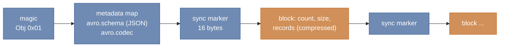
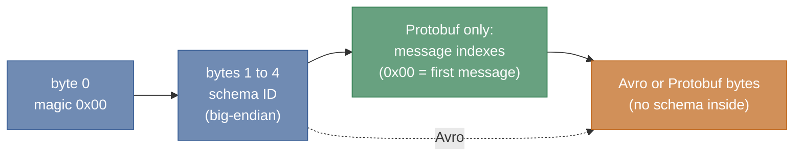

# Chapter 16: XML, Avro and Protobuf

The formats of the earlier chapters are text that a person can read. This chapter is about three formats that are different. XML is text, but its structure does not map directly to rows. Avro and Protobuf are binary. A person cannot read them, and a reader without the correct schema reads them incorrectly.

These three formats come to a data team from other systems. XML comes from government feeds, banks and older enterprise software. Avro and Protobuf come from Kafka topics. In each case, the producer has a schema, and the consumer must use the same schema.

**Each format in this chapter has a schema contract with the producer, and Spark trusts that contract. XML gives a different type when an element occurs one time or many times. Avro bytes decoded with the wrong schema can give incorrect values without an error. A Kafka message has a header in front of the Avro or Protobuf bytes, and Spark does not remove it for you. A reader for these formats must check the contract on each record, and must send each record that fails to a dead letter table.**

The data is SparkTutor's `xml/orders.xml` and `binary/` folder in [`code/data/messy`](https://github.com/lisancao/spark-masterclass/tree/main/code/data/messy). The `binary/` folder holds two dumps of Kafka topics, one message on each line, with the message bytes in base64. The `orders` topic holds Avro and the `payments` topic holds Protobuf. Both topics have bad messages on purpose. The scripts are [`code/ch16/xml.py`](https://github.com/lisancao/spark-masterclass/tree/main/code/ch16), `missing.py`, `avro.py` and `protobuf.py`. All output is from `code/ch16/output/`, on Spark 4.3.0.

## Part 1: XML

The XML source is part of Spark since Spark 4.0. It needs no package.

## Step 1: `rowTag` makes rows

An XML file is one tree. Spark must know which element is a row. The `rowTag` option names it. You must give it:

```text
== rowTag is required ==
  spark.read.xml(path) without rowTag          -> XML_ROW_TAG_MISSING
root
 |-- _channel: string (nullable = true)
 |-- _id: long (nullable = true)
 |-- coupon: string (nullable = true)
 |-- customer: string (nullable = true)
 |-- items: struct (nullable = true)
 |    |-- item: array (nullable = true)
 |    |    |-- element: struct (containsNull = true)
 |    |    |    |-- _sku: string (nullable = true)
 |    |    |    |-- qty: long (nullable = true)

+---+--------+--------+------+-----------------------------+
|_id|_channel|customer|coupon|items                        |
+---+--------+--------+------+-----------------------------+
|0  |store   |C0      |SAVE0 |{[{P8, 2}, {P7, 3}]}         |
|1  |web     |C1      |NULL  |{[{P9, 3}, {P8, 1}, {P4, 2}]}|
|2  |store   |C2      |NULL  |{[{P1, 3}]}                  |
+---+--------+--------+------+-----------------------------+
only showing top 3 rows
orders: 10  rowTag elements in the file: 10
```

The mapping from XML to columns has these rules:

- **An attribute becomes a column with the prefix `_`.** `<order id="0" channel="store">` gives `_id` and `_channel`.
- **A child element with only text becomes a scalar column.** `<customer>C0</customer>` gives `customer`.
- **A child element that is not in each row is `NULL`** in the rows where it is not there. `coupon` is in some orders only.
- **A wrapper element becomes a struct.** `<items>` holds the `<item>` elements, so the path is `items.item`.
- **Inference gives a type to each value.** `_id` and `qty` are `long`.

The last line of the output compares the number of rows with a count of `<order ` in the raw text. Make this check for each XML feed. Step 5 shows why.

## Step 2: Attributes, text and `_VALUE`

An element can have attributes and text together. The text then goes into a field with the name `_VALUE`:

```text
== attributes, text and _VALUE ==
root
 |-- price: struct (nullable = true)
 |    |-- _VALUE: double (nullable = true)
 |    |-- _cur: string (nullable = true)
 |-- qty: struct (nullable = true)
 |    |-- _VALUE: double (nullable = true)
 |    |-- _unit: string (nullable = true)

+-----------+-----------+
|price      |qty        |
+-----------+-----------+
|{4.5, CAD} |{2.0, NULL}|
|{3.0, NULL}|{1.5, kg}  |
+-----------+-----------+

+-----------+-----------+
|price      |qty        |
+-----------+-----------+
|{CAD, 4.5} |{NULL, 2.0}|
|{NULL, 3.0}|{kg, 1.5}  |
+-----------+-----------+

excludeAttribute=true: struct<price:double,qty:double>
inferSchema=false:     struct<price:struct<_VALUE:string,_cur:string>,qty:struct<_VALUE:string,_unit:string>>
```

`qty` has an attribute in the second row only. But one column has one type for all rows, so `qty` is a struct in each row. The first row gets `{2.0, NULL}`, although its XML was only `<qty>2</qty>`. The options change the mapping:

- `valueTag` changes the name `_VALUE`, and `attributePrefix` changes the prefix `_`. The second table uses `text` and `@`.
- `excludeAttribute` ignores all attributes. Then each element is a plain value again.
- `inferSchema=false` keeps each value as a `string`.

## Step 3: One child or many

This is the most frequent XML problem. Inference makes `item` an array only if at least one order in the file has more than one `<item>`:

```text
== one child or many: inference sees the whole file ==
orders.xml (1 to 3 items): struct<item:array<struct<_sku:string,qty:bigint>>>
a file where each order has one item: struct<item:struct<_sku:string,qty:bigint>>
  explode(items.item) on that file             -> DATATYPE_MISMATCH.UNEXPECTED_INPUT_TYPE
with ARRAY in the schema: 2 item rows
item rows from orders.xml: 23
```

`orders.xml` has orders with up to three items, so `item` is an array. A file of the same feed where each order has one item gives a struct, not an array. The code that worked on the first file (`explode(items.item)`) fails on the second file. A job that worked for months can fail on the day when no order has two items.

The fix is a schema that declares `ARRAY`. Then one `<item>` becomes an array with one element:

```python
SCHEMA = "_id BIGINT, _channel STRING, customer STRING, coupon STRING, items STRUCT<item: ARRAY<STRUCT<_sku: STRING, qty: INT>>>"
```

## Step 4: XML as `VARIANT`

With `singleVariantColumn`, each row element becomes one `VARIANT` value ([Chapter 15](ch15-variant.md)). The one-or-many problem is still there, inside the value:

```text
== VARIANT mode: one child is an OBJECT, many are an ARRAY ==
+---+----------------------------------------+
|id |item_shape                              |
+---+----------------------------------------+
|0  |ARRAY<OBJECT<_sku: STRING, qty: BIGINT>>|
|1  |ARRAY<OBJECT<_sku: STRING, qty: BIGINT>>|
|2  |OBJECT<_sku: STRING, qty: BIGINT>       |
+---+----------------------------------------+

OBJECT<_channel: STRING, _id: BIGINT, coupon: STRING, customer: STRING, items: OBJECT<item: VARIANT>>
  v:items.item::array<variant> on one item     -> INVALID_VARIANT_CAST
  try_variant_get(..., 'array<variant>')       -> None
  v:items.item[0] on one item                  -> None
item rows from VARIANT, after the CASE: 23
the same with variant_array_append (4.3): 23
```

Order 2 has one item, and its `item` is an `OBJECT`. The merged schema shows `item: VARIANT`, which means "different shapes". The three short methods all fail on order 2: the cast is an error, and `try_variant_get` and `[0]` give `NULL`. With `try_variant_get`, the order loses its item, and no error shows it.

The fix tests the shape of each value, and puts a single object into an array:

```sql
CASE WHEN schema_of_variant(v:items.item) LIKE 'ARRAY%'
     THEN v:items.item::array<variant>
     ELSE array(v:items.item) END
```

In Spark 4.3, `variant_array_append(parse_json('[]'), '$', v:items.item)` makes the one-element array inside the `VARIANT` value. Both methods give 23 item rows, the same count as the struct schema.

## Step 5: Malformed XML loses rows with the default parser

The script reads a file with five orders. The second order has an incorrect end tag, `</custmer>`:

```text
== malformed XML: one bad tag ==
useLegacyXMLParser=false: rows 2, good 1
+----+--------+------------------------------------------------------------+
|_id |customer|_bad                                                        |
+----+--------+------------------------------------------------------------+
|NULL|NULL    |<orders> <order id="1"><customer>C1</customer></order> <orde|
|1   |C1      |NULL                                                        |
+----+--------+------------------------------------------------------------+

useLegacyXMLParser=true: rows 4, good 3
+----+--------+--------------------------------------------+
|_id |customer|_bad                                        |
+----+--------+--------------------------------------------+
|NULL|NULL    |<order id="2"><customer>C2</custmer></order>|
|1   |C1      |NULL                                        |
|3   |C3      |NULL                                        |
|4   |C4      |NULL                                        |
+----+--------+--------------------------------------------+

  mode=FAILFAST                                -> MALFORMED_RECORD_IN_PARSING.WITHOUT_SUGGESTION
```

The default parser of Spark 4.3.0 gives two rows. One row is order 1. The other row is a corrupt record that holds the file text from the start. Orders 3 and 4 are valid, but they are not in the result. The legacy parser (`spark.sql.legacy.useLegacyXMLParser=true`, an internal configuration) keeps the three valid orders, and puts only order 2 into the corrupt column.

!!! warning
    In Spark 4.3.0, one malformed element can make the default XML parser lose the valid rows after it, without an error. Count the row elements in the raw files, and compare the count with the rows that Spark gives. If the counts are different, read the file again with `spark.sql.legacy.useLegacyXMLParser=true`, or with `mode` set to `FAILFAST`.

This behavior looks like a bug. The part notes record it as an open finding. Nobody reported it to the Spark project yet.

## Step 6: `from_xml` for XML inside a column

Some data has XML text inside a column of another format. `from_xml` parses it with a schema, like `from_json`:

```text
== from_xml and schema_of_xml on a string column ==
+----------------------------+------+----+
|xml                         |_VALUE|_cur|
+----------------------------+------+----+
|<price cur="CAD">4.5</price>|4.5   |CAD |
|<price cur="USD">12</price> |12.0  |USD |
+----------------------------+------+----+

schema_of_xml(lit): STRUCT<_VALUE: DOUBLE, _cur: STRING>
  schema_of_xml('<price ...>') as a column name -> STRUCT<_VALUE: DOUBLE, _cur: STRING>
+---------------------------+
|v                          |
+---------------------------+
|{"_VALUE":4.5,"_cur":"CAD"}|
|{"_VALUE":12,"_cur":"USD"} |
+---------------------------+
```

`schema_of_xml` describes one sample, like `schema_of_json`. `from_xml` with the schema `'variant'` gives a `VARIANT` value, with no schema to write.

## Step 7: Namespaces

```text
== namespaces ==
rowTag=s:order:             ['_s:id', 's:customer']
rowTag=order, ignoreNamespace: ['_id', 'customer'] 2 rows
```

A prefix such as `s:` is part of the name, unless you set `ignoreNamespace`. Without the option, `rowTag` must include the prefix, and the column names include it too.

## Step 8: Which XML files Spark can split

```text
== the XML source splits a large file ==
multiLine=true : 25.4 MB file, maxPartitionBytes 4 MB -> 1 partitions, 400000 rows, 400000 distinct ids
  corrupt rows: []
multiLine=false: 25.4 MB file, maxPartitionBytes 4 MB -> 7 partitions, 400002 rows, 400000 distinct ids
  corrupt rows: ['<orders>', '</orders>']
```

The XML option `multiLine` is `true` by default. In this mode, a file is one split, and one task reads all of it, as for a JSON document ([Chapter 13](ch13-json.md), Step 1). With `multiLine=false`, Spark splits the file like a text file. Each line must then hold one complete row element. The root tags `<orders>` and `</orders>` are lines too, and they become two corrupt records. The source code is in `XmlDataSource.scala`: `MultiLineXmlDataSource` is not splittable, and `TextInputXmlDataSource` is splittable.

Use `multiLine=false` only for a file that has one row element on each line. Filter out the corrupt records of the root tags.

The XML writer needs `rowTag` and `rootTag`:

```text
== write XML ==
<?xml version="1.0" encoding="UTF-8" standalone="yes"?>
<items>
    <item>
        <order_id>0</order_id>
        <sku>P8</sku>
```

## Part 2: Avro

## Step 9: Avro and Protobuf need a package

The Avro and Protobuf sources are separate modules of Spark. They are not in the `pyspark` package. Without them, Spark gives a named error:

```text
== no --packages ==
  spark.read.format('avro')                  -> AVRO_DATA_SOURCE_NOT_ENABLED
  SQL from_avro                              -> AVRO_NOT_LOADED_SQL_FUNCTIONS_UNUSABLE
  SQL from_protobuf                          -> PROTOBUF_NOT_LOADED_SQL_FUNCTIONS_UNUSABLE
  Python from_avro                           -> AVRO_NOT_LOADED_SQL_FUNCTIONS_UNUSABLE
```

Add the packages when the session starts, with the same Spark and Scala versions as your Spark:

```python
spark = (SparkSession.builder
         .config("spark.jars.packages",
                 "org.apache.spark:spark-avro_2.13:4.3.0,"
                 "org.apache.spark:spark-protobuf_2.13:4.3.0")
         .getOrCreate())
```

With `spark-submit`, use `--packages` with the same coordinates. Spark downloads the jars from Maven Central at the first start. You cannot add a package to a session after it starts.

## Step 10: An Avro file carries its schema

An Avro file has a header with the schema, and then blocks of records in binary:

```text
== an Avro file: the header carries the schema ==
first 4 bytes: b'Obj\x01'  file size: 345 bytes
avro.schema in the header: {"type":"record","name":"topLevelRecord","fields":[{"name":"order_id","type":"string"},{"name":"user_id","type":"long"},{"name":"total","type":["double","null"]},{"name":"coupon","type":["string","null"]}]}
other header keys: ['org.apache.spark.version', 'avro.codec'] codec: snappy
```



The schema is in the file, so a reader of an Avro file needs no schema from you. Spark writes a nullable column as a union with `null` (`["double","null"]`). The sync markers between the blocks let Spark split a large Avro file into tasks.

### Spark types and Avro types

`schema_of_avro` shows the Spark type for an Avro schema:

```text
== Spark types to Avro types, and back ==
STRUCT<a: INT NOT NULL, b: STRING, c: TIMESTAMP NOT NULL, d: DECIMAL(10,2) NOT NULL, e: STRING NOT NULL, f: STRUCT<member0: INT, member1: STRING> NOT NULL, g: MAP<STRING, BIGINT> NOT NULL>
  write a VARIANT column to Avro                 -> UNSUPPORTED_DATA_TYPE_FOR_DATASOURCE
  from_avro on a union without stable names      -> STRUCT<member0: INT, member1: STRING>
    with enableStableIdentifiersForUnionType     -> STRUCT<member_int: INT, member_string: STRING>
```

- A union with `null` is a nullable column. A field without that union is `NOT NULL`.
- Logical types map to Spark types: `timestamp-millis` to `TIMESTAMP`, `decimal` to `DECIMAL`.
- An `enum` becomes a `STRING`.
- A union of two other types becomes a struct with one field for each branch, `member0` and `member1`. The option `enableStableIdentifiersForUnionType` names the fields after the types. The position names change if the producer adds a branch, so use the option for a union that can grow.
- Avro has no type for `VARIANT`, so a `VARIANT` column cannot go into an Avro file.

### Codecs

The script writes one million taxi trips with each codec:

```text
== compression codecs on one million taxi trips ==
  uncompressed    134.9 MB
  snappy           43.6 MB
  deflate          28.5 MB
  zstandard        29.9 MB
  xz               23.4 MB
  (parquet)        20.9 MB
  compression=lz5                                -> CODEC_SHORT_NAME_NOT_FOUND
```

`snappy` is the default. It is fast, but it gives the largest compressed files here. The Parquet file of the same rows is smaller than each Avro file, because Parquet stores and compresses each column separately. Avro is a row format. It is good for messages and for files that a stream writes one record at a time. For a table that queries read, Parquet is a better format.

## Step 11: Write with a schema of your own

The option `avroSchema` gives the writer an exact Avro schema. The writer then checks each row against it:

```text
== write with an Avro schema of your own ==
  method='CARD' into an enum                     -> written
  method='BITCOIN' into an enum                  -> TASK_WRITE_FAILED
```

`BITCOIN` is not a symbol of the enum, so the write fails in the task. This check is useful when another system reads the files and expects the exact schema.

## Step 12: A folder with two versions of the schema

A producer changes its schema. Version 2 of the orders schema gives `amount` a new name, `total`, with the alias `amount`. It also adds `currency`, `coupon` and `items` with default values. The script writes one day with each version into one folder:

```text
== a folder with two versions of the schema ==
schema from one file: ['order_id', 'user_id', 'amount', 'ts', 'day']
mergeSchema=true:     ['order_id', 'user_id', 'amount', 'ts', 'day']
+--------+-----+--------+------+---------+---+
|order_id|total|currency|coupon|items    |day|
+--------+-----+--------+------+---------+---+
|O-1     |10.0 |CAD     |NULL  |[]       |1  |
|O-2     |20.0 |EUR     |NULL  |[{P1, 2}]|2  |
+--------+-----+--------+------+---------+---+
```

The Avro reader takes the schema of one file for the full folder. Here it took version 1, and the new columns of day 2 are not in the DataFrame. The option `mergeSchema` has no effect for Avro. No warning tells you about the lost columns.

The fix is the option `avroSchema` on the read. Each file has its own writer schema in its header. Avro resolves each file into the reader schema that you give. Day 1 gets the default values `CAD` and `[]`, and its `amount` becomes `total` through the alias.

## Step 13: What a reader schema may change

Avro schema resolution follows a set of rules. The script encodes one record `{a: 7, b: "x"}` and reads it with different reader schemas:

```text
== Avro schema resolution: what a reader schema may change ==
  same schema                                    -> {'a': 7, 'b': 'x'}
  add a field with a default                     -> {'a': 7, 'b': 'x', 'c': 'CAD'}
  add a nullable field, default null             -> {'a': 7, 'b': 'x', 'c': None}
  add a field without a default                  -> AvroTypeException
  remove field b                                 -> {'a': 7}
  rename b to c, alias b                         -> {'a': 7, 'c': 'x'}
  promote a: int to long                         -> {'a': 7, 'b': 'x'}
  promote a: int to double                       -> {'a': 7.0, 'b': 'x'}
  narrow: read int a as a string                 -> AvroTypeException
```

| Change in the reader schema | Result |
|---|---|
| Add a field with a default | the default |
| Add a field without a default | error |
| Remove a field | Avro skips its bytes |
| A new name with an alias for the old name | the value |
| Promote `int` to `long`, `float` or `double` | the value, widened |
| Change to a type that is not a promotion | error |

These rules are the reason for a schema registry. A producer that follows them can change its schema, and old and new consumers can still read all messages.

## Step 14: The bytes of one Avro record

`to_avro` encodes a struct column into Avro binary, and `from_avro` decodes it. A record in a message has no header and no schema. It is only the values:

```text
== from_avro and to_avro: the bytes of one record ==
to_avro: 14 bytes: 06 4f 2d 31 0e 00 00 00 00 00 00 29 40 00
  06 'O-1'               string: length 3 as a zigzag varint (06), then the UTF-8 bytes
  0e                     long 7 as a zigzag varint (7 * 2 = 14 = 0x0e)
  00 00 00 00 00 00 29 40 double 12.5, 8 bytes little-endian
  00                     union branch 0 (null), no more bytes
the same record as JSON: 43 bytes
```

The record uses 14 bytes, and the same record as JSON uses 43. There are no field names and no type tags in the bytes. The reader knows from the schema that the first value is a string, the second a long, and so on. Integers use a zigzag variable-length form: small numbers use one byte. Without the schema, nobody can decode these bytes.

## Step 15: Decode with the wrong schema

Because the bytes have no types, a wrong schema does not always cause an error:

```text
== decode with the wrong schema ==
  user_id as int (same bytes)                    -> Row(order_id='O-1', user_id=7, total=12.5, coupon=None)
  fields in another order                        -> SparkException
  total as float                                 -> Row(order_id='O-1', user_id=7, total=0.0, coupon=None)
  one extra string field at the end              -> EOFException
  garbage bytes, mode=FAILFAST                   -> EOFException
  garbage bytes, mode=PERMISSIVE                 -> Row(order_id=None, user_id=None, total=None, coupon=None)
  garbage bytes, mode=DROPMALFORMED              -> PARSE_MODE_UNSUPPORTED
```

- **`long` read as `int` gives the correct value.** The two types have the same encoding. The value is correct only while it is small enough for an `int`.
- **`double` read as `float` gives `0.0` with no error.** The reader takes 4 of the 8 bytes as a float, and the next field starts in the wrong place. Here the bytes happen to give valid values for the next fields too. This is the worst result: incorrect data that looks correct.
- **A different field order, or an extra field, fails.** The reader goes past the end of the bytes, or it reads a value that cannot be correct.
- **`from_avro` has two modes.** `FAILFAST` (the default) stops the job. `PERMISSIVE` gives a struct with all fields `NULL`, not a `NULL` struct. `DROPMALFORMED` is not supported.

Thus a check for a `NULL` struct does not find a bad Avro record in `PERMISSIVE` mode. Check a field that is never `NULL` in a good record, such as the key.

## Part 3: Kafka messages and Protobuf

## Step 16: The Confluent wire format

A Kafka message has a key and a value, both as bytes. Spark's Kafka source gives them as `binary` columns. This is the real schema of the source:

```text
== the real Kafka source: its schema, with no broker ==
root
 |-- key: binary (nullable = true)
 |-- value: binary (nullable = true)
 |-- topic: string (nullable = true)
 |-- partition: integer (nullable = true)
 |-- offset: long (nullable = true)
 |-- timestamp: timestamp (nullable = true)
 |-- timestampType: integer (nullable = true)
```

The script made this schema with `spark.readStream.format("kafka")` and the package `org.apache.spark:spark-sql-kafka-0-10_2.13:4.3.0`. It did not connect to a broker, because a stream source connects only when the query starts. The rest of this part reads the topic dumps in `binary/`, which have the same columns. Chapter 25 runs a stream from a source.

Producers that use the Confluent Schema Registry do not put plain Avro into the value. They put a five-byte header in front of it:

```text
== the Kafka wire format: a Confluent header in front of the Avro bytes ==
offset 0: 00 00 00 00 01 0c 4f 2d 32 30 30 31 0a ec 51 b8 1e 85 fb 59 40 80 e0 d1 e7 9e 68
  00          magic byte
  00 00 00 01 schema id 1, 4 bytes big-endian
  0c ...      the Avro record of schema 1
```



The schema ID is a key in the registry. The consumer gets the writer schema for that ID from the registry, and decodes the bytes with it. Open source Spark has no client for the registry. You get the schemas yourself and give them to `from_avro`.

`from_avro` does not know about the header. On the full value, it reads the header bytes as data:

```text
  from_avro on the full value (header included)  -> Row(order_id='', user_id=0, amount=1.56979527095074e-76, ts=datetime.datetime(1969, 12, 31, 16, 0, 0, 24000))
```

There is no error. Each field has a value, and each value is incorrect. This is the most frequent bug with Kafka and Avro. Remove the header first, with `substring`, and read the schema ID with `conv` and `hex`:

```python
framed = topic.select("*",
                      (F.hex(F.substring("value", 1, 1)) == "00").alias("framed"),
                      F.conv(F.hex(F.substring("value", 2, 4)), 16, 10).cast("int").alias("schema_id"),
                      F.expr("substring(value, 6)").alias("payload"))
```

```text
+------+----------+--------+------------+
|framed|schema_id |messages|first_offset|
+------+----------+--------+------------+
|NULL  |NULL      |1       |5           |
|true  |1         |12      |0           |
|true  |2         |15      |13          |
|true  |7         |1       |17          |
|false |1328362041|1       |26          |
+------+----------+--------+------------+
```

The topic has five kinds of message:

- 12 messages with schema 1, and 15 with schema 2.
- A message with a `NULL` value at offset 5. This is a **tombstone**: in a compacted topic, it deletes the key.
- A message with schema ID 7 at offset 17. The consumer has no schema for this ID.
- A message at offset 26 with no header. Its "schema ID" is a large random number from the first bytes of the data.

## Step 17: Decode each schema version, and classify each message

Each message must use the writer schema of its own ID. A `when` chain selects the correct `from_avro` for each ID. Each branch resolves its version into the newest schema (version 2), so all rows have the same columns:

```python
schemas = {1: v1, 2: v2}
decoded = None
for sid, writer in sorted(schemas.items()):
    branch = from_avro("payload", writer, {"avroSchema": v2, "mode": "PERMISSIVE"})
    decoded = F.when(F.col("schema_id") == sid, branch) if decoded is None else decoded.when(F.col("schema_id") == sid, branch)
classified = (framed.withColumn("o", decoded)
              .withColumn("problem", F.when(F.col("value").isNull(), "tombstone")
                          .when(~F.col("framed"), "no confluent header")
                          .when(~F.col("schema_id").isin(*schemas), "unknown schema id")
                          .when(F.col("o.order_id").isNull(), "corrupt")))
```

```text
+-------------------+--------+-----------------------------------------------------------------------------------------------+
|problem            |messages|offsets                                                                                        |
+-------------------+--------+-----------------------------------------------------------------------------------------------+
|NULL               |26      |[0, 1, 2, 3, 4, 6, 7, 8, 9, 10, 11, 12, 13, 14, 15, 16, 18, 19, 20, 21, 22, 24, 25, 27, 28, 29]|
|corrupt            |1       |[23]                                                                                           |
|no confluent header|1       |[26]                                                                                           |
|tombstone          |1       |[5]                                                                                            |
|unknown schema id  |1       |[17]                                                                                           |
+-------------------+--------+-----------------------------------------------------------------------------------------------+
```

The test for `corrupt` uses `o.order_id`, a field that a good record always has, because `PERMISSIVE` gives a struct of `NULL` fields (Step 15). Offset 23 has a valid header and a known schema ID, but its bytes do not decode.

The messages with a problem, except the tombstones, go into a dead letter table with the topic, the offset and the raw bytes. Then someone can find the producer bug and replay the messages after a fix.

The current state of each order is the last usable message for its key, as in a compacted topic. A tombstone as the last message deletes the key:

```python
latest = Window.partitionBy("key").orderBy(F.col("offset").desc())
current = (classified.where("problem IS NULL OR problem = 'tombstone'")
           .withColumn("rn", F.row_number().over(latest))
           .where("rn = 1 AND problem IS NULL")
           .select("o.order_id", "o.user_id", "o.total", "o.currency", "o.coupon",
                   F.size("o.items").alias("n_items"), "schema_id"))
```

```text
current orders: 25  keys in the topic: 29
+--------+-------+------+--------+------+-------+---------+
|order_id|user_id|total |currency|coupon|n_items|schema_id|
+--------+-------+------+--------+------+-------+---------+
|O-2001  |5      |103.93|CAD     |NULL  |0      |1        |
|O-2002  |7      |37.38 |CAD     |NULL  |0      |1        |
|O-2004  |1      |57.25 |CAD     |NULL  |0      |1        |
|O-2005  |9      |51.48 |CAD     |NULL  |0      |1        |
+--------+-------+------+--------+------+-------+---------+
only showing top 4 rows
```

The schema 1 orders have `currency` `CAD` and no items. These are the defaults of schema 2. All rows have the shape of schema 2.

## Step 18: Protobuf needs a descriptor set

Protobuf describes messages in a `.proto` file:

```text
== the descriptor set: protoc output, not the .proto file ==
syntax = "proto3";

package shop;

enum Method {
  METHOD_UNSPECIFIED = 0;
  CARD = 1;
  CASH = 2;
  GIFT_CARD = 3;
}

message Payment {
  string payment_id = 1;
  string order_id = 2;
  int64 amount_cents = 3;
  Method method = 4;
  repeated string flags = 5;
  optional string note = 6;
}
payments.desc: 301 bytes (protoc --include_imports --descriptor_set_out)
```

Spark cannot read a `.proto` file. It needs a **descriptor set**, the compiled form that `protoc` writes:

```bash
protoc --include_imports --descriptor_set_out=payments.desc payments.proto
```

`from_protobuf` takes the message name (`shop.Payment`) and the descriptor set. You can give the descriptor set as a file path or as bytes (`binaryDescriptorSet`). A file path must be readable on the driver. The bytes are safer on a cluster, because they go with the plan.

## Step 19: The Protobuf wire format

```text
== encode one payment, and walk the bytes ==
25 bytes: 0a 05 50 41 59 2d 31 12 03 4f 2d 31 18 e2 09 20 01 2a 06 6d 61 6e 75 61 6c
  0a 05 'PAY-1'  field 1, wire type 2 (length): 5 bytes
  12 03 'O-1'    field 2, wire type 2: 3 bytes
  18 e2 09       field 3, wire type 0 (varint): 1250
  20 01          field 4, wire type 0: enum 1 = CARD
  2a 06 'manual' field 5, wire type 2: one element of the repeated string
  (field 6, note, is NULL, so it has no bytes)
```

Unlike Avro, each Protobuf value starts with a key byte.

The key holds the field number and a wire type. `0x0a` is field 1 with wire type 2 (a length and bytes). `0x18` is field 3 with wire type 0 (a varint). The field numbers come from the `.proto` file. Because each value carries its number, a reader can skip a field that it does not know. This is why Protobuf allows a producer to add fields.

## Step 20: proto3 does not write default values

The proto3 writer does not write a field that has its default value (0, an empty string, the first enum value, an empty list):

```text
== proto3 does not write default values ==
bytes: 0a 05 50 41 59 2d 30 12 03 4f 2d 30 32 00  (no amount_cents, method or flags)
+----------+--------+------------+------+-----+----+
|payment_id|order_id|amount_cents|method|flags|note|
+----------+--------+------------+------+-----+----+
|PAY-0     |O-0     |NULL        |NULL  |[]   |    |
+----------+--------+------------+------+-----+----+

+----------+--------+------------+------------------+-----+----+
|payment_id|order_id|amount_cents|method            |flags|note|
+----------+--------+------------+------------------+-----+----+
|PAY-0     |O-0     |0           |METHOD_UNSPECIFIED|[]   |    |
+----------+--------+------------+------------------+-----+----+

+------+
|method|
+------+
|0     |
+------+
```

The payment of 0 cents comes back as `NULL`, because the bytes have no `amount_cents`. A sum that ignores `NULL` gives the correct total. But a test such as `amount_cents IS NULL` finds "free" payments as "missing" payments. The option `emit.default.values` gives the default for each field that is not in the bytes. Use it for a proto3 schema, unless your code needs to know that a field was not sent.

`note` is `optional`, so proto3 keeps its presence. The writer writes the empty string (`32 00`), and it comes back as an empty string. A repeated field is never `NULL`. It is an empty array. `enums.as.ints` gives the number of the enum value, not its name.

## Step 21: The Confluent header for Protobuf, and the dead letters

The Confluent header for Protobuf has one more part after the schema ID: a list of message indexes. It tells the consumer which message type of the `.proto` file the bytes use. The single byte `00` means "the first message type":

```text
== the Confluent header for Protobuf has a message index ==
offset 0: 00 00 00 00 03 00 0a 08 50 41 59 2d 39 30 30 31 12 06 4f 2d  ...
  00 | 00 00 00 03 | 00 | 0a 08 ...  magic byte | schema id 3 | message index 0 | Protobuf
  from_protobuf on a payload with the index byte -> MALFORMED_PROTOBUF_MESSAGE
+-------+--------+--------------------------------------------------------------------------------------+
|problem|messages|offsets                                                                               |
+-------+--------+--------------------------------------------------------------------------------------+
|NULL   |24      |[0, 1, 2, 3, 4, 5, 6, 7, 8, 9, 10, 11, 13, 14, 15, 16, 17, 18, 19, 20, 21, 22, 23, 24]|
|corrupt|1       |[12]                                                                                  |
+-------+--------+--------------------------------------------------------------------------------------+

+------+--------+------------+---------+---------------------+------+
|offset|order_id|amount_cents|method   |flags                |note  |
+------+--------+------------+---------+---------------------+------+
|0     |O-2001  |10393       |GIFT_CARD|[fraud_check]        |thanks|
|1     |O-2002  |3738        |CARD     |[manual, fraud_check]|thanks|
|2     |O-2003  |4885        |CASH     |[]                   |thanks|
|3     |O-2004  |0           |GIFT_CARD|[]                   |NULL  |
|4     |O-2006  |793         |GIFT_CARD|[fraud_check]        |NULL  |
+------+--------+------------+---------+---------------------+------+
only showing top 5 rows
```

<figure markdown>
  <video autoplay loop muted playsinline controls width="1280" height="720" poster="../../media/clips/ch16-kafka.webp">
    <source src="../../media/clips/ch16-kafka.mp4" type="video/mp4">
  </video>
  <figcaption><code>protobuf.py</code> on Spark 4.3.0. A Confluent message has a magic byte, a schema ID and a message index before the Protobuf bytes. The decode classifies each message.</figcaption>
</figure>

With the index byte still in the payload, `from_protobuf` fails. The payload for Protobuf starts at byte 7, not at byte 6. The code is the same as for Avro, with one more byte to remove. The decode uses `PERMISSIVE` and `emit.default.values`. `nullif(method, 'METHOD_UNSPECIFIED')` changes the default enum value into `NULL`, because "the producer did not say" is not a payment method.

## Step 22: Errors and silent results in Protobuf

```text
== PERMISSIVE: Protobuf gives NULL, Avro gives a struct of NULLs ==
  from_protobuf(X'FFFF'), FAILFAST               -> MALFORMED_PROTOBUF_MESSAGE
  from_protobuf(X'FFFF'), PERMISSIVE             -> None
  an unknown message name                        -> PROTOBUF_MESSAGE_NOT_FOUND

== the bytes of a different message type ==
+----------+--------+
|payment_id|order_id|
+----------+--------+
|O-1       |PAY-    |
+----------+--------+

  field 3 sent as a string (wire type 2)         -> MALFORMED_PROTOBUF_MESSAGE

== encode errors ==
  method 'BITCOIN' into the enum                 -> CANNOT_CONVERT_SQL_VALUE_TO_PROTOBUF_ENUM_TYPE
  amount_cents as a STRING                       -> UNABLE_TO_CONVERT_TO_PROTOBUF_MESSAGE_TYPE
```

- **In `PERMISSIVE` mode, a bad Protobuf message gives a `NULL` struct.** Avro gives a struct of `NULL` fields. The test for a bad record is thus different for the two formats.
- **Bytes of a different message type can decode without an error.** The bytes have field 1 and field 2 as strings. `shop.Payment` also has two string fields with these numbers, so the decode works, and the values are in the wrong fields. Field numbers are the contract. A wire type that does not match the schema is an error.
- **The encoder checks the values.** An unknown enum name and a value of the wrong type are errors.

## The format choice

| | XML | Avro | Protobuf |
|---|---|---|---|
| Schema in the data | no | in the file header, not in a message | no |
| A reader needs | `rowTag`, and a schema for arrays | the writer schema | the descriptor set and the message name |
| Field identity | element name | position in the schema | field number |
| A new field | a new column after inference | needs a default in the reader schema | readers skip it |
| Bad record in `PERMISSIVE` | corrupt record column | struct of `NULL` fields | `NULL` |
| In Spark 4.3 | built in | package `spark-avro_2.13` | package `spark-protobuf_2.13` |

## The whole chapter, on one page

```python
from pyspark.sql import functions as F
from pyspark.sql.avro.functions import from_avro
from pyspark.sql.protobuf.functions import from_protobuf

# XML: pin arrays in the schema, count rows against the raw text
orders = (spark.read.option("rowTag", "order")
          .schema("_id BIGINT, customer STRING, items STRUCT<item: ARRAY<STRUCT<_sku: STRING, qty: INT>>>")
          .xml("xml/"))

# Kafka: split the Confluent header (Protobuf has one more index byte)
def frame(df, index_bytes=0):
    return df.select("*",
                     (F.hex(F.substring("value", 1, 1)) == "00").alias("framed"),
                     F.conv(F.hex(F.substring("value", 2, 4)), 16, 10).cast("int").alias("schema_id"),
                     F.expr(f"substring(value, {6 + index_bytes})").alias("payload"))

# Avro: each writer schema, resolved into the newest; PERMISSIVE gives a struct of NULLs
decoded = None
for sid, writer in sorted(schemas.items()):
    b = from_avro("payload", writer, {"avroSchema": schemas[max(schemas)], "mode": "PERMISSIVE"})
    decoded = F.when(F.col("schema_id") == sid, b) if decoded is None else decoded.when(F.col("schema_id") == sid, b)
orders = frame(order_topic).withColumn("o", decoded)

# Protobuf: descriptor set, defaults emitted; PERMISSIVE gives NULL
payments = frame(payment_topic, index_bytes=1).withColumn(
    "p", from_protobuf("payload", "shop.Payment", "payments.desc",
                       {"mode": "PERMISSIVE", "emit.default.values": "true"}))
```

- **XML: you must give `rowTag`.** Attributes get `_`, text with attributes is `_VALUE`.
- **XML: one child is a struct, many are an array.** Pin `ARRAY` in the schema, or normalize the `VARIANT` value.
- **XML: count the row elements.** In Spark 4.3.0, the default parser can lose valid rows after a malformed element.
- **XML: `multiLine=true` (the default) is one task for each file.**
- **Avro and Protobuf need the `spark-avro` and `spark-protobuf` packages** with your Spark version.
- **Avro: a folder uses one file's schema, and `mergeSchema` does nothing.** Give `avroSchema`.
- **Avro: a wrong schema can give incorrect values with no error.**
- **Kafka: remove the Confluent header before you decode.** Use the schema ID to select the writer schema, and classify tombstones, unknown IDs, unframed and corrupt messages.
- **Protobuf: proto3 does not write defaults.** Use `emit.default.values`.

[Chapter 17](ch17-documents-images-audio.md) goes to formats that have no schema at all: e-mail, PDF, images and audio.

## Further reading

- [XML files](https://spark.apache.org/docs/4.3.0/sql-data-sources-xml.html), the reader and writer options.
- [Avro files](https://spark.apache.org/docs/4.3.0/sql-data-sources-avro.html), the Avro source, `from_avro` and `to_avro`.
- [Protobuf data](https://spark.apache.org/docs/4.3.0/sql-data-sources-protobuf.html), `from_protobuf`, `to_protobuf` and their options.
- [Structured Streaming and Kafka](https://spark.apache.org/docs/4.3.0/streaming/structured-streaming-kafka-integration.html), the Kafka source and sink.
- [Avro specification: schema resolution](https://avro.apache.org/docs/1.12.0/specification/#schema-resolution).
- [Confluent wire format](https://docs.confluent.io/platform/current/schema-registry/fundamentals/serdes-develop/index.html#wire-format).
