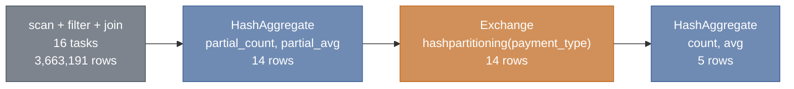
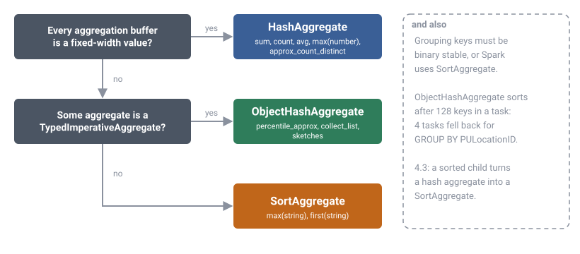
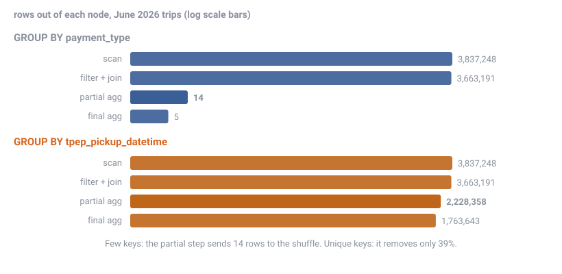
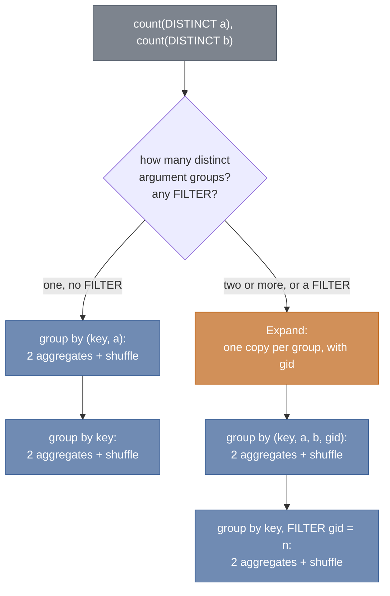
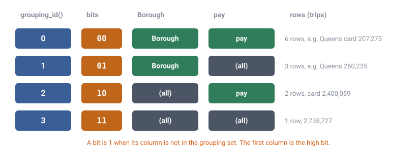
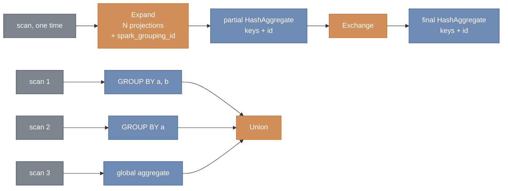
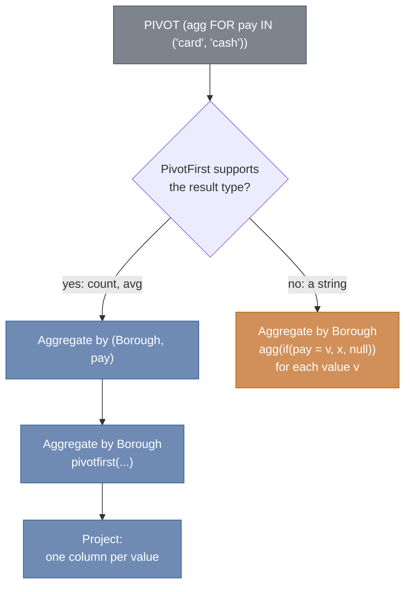

# Chapter 19: Aggregation: GROUP BY, grouping sets, ROLLUP, CUBE and pivots

[Chapter 7](ch07-quick-start.md) counted the taxi trips for each borough with one `GROUP BY`. [Chapter 18](ch18-spark-sql-in-depth.md) put an aggregate inside a window and inside a pipe. This chapter is about the aggregate itself. It shows what Spark does with a `GROUP BY` and with the `FILTER` and `DISTINCT` forms of an aggregate. Then it shows `GROUPING SETS`, `ROLLUP`, `CUBE`, `PIVOT` and `UNPIVOT`.

**Each form of aggregation in Spark SQL becomes a small set of physical operators. These are a partial aggregate before the shuffle, a final aggregate after it, and sometimes an `Expand` that copies each row. Know which operator Spark selects and how many rows it makes. Then you can see the cost of a query in its plan before you run it.** Spark 4.3 changes some of these plans. It combines two aggregates that are next to each other, it can skip the partial step, and it generates code for more sort aggregates.

The scripts are in [`code/ch19`](https://github.com/open-lakehouse/spark-masterclass/tree/main/code/ch19), and each output block below comes from `code/ch19/output/`. They use the June 2026 taxi trips and the zone lookup from Part II, on Spark 4.3.0 in local mode with 16 cores. Each script makes the view `june` of [Chapter 18](ch18-spark-sql-in-depth.md). It has the June trips with a valid fare and distance, joined to their pickup zone (3,663,191 rows).

- `groupby.py`: the two phases, the three aggregate operators, the new 4.3 plan rules, `FILTER` and `DISTINCT`.
- `sets.py`: `GROUPING SETS`, `ROLLUP`, `CUBE`, `grouping()` and `grouping_id()`.
- `pivots.py`: `PIVOT` and `UNPIVOT` in SQL and in the DataFrame API.
- `approx.py`: approximate aggregates against exact aggregates.
- `bench.py`: the timings, under the book's bench lock.

## Step 1: GROUP BY runs in two phases

`groupby.py` counts the trips for each payment type. Then it reads the SQL metrics of each plan node from the REST API of the Spark UI:

```sql
SELECT payment_type, count(*) AS trips, round(avg(fare_amount), 2) AS avg_fare
FROM june GROUP BY payment_type ORDER BY payment_type
```

```text
== 1. GROUP BY payment_type: partial and final aggregates
+------------+-------+--------+
|payment_type|  trips|avg_fare|
+------------+-------+--------+
|           0| 901951|   26.07|
|           1|2404314|   19.53|
|           2| 339758|    20.8|
|           3|   6585|   18.68|
|           4|  10583|   23.03|
+------------+-------+--------+

+- Sort [payment_type ASC NULLS FIRST], true, 0
   +- Exchange rangepartitioning(payment_type ASC NULLS FIRST, 200), ENSURE_REQUIREMENTS
      +- HashAggregate(keys=[payment_type], functions=[count(1), avg(fare_amount)])
         +- Exchange hashpartitioning(payment_type, 200), ENSURE_REQUIREMENTS
            +- HashAggregate(keys=[payment_type], functions=[partial_count(1), partia...
               +- Project [payment_type, fare_amount]
                  +- BroadcastHashJoin [PULocationID], [LocationID], Inner, BuildRigh...
rows out of each node:
  Scan csv                            265   FileScan csv [LocationID#38] Batched: false, Da...
  Filter                              265   Filter isnotnull(LocationID#38)
  Scan parquet                  3,837,248   FileScan parquet [tpep_pickup_datetime#1,trip_d...
  Filter                        3,663,191   Filter ((((((((isnotnull(tpep_pickup_datetime#1...
  HashAggregate                        14   HashAggregate(keys=[payment_type#9L], functions...
  HashAggregate                         5   HashAggregate(keys=[payment_type#9L], functions...
tasks in the scan stage: 16
```

The plan has two `HashAggregate` nodes with one `Exchange` between them:

- **The partial aggregate** runs in each of the 16 scan tasks. It keeps a hash map from each key to an aggregation buffer. For `count` the buffer is one number. For `avg` the buffer is a sum and a count.
- **The `Exchange`** sends each buffer to the task that owns its key. Here, 14 rows go through the shuffle. Each scan task sent one row for each payment type that it saw.
- **The final aggregate** merges the buffers for each key and calculates the result. `avg` divides the sum by the count only here.

Thus 3,663,191 rows go into the partial step, and 14 rows go into the shuffle. This reduction is the reason for the partial step. [Chapter 5](ch05-how-spark-runs.md) showed the same two nodes from the side of the stages and tasks.



The partial step helps only when a key occurs many times in each task. Step 4 shows a key that almost never repeats.

## Step 2: The buffer type selects the operator

Spark has three aggregate operators. The planner selects one for each aggregate node in `AggUtils.createAggregate`. The decision uses the types of the aggregation buffers, not the names of the functions. `groupby.py` plans seven aggregates and prints the operator of each:

```text
== 2. which aggregate operator
  count(*), sum(fare_amount)             buffer: numbers     -> HashAggregate
  max(fare_amount)                       buffer: a number    -> HashAggregate
  max(Zone)                              buffer: a string    -> SortAggregate
  first(Zone)                            buffer: a string    -> SortAggregate
  percentile_approx(fare_amount, 0.5)    buffer: an object   -> ObjectHashAggregate
  collect_list(VendorID)                 buffer: an object   -> ObjectHashAggregate
  approx_count_distinct(DOLocationID)    buffer: fixed words -> HashAggregate
  percentile_approx, useObjectHashAggregateExec=false        -> SortAggregate
```

The rules, from `Aggregate.supportsHashAggregate` and `Aggregate.supportsObjectHashAggregate` in the 4.3.0 source:

| Operator | When Spark selects it | Examples above |
|---|---|---|
| `HashAggregate` | Each buffer field has a fixed width that `UnsafeRow` can change in place, and each grouping key is binary stable | `count`, `sum`, `max` of a number, `approx_count_distinct` |
| `ObjectHashAggregate` | Not the first case, and some aggregate is a `TypedImperativeAggregate`, which keeps a Java object as its buffer | `percentile_approx`, `collect_list`, the sketches of [Chapter 68](ch68-sketches.md) |
| `SortAggregate` | All other cases, for example a string buffer, or a grouping key that is not binary stable | `max(Zone)`, `first(Zone)`, a collated key ([Chapter 10](ch10-cleaning-values.md)) |

`approx_count_distinct` uses a `HashAggregate`, although it is a sketch. Its HyperLogLog++ registers are a fixed set of `long` words in the buffer. `max(Zone)` uses a `SortAggregate`, although `max` of a number uses a hash. A string does not have a fixed width, so the buffer cannot change in place.

<figure markdown>

<figcaption>How Spark 4.3.0 selects the aggregate operator, from <code>AggUtils.createAggregate</code>. The examples are the plans that <code>groupby.py</code> printed.</figcaption>
</figure>

An `ObjectHashAggregate` keeps its objects in a hash map on the heap. When one task has more keys than `spark.sql.objectHashAggregate.sortBased.fallbackThreshold` (128 by default), the task changes to a sort-based aggregation for the rest of its input. The SQL metric `number of sort fallback tasks` counts these tasks:

```text
== 2b. ObjectHashAggregate: the sort fallback
  GROUP BY Borough       partial rows out     31, sort fallback tasks: 0
  GROUP BY PULocationID  partial rows out    990, sort fallback tasks: 4
```

With 8 boroughs, no task falls back. With the pickup zones as the key, 4 tasks have more than 128 keys and fall back to the sort. The result is the same, but the work is different. [Chapter 42](ch42-partitions-caching-memory.md) explains spill, which is what a large sort does next.

## Step 3: New in 4.3: one aggregate instead of two

Sometimes the data is already partitioned by the grouping key before the aggregate. Then the planner needs no `Exchange` between the partial and the final aggregate, and the two nodes are next to each other. A common case is a `GROUP BY` on the key of a sort-merge join ([Chapter 11](ch11-joins.md)). `groupby.py` turns off broadcast joins and runs this query two times, with the 4.3.0 defaults and with the two new rules turned off:

```sql
SELECT t.PULocationID, count(*) AS trips FROM trips t JOIN zones z ON t.PULocationID = z.LocationID
GROUP BY t.PULocationID
```

```text
== 3. GROUP BY after a sort-merge join on the same key
-- 4.3.0 defaults
   +- *(5) SortAggregate(key=[PULocationID], functions=[count(1)])
         +- *(5) SortMergeJoin [PULocationID], [LocationID], Inner
            :- *(3) Sort [PULocationID ASC NULLS FIRST], false, 0
            :        +- Exchange hashpartitioning(PULocationID, 200), ENSURE_REQUIREM...
            +- *(4) Sort [LocationID ASC NULLS FIRST], false, 0
                     +- Exchange hashpartitioning(LocationID, 200), ENSURE_REQUIREMENTS
-- combineAdjacentAggregation=false, replaceHashWithSortAgg=false
   +- *(5) HashAggregate(keys=[PULocationID], functions=[count(1)])
      +- *(5) HashAggregate(keys=[PULocationID], functions=[partial_count(1)])
            +- *(5) SortMergeJoin [PULocationID], [LocationID], Inner
               :- *(3) Sort [PULocationID ASC NULLS FIRST], false, 0
               :        +- Exchange hashpartitioning(PULocationID, 200), ENSURE_REQUI...
               +- *(4) Sort [LocationID ASC NULLS FIRST], false, 0
                        +- Exchange hashpartitioning(LocationID, 200), ENSURE_REQUIRE...
```

Two physical rules make the difference:

1. `CombineAdjacentAggregation` (new in 4.3.0, on by default) changes a `Partial` aggregate and the `Final` aggregate above it into one aggregate in `Complete` mode. A `Complete` aggregate reads the rows and gives the results in one step, with no buffers between two nodes.
2. `ReplaceHashWithSortAgg` changes a hash aggregate into a `SortAggregate` when its input is already sorted by the grouping keys. The rule is from 3.3.0, and it is on by default since 4.3.0 (SPARK-58210). The sort-merge join gives sorted output, so a sort aggregate only has to count each run of equal keys. It does not need a hash map.

Both configs are internal (`spark.sql.execution.combineAdjacentAggregation` and `spark.sql.execution.replaceHashWithSortAgg`). The plan above with both rules off is the plan that Spark 4.2 makes.

The `*(5)` before `SortAggregate` is also new. Spark 4.3.0 generates whole-stage code for a `SortAggregate` with grouping keys (SPARK-32750). The internal config `spark.sql.codegen.aggregate.sortAggregate.withKeys.enabled` controls it:

```text
== 3b. SortAggregate with keys in whole-stage code
  withKeys.enabled=true  count(*) after the join     *(5) SortAggregate
  withKeys.enabled=true  max(Zone), a string buffer  SortAggregate | SortAggregate
  withKeys.enabled=false count(*) after the join     SortAggregate
  withKeys.enabled=false max(Zone), a string buffer  SortAggregate | SortAggregate
```

The generated code works only with a buffer that can change in place. `max(Zone)` has a string buffer, so its `SortAggregate` stays outside whole-stage code. Thus the new code path applies to the sort aggregates that `ReplaceHashWithSortAgg` makes, not to the string case of Step 2.

<figure markdown>
  <video autoplay loop muted playsinline controls width="1280" height="720" poster="../../media/clips/ch19-combine.webp">
    <source src="../../media/clips/ch19-combine.mp4" type="video/mp4">
  </video>
  <figcaption><code>groupby.py</code> runs against Spark 4.3.0. After a sort-merge join on the same key, the two aggregates become one <code>SortAggregate</code> in whole-stage code. With the two rules off, the plan has two hash aggregates.</figcaption>
</figure>

## Step 4: New in 4.3: skip the partial step for keys that do not repeat

The partial step costs a hash map lookup for each row. If almost every key is different, the partial step sends almost as many rows to the shuffle as it reads. `groupby.py` groups by the pickup time, which has 1,763,643 different values in 3,663,191 rows:

```text
== 4. partial aggregation on a key that hardly repeats
-- bypassPartialAggregation=false
+- HashAggregate(keys=[tpep_pickup_datetime], functions=[count(1)])
   +- Exchange hashpartitioning(tpep_pickup_datetime, 200), ENSURE_REQUIREMENTS
      +- HashAggregate(keys=[tpep_pickup_datetime], functions=[partial_count(1)])
     rows out: Scan parquet            3,837,248  FileScan parquet [tpep_pickup_datetime#1,...
     rows out: HashAggregate           2,228,358  HashAggregate(keys=[tpep_pickup_datetime#...
     rows out: HashAggregate           1,763,643  HashAggregate(keys=[tpep_pickup_datetime#...
-- bypassPartialAggregation=true
+- HashAggregate(keys=[tpep_pickup_datetime], functions=[count(1)])
   +- Exchange hashpartitioning(tpep_pickup_datetime, 200), ENSURE_REQUIREMENTS
     rows out: Scan parquet            3,837,248  FileScan parquet [tpep_pickup_datetime#1,...
     rows out: HashAggregate           1,763,643  HashAggregate(keys=[tpep_pickup_datetime#...
```

The partial step removed only 39% of the rows (3,663,191 in, 2,228,358 out). The new session config `spark.sql.execution.bypassPartialAggregation` (4.3.0, `false` by default, SPARK-57688) removes the partial aggregate. Then one `Complete` aggregate runs after the shuffle. The 4.3.0 source applies it only when the query has grouping keys and no session window. The config has no effect on a query with a `DISTINCT` aggregate.

<figure markdown>

<figcaption>Rows out of each node, from the SQL metrics in <code>groupby.txt</code>. With few keys, the partial step makes the shuffle very small. With almost unique keys, it removes only 39% of the rows.</figcaption>
</figure>

`bench.py` measures both settings on a cached copy of `june` (local mode, 16 cores, median of 5 runs after one warmup, under the bench lock):

```text
  high-card key, partial + final     median  1.248 s   (min 0.837, max 1.838)
  high-card key, bypass partial      median  0.744 s   (min 0.662, max 0.857)
  low-card key, partial + final      median  0.251 s   (min 0.184, max 0.371)
  low-card key, bypass partial       median  0.794 s   (min 0.666, max 0.840)
```

The bypass made the pickup-time query faster, and it made the borough query about three times slower. Without the partial step, all 3,663,191 rows of the borough query go through the shuffle. Thus use the config only for a query whose keys hardly repeat. It is a session config, so you can set it for one query and unset it after.

!!! caution "Do not set `bypassPartialAggregation` for all queries"
    Set it only for a query with almost unique keys. For a query with few keys, every input row goes through the shuffle.

## Step 5: FILTER gives each aggregate its own rows

An aggregate can have a `FILTER (WHERE ...)` clause. Only the rows that pass the filter go into that aggregate. The other aggregates in the same `SELECT` still see all the rows. `groupby.py` uses this to compare the tip of all card trips with the tip of the card trips that had a tip:

```sql
SELECT Borough,
       count(*)                                   AS trips,
       count(*) FILTER (WHERE tip_amount > 0)     AS tipped,
       round(avg(tip_amount) FILTER (WHERE tip_amount > 0), 2) AS avg_tip_if_tipped,
       round(avg(tip_amount), 2)                  AS avg_tip_all
FROM june WHERE payment_type = 1 GROUP BY Borough ORDER BY trips DESC
```

```text
== 5. aggregate FILTER clauses
+-------------+-------+-------+-----------------+-----------+
|      Borough|  trips| tipped|avg_tip_if_tipped|avg_tip_all|
+-------------+-------+-------+-----------------+-----------+
|    Manhattan|2183587|2076592|             4.01|       3.81|
|       Queens| 207275| 194335|            12.64|      11.85|
|     Brooklyn|   9197|   8104|             5.59|       4.93|
|      Unknown|   3014|   2849|             6.41|       6.06|
|        Bronx|    600|    412|            10.26|       7.05|
|          N/A|    584|    416|             17.0|      12.11|
|          EWR|     40|     30|            18.83|      14.12|
|Staten Island|     17|     15|            20.29|      17.91|
+-------------+-------+-------+-----------------+-----------+

same rows as count_if and CASE WHEN: True
final:
    count(1)
    count(1)
    avg(tip_amount)
    avg(tip_amount)
partial:
    partial_count(1)
    partial_count(1) FILTER (WHERE (tip_amount > 0.0))
    partial_avg(tip_amount) FILTER (WHERE (tip_amount > 0.0))
    partial_avg(tip_amount)
```

The results are the same as `count_if(tip_amount > 0)` and `avg(CASE WHEN tip_amount > 0 THEN tip_amount END)`. `FILTER` is easier to read, and it works with each aggregate function in the same way.

The plan shows where the filter runs. The filter is on the partial aggregate only. The final aggregate merges buffers, not rows, so it has no filter. The planner removes the filter from the final modes in `AggUtils.mayRemoveAggFilters`.

A filter in a `WHERE` clause removes rows for all aggregates. A filter in a `FILTER` clause removes rows for one aggregate. Use a `WHERE` clause when all aggregates need the same rows, because a `WHERE` filter can go down to the scan.

## Step 6: DISTINCT aggregates add an aggregation level, or an Expand

`count(DISTINCT x)` cannot merge two partial counts, because the same `x` can occur in two tasks. Spark first removes the duplicates. The plan depends on how many different `DISTINCT` arguments the query has. `groupby.py` plans three queries:

```text
== 6. DISTINCT aggregates
-- one DISTINCT
+- HashAggregate(keys=[payment_type], functions=[count(distinct PULocationID)])
   +- Exchange hashpartitioning(payment_type, 200), ENSURE_REQUIREMENTS
      +- HashAggregate(keys=[payment_type], functions=[partial_count(distinct PULocat...
         +- HashAggregate(keys=[payment_type, PULocationID], functions=[])
            +- Exchange hashpartitioning(payment_type, PULocationID, 200), ENSURE_REQ...
               +- HashAggregate(keys=[payment_type, PULocationID], functions=[])
     rows out: Scan parquet            3,837,248
-- two DISTINCT
+- HashAggregate(keys=[payment_type], functions=[count(t.PULocationID), count(t.DOLoc...
   +- Exchange hashpartitioning(payment_type, 200), ENSURE_REQUIREMENTS
      +- HashAggregate(keys=[payment_type], functions=[partial_count(t.PULocationID) ...
         +- HashAggregate(keys=[payment_type, t.PULocationID, t.DOLocationID, gid], f...
            +- Exchange hashpartitioning(payment_type, t.PULocationID, t.DOLocationID...
               +- HashAggregate(keys=[payment_type, t.PULocationID, t.DOLocationID, g...
                  +- Expand [[payment_type, PULocationID, null, 1], [payment_type, nu...
     rows out: Scan parquet            3,837,248
     rows out: Expand                  7,326,382
-- DISTINCT with FILTER
+- HashAggregate(keys=[payment_type], functions=[count(t.PULocationID)])
   +- Exchange hashpartitioning(payment_type, 200), ENSURE_REQUIREMENTS
      +- HashAggregate(keys=[payment_type], functions=[partial_count(t.PULocationID) ...
         +- HashAggregate(keys=[payment_type, t.PULocationID, gid], functions=[max((t...
            +- Exchange hashpartitioning(payment_type, t.PULocationID, gid, 200), ENS...
               +- HashAggregate(keys=[payment_type, t.PULocationID, gid], functions=[...
                  +- Expand [[payment_type, PULocationID, 1, (tip_amount > 0.0)]], [p...
     rows out: Scan parquet            3,837,248
     rows out: Expand                  3,663,191
```

- **One `DISTINCT` argument.** The planner (`AggUtils.planAggregateWithOneDistinct`) adds the distinct column to the grouping keys. The first two aggregates group by `(payment_type, PULocationID)` and remove the duplicates, with a shuffle on both columns. The last two aggregates count the rows that remain for each payment type, with a second shuffle. Thus one `DISTINCT` gives four aggregates and two shuffles.
- **Two different `DISTINCT` arguments.** The optimizer rule `RewriteDistinctAggregates` adds an `Expand`. The `Expand` makes one copy of each row for each distinct group, with a group ID `gid`. Copy 1 keeps `PULocationID` and sets `DOLocationID` to NULL. Copy 2 does the opposite. The metrics show the cost: 3,663,191 rows went in, and 7,326,382 rows came out.
- **A `DISTINCT` aggregate with a `FILTER`.** The same rule rewrites it, also with only one distinct group. The `Expand` adds the filter result as a column, and the aggregate uses `max` of that column to know if a group passed the filter.



The result of the two-`DISTINCT` query:

```text
+------------+--------+--------+
|payment_type|pu_zones|do_zones|
+------------+--------+--------+
|           0|     254|     259|
|           1|     251|     261|
|           2|     240|     260|
|           3|     145|     218|
|           4|     134|     228|
+------------+--------+--------+
```

Each `DISTINCT` argument adds one copy of the data after the `Expand`. If you need the distinct count of many columns, and an approximate answer is good enough, Step 13 shows a less expensive method.

## Step 7: ROLLUP, CUBE and GROUPING SETS are one Expand

A report often needs totals at several levels: for each borough and payment method, for each borough, and for all trips. `GROUP BY ROLLUP` gives all three levels in one query. `sets.py` uses a small view, `small`: the card and cash trips in Manhattan, Queens and Brooklyn, with `pay` as `'card'` or `'cash'`.

```sql
SELECT Borough, pay, count(*) AS trips, grouping(Borough) AS gb, grouping(pay) AS gp,
       grouping_id() AS gid
FROM small GROUP BY ROLLUP(Borough, pay) ORDER BY gid, Borough, pay
```

```text
== 1. ROLLUP(Borough, pay)
+---------+----+-------+---+---+---+
|  Borough| pay|  trips| gb| gp|gid|
+---------+----+-------+---+---+---+
| Brooklyn|card|   9197|  0|  0|  0|
| Brooklyn|cash|   2165|  0|  0|  0|
|Manhattan|card|2183587|  0|  0|  0|
|Manhattan|cash| 283543|  0|  0|  0|
|   Queens|card| 207275|  0|  0|  0|
|   Queens|cash|  52960|  0|  0|  0|
| Brooklyn|NULL|  11362|  0|  1|  1|
|Manhattan|NULL|2467130|  0|  1|  1|
|   Queens|NULL| 260235|  0|  1|  1|
|     NULL|NULL|2738727|  1|  1|  3|
+---------+----+-------+---+---+---+

== 2. the plan of the ROLLUP
      +- HashAggregate(keys=[Borough, pay, spark_grouping_id], functions=[count(1)])
         +- Exchange hashpartitioning(Borough, pay, spark_grouping_id, 200), ENSURE_REQUIREMENTS
            +- HashAggregate(keys=[Borough, pay, spark_grouping_id], functions=[partial_count(1)])
               +- Expand [[Borough, pay, 0], [Borough, null, 1], [null, null, 3]], [Borough, pay, spark_grouping_id]
  rows out: Expand           8,216,181
  rows out: HashAggregate           30
```

`ROLLUP(Borough, pay)` is a short form of `GROUPING SETS ((Borough, pay), (Borough), ())`. The analyzer changes it into one `Expand` and one aggregate:

- The `Expand` has one projection for each grouping set. Each projection keeps the columns of its set, sets the other columns to NULL, and adds a constant `spark_grouping_id`. Thus each input row comes out three times. 2,738,727 rows went in, and 8,216,181 rows came out.
- The aggregate groups by the columns and `spark_grouping_id`. The ID keeps the levels apart. Without it, the subtotal row `(Manhattan, NULL)` and a real `pay` value of NULL would go into the same group.
- After the `Expand`, the plan is a normal two-phase aggregate. The partial step sent 30 rows to the shuffle.

<figure markdown>
  <video autoplay loop muted playsinline controls width="1280" height="720" poster="../../media/clips/ch19-anim-expand.webp">
    <source src="../../media/clips/ch19-anim-expand.mp4" type="video/mp4">
  </video>
  <figcaption>Animation: the <code>Expand</code> of <code>ROLLUP(Borough, pay)</code> copies each row once for each grouping set. The numbers are the SQL metrics from <code>sets.txt</code>.</figcaption>
</figure>

`CUBE(Borough, pay)` gives every combination of the columns, which is 2^N grouping sets for N columns:

```text
== 3. CUBE(Borough, pay): every combination
+---+----+---------+-----+-------+
|gid|bits|  Borough|  pay|  trips|
+---+----+---------+-----+-------+
|  0|   0| Brooklyn| card|   9197|
|  0|   0| Brooklyn| cash|   2165|
|  0|   0|Manhattan| card|2183587|
|  0|   0|Manhattan| cash| 283543|
|  0|   0|   Queens| card| 207275|
|  0|   0|   Queens| cash|  52960|
|  1|   1| Brooklyn|(all)|  11362|
|  1|   1|Manhattan|(all)|2467130|
|  1|   1|   Queens|(all)| 260235|
|  2|  10|    (all)| card|2400059|
|  2|  10|    (all)| cash| 338668|
|  3|  11|    (all)|(all)|2738727|
+---+----+---------+-----+-------+

Expand [[Borough, pay, 0], [Borough, null, 1], [null, pay, 2], [null, null, 3]], [Borough, pay, spark_grouping_id]
```

The `CUBE` has four projections in its `Expand`. Each extra column in a `CUBE` doubles the number of rows after the `Expand`. A `ROLLUP` adds one grouping set for each column.

| Clause | Grouping sets for columns `(a, b, c)` | Copies of each row |
|---|---|---|
| `GROUP BY a, b, c` | `(a, b, c)` | 1, no `Expand` |
| `ROLLUP(a, b, c)` | `(a, b, c)`, `(a, b)`, `(a)`, `()` | 4 |
| `CUBE(a, b, c)` | all 8 subsets | 8 |
| `GROUPING SETS ((a), (b), ())` | the sets that you write | 3 |
| `GROUP BY a, ROLLUP(b, c)` | the product: `(a, b, c)`, `(a, b)`, `(a)` | 3 |

The last row is a mixed form. A plain column and a `ROLLUP` give the product of their grouping sets. `sets.py` shows it with `GROUP BY Borough, ROLLUP(pay, hour(...))`. The result has the IDs 0, 1 and 3. It has no ID 2 or higher, because `Borough` is in each set:

```text
== 6. GROUP BY Borough, ROLLUP(pay, hour)
+---+-----+
|gid|count|
+---+-----+
|  0|   12|
|  1|    6|
|  3|    3|
+---+-----+
```

## Step 8: grouping() and grouping_id() tell the levels apart

A subtotal row has NULL in the columns that it does not group by. A real NULL key also prints as NULL. `sets.py` groups by `passenger_count`, which is NULL for 901,951 trips:

```text
== 5. NULL keys against subtotal rows
+---------------+-------+---+
|passenger_count|  trips|  g|
+---------------+-------+---+
|           NULL| 901951|  0|
|              1|2257449|  0|
|           NULL|3159400|  1|
+---------------+-------+---+
```

Two rows show NULL. The first one is the group of trips with no passenger count. The second one is the total. `grouping(passenger_count)` is 0 for the first row and 1 for the total. Use `grouping()` in a `CASE` expression to show a label such as `(all)` in a report, as the `CUBE` query in Step 7 does.

`grouping_id()` puts the `grouping()` bits of all the grouping columns into one number. The first column is the highest bit. A bit is 1 when its column is not in the grouping set:

<figure markdown>

<figcaption>The four values of <code>grouping_id()</code> for <code>CUBE(Borough, pay)</code>, from <code>sets.txt</code>. Use the ID to select one level, for example <code>HAVING grouping_id() = 1</code> for the borough totals.</figcaption>
</figure>

The DataFrame API has the same three forms: `rollup`, `cube` and `groupingSets` (new in Spark 4.0). `sets.py` compares each one with the SQL form:

```text
== 7. the same in the DataFrame API
  rollup        rows: 10   same rows as SQL: True
  cube          rows: 12   same rows as SQL: True
  groupingSets  rows:  6   same rows as SQL: True
```

```python
small.groupingSets([["Borough"], ["pay"], []], "Borough", "pay").agg(F.count("*").alias("trips"))
```

## Step 9: One scan against a UNION ALL, and the empty grouping set

The Spark docs describe `GROUPING SETS` as a short form of a `UNION ALL` of one `GROUP BY` for each set. The results are the same, but the plans are not:

```text
== 4. GROUPING SETS against UNION ALL
same rows: True
  GROUPING SETS  parquet scans: 1, rows read: 3,145,728
  UNION ALL      parquet scans: 3, rows read: 9,437,184
```

The `UNION ALL` reads the Parquet file three times, and the `GROUPING SETS` query reads it one time. The scan returned fewer rows than the 3,837,248 rows of the file. Parquet skipped a row group because of the pushed filter on `payment_type`. The `GROUPING SETS` query pays with the copies from the `Expand` instead.

Which cost is larger depends on the data. `bench.py` timed a `ROLLUP` and the equivalent `UNION ALL`, on the cached `june` view and on the Parquet file:

```text
  ROLLUP(Borough, payment_type)      median  0.522 s   (min 0.449, max 0.709)
  UNION ALL of the 3 levels          median  0.438 s   (min 0.405, max 0.636)
  ROLLUP, from the Parquet file      median  0.235 s   (min 0.207, max 0.431)
  UNION ALL, from the Parquet file   median  0.222 s   (min 0.132, max 0.303)
```

On 63 MB of local Parquet, the two forms took about the same time. The scans are not expensive here, so one scan instead of three gives no clear gain. The single scan is important when a scan is expensive: a large table, a remote object store or a slow source. The `ROLLUP` also has a second advantage: the query text is shorter, and the levels cannot disagree.

An empty grouping set `()` is a total. Since Spark 4.2.0 (SPARK-57775), `GROUP BY GROUPING SETS (())` over an empty input returns one row, the same as an aggregate without `GROUP BY`:

```text
== 8. GROUPING SETS (()) over an empty input
  1 row(s)   (no GROUP BY)
  1 row(s)   GROUP BY GROUPING SETS (())
  0 row(s)   GROUP BY Borough
```

A `GROUP BY` with a key gives no rows for an empty input, because there are no keys.



<figure markdown>
  <video autoplay loop muted playsinline controls width="1280" height="720" poster="../../media/clips/ch19-rollup.webp">
    <source src="../../media/clips/ch19-rollup.mp4" type="video/mp4">
  </video>
  <figcaption><code>sets.py</code> runs against Spark 4.3.0. The <code>ROLLUP</code> gives three levels with the IDs 0, 1 and 3, and the plan has one <code>Expand</code> with three projections.</figcaption>
</figure>

## Step 10: PIVOT in SQL

`PIVOT` changes values of one column into columns. `pivots.py` puts the card and cash trips of each borough side by side:

```sql
SELECT * FROM (SELECT Borough, pay, fare_amount FROM small)
PIVOT (count(*) AS trips, round(avg(fare_amount), 2) AS fare FOR pay IN ('card' AS card, 'cash' AS cash))
ORDER BY Borough
```

```text
== 1. PIVOT in SQL
+---------+----------+---------+----------+---------+
|  Borough|card_trips|card_fare|cash_trips|cash_fare|
+---------+----------+---------+----------+---------+
| Brooklyn|      9197|    25.04|      2165|     22.1|
|Manhattan|   2183587|     15.9|    283543|    15.72|
|   Queens|    207275|    57.07|     52960|    47.73|
+---------+----------+---------+----------+---------+

== 2. the optimized plan of the PIVOT
Sort [Borough ASC NULLS FIRST], true
+- Project [Borough, __pivot_count(1) AS trips AS `count(1) AS trips`[0] AS card_trips, __pivot_r...
   +- Aggregate [Borough], [Borough, pivotfirst(pay, count(1) AS trips, card, cash, 0, 0) AS __pi...
      +- Aggregate [Borough, pay], [Borough, pay, count(1) AS count(1) AS trips, round(avg(fare_a...
```

Each output column gets the name of its value and its aggregate alias: `card_trips`, `card_fare`. The analyzer (`PivotTransformer` in the 4.3.0 source) has two plans for a pivot:

- **The fast plan**, when each aggregate result has a type that `PivotFirst` supports (the number types and `BOOLEAN`). The first `Aggregate` groups by `(Borough, pay)` and calculates the aggregates one time for each pair. The second `Aggregate` groups by `Borough` only. Its `pivotfirst` function puts the value for each pivot value into an array position. The `Project` takes each position out as a column.
- **The other plan**, for all other types. One `Aggregate` calculates each aggregate one time for each pivot value, with an `if (pay <=> 'card')` around its input.

`pivots.py` shows the second plan with a string result, the zone of the most expensive trip:

```text
== 4. PIVOT of a string aggregate: no PivotFirst
+---------+------------+--------------+
|Borough  |card        |cash          |
+---------+------------+--------------+
|Brooklyn |Bay Ridge   |Bay Ridge     |
|Manhattan|Clinton West|Midtown Center|
|Queens   |JFK Airport |Steinway      |
+---------+------------+--------------+

Sort [Borough ASC NULLS FIRST], true
+- Aggregate [Borough], [Borough, max_by(if ((pay <=> card)) Zone else null, if ((pay <=> card)) ...
```



A SQL `PIVOT` has no `GROUP BY` clause. It groups by every column of its input that the `PIVOT` does not name. This rule is a common cause of wrong results:

```text
== 3. the implicit GROUP BY of a SQL PIVOT
  subquery with 3 columns      columns: ['Borough', 'fare_amount', 'card', 'cash']  rows: 3,801
  the whole view (6 columns)   columns: ['Borough', 'fare_amount', 'tip_amount', 'Zone', 'hour', 'card', 'cash']  rows: 714,323
```

The query was `PIVOT (count(*) FOR pay IN ('card', 'cash'))`. The aggregate `count(*)` names no column, so even the three-column subquery groups by `fare_amount` too. On the whole view, the pivot groups by five columns and returns 714,323 rows instead of 3.

!!! caution "Select only the columns that the PIVOT needs"
    Put the `PIVOT` on a subquery with only the columns that it needs. Each other column becomes a grouping column.

## Step 11: pivot in the DataFrame API

The DataFrame API writes the grouping columns explicitly. `groupBy(...).pivot(column, values)` takes the values as a list. Without the list, Spark finds the values itself:

```text
== 5. pivot in the DataFrame API
  jobs run by pivot('pay', ['card', 'cash']): 0
  jobs run by pivot('pay'):                   5   (before any action)
  columns: ['Borough', 'card', 'cash']
  same rows as SQL: True
  pivot(...).agg(count('*')): [INVALID_USAGE_OF_STAR_OR_REGEX] Invalid usage of '*' in Pivot. SQLSTA
  pivot('Zone') with spark.sql.pivotMaxValues=100: The pivot column june.Zone has more than 100 distinct values, this could indicate an error. If this was intended, set spark.sql.pivotMaxV...
```

- `pivot('pay')` without values ran 5 jobs on Spark Classic before the script called an action. The method calculates the distinct values of the column at the time of the call (`collectPivotValues` in `RelationalGroupedDataset`). Give the values when you know them.
- Without values, Spark stops when the column has more than `spark.sql.pivotMaxValues` distinct values (10,000 by default). The script set the limit to 100 to show the error.
- `F.count("*")` works in a normal `groupBy().agg()`, but in a pivot it fails with `INVALID_USAGE_OF_STAR_OR_REGEX`. Use `F.count(F.lit(1))` or `.count()` after the pivot.

```python
small.groupBy("Borough").pivot("pay", ["card", "cash"]).agg(F.count(F.lit(1)))
```

## Step 12: UNPIVOT

`UNPIVOT` changes columns into rows. `pivots.py` makes a wide view of the average tip at 03:00, 08:00 and 18:00 for each borough. It adds one test row with two NULL values:

```text
== 6. UNPIVOT in SQL
+---------+----+----+-----+
|  Borough| h03| h08|  h18|
+---------+----+----+-----+
| Brooklyn|3.78|4.41| 3.69|
|Manhattan|3.22|3.18| 3.42|
|   Queens|5.81|9.39|10.05|
|     Test|NULL| 1.0| NULL|
+---------+----+----+-----+

-- UNPIVOT (EXCLUDE NULLS is the default): 10 rows
-- UNPIVOT INCLUDE NULLS: 12 rows
```

```sql
SELECT * FROM wide2 UNPIVOT (avg_tip FOR hour IN (h03, h08, h18)) ORDER BY Borough, hour
```

```text
Sort [Borough ASC NULLS FIRST, hour ASC NULLS FIRST], true
+- Filter isnotnull(avg_tip)
   +- Expand [[Borough, h03, h03], [Borough, h08, h08], [Borough, h18, h18]], [Borough, hour, avg...
```

`UNPIVOT` is an `Expand` too (`UnpivotTransformer` in the source). Each unpivoted column is one projection, and the name of the column becomes the value of `hour`. In SQL, `EXCLUDE NULLS` is the default, and the analyzer adds `Filter isnotnull(avg_tip)` after the `Expand`. Thus the two NULL cells of the test row do not come out. Write `INCLUDE NULLS` to keep them.

The DataFrame methods `unpivot` and its alias `melt` keep the NULL values:

```text
== 7. unpivot and melt in the DataFrame API
  unpivot rows: 12 | melt rows: 12 | same as SQL INCLUDE NULLS: True
```

| Form | NULL values | Example |
|---|---|---|
| SQL `UNPIVOT (...)` | removed (`EXCLUDE NULLS`) | 10 rows |
| SQL `UNPIVOT INCLUDE NULLS (...)` | kept | 12 rows |
| `DataFrame.unpivot(ids, values, name, value)` | kept | 12 rows |
| `DataFrame.melt(...)` | kept | 12 rows |

A multi-value `UNPIVOT` unpivots groups of columns. The last query of `pivots.py` pivots the trip count and the fare of each payment method into four columns. Then it unpivots the four columns into two columns again:

```sql
PIVOT (first(n) AS n, first(fare) AS fare FOR pay IN ('card' AS card, 'cash' AS cash))
UNPIVOT ((n, fare) FOR pay IN ((card_n, card_fare) AS card, (cash_n, cash_fare) AS cash))
```

```text
+---------+----+-------+-----+
|  Borough| pay|      n| fare|
+---------+----+-------+-----+
| Brooklyn|card|   9197|25.04|
| Brooklyn|cash|   2165| 22.1|
|Manhattan|card|2183587| 15.9|
|Manhattan|cash| 283543|15.72|
|   Queens|card| 207275|57.07|
|   Queens|cash|  52960|47.73|
+---------+----+-------+-----+
```

Pipe syntax has `PIVOT` and `UNPIVOT` operators with the same clauses ([Chapter 18](ch18-spark-sql-in-depth.md), Step 16).

## Step 13: Approximate aggregates

Step 6 showed that an exact distinct count shuffles each distinct pair of key and value. An approximate aggregate keeps a fixed-size summary for each group instead. `approx.py` counts the distinct pickup times in each borough, exactly and with three sketches:

```text
== 1. distinct pickup times for each borough: exact against approximate
  Borough        exact   hll++ 5%    err   hll++ 1%    err    ds hll    err
  Manhattan  1,659,303  1,775,233 +6.99%  1,650,614 -0.52% 1,672,284 +0.78%
  Queens       282,944    296,419 +4.76%    283,776 +0.29%   285,143 +0.78%
  Brooklyn      95,456    101,776 +6.62%     96,254 +0.84%    91,240 -4.42%
  Bronx         13,562     13,906 +2.54%     13,515 -0.35%    13,510 -0.38%

== 2. what each one shuffles
  count(DISTINCT)         aggregates: 4  shuffle records written: [2448981, 127]
  approx_count_distinct   aggregates: 2  shuffle records written: [31]
```

- `approx_count_distinct(x)` uses HyperLogLog++ with a relative standard deviation of 5% by default. The second argument sets a smaller target, here 1%. The target is a standard deviation, not a limit, so a single error can be larger, as the +6.99% for Manhattan shows.
- `hll_sketch_agg` with `hll_sketch_estimate` is the Apache DataSketches HLL sketch, with `lgConfigK` 12 by default. It accepts `INT`, `BIGINT`, `STRING` and `BINARY` values. Thus the script casts the timestamp to a string. [Chapter 68](ch68-sketches.md) explains the sketches, and how to store and merge them.
- The exact count shuffled 2,448,981 rows in its first shuffle. The sketch shuffled 31 rows, one buffer for each borough in each task that saw it.

Percentiles have the same choice. `percentile` is exact. `percentile_approx` has an accuracy argument (10,000 by default). The KLL sketch is the DataSketches form:

```text
== 3. the median fare for each borough
+---------+-----+----------+------------+-----+
|  Borough|exact|approx_100|approx_10000|  kll|
+---------+-----+----------+------------+-----+
|    Bronx| 24.4|     24.24|       24.39|24.58|
| Brooklyn|29.21|     29.18|       29.21|29.19|
|Manhattan| 14.2|      14.9|        14.2| 14.2|
|   Queens| 48.5|      48.5|        48.5| 49.2|
+---------+-----+----------+------------+-----+

  percentile(fare_amount, 0.5)           -> ObjectHashAggregate
  percentile_approx(fare_amount, 0.5)    -> ObjectHashAggregate
  median(fare_amount)                    -> ObjectHashAggregate
```

With the default accuracy, `percentile_approx` gave the exact median in three boroughs and was 0.01 lower in the Bronx. With an accuracy of 100, it was 0.70 higher in Manhattan. All three percentile functions use an `ObjectHashAggregate`, because each buffer is an object.

The timings from `bench.py`:

```text
  count(DISTINCT ts) by Borough      median  0.925 s   (min 0.809, max 0.984)
  approx_count_distinct(ts)          median  0.241 s   (min 0.220, max 0.456)
  percentile(fare, 0.5)              median  0.346 s   (min 0.294, max 0.409)
  percentile_approx(fare, 0.5)       median  0.641 s   (min 0.566, max 0.728)
```

`approx_count_distinct` was about four times faster than the exact count on 1,763,643 distinct values. But `percentile_approx` was slower than the exact `percentile`. The fare column has only 11,484 distinct values, and the exact `percentile` keeps a count for each distinct value. That buffer stays small. An approximate aggregate is less expensive when the number of distinct values is large. Measure it on your data before you select it.

| Need | Exact | Approximate |
|---|---|---|
| Distinct count | `count(DISTINCT x)`: extra aggregates and shuffles, `Expand` for many columns | `approx_count_distinct(x, rsd)`, `hll_sketch_agg` |
| Percentile, median | `percentile`, `median`: a count for each distinct value | `percentile_approx(x, p, accuracy)`, `kll_sketch_agg_*` |
| Most frequent values | `GROUP BY` and `ORDER BY ... LIMIT` | `approx_top_k` ([Chapter 18](ch18-spark-sql-in-depth.md), Step 18) |
| Totals that you merge later | not possible for distinct counts | store the sketch, merge with `hll_union_agg` ([Chapter 68](ch68-sketches.md)) |

## The whole chapter, on one page

- **A `GROUP BY` is a partial aggregate, a shuffle and a final aggregate.** The partial step makes the shuffle small when each key repeats in each task.
- **The buffer type selects the operator.** Fixed-width buffers give `HashAggregate`. Object buffers give `ObjectHashAggregate`, which sorts after 128 keys in a task. Other buffers and unstable keys give `SortAggregate`.
- **New in 4.3:** a partial and a final aggregate with no shuffle between them become one `Complete` aggregate. A sorted input gives a `SortAggregate`, and that `SortAggregate` runs in whole-stage code.
- **New in 4.3:** `spark.sql.execution.bypassPartialAggregation` removes the partial step. Use it only for keys that hardly repeat.
- **`FILTER (WHERE ...)` gives one aggregate its own rows.** The filter runs in the partial aggregate only.
- **One `DISTINCT` argument adds two aggregates and a shuffle. Two or more, or a `DISTINCT` with `FILTER`, add an `Expand`** that copies each row once for each distinct group.
- **`ROLLUP`, `CUBE` and `GROUPING SETS` are one `Expand` and one aggregate** keyed by `spark_grouping_id`. They read the data one time, and each grouping set adds one copy of each row.
- **`grouping()` and `grouping_id()` tell a subtotal from a NULL key.** A bit is 1 when its column is not in the set.
- **A SQL `PIVOT` groups by every column that it does not name.** Pivot a subquery with only the columns that you need. In the DataFrame API, give the pivot values, or Spark runs jobs to find them.
- **`UNPIVOT` is an `Expand`.** SQL removes NULL values by default. `DataFrame.unpivot` and `melt` keep them.
- **Approximate aggregates win when there are many distinct values.** On a column with few distinct values, an exact percentile can be faster.

The film tape for this chapter is `code/film/ch19.tape`. [Chapter 20](ch20-procedural-sql.md) continues with the procedural parts of SQL.

## Further reading

- [GROUP BY clause](https://spark.apache.org/docs/4.3.0/sql-ref-syntax-qry-select-groupby.html), with `GROUPING SETS`, `ROLLUP`, `CUBE` and `FILTER`.
- [PIVOT clause](https://spark.apache.org/docs/4.3.0/sql-ref-syntax-qry-select-pivot.html) and [UNPIVOT clause](https://spark.apache.org/docs/4.3.0/sql-ref-syntax-qry-select-unpivot.html).
- [Built-in aggregate functions](https://spark.apache.org/docs/4.3.0/sql-ref-functions-builtin.html#aggregate-functions).
- [Sketch aggregates](https://spark.apache.org/docs/4.3.0/sql-ref-sketch-aggregates.html).
- In the Spark source at `v4.3.0`: `AggUtils.scala` (operator selection and the distinct plan), `RewriteDistinctAggregates.scala`, `CombineAdjacentAggregation.scala`, `ReplaceHashWithSortAgg.scala` and `PivotTransformer.scala`.
