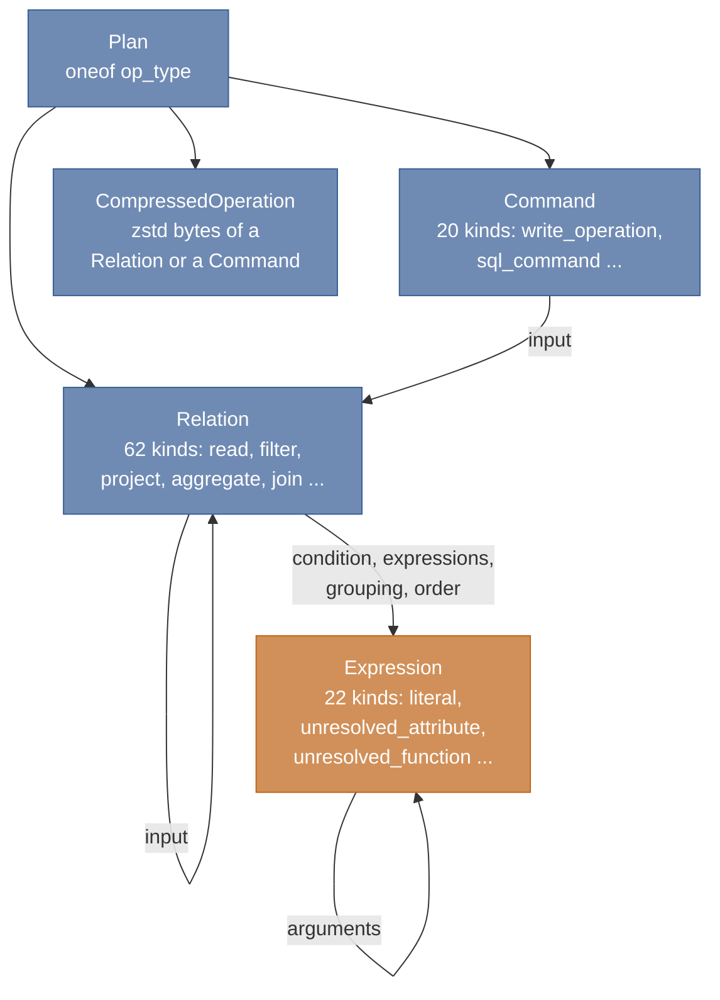
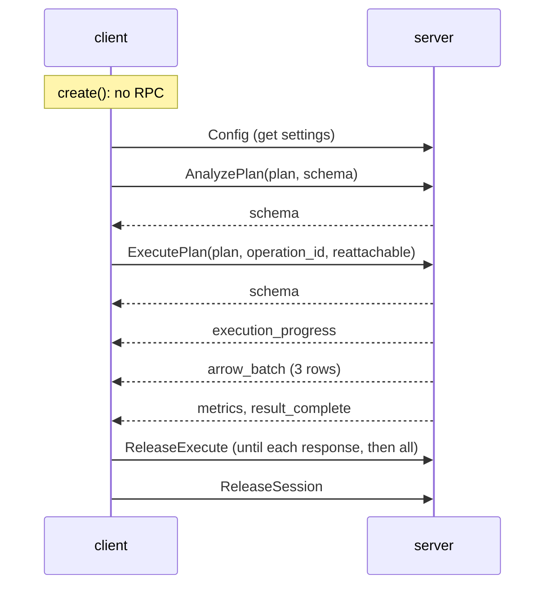
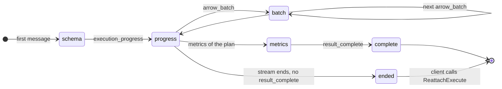

# Chapter 19: Inside the Spark Connect protocol

[Chapter 18](ch18-spark-connect.md) printed the plan that a Connect client sends, and it measured what the split between client and server changes. This chapter opens the connection between the two. It puts a logging proxy between a client and a server, and it records each RPC of a short session. Then it decodes a plan field by field, and it reads an Arrow batch from a response, byte by byte.

**The Spark Connect protocol is small. A request carries a plan as protobuf: a tree of `Relation` and `Expression` messages, or a `Command`. The response is a stream of protobuf messages, and the rows in it are Arrow IPC batches. Because of these two formats, a client is easy to write in any language. They also let a Connect client collect a large result as fast as Classic with Arrow.**

The code is in [`code/ch19`](https://github.com/lisancao/spark-masterclass/tree/main/code/ch19). The scripts ran on pyspark 4.3.0, OpenJDK 17 and Python 3.12.3 on a 16-core Linux machine. They use the server of Chapter 18 (`code/ch18/server.sh`). The source of the protocol is `sql/connect/common/src/main/protobuf/spark/connect/*.proto` at tag `v4.3.0`. Chapter 21 uses this protocol from other languages, and Chapter 23 writes a client with it.

<figure markdown>
  <video autoplay loop muted playsinline controls width="1280" height="720" poster="../../media/clips/ch19-anim-round-trip.webp">
    <source src="../../media/clips/ch19-anim-round-trip.mp4" type="video/mp4">
  </video>
  <figcaption>One round trip. The client builds a plan and sends it in an <code>ExecutePlan</code> request of 695 bytes. The server analyzes, optimizes and runs it. The response is a stream of messages, and one of them carries the three rows in 496 bytes of Arrow. The sizes come from <code>protocol.txt</code>. The timing is schematic.</figcaption>
</figure>

## Step 1: The messages that a plan is made of

The client sends a `Plan`. A `Plan` holds one of three things:

- a `Relation`, which is a query that returns rows
- a `Command`, which is an action with a side effect, such as a write or a view
- a compressed form of one of the two

 `code/ch19/catalog.py` reads the descriptors of the protobuf classes that ship in pyspark:

```text
== The message types that a Plan can hold
spark.connect.Plan         op_type        3 kinds: root, command, compressed_operation, ...
spark.connect.Relation     rel_type      62 kinds: read, project, filter, join, set_op, sort, ...
spark.connect.Expression   expr_type     22 kinds: literal, unresolved_attribute, unresolved_function, expression_string, unresolved_star, alias, ...
spark.connect.Command      command_type  20 kinds: register_function, write_operation, create_dataframe_view, write_operation_v2, sql_command, write_stream_operation_start, ...
```



The structure has three properties:

- **A relation holds its input.** A `filter` holds the relation that it filters in its `input` field. Thus a DataFrame chain becomes a nested message, with the last operation at the top.
- **Expressions have no resolved names.** The kinds are `unresolved_attribute`, `unresolved_function` and `unresolved_star`. The client sends names. The analyzer on the server resolves them.
- **Each list ends with `extension`.** A `google.protobuf.Any` in that field carries a message that Spark does not know. A server plugin reads it ([Chapter 72](ch72-connect-plugins.md)).

## Step 2: The gRPC service

The service is `spark.connect.SparkConnectService` in `base.proto`. `catalog.py` lists its methods, with the streams:

```text
== The gRPC service spark.connect.SparkConnectService
  ExecutePlan        ExecutePlanRequest -> stream ExecutePlanResponse
  AnalyzePlan        AnalyzePlanRequest -> AnalyzePlanResponse
  Config             ConfigRequest -> ConfigResponse
  AddArtifacts       stream AddArtifactsRequest -> AddArtifactsResponse
  ArtifactStatus     ArtifactStatusesRequest -> ArtifactStatusesResponse
  Interrupt          InterruptRequest -> InterruptResponse
  ReattachExecute    ReattachExecuteRequest -> stream ExecutePlanResponse
  ReleaseExecute     ReleaseExecuteRequest -> ReleaseExecuteResponse
  ReleaseSession     ReleaseSessionRequest -> ReleaseSessionResponse
  FetchErrorDetails  FetchErrorDetailsRequest -> FetchErrorDetailsResponse
  CloneSession       CloneSessionRequest -> CloneSessionResponse
  GetStatus          GetStatusRequest -> GetStatusResponse
```

| RPC | What it does | A client call that sends it |
|---|---|---|
| `ExecutePlan` | Runs a plan. The server streams the results back. | `collect()`, `show()`, `count()`, `write...save()`, `spark.sql(...)` |
| `AnalyzePlan` | Analyzes a plan and does not run it: schema, explain, tree string, version. | `df.columns`, `df.schema`, `df.explain()` |
| `Config` | Gets and sets SQL configs of the session. | `spark.conf.set(...)`, `spark.conf.get(...)` |
| `AddArtifacts` | Uploads files to the session: Python files, jars, archives. A client stream. | `spark.addArtifacts(...)` |
| `ArtifactStatus` | Asks if the server already has an artifact with a given hash, to skip an upload. | The client does it for cached artifacts |
| `Interrupt` | Cancels operations of the session: all, by tag, or by operation ID. | `interruptAll()`, `interruptTag()`, `interruptOperation()` |
| `ReattachExecute` | Continues the result stream of an operation after the stream ended. | The client does it, with no call from you |
| `ReleaseExecute` | Tells the server that the client has the responses, so the server can free them. | The client does it, with no call from you |
| `ReleaseSession` | Closes the session on the server. | `spark.stop()`, the end of a `with` block |
| `FetchErrorDetails` | Gets the full error of a failed operation, with the JVM stack trace. | The client does it when an RPC fails |
| `CloneSession` | Copies the state of a session into a new session. | `spark.cloneSession()` |
| `GetStatus` | Returns the status of operations of the session. | Only a private method in the 4.3 Python client: `client._get_operation_statuses()` |

Each request carries the `session_id` and a `user_context` with the `user_id`. The server keys each session by the pair `(user_id, session_id)` ([Chapter 24](ch24-connect-in-production.md), Step 1). Only `ExecutePlan` and `ReattachExecute` return a stream. Thus a result of any size arrives in many small messages, and Step 7 counts them.

## Step 3: Capture the traffic with a logging proxy

`code/ch19/proxy.py` is a gRPC server that forwards each call to the real server. It does not need the method types to forward a call, because it forwards bytes:

```python
def service(self, details):
    method = details.method.removeprefix(SERVICE)
    req_cls, resp_cls = TYPES.get(method, (None, None))
    upstream = self.channel.stream_stream(details.method)   # raw bytes in, raw bytes out
    md = [(k, v) for k, v in details.invocation_metadata]

    def handler(request_iterator, context):
        def forward():
            for raw in request_iterator:
                self.record(call, method, "req", raw, req_cls)
                yield raw
        responses = upstream(forward(), metadata=md)
        for raw in responses:
            self.record(call, method, "resp", raw, resp_cls)
            yield raw
    return grpc.stream_stream_rpc_method_handler(handler)
```

On the wire, a unary call and a streaming call have the same frames. Thus one stream-to-stream handler forwards all twelve methods. `record` decodes each message with the classes in `pyspark.sql.connect.proto`, only to write a summary to a log.

`code/ch19/protocol.py` starts the proxy and connects a client to it. Then it does a short session. It builds a DataFrame, reads its columns, sets a config and collects the top three pickup zones. Then it makes an error, uploads a Python file, interrupts a long query by its tag, and stops. After each client call, it writes a marker in the log. Thus the output shows each RPC under the call that caused it:

```text
client call              RPC                      bytes out/in  responses
build a DataFrame        Config                    146/129      -
df.columns               Config                    236/201      -
                         AnalyzePlan               649/118      result=schema
conf.set                 Config                    167/76       -
df.collect()             ExecutePlan               695/5756     schema, execution_progress x4, arrow_batch, 
                         ReleaseExecute x8        1298/912      -
                         Config                    182/127      -
collect() with an error  ExecutePlan               361/0        error INTERNAL
                         ReleaseExecute            129/114      -
                         FetchErrorDetails         165/7595     -
                         Config                    175/128      -
addArtifacts(pyfile)     AddArtifacts              127/98       -
interruptTag             ExecutePlan               260/687      schema, execution_progress x3, error INTERNA
                         ReleaseExecute x4         668/456      -
                         Interrupt                 138/114      -
                         FetchErrorDetails         165/495      -
                         ReleaseExecute            129/114      -
                         Config                    175/128      -
stop()                   ReleaseSession             89/76       -
```

<figure markdown>
  <video autoplay loop muted playsinline controls width="1280" height="720" poster="../../media/clips/ch19-proxy.webp">
    <source src="../../media/clips/ch19-proxy.mp4" type="video/mp4">
  </video>
  <figcaption><code>protocol.py</code> through the logging proxy. The film is a different run, so some counts of <code>ReleaseExecute</code> and <code>execution_progress</code> are different from the output above.</figcaption>
</figure>

The log shows these facts:

- **`create()` sends no RPC.** The session on the server starts with the first RPC. The first `Config` call reads a config that the client needs before it builds a DataFrame (`spark.python.sql.dataFrameDebugging.enabled` in the full log).
- **`df.columns` is an `AnalyzePlan` call.** The 649 bytes are mostly the plan. The 118 bytes of the answer are the schema. The client also reads the settings for plan compression one time (`spark.connect.session.planCompression.threshold`, 10 MB by default).
- **A collect is one `ExecutePlan` and many `ReleaseExecute` calls.** The execution is reattachable, so the server keeps each response until the client releases it. The client releases the responses while it reads them, and it releases all at the end.
- **An error is two RPCs.** The stream of `ExecutePlan` ends with a gRPC status `INTERNAL`. That status carries a short message. Then the client calls `FetchErrorDetails` and gets 7,595 bytes: the error class, the message and the JVM stack trace of the server.
- **An interrupt is a different RPC from the operation.** The long query had sent its schema and three progress messages. Then the `Interrupt` call stopped it, and its stream ended with an error.
- **`stop()` sends `ReleaseSession`.** The server then removes the state of the session.

This run did not use `ArtifactStatus`, `CloneSession`, `GetStatus` or `ReattachExecute`. Step 7 makes the server end a stream early, so that the client must call `ReattachExecute`.



## Step 4: Decode a plan

`code/ch19/wire.py` builds a small plan and shows it three times: as a tree of relations, as protobuf text, and as bytes. The DataFrame is this:

```python
df = (spark.read.parquet(str(TRIPS))
      .where(F.col("fare_amount") > 100)
      .select("PULocationID", "fare_amount")
      .limit(5))
plan = df._plan.to_proto(spark.client)          # a spark.connect.Plan, built in the client
```

```text
== 1. The plan as a tree of relations
limit    limit=5
  project  PULocationID, fare_amount
    filter   >(fare_amount, 100)
      read     format=parquet
```

The tree is the DataFrame chain in reverse order. `limit` is the last call, so it is the root. The condition `F.col("fare_amount") > 100` is the function `>` with an attribute and a literal. The client does not know that `fare_amount` is a `double`, and it does not know that `100` needs a cast. The protobuf text shows the same plan, without the plan IDs:

```text
root {
  limit {
    input {
      project {
        input {
          filter {
            input {
              read {
                data_source {
                  format: "parquet"
                  schema: ""
                  paths: "~/spark-masterclass/data/nyc-taxi/yellow"
                }
              }
            }
            condition {
              unresolved_function {
                function_name: ">"
                arguments {
                  unresolved_attribute {
                    unparsed_identifier: "fare_amount"
                    is_metadata_column: false
                  }
                }
                arguments {
                  literal {
                    integer: 100
                  }
                }
              }
            }
          }
        }
        expressions {
          unresolved_attribute {
            unparsed_identifier: "PULocationID"
            is_metadata_column: false
          }
        }
        expressions {
          unresolved_attribute {
            unparsed_identifier: "fare_amount"
            is_metadata_column: false
          }
        }
      }
    }
    limit: 5
  }
}
```

The bytes are the real message. `wire.py` walks them with the descriptors: for each field, it prints the offset, the key bytes, the field name and the size. It goes down into messages, and it stops at a set depth:

```text
== 3. The same plan as bytes: 592 bytes, field by field (187 bytes without the Python call sites in `origin`)
    0  0a       root { 589 bytes
    3  0a         common { 2 bytes
    5  10           plan_id = 3
    7  42         limit { 582 bytes
   10  0a           input { 577 bytes
   13  0a             common { 2 bytes
   15  10               plan_id = 2
   17  1a             project { 570 bytes
   20  0a               input { 364 bytes
   23  0a                 common { 2 bytes
   25  10                   plan_id = 1
   27  22                 filter { 357 bytes
   30  0a                   input: 69 bytes
  101  12                   condition: 283 bytes
  387  1a               expressions { 100 bytes
  389  12                 unresolved_attribute { 16 bytes
  391  0a                   unparsed_identifier = 'PULocationID'
  405  18                   is_metadata_column = 0
  407  92 01              common { 79 bytes
  410  0a                   origin: 77 bytes
  489  1a               expressions { 99 bytes
  491  12                 unresolved_attribute { 15 bytes
  493  0a                   unparsed_identifier = 'fare_amount'
  506  18                   is_metadata_column = 0
  508  92 01              common { 79 bytes
  511  0a                   origin: 77 bytes
  590  10           limit = 5
```

<figure markdown>
  
  <figcaption>The decoded plan next to its bytes, from <code>wire.txt</code>. The call sites that the client adds take 405 of the 592 bytes.</figcaption>
</figure>

Each key is one byte here, and it holds the field number and the wire type (`field_number << 3 | wire_type`). For example, `42` is field 8, wire type 2. Field 8 of `Relation` is `limit`, and wire type 2 means a length and then bytes. `1a` is field 3 (`project`), and `22` is field 4 (`filter`). The key `92 01` is a varint of two bytes. It is field 18 of `Expression`, which is `common`. [Chapter 72](ch72-connect-plugins.md), Step 3, decodes the wire format by hand.

The largest fields are not the query. They are `common.origin`, where the Python client records the call site of each expression: the file, the line and the function. The plan is 592 bytes, and 187 bytes without these call sites. The server can use them in error messages, to show the line in your code that made the column.

## Step 5: The request around the plan

The plan is one field of the `ExecutePlanRequest`. The proxy saved the request of `df.collect()` from Step 3. `wire.py` prints it without its plan:

```text
== 4. The ExecutePlanRequest of df.collect(), without the plan
session_id: "3ceec26c-5727-49e7-aca9-3f9e6402b163"
user_context {
  user_id: "reader"
}
client_type: "ch19 spark/4.3.0 os/linux python/3.12.3"
request_options {
  result_chunking_options {
    allow_arrow_batch_chunking: true
  }
}
request_options {
  reattach_options {
    reattachable: true
  }
}
operation_id: "c346d50b-d24a-4a5d-a019-0ada09da2386"
client_observed_server_side_session_id: "75aa4a37-2e6b-4c2f-a9f8-8e917cda4eac"
```

Each field has a job:

| Field | Job |
|---|---|
| `session_id` | The session on the server. The client makes it, as a UUID. |
| `user_context.user_id` | The user. It comes from `user_id=` in the connection string. Without it, the client uses `$USER`. The server does not check it. Authentication is a different layer ([Chapter 24](ch24-connect-in-production.md), Step 4). |
| `client_type` | The `user_agent=` of the connection string, and the versions. The server only logs it. |
| `reattach_options` | The client asks for a reattachable execution. The server keeps the responses until the client releases them (Step 7). |
| `result_chunking_options` | The client accepts a large Arrow batch in more than one message. |
| `operation_id` | The ID of this execution. In 4.3, the client makes it before it sends the request ([Chapter 18](ch18-spark-connect.md), Step 8). |
| `client_observed_server_side_session_id` | The ID that the server gave to the session. If the server restarted, the IDs do not agree, and the server refuses the request. |
| `tags` | The tags of `addTag`. This request had none. The long query of Step 3 had `tags=['nightly']`. |

## Step 6: The response stream and an Arrow batch

The response to `ExecutePlan` is a stream. `protocol.py` lists each message of the stream of `df.collect()`:

```text
The response stream of df.collect(), message by message:
    192 B  schema
    155 B  execution_progress
    662 B  arrow_batch rows=3 arrow_bytes=496
    183 B  execution_progress
    187 B  execution_progress
   4038 B  metrics=14
    185 B  execution_progress
    154 B  result_complete
```



Each message is an `ExecutePlanResponse`. It has the session ID, the operation ID and a `response_id`, and one item of the `response_type` oneof:

- **`schema`** is the Spark schema of the result. The client needs it for types that Arrow cannot hold exactly.
- **`execution_progress`** reports the stages and the tasks in progress. The server sends it at an interval, `spark.connect.progress.reportInterval` (2 seconds by default). [Chapter 20](ch20-connect-observability.md) uses it.
- **`arrow_batch`** carries the rows.
- **`metrics`** carries the SQL metrics of each node of the physical plan: 14 metric objects for this query.
- **`result_complete`** tells the client that the stream is complete. If a stream ends without it, the client must reattach.

`wire.py` walks the message that carried the rows:

```text
== 5. The ExecutePlanResponse that carried the rows: 662 bytes
    0  0a       session_id = '3ceec26c-5727-49e7-aca9-3f9e6402b163'
   38  12       arrow_batch { 507 bytes
   41  08         row_count = 3
   43  12         data: 496 bytes
  542  18         start_offset = 0
  544  20         chunk_index = 0
  546  28         num_chunks_in_batch = 1
  548  62       operation_id = 'c346d50b-d24a-4a5d-a019-0ada09da2386'
  586  6a       response_id = '5ad4ed62-a66c-482a-8ad7-b456f519b48b'
  624  7a       server_side_session_id = '75aa4a37-2e6b-4c2f-a9f8-8e917cda4eac'
```

The field `data` is an Arrow IPC stream. It is the same format that `pyarrow.ipc` writes, so `pyarrow.ipc.open_stream` reads it with no Spark code:

```text
== 6. arrow_batch.data: an Arrow IPC stream of 496 bytes
schema: PULocationID: int32, trips: int64 not null
batch:  3 rows, {'PULocationID': [237, 161, 236], 'trips': [177610, 161198, 157113]}

The messages in the stream (continuation marker, metadata length, metadata, body):
  @0    schema        marker ffffffff  metadata 232 B  body 0 B
  @240  record batch  marker ffffffff  metadata 184 B  body 56 B
  @488  end-of-stream marker: ff ff ff ff 00 00 00 00

The start of the stream (schema message):
  0000  ff ff ff ff e8 00 00 00 10 00 00 00 00 00 0a 00  ................
  0010  0e 00 06 00 0d 00 08 00 0a 00 00 00 00 00 04 00  ................
  0020  10 00 00 00 00 01 0a 00 0c 00 00 00 08 00 04 00  ................
  0030  0a 00 00 00 08 00 00 00 08 00 00 00 00 00 00 00  ................

The record batch body (the three rows, column by column):
  01b0  07 00 00 00 00 00 00 00 ed 00 00 00 a1 00 00 00  ................
  01c0  ec 00 00 00 00 00 00 00 07 00 00 00 00 00 00 00  ................
  01d0  ca b5 02 00 00 00 00 00 ae 75 02 00 00 00 00 00  .........u......
  01e0  b9 65 02 00 00 00 00 00                          .e......
```

<figure markdown>
  <video autoplay loop muted playsinline controls width="1280" height="720" poster="../../media/clips/ch19-arrow.webp">
    <source src="../../media/clips/ch19-arrow.mp4" type="video/mp4">
  </video>
  <figcaption><code>wire.py</code> opens the Arrow IPC stream that the proxy saved from the response, and prints its messages and its bytes.</figcaption>
</figure>

<figure markdown>
  
  <figcaption>From the protobuf message to the column values. All sizes and bytes are from <code>wire.txt</code>.</figcaption>
</figure>

Read the body from the left. The first 8 bytes are the validity bitmap of `PULocationID`. The value `07` is `0b111`, so all three rows have a value, and 7 bytes of padding follow. Then come three little-endian `int32` values: `ed 00 00 00` is 237, `a1 00 00 00` is 161 and `ec 00 00 00` is 236, with 4 bytes of padding. The column `trips` has its own bitmap, and then three `int64` values: `ca b5 02 00 00 00 00 00` is 177,610.

These are the buffers that Arrow uses in memory. The client does not parse a row and does not unpickle an object. It gives the buffers to Arrow, and pandas reads them as columns. The cost of a result is the copy of bytes, not work for each row.

## Step 7: A large result: batches, release and reattach

A large result shows the rest of the stream. `code/ch19/reattach.py` collects five columns of the whole month with `toPandas()` through the proxy. The server ran with a small internal limit on the bytes of one stream, `spark.connect.execute.reattachable.senderMaxStreamSize=16m`. The default is `1g`. Thus the server ended the stream after each 16 MB, and the client had to reattach:

```text
toPandas: 3,837,248 rows, 117 MiB in pandas
RPCs: {'Config': 3, 'ExecutePlan': 1, 'ReleaseExecute': 392, 'ReattachExecute': 7, 'ReleaseSession': 1}
Arrow batches: 385, rows per batch median 10,000 (max 10,000), bytes per batch median 327,056
Arrow bytes in total: 120 MiB for 3,837,248 rows = 32.7 bytes per row

The stream, call by call (ExecutePlan, then each ReattachExecute):
  ExecutePlan        57 responses   16.2 MiB  last: arrow_batch
  ReattachExecute    52 responses   16.2 MiB  last: arrow_batch
  ReattachExecute    52 responses   16.2 MiB  last: arrow_batch
  ReattachExecute    52 responses   16.2 MiB  last: arrow_batch
  ...
  ReattachExecute    52 responses   16.2 MiB  last: arrow_batch
  ReattachExecute    23 responses    6.3 MiB  last: result_complete
```

The output shows how the server cuts a result:

- **Batches of 10,000 rows.** The server makes each batch with `spark.sql.execution.arrow.maxRecordsPerBatch` (default 10,000). It also limits a batch to 70% of `spark.connect.grpc.arrow.maxBatchSize` (default 128 MB), because the size is an estimate (`SparkConnectPlanExecution.scala`).
- **Arrow is the size of the data.** The 120 MiB of Arrow became 117 MiB in pandas. The format on the wire is almost the format in memory.
- **Release for each response.** The client sent 392 `ReleaseExecute` calls for about 390 responses. Each call lets the server free the responses that the client has.
- **Reattach is not visible to your code.** Each stream ended after 16 MB with no `result_complete`. The client then called `ReattachExecute` with the operation ID and the ID of the last response that it had. The server continued from the next response. Only the last stream ended with `result_complete`. `toPandas()` returned all 3,837,248 rows.

With the default limits, a stream ends after 2 minutes (`senderMaxStreamDuration`) or 1 GB. The same mechanism keeps a query alive after a network failure. [Chapter 59](ch59-determinism-retries.md), Step 10, cuts a connection and shows that the operation continues.

## Step 8: Why Arrow batches matter

Arrow is not only the format of Connect. Classic PySpark can also use it for `toPandas()`, but only when `spark.sql.execution.arrow.pyspark.enabled` is `true`. Without Arrow, Classic sends pickled rows from the JVM to Python. `code/ch19/bench.py` measures the three paths on the same data, in three new processes. The Connect server and the Classic driver both had 4 GB of memory. The run took the book's benchmark lock:

```python
COLS = ["PULocationID", "DOLocationID", "trip_distance", "fare_amount", "tpep_pickup_datetime"]
for name, action in [("toPandas", lambda: df.toPandas()),
                     ("collect", lambda: df.limit(ROWS).collect())]:
```

```text
5 runs per cell after a warmup, median seconds (min-max)

mode                       toPandas, all rows    collect, 1,000,000 rows
classic-no-arrow          20.38 (17.82-28.68)           3.60 (3.15-5.54)
classic                      0.60 (0.55-0.74)           3.48 (3.15-4.74)
connect                      0.64 (0.59-0.75)           3.17 (3.06-4.08)

rows: toPandas 3,837,248, collect 1,000,000
```

| Path | `toPandas()`, 3,837,248 rows | Why |
|---|---|---|
| Classic, Arrow off | 20.38 s | The JVM pickles rows, and Python unpickles each row into objects. |
| Classic, Arrow on | 0.60 s | The JVM writes Arrow batches to a local socket. |
| Connect | 0.64 s | The server writes Arrow batches into gRPC messages. Connect has no other path. |

Over Connect, `toPandas()` took 0.64 s, close to Classic with Arrow, and 32 times less than Classic without Arrow. The server and the client were on the same machine, so the network cost nothing here. On a real network, add the time to move 120 MiB.

`collect()` is different. It makes a Python `Row` object for each row, and that work is the same in all modes. Over Connect, the 1,000,000 rows took 3.17 s, against 3.48 s in Classic. If you want speed from a large result, ask for columns (`toPandas()`, `toArrow()`), not rows.

Arrow also makes the protocol easy for other languages. A client in Go, Rust or Swift reads the same IPC stream with the Arrow library of its language. It does not need a decoder for a Spark format. Chapter 21 shows these clients.

## The whole chapter, on one page

```bash
cd code
ch18/server.sh start                        # a Connect server on 15002, UI on 4041
uv run python ch19/catalog.py               # the protocol from its descriptors
uv run python ch19/protocol.py              # every RPC of a session, through ch19/proxy.py
uv run python ch19/wire.py                  # a plan as a tree, as text and as bytes; an Arrow batch
ch18/server.sh start --conf spark.connect.execute.reattachable.senderMaxStreamSize=16m
uv run python ch19/reattach.py              # 385 batches and 7 reattaches
ch18/server.sh start --conf spark.driver.memory=4g
flock $BOOK_DATA/.bench.lock uv run python ch19/bench.py
ch18/server.sh stop
```

- **A plan is a tree of protobuf messages.** `Relation` (62 kinds) holds its input, `Expression` (22 kinds) holds unresolved names, and `Command` (20 kinds) does writes and other side effects.
- **The service has twelve RPCs.** Only `ExecutePlan` and `ReattachExecute` stream their results.
- **A logging proxy shows the whole session.** `create()` sends nothing, `df.columns` is an `AnalyzePlan`, an error adds a `FetchErrorDetails`, and `stop()` sends `ReleaseSession`.
- **Python call sites are most of a small plan.** Here, 405 of 592 bytes.
- **The response is a stream:** schema, progress, Arrow batches, metrics and `result_complete`.
- **An Arrow batch is an Arrow IPC stream** that `pyarrow` reads directly. Its body is the column buffers, little-endian and aligned.
- **Large results come in batches of 10,000 rows,** and the client reattaches when a stream ends early.
- **Arrow is why Connect is fast for columns.** `toPandas()` of the month took 0.64 s over Connect, 0.60 s in Classic with Arrow, and 20.38 s in Classic without it.

## Further reading

- [`base.proto` at v4.3.0](https://github.com/apache/spark/blob/v4.3.0/sql/connect/common/src/main/protobuf/spark/connect/base.proto): the service, the requests and the responses.
- [`relations.proto`](https://github.com/apache/spark/blob/v4.3.0/sql/connect/common/src/main/protobuf/spark/connect/relations.proto) and [`expressions.proto`](https://github.com/apache/spark/blob/v4.3.0/sql/connect/common/src/main/protobuf/spark/connect/expressions.proto): each node of a plan.
- [Arrow IPC format](https://arrow.apache.org/docs/format/Columnar.html#serialization-and-interprocess-communication-ipc): the stream format inside `arrow_batch.data`.
- [Protocol Buffers encoding](https://protobuf.dev/programming-guides/encoding/): keys, varints and lengths.
- [Building a Spark Connect Client in OCaml](https://systemsnull.net/posts/data-engineering-ai/build-a-spark-connect-client), about what a client must implement.
