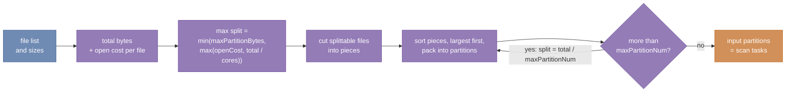

# Chapter 19: Partitions, caching, memory and spill

[Chapter 18](ch18-query-plans.md) showed what Spark decides. This chapter shows what those decisions cost when they run. A plan can be correct and still slow. For example, 16 tasks read a file with 4 row groups, and twelve tasks do nothing. One task writes all the output because a `coalesce(1)` at the end pulled all the work into that task. A sort writes 1 GiB to the disk because each task got a small part of a small heap. A cache makes a query slower than the Parquet files that it replaced.

**Three numbers set the cost of most Spark jobs: the number of partitions in each stage, the quantity of memory that each task gets, and the bytes that move between stages. You can predict the first number from the input files before you run anything. You can read the second number from the memory settings. You can measure the third number in the Spark UI. Caching and repartitioning are tools that change these numbers, and each of them has a cost.**

The scripts are in [`code/ch19`](https://github.com/lisancao/spark-masterclass/tree/main/code/ch19), and each output block comes from `code/ch19/output/`. The data is six months of yellow-taxi trips, January to June 2026 (six Parquet files, 372.6 MB, 21,828,310 rows after the cleaning in Step 6), plus the June file alone from [Chapter 1](ch01-how-spark-runs.md). All runs use Spark 4.3.0 in `local[*]` mode on a machine with 16 cores. Each timing is a median after a warm-up run, measured while no other benchmark ran on the machine.

## Step 1: Which settings you can change, and when

Spark has two kinds of settings. **Runtime settings** are SQL settings. You can change them in a session at any time with `spark.conf.set`, and the next query uses the new value. **Static settings** configure the JVM, the memory manager and the scheduler. Spark reads them one time, when the application starts. `config.py` asks the session which settings it can change:

```python
for k in KEYS:
    print(f"{k:<46}{spark.conf.get(k, '(not set)'):>12}  {spark.conf.isModifiable(k)}")
```

```text
key                                                  value  isModifiable
spark.sql.shuffle.partitions                           200  True
spark.sql.files.maxPartitionBytes               134217728b  True
spark.sql.adaptive.enabled                            true  True
spark.sql.autoBroadcastJoinThreshold             10485760b  True
spark.sql.execution.arrow.maxRecordsPerBatch         10000  True
spark.executor.memory                            (not set)  False
spark.driver.memory                                     4g  False
spark.memory.fraction                            (not set)  False
spark.default.parallelism                        (not set)  False
spark.serializer                                 (not set)  False
spark.python.worker.reuse                        (not set)  False

set spark.sql.shuffle.partitions=64 -> 64
set spark.memory.fraction=0.8 -> [CANNOT_MODIFY_CONFIG] Cannot modify the value of the Spark config: "spark.memory.fraction".
set spark.executor.memory=8g -> [CANNOT_MODIFY_CONFIG] Cannot modify the value of the Spark config: "spark.executor.memory".
```

All `spark.sql.*` settings in this list are runtime settings. The memory settings, the default parallelism, the serializer and the Python worker settings are static. If you try to change a static setting in a running session, Spark gives the error `CANNOT_MODIFY_CONFIG`. To change a static setting, give it to `SparkSession.builder.config(...)` before the first session starts, or to `spark-submit --conf`. The **Environment** tab of the Spark UI shows the values that the application started with.

`(not set)` means that the application did not set a value, and Spark uses the default in its code. In local mode, `spark.driver.memory` is the only memory setting that matters, because the driver and the executor are one JVM. The scripts that read six months of data set it to `4g`. The reason is in Step 7.

## Step 2: How many partitions a file read makes

A scan stage has one task for each **input partition**. Spark calculates the input partitions on the driver, before it reads any data, from the list of files and their sizes. The calculation is in `FilePartition.scala`:

1. Add the size of each file, plus `spark.sql.files.openCostInBytes` (4 MB) for each file. The open cost is the estimated cost to open a file, written as bytes.
2. Divide this total by the default parallelism (16 here), or by `spark.sql.files.minPartitionNum` if you set it. The result is the bytes for each core.
3. The maximum split size is `min(maxPartitionBytes, max(openCostInBytes, bytesPerCore))`. `maxPartitionBytes` is 128 MB by default.
4. Cut each splittable file into pieces of the maximum split size. A file that Spark cannot split stays as one piece.
5. Sort the pieces from the largest to the smallest. Put them into partitions in that sequence, and start a new partition when the next piece does not fit. Each piece also adds the open cost to its partition.
6. If there are more partitions than `spark.sql.files.maxPartitionNum`, do the packing again with a larger split size. The new split size is the total divided by `maxPartitionNum`.



`file_partitions.py` does this calculation in Python for each input, and then it compares the prediction with `df.rdd.getNumPartitions()`:

```text
local[*] with 16 cores; defaults: maxPartitionBytes 128MB, openCostInBytes 4MB

input                                  files      MB  max split  predicted  actual
June: 1 Parquet file                       1    62.4       4.2M         16      16
June, maxPartitionBytes 2MB                1    62.4       2.0M         32      32
January to June: 6 files                   6   372.6      24.8M         17      17
January to June, minPartitionNum 64        6   372.6       6.2M         62      62
June as 200 small files                  200    98.4      56.2M         16      16
200 small files, openCostInBytes 1       200    98.4       6.2M         17      17
200 small files, maxPartitionNum 4       200    98.4     224.6M          4       4
CSV, 500,000 rows                          1    55.1       4.0M         14      14
the same CSV, gzip                         1     9.7       4.0M          1       1
the same CSV, bzip2                        1     5.1       4.0M          2       2
```

The prediction is correct in each case. Some rows need an explanation:

- **The split size follows the data, not the 128 MB default.** For less than 2 GB of input on 16 cores, the bytes for each core are smaller than 128 MB. Thus, Spark makes about one partition for each core. The 128 MB limit applies only to large inputs.
- **Six files make 17 partitions, not 16.** The pieces do not divide exactly into 16 groups, so the packing needs one more partition.
- **Small files cost an open cost each.** June as 200 small files is 98.4 MB on the disk, but the packing counts 200 × 4 MB of open cost more. The partitions are full sooner. With `openCostInBytes` at 1, the same files pack into 17 partitions of real data.
- **`maxPartitionNum` is a ceiling.** Spark packs the files again with a split of 224.6 MB, and it ignores `maxPartitionBytes`. Spark logs a warning when it does this.
- **gzip cannot split.** A gzip stream has no points where a reader can start in the middle. Thus, the 9.7 MB file is one piece and one task, regardless of its size. bzip2 has block boundaries, and Hadoop's `BZip2Codec` implements `SplittableCompressionCodec`. Thus, the 5.1 MB bzip2 file splits into two pieces.

Other inputs that do not split: a JSON or CSV file with `multiLine=true`, a `wholetext` text read, and each file of a `binaryFile` read. One large gzip file makes one task for the whole scan stage. If a job reads such a file, `repartition` after the read is the only method to spread the next steps over the cores.

### A partition is not the same as a task with work

The split rule counts bytes. Parquet decodes **row groups**, as [Chapter 1](ch01-how-spark-runs.md) showed. A Parquet split reads a row group only if the split contains the midpoint of that row group:

```text
row groups: June 4 | January to June 24
June: 16 partitions, 4 of them return rows
January to June: 17 partitions, 17 of them return rows
```

The June file gives 16 partitions, but only 4 of them return rows. The six months have 24 row groups in 17 partitions, so each partition gets at least one row group. A small file with a few large row groups is the worst case for a scan. [Chapter 22](ch22-parquet-inside.md) shows how a writer sets the size of the row groups.

!!! note "Project Feather changes the June row"
    Spark 4.3 can read a single small file in one task. If `spark.sql.optimizer.singleTaskExecution.enabled` is `true`, the June file is one input partition, not 16. The conditions are in [Chapter 23](ch23-project-feather.md). All the numbers in this chapter use the default, `false`.

## Step 3: repartition, coalesce and the cost of `coalesce(1)`

After the scan, two methods change the number of partitions. `repartition` adds a shuffle. `coalesce` merges partitions that are next to each other, without a shuffle. `repartition.py` applies each variant to the six months and prints the top operator of the plan:

<<REPARTITION_TABLE>>

## Step 4: Write a layout that later queries can skip

<<LAYOUT>>

## Step 5: What `cache()` does

<<CACHING>>

## Step 6: The memory of an executor

<<MEMORY>>

## Step 7: Spill

<<SPILL>>

## Step 8: Very large files

<<BLOBS>>

## Step 9: A walk through the Spark UI

<<UI>>

## The whole chapter, on one page

<<RECAP>>
