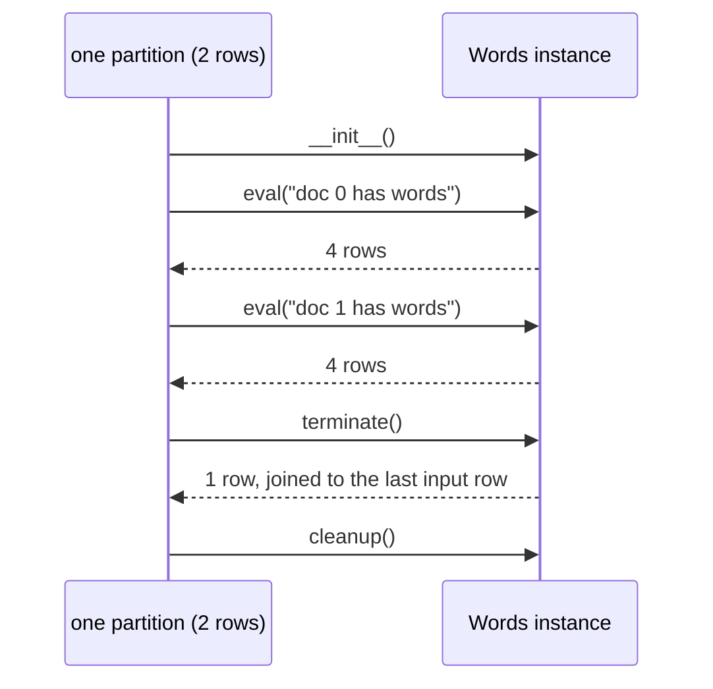
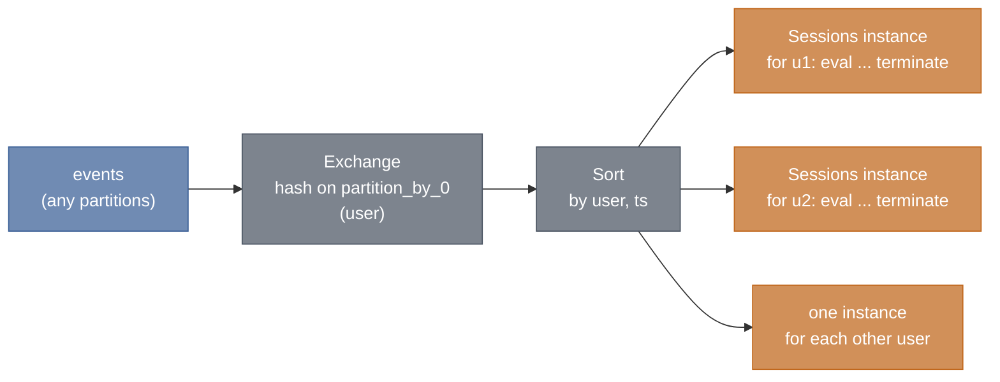

# Chapter 21: Python UDTFs

A UDF returns one value for each row. Many real tasks need a different shape. One log line holds a number of key-value pairs, and each pair must become a row. One user's events must become sessions, with a state that continues from one event to the next. One JSON document holds an array of items.

A Python user-defined table function (UDTF) is the tool for these tasks. It is a Python class that Spark calls for each input row, and each call can return zero, one or many rows.

**A Python UDTF is a small program with a lifecycle. Spark makes one instance for each partition or each partition key, calls `eval` for each row, and calls `terminate` at the end. The form of the input sets which rows go to which instance: a scalar argument in a lateral join, or a `TABLE` argument with `PARTITION BY`. The output schema can come from the arguments at analysis time. A UDTF has the same Python costs as a UDF. Thus, for a task that a built-in table function can do, such as `JSON_TABLE` in Spark 4.3 for JSON, the built-in function is faster.**

The scripts are in [`code/ch21`](https://github.com/lisancao/spark-masterclass/tree/main/code/ch21), and each output block comes from `code/ch21/output/`. The data is a service log in `key=value` format from SparkTutor (`code/data/service_logs/kv.log`, 112 lines), and 200,000 generated JSON order documents. The log has some defects:

- blank lines and a comment,
- a repeated key and an upper-case key,
- a value that is not a number,
- a line with a quote that does not end.
 All runs use Spark 4.3.0 in `local[*]` mode on 16 cores.

## Step 1: Where a UDTF fits

| Tool | Input | Output per input | State across rows | Runs in |
|---|---|---|---|---|
| built-in function | columns of a row | one value | no | JVM |
| `explode`, `inline`, `JSON_TABLE` | an array, a map, a JSON string | many rows | no | JVM |
| `@udf`, `@pandas_udf` | columns of a row, or a batch | one value per row | no | Python |
| UDTF with scalar arguments | columns of a row | zero or more rows | inside one partition | Python |
| UDTF with a `TABLE` argument | all rows of a partition or a key | zero or more rows | inside one key | Python |
| `applyInPandas` | all rows of a key, as pandas | a pandas DataFrame | inside one key | Python |
| `mapInPandas`, `mapInArrow` | a partition, as batches | batches | inside one partition | Python |

The history of the API: Python UDTFs arrived in Spark 3.5. Spark 4.0 added `analyze()`, and `PARTITION BY` and `ORDER BY` for `TABLE` arguments. Spark 4.1 added `arrow_udtf`. Spark 4.2 made Arrow the default for UDTFs (see the PySpark migration guide for 4.2).

## Step 2: The lifecycle of a UDTF

`udtf_core.py` defines a UDTF that splits text into words. Each method writes a line to a file. The name of the file has the process ID and the instance ID, so the script can see which methods ran in which instance:

```python
@udtf(returnType="word string, n int")
class Words:
    def __init__(self):
        self.id = f"{os.getpid()}-{id(self)}"
        self.calls = 0
        self.log("__init__")

    def eval(self, text: str):
        self.calls += 1
        for w in text.split():
            yield w, self.calls

    def terminate(self):
        self.log(f"terminate after {self.calls} eval calls")
        yield "<end>", self.calls          # rows from terminate() come after the last eval

    def cleanup(self):
        self.log("cleanup")

docs = spark.range(6, numPartitions=3).select(F.concat(F.lit("doc "), "id", F.lit(" has words")).alias("text"))
rows = docs.lateralJoin(Words(F.col("text").outer())).collect()
```

```text
=== lifecycle: which methods run, in which process, how often
27 rows from 6 input rows in 3 partitions
  instance 759558-...: __init__ | terminate after 2 eval calls | cleanup
  instance 759559-...: __init__ | terminate after 2 eval calls | cleanup
  instance 759563-...: __init__ | terminate after 2 eval calls | cleanup
  rows from terminate(): [('doc 1 has words', '<end>', 2), ('doc 3 has words', '<end>', 2), ('doc 5 has words', '<end>', 2)]
```



<figure markdown>
  <video autoplay loop muted playsinline controls width="1280" height="720" poster="../../media/clips/ch21-lifecycle.webp">
    <source src="../../media/clips/ch21-lifecycle.mp4" type="video/mp4">
  </video>
  <figcaption><code>udtf_core.py lifecycle</code>: each instance logs its methods. Then the same UDTF fails on an input with an empty partition.</figcaption>
</figure>

The output shows the rules:

- **One instance for each partition.** Six rows in three partitions made three instances, and each instance got two `eval` calls. Thus, a UDTF can keep a state across the rows of a partition in `self`.
- **`terminate` runs once, after the last `eval`.** Its rows join to the last input row of the partition. In the output, the `<end>` rows are next to `doc 1`, `doc 3` and `doc 5`.
- **`cleanup` runs last.** It also runs after a failure, so it is the place to close a connection or delete a temporary file. `terminate` does not run after a failure.

Six rows of four words gave 24 rows, and three `terminate` rows gave 27.

### `terminate` and an empty partition

The second input has two rows in three partitions, so one partition is empty:

```text
  rows per partition of a second input: [0, 1, 1]
  lateral join with terminate(), one empty partition -> java.lang.NullPointerException
  TABLE argument                          -> java.lang.NullPointerException
  TABLE argument, withSinglePartition()   terminate() rows: [2]
  TABLE argument, partitionBy('text')     terminate() rows: [1, 1]
```

In this run, one input partition was empty. A UDTF whose `terminate` yields a row then failed with `java.lang.NullPointerException`, in a lateral join and with a plain `TABLE` argument. The failure is in `EvalPythonUDTFExec`, which joins each `terminate` row to the last input row, and an empty partition has no last row. With `withSinglePartition()` or `partitionBy()`, each instance had at least one row, and the query ran.

!!! caution
    A UDTF that yields rows from `terminate()` can fail when an input partition is empty. Use a `TABLE` argument with `PARTITION BY`, or make sure that each partition has rows, before you depend on rows from `terminate()`.

## Step 3: Arrow or not, decided when `udtf()` runs

PySpark decides if a UDTF uses Arrow when you call `udtf()`, not when the query runs. It reads `spark.sql.execution.pythonUDTF.arrow.enabled` from the active session at that moment. If no session exists yet, it cannot read the setting, and it makes a UDTF without Arrow. `udtf_core.py` defines `BeforeSession` at the top of the file, before it starts the session:

```text
=== Arrow or not: decided when udtf() runs
spark.sql.execution.pythonUDTF.arrow.enabled = true
  defined before the session   BatchEvalPythonUDTF BeforeSession(1)#31, [n#32]
  defined after the session    ArrowEvalPythonUDTF AfterSession(1)#33, [n#34], 301
  useArrow=False               BatchEvalPythonUDTF AfterSession(1)#35, [n#36]
```

If you define the class before the session, the plan has `BatchEvalPythonUDTF`. If you define it after, the plan has `ArrowEvalPythonUDTF` (eval type 301, `SQL_ARROW_TABLE_UDF`). A module of UDTFs that you import before you create the session gets the slower form without a warning. Give `useArrow=` explicitly, or create the UDTFs after the session.

## Step 4: What a yielded value becomes

A UDTF yields Python tuples, and Spark converts them to the declared schema. The two paths convert in different ways:

```text
=== what a yielded value becomes
  schema        yield               Arrow (default)                         useArrow=False
  n int         (7.9,)              [(7,)]                                  [(None,)]
  n int         ('7',)              error UDTF_ARROW_DATA_CONVERSION_ERROR  [(None,)]
  n int         (True,)             error UDTF_ARROW_DATA_CONVERSION_ERROR  [(None,)]
  s string      (42,)               [('42',)]                               [('42',)]
  n int         5                   [(5,)]                                  error UDTF_INVALID_OUTPUT_ROW_TYPE
  a int, b int  {'b': 2, 'a': 1}    [(1, 2)]                                [(1, 2)]
  n int         None                [(None,)]                               [(None,)]
  n int         [3]                 error UDTF_ARROW_DATA_CONVERSION_ERROR  [(3,)]
```

- **The non-Arrow path returns NULL for a value that does not match.** `7.9`, `'7'` and `True` for an `int` column all became NULL. No error.
- **The Arrow path converts or fails.** `7.9` became `7`. `'7'`, `True` and a list `[3]` failed with `UDTF_ARROW_DATA_CONVERSION_ERROR`.
- **The Arrow path accepts a scalar for a one-column schema.** `yield 5` gave a row with `5`. The non-Arrow path requires a tuple and fails with `UDTF_INVALID_OUTPUT_ROW_TYPE`.
- **Spark matches a dict by name**, on both paths. `{"b": 2, "a": 1}` gave `(1, 2)` for the schema `a int, b int`.
- **`None` is a row of NULLs**, not "no row". To give no row for an input, do not yield.

Thus, a change between the two paths can change the results. Yield tuples of the declared Python types.

## Step 5: Scalar arguments and lateral joins

A UDTF with scalar arguments runs once for each input row. In the DataFrame API, call it inside `lateralJoin`, and mark the columns of the outer DataFrame with `.outer()`. In SQL, use `LATERAL`:

```python
@udtf(returnType="key string, value string")
class Pairs:
    def eval(self, line: str):
        if line and "=" in line:
            for tok in line.split():
                k, _, v = tok.partition("=")
                if v:
                    yield k, v

df = lines.lateralJoin(Pairs(F.col("line").outer()))
spark.sql("SELECT l.line, p.* FROM lines l, LATERAL pairs(l.line) p")
```

```text
DataFrame lateralJoin: 634 rows
  ArrowEvalPythonUDTF Pairs(line#2)#71, [line#2], [key#73, value#74], 301
SQL LATERAL: 634 rows
input lines 112, of them blank 2
LEFT JOIN LATERAL, no ON:   rows with no pair: 0
LEFT JOIN LATERAL ... ON true: rows with no pair: 3
  plan with ON true:
  BroadcastHashJoin [coalesce(line#2, ), isnull(line#2)], [coalesce(line#130, ), isnull(line#130)]
  BroadcastExchange HashedRelationBroadcastMode(List(coalesce(input[0, string, true], ), isnull(in
  ArrowEvalPythonUDTF pairs(line#130)#111, [line#130], [key#112, value#113], 301
  Exchange hashpartitioning(line#2, 200), ENSURE_REQUIREMENTS, [plan_id=890]
```

The DataFrame and SQL forms give the same 634 rows and one `ArrowEvalPythonUDTF` node. The lateral join needs no `Join` node, because Spark attaches the UDTF output to its input row.

### `LEFT JOIN LATERAL` and lines with no pairs

Three input lines give no pairs: two blank lines and the comment line. A left lateral join must keep each of them, with NULL in the UDTF columns. Without an `ON` clause, the result had 0 rows with a NULL `key`, so the three lines were not in the result. With `ON true`, the result kept them. The plan with `ON true` shows the cost: the optimizer changed the lateral join into a real join. It runs the UDTF on the distinct input lines, broadcasts the result, and joins it back on `coalesce(line, '')` and `isnull(line)`.

!!! caution
    In this run, `LEFT JOIN LATERAL` with a Python UDTF and no `ON` clause did not keep the input rows for which the UDTF yielded nothing. Add `ON true`, or make the UDTF yield one row with NULL values for an input that has no output.

## Step 6: `TABLE` arguments: one instance for each key

A `TABLE` argument gives the UDTF a whole table, and `PARTITION BY` sends all rows of one key to one instance. `ORDER BY` sorts the rows of each key before `eval` sees them. Thus, a UDTF can keep a state across the rows of one key. `Sessions` groups each user's events into sessions, with a new session after a gap of more than 30 minutes:

```python
@udtf(returnType="user string, start timestamp, events int, pid int")
class Sessions:
    def __init__(self):
        self.user, self.start, self.last, self.n = None, None, None, 0

    def eval(self, row: Row, gap_minutes: int):
        ts = row["ts"]
        if self.last is not None and ts - self.last > timedelta(minutes=gap_minutes):
            yield self.user, self.start, self.n, os.getpid()
            self.start, self.n = ts, 0
        self.user, self.start, self.last = row["user"], self.start or ts, ts
        self.n += 1

    def terminate(self):
        if self.n:
            yield self.user, self.start, self.n, os.getpid()
```

```sql
SELECT * FROM sessions(TABLE(events) PARTITION BY user ORDER BY ts, gap_minutes => 30)
```

```text
19 sessions; per user: {'u1': 4, 'u2': 3, 'u3': 4, 'u4': 2, 'u5': 4, 'u6': 2}
  ArrowEvalPythonUDTF sessions(c#141, gap_minutes => 30)#135, [user#136, start#137, events#138, pi
  Sort [partition_by_0#140 ASC NULLS FIRST, ts#133 ASC NULLS FIRST], false, 0
  Exchange hashpartitioning(partition_by_0#140, 200), REPARTITION_BY_COL, [plan_id=1056]
DataFrame asTable().partitionBy().orderBy(): 19 sessions
ORDER BY ts, 30 -> INVALID_SQL_SYNTAX.INVALID_TABLE_FUNCTION_TABLE_ARGUMENT_PARTITIONING
```



The plan shows how Spark keeps the promise of `PARTITION BY`. It adds an `Exchange` with hash partitioning on a helper column `partition_by_0`, and a `Sort` on that column and `ts`. Then each key is one contiguous run of rows in one task, and Spark starts a new instance of the UDTF for each key. The last session of each user comes from `terminate()`.

The DataFrame form is `Sessions(events.asTable().partitionBy("user").orderBy("ts"), F.lit(30))`, and it gave the same 19 sessions.

The last line is a parser trap. In `ORDER BY ts, 30`, the parser reads `30` as a second sort expression, and the query fails with `INVALID_SQL_SYNTAX.INVALID_TABLE_FUNCTION_TABLE_ARGUMENT_PARTITIONING`. Use a named argument (`gap_minutes => 30`), or put the `ORDER BY` list in parentheses.

Without `PARTITION BY`, each input partition gets one instance, in the order of the partition. `WITH SINGLE PARTITION` (or `withSinglePartition()`) sends all rows to one instance, which is one task.

## Step 7: `analyze()`: the output schema from an argument

A static `returnType` fixes the output columns. A static method `analyze` can calculate them from the arguments, on the driver, when Spark analyzes the query. Each argument comes as an `AnalyzeArgument` with `dataType`, `value`, `isTable` and `isConstantExpression`. `KV` reads a constant `spec` string such as `'ts:timestamp,user,action,ms:int'` and returns a schema with those columns and an `_error` column:

```python
class KV:
    @staticmethod
    def analyze(line: AnalyzeArgument, spec: AnalyzeArgument) -> AnalyzeResult:
        if not spec.isConstantExpression or spec.value is None:
            raise ValueError("spec must be a constant string such as 'ts:timestamp,user'")
        schema = StructType()
        for part in spec.value.split(","):
            name, _, kind = part.partition(":")
            schema = schema.add(name.strip(), TYPES[kind.strip() or "string"])
        return AnalyzeResult(schema.add("_error", StringType()))
```

```text
schema from the spec: struct<ts:timestamp,user:string,action:string,ms:int,_error:string>
rows: 109 | with an _error: [('u4', "ms='fast'"), (None, 'unparseable: No closing quotation')]
a spec that is not constant -> TABLE_VALUED_FUNCTION_FAILED_TO_ANALYZE_IN_PYTHON
```

The schema came from the spec. The UDTF kept the lines that it could not parse completely and wrote the reason in `_error`. One line has `ms=fast`, which is not an integer. One line has a quote that does not end, so `shlex` cannot split it. The blank lines and the comment gave no rows, so 109 of 112 lines are in the result. A column that is not constant cannot set a schema, and analysis fails with `TABLE_VALUED_FUNCTION_FAILED_TO_ANALYZE_IN_PYTHON`.

`AnalyzeResult` can also ask for an input layout: `partitionBy=[PartitioningColumn("user")]`, `orderBy=[OrderingColumn("ts")]` or `withSinglePartition=True`. Then the UDTF requires that layout, and a caller cannot forget the `PARTITION BY` clause. `analyze` runs on the driver, or on the Connect server, at each analysis.

## Step 8: `arrow_udtf`: batches in, batches out

`arrow_udtf` (Spark 4.1 and later) is the batch form. `eval` gets a `pyarrow.RecordBatch` of the `TABLE` argument and yields Arrow tables. With `pyarrow.compute`, it can work on a whole batch without a Python loop:

```python
@arrow_udtf(returnType="user string, ms int")
class SlowRequests:
    def eval(self, batch: pa.RecordBatch):
        ms = pc.cast(pc.extract_regex(batch["line"], r"ms=(?P<ms>\d+)").field("ms"), pa.int32(), safe=False)
        user = pc.extract_regex(batch["line"], r"user=(?P<u>\w+)").field("u")
        keep = pc.fill_null(pc.greater(ms, 800), False)
        yield pa.table({"user": pc.filter(user, keep), "ms": pc.filter(ms, keep)})
```

```text
requests over 800 ms: [('u1', 848), ('u1', 895), ('u2', 836), ('u2', 855), ('u2', 862), ('u2', 863), ('u3', 826), ('u3', 896), ('u6', 878)]
  ArrowEvalPythonUDTF SlowRequests(c#186)#183, [user#184, ms#185], 302
in a lateral join -> LATERAL_JOIN_WITH_ARROW_UDTF_UNSUPPORTED
```

The plan node is `ArrowEvalPythonUDTF` with eval type 302 (`SQL_ARROW_UDTF`). An `arrow_udtf` takes `TABLE` arguments. It is not allowed in a lateral join, and the error is `LATERAL_JOIN_WITH_ARROW_UDTF_UNSUPPORTED`.

## Step 9: New in 4.3: JSON_TABLE instead of a parsing UDTF

A frequent use of a UDTF is to parse a document into rows. Spark 4.3 adds `JSON_TABLE`, the SQL:2016 table function for this task with JSON. It takes a JSON string, a row path such as `'$.items[*]'`, and a `COLUMNS` clause with a type and a path for each column. Only the flat form is in 4.3. `NESTED PATH` is not supported yet (`docs/sql-ref-syntax-qry-select-json-table.md`).

`json_table.py` makes 200,000 order documents, each with one to six items, and four truncated documents. It turns them into one row for each item in three ways:

```python
@udtf(returnType="order int, seq int, sku string, qty int, price double")
class Items:
    def eval(self, doc: str):
        try:
            d = json.loads(doc)
        except (TypeError, ValueError):
            return                                    # a bad document gives no rows
        for i, it in enumerate(d.get("items") or [], 1):
            yield d.get("order"), i, it.get("sku"), it.get("qty"), it.get("price")
```

```sql
SELECT get_json_object(doc, '$.order') :: int AS order, t.*
FROM docs, LATERAL JSON_TABLE(doc, '$.items[*]'
     COLUMNS (seq FOR ORDINALITY, sku STRING PATH '$.sku', qty INT PATH '$.qty',
              price DOUBLE PATH '$.price')) AS t
```

```python
docs.select(F.from_json("doc", "order int, items array<struct<sku string, qty int, price double>>").alias("d"))
    .select("d.order", F.posexplode("d.items").alias("pos", "it"))
    .select("order", (F.col("pos") + 1).alias("seq"), "it.*")
```

```text
200,000 JSON documents (Parquet, one string column); one row per item

Python UDTF            rows   698,132  sum(qty*price)  84,944,653.68  rows with NULL sku   0  plan: ArrowEvalPythonUDTF items
JSON_TABLE             rows   698,132  sum(qty*price)  84,944,653.68  rows with NULL sku   0  plan: Generate json_table
from_json + explode    rows   698,132  sum(qty*price)  84,944,653.68  rows with NULL sku   0  plan: Generate posexplode

noop write, median of 5 runs after a warm-up:
  Python UDTF             2.47 s
  JSON_TABLE              1.31 s
  from_json + explode     0.20 s

JSON_TABLE on a truncated document, the default (NULL ON ERROR) and ERROR ON ERROR:
```

<figure markdown>
  <video autoplay loop muted playsinline controls width="1280" height="720" poster="../../media/clips/ch21-jsontable.webp">
    <source src="../../media/clips/ch21-jsontable.mp4" type="video/mp4">
  </video>
  <figcaption><code>json_table.py</code> on 20,000 documents: the same rows from a Python UDTF, from <code>JSON_TABLE</code> and from <code>from_json</code> with <code>posexplode</code>.</figcaption>
</figure>

The three methods agree: 698,132 item rows with the same total. The four truncated documents gave no rows in each method, because each one treats a document that it cannot parse as empty.

The times are less simple:

- **`JSON_TABLE` took about half the time of the Python UDTF.** It runs in the JVM, with no Python worker and no Arrow transfer.
- **`from_json` with `posexplode` was the fastest by a large margin**, about six times faster than `JSON_TABLE`. `from_json` parses each document one time into a typed struct, and `posexplode` only reads the array. In this run, `JSON_TABLE` with four `PATH` columns and the extra `get_json_object` for the order number did more work for each document. This explanation agrees with the plans, but the internals of the `json_table` generator were not examined.
- **The error behavior is different.** `JSON_TABLE` has an explicit `NULL ON ERROR` (the default, no rows) or `ERROR ON ERROR` clause. The truncated document gave 0 rows, or the error `MALFORMED_RECORD_IN_PARSING.WITHOUT_SUGGESTION`.

Thus, for JSON in Spark 4.3, do not write a UDTF that parses it. Use `from_json` with `explode` or `posexplode` when you know the schema and speed matters. Use `JSON_TABLE` when SQL is the interface, or when you migrate SQL from Oracle, DB2 or MySQL. It also gives `EXISTS` columns and the error clause. Keep UDTFs for logic that a built-in function cannot express. The sessions of Step 6 and the `key=value` parser of Step 7 are examples. [Chapter 13](ch13-json.md) covers JSON drift and quarantine in depth.

## Step 10: What does not apply to UDTFs

Two 4.3 features that make Python faster do not apply to UDTFs:

- **The UDF transpiler** ([Chapter 20](ch20-python-udfs-arrow.md), Step 4) transpiles only plain batched UDFs (`SQL_BATCHED_UDF`, the check in `pyspark/sql/udf.py`). A UDTF always runs in Python.
- **Single-task execution** ([Chapter 23](ch23-project-feather.md)) refuses any plan with a Python UDTF. `EVAL_PYTHON_UDTF` is in the `unsupportedPatterns` list of `MarkSingleTaskExecution`, so a small query with a UDTF keeps its shuffles.

Neither limit is a reason to avoid UDTFs. They are a reason to use a UDTF for logic that needs Python, and a built-in function for the rest.

## The whole chapter, on one page

```python
from pyspark.sql.functions import udtf
from pyspark.sql.udtf import AnalyzeArgument, AnalyzeResult

@udtf(returnType="key string, value string", useArrow=True)   # say useArrow= explicitly
class Pairs:
    def __init__(self):            # once for each partition (or each key with PARTITION BY)
        self.n = 0
    def eval(self, line: str):     # once for each input row; yield tuples of the declared types
        for tok in (line or "").split():
            k, _, v = tok.partition("=")
            if v:
                yield k, v
    def terminate(self):           # once at the end; its rows join to the last input row
        pass
    def cleanup(self):             # always, also after a failure
        pass

lines.lateralJoin(Pairs(F.col("line").outer()))                                   # scalar argument
spark.udtf.register("pairs", Pairs)
spark.sql("SELECT l.line, p.* FROM lines l LEFT JOIN LATERAL pairs(l.line) p ON true")   # keep empty rows
spark.sql("SELECT * FROM sessions(TABLE(events) PARTITION BY user ORDER BY ts, gap_minutes => 30)")

# JSON into rows: no Python needed in 4.3
spark.sql("SELECT t.* FROM docs, LATERAL JSON_TABLE(doc, '$.items[*]' COLUMNS (sku STRING, qty INT)) t")
```

- **Lifecycle:** one instance for each partition or key, `eval` for each row, `terminate` at the end, `cleanup` always. Rows from `terminate` need an input row to attach to.
- **PySpark selects Arrow when `udtf()` runs.** Define UDTFs after the session, or give `useArrow=`.
- **The Arrow and non-Arrow paths convert yielded values in different ways.** Yield the declared types.
- **Scalar arguments** run once for each row in a lateral join. Add `ON true` to a `LEFT JOIN LATERAL`.
- **`TABLE` arguments with `PARTITION BY` and `ORDER BY`** give one instance for each key, with sorted rows, after a shuffle and a sort.
- **`analyze()`** sets the schema from constant arguments, and it can require a partitioning.
- **For JSON, use `JSON_TABLE` or `from_json` with `explode`.** They run in the JVM.

## Further reading

- [Python user-defined table functions](https://spark.apache.org/docs/4.3.0/api/python/user_guide/sql/python_udtf.html) in the PySpark user guide.
- [JSON_TABLE](https://spark.apache.org/docs/4.3.0/sql-ref-syntax-qry-select-json-table.html) in the SQL reference.
- The 4.3.0 source: `python/pyspark/sql/udtf.py` and `python/pyspark/worker.py` (the Python side), `EvalPythonUDTFExec.scala` (the JVM side).
- [Chapter 13](ch13-json.md) for JSON drift and quarantine, and [Chapter 60](ch60-python-worker-protocol.md) for the Python worker protocol.
