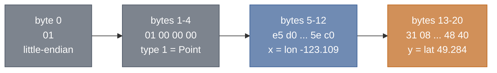
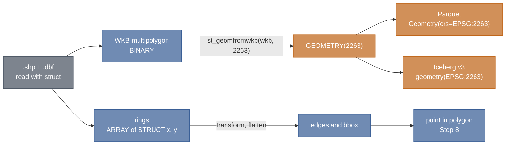
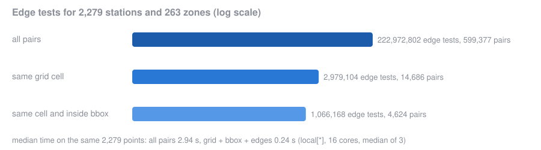
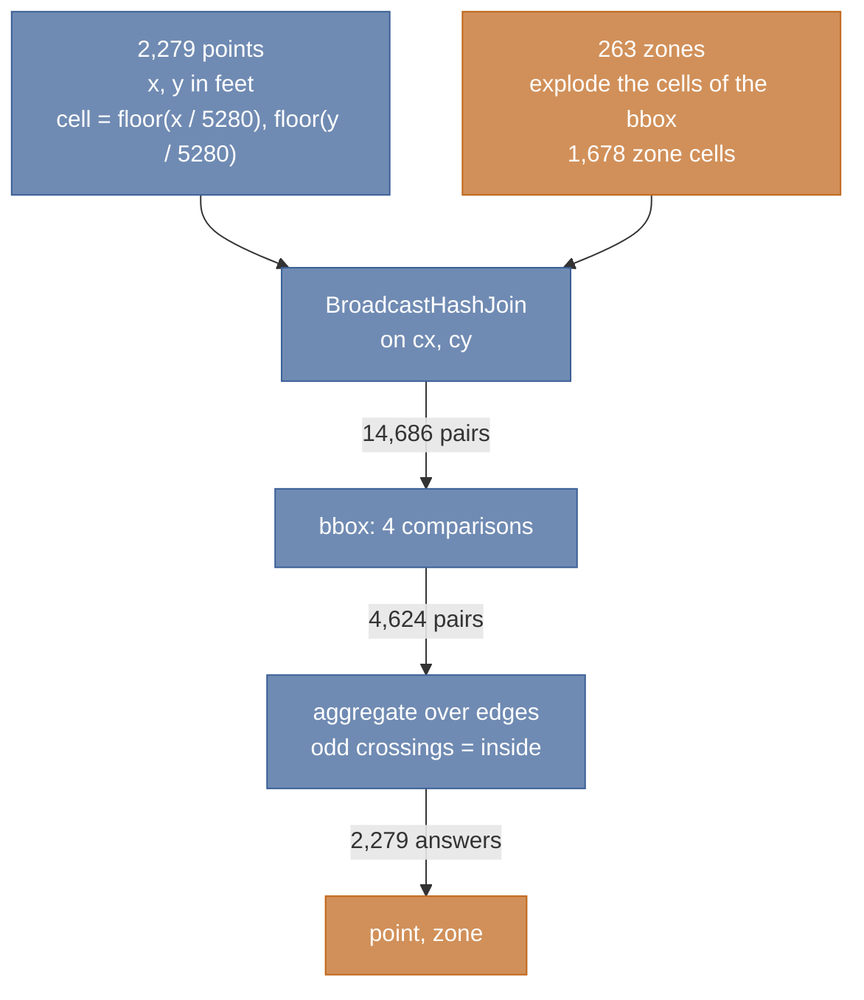
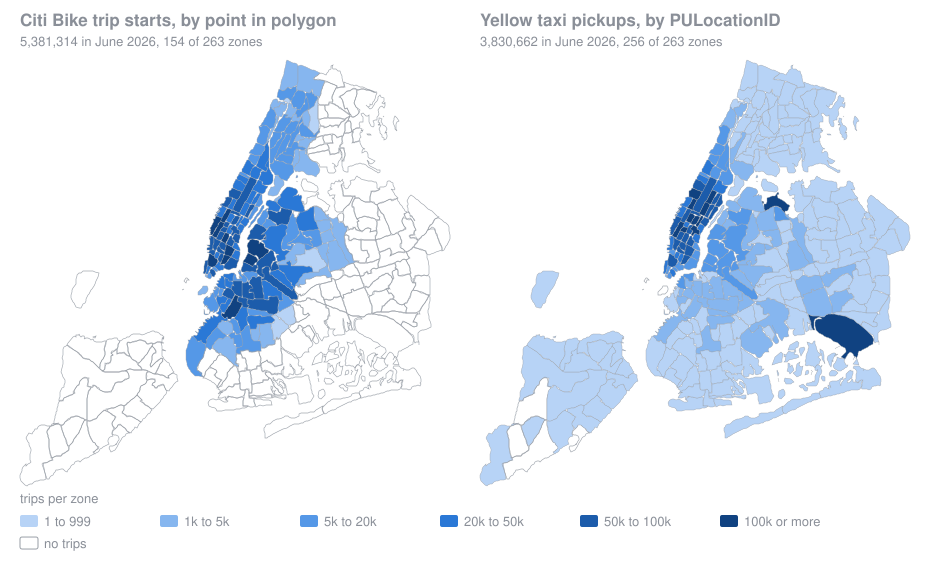

# Chapter 22: Geospatial data in Spark 4.3

A taxi zone is a polygon. A bike station is a point. A question such as "how many trips start in each zone" needs a test that tells if a point is inside a polygon. Databases with spatial support have functions for this test, for areas, for distances and for spatial joins.

Spark 4.1 added the `GEOMETRY` and `GEOGRAPHY` types behind a flag. Spark 4.2 enabled them by default. This chapter looks at what Spark 4.3.0 actually gives you, and then builds the other parts with SQL on real New York data.

**Spark 4.3.0 has two geospatial types and five `ST` functions. The types store shapes correctly as WKB and keep the reference system in the type. They go into Parquet and Iceberg v3 files with their reference system. But Spark 4.3.0 does not measure, compare or join shapes. You write those operations yourself, and a grid key and a bounding box decide what they cost.**

!!! note "What 4.3.0 has, checked against the source"
    This is the complete list of geospatial functions in Spark 4.3.0, from all releases. It is the same list as in Spark 4.2.0: `st_asbinary`, `st_geogfromwkb`, `st_geomfromwkb`, `st_setsrid` and `st_srid`. The `master` branch of apache/spark on 2026-11-22 has the same five functions. The 4.3.0 release notes do not mention geospatial work. The geospatial changes that are only in 4.3.0 are guards and fixes:

    - `GEOMETRY` and `GEOGRAPHY` cannot be partition columns (SPARK-60518).
    - Hive tables refuse them with a clear error (SPARK-60519, SPARK-60514).
    - The type converters read the types at the correct position (SPARK-60470).

    The umbrella issue is SPARK-51658, "SPIP: Add geospatial types in Spark". Its tasks have fix versions 4.1.0 and 4.2.0.

The scripts are in [`code/ch22`](https://github.com/open-lakehouse/spark-masterclass/tree/main/code/ch22), and each output block below comes from `code/ch22/output/`.

- `inventory.py` and `geotypes.py` list the functions and types and show the rules of the types.
- `zones.py` reads the TLC taxi zone shapefile into `GEOMETRY(2263)`.
- `pip.py` and `pip_bench.py` find the zone of each Citi Bike trip start in June 2026, without `ST_Contains`.
- `storage.py` writes the types to Parquet and to an Iceberg v3 table.
- `geo_points.py` builds points from messy coordinates and finds the nearest store (moved here from [Chapter 21](ch21-time-series.md)).
- `limits.py` shows what the types do not do.

The data:

- The taxi zone shapefile `taxi_zones.zip` from the [TLC trip record page](https://www.nyc.gov/site/tlc/about/tlc-trip-record-data.page).
- The Citi Bike trips of June 2026 from [Citi Bike system data](https://citibikenyc.com/system-data). The CSV files are 1 GB, so they stay out of git in `$BOOK_DATA/citibike`.
- The yellow-taxi trips of June 2026 from [Chapter 7](ch07-quick-start.md).

The taxi trips do not have coordinates. The trip files on the TLC site give the zone ID of a pickup, not its position. The file for January 2015 also has only `PULocationID`. Thus the points in this chapter come from the bike trips, which record the latitude and longitude of each start.

## Step 1: The inventory

`inventory.py` asks three APIs for their `st_` functions. SQL answers with `SHOW FUNCTIONS`. PySpark answers with the names in `pyspark.sql.functions`. Scala answers with the methods of `org.apache.spark.sql.functions`, through the JVM:

```python
names = [r.function for r in spark.sql("SHOW FUNCTIONS LIKE 'st_*'").collect()]
print("SQL     :", names)
print("PySpark :", sorted(n for n in dir(F) if n.startswith("st_")))
jf = spark.sparkContext._jvm.java.lang.Class.forName("org.apache.spark.sql.functions")
scala = sorted({m.getName() for m in jf.getMethods() if m.getName().startswith("st_")})
```

```text
== 1. ST functions in the function registry
Spark 4.3.0 | pyspark 4.3.0
SQL     : ['st_asbinary', 'st_geogfromwkb', 'st_geomfromwkb', 'st_setsrid', 'st_srid']
PySpark : ['st_asbinary', 'st_geogfromwkb', 'st_geomfromwkb', 'st_setsrid', 'st_srid']
Scala   : ['st_asbinary', 'st_geogfromwkb', 'st_geomfromwkb', 'st_setsrid', 'st_srid']
all built-in and session functions: 591

== 2. signatures (DESCRIBE FUNCTION)
  st_asbinary(geo[, endianness]) - Returns the geospatial value (value of type GEOGRAPHY or GEOMETRY) in WKB for
  st_geogfromwkb(wkb) - Parses the WKB description of a geography and returns the corresponding GEOGRAPHY value.
  st_geomfromwkb(wkb[, srid]) - Parses the WKB description of a geometry and returns the corresponding GEOMETRY 
  st_setsrid(geo, srid) - Returns a new GEOGRAPHY or GEOMETRY value whose SRID is the specified SRID value.
  st_srid(geo) - Returns the SRID of the input GEOGRAPHY or GEOMETRY value.
```

The three APIs agree. The same five names are in `FunctionRegistry.scala` and in `sql-expression-schema.md` at the tag `v4.3.0`. This is the full list, by category:

| Category | Function | What it does in 4.3.0 |
|---|---|---|
| Constructor | `st_geomfromwkb(wkb[, srid])` | Parses WKB into a `GEOMETRY`. The SRID is 0 if you do not give one. The `srid` argument is new in 4.2 (SPARK-55295). |
| Constructor | `st_geogfromwkb(wkb)` | Parses WKB into a `GEOGRAPHY(4326)`. It checks the longitude and latitude ranges. |
| Output | `st_asbinary(geo[, endianness])` | Returns the WKB bytes. `'NDR'` (the default) is little-endian, `'XDR'` is big-endian. The `endianness` argument is new in 4.2 (SPARK-56682). |
| SRID | `st_srid(geo)` | Returns the SRID of a value. |
| SRID | `st_setsrid(geo, srid)` | Returns the same value with a new SRID. It does not change the coordinates. |

The flag `spark.sql.geospatial.enabled` is an internal configuration since 4.1.0, and its default is `true` since 4.2.0 (SPARK-56771). If you set it to `false`, the types and the functions stop:

```text
== 4. the flag spark.sql.geospatial.enabled
  default: true
  st_srid with the flag off  UNSUPPORTED_FEATURE.GEOSPATIAL_DISABLED: The feature is not supported: Geospatial feature is disabled. SQLSTATE
  CAST AS GEOMETRY(0), flag off UNSUPPORTED_FEATURE.GEOSPATIAL_DISABLED: The feature is not supported: Geospatial feature is disabled. SQLSTATE
```

The functions that other spatial engines have are not in 4.3.0. Each name gives `UNRESOLVED_ROUTINE`:

```text
== 5. names from PostGIS and Sedona that 4.3.0 does not have
  st_point(1, 2)                 UNRESOLVED_ROUTINE: Cannot resolve routine `st_point` on search path [`system`.`builtin`, 
  st_geomfromtext('POINT (1 2)') UNRESOLVED_ROUTINE: Cannot resolve routine `st_geomfromtext` on search path [`system`.`bui
  st_geomfromgeojson('{}')       UNRESOLVED_ROUTINE: Cannot resolve routine `st_geomfromgeojson` on search path [`system`.`
  st_astext(g)                   UNRESOLVED_ROUTINE: Cannot resolve routine `st_astext` on search path [`system`.`builtin`,
  st_x(g)                        UNRESOLVED_ROUTINE: Cannot resolve routine `st_x` on search path [`system`.`builtin`, `sys
  st_contains(g, g)              UNRESOLVED_ROUTINE: Cannot resolve routine `st_contains` on search path [`system`.`builtin
  st_intersects(g, g)            UNRESOLVED_ROUTINE: Cannot resolve routine `st_intersects` on search path [`system`.`built
  st_distance(g, g)              UNRESOLVED_ROUTINE: Cannot resolve routine `st_distance` on search path [`system`.`builtin
  st_area(g)                     UNRESOLVED_ROUTINE: Cannot resolve routine `st_area` on search path [`system`.`builtin`, `
  st_transform(g, 4326)          UNRESOLVED_ROUTINE: Cannot resolve routine `st_transform` on search path [`system`.`builti
  h3_longlatash3(1.0, 2.0, 7)    UNRESOLVED_ROUTINE: Cannot resolve routine `h3_longlatash3` on search path [`system`.`buil
```

<figure markdown>
  <video autoplay loop muted playsinline controls width="1280" height="720" poster="../../media/clips/ch22-inventory.webp">
    <source src="../../media/clips/ch22-inventory.mp4" type="video/mp4">
  </video>
  <figcaption><code>inventory.py</code> runs against Spark 4.3.0. SQL, PySpark and Scala have the same five <code>st_</code> functions. The names from PostGIS and Sedona do not resolve.</figcaption>
</figure>

The rest of this chapter replaces each of these functions with built-in SQL. This table is the map:

| Function that 4.3.0 does not have | What this chapter does | Step |
|---|---|---|
| `st_point`, `st_geomfromtext`, `st_geomfromgeojson` | Build the WKB bytes with SQL functions, then call `st_geomfromwkb` | 6, 12 |
| `st_astext`, `st_asgeojson` | Write WKT and GeoJSON text from the coordinate arrays | 6 |
| `st_x`, `st_y` | Read the 8-byte doubles out of the WKB bytes | 6 |
| `st_area` | The shoelace formula with `aggregate` | 5 |
| `st_transform` | The projection formula as Column expressions | 7 |
| `st_contains` | Count the edge crossings of a ray, with `aggregate` | 8 |
| `st_distance` | The haversine formula with built-in functions | 13 |
| A spatial join | A grid key for an equi-join, then a bounding box, then the exact test | 8 |

## Step 2: Two types, and the SRID in the type

<figure markdown>
  
  <figcaption>The two types of Spark 4.3.0. The SRID counts come from <code>srs_registry.csv</code> at <code>v4.3.0</code>. The casts are the results in <code>geotypes.txt</code>.</figcaption>
</figure>

A `GEOMETRY` is on a plane. Its edges are straight lines, and its coordinates have the units of its reference system. A `GEOGRAPHY` is on the Earth. Its coordinates are longitude and latitude in degrees, and its edges are spherical. The **SRID** (spatial reference identifier) names the reference system, and it is a part of the type:

```text
== 1. constructors and the SRID of the result
  st_geomfromwkb(<wkb>)                      geometry(0)
  st_geomfromwkb(<wkb>, 3857)                geometry(3857)
  st_geogfromwkb(<wkb>)                      geography(4326)
  st_setsrid(st_geomfromwkb(<wkb>), 4326)    geometry(4326)
  st_setsrid(st_geogfromwkb(<wkb>), 4269)    geography(4269)
```

Spark 4.3.0 checks each SRID against a registry, `srs_registry.csv`, which the build makes from PROJ 9.8.1. The registry has 10,713 entries. 1,406 of them are geographic. A `GEOMETRY` accepts SRID 0 and all entries. A `GEOGRAPHY` accepts only the geographic entries. SRID 0 means "no reference system": plain x and y.

`st_setsrid` changes the label, not the coordinates. The output of `geo_points.py` shows the rules:

```text
== 2. SRIDs
  st_setsrid(geom, 3857)             GeometryType(3857)
  st_setsrid(geog, 3857)             ST_INVALID_SRID_VALUE: Invalid or unsupported SRID (spatial reference identifier) value: 
  st_setsrid(geom, 99999)            ST_INVALID_SRID_VALUE: Invalid or unsupported SRID (spatial reference identifier) value: 
  CAST(geog AS GEOMETRY(4326))       GeometryType(4326)
  CAST(geom AS GEOGRAPHY(4326))      DATATYPE_MISMATCH.CAST_WITHOUT_SUGGESTION: Cannot resolve "CAST(geom AS GEOGRAPHY(4326))" due to data type mi
```

3857 (Web Mercator) is a projection on a plane, so a `GEOGRAPHY` refuses it. SRID 99999 is not in the registry. `geotypes.py` tries all the casts:

```text
== 3. casts between the types
  GEOGRAPHY(4326) -> GEOMETRY(4326)  geometry(4326)
  GEOMETRY(4326) -> GEOGRAPHY(4326)  geography(4326)
  GEOMETRY(0) -> GEOGRAPHY(4326)     DATATYPE_MISMATCH.CAST_WITHOUT_SUGGESTION
  GEOMETRY(3857) -> GEOMETRY(ANY)    geometry(any)
  GEOMETRY(3857) -> GEOMETRY(4326)   DATATYPE_MISMATCH.CAST_WITHOUT_SUGGESTION
  GEOMETRY(0) -> BINARY              DATATYPE_MISMATCH.CAST_WITHOUT_SUGGESTION
  BINARY -> GEOMETRY(0)              DATATYPE_MISMATCH.CAST_WITHOUT_SUGGESTION
  GEOMETRY(0) -> STRING              DATATYPE_MISMATCH.CAST_WITHOUT_SUGGESTION
```

- **A cast between the two types keeps the SRID.** `GEOMETRY(4326)` and `GEOGRAPHY(4326)` cast in both directions. `GEOMETRY(0)` has no position on the Earth, so it does not cast to a `GEOGRAPHY`.
- **A cast never transforms coordinates.** `GEOMETRY(3857)` does not cast to `GEOMETRY(4326)`. Only `ANY` accepts a value with a different SRID.
- **`ANY` is a column with a different SRID in each row.** `GEOMETRY(ANY)` and `GEOGRAPHY(ANY)` exist for queries in memory. Step 10 shows that files refuse them.
- **`BINARY` and `STRING` do not cast.** Use `st_asbinary` and the two constructors.

In SQL, a column type must have an SRID or `ANY`. A plain `GEOMETRY` is a parse error:

```text
== 3. the types (DDL strings)
  GEOMETRY(4326)     GeometryType(4326)
  GEOMETRY(2263)     CANNOT_PARSE_DATATYPE: Unable to parse datatype. [ST_INVALID_CRS_VALUE] Invalid or unsupporte
  GEOMETRY(0)        GeometryType(0)
  GEOMETRY(ANY)      GeometryType(ANY)
  GEOGRAPHY(4326)    GeographyType(4326)
  GEOGRAPHY(ANY)     GeographyType(ANY)
  GEOGRAPHY(3857)    ST_INVALID_SRID_VALUE: Invalid or unsupported SRID (spatial reference identifier) value: 3857
  GEOMETRY           UNSUPPORTED_DATATYPE: Unsupported data type "GEOMETRY". SQLSTATE: 0A000
```

The `GEOMETRY(2263)` line is a surprise. SRID 2263 (NAD83 / New York Long Island, in US feet) is in the registry. The JVM makes the type without an error. The error comes from PySpark, when it reads the schema of the DataFrame:

```text
== 6. SRIDs that the JVM accepts and PySpark 4.3.0 cannot describe
  3857: JVM type geometry(3857), df.schema GeometryType(3857)
  2263: JVM type geometry(2263), df.schema CANNOT_PARSE_DATATYPE: Unable to parse datatype. [ST_INVALID_CRS_VALUE] Invalid or unsupporte
  32618: JVM type geometry(32618), df.schema CANNOT_PARSE_DATATYPE: Unable to parse datatype. [ST_INVALID_CRS_VALUE] Invalid or unsupporte
  4269: JVM type geometry(4269), df.schema CANNOT_PARSE_DATATYPE: Unable to parse datatype. [ST_INVALID_CRS_VALUE] Invalid or unsupporte
  2263 as BINARY, collected: Row(srid=2263, wkb='0101000000000000000000F03F0000000000000040')
  JVM registry entries: EPSG:2263
```

The registry of PySpark 4.3.0 (`pyspark/sql/geo_utils.py`) has three entries: 0, 3857 and 4326. The Spark Connect client uses the same Python code, and it fails in the same way:

```text
Spark Connect session: pyspark.sql.connect.session 4.3.0
  3857: df.schema  GeometryType(3857)
  3857: collect()  3857
  3857: st_srid in SQL 3857
  2263: df.schema  ST_INVALID_SRID_VALUE: Invalid or unsupported SRID (spatial reference identifier) value: 2263.
  2263: collect()  ST_INVALID_SRID_VALUE: Invalid or unsupported SRID (spatial reference identifier) value: 2263.
  2263: st_srid in SQL 2263
```

!!! warning "CAUTION: Keep other SRIDs out of Python"
    Do not collect a geo column with an SRID other than 0, 3857 or 4326. In PySpark 4.3.0, `df.schema`, `df.collect()` and `df.toPandas()` fail for such a column. Keep the column in SQL, in views and in writes. Convert it with `st_asbinary` and `st_srid` before you collect it. The scripts of this chapter keep `GEOMETRY(2263)` in SQL for this reason.

## Step 3: WKB, the bytes inside both types

Both types keep each value as **well-known binary** (WKB), the binary form of the Open Geospatial Consortium (OGC) Simple Features standard. A 2D point is 21 bytes. `geo_points.py` writes the point for a store in Vancouver with Python's `struct`:

```python
wkb = struct.pack("<BIdd", 1, 1, -123.1090, 49.2840)          # Gastown, Vancouver: x = lon, y = lat
g = spark.createDataFrame([(wkb,)], "wkb BINARY").select(
    F.st_geogfromwkb("wkb").alias("geog"), F.st_geomfromwkb("wkb").alias("geom"))
```

```text
== 1. a point in WKB
bytes: 21 01 01 00 00 00 e5 d0 22 db f9 c6 5e c0 31 08 ac 1c 5a a4 48 40
      order=01 (little-endian) | type=01000000 (Point) | x: 8 bytes | y: 8 bytes
schema: [('geog', 'geography(4326)'), ('geom', 'geometry(0)')]
Row(geog_srid=4326, geom_srid=0, back_to_wkb='0101000000E5D022DBF9C65EC03108AC1C5AA44840')
Python value: Geography(bytearray(b'\x01\x01\x00\x00\x00\xe5\xd0"\xdb\xf9\xc6^\xc01\x08\xac\x1cZ\xa4H@'), 4326)
```



- **The first byte is the byte order.** `01` is little-endian, and `00` is big-endian.
- **The next four bytes are the geometry type.** 1 is a point, 2 a line string, 3 a polygon and 6 a multipolygon.
- **The coordinates are 8-byte doubles, x first.** For longitude and latitude, x is the longitude. Many people write "lat, lon", so a swapped pair is a frequent error (Step 12).

A polygon adds a ring count, and each ring adds a point count and its points. The first and the last point of a ring are the same point. `st_asbinary` writes either byte order, and the parsers read both:

```text
== 2. st_asbinary: the same point, two byte orders
  NDR (default): 0101000000000000000000F03F0000000000000040
  XDR          : 00000000013FF00000000000004000000000000000
  XDR read back: 0101000000000000000000F03F0000000000000040
```

The parsers check the structure of the bytes when they make a value. `geotypes.py` gives both parsers the same bytes:

```text
== 4. the WKB rules at parse time
  case                           GEOMETRY                       GEOGRAPHY
  point (1 2)                    ok, 21 bytes                   ok, 21 bytes
  point (NaN NaN), POINT EMPTY   ok, 21 bytes                   ok, 21 bytes
  point (inf 2)                  Invalid coordinate value found Invalid coordinate value found
  point (200 95)                 ok, 21 bytes                   Invalid coordinate value found
  closed square, 5 points        ok, 93 bytes                   ok, 93 bytes
  open ring                      Ring is not closed             Ring is not closed
  ring of 3 points               Too few points in ring         Too few points in ring
  linestring, 1 point            Too few points in linestring   Too few points in linestring
  truncated (3 bytes)            Unexpected end of WKB buffer   Unexpected end of WKB buffer
```

- **A point of NaN is `POINT EMPTY`.** Both types accept it. Infinity is never valid.
- **Only `GEOGRAPHY` checks ranges.** A longitude of 200 and a latitude of 95 make a valid `GEOMETRY`.
- **The first and the last point of a ring must be the same, and a ring needs at least 4 points.** A line string needs 2 points.
- **Each failure is a `WKB_PARSE_ERROR`, and it stops the job.** There is no `try_` form of the constructors. Validate the inputs first (Step 12).

In Python, a value is a `Geometry` or a `Geography` object with the bytes and the SRID. A typed column checks the SRID of each value that you give it:

```text
== 5. values in Python
  geom: Geometry srid 3857 bytes 0101000000000000000000f03f0000000000000040
  geog: Geography srid 4326
  createDataFrame with GeometryType(4326): 4326
  a value with SRID 0 in a GEOMETRY(4326) column GEO_ENCODER_SRID_MISMATCH_ERROR: Failed to encode GEOMETRY value because provided SRID 0 of a value to 
```

## Step 4: The taxi zones as GEOMETRY(2263)

The TLC publishes the 263 taxi zones as a shapefile. A shapefile is three files: `.shp` with the shapes, `.dbf` with the attributes and `.prj` with the reference system. Spark has no shapefile reader, and the formats are simple, so `geo76.py` reads them with `struct` in about 40 lines:

```text
== 1. the shapefile
PROJCS["NAD_1983_StatePlane_New_York_Long_Island_FIPS_3104_F ...
records: 263 | rings: 354 | vertices: 98192 | most in one zone: 7814
zones with more than one polygon: 23
zones with a hole: 0
```

The coordinates are in feet on the New York Long Island State Plane, which is EPSG:2263. Thus the right type is `GEOMETRY(2263)`, a plane in US feet. A shapefile ring with clockwise order starts a new polygon, and a ring with counter-clockwise order is a hole. `polygons()` applies this rule, and `wkb_multipolygon()` writes one WKB multipolygon per zone. The script keeps the rings as an array of structs too, because the SQL in the next steps needs the coordinates:

```python
raw = spark.createDataFrame(rows, "location_id INT, zone STRING, borough STRING, wkb BINARY, "
                                  "rings ARRAY<ARRAY<STRUCT<x: DOUBLE, y: DOUBLE>>>")
```

```sql
SELECT location_id, zone, borough,
       st_geomfromwkb(wkb, 2263)                                        AS geom,
       flatten(transform(rings, r -> transform(sequence(0, size(r) - 2),
               i -> named_struct('x1', r[i].x, 'y1', r[i].y, 'x2', r[i + 1].x, 'y2', r[i + 1].y))))
                                                                        AS edges,   -- (1)!
       array_min(transform(flatten(rings), p -> p.x)) AS xmin, ...                   -- (2)!
FROM raw_zones
```

1. Each pair of neighbor points in a ring is one edge. All rings of all polygons go into one array. The test in Step 8 does not need to know the ring of an edge.
2. The bounding box: the smallest and the largest x and y.

```text
typeof(geom): geometry(2263)
st_srid(geom): 2263
+-----------+---------------------+---------+-----+--------+---------+
|location_id|zone                 |wkb_bytes|edges|width_ft|height_ft|
+-----------+---------------------+---------+-----+--------+---------+
|1          |Newark Airport       |3734     |231  |10257.0 |13468.0  |
|132        |JFK Airport          |35853    |2233 |23933.0 |16503.0  |
|161        |Midtown Center       |630      |37   |3566.0  |4091.0   |
|237        |Upper East Side South|806      |48   |4087.0  |5147.0   |
+-----------+---------------------+---------+-----+--------+---------+
```

JFK Airport has 2,233 edges and a WKB value of 35,853 bytes. Midtown Center has 37 edges. The cost of the exact test in Step 8 is the number of edges. Thus one zone with a long coastline costs more than many zones in Manhattan.



## Step 5: Area without ST_Area

The area of a ring on a plane is the shoelace formula: half the sum of `x[i] * y[i+1] - x[i+1] * y[i]` over its edges. `aggregate` adds the terms in SQL. A clockwise ring gives a negative sum, and the shapefile outer rings are clockwise, so the query changes the sign:

```sql
-aggregate(rings, 0D, (acc, r) -> acc + aggregate(sequence(0, size(r) - 2), 0D,
        (s, i) -> s + r[i].x * r[i + 1].y - r[i + 1].x * r[i].y) / 2) AS area_sqft
```

```text
== 3. area: the shoelace formula on the rings (no st_area in 4.3.0)
+-------------+-----+-----+
|      borough|zones|sq_mi|
+-------------+-----+-----+
|       Queens|   69|111.7|
|     Brooklyn|   61| 68.0|
|Staten Island|   20| 58.2|
|        Bronx|   43| 42.6|
|    Manhattan|   69| 22.7|
|          EWR|    1|  2.8|
+-------------+-----+-----+
```

The unit is the unit of the SRID. EPSG:2263 is in US survey feet, so the script divides by the square of 5,280 survey feet. The formula is correct only on a plane in a projection that keeps areas almost correct. On `GEOGRAPHY` coordinates in degrees, the same formula gives square degrees, which have no fixed size on the Earth.

`check_reference.py` compares the result with shapely, a geometry library that is not a part of the book's code:

```text
== areas: shoelace in Spark against shapely
zones: 263 | largest relative difference: 1.71e-10 | invalid in shapely: 0
```

## Step 6: WKT, GeoJSON and coordinates, in and out

Spark 4.3.0 reads and writes only WKB. **WKT** (well-known text, such as `POINT (1 2)`) and **GeoJSON** are text forms that people and web maps use. Both are text that SQL can build from the coordinate arrays:

=== "WKT out"

    ```sql
    SELECT location_id,
           'MULTIPOLYGON (((' || array_join(transform(rings[0], p -> format_number(p.x, '#.###') || ' ' ||
                                           format_number(p.y, '#.###')), ', ') || ')))' AS wkt
    FROM raw_zones WHERE location_id = 202
    ```

=== "GeoJSON out"

    ```sql
    SELECT to_json(named_struct(
             'type', 'Feature',
             'properties', named_struct('location_id', location_id, 'zone', zone),
             'geometry', named_struct('type', 'MultiPolygon',
                                      'coordinates', array(transform(rings, r -> transform(r, p -> array(p.x, p.y))))))) AS f
    FROM raw_zones WHERE size(rings) = 1
    ```

```text
== 4. WKT and GeoJSON out (no st_astext or st_asgeojson in 4.3.0)
WKT of zone 202 (one ring): MULTIPOLYGON (((1000370.939 219466.661, 1000158.41 219269.408, 1000078.898 219195.611, 999978.18...
GeoJSON of zone 202: {"type":"Feature","properties":{"location_id":202,"zone":"Roosevelt Island"},"geometry":{"type":"MultiPolygon","coordinates":[[[[1000370.938598603,219...
wrote 240 single-ring zones as GeoJSON lines
```

The GeoJSON standard (RFC 7946) uses longitude and latitude on WGS 84. These coordinates are in feet, so a web map needs a projection first (Step 7 shows the forward direction).

GeoJSON in is the harder direction. `spark.read.json` reads the coordinates as nested arrays of doubles. Then SQL writes the WKB bytes as hex text. The text has a byte order, a type, the counts as 4-byte little-endian integers, and each double as 8 little-endian bytes. `doubleToRawLongBits`, a static Java method that `reflect` calls, gives the 64 bits of a double:

```python
DOUBLE_LE = """lpad(hex(CAST(reflect('java.lang.Double', 'doubleToRawLongBits', {c}) AS BIGINT)), 16, '0')"""
# ... for each ring: the point count, then for each point the two doubles, bytes reversed
```

```text
== 5. GeoJSON in: WKB bytes built with SQL functions only
Row(zones=240, same_bytes=240, largest_wkb=74870)
```

The SQL bytes are the same as the bytes from Python's `struct` for all 240 zones, also for a value of 74,870 bytes. The reverse direction replaces `st_x` and `st_y`. `parseUnsignedLong` and `longBitsToDouble` read a double from 8 bytes of a WKB value:

```text
== 6. reading coordinates back out of WKB (no st_x or st_y in 4.3.0)
+-----------+------------------+------------------+----------------------------------------+
|location_id|first_x           |first_y           |from_rings                              |
+-----------+------------------+------------------+----------------------------------------+
|132        |1032791.0008004904|181085.00629757345|{1032791.0008004904, 181085.00629757345}|
+-----------+------------------+------------------+----------------------------------------+
```

`reflect` calls a Java method for each row. It is slower than a built-in function, but it stays in the JVM and needs no Python worker.

## Step 7: Put the points on the same plane

The Citi Bike trips record each start as longitude and latitude (WGS 84). The zones are in feet on EPSG:2263. A test between a point and a polygon needs one reference system, and Spark 4.3.0 has no `st_transform`.

EPSG:2263 is a Lambert conformal conic projection with two standard parallels. The `.prj` file gives its parameters, and the forward formula needs only a few `sin`, `tan`, `pow` and `log` calls. `geo76.lcc_columns()` writes it as Column expressions:

```python
def lcc_columns(lon, lat):
    phi = F.radians(lat)
    s = F.sin(phi)
    t = F.tan(F.lit(math.pi / 4) - phi / 2) / F.pow((1 - E * s) / (1 + E * s), E / 2)
    r = A * FF * F.pow(t, N)
    th = N * F.radians(lon - LON0)
    return (r * F.sin(th)) / FT + FE, (F.lit(R0) - r * F.cos(th)) / FT
```

```text
== 1. the points
Row(trips=5384468, no_start_coords=3154, first=datetime.datetime(2026, 5, 30, 23, 42, 34, 9000), last=datetime.datetime(2026, 6, 30, 23, 57, 43, 182000))
distinct start coordinates: 2279
Times Square, Spark : Row(x=988369.5233640209, y=215763.33774841955)
Times Square, Python: (988369.5233640209, 215763.33774841344)
```

`check_reference.py` compares the Spark projection of all 2,279 points with pyproj, the Python interface to PROJ:

```text
== projection: geo76.lcc_python against pyproj EPSG:4326 -> EPSG:2263
points: 2279 | largest difference: 0.000000 ft
Times Square: (988369.5233640223, 215763.33774841248) (988369.5233640209, 215763.33774841344)
```

The month has 5,384,468 trips, but only 2,279 different start coordinates. The trip records give the coordinates of the station, not of the bike. Thus `pip.py` groups the trips by coordinates first, and the expensive test runs 2,279 times, not 5.4 million times. This step removes more work than any other step in the chapter, and it needs no spatial function.

## Step 8: Point in polygon, with a grid and a bounding box

A point is inside a polygon if a ray from the point crosses the edges of the polygon an odd number of times. This is the even-odd rule. It works across all rings and all polygons of a zone, so the flat `edges` array from Step 4 is enough. In SQL, the test is one `aggregate` over the edges:

```sql
aggregate(edges, 0, (n, e) -> n + IF(((e.y1 > y) <> (e.y2 > y))            -- (1)!
          AND (x < (e.x2 - e.x1) * (y - e.y1) / (e.y2 - e.y1) + e.x1), 1, 0)) % 2 = 1   -- (2)!
```

1. The edge goes across the horizontal line through the point.
2. The edge crosses that line to the right of the point. An odd count means inside.

The test is exact, but it costs one evaluation for each edge. All pairs of 2,279 points and 263 zones is 599,377 pairs and 223 million edge tests. Two filters remove most pairs before the exact test:

1. **A grid key.** Give each point the cell `floor(x / 5280), floor(y / 5280)`, one mile on each side. Give each zone all the cells that its bounding box touches, with `explode(sequence(...))`. Then an equi-join on the cell keeps only the zones that share a cell with the point. An equi-join lets Spark use a hash join.
2. **A bounding box.** Four comparisons, `x BETWEEN xmin AND xmax AND y BETWEEN ymin AND ymax`, drop most of the zones in the cell.

<figure markdown>
  <video autoplay loop muted playsinline controls width="1280" height="720" poster="../../media/clips/ch22-anim-bbox.webp">
    <source src="../../media/clips/ch22-anim-bbox.mp4" type="video/mp4">
  </video>
  <figcaption>The real zones and Citi Bike stations of lower Manhattan. The grid key and the bounding boxes remove candidate zones, then a ray counts the edge crossings for one station. The counts and the times come from <code>pip.txt</code> and <code>pip_bench.txt</code>.</figcaption>
</figure>

```sql
SELECT p.pid, z.location_id, p.trips
FROM pts p JOIN zone_cells z ON p.cx = z.cx AND p.cy = z.cy
WHERE x BETWEEN xmin AND xmax AND y BETWEEN ymin AND ymax
  AND aggregate(edges, ...) % 2 = 1
```

```text
== 2. the zones as grid cells
Row(zone_cells=1678, cells=475, most_zones_in_a_cell=13)

== 3. how many point-zone pairs each method tests
  candidates                           pairs        edge tests
  all pairs                          599,377       222,972,802
  same grid cell                      14,686         2,979,104
  same cell and inside bbox            4,624         1,066,168

== 4. the plan of the grid method
  AdaptiveSparkPlan <- Project <- BroadcastHashJoin <- BroadcastExchange <- Filter <- FileScan <- Project <- Generate <- Generate <- Filter <- FileScan
```

<figure markdown>
  
  <figcaption>Edge tests for each method, from <code>pip.txt</code>. The times are medians from <code>pip_bench.txt</code>.</figcaption>
</figure>

The grid cuts the edge tests by a factor of 75. The bounding box cuts them by a factor of almost 3 more. The plan has a `BroadcastHashJoin` on the cell. The two `Generate` operators are the `explode` calls that give each zone its cells. The bounding box and the edge test are conditions of the join.



`pip_bench.py` times the methods under the book's bench lock:

```text
local[*] on 16 cores, Spark 4.3.0, median of 3 runs after 1 warmup
trip rows in June: 5381314
trip rows on 2026-06-10: 197988 | distinct coordinates: 2224

  method                                  rows out  median s   runs
  distinct points, all pairs                 2,279      2.94   2.87 3.14 2.94
  distinct points, bbox + edges              2,279      0.26   0.27 0.26 0.20
  distinct points, grid + bbox + edges       2,279      0.24   0.39 0.24 0.21
  one day of rows, bbox + edges            197,988      0.53   0.72 0.53 0.53
  one day of rows, grid + bbox + edges     197,988      0.64   0.63 0.64 0.73
  all June rows, grid + bbox + edges     5,381,314      7.09   6.99 7.65 7.09

join operator in each plan:
  distinct points, all pairs            BroadcastNestedLoopJoin
  distinct points, bbox + edges         BroadcastNestedLoopJoin
  distinct points, grid + bbox + edges  BroadcastHashJoin
```

- **The bounding box gives most of the speed.** All pairs takes 2.94 s. The bounding box alone takes 0.26 s, because it stops the edge test for most pairs.
- **The grid adds little with 263 zones.** A nested loop join of 2,279 points and 263 boxes is small. The grid changes the join to a hash join, so its cost grows with the matches, not with the product of the two sides. With many more zones or points, that difference decides the cost.
- **Group the points first.** All June rows take 7.09 s with the best method. The 2,279 distinct points take 0.24 s for the same answer.

The result for each trip:

```text
== 5. the answer
Row(trips=5381314, in_one_zone=5381314, in_two_or_more=0, in_no_zone=0)
```

Each trip start is in exactly one zone. `check_reference.py` gives the same 2,279 points to shapely's `contains` test, and the answers agree:

```text
== point in polygon: Spark edge crossings against shapely.contains
points: 2279 | different answers: 0
```

!!! note "A point on an edge"
    The even-odd rule gives each point on a shared edge to one zone, by the direction of the comparisons. A point exactly on an edge is rare with real coordinates, and here no point is in two zones. `ST_Contains` in other engines has its own rule for boundaries.

## Step 9: Trips per zone, bikes and taxis

The bike trips now have a zone. The taxi trips have a zone ID already, `PULocationID`, from the same 263 zones. `pip.py` joins both to the zones:

```text
== 6. trips per zone, June 2026
+-----------+-------------------------+---------+-----------+------------+--------------+
|location_id|zone                     |borough  |bike_starts|taxi_pickups|bikes_per_taxi|
+-----------+-------------------------+---------+-----------+------------+--------------+
|79         |East Village             |Manhattan|222013     |99792       |2.22          |
|68         |East Chelsea             |Manhattan|167498     |100657      |1.66          |
|255        |Williamsburg (North Side)|Brooklyn |152080     |9945        |15.29         |
|246        |West Chelsea/Hudson Yards|Manhattan|117378     |76799       |1.53          |
|234        |Union Sq                 |Manhattan|114209     |98290       |1.16          |
|112        |Greenpoint               |Brooklyn |112277     |6527        |17.2          |
|48         |Clinton East             |Manhattan|111075     |91819       |1.21          |
|231        |TriBeCa/Civic Center     |Manhattan|108228     |55676       |1.94          |
+-----------+-------------------------+---------+-----------+------------+--------------+

+-------------+-----------+------------+----------------+-----+
|      borough|bike_starts|taxi_pickups|zones_with_bikes|zones|
+-------------+-----------+------------+----------------+-----+
|    Manhattan|    3303273|     3385932|              67|   69|
|     Brooklyn|    1540459|      106868|              40|   61|
|       Queens|     375489|      322050|              23|   69|
|        Bronx|     162093|       15006|              24|   43|
|Staten Island|          0|         237|               0|   20|
|          EWR|          0|         569|               0|    1|
+-------------+-----------+------------+----------------+-----+
```

<figure markdown>
  
  <figcaption>Trips per taxi zone in June 2026, drawn from <code>trips_per_zone.csv</code> and the zone rings. The taxi map counts only pickups in the 263 zones, so it leaves out the pickups with an unknown zone.</figcaption>
</figure>

In Manhattan, bike starts and taxi pickups are almost equal. In Brooklyn, the bikes have 14 times more starts than the taxis. North Brooklyn (Williamsburg and Greenpoint) has more than 15 bike starts for each taxi pickup. The bike data has no starts on Staten Island, and the yellow taxis serve the airports. The map shows each fact at once, and the table needs a careful look for the same facts.

<figure markdown>
  <video autoplay loop muted playsinline controls width="1280" height="720" poster="../../media/clips/ch22-pip.webp">
    <source src="../../media/clips/ch22-pip.mp4" type="video/mp4">
  </video>
  <figcaption><code>pip.py</code> runs against Spark 4.3.0. It shows 2,279 distinct points, the candidate pairs of each method, and one zone for each of the 5,381,314 trips. One cut removes the wait for Spark.</figcaption>
</figure>

## Step 10: The types in Parquet files

Spark writes both types to Parquet with the geospatial logical types of the Parquet format. `storage.py` writes the zones as `GEOMETRY(2263)` and the stations as `GEOGRAPHY(4326)`, and reads the footers with PyArrow:

```text
geo_zones: 263 rows in part-00000...
  physical type: BYTE_ARRAY | logical type: Geometry(crs=EPSG:2263)
  min/max statistics set: True | geospatial statistics set: True
  bbox x [913175.109009, 1067382.508405]  y [120121.881254, 272844.294005]
  geometry types: [6]
  arrow type: binary

geo_stations: 2279 rows in part-00000...
  physical type: BYTE_ARRAY | logical type: Geography(crs=OGC:CRS84, algorithm=spherical)
  min/max statistics set: True | geospatial statistics set: False
  arrow type: binary

read back in Spark: Row(typeof(geom)='geometry(2263)', st_srid(geom)=2263)
```

- **The column is a `BYTE_ARRAY` of WKB values.** The logical type in the footer records the reference system. For a `GEOGRAPHY`, it also records the edge algorithm.
- **SRID 4326 becomes `OGC:CRS84`.** That is WGS 84 with longitude first, the order that WKB uses.
- **A `GEOMETRY` column gets geospatial statistics.** The footer has the bounding box of the column chunk and the geometry types in it (6 is multipolygon). The `GEOGRAPHY` column has none.
- **Spark 4.3.0 does not use the bounding box to skip data.** No spatial predicate exists, so no filter can go down to the scan.

The Parquet source refuses some writes:

```text
== 2. what the Parquet source refuses
  write GEOMETRY(ANY)            UNSUPPORTED_DATA_TYPE_FOR_DATASOURCE: The Parquet datasource doesn't support the column `g` of the type "GEOMETRY(ANY)". SQLSTAT
  partitionBy a GEOMETRY column  INVALID_PARTITION_COLUMN_DATA_TYPE: Cannot use "GEOMETRY(2263)" for partition column. SQLSTATE: 0A000
  saveAsTable (session catalog)  None
    and read it back             Row(typeof(geom)='geometry(2263)', count(1)=263)
```

The Parquet geospatial specification needs one reference system for each column, so `ANY` cannot go into a file. Give a column one SRID with `st_setsrid` before you write it. The refusal of a partition column is new in 4.3.0 (SPARK-60518). A data source table in the session catalog works. In 4.3.0, a Hive SerDe table refuses the types with a clear error (SPARK-60519). This chapter did not test a Hive table.

## Step 11: An Iceberg v3 table

Iceberg format version 3 has `geometry` and `geography` types. No Iceberg release supports Spark 4.3 yet. Thus [Chapter 55](ch55-iceberg.md) uses an Iceberg runtime that this book built from apache/iceberg PR #18749. That build maps the Spark types to the Iceberg types:

```sql
CREATE TABLE ice.db.zones (location_id INT, zone STRING, geom GEOMETRY(2263))
USING iceberg TBLPROPERTIES ('format-version' = '3')
```

```text
== 3. an Iceberg v3 table with the geospatial types
Row(count(1)=263, typeof(geom)='geometry(2263)')
Row(count(1)=2279, typeof(geog)='geography(4326)')
format-version: 3
zones schema fields: [('location_id', 'int'), ('zone', 'string'), ('geom', 'geometry(EPSG:2263)')]
stations schema fields: [('pid', 'long'), ('trips', 'long'), ('geog', 'geography(OGC:CRS84, spherical)')]
  v2 table with GEOMETRY(2263)   IllegalStateException: Invalid schema for v2: - Invalid type for geom: geometry(EPSG:2263) is
  GEOMETRY(ANY) column           UnsupportedOperationException: Cannot convert Spark geometry with mixed SRID to Iceberg
```

The table metadata keeps the reference system in the type: `geometry(EPSG:2263)` and `geography(OGC:CRS84, spherical)`. A format version 2 table refuses the type, and so does a column with `ANY`.

Iceberg keeps a lower and an upper bound for each column of each data file. For a geometry column, the bounds are the corners of the bounding box of the file, as little-endian doubles:

```text
file-level bounds of the geometry column (Iceberg metadata table, field id 3):
  readable_metrics.geom          Py4JJavaError, caused by java.lang.IllegalStateException: Unknown type for binary field. Type name: org.apache.iceberg
  00000-6-44e107ce-9cb7-4e... rows 128: 16-byte bounds, x [913175.109, 1067382.508]  y [120121.881, 265000.636]
  00001-7-44e107ce-9cb7-4e... rows 135: 16-byte bounds, x [922745.647, 1060539.825]  y [130242.304, 272844.294]
  filter on a geometry column    263
```

The raw bounds in `lower_bounds` and `upper_bounds` are correct. The `readable_metrics` column of the `files` metadata table fails for a geometry column in this PR build. That is an open problem of the PR, not of Spark. With a spatial predicate, these bounds could skip files. Spark 4.3.0 has no spatial predicate, so the filter on `st_srid` reads all 263 rows.

!!! warning "CAUTION: The Iceberg runtime in this step is not a release"
    Do not use the PR build in production. The geospatial types in Iceberg v3 need an Iceberg runtime for Spark 4.3, and no Iceberg release has one. [Chapter 55](ch55-iceberg.md) records the build and its checksum.

## Step 12: Points from messy coordinates

The steps until now had clean coordinates. Real coordinates are text from forms, phones and spreadsheets. This step and the next step come from SparkTutor's courier data in `code/data/geo_deliveries`: 166 deliveries with messy coordinates in Canada and Vietnam, and 12 stores.

The constructors stop the job on bad bytes (Step 3), so validate the coordinates as numbers first. `try_cast` lets some bad values through:

```text
== 4. raw coordinates
166 deliveries; 12 stores
+----------+--------+--------+
|         s|try_cast| trimmed|
+----------+--------+--------+
| 16.01392 |16.01392|16.01392|
|       NaN|     NaN|     NaN|
|      1.5d|     1.5|     1.5|
|     49,25|    NULL|    NULL|
|          |    NULL|    NULL|
|  Infinity|Infinity|Infinity|
+----------+--------+--------+
```

`NaN`, `Infinity` and `1.5d` (a Java double literal) all cast to a double. A decimal comma (`49,25`) does not. A range check and `isnan` are necessary. `geo_points.py` uses a ladder of rules. The first rule that matches gives the status:

```python
status = (F.when(lat_s.isNull() | lon_s.isNull() | (lat_s == "") | (lon_s == ""), "missing")
          .when(lat.isNull() | lon.isNull() | F.isnan(lat) | F.isnan(lon), "unparseable")
          .when((lat == 0) & (lon == 0), "null_island")
          .when(in_area(lat, lon), "ok")
          .when(in_area(lon, lat), "swapped")
          .when(lat.between(-90, 90) & lon.between(-180, 180), "outside_area")
          .otherwise("out_of_range"))
```

```text
== 5. the validation ladder
+------------+-----+
|      status|count|
+------------+-----+
|          ok|  134|
|     swapped|   15|
| unparseable|    7|
|outside_area|    4|
| null_island|    3|
|out_of_range|    2|
|     missing|    1|
+------------+-----+

+-----------+---------+----------+------------+
|delivery_id|      lat|       lon|      status|
+-----------+---------+----------+------------+
|       D050|        0|         0| null_island|
|       D040| 20.98566|-105.85173|outside_area|
|       D015|-79.39139|  43.71964|     swapped|
|       D008| 45.4767N|  73.5301W| unparseable|
+-----------+---------+----------+------------+
```

The service areas (a box around Canada and a box around Vietnam) do the most important work. D015 has a latitude of -79.4, which is a valid latitude in Antarctica. A range check accepts it. The service area rejects it, and the swapped pair (43.7, -79.4) is in Toronto. D040 is valid, but in Mexico, and the ladder does not guess. `0, 0` ("null island") is a valid point in the sea, and it almost always means that the value is not known.

The ladder repairs the 15 swapped rows, so 149 of the 166 deliveries get a point. The WKB bytes come from SQL functions, as in Step 6:

```python
def double_le(c):
    """The 8 bytes of a double, little-endian, as hex text."""
    h = F.lpad(F.hex(F.expr(f"reflect('java.lang.Double', 'doubleToRawLongBits', {c})").cast("bigint")), 16, "0")
    return F.concat(*[F.substring(h, 15 - 2 * i, 2) for i in range(8)])

wkb_col = F.unhex(F.concat(F.lit("0101000000"), double_le("lon"), double_le("lat")))
geo = points.where(F.col("lat").isNotNull()).withColumn("geo", F.st_geogfromwkb(wkb_col))
```

```text
== 6. WKB from SQL functions, no Python
rows with a GEOGRAPHY: 149
rows where the SQL bytes and the struct.pack bytes are different: 0
```

## Step 13: Distance and the nearest store

There is no `st_distance`. For a distance on the Earth, use the haversine formula with built-in functions:

```python
def haversine_km(la1, lo1, la2, lo2):
    dlat, dlon = F.radians(la2 - la1), F.radians(lo2 - lo1)
    a = F.pow(F.sin(dlat / 2), 2) + F.cos(F.radians(la1)) * F.cos(F.radians(la2)) * F.pow(F.sin(dlon / 2), 2)
    return 2 * EARTH_RADIUS_KM * F.asin(F.sqrt(a))
```

```text
== 7. distance with built-in functions
ST functions in 4.3.0: ['st_asbinary', 'st_geogfromwkb', 'st_geomfromwkb', 'st_setsrid', 'st_srid']
Montreal to Toronto: Spark 504.262 km, Python 504.262 km
planar degrees, Vancouver to Hanoi, as if the map were flat: 230.7 degrees; great circle: 10825 km
```

The formula assumes a sphere with a radius of 6,371 km. Thus the error against the real shape of the Earth can be up to about 0.5 percent. The last line shows why a plane is wrong for long distances. On a flat map, Vancouver to Hanoi is 230.7 degrees to the west. The great circle goes over the Pacific, 10,825 km. On a projected plane such as EPSG:2263, inside its area, a plain Euclidean distance in feet is correct enough.

Each delivery needs its nearest store. `geo_points.py` gets the answer in three ways: all pairs with `row_number()`, a grid of 0.5 degrees with the 8 neighbor cells, and `JOIN ... EXACT NEAREST 1 BY DISTANCE` ([Chapter 11](ch11-joins.md)):

```text
== 8. the nearest store for each delivery
pairs compared: all pairs 1788, grid 320
deliveries with a store: all pairs 149 | grid 145 | NEAREST BY 149
NEAREST BY and all pairs choose a different store: 0
grid finds no store (no store within one cell): 4
+---------+----------+------+
|     name|deliveries|max_km|
+---------+----------+------+
|Metrotown|        22| 667.6|
| Cầu Giấy|        14|   5.6|
| Hải Châu|        14|  81.3|
|Hoàn Kiếm|        13|   6.9|
|Thảo Điền|        13|   6.8|
+---------+----------+------+
only showing top 5 rows
plans:
  all pairs  ['BroadcastNestedLoopJoin', 'Window']
  grid       ['BroadcastHashJoin', 'Generate', 'Window']
  NEAREST BY ['BroadcastNestedLoopJoin', 'Generate', 'SortAggregate']
```

<figure markdown>
  <video autoplay loop muted playsinline controls width="1280" height="720" poster="../../media/clips/ch21-nearest.webp">
    <source src="../../media/clips/ch21-nearest.mp4" type="video/mp4">
  </video>
  <figcaption><code>geo_points.py</code> (filmed as <code>ch21/geo.py</code>, the same script before the move) runs against Spark 4.3.0. All pairs and <code>NEAREST BY</code> compare 1,788 pairs, the grid compares 320 and misses 4 deliveries.</figcaption>
</figure>

All pairs and `NEAREST BY` give the same store for each of the 149 deliveries, and both compare 149 × 12 = 1,788 pairs. The grid compares 320 pairs with a `BroadcastHashJoin`. But it finds no store for 4 deliveries, because the nearest store is more than one cell away. A nearest-neighbor grid needs a fallback, for example a second pass with all pairs for the rows with no candidate. A point-in-polygon grid (Step 8) needs no fallback, because each zone goes into all the cells of its bounding box.

Libraries such as Apache Sedona give Spark spatial indexes and spatial joins. This chapter did not do a check for a Sedona release for Spark 4.3.

## Step 14: What the types do not do

```text
== 1. ordering, equality and grouping
  ORDER BY g                     DATATYPE_MISMATCH.INVALID_ORDERING_TYPE
  WHERE g = g                    DATATYPE_MISMATCH.INVALID_ORDERING_TYPE
  GROUP BY g                     Py4JJavaError, caused by scala.MatchError: org.apache.spark.unsafe.types.BinaryView@... (of class 
  SELECT DISTINCT g              Py4JJavaError, caused by scala.MatchError: org.apache.spark.unsafe.types.BinaryView@... (of class 
  GROUP BY st_asbinary(g)        263
  max_by(g, location_id) per borough 6
  collect_list(g) per borough    6
  JOIN ON g                      DATATYPE_MISMATCH.INVALID_ORDERING_TYPE

== 2. the in-memory cache
  cache() then count()           SparkException: not support type: GeometryType(3857).
  cache() of st_asbinary(g)      263

== 3. printing and JSON
+-----------+-----------------------------------------------+
|location_id|g                                              |
+-----------+-----------------------------------------------+
|161        |org.apache.spark.unsafe.types.BinaryView@d29618|
+-----------+-----------------------------------------------+

  to_json(named_struct('g', g))  _LEGACY_ERROR_TEMP_2026: Failed to convert value org.apache.spark.unsafe.types.BinaryView@41cf7c36 (class of class 
  to_json of st_asbinary(g)      {"g":"AQYAAAABAAAAAQMAAAABAAAAJgAAAAAkWA3SPi5BADo9lq0tCkGAg8
```

- **A geospatial value has no order and no equality.** `ORDER BY`, `=` and a join on the value fail in the analyzer.
- **`GROUP BY` and `DISTINCT` on the value pass the analyzer, and then the tasks fail** with a `scala.MatchError`. Group by `st_asbinary(g)`, which is a `BINARY` with equality. An aggregate that only carries the value, such as `max_by` or `collect_list`, works.
- **The default cache does not accept the types.** Cache the WKB bytes, or use the Arrow cache serializer (below).
- **`show()` prints a Java object name, not the shape, and `to_json` fails.** Spark 4.2.0 prints the same name. Show and serialize `st_asbinary(g)` instead.

Spark 4.3 has an Arrow format for the in-memory cache. Its documentation (`sql-arrow-cache-format.md`) lists `GeometryType` and `GeographyType` as supported. `spark.sql.cache.serializer` is a static configuration, so set it before the session starts:

```text
---- with --arrow-cache
cache serializer: org.apache.spark.sql.execution.columnar.ArrowCachedBatchSerializer

== 2. the in-memory cache
  cache() then count()           263
  cache() of st_asbinary(g)      263
  cached rows, then st_srid(g)   (263, 3857)
  cached plan has InMemoryRelation True
```

With the Arrow serializer, a DataFrame with a `GEOMETRY` column goes into the cache, and the values are correct after the read.

## The whole chapter, on one page

| Need | Spark 4.3.0 | What to do |
|---|---|---|
| Store a shape with its reference system | `GEOMETRY(srid)`, `GEOGRAPHY(srid)` | Use one SRID for each column. `ANY` stays in memory. |
| Make a value | `st_geomfromwkb(wkb[, srid])`, `st_geogfromwkb(wkb)` | Validate the coordinates first. A bad value stops the job. |
| Get the bytes back | `st_asbinary(geo[, 'NDR' or 'XDR'])` | Group, show, serialize and collect the bytes. |
| Read or change the SRID | `st_srid`, `st_setsrid` | `st_setsrid` changes the label, never the coordinates. |
| WKT, GeoJSON, `st_x` | none | Build or read the text and the bytes with SQL (Step 6). |
| Area | none | Shoelace with `aggregate`, on a projected plane (Step 5). |
| Transform | none | The projection formula as Column expressions (Step 7). |
| Point in polygon | none | Grid key, then bounding box, then edge crossings (Step 8). |
| Distance, nearest | none | Haversine, then all pairs, a grid with a fallback, or `NEAREST BY` (Step 13). |
| Files | Parquet logical types, Iceberg v3 | No data skip on spatial bounds, because no spatial predicate exists. |
| Cache | Arrow cache serializer | The default serializer refuses the types. |
| PySpark | SRIDs 0, 3857 and 4326 only | Keep other SRIDs in SQL. Collect `st_asbinary` and `st_srid`. |

The core of Step 8, as one query:

```sql
-- points: pid, x, y in feet (EPSG:2263), cx = floor(x / 5280), cy = floor(y / 5280)
-- zones:  location_id, edges ARRAY<STRUCT<x1, y1, x2, y2>>, xmin, xmax, ymin, ymax
CREATE OR REPLACE TEMP VIEW zone_cells AS
SELECT location_id, cx, cy, xmin, xmax, ymin, ymax, edges FROM zones
LATERAL VIEW explode(sequence(CAST(floor(xmin / 5280) AS BIGINT), CAST(floor(xmax / 5280) AS BIGINT))) AS cx
LATERAL VIEW explode(sequence(CAST(floor(ymin / 5280) AS BIGINT), CAST(floor(ymax / 5280) AS BIGINT))) AS cy;

SELECT p.pid, z.location_id
FROM points p JOIN zone_cells z ON p.cx = z.cx AND p.cy = z.cy
WHERE x BETWEEN xmin AND xmax AND y BETWEEN ymin AND ymax
  AND aggregate(edges, 0, (n, e) -> n + IF(((e.y1 > y) <> (e.y2 > y))
        AND (x < (e.x2 - e.x1) * (y - e.y1) / (e.y2 - e.y1) + e.x1), 1, 0)) % 2 = 1;
```

## Further reading

- [Geospatial (Geometry/Geography) types](https://spark.apache.org/docs/4.3.0/sql-ref-geospatial-types.html), the Spark 4.3.0 reference page, with the SRID rules and the WKB rules.
- [Built-in functions](https://spark.apache.org/docs/4.3.0/api/sql/index.html#st_asbinary), with the five `st_` functions.
- [SPARK-51658](https://issues.apache.org/jira/browse/SPARK-51658), the SPIP for the geospatial types, and its tasks.
- [OGC Simple Features](https://www.ogc.org/standard/sfa/), the standard for WKB and WKT.
- [Parquet geospatial types](https://github.com/apache/parquet-format/blob/master/Geospatial.md), the logical types and the statistics in the footer.
- [Iceberg table spec](https://iceberg.apache.org/spec/), version 3, with the `geometry` and `geography` types and their bounds.
- [EPSG:2263](https://epsg.io/2263), NAD83 / New York Long Island (US feet), the reference system of the taxi zones.
