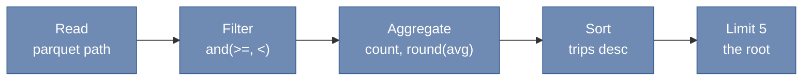
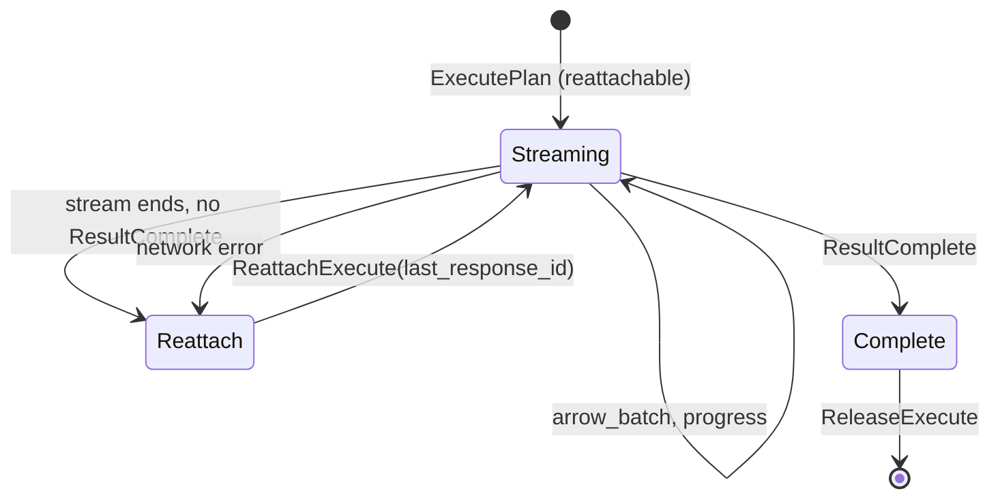

# Chapter 23: Writing a Spark Connect client

[Chapter 21](ch21-connect-clients.md) used five clients that other people wrote. [Chapter 19](ch19-connect-protocol.md) recorded the messages between PySpark and a server. This chapter writes a client from nothing, in Python, without pyspark. The client compiles the protocol files of Spark 4.3.0, opens a gRPC channel, sends a plan and decodes the Arrow batches. Then it gets a schema, decodes errors, reattaches to a stream, and puts a small DataFrame API on top.

**A useful Spark Connect client is about 200 lines of code on three libraries: gRPC, protobuf and Arrow. Those libraries exist for most languages, so the protocol does not need a Spark library in the language of the client. The code that you write is the plan builder and the code around the RPCs. What makes a client complete is not the first query. It is the rest of the protocol: sessions, reattach, release, errors and artifacts.**

The code is in [`code/ch23`](https://github.com/lisancao/spark-masterclass/tree/main/code/ch23). The client is one file, `miniconnect.py` (212 lines). Each step of the chapter is a script that uses it. The scripts run in an environment that has only these packages (`requirements.txt`). pyspark is not importable in it (`output/env.txt`):

```text
pyspark importable: False
grpcio 1.85.3 | protobuf 7.36.2 | pyarrow 26.0.1
```

The server is the Spark 4.3.0 Connect server of [Chapter 21](ch21-connect-clients.md) (`code/ch21/server.sh`, port 15106).

<figure markdown>
  <video autoplay loop muted playsinline controls width="1280" height="720" poster="../../media/clips/ch23-anim-layers.webp">
    <source src="../../media/clips/ch23-anim-layers.mp4" type="video/mp4">
  </video>
  <figcaption>Each DataFrame call wraps the plan in one more <code>Relation</code>. Protobuf turns the tree into 320 bytes, gRPC sends them, and Arrow batches come back as a table. The plan size and the rows come from <code>step4_dataframe.txt</code>. The times are schematic.</figcaption>
</figure>

## The layers of a client

<figure markdown>


<figcaption>The layers of <code>miniconnect.py</code>. The line counts come from the file. The number of message types comes from the <code>.proto</code> files at <code>v4.3.0</code>.</figcaption>
</figure>

| Layer | What it does | Who supplies it |
|---|---|---|
| gRPC | One HTTP/2 channel and a stub for `SparkConnectService` | `grpcio` |
| protobuf | Classes for each message in the `.proto` files | `protoc` generates them |
| Arrow | Reads the IPC stream in each `ArrowBatch.data` | `pyarrow` |
| Session and RPCs | A session ID, the requests, the response stream, reattach, release, errors | this chapter |
| DataFrame API | `Column`, `DataFrame` and functions that build `Relation` and `Expression` trees | this chapter |

## Step 1: Compile the protocol

The protocol is the `.proto` files in the Spark source, under `sql/connect/common/src/main/protobuf/spark/connect/`. `gen.sh` takes them from the `v4.3.0` tag with `git show`, so they match the server exactly. Then `grpc_tools.protoc` generates the Python classes and the gRPC stub:

```bash
SRC=sql/connect/common/src/main/protobuf/spark/connect
for f in $(git -C "$SPARK_SRC" ls-tree --name-only v4.3.0 "$SRC/"); do
  git -C "$SPARK_SRC" show "v4.3.0:$f" > "build/proto/spark/connect/$(basename "$f")"
done
uv run --isolated --no-project --with-requirements requirements.txt python -m grpc_tools.protoc \
  -I build/proto --python_out=build/gen --grpc_python_out=build/gen build/proto/spark/connect/*.proto
```

The result is a `_pb2.py` module for each of the 11 files, and `base_pb2_grpc.py` with the stub. The files import `google/protobuf/any.proto` and `timestamp.proto`. `grpcio-tools` includes these standard files. Other toolchains do not always include them: in [Chapter 21](ch21-connect-clients.md), the Rust build needed `libprotobuf-dev` for them.

Use the `.proto` files of the server version, or an older version. A client with newer files can build a message that an older server does not know. Protobuf ignores the unknown field, and the server then sees a plan with no relation in it.

## Step 2: The bytes of a request

The smallest useful request is an `ExecutePlanRequest` with a SQL relation. `step1_bytes.py` builds it and reads its bytes with a small decoder of the protobuf wire format:

```python
req = base_pb2.ExecutePlanRequest(
    session_id="00112233-4455-6677-8899-aabbccddeeff",          # the client chooses it
    user_context=base_pb2.UserContext(user_id="book"),
    plan=base_pb2.Plan(root=relations_pb2.Relation(sql=relations_pb2.SQL(query="SELECT 1 AS x"))),
    client_type="miniconnect/0.1",
)
data = req.SerializeToString()
```

```text
ExecutePlanRequest: 84 bytes
  0000  0a 24 30 30 31 31 32 32 33 33 2d 34 34 35 35 2d  .$00112233-4455-
  0010  36 36 37 37 2d 38 38 39 39 2d 61 61 62 62 63 63  6677-8899-aabbcc
  0020  64 64 65 65 66 66 12 06 0a 04 62 6f 6f 6b 1a 13  ddeeff....book..
  0030  0a 11 52 0f 0a 0d 53 45 4c 45 43 54 20 31 20 41  ..R...SELECT 1 A
  0040  53 20 78 22 0f 6d 69 6e 69 63 6f 6e 6e 65 63 74  S x".miniconnect
  0050  2f 30 2e 31                                      /0.1

field by field (offset, tag and length bytes, field):
  @00 0a 24     session_id = '00112233-4455-6677-8899-aabbccddeeff'
  @26 12 06     user_context (UserContext, 6 bytes)
  @28 0a 04       user_id = 'book'
  @2e 1a 13     plan (Plan, 19 bytes)
  @30 0a 11       root (Relation, 17 bytes)
  @32 52 0f         sql (SQL, 15 bytes)
  @34 0a 0d           query = 'SELECT 1 AS x'
  @43 22 0f     client_type = 'miniconnect/0.1'
```

<figure markdown>


<figcaption>The request of <code>step1_bytes.txt</code>. Each field starts with a tag byte and a length byte. The plan is a message in a message in a message.</figcaption>
</figure>

Each field starts with a tag. The tag is the field number shifted left by three bits, plus the wire type. Wire type 2 means "a length follows, then that number of bytes". Thus:

- `0a` is field 1 (`session_id`), wire type 2. The next byte, `24`, is the length: 36 bytes of UUID.
- `1a` is field 3 (`plan`). Its 19 bytes are a `Plan` message.
- Inside the plan, `0a` is field 1 of `Plan` (`root`, a `Relation`).
- Inside the relation, `52` is field 10 of `Relation`: 10 << 3 | 2 = 82 = 0x52. Field 10 is `sql` in `relations.proto`.
- The query is field 1 of `SQL`, 13 bytes of UTF-8.

The plan of a SQL query is the text of the query. A plan from a DataFrame is a deeper tree of the same kind of messages (Step 5).

[Chapter 19](ch19-connect-protocol.md) decodes such a tree from PySpark. It also lists the job of each field of the request.

## Step 3: Send it, and read the stream

The client is a `Session`: a channel, a stub, a session ID and a user. The session ID is a UUID that the client makes. The server creates the session when the first request with that ID arrives:

```python
class Session:
    def __init__(self, url="sc://localhost:15106", user="book"):
        host_port = url.removeprefix("sc://").split("/")[0]
        self.channel = grpc.insecure_channel(host_port)
        self.stub = base_pb2_grpc.SparkConnectServiceStub(self.channel)
        self.session_id = str(uuid.uuid4())
        self.user = base_pb2.UserContext(user_id=user)

    def request(self, relation: relations_pb2.Relation) -> base_pb2.ExecutePlanRequest:
        return base_pb2.ExecutePlanRequest(
            session_id=self.session_id, user_context=self.user, client_type=CLIENT_TYPE,
            operation_id=str(uuid.uuid4()), plan=base_pb2.Plan(root=relation))
```

`ExecutePlan` is a server-streaming RPC: one request in, a stream of responses out. `step2_execute.py` prints the type of each response:

```text
ExecutePlan: SELECT id, id * id AS square FROM range(5)
  response 0: (none)             op=861189c9  schema=['id', 'square']
  response 1: execution_progress op=861189c9 stages=0
  response 2: arrow_batch        op=861189c9 row_count=1 data=448 bytes
  response 3: arrow_batch        op=861189c9 row_count=1 data=448 bytes
  response 4: arrow_batch        op=861189c9 row_count=1 data=448 bytes
  response 5: arrow_batch        op=861189c9 row_count=1 data=448 bytes
  response 6: execution_progress op=861189c9 stages=1
  response 7: execution_progress op=861189c9 stages=1
  response 8: execution_progress op=861189c9 stages=1
  response 9: arrow_batch        op=861189c9 row_count=1 data=448 bytes
  response 10: execution_progress op=861189c9 stages=1
  response 11: (none)             op=861189c9 3 plan nodes with metrics
  response 12: execution_progress op=861189c9 stages=1
pyarrow.Table
id: int64 not null
square: int64 not null
----
id: [[0],[1],...,[3],[4]]
square: [[0],[1],...,[9],[16]]
```

<figure markdown>
  <video autoplay loop muted playsinline controls width="1280" height="720" poster="../../media/clips/ch23-stream.webp">
    <source src="../../media/clips/ch23-stream.mp4" type="video/mp4">
  </video>
  <figcaption><code>step2_execute.py</code> sends one <code>ExecutePlan</code> request and prints each response of the stream. Five responses carry Arrow batches of one row each.</figcaption>
</figure>

The stream has four kinds of response that a client must handle:

| Response | What the client does |
|---|---|
| The first response, with `schema` and no `response_type` | Keeps the schema. |
| `arrow_batch` | Decodes `data` as an Arrow IPC stream and keeps the batches |
| `execution_progress` | Shows the progress, or ignores it |
| The last response, with `metrics` | Ignores it, or shows the metrics for each plan node |

The order of the responses is not fixed. This run sent the progress reports between the batches. `range(5)` on this server has 16 partitions. The server sent one batch for each partition that had a row, in five batches of one row. The `execute` method of the client keeps only the batches:

```python
    def execute(self, relation) -> pa.Table:
        """Run a relation and decode every ArrowBatch into one pyarrow Table."""
        batches = []
        for r in self.responses(relation):
            if r.WhichOneof("response_type") == "arrow_batch":
                with pa.ipc.open_stream(r.arrow_batch.data) as reader:
                    batches.extend(reader)
        return pa.Table.from_batches(batches) if batches else pa.table({})
```

## Step 4: Decode an Arrow batch

Each `ArrowBatch.data` is a complete Arrow IPC stream: a schema message, one record batch message and an end marker. `step3_arrow_bytes.py` reads the stream of `SELECT 42L AS answer` message by message:

```text
ArrowBatch.data: 328 bytes
  @000 ff ff ff ff 98 00 00 00  continuation 0xffffffff, metadata 152 bytes: schema message, body 0 bytes
  @0a0 ff ff ff ff 88 00 00 00  continuation 0xffffffff, metadata 136 bytes: record batch message, body 16 bytes
       body: 01 00 00 00 00 00 00 00 2a 00 00 00 00 00 00 00
  @140 ff ff ff ff 00 00 00 00  end of stream
answer: int64 not null
{'answer': [42]}
```

The body of the record batch is the data:

- `01 00 00 00 00 00 00 00` is the validity bitmap: bit 0 is set, so row 0 is not null. Arrow pads each buffer to 8 bytes.
- `2a 00 00 00 00 00 00 00` is the value: 0x2a = 42, as a little-endian 64-bit integer.

Most of the 328 bytes are the schema and the metadata. Each batch repeats the schema, so a result with many small batches costs more bytes than the data. With 10,000 rows in a batch, the data is most of the bytes. [Chapter 19](ch19-connect-protocol.md), Step 6, reads a larger batch byte by byte.

This step is the reason why a client is easy to write. The client does not need a decoder for a Spark row format. It gives the bytes to the Arrow library of its language, and it gets columns with the correct types.

## Step 5: A DataFrame API on top

The DataFrame API builds the same messages as `SQL`, only deeper. The design is small:

- A `Column` holds one unresolved `Expression`. An operator, for example `>=`, is an `UnresolvedFunction` with the name `">="`. The server resolves the name, as it does for PySpark.
- A `DataFrame` holds one `Relation`. Each method returns a new `DataFrame` whose relation has the old relation as its `input`.

```python
class DataFrame:
    def __init__(self, session, relation):
        self.session, self.relation = session, relation

    def _wrap(self, **node):
        return DataFrame(self.session, R.Relation(**node))

    def where(self, cond: Column):
        return self._wrap(filter=R.Filter(input=self.relation, condition=cond.expr))

    def group_by(self, *names):
        return GroupedData(self, [col(n).expr for n in names])

    def order_by(self, *orders):
        return self._wrap(sort=R.Sort(input=self.relation, order=list(orders), is_global=True))

    def limit(self, n):
        return self._wrap(limit=R.Limit(input=self.relation, limit=n))
```



`AnalyzePlan` asks the server to analyze a plan without a run. The client uses it for the schema. `step4_dataframe.py` gets the schema of the taxi files, then runs the query of [Chapter 21](ch21-connect-clients.md) through the builder:

```python
trips = s.read_parquet(TRIPS)
schema = trips.schema()                                   # AnalyzePlan: nothing runs
pickup = col("tpep_pickup_datetime")
top = (trips.where((pickup >= "2026-06-01") & (pickup < "2026-07-01"))
       .group_by("PULocationID")
       .agg(fn("count", 1).alias("trips"), fn("round", fn("avg", col("fare_amount")), 2).alias("avg_fare"))
       .order_by(col("trips").desc())
       .limit(5))
table = top.to_arrow()
```

```text
AnalyzePlan(schema): 21 fields
  VendorID: integer nullable=True
  tpep_pickup_datetime: timestamp_ntz nullable=True
  tpep_dropoff_datetime: timestamp_ntz nullable=True

the plan is 320 bytes of protobuf; its node chain:
  limit <- sort <- aggregate <- filter <- read

PULocationID: int32
trips: int64 not null
avg_fare: double
  {'PULocationID': 237, 'trips': 177610, 'avg_fare': 14.15}
  {'PULocationID': 161, 'trips': 161198, 'avg_fare': 18.47}
  {'PULocationID': 236, 'trips': 157113, 'avg_fare': 15.02}
  {'PULocationID': 132, 'trips': 148169, 'avg_fare': 60.84}
  {'PULocationID': 162, 'trips': 119615, 'avg_fare': 17.39}
```

The rows are the same as the rows of the five clients in [Chapter 21](ch21-connect-clients.md). The whole plan is 320 bytes. The client knows no function. `count`, `round`, `avg`, `>=` and `and` are names in `UnresolvedFunction` messages, so each Spark SQL function is available through `fn(name, ...)`. This is why a new client can be useful early: the server does the type checks and the function lookup.

## Step 6: Errors

When the server rejects a plan, the gRPC call fails. The error class and the SQLSTATE are not in the message text. They are in the gRPC status details: a `google.rpc.Status` in the trailer `grpc-status-details-bin`. `step5_errors.py` selects a column that does not exist:

```text
built a plan over a column that does not exist; nothing was sent yet
AnalyzePlan: error_class=UNRESOLVED_COLUMN.WITH_SUGGESTION sqlstate=42703
  [UNRESOLVED_COLUMN.WITH_SUGGESTION] A column, variable, or function parameter with name
ExecutePlan: error_class=UNRESOLVED_COLUMN.WITH_SUGGESTION sqlstate=42703
  [UNRESOLVED_COLUMN.WITH_SUGGESTION] A column, variable, or function parameter with name

gRPC status: INTERNAL
ErrorInfo.reason=org.apache.spark.sql.catalyst.ExtendedAnalysisException domain=org.apache.spark
  metadata[classes] = ["org.apache.spark.sql.catalyst.ExtendedAnalysisException","
  metadata[errorClass] = UNRESOLVED_COLUMN.WITH_SUGGESTION
  metadata[errorId] = df90b0e2-65d7-42f9-b1e0-30ce73fc7440
  metadata[messageParameters] = {"objectName":"`revenue`","proposal":"`extra`, `VendorID`, `
  metadata[sqlState] = 42703
FetchErrorDetails: 1 error(s), root org.apache.spark.sql.catalyst.ExtendedAnalysisException, 67 stack frames
```

The `ErrorInfo` message has the error class, the SQLSTATE, the message parameters and an `errorId`. The `_error` function of the client reads it:

```python
def _error(e: grpc.RpcError) -> SparkError:
    """Read google.rpc.Status from the trailers: it carries an ErrorInfo with the error class."""
    from google.rpc import error_details_pb2, status_pb2
    for key, value in e.trailing_metadata() or ():
        if key == "grpc-status-details-bin":
            status = status_pb2.Status.FromString(value)
            for d in status.details:
                info = error_details_pb2.ErrorInfo()
                if d.Unpack(info):
                    return SparkError(status.message, info.metadata.get("errorClass"),
                                      info.metadata.get("sqlState"))
    return SparkError(e.details())
```

The trailers are small. For the full error, with the causes and the stack trace of the server, the client sends `FetchErrorDetails` with the `errorId`. Here the server returned one error with 67 stack frames. The gRPC status code is `INTERNAL` for an analysis error. Thus a client must not decide on retries from the gRPC code alone. Only some codes, for example `UNAVAILABLE`, mean "try again".

## Step 7: Reattach and release

A plain `ExecutePlan` is not reattachable. If the stream breaks, the result is lost. For a long query, the client asks for a reattachable execution with a request option. Then the server keeps the responses until the client releases them, and it ends each stream after a time or size limit. When a stream ends without `ResultComplete`, the client calls `ReattachExecute` with the operation ID and the ID of the last response that it got:

```python
    def execute_reattachable(self, relation, log=print) -> pa.Table:
        req = self.request(relation)
        req.request_options.append(base_pb2.ExecutePlanRequest.RequestOption(
            reattach_options=base_pb2.ReattachOptions(reattachable=True)))
        stream, last, batches, done, n = self.stub.ExecutePlan(req), None, [], False, 0
        while not done:
            for r in stream:
                last, n = r.response_id, n + 1
                kind = r.WhichOneof("response_type")
                if kind == "arrow_batch":
                    with pa.ipc.open_stream(r.arrow_batch.data) as reader:
                        batches.extend(reader)
                elif kind == "result_complete":
                    done = True
            if not done:                    # the server closed the stream early: continue from `last`
                log(f"  stream ended after {n} responses without ResultComplete: ReattachExecute")
                stream = self.stub.ReattachExecute(base_pb2.ReattachExecuteRequest(
                    session_id=self.session_id, user_context=self.user, client_type=CLIENT_TYPE,
                    operation_id=req.operation_id, last_response_id=last))
        log(f"  ResultComplete after {n} responses: ReleaseExecute")
        self.stub.ReleaseExecute(base_pb2.ReleaseExecuteRequest(
            session_id=self.session_id, user_context=self.user, client_type=CLIENT_TYPE,
            operation_id=req.operation_id, release_all=base_pb2.ReleaseExecuteRequest.ReleaseAll()))
        return pa.Table.from_batches(batches)
```

`step6_reattach.py` runs against the server of `ch21/server.sh small-streams`, which ends each stream after 1 MiB. It collects 20 MB, first with a plain request, then with a reattachable one:

```text
plain ExecutePlan: 200000 rows
reattachable ExecutePlan:
  stream ended after 3 responses without ResultComplete: ReattachExecute
  stream ended after 7 responses without ResultComplete: ReattachExecute
  stream ended after 9 responses without ResultComplete: ReattachExecute
  ...
  stream ended after 33 responses without ResultComplete: ReattachExecute
  stream ended after 35 responses without ResultComplete: ReattachExecute
  ResultComplete after 38 responses: ReleaseExecute
  200000 rows, 21.4 MiB of Arrow data
```

<figure markdown>
  <video autoplay loop muted playsinline controls width="1280" height="720" poster="../../media/clips/ch23-reattach.webp">
    <source src="../../media/clips/ch23-reattach.mp4" type="video/mp4">
  </video>
  <figcaption>The server ends each stream after 1 MiB. The hand-written client calls <code>ReattachExecute</code> until it gets <code>ResultComplete</code>, then releases the operation.</figcaption>
</figure>

The client reattached 16 times, the same number as the Python, Scala, Rust and Swift clients in [Chapter 21](ch21-connect-clients.md), Step 7. The plain request got all the rows in one stream, because the server applies the limits only to reattachable executions. That is the trade: a plain request is simpler, but a broken connection loses it.



This client releases the responses only at the end, with `ReleaseAll`. A production client releases them during the result, with `ReleaseUntil` and the last response ID. Then the server can free its buffer early. [Chapter 19](ch19-connect-protocol.md), Step 7, shows that PySpark sends one `ReleaseExecute` for each response.

## What a full client needs

`miniconnect.py` can run queries, get schemas, decode errors and survive a stream that ends early. A client for real work needs more of the protocol. This list comes from `base.proto` at `v4.3.0` and from the clients of [Chapter 21](ch21-connect-clients.md):

| Area | What to implement | RPCs and fields |
|---|---|---|
| Connection | The `sc://` string with `token`, `use_ssl` and `user_id`. TLS when a token is set. The token goes in an `authorization: Bearer` header. | channel options |
| Session | Keep the `server_side_session_id` of the first response. Send it back as `client_observed_server_side_session_id`, so a restarted server refuses a request instead of using a new, empty session. Release the session at the end. | `ReleaseSession`, `CloneSession` |
| Results | Reattach, and release as you go. Accept a batch in more than one message. | `ReattachExecute`, `ReleaseExecute`, `ResultChunkingOptions` |
| Retries | Retry `UNAVAILABLE` with an exponential wait and jitter. Keep the same operation ID, so a retry does not run the operation two times. | all RPCs |
| Errors | Read `ErrorInfo` from the status details. Get causes and stack traces with `FetchErrorDetails`. | `FetchErrorDetails` |
| Configuration | Set and get session configuration. | `Config` |
| Control | Stop an operation, a tag or all operations of the session. Tag the operations. | `Interrupt`, `ExecutePlanRequest.tags` |
| Commands | Writes, temporary views and SQL commands are a `Command`, not a `Relation`. | `Plan.command` |
| Local data | Encode client rows as Arrow IPC for a `LocalRelation`. Large data goes to the server first as an artifact. | `LocalRelation`, `CachedLocalRelation`, `AddArtifacts` |
| Code on the server | UDFs need their code on the server: Python pickles, JARs or class files. | `AddArtifacts`, `ArtifactStatus` |
| Streaming | Start, watch and stop streaming queries. | `WriteStreamOperationStart`, `StreamingQueryCommand` |

The size of this list is why the clients of [Chapter 21](ch21-connect-clients.md) are at different stages. The first query is a weekend of work. The list above is the work of a project.

A hand-written client can also go much further down than this chapter. For an example, see [spark-connect-wasm](https://github.com/lisancao/spark-connect-wasm). It is a Spark Connect client in WebAssembly text format, with its own protobuf, HTTP/2 and Arrow code.

## The whole chapter, on one page

```bash
cd code
ch21/server.sh start            # the Connect server of Chapter 21: sc://localhost:15106
ch23/gen.sh                     # .proto files from v4.3.0 -> build/gen (grpcio-tools)
ch23/step.sh step1_bytes        # an ExecutePlanRequest, byte by byte
ch23/step.sh step2_execute      # one ExecutePlan, the response stream, a pyarrow Table
ch23/step.sh step3_arrow_bytes  # one ArrowBatch: schema, record batch, end of stream
ch23/step.sh step4_dataframe    # AnalyzePlan, then the taxi query through the DataFrame builder
ch23/step.sh step5_errors       # ErrorInfo in the gRPC trailers, then FetchErrorDetails
ch21/server.sh small-streams
ch23/step.sh step6_reattach     # 16 ReattachExecute calls, then ReleaseExecute
ch21/server.sh start            # or: ch23/run.sh, which runs all of it and saves the outputs
```

- **Compile the protocol from the tag of your server.** `git show v4.3.0:...` and `protoc` give the messages and the stub.
- **A request is a few nested messages.** A SQL query is 84 bytes. The taxi query from the DataFrame builder is 320 bytes.
- **The response is a stream.** Keep the schema, decode each `arrow_batch` with an Arrow library, and ignore what you do not need.
- **The server knows the functions.** The client sends names, so each Spark SQL function works from the first day.
- **Errors are in the gRPC status details.** Read `ErrorInfo` for the error class and the SQLSTATE. Use `FetchErrorDetails` for the rest.
- **The rest of the protocol makes the client complete.** Reattach and release, sessions, retries, commands and artifacts.

## Further reading

- [The Spark Connect protocol files at v4.3.0](https://github.com/apache/spark/tree/v4.3.0/sql/connect/common/src/main/protobuf/spark/connect), with comments on each field.
- [The protobuf wire format](https://protobuf.dev/programming-guides/encoding/), for Step 2.
- [Arrow IPC format](https://arrow.apache.org/docs/format/Columnar.html#serialization-and-interprocess-communication-ipc), the format of Step 4.
- [gRPC status details](https://grpc.io/docs/guides/error/#richer-error-model), the error model of Step 6.
- [spark-connect-wasm](https://github.com/lisancao/spark-connect-wasm), a client written by hand in WebAssembly text format.
