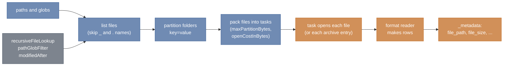
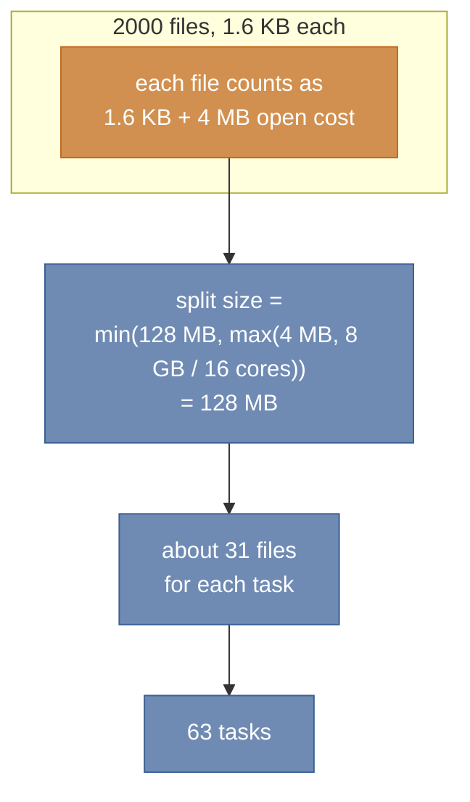
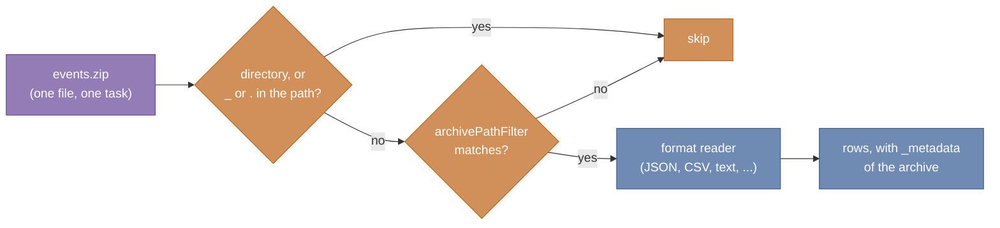

# Chapter 25: Files as files, globs and metadata

The JSON, CSV and XML readers make an assumption about each file before they read it. They assume that the file has the format that its name says. Real folders do not always agree. A file with the name `.png` can contain text, an upload can stop half way, and one folder can contain three formats and a `README`.

Before Spark parses a record, it lists files, selects some of them, and puts them into tasks. This chapter is about that first part of each read.

**Every file read in Spark starts with a listing, and the listing controls the cost and the correctness of the read. The listing decides which files Spark reads, how Spark packs the files into tasks, and which file each row comes from. The `binaryFile` source, the hidden `_metadata` column and the new archive reader in Spark 4.3 let you see and control the listing directly.**

The data is SparkTutor's messy sample set: small images, WAV recordings, PDFs, e-mails, JSON events and CSV exports, copied into [`code/data/messy`](https://github.com/lisancao/spark-masterclass/tree/main/code/data/messy). Step 2 also uses one million NYC taxi trips. The scripts are in [`code/ch25`](https://github.com/lisancao/spark-masterclass/tree/main/code/ch25). All output in this chapter comes from `code/ch25/output/`, from runs on Spark 4.3.0 with `spark.sql.session.timeZone=UTC`.

## How a read starts

A read has two halves. The driver does the first half before a task starts. The executors do the second half.



The options in the gray box change the listing. They do not change the parser. Thus no task opens a file that the listing removes. A task opens each file that the listing keeps, even if its content is wrong. The rest of the chapter goes through the boxes from left to right.

## Step 1: Read a folder as one row per file

The `binaryFile` source reads each file as one row. It does not look inside the file:

```python
audio = spark.read.format("binaryFile").load(str(MESSY / "audio"))
audio.printSchema()
```

```text
root
 |-- path: string (nullable = true)
 |-- modificationTime: timestamp (nullable = true)
 |-- length: long (nullable = true)
 |-- content: binary (nullable = true)

+------------------------+------+------------------------+
|path                    |length|first 12 bytes          |
+------------------------+------+------------------------+
|audio/silence.wav       |8044  |52494646641F000057415645|
|audio/tone_440.wav      |4044  |52494646C40F000057415645|
|audio/tone_880_quiet.wav|4044  |52494646C40F000057415645|
+------------------------+------+------------------------+
```

The schema does not change, so Spark does not infer it. The source gets `path`, `length` and `modificationTime` from the file system. It reads `content`, the full file as a `binary` value, only if the query uses that column (Step 4 shows the proof). The source tells the planner that a file is not splittable (`isSplitable` returns `false` in `BinaryFileFormat.scala`). Thus one task always reads a full file. This is correct for PNG, PDF and WAV, because their bytes have meaning only together.

## Step 2: Select files with folders, globs and options

The sample `images` folder contains only two subfolders, `products` and `scans`. A load of the top folder gives zero rows and no error:

```text
load(images).count()                         -> 0
recursiveFileLookup=true                     -> 6
  + pathGlobFilter=*.png                     -> 5
load(images/*/*.png)                         -> 5
load([pdf, mail])                            -> 6
pathGlobFilter matching nothing              -> 0
a path glob matching nothing                 -> [PATH_NOT_FOUND]
```

A file source lists only the files directly in the folder that you give it. It treats a subfolder as a possible partition folder, such as `day=2026-10-01`. The name `products` does not have the `key=value` form, so Spark does not use it and does not walk into it. The options that change this have different scopes:

- `recursiveFileLookup` lists files at all depths.
- `pathGlobFilter` is a glob that Spark compares with the **file name** only, not with the folder path. All file sources accept it.
- A glob in the path (`*/*.png`) compares each part of the path by position. It is good for a fixed folder layout.
- A list of paths reads several roots in one DataFrame.

Two of these results are the same "nothing", but Spark reports them differently. A path or glob that matches nothing is an error, `PATH_NOT_FOUND`. A `pathGlobFilter` that removes every file gives an empty DataFrame with no error. If an empty input is a bug in your job, examine the count yourself.

Partition folders are the second rule of the listing. The script writes two days of events into `day=2026-10-01` and `day=2026-10-02`. It also writes a `_SUCCESS` file and a `.crc` file into the second folder:

```text
columns: ['path', 'modificationTime', 'length', 'content', 'day']
+--------------------------+----------+
|path                      |day       |
+--------------------------+----------+
|day=2026-10-02/events.json|2026-10-02|
|day=2026-10-01/events.json|2026-10-01|
+--------------------------+----------+

with recursiveFileLookup, columns: ['path', 'modificationTime', 'length', 'content']
```

Partition discovery adds the column `day` from the folder names. The listing does not show `_SUCCESS` or `.crc`, because the listing skips names that start with `_` or `.`. When you set `recursiveFileLookup`, Spark turns off partition discovery, and the `day` column goes away. Thus you must select one of the two layouts for each dataset.

## Step 3: Read only the files that changed

The options `modifiedAfter` and `modifiedBefore` filter the listing by the modification time of each file. The script makes an `uploads` folder with a new copy of `red_16x8.png` and a copy of `tone_440.wav` with a modification time in 2020:

```text
+---------------+-----------------------+
|file           |modificationTime       |
+---------------+-----------------------+
|voice_note.wav |2020-01-01 00:00:00    |
|upload_0001.png|2026-11-22 08:44:15.132|
+---------------+-----------------------+

modifiedAfter=2025-01-01T00:00:00 -> ['upload_0001.png']
modifiedAfter='01/01/2025'   -> The timestamp provided for the 'modifiedafter' option is invalid. The expected format is 'YYYY-MM-DDTHH:mm:ss'
modifiedAfter='2025-01-01'   -> 1 file(s)
```

An ISO value works, and the short form `2025-01-01` also works. A value such as `01/01/2025` fails when Spark reads. The message writes the expected format as `YYYY-MM-DDTHH:mm:ss`. This text is a description for people. It is not a pattern for `to_timestamp`, because `YYYY` and `DD` have other meanings in Spark's datetime patterns. Spark reads the value in the session time zone, or in the `timeZone` option if you set it.

These options apply to a batch read only. They are a fast way to read "the files since the last run". But they do not remember which files a job read before. For true incremental ingestion, use a streaming file source with a checkpoint ([Part VIII](ch39-structured-streaming.md)).

## Step 4: Use the hidden `_metadata` column

Each file source has a hidden column with the name `_metadata`. It is not in `df.columns` and `select("*")` does not include it. You must select it by name:

```python
events = spark.read.json(str(MESSY / "events"))
events.select("_metadata").printSchema()
events.groupBy(F.col("_metadata.file_name"), F.col("_metadata.file_size")).count()
```

```text
'_metadata' in events.columns: False
root
 |-- _metadata: struct (nullable = false)
 |    |-- file_path: string (nullable = false)
 |    |-- file_name: string (nullable = false)
 |    |-- file_size: long (nullable = false)
 |    |-- file_block_start: long (nullable = false)
 |    |-- file_block_length: long (nullable = false)
 |    |-- file_modification_time: timestamp (nullable = false)

+----------------------+---------+-----+
|file_name             |file_size|count|
+----------------------+---------+-----+
|events_2026-10-01.json|1589     |20   |
|events_2026-10-02.json|3302     |20   |
|events_2026-10-03.json|4016     |21   |
+----------------------+---------+-----+
```

For `binaryFile`, the columns `path` and `length` already give most of this information. The real value of `_metadata` is on JSON, CSV, text, XML and Parquet. In those formats a row is a record inside a file, and without `_metadata` you do not know which file the record came from. The rest of Part VI uses `_metadata.file_name` for each quarantine table.

The fields `file_block_start` and `file_block_length` show the byte range of the task that read the row. Parquet adds one more field, `row_index`, the position of the row in its file. On the taxi month from Part II, the output is:

```text
 |    |-- row_index: long (nullable = false)

+---------+----------------+-----------------+
|row_index|file_block_start|file_block_length|
+---------+----------------+-----------------+
|0        |8707492         |4353746          |
|1048575  |8707492         |4353746          |
|1048576  |26122476        |4353746          |
+---------+----------------+-----------------+
```

The file has row groups of 1,048,576 rows ([Chapter 5](ch05-how-spark-runs.md), Step 4). Row 1,048,575 is the last row of the first row group. The task with the byte range at 8,707,492 read it. Row 1,048,576 starts the second row group, and a different task read it. Thus `_metadata` also shows how Spark cut a file into tasks. Step 7 uses `row_index` to select the same one million trips on each run.

## Step 5: Do not read bytes that you do not need

A listing of a million files is not expensive. A read of a million files is expensive. The `binaryFile` reader opens a file only when the query needs `content`. It also applies filters on `length` and `modificationTime` to the file status, before it opens the file. The plan shows both:

```python
big = files.where(F.col("length") > 5000).select("path", "length")
```

```text
+- FileScan binaryFile [path#0,length#2L] Batched: false,
    DataFilters: [isnotnull(length#2L),
    (length#2L > 5000)],
    Format: BINARYFILE,
    Location: InMemoryFileIndex(5 paths)[file:data/messy/images,
    ...,
    PartitionFilters: [],
    PushedFilters: [IsNotNull(length),
    GreaterThan(length,5000)],
    ReadSchema: struct<path:string,length:bigint>
```

`ReadSchema` does not contain `content`, and `PushedFilters` contains the size filter. In the 4.3.0 source, `BinaryFileFormat.parse` writes `path`, `length` and `modificationTime` from the `FileStatus`, and calls `getContent()` only for the `content` column.

The setting `spark.sql.sources.binaryFile.maxLength` makes this visible. It is an internal setting. Its default is 2147483647 bytes, the largest Java array. The reader examines the limit only when it is about to read the bytes of a file:

```text
maxLength=1000, select(path, length).count(): 17
maxLength=1000, select(sha2(content)): [FAILED_READ_FILE.NO_HINT]
  caused by: The length of gradient_32x32.png is 1795, which exceeds the max length allowed: 1000
```

The metadata query counts all 17 files with a limit of 1000 bytes. The query that hashes the content fails on the first file that is too large. In classic PySpark the failure arrives as a `Py4JJavaError` with the condition in the message. Thus the correct order for a large folder is: list, filter on metadata, and then select `content` only for the rows that you must parse.

<figure markdown>
  <video autoplay loop muted playsinline controls width="1280" height="720" poster="../../media/clips/ch25-bytes.webp">
    <source src="../../media/clips/ch25-bytes.mp4" type="video/mp4">
  </video>
  <figcaption><code>bytes.py</code> on Spark 4.3.0. A metadata query reads no content, a content read fails on <code>maxLength</code>, and magic bytes give the file kinds.</figcaption>
</figure>

## Step 6: Find what a file really is from its first bytes

Most binary formats start with a fixed signature, the "magic bytes". The signature is a better guide than the file name:

| Format | First bytes (hex) | As text |
|---|---|---|
| PNG | `89 50 4E 47 0D 0A 1A 0A` | `\x89PNG\r\n\x1a\n` |
| WAV | `52 49 46 46`, then `57 41 56 45` at byte 9 | `RIFF....WAVE` |
| PDF | `25 50 44 46 2D` | `%PDF-` |
| gzip | `1F 8B` | |
| ZIP (also `.docx`, `.xlsx`) | `50 4B 03 04` | `PK..` |

The SQL string functions also work on `binary` columns. On a `binary` value, `substring` counts **bytes, from 1**, and `hex` makes the bytes easy to compare with the table:

```python
def head_hex(start, n):
    return F.hex(F.substring("content", start, n))

kind = (F.when(head_hex(1, 8) == "89504E470D0A1A0A", "png")
        .when((head_hex(1, 4) == "52494646") & (head_hex(9, 4) == "57415645"), "wav")
        .when(head_hex(1, 5) == "255044462D", "pdf")
        .otherwise("other"))
```

A header also contains numbers. A PNG file has the 8-byte signature and then a chunk with the name `IHDR`. Bytes 13 to 16 are the letters `IHDR`. Bytes 17 to 20 are the width, and bytes 21 to 24 are the height, each as a 4-byte big-endian integer. In big-endian order the most important byte is first, which is also the order of hex digits. Thus `conv` from base 16 to base 10 gives the number:

```python
def be_uint32(start):
    return F.conv(head_hex(start, 4), 16, 10).cast("long")

png_ok = F.when(kind == "png", head_hex(13, 4) == "49484452")   # the letters IHDR
width  = F.when(F.col("png_ok"), be_uint32(17))
height = F.when(F.col("png_ok"), be_uint32(21))
```

The inventory of all five folders (the four sample folders and `uploads`):

```text
+-------------------+------+-----+------+----------------+-----+------+
|file               |length|kind |png_ok|first_8_bytes   |width|height|
+-------------------+------+-----+------+----------------+-----+------+
|readme.txt         |13    |other|NULL  |6E6F7420616E2069|NULL |NULL  |
|ticket_0.eml       |250   |other|NULL  |46726F6D3A206375|NULL |NULL  |
|ticket_1.eml       |250   |other|NULL  |46726F6D3A206375|NULL |NULL  |
|ticket_2.eml       |257   |other|NULL  |46726F6D3A206375|NULL |NULL  |
|ticket_3.eml       |250   |other|NULL  |46726F6D3A206375|NULL |NULL  |
|invoice_1001.pdf   |878   |pdf  |NULL  |255044462D312E34|NULL |NULL  |
|invoice_1002.pdf   |603   |pdf  |NULL  |255044462D312E34|NULL |NULL  |
|corrupt.png        |24    |png  |false |89504E470D0A1A0A|NULL |NULL  |
|gradient_32x32.png |1795  |png  |true  |89504E470D0A1A0A|32   |32    |
|gray_20x10.png     |90    |png  |true  |89504E470D0A1A0A|20   |10    |
|logo_rgba_12x12.png|81    |png  |true  |89504E470D0A1A0A|12   |12    |
|red_16x8.png       |76    |png  |true  |89504E470D0A1A0A|16   |8     |
|upload_0001.png    |76    |png  |true  |89504E470D0A1A0A|16   |8     |
|silence.wav        |8044  |wav  |NULL  |52494646641F0000|NULL |NULL  |
|tone_440.wav       |4044  |wav  |NULL  |52494646C40F0000|NULL |NULL  |
|tone_880_quiet.wav |4044  |wav  |NULL  |52494646C40F0000|NULL |NULL  |
|voice_note.wav     |4044  |wav  |NULL  |52494646C40F0000|NULL |NULL  |
+-------------------+------+-----+------+----------------+-----+------+
```

Spark found 17 files: 6 PNG, 4 WAV, 2 PDF and 5 other. The e-mails and `readme.txt` have no signature. The e-mails start with the text `From: cu` (`46726F6D3A206375`). A file without a signature needs other information, such as the extension, or a try with a parser. [Chapter 31](ch31-documents-images-audio.md) does this for e-mail.

The column `png_ok` is important, because SQL decodes any bytes that you give it. The file `corrupt.png` has a correct PNG signature, and then the text `not really a png`. If you decode its header without the `IHDR` check, you get this:

```text
+-----------+------------------+----------+---------+
|bytes 13-16|bytes 9-24 as text|width     |height   |
+-----------+------------------+----------+---------+
|7265616C   |not really a png  |1819877473|544239207|
+-----------+------------------+----------+---------+
```

The "width" 1819877473 is the four letters `ly a` as a big-endian number, and the "height" is the letters ` png`. Thus you must validate the structure before you use a field. Then put the fields in `F.when(valid, ...)`, so that a bad file gives `NULL`, and keep the flag column so that you can count bad files.

<figure markdown>


<figcaption>The first 24 bytes of a PNG file. The labels give the byte positions. <code>corrupt.png</code> has a correct signature, but bytes 13 to 16 are not <code>IHDR</code>.</figcaption>
</figure>


## Step 7: Find duplicate files with a hash

Two files with the same bytes have the same SHA-256 hash. Their names, folders and times have no effect on the hash. `F.sha2("content", 256)` gives the hash as 64 hex characters:

```python
inv.groupBy("sha256").agg(F.count("*").alias("n"),
                          F.sort_array(F.collect_list("file")).alias("files")).where("n > 1")
```

```text
+-----------------+---+-------------------------------+
|sha256 (first 12)|n  |files                          |
+-----------------+---+-------------------------------+
|ac5f8f645de6     |2  |[tone_440.wav, voice_note.wav] |
|de806669504e     |2  |[red_16x8.png, upload_0001.png]|
+-----------------+---+-------------------------------+
```

The two copies in `uploads` have different names and times, but the hash finds them. Do not use `hash()` or `xxhash64()` for this work. They give 32-bit and 64-bit numbers for hash tables, and two different files can have the same number. For SHA-256, a collision is not a practical risk.

Spark also has `md5` and `sha1`. They find accidental copies, but they do not give protection against a file that an attacker made on purpose. A hash reads every byte of every file. Thus filter on `length` first when possible, because only files of the same size can be identical.

## Step 8: Keep the bytes, but not with `binaryFile`

The `binaryFile` source cannot write:

```text
[UNSUPPORTED_FEATURE.WRITE_FOR_BINARY_SOURCE] The feature is not supported: Write for the binary fil
as Parquet instead: struct<path:string,length:bigint,content:binary>
```

To keep the bytes next to the parsed fields, write a Parquet table with a `binary` column. A large `binary` column in a table needs a careful design, and [Chapter 31](ch31-documents-images-audio.md) shows why.

## Step 9: The writer, save modes and partition folders

A write in Spark also works with files, so the same rules apply in the other direction. The script writes one million trips (the rows with `_metadata.row_index < 1000000`) as Parquet:

```text
== a write is a folder of part files ==
  ._SUCCESS.crc
  .part-00000-8450b709-89a5-4dfb-b048-4b76967467ae-c000.snappy.parquet.crc
  .part-00002-8450b709-89a5-4dfb-b048-4b76967467ae-c000.snappy.parquet.crc
  _SUCCESS
  part-00000-8450b709-89a5-4dfb-b048-4b76967467ae-c000.snappy.parquet
  part-00002-8450b709-89a5-4dfb-b048-4b76967467ae-c000.snappy.parquet
write again, default mode: [PATH_ALREADY_EXISTS]
mode=ignore    -> 1,000,000 rows
mode=append    -> 1,000,010 rows
mode=overwrite ->        10 rows
```

The output is a folder, not a file. Each write task that has rows writes one `part-` file. Here two tasks had rows, because the first million rows are in the first row group and part of the second (Step 4). The committer writes `_SUCCESS` when the job commits. The local file system writes a `.crc` checksum next to each file.

A reader skips all of these hidden names.

The save mode decides what happens when the folder already exists:

| Mode | Result here |
|---|---|
| `errorifexists` (default) | `PATH_ALREADY_EXISTS` |
| `ignore` | no write, the folder keeps 1,000,000 rows |
| `append` | new part files next to the old ones: 1,000,010 rows |
| `overwrite` | Spark deletes the folder, then writes: 10 rows |

A plain folder gives no atomic commit. If an `overwrite` fails half way, the old data is already deleted. Table formats such as Delta Lake and Iceberg fix this problem with a transaction log ([Part IX](ch44-tables-delta-iceberg.md)).

`partitionBy` writes one folder for each value, and a filter on that column then removes folders from the listing:

```python
sample.write.partitionBy("payment_type").parquet(str(by_pay))
cash = spark.read.parquet(str(by_pay)).where("payment_type = 2")
```

```text
  payment_type=1/part-00002-15da6e5e-ac1b-4784-b57d-823c5f072c08.c000.snappy.parquet
  payment_type=2/part-00002-15da6e5e-ac1b-4784-b57d-823c5f072c08.c000.snappy.parquet
  ...
Location: InMemoryFileIndex [file:work/ch25/formats/by_payment_type]
PartitionFilters: [isnotnull(payment_type#320), (payment_type#320 = 2)]
cash trips: 119,709
```

The filter is in `PartitionFilters`, not in `PushedFilters`. Spark applies it to the folder names during the listing, so it never opens the other folders. Do not partition by a column with many values, such as a user ID. Each value makes a folder, and each folder holds small files. Step 11 shows the cost of small files.

SQL can also read a path directly, without a table or a view:

```python
spark.sql(f"SELECT payment_type, count(*) AS trips FROM parquet.`{by_pay}` GROUP BY payment_type ORDER BY payment_type")
```

```text
+------------+------+
|payment_type| trips|
+------------+------+
|           1|869220|
|           2|119709|
|           3|  3676|
|           4|  7394|
|           5|     1|
+------------+------+
```

## Step 10: The same million trips in five formats

The format decides how much of each file a query must read. The script writes the same million trips in five formats, with one file for each format. Then it reads each copy with an explicit schema and measures two queries.

The first query is the average of one column. The second query is the maximum of all 21 columns. Each time is the median of 7 runs after one warm-up run, on 16 cores with `local[*]`. A lock made sure that no other benchmark ran at the same time:

```text
format    size MB  avg(fare) s  avg(all) s  scan tasks
csv         116.5        0.167       0.488  16
csv.gz       20.5        0.993       1.823  1
json        454.1        0.293       0.697  16
orc          19.5        0.102       0.687  5
parquet      21.0        0.048       0.695  5
```

<figure markdown>


<figcaption>Size and <code>avg(fare)</code> time of each format, from the output above. Gzip makes the CSV small, but one task must read the full file.</figcaption>
</figure>


These results show three different effects:

- **Column pruning.** For one column, Parquet (0.048 s) and ORC (0.102 s) are fastest, because they store each column separately and read only `fare_amount`. CSV and JSON must read and split every line to find one field. For all 21 columns, the columnar advantage becomes small, because all formats must then decode everything.
- **Size.** JSON is 454.1 MB, more than 20 times the size of Parquet, because each row repeats all 21 field names. CSV is 116.5 MB. The columnar formats compress each column with similar values, and are about 20 MB.
- **Splits.** Gzip made the CSV small (20.5 MB), but a gzip file is not splittable. Thus one task read the full file, and `csv.gz` is the slowest copy for both queries. The other formats gave 16 or 5 tasks for the same rows.

The timings are from one machine and one sample of the data. They show the direction of each effect, not a general speed for each format. [Chapter 36](ch36-parquet-inside.md) goes into Parquet in detail.

## Step 11: Many small files and the cost to open a file

Spark puts small files together in one task, so a thousand small files do not make a thousand tasks. The script writes 2000 copies of a 1.6 KB JSON file and counts the tasks of the scan:

```text
2000 files, 3.2 MB
openCostInBytes=4MB   ->   63 tasks, read in 0.49 s
openCostInBytes=64KB  ->   16 tasks, read in 0.40 s
openCostInBytes=1KB   ->   16 tasks, read in 0.62 s
```

The planner in `FilePartition.scala` adds `spark.sql.files.openCostInBytes` (4 MB by default) to the size of each file. With the default, the 2000 files "cost" about 8 GB. Divided by 16 cores, this is more than `spark.sql.files.maxPartitionBytes` (128 MB), so the split size is 128 MB. Each task then gets about 31 files (128 MB / 4 MB), and 2000 files become 63 tasks. With a smaller open cost, the planner calculates a smaller total. Then the minimum of one task for each core controls the result, which is 16 tasks.

The open cost is an estimate of the time to open a file, given as a number of bytes. On a local disk, the three settings give almost the same time. On an object store, each file open is a network request, and the default of 4 MB is a better estimate. Do not decrease it only to get fewer tasks.



The animation shows how Spark packs the files with the two open costs.

<figure markdown>
  <video autoplay loop muted playsinline controls width="1280" height="720" poster="../../media/clips/ch25-anim-packing.webp">
    <source src="../../media/clips/ch25-anim-packing.mp4" type="video/mp4">
  </video>
  <figcaption>Animation: with the default open cost of 4 MB, the 2000 small files fill 63 tasks. With 64 KB, the minimum of one task for each core gives 16 tasks. Each square stands for about 16 files.</figcaption>
</figure>


## Step 12: New in 4.3: read the files inside zip and tar archives

Data from a partner often arrives as an archive: a `.zip` export, or a `.tar.gz` of rotated logs. Before Spark 4.3, a file source read an archive as one opaque file. Spark 4.3 adds an archive reader for the file sources (SPARK-57135 and the related changes in the 4.3 log). The setting `spark.sql.files.archive.reader.enabled` turns it on. Its default is `false`.

The script makes a drop folder. It contains a zip with three days of events, a `README.txt`, and the `__MACOSX` folder that macOS adds. It also contains a `.tar.gz` with two logs, and a single `.json.gz` file:

```text
  events.zip                     1816 bytes
  events_2026-10-01.json.gz       294 bytes
  logs.tar.gz                    3863 bytes
    events.zip!/export/events_2026-10-01.json               1589 ->   262 bytes
    events.zip!/export/events_2026-10-02.json               3302 ->   434 bytes
    events.zip!/export/events_2026-10-03.json               4016 ->   392 bytes
    events.zip!/export/README.txt                             32 ->    32 bytes
    events.zip!/__MACOSX/export/._events_2026-10-01.json       4 ->     6 bytes
```

With the setting off, the JSON reader reads the compressed bytes of the zip as text:

```text
json, .json.gz (a codec, not an archive): 20 rows
json, .zip: ['_corrupt_record'] 14 rows
```

The `.json.gz` file is different. Gzip is a compression codec for one file, not an archive of many files. Spark selects the codec from the extension and has read `.gz` files for a long time. The zip gives 14 rows of binary data, and the only column is `_corrupt_record`.

With the setting on, Spark reads each entry of the archive as if it were a file in a folder:

```python
spark.conf.set("spark.sql.files.archive.reader.enabled", "true")
events = spark.read.json(str(drop / "events.zip"))
```

```text
columns: ['_corrupt_record', 'amount', 'event', 'event_type', 'items', 'ts', 'user', 'user_id']
rows: 62
+-------------------------------------------+
|_corrupt_record                            |
+-------------------------------------------+
|{"event_type": "purchase", "user": {"id": 9|
|Exported by the partner portal.            |
+-------------------------------------------+
```

The three event files have 61 records. One of them is a truncated line, which is a real problem in the data. The 62nd row is the text of `README.txt`, because the JSON reader reads all entries that the archive listing keeps. The archive listing skips directories and the same hidden names as the file listing, so `__MACOSX` is not in the result. But it does not skip a file because of its extension. The option `archivePathFilter` (SPARK-58609) is a glob for the full path of the entry inside the archive:

```text
archivePathFilter=*.json -> 61 rows, 1 corrupt
+-------------------+-------------------+-----+
|_metadata.file_name|_metadata.file_size|count|
+-------------------+-------------------+-----+
|events.zip         |1816               |61   |
+-------------------+-------------------+-----+

scan tasks for one archive: 1
```

This output shows two limits of the archive reader in 4.3.0:

- **`_metadata` names the archive, not the entry.** All 61 rows have the `file_name` `events.zip` and the `file_size` of the archive. Thus you cannot tell which day a JSON record came from with `_metadata`. If you need per-entry lineage, put the date in the records, or read the entries with `binaryFile` (below).
- **One archive is one task.** The tar reader uses one forward stream, and the CSV source returns `false` from `isSplitable` for an archive path. A large archive is thus read by one task. Many small archives parallelize well. One large archive does not.

The text source reads a `.tar.gz` in the same way:

```text
lines: 334  first: 10.0.2.238 - - [01/Oct/2026:10:00:00 +0000] "GET /?session=s1 HTTP/1.1
```

The `binaryFile` source keeps one row for each archive by default. With the option `wholeFile` set to `false` (SPARK-58382), it gives one row for each entry. Then the `path` column contains the entry name after `!/`:

```text
+-----------------------------------------+------+-------------+
|path                                     |length|first 4 bytes|
+-----------------------------------------+------+-------------+
|logs.tar.gz!/logs/access.log             |21213 |31302E30     |
|logs.tar.gz!/logs/app.log                |10072 |32303236     |
|events.zip!/export/events_2026-10-01.json|1589  |7B226576     |
|events.zip!/export/events_2026-10-02.json|3302  |7B226576     |
|events.zip!/export/events_2026-10-03.json|4016  |7B226576     |
|events.zip!/export/README.txt            |32    |4578706F     |
|events_2026-10-01.json.gz                |294   |1F8B0808     |
+-----------------------------------------+------+-------------+
```

This is the triage tool of Step 6, one level down. You can examine the magic bytes of each entry before you send the entry to a parser. The `.json.gz` file starts with `1F8B`, the gzip signature, because `binaryFile` does not decompress.

<figure markdown>
  <video autoplay loop muted playsinline controls width="1280" height="720" poster="../../media/clips/ch25-archives.webp">
    <source src="../../media/clips/ch25-archives.mp4" type="video/mp4">
  </video>
  <figcaption><code>archives.py</code>: the same zip read with the archive reader off and on, then filtered with <code>archivePathFilter</code>, and listed entry by entry with <code>binaryFile</code>.</figcaption>
</figure>



The source of 4.3.0 shows the details. `SupportsArchiveFormat.isArchivePath` accepts `.tar`, `.tar.gz`, `.tgz`, `.zip` and `.7z`. CSV, JSON, text, XML, Avro, ORC, Parquet and `binaryFile` use the trait. The formats that need random access (Parquet, ORC, Avro) copy each entry to a temporary file on the executor first. The line formats read the entry as a stream.

The 4.3.0 documentation pages for the data sources do not describe the setting or the options yet. Thus the source code is the reference for this feature now.

## Limits of the file view

- **One file, one value.** The `content` column holds the full file in one Java array, so the limit is 2 GB. A task that holds several large files can run out of memory before that limit. For very large files, keep only `path` and `length` in Spark, and let each task stream its file itself. A Python data source ([Part XIII](ch65-python-data-sources-readers.md)) does this well.
- **Cache and shuffle copy the bytes.** A `cache()` or a shuffle of a DataFrame with `content` copies every byte. Select `content` late, after the filters, and remove it after you parse it.
- **Spark Connect.** The reads in this chapter give the same results over Connect, and collected `content` is Python `bytes` there too. On Connect, Spark reports a path that does not exist at the first action, not at `load()` ([Chapter 18](ch18-spark-connect.md)).
- **Custom formats.** A Python data source can parse a format that no built-in source can parse. [Part XIII](ch65-python-data-sources-readers.md) builds readers, writers and a filter pushdown in Python.

## The whole chapter, on one page

- **A read starts with a listing.** Spark lists the files directly in each path, skips names that start with `_` or `.`, and makes columns from `key=value` folders. A folder that contains only other folders gives zero rows.
- **Listing options select files, not content.** `recursiveFileLookup`, `pathGlobFilter`, path globs and `modifiedAfter` change which files Spark opens. A glob that matches nothing is `PATH_NOT_FOUND`. A filter that removes everything gives an empty DataFrame.
- **`_metadata` tells you where each row came from.** It has the path, name, size, time and byte range of the file, and `row_index` for Parquet.
- **`binaryFile` reads bytes only when you select `content`.** Filters on `length` and `modificationTime` apply to the file status, and `maxLength` applies only to content reads.
- **Magic bytes tell you the real type.** On `binary`, `substring` counts bytes from 1, `hex` makes them comparable, and `conv` decodes big-endian fields. Validate the structure before you use a field.
- **`sha2(content, 256)` finds identical files.**
- **A write is a folder of part files.** The save mode decides what happens to a folder that exists, and `partitionBy` makes folders that a filter can skip.
- **Format and splits decide the cost.** Columnar formats read only the columns that a query needs, and a gzip file is always one task.
- **Small files go together** by the open cost, `openCostInBytes`.
- **New in 4.3:** with `spark.sql.files.archive.reader.enabled`, file sources read the entries of zip, tar and 7z archives. Use `archivePathFilter` to select entries, and `binaryFile` with `wholeFile=false` to list them. One archive is one task, and `_metadata` names the archive.

The listing is not visible in your code. But each later chapter depends on it. [Chapter 26](ch26-text-logs-csv.md) parses the content of the text files that this chapter only listed.

## Further reading

- [Generic file source options](https://spark.apache.org/docs/4.3.0/sql-data-sources-generic-options.html), the options for `pathGlobFilter`, `recursiveFileLookup`, `modifiedBefore` and `modifiedAfter`.
- [Binary file data source](https://spark.apache.org/docs/4.3.0/sql-data-sources-binaryFile.html), the official page for `binaryFile`.
- [File metadata column](https://spark.apache.org/docs/4.3.0/sql-data-sources-generic-options.html), and the `_metadata` fields in `FileFormat.scala`.
- [`SupportsArchiveFormat.scala`](https://github.com/apache/spark/blob/v4.3.0/sql/core/src/main/scala/org/apache/spark/sql/execution/datasources/SupportsArchiveFormat.scala), the archive reader in the 4.3.0 source.
