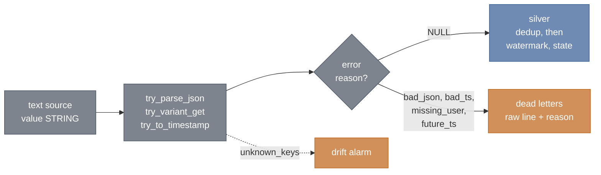
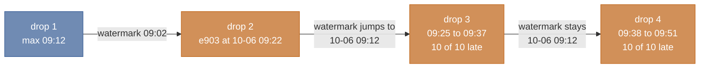

# Chapter 25: Streaming messy data: drift, dead letters, late events

[Chapter 24](ch24-structured-streaming.md) used clean taxi trips. Each line was valid JSON, and each field had the correct type. The only problem was lateness. Real event streams are not so clean.

A tracker on a phone sends the same event two times when the network fails. A new version of the app renames a field. A line arrives cut in half. A device with a wrong clock sends an event from tomorrow.

A batch job meets these problems one time, and you fix the input and run the job again. A stream meets them while it runs, and it continues to run. The damage collects in the state and in the output, often with no error.

**In a stream, most bad data does not fail the query. It changes the result without a message. The defense is to make each problem visible before it gets to a stateful operator.**

The problems are of four kinds. A schema that drifts gives NULL columns. A broken line can stop the stream. A duplicate counts two times. One event from the future moves the watermark so far that each later event is late. The defense has four parts:

- Parse lines with functions that cannot fail.
- Give each bad row a reason.
- Write the bad rows to a dead-letter location.
- Check event times before the watermark.

This chapter builds that defense one step at a time, and it measures what each problem does without it.

The scripts are in [`code/ch25`](https://github.com/lisancao/spark-masterclass/tree/main/code/ch25), and each number in the chapter comes from their saved output in `code/ch25/output/`. All of them use the file source, so no other service is necessary.

## The data: four drops from a click tracker

The data is the clickstream from the messy-data course of SparkTutor, copied into `code/data/clickstream/`. A web shop's tracker uploaded four JSON Lines files, one after the other. Each line is one event:

```json
{"event_id": "e001", "user_id": "u1", "type": "page_view", "page": "/p/chair", "ts": "2026-10-05T09:00:51"}
```

Each drop has problems that a real tracker makes:

| File | Event time | What is wrong with it |
|---|---|---|
| `drop_01.jsonl` | 09:00 to 09:12 | nothing |
| `drop_02.jsonl` | 09:10 to 09:24 | two events sent again from drop 1, one line sent two times, a truncated line, `"ts": "yesterday"`, an event with no `user_id`, and an event dated 2026-10-06 from a device whose clock is one day ahead |
| `drop_03.jsonl` | 09:25 to 09:37 | tracker version 2.0: the field `type` is now `event_type`, and a new field `app_version` appears. The events are not in time sequence. |
| `drop_04.jsonl` | 09:38 to 09:51 | more version 2.0 events. Two of them arrive very late. |

`clicks.py` delivers drop *i* into an inbox with the safe rename from [Chapter 24](ch24-structured-streaming.md). It also gives each file a modification time that keeps the drops in sequence. If two files have the same modification time, the file source reads them in no guaranteed sequence. Do not use file sequence as event sequence. Event time is for that purpose.

## Step 1: The schema of a stream is fixed when the query starts

`m1_drift.py` first shows what schema inference does with drift. With `spark.sql.streaming.schemaInference=true`, Spark infers the schema from the files that exist when the query starts:

```text
1. schemaInference=true infers the schema once, when the query starts
   drop 1 only:       struct<event_id:string,page:string,ts:string,type:string,user_id:string>
   after drops 2, 3:  struct<_corrupt_record:string,app_version:string,event_id:string,event_type:string,page:string,ts:string,type:string,user_id:string>
```

A query that started after drop 1 has five columns for all its life. It never sees `event_type` or `app_version`, even when each new event has them. A query that started after drop 3 has eight columns, and `ts` is a string, because one line had `"yesterday"` in it.

An explicit schema has the same problem in a different form. The script reads the first three drops with the tracker 1.0 schema:

```python
V1_SCHEMA = "event_id STRING, user_id STRING, type STRING, page STRING, ts TIMESTAMP"
```

```text
2. The tracker 1.0 schema meets tracker 2.0 (drop 3): no error, and type is NULL
+------------+-----+
|type_is_null|count|
+------------+-----+
|       false|   25|
|        true|   11|
+------------+-----+

+--------+-------+----+--------+-------------------+
|event_id|user_id|type|    page|                 ts|
+--------+-------+----+--------+-------------------+
|    NULL|   NULL|NULL|    NULL|               NULL|
|    e023|     u4|NULL| /search|2026-10-05T09:25:15|
|    e020|     u3|NULL|/p/chair|2026-10-05 09:26:22|
+--------+-------+----+--------+-------------------+
only showing top 3 rows
```

The query did not fail. Eleven rows have a NULL `type`: the ten tracker 2.0 events, and the truncated line, which is NULL in all columns. A dashboard that counts events by type now shows a drop in each type, and a new type with the name NULL. **Drift against a fixed schema is silent data loss.**

### The corrupt record column, and its trap

The JSON reader can keep the lines that it cannot parse. Add a column with the name `_corrupt_record` and type `STRING` to the schema:

```text
3. The corrupt record column catches broken lines, and only them
+--------+----+------------------------------------------------+
|event_id|  ts|                                 _corrupt_record|
+--------+----+------------------------------------------------+
|    NULL|NULL|{"event_id": "e900", "user_id": "u3", "type":...|
|    e901|NULL|{"event_id": "e901", "user_id": "u3", "type":...|
+--------+----+------------------------------------------------+
```

The column caught two lines: the truncated line, and the line with `"ts": "yesterday"`, because `yesterday` is not a timestamp. It did not catch the drifted rows, because those lines are valid JSON. If a field is not in the line, the reader gives NULL, not an error. The reader ignores an extra field. Thus, the corrupt record column finds broken lines, but it does not find drift.

The column also has a trap. A query that selects *only* the corrupt record column starts, and then fails on the first batch:

```text
4. Selecting only the corrupt record column starts, then fails on the first batch:
  StreamingQueryException: [STREAM_FAILED] ...
  [UNSUPPORTED_FEATURE.QUERY_ONLY_CORRUPT_RECORD_COLUMN] The feature is not supported:
  Queries from raw JSON/CSV/XML files are disallowed when the
```

The reason is column pruning. If the query needs no data column, the reader does not parse the JSON, and then it cannot know which lines are corrupt. A batch query can avoid the error with `cache()`. In a stream, the error kills the query, and a dead-letter query that selects only `_corrupt_record` is a natural thing to write.

## Step 2: Read lines, not JSON

The two problems of Step 1 have one cause: the JSON reader decides the schema, and the stream fixes the schema at start. The solution is to give the reader a schema that cannot drift. The `text` source has one column, `value STRING`, for each line. That schema never changes.

Then parse each line with functions that never fail. `try_parse_json` (Spark 4.0) changes a string into a `VARIANT`, or into NULL if the string is not valid JSON. `try_variant_get` takes one field from the variant as a type. It gives NULL if the line has no such field or the field has the wrong type. `parse_events` in `clicks.py` does the work:

```python
def parse_events(lines, now=None, reject_future=True):
    """One string column `value` in; typed columns, unknown keys and one error reason out."""
    now = now if now is not None else F.lit(NOW).cast("timestamp")
    v = F.try_parse_json("value")
    parsed = lines.select(F.col("value").alias("line"), v.alias("v")).select(
        "line",
        F.try_variant_get("v", "$.event_id", "string").alias("event_id"),
        F.try_variant_get("v", "$.user_id", "string").alias("user_id"),
        F.coalesce(F.try_variant_get("v", "$.type", "string"),          # tracker 1.0
                   F.try_variant_get("v", "$.event_type", "string")).alias("type"),   # 2.0
        F.try_variant_get("v", "$.page", "string").alias("page"),
        F.try_to_timestamp(F.try_variant_get("v", "$.ts", "string")).alias("ts"),
        F.array_except(F.expr("json_object_keys(line)"),
                       F.array(*[F.lit(k) for k in KNOWN_KEYS])).alias("unknown_keys"),
        F.col("v").isNull().alias("_bad_json"))
    error = (F.when(F.col("_bad_json"), "bad_json")
             .when(F.col("event_id").isNull(), "missing_event_id")
             .when(F.col("user_id").isNull(), "missing_user")
             .when(F.col("ts").isNull(), "bad_ts"))
    if reject_future:
        error = error.when(F.col("ts") > now + F.expr(f"INTERVAL {CLOCK_SKEW}"), "future_ts")
    return parsed.withColumn("error", error).drop("_bad_json")
```

The function does five things:

- **It keeps the raw line** in `line`. A bad row must go to the dead-letter location with the text that the producer sent. Then somebody can fix the producer and replay the line.
- **It reads the renamed field from both names.** `coalesce` takes `type` from tracker 1.0 and `event_type` from tracker 2.0.
- **It raises a drift alarm.** `json_object_keys` lists the keys of each line, and `array_except` removes the keys that the code knows. A key in `unknown_keys` is a field that nobody declared.
- **It gives each bad row exactly one reason.** The `when` chain stops at the first true condition, so the sequence of the conditions decides which reason a row gets.
- **It rejects events from the future,** with a tolerance of five minutes for normal clock differences. `now` is a fixed time in the book (`2026-10-05 10:00:00`) so that the output does not change from run to run. A real job passes `F.current_timestamp()`. Step 5 shows why this check must occur before the watermark.

`m2_parse.py` runs the function on a batch read of the four drops first, because a batch gives fast feedback:

```text
Every line gets at most one reason (NULL = a good event):
+------------+-----+
|       error|count|
+------------+-----+
|        NULL|   42|
|    bad_json|    1|
|      bad_ts|    1|
|   future_ts|    1|
|missing_user|    1|
+------------+-----+

The rejected lines:
+------------+------------------------------------------------------------------+
|error       |line                                                              |
+------------+------------------------------------------------------------------+
|bad_json    |{"event_id": "e900", "user_id": "u3", "type": "page_v             |
|bad_ts      |{"event_id": "e901", "user_id": "u3", "type": "page_view", "page":|
|missing_user|{"event_id": "e902", "type": "page_view", "page": "/", "ts": "2026|
|future_ts   |{"event_id": "e903", "user_id": "u4", "type": "page_view", "page":|
+------------+------------------------------------------------------------------+

Drift alarm: keys nobody declared
+-------------+-----+
| unknown_keys|count|
+-------------+-----+
|[app_version]|   20|
+-------------+-----+

Tracker 2.0 rows still have a type: 0 with type NULL
```

All 46 lines have a result: 42 good events and 4 rejects, each with a reason. The 20 tracker 2.0 events show the new key, and none of them lost its type. The 42 good events still include duplicates. Step 3 removes them.

The same function works on a stream without a change, and the source schema of the stream is one string column:

```text
The same function on a stream: the source schema is one column
   struct<value:string>
   struct<line:string,event_id:string,user_id:string,type:string,page:string,ts:timestamp,unknown_keys:array<string>,error: ...
```

The `try_` versions are necessary. `parse_json` fails the full job on the first bad line:

```text
parse_json fails the whole job on the first bad line; try_parse_json returns NULL:
  parse_json:     [MALFORMED_RECORD_IN_PARSING.WITHOUT_SUGGESTION] Malformed records are detected in record parsing: {"event_id"
  try_parse_json: None
```

In a stream, a failed batch stops the query. When you start the query again, it reads the same batch again and fails again. One bad line can stop a stream until somebody removes the line. Use only functions that cannot fail between the source and the dead-letter split: `try_parse_json`, `try_variant_get`, `try_to_timestamp`, `try_cast`.



## Step 3: Dead letters through `foreachBatch`, safe for a replay

The built-in sinks write one DataFrame to one location. A stream that splits its rows into good rows and bad rows needs `foreachBatch`. `m3_dead_letters.py` writes each micro-batch in a way that a second run of the same batch changes nothing:

```python
def route_batch(batch, batch_id):
    """Write one micro-batch so that running it again changes nothing."""
    batch = batch.persist()                   # used twice: read and parse the files once
    try:
        (batch.where("error IS NOT NULL").select("line", "error")
         .write.mode("overwrite").json(str(lake / f"dead_letter/batch_id={batch_id}")))
        good = (batch.where("error IS NULL")
                .select("event_id", "user_id", "type", "page", "ts", "unknown_keys")
                .dropDuplicates(["event_id"]))                       # duplicates inside the batch
        silver = lake / "silver"
        if silver.exists():                                          # ... and in earlier batches
            seen = (spark.read.parquet(str(silver))
                    .where(F.col("batch_id") != batch_id).select("event_id"))
            good = good.join(seen, "event_id", "left_anti")
        good.write.mode("overwrite").parquet(str(silver / f"batch_id={batch_id}"))
    finally:
        batch.unpersist()
```

Each part of the function has a purpose:

- **`persist()`** makes the batch one time. Without it, the two writes run the plan two times: they read and parse the files two times, as [Chapter 24](ch24-structured-streaming.md) measured.
- **One folder for each `batch_id`, with `mode("overwrite")`.** If Spark runs batch 3 again after a crash, the second write replaces the first. An append adds the rows two times.
- **The dead-letter folder gets a write for each batch, also an empty write.** Then each batch has a folder, and the dead-letter data has no gaps.
- **Deduplication inside the batch** removes the line that the tracker sent two times in one file.
- **Deduplication against earlier batches** removes the events that drop 2 sent again from drop 1. The anti-join reads silver, but without the folder of the *current* batch (`batch_id != batch_id`). This detail makes a replay safe. If a replay read its own earlier output, each event of the batch would match itself, and the replay would write an empty folder.

A partition column comes free from the folder names. `spark.read.parquet(silver)` finds `batch_id=0`, `batch_id=1` and so on, and it adds `batch_id` as a column.

The script delivers one drop for each run:

```text
drop 1: batch 0, 10 lines -> silver 10 (10 distinct ids), dead letters 0
drop 2: batch 1, 16 lines -> silver 19 (19 distinct ids), dead letters 4
drop 3: batch 2, 10 lines -> silver 29 (29 distinct ids), dead letters 4
drop 4: batch 3, 10 lines -> silver 38 (38 distinct ids), dead letters 4
```

Drop 2 has 16 lines. Four went to the dead letters. One line was a copy in the same file, and two were events from drop 1. That leaves nine new events, and silver goes from 10 to 19. At the end, silver has 38 events and 38 distinct IDs: no duplicates.

```text
Dead letters, with the raw line kept for replay:
+--------+------------+--------------------------------------------------+
|batch_id|error       |line                                              |
+--------+------------+--------------------------------------------------+
|1       |bad_json    |{"event_id": "e900", "user_id": "u3", "type": "pag|
|1       |bad_ts      |{"event_id": "e901", "user_id": "u3", "type": "pag|
|1       |missing_user|{"event_id": "e902", "type": "page_view", "page": |
|1       |future_ts   |{"event_id": "e903", "user_id": "u4", "type": "pag|
+--------+------------+--------------------------------------------------+
```

Then the script makes Spark run the last batch again. It removes the last commit file from the checkpoint. The checkpoint now says that batch 3 started and did not complete. A crash after the sink wrote and before the commit gives the same state:

```text
Deleted commits/3: the checkpoint now says batch 3 was planned, not finished.
restart ran batches [3] -> silver 38 (38 distinct), dead letters 4
```

<figure markdown>
  <video autoplay loop muted playsinline controls width="1280" height="720" poster="../../media/clips/ch25-dead-letters.webp">
    <source src="../../media/clips/ch25-dead-letters.mp4" type="video/mp4">
  </video>
  <figcaption><code>m3_dead_letters.py</code>. Four drops go through the dead-letter split. Then the script removes the last commit, batch 3 runs again, and the counts do not change.</figcaption>
</figure>

Batch 3 ran again, and the counts did not change. This is the end-to-end form of exactly-once: Spark replays the batch with the same `batch_id`, and the sink makes the replay harmless.

A table format with transactions gives a shorter form of the same idea. With Delta Lake or Apache Iceberg, `foreachBatch` can run a `MERGE INTO silver USING batch ON silver.event_id = batch.event_id WHEN NOT MATCHED THEN INSERT *`. The `MERGE` is a replay-safe deduplication in one statement. The book shows table formats in a later part. This chapter uses plain Parquet folders, so that each step is visible on disk.

### Housekeeping: `cleanSource`

A file source remembers each file that it read, in the `sources/0/` log of the checkpoint. The files stay in the inbox. The option `cleanSource` (default `off`) can move processed files to an archive (`archive`, with `sourceArchiveDir`) or remove them (`delete`). The second half of `m3_dead_letters.py` uses `archive`, with one file for each batch:

```text
Housekeeping: cleanSource=archive
  after run 1   inbox: ['drop_02.jsonl']  archive: ['drop_01.jsonl']
  archived as:   archive/~/spark-masterclass-parts/part05/data/work/ch25/m3-archive/inbox/drop_01.jsonl
  after run 2   inbox: ['drop_03.jsonl']  archive: ['drop_01.jsonl', 'drop_02.jsonl']
  ['cleanSource']:
  StreamingQueryException: [STREAM_FAILED] ... Archive mode must be used with
  'sourceArchiveDir' option. SQLSTATE: XXKST
  ['cleanSource', 'sourceArchiveDir']:
  StreamingQueryException: [STREAM_FAILED] ... requirement failed: Base archive path
  cannot be set to the path where archived path can possibly match with source pattern.
  Ensure the base archive path doesn't match with source pattern in depth, where the depth ...
```

The output shows three behaviors:

- **The files of the last batch stay in the inbox.** Run 1 read `drop_01` and `drop_02` in two batches, but only `drop_01` moved. Spark tells the source that a batch completed when it plans the *next* batch. Thus, the next run archives the files of the last batch. Do not think that a file in the inbox is a file that the query did not read.
- **The archive keeps the full path** of the file under `sourceArchiveDir`.
- **The archive folder must not match the source path.** An archive inside the inbox fails at start, because the source would read the archived files again.

## Step 4: The watermark on real messy events

`m4_watermark.py` builds user sessions from the clean events. It removes duplicates with `dropDuplicatesWithinWatermark`, and it groups events into sessions with `session_window` and a gap of five minutes:

```python
events = parse_events(spark.readStream.text(str(inbox)), reject_future=(MODE == "defended"))
sessions = (events.where("error IS NULL")
            .withWatermark("ts", "10 minutes")
            .dropDuplicatesWithinWatermark(["event_id"])
            .groupBy("user_id", F.session_window("ts", "5 minutes").alias("s"))
            .agg(F.count("*").alias("events"), F.max(F.col("type") == "checkout").alias("checkout"))
            .select("user_id", F.col("s.start").alias("start"), F.col("s.end").alias("end"),
                    "events", "checkout"))
```

The query has two stateful operators, and each one has its own state and its own count of late rows. The script runs the query in append mode to a Parquet sink, one drop for each run, and prints each operator after each batch:

```text
defended: drop  batch  rows  watermark      dedup          sessions      written
                                    (state/late)   (state/late)
             1      0    10  01-01 00:00      10/0          3/0             
             1      1     0  10-05 09:02      10/0          3/0            0
             2      2    16  10-05 09:02      19/1          5/0             
             2      3     0  10-05 09:14      14/0          4/0            1
             3      4    10  10-05 09:14      24/0          7/0             
             3      5     0  10-05 09:26      14/0          4/0            4
             4      6    10  10-05 09:26      21/3          7/0             
             4      7     0  10-05 09:40      11/0          4/0            7

finished sessions written: 7
+-------+--------------+--------------+------+--------+
|user_id|start         |end           |events|checkout|
+-------+--------------+--------------+------+--------+
|u1     |10-05 09:00:51|10-05 09:08:35|3     |false   |
|u1     |10-05 09:14:46|10-05 09:21:40|3     |false   |
|u2     |10-05 09:02:03|10-05 09:16:38|7     |true    |
|u3     |10-05 09:08:51|10-05 09:17:44|3     |false   |
|u3     |10-05 09:26:22|10-05 09:34:48|3     |false   |
|u4     |10-05 09:16:51|10-05 09:30:15|6     |false   |
|u4     |10-05 09:31:31|10-05 09:36:31|1     |false   |
+-------+--------------+--------------+------+--------+
```

Each drop gives two batches: one with the data, and one no-data batch. The data batch moved the watermark. The new watermark lets Spark write sessions and remove state, so Spark runs a no-data batch ([Chapter 24](ch24-structured-streaming.md), Step 6).

The output shows five rules of the watermark on messy data:

- **The watermark moves only between batches.** Drop 2 had events up to 09:24, but batch 2 still ran with the watermark 09:02 from drop 1.
- **A late event and an out-of-sequence event are not the same.** Drop 3 is not in time sequence, but each of its events is newer than the watermark, so the operators dropped nothing. An event is late only when it is older than the watermark.
- **An event that arrives again can be late before it is a duplicate.** In batch 2, the deduplication dropped one row as late. It is `e001` (09:00:51) from drop 1, which drop 2 sent again. It was older than the watermark, so the operator dropped it before the duplicate check. The other copy, `e005` (09:04:23), was newer than the watermark, and the duplicate check removed it. Both copies are gone, but they show in different counters.
- **Drop 4 gives three late rows in the deduplication.** Two are the very late events from 09:05. The third is a second copy of `e023` (09:25:15) from drop 3, which is older than the watermark 09:26.
- **A session goes out when the watermark passes its end.** Append mode writes a session one time, when it is final. The `end` of a session is its last event plus the gap. At the end, seven sessions are final, and four are still open in state.

### `dropDuplicatesWithinWatermark` keeps less state

`dropDuplicates(["event_id"])` on a stream remembers each `event_id` for the life of the query. `dropDuplicatesWithinWatermark` (Spark 3.5, SPARK-42931) remembers each ID only until the watermark passes the event time plus the delay. `m5_state_bounds.py` measures the difference. It sends six batches of 1,000 synthetic events, ten minutes of event time in each batch. About 2% of the events go two times:

```text
1. Six batches of 1,000 events, 10 minutes of event time each, ~2% re-sent
   dropDuplicates                 state rows after each batch [1000, 2000, 3000, 4000, 5000, 6000]  (unique events kept 6000)
   dropDuplicatesWithinWatermark  state rows after each batch [1000, 2000, 3000, 3001, 3000, 3000]  (unique events kept 6000)
```

Both operators kept the same 6,000 unique events. The state of `dropDuplicates` grew by 1,000 rows each batch. The state of `dropDuplicatesWithinWatermark` stopped at about 3,000 rows: the IDs of the events that are newer than the watermark.

The docstring of the operator gives its guarantee:

> Events are deduplicated as long as the time distance of earliest and latest events are smaller than the delay threshold of watermark.

Thus, choose the delay from how late the second copy of an event arrives, not only from how late first copies arrive. A plain `dropDuplicates` can remove state only when an event-time column is one of its keys. But then two copies with different times are not duplicates.

## Step 5: One event from the future

Drop 2 has one event from a phone whose clock is one day ahead:

```json
{"event_id": "e903", "user_id": "u4", "type": "page_view", "page": "/cart", "ts": "2026-10-06T09:22:00"}
```

The defended run rejected it with `future_ts`. The naive run, `m4_watermark.py naive`, is the same query without the `future_ts` check:

```text
naive: drop  batch  rows  watermark      dedup          sessions      written
                                    (state/late)   (state/late)
             1      0    10  01-01 00:00      10/0          3/0             
             1      1     0  10-05 09:02      10/0          3/0            0
             2      2    16  10-05 09:02      20/1          6/0             
             2      3     0  10-06 09:12       1/0          1/0            5
             3      4    10  10-06 09:12       1/10         1/0            5
             4      5    10  10-06 09:12       1/10         1/0            5

finished sessions written: 5
+-------+--------------+--------------+------+--------+
|user_id|start         |end           |events|checkout|
+-------+--------------+--------------+------+--------+
|u1     |10-05 09:00:51|10-05 09:08:35|3     |false   |
|u1     |10-05 09:14:46|10-05 09:20:59|2     |false   |
|u2     |10-05 09:02:03|10-05 09:16:38|7     |true    |
|u3     |10-05 09:08:51|10-05 09:17:44|3     |false   |
|u4     |10-05 09:16:51|10-05 09:29:54|4     |false   |
+-------+--------------+--------------+------+--------+
```

<figure markdown>
  <video autoplay loop muted playsinline controls width="1280" height="720" poster="../../media/clips/ch25-future.webp">
    <source src="../../media/clips/ch25-future.mp4" type="video/mp4">
  </video>
  <figcaption><code>m4_watermark.py</code>, defended and then naive. In the naive run, one event from the next day moves the watermark to 10-06 09:12. Then the operators drop all ten events of each later drop.</figcaption>
</figure>

After batch 2, the newest event time was 2026-10-06 09:22. The watermark became that time minus ten minutes: 10-06 09:12, one day ahead of all real events. The damage follows from the rules:

- **All open sessions closed at once.** Batch 3 wrote five sessions, because each session ended before the new watermark. Two of them are incomplete. The u1 session from 09:14:46 has two events, not three, and the u4 session has four events, not six. Their other events had not arrived yet.
- **Each later event is late.** The deduplication dropped 10 of 10 rows of drop 3 and 10 of 10 of drop 4. No session after 09:30 exists in the output.
- **The query reported success each time.** No error, no warning. The only signal is the count of late rows.
- **The damage does not stop.** The watermark never moves back. The stream drops all events until the real event time passes 10-06 09:12, one day later. The other method is to start the query again with a new checkpoint.



The defenses, the cheapest first:

1. **Reject events from the future before `withWatermark`.** The `future_ts` check of Step 2 does this, with a tolerance for normal clock differences. The defended run shows the result: seven sessions, all complete.
2. **Use a time from your own servers for the watermark.** The time when your collector received the event cannot be in the future. Keep the device time as a data column.
3. **Make an alert on `numRowsDroppedByWatermark`.** A healthy stream drops a few rows. This stream dropped all rows. The metric counts rows at the input of the operator ([Chapter 24](ch24-structured-streaming.md)). Use it as an alarm, not as a count of lost events.

!!! caution "Check event times before the watermark"
    Do not put device time into `withWatermark` without a check. If one event is far in the future, the stream drops each later event, and the query reports no error.

## Step 6: Two inputs, two watermarks

A query with two watermarked inputs (a union or a join) has one global watermark. `spark.sql.streaming.multipleWatermarkPolicy` decides how Spark calculates it from the two input watermarks. The default is `min`: the global watermark follows the slowest input. The other value is `max`.

The second part of `m5_state_bounds.py` sends 1,200 web events and 1,200 phone events into a union. The phone events are 30 minutes behind the web events. A windowed count runs over the union:

```text
2. Two inputs, one 30 minutes behind: which watermark wins?
   policy min: global watermark per batch ['00:00', '08:34', '08:44', '08:54', '09:04', '09:14', '09:24']
     events counted 2400 of 2400; numRowsDroppedByWatermark 0
   policy max: global watermark per batch ['00:00', '09:04', '09:14', '09:24', '09:34', '09:44', '09:54']
     events counted 1600 of 2400; numRowsDroppedByWatermark 4
```

- **`min` counted all 2,400 events.** The watermark stayed with the slow phone input, 30 minutes behind the web input.
- **`max` lost 800 events.** The watermark followed the web input, and most phone events were older than it. The metric says 4. The aggregation drops partial counts after the partial aggregation in each task, not single events, so a large loss shows as a small number.

Keep the default `min` unless you accept the loss of data from the slowest input. The policy is one of the settings that the checkpoint fixes ([Chapter 24](ch24-structured-streaming.md), Step 7). If you change it in the session, a restarted query continues to use the value in its checkpoint.

The same `min` rule has a cost. One input that stops sends no new events, so its watermark does not move, and the global watermark stops too. Then no window closes, and the state grows. The fix depends on the source. A source that has no data for a long time is a reason to look at the global watermark in the progress report.

## Step 7: Which changes a checkpoint survives

A stream runs for months, and its code changes. The checkpoint holds state in the format of the old query. `m6_compat.py` makes a checkpoint with a base query, which counts clean events by user in ten-minute windows. Then it restarts a copy of the checkpoint eight times, each time with one change:

```text
change on restart                        result
the same query                           ran (10 rows)
watermark delay 10 -> 30 minutes         ran (10 rows)
a different filter                       ran (10 rows)
group by page, not user_id               ran (10 rows)
group by user_id and page                STATE_STORE_KEY_SCHEMA_NOT_COMPATIBLE
one more aggregate column                STATE_STORE_VALUE_SCHEMA_NOT_COMPATIBLE
count -> sum of a different column       ran (10 rows)
a dedup operator before the aggregate    STREAMING_STATEFUL_OPERATOR_NOT_MATCH_IN_STATE_METADATA
```

Three kinds of change fail at start:

- **A different key schema.** One more grouping column changes the key schema, and Spark refuses the old state.
- **A different value schema.** One more aggregate column changes the schema of the state value.
- **A different set of stateful operators.** The checkpoint records each stateful operator in its operator metadata. A new `dropDuplicatesWithinWatermark` does not match.

The error message of the key change shows how Spark compares the schemas:

```text
The key schema error, in full (first lines):
  [STATE_STORE_KEY_SCHEMA_NOT_COMPATIBLE] Provided key schema does not match existing state key schema.
  Please check number and type of fields.
  Existing key_schema=StructType(StructField(window,StructType(StructField(start,TimestampType,true),StructField(end,TimestampType,true)),true),StructFi
  If you want to force running the query without schema validation, please set spark.sql.streaming.stateStore.stateSchemaCheck to false.
```

"Number and type of fields." Spark compares the number and the types of the key fields, not their names or their meaning. That is why two of the changes that ran are the most dangerous rows of the table:

- **`group by page, not user_id` ran.** `page` and `user_id` are both strings, so the key schema has the same shape. The query now puts page counts into the state of user counts.
- **`count -> sum of a different column` ran.** The sum of page lengths is a `bigint`, the same type as a count. The query adds lengths to the old counts.

The state data source shows the result of the page change. The state of the restarted query still calls its key `user_id`, because that is the schema in the checkpoint:

```text
The page experiment again, then its state read back with the state data source:
+------+-----------+-----+
|window|key.user_id|count|
+------+-----------+-----+
|09:20 |/p/chair   |1    |
|09:20 |/p/lamp    |1    |
|09:20 |/search    |3    |
|09:20 |u4         |2    |
|09:30 |/cart      |2    |
|09:30 |/p/chair   |1    |
|09:30 |/p/lamp    |1    |
+------+-----------+-----+
```

The window 09:20 has page keys and the old user key `u4` in one state. Nothing failed, and the output of this query is wrong.

!!! caution "Use a new checkpoint for new state"
    Do not use the old checkpoint after you change the meaning of the state.

    Spark compares only the number and the types of the state fields, so it accepts a change that keeps the types.

The last experiment changes the state store provider. The session sets RocksDB, and the query restarts on a checkpoint that the default provider wrote:

```text
Switch the session to RocksDB, then restart the HDFS-backed checkpoint:
  session:      RocksDBStateStoreProvider
  offsets/3:    HDFSBackedStateStoreProvider
  state files:  8 .delta files, 0 RocksDB files
```

The query ran on the old provider, with no message. The provider is one of the settings that the checkpoint fixes. To move a query to RocksDB, start it on a new checkpoint. The files that each provider writes are in [Chapter 28](ch28-checkpoints-and-state-store.md), with the state schema files that Spark compares here.

| Change on restart | Result |
|---|---|
| watermark delay, filter, a projection after the state | runs |
| a grouping key of the same type in the same position | runs, with wrong state |
| an aggregate of the same type in the same position | runs, with wrong state |
| one more or one less grouping key | `STATE_STORE_KEY_SCHEMA_NOT_COMPATIBLE` |
| one more or one less aggregate | `STATE_STORE_VALUE_SCHEMA_NOT_COMPATIBLE` |
| a new or removed stateful operator | `STREAMING_STATEFUL_OPERATOR_NOT_MATCH_IN_STATE_METADATA` |
| state store provider in the session | ignored: the checkpoint keeps its provider |

## What comes next for this stream

The pipeline of this chapter has four parts:

- a source that cannot drift (`text`)
- functions that cannot fail (`try_` functions)
- a dead-letter split that is safe for a replay (`foreachBatch` keyed by `batch_id`)
- a check of event times before the watermark

Some extensions are natural:

- **Replay the dead letters.** Each dead letter keeps its raw line. After a fix to the producer, a batch job can read the dead-letter folder, parse the lines again and append the good ones to silver.
- **Watch the drift alarm.** A count of `unknown_keys` by key, for each batch, shows the day that a producer adds a field.
- **Custom sessions.** `session_window` has one rule: a gap. A session that must also end at a checkout needs custom state. [Chapter 26](ch26-transform-with-state.md) writes that logic with `transformWithState` and event-time timers.
- **Lower latency.** This file pipeline cannot run in Real-time Mode: Real-time Mode reads only Kafka, and it does not accept `foreachBatch`. [Chapter 27](ch27-real-time-mode.md) shows its limits.

## The whole chapter, on one page

- **A stream fixes its schema at start.** Inference sees only the files of that moment. An explicit schema makes drifted fields NULL with no error. Drift against a fixed schema is silent data loss.
- **The corrupt record column finds broken lines, not drift.** A query that selects only `_corrupt_record` fails on its first batch.
- **Read lines with the `text` source, and parse with functions that cannot fail.** `try_parse_json`, `try_variant_get` and `try_to_timestamp` give NULL, not an error. `parse_json` stops the stream on one bad line.
- **Give each bad row one reason, keep its raw line, and alarm on unknown keys.**
- **Write dead letters and silver in `foreachBatch`, one folder for each `batch_id`, with overwrite.** Deduplicate against the *other* batches, so that a replay writes the same rows.
- **`cleanSource` archives the files of the last batch in the next run,** and the archive folder must not match the source path.
- **A late event is older than the watermark.** An event out of sequence is not late. A copy of an event can be late before it is a duplicate.
- **`dropDuplicatesWithinWatermark` keeps state bounded.** `dropDuplicates` keeps each key for all time.
- **One event from the future moves the watermark and drops each later event, with no error.** Reject future events before the watermark, use a server time, and alarm on late rows.
- **The global watermark follows the slowest input** (`min`). `max` loses the data of the slow input.
- **Spark compares the number and the types of state fields on restart, not their meaning.** A change that keeps the types runs with wrong state. The checkpoint keeps its state store provider.

## Further reading

- [APIs on DataFrames and Datasets](https://spark.apache.org/docs/4.3.0/streaming/apis-on-dataframes-and-datasets.html), the sections on the file source options (`cleanSource`, `sourceArchiveDir`) and on `foreachBatch`.
- [Recovery semantics after changes in a streaming query](https://spark.apache.org/docs/4.3.0/streaming/apis-on-dataframes-and-datasets.html#recovery-semantics-after-changes-in-a-streaming-query), the official list of changes that a checkpoint accepts.
- [`try_parse_json`](https://spark.apache.org/docs/4.3.0/api/python/reference/pyspark.sql/api/pyspark.sql.functions.try_parse_json.html) and [`try_variant_get`](https://spark.apache.org/docs/4.3.0/api/python/reference/pyspark.sql/api/pyspark.sql.functions.try_variant_get.html) in the PySpark reference.
