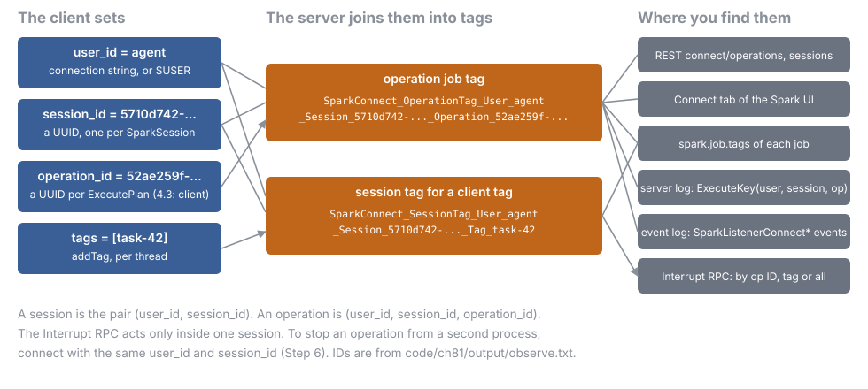
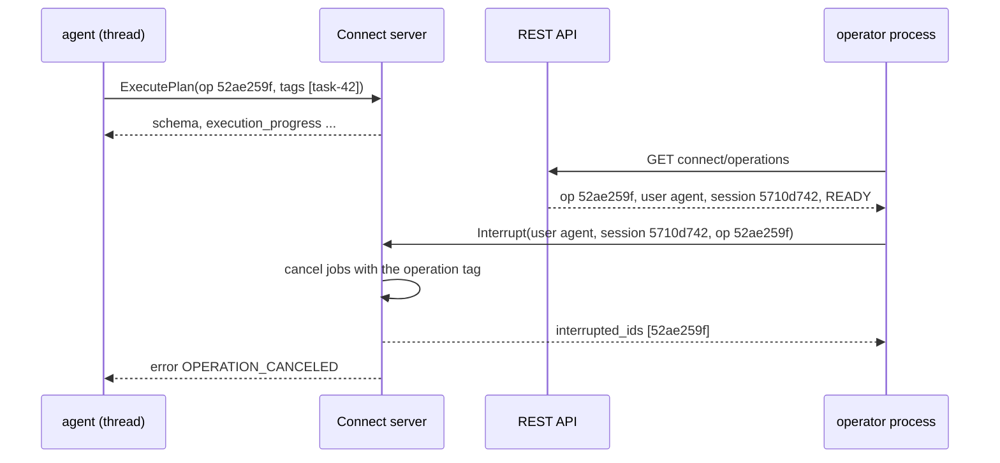
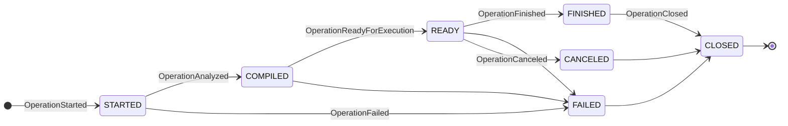

# Chapter 26: Session observability: what does this client run, and how do I stop it?

A Connect server runs the queries of many clients in one Spark application. When the server is slow, the job list of the Spark UI shows the jobs of all clients together. The operator then needs other answers. Which client sent the job? What does the client run now? How do you stop one operation and keep the server?

**Each Connect operation carries three IDs: the user, the session and the operation. The server joins them into a job tag. That tag is in the REST API, the Connect tab, the Spark jobs, the server log and the event log. With these IDs, you can find what a client runs now, and you can stop exactly that operation. The client can stop it. A second process can also stop it, because a process that knows the user and the session can open the same session.**

This chapter is about the Connect parts of observability. The general tools are in [Chapter 74](ch74-observability.md): the REST API, the metrics system, the event log, the History Server, listeners and profilers. Its Step 7 introduces the Connect endpoints of the REST API. This chapter does not repeat that table. [Chapter 30](ch30-connect-in-production.md) shows the life of a session and the interrupt by tag.

The code is in [`code/ch26`](https://github.com/open-lakehouse/spark-masterclass/tree/main/code/ch26). The scripts ran on pyspark 4.3.0, OpenJDK 17 and Python 3.12.3 on a 16-core Linux machine. `observe.py` uses the server of [Chapter 24](ch24-spark-connect.md), with the event log on:

```bash
ch24/server.sh start --conf spark.eventLog.enabled=true \
  --conf spark.eventLog.dir=file://$PWD/../data/ch26-events
uv run python ch26/observe.py
```

## Step 1: The IDs that a client sets

Two clients connect to the server: a person in a notebook and an agent. The connection string sets the user and a user agent:

```python
analyst = SparkSession.builder.remote(f"{URL}/;user_id=analyst;user_agent=notebook").create()
agent = SparkSession.builder.remote(f"{URL}/;user_id=agent;user_agent=agent-7").create()
for name, s in [("analyst", analyst), ("agent", agent)]:
    print(f"  {name:8} user_id={s.client._user_id:8} session_id={s.session_id}")
```

```text
== 1. Who is who
  analyst  user_id=analyst  session_id=b0658161-f836-4e43-80d7-bbca5a8176f6
  agent    user_id=agent    session_id=5710d742-1a5f-41a4-be34-10845ed24005
  the analyst ran operation df307af1 with tag daily-report
```

The client sets all of these IDs, not the server:

| ID | Where it comes from | Scope |
|---|---|---|
| `user_id` | `user_id=` in the connection string. Without it, the Python client uses `$USER`. | A label. The server does not check it. |
| `session_id` | A UUID that the client makes for each `SparkSession`. `session_id=` in the connection string sets it. | One session on the server, keyed by `(user_id, session_id)` |
| `operation_id` | A UUID that the client makes for each `ExecutePlan` (new in 4.3, [Chapter 24](ch24-spark-connect.md), Step 8) | One execution |
| tags | `spark.addTag(...)`, in the thread that runs the query | All operations of that thread in that session |
| `user_agent` | `user_agent=` in the connection string | Only for logs, in `client_type` ([Chapter 25](ch25-connect-protocol.md), Step 5) |

<figure markdown>
  
  <figcaption>How the IDs of one operation become tags, and where you find them. The IDs are from <code>observe.txt</code>.</figcaption>
</figure>

The server makes two kinds of tag from the IDs:

- **The operation tag** is `SparkConnect_OperationTag_User_<user>_Session_<session>_Operation_<operation>`. The server adds it to each Spark job of the operation. It is unique for each operation.
- **A session tag** is `SparkConnect_SessionTag_User_<user>_Session_<session>_Tag_<tag>` for each client tag. Thus the tag `task-42` of one session cannot match the jobs of a different session ([Chapter 74](ch74-observability.md), Step 7).

!!! warning "CAUTION"
    Do not use `user_id` as an identity on a server that has no authentication. The client sets the user ID, and the server accepts any value. Use a token or a proxy that authenticates each client ([Chapter 30](ch30-connect-in-production.md), Steps 4 and 5).

## Step 2: What a client runs now

The agent starts a long query in a thread, with a tag. Six seconds later, the operator script reads the REST API. It does not use the client objects:

```python
def agent_task():
    agent.addTag("task-42")
    try:
        result["count"] = agent.range(0, 10**11, numPartitions=64).where("id % 7 = 3").count()
    except Exception as e:
        result["error"] = f"{type(e).__name__} {e.getCondition()}"
        result["operation_id"] = getattr(e, "operation_id", None)

running = [o for o in rest("connect/operations") if o["state"] in ("STARTED", "COMPILED", "READY")]
```

```text
== 2. The operator's view: GET connect/sessions and connect/operations
  session 5710d742  user agent    operations 0  finished False
  session b0658161  user analyst  operations 1  finished False
  RUNNING operation 52ae259f  user agent  session 5710d742  state READY  jobs ['3']
    tags  ['task-42']
    statement  common { plan_id: 6 } aggregate { input { common { plan_id: 5 } filter { input ...
```

An operation runs while its state is `STARTED`, `COMPILED` or `READY`. The server calls this test `isExecutionActive` (`SparkConnectServerAppStatusStore.scala`), and the Connect tab shows these three states as `RUNNING`. The record gives the answer to "what does this client run now":

- **Who:** the user `agent` and the session `5710d742`.
- **What:** the statement, which is the protobuf plan as text. It is not the Python code.
- **How far:** job 3. The jobs endpoint of the REST API gives its stages and tasks.
- **Why:** the client tag `task-42`, in `sparkSessionTags`.

The session list said that the agent had 0 operations, while the operation ran. The listener increments the count when the operation starts. But it writes a live entity to the status store at most one time in each `spark.ui.liveUpdate.period` (default `100ms`). The session started 29 ms before the operation, so the write of the new count waited for the next event of the session. To find the work that runs now, read `connect/operations`, not the count of a session.

<figure markdown>
  
  <figcaption>The Connect tab (<code>/connect/</code>) while the agent's query runs. <code>observe.py</code> took this screenshot with headless Chrome. The "Total Execute" of the agent is 0, for the reason above.</figcaption>
</figure>

## Step 3: What the client sees of its own operation

The client does not need the REST API to follow its own query. The server sends `execution_progress` messages in the response stream ([Chapter 25](ch25-connect-protocol.md), Step 6). The Python client gives them to a progress handler:

```python
agent.registerProgressHandler(
    lambda stages, inflight_tasks, operation_id, done: progress.append(
        (round(time.time(), 1), operation_id, sum(s.num_completed_tasks for s in stages),
         sum(s.num_tasks for s in stages), inflight_tasks, done)))
```

```text
== 3. The agent's own view: the last progress reports from ExecutionProgress
  operation 52ae259f  tasks 1/64 done, 16 running, done=False
```

The report carries the operation ID, so a service can match it to the server record. An agent can use it to decide when to stop its own query. A notebook can use it to show a progress bar.

## Step 4: Stop it from a second process

The `Interrupt` RPC acts inside one session. The server finds the session by the `user_id` and the `session_id` of the request, and then it interrupts operations of that session only (`SparkConnectInterruptHandler.scala`). A different session of the same user cannot stop the operation.

But a second process can open the same session. The connection string accepts a `session_id`. The operator script takes the user and the session from the REST record, and it connects with them:

```python
operator = SparkSession.builder.remote(
    f"{URL}/;user_id={victim['userId']};session_id={victim['sessionId']}").create()
operator.release_session_on_close = False          # never release the agent's session
print("  operator session_id == agent session_id:", operator.session_id == agent.session_id)
print("  interruptOperation ->", [short(i) for i in operator.interruptOperation(victim["operationId"])])
```

```text
== 4. Stop it: attach to the agent's session from a second process, and interrupt
  operator session_id == agent session_id: True
  interruptOperation -> ['52ae259f']
  the agent's thread got: UnknownException OPERATION_CANCELED | operation 52ae259f
  REST record now: state CLOSED  jobs ['3']  executionTime 8579 ms
  the tag as the server stores it: ['task-42']
```

<figure markdown>
  <video autoplay loop muted playsinline controls width="1280" height="720" poster="../../media/clips/ch26-stop.webp">
    <source src="../../media/clips/ch26-stop.mp4" type="video/mp4">
  </video>
  <figcaption><code>observe.py</code>: the operator finds the active operation in the REST API, attaches to the agent's session and interrupts the operation. The film is a different run, so the IDs and the times are different.</figcaption>
</figure>



The interrupt has three forms. Use the narrowest form that does the job:

| Call | Stops | Use it when |
|---|---|---|
| `interruptOperation(op_id)` | One operation | You have the ID from the client or from the REST API |
| `interruptTag(tag)` | All operations of the session with the client tag | A task of an agent or a request of a service started a number of operations |
| `interruptAll()` | All operations of the session | The session must stop all work, for example at the end of a sandbox |

Each call returns the IDs that it interrupted. An empty list means that nothing matched. For example, the operation finished before the call. [Chapter 30](ch30-connect-in-production.md), Step 6, found one more trap: a tag belongs to the thread that called `addTag`.

!!! warning "CAUTION"
    Set `release_session_on_close = False` on a session that you open with the ID of another client. If you do not, `stop()` or the end of a `with` block sends `ReleaseSession`, and the server closes the session of the other client.

Anyone who knows a user ID and a session ID can attach to that session in the same way. On a server without authentication, a session ID is the only key. Keep session IDs out of logs that other users can read, and put authentication in front of the server.

## Step 5: The life of an operation, and reattach

The state in the REST record follows the events of the operation. The listener of the Connect tab (`SparkConnectServerListener.scala`) changes the state for each event:



The last state of a record is always `CLOSED`. To know how an operation ended, read the error in `detail`. You can also read the event before `OperationClosed` in the event log (Step 7). The interrupted operation of Step 4 went from `READY` to `CANCELED` to `CLOSED`.

An operation also outlives its gRPC stream. The client asks for a reattachable execution, so the server keeps the results until the client releases them. If the stream ends, the client calls `ReattachExecute` with the operation ID and continues. [Chapter 25](ch25-connect-protocol.md), Step 7, shows seven reattaches in one `toPandas()`. For the operator, this means two things:

- An operation can be `READY` while no stream is open. The client can reattach to it.
- If no client reattaches, the server removes the operation after `spark.connect.execute.manager.detachedTimeout` (internal, default `5m`).

## Step 6: The server log for one session

The Connect server writes its log in `data/logs/` (from `SPARK_LOG_DIR`). The log has no file for each session, but the Connect lines name the session and the operation. `observe.py` prints the Connect lines that contain the agent's operation ID:

```text
== 5. The server log lines that name the agent's operation
  SparkConnectExecutionManager: ExecuteHolder ExecuteKey(agent,5710d742...,52ae259f-b121-4105-a94f-2aa84484b0dc) is created.
  ExecuteGrpcResponseSender: Starting for opId=52ae259f-b121-4105-a94f-2aa84484b0dc, reattachable=true, lastConsumedStreamIndex=0
  DAGScheduler: Asked to cancel jobs with tag SparkConnect_OperationTag_User_agent_Session_5710d742..._Operation_52ae259f-b121
  ExecuteResponseObserver: Release all for opId=52ae259f-b121-4105-a94f-2aa84484b0dc. Execution stats: total=CachedSize(1677,10) autoRemo
  ExecuteGrpcResponseSender: Stream finished for opId=52ae259f-b121-4105-a94f-2aa84484b0dc, sent all responses up to last index 10. totalTi
  SparkConnectExecutionManager: ExecuteHolder ExecuteKey(agent,5710d742...,52ae259f-b121-4105-a94f-2aa84484b0dc) is removed.
```

The lines tell the story of the operation on the server:

- `ExecuteKey(agent, <session>, <operation>)` is the key of the operation. The server made the holder of the execution, and later it removed it.
- The response sender started a reattachable stream at index 0.
- The `DAGScheduler` cancelled the jobs with the operation tag. This line is the interrupt of Step 4. The executor lines that killed each task follow it in the full log. The script removes them.
- The response observer released all responses: 10 responses, 1,677 bytes in total.

To get the log of one session, filter the log for its session ID. The task lines of the executors do not contain the session ID, but they contain the job tag when Spark cancels a job. With structured logging (`spark.log.structuredLogging.enabled`, [Chapter 74](ch74-observability.md), Step 11), each line is a JSON object, and a log system can filter on its fields.

## Step 7: The Connect events in the event log

The server sends Connect events to the listener bus. The event log keeps them, so the History Server can show the Connect tab after the server stops. A Python client cannot register a JVM listener, but the operator of the server can add one with `spark.extraListeners`. `observe.py` reads the event log of its server. Spark 4 writes the event log as a folder of files, compressed with zstd. Thus the script decompresses each file of the folder:

```python
folder = next((ROOT / "data" / "ch26-events").glob("eventlog_v2_*"))
raw = b"".join(zstandard.ZstdDecompressor().stream_reader(open(f, "rb"), read_across_frames=True).read()
               for f in sorted(folder.glob("events_*")))
```

```text
== 6. The Connect events in the event log, for the agent's session
  +     0 ms  SparkListenerConnectSessionStarted               {'userId': 'agent'}
  +    29 ms  SparkListenerConnectOperationStarted             {'operationId': '52ae259f', 'userId': 'agent'}
  +   504 ms  SparkListenerConnectOperationAnalyzed            {'operationId': '52ae259f'}
  +   599 ms  SparkListenerConnectOperationReadyForExecution   {'operationId': '52ae259f'}
  +   805 ms  SparkListenerJobStart (job 3)                    spark.job.tags has the operation tag
  +  8608 ms  SparkListenerConnectOperationCanceled            {'operationId': '52ae259f'}
  +  8610 ms  SparkListenerConnectOperationClosed              {'operationId': '52ae259f'}
  +  9754 ms  SparkListenerConnectSessionClosed                {'userId': 'agent'}
```

The events are in `sql/connect/server/src/main/scala/org/apache/spark/sql/connect/service/ExecuteEventsManager.scala` and `SessionEventsManager.scala`:

| Event | When | Important fields |
|---|---|---|
| `SparkListenerConnectSessionStarted` | The first RPC of a session | `sessionId`, `userId` |
| `SparkListenerConnectOperationStarted` | The server receives an `ExecutePlan` | `jobTag`, `operationId`, `sessionId`, `userId`, `statementText`, `sparkSessionTags` |
| `SparkListenerConnectOperationAnalyzed` | The analyzer is done | `jobTag`, `operationId` |
| `SparkListenerConnectOperationReadyForExecution` | The plan is ready to run | `jobTag`, `operationId` |
| `SparkListenerConnectOperationFinished` | The execution is done | `jobTag`, `operationId` |
| `SparkListenerConnectOperationFailed` | The execution failed | `jobTag`, `operationId`, `errorMessage` |
| `SparkListenerConnectOperationCanceled` | An interrupt stopped the execution | `jobTag`, `operationId` |
| `SparkListenerConnectOperationClosed` | The server released the results | `jobTag`, `operationId` |
| `SparkListenerConnectSessionClosed` | The session ended | `sessionId`, `userId` |

The timeline of the interrupted operation shows the cost of each phase. The analysis took 475 ms, from `OperationStarted` to `OperationAnalyzed`. Job 3 started 206 ms after the plan was ready. The job ran for 7.8 s before the cancel. 

Only `OperationStarted` carries the session and the user. The later events carry the `jobTag`, which contains both. Thus a listener can join all events of one operation on the `jobTag`, and it can join the Spark jobs on the same tag.

## Step 8: The runbook

The question of this chapter has a short answer. Use these steps on a server that you operate:

1. Get the operations: `GET /api/v1/applications/<app-id>/connect/operations`.
2. Keep the records with the state `STARTED`, `COMPILED` or `READY`.
3. Find the client by `userId`, `sessionId` and `sparkSessionTags`. Read `statement` to see the plan.
4. For the progress, read `jobIds`, then `GET .../jobs/<job-id>` and its stages.
5. To stop it from the client, call `interruptOperation`, `interruptTag` or `interruptAll`.
6. To stop it from a different process, connect with `user_id=<userId>;session_id=<sessionId>`. Set `release_session_on_close = False`. Then call `interruptOperation(<operationId>)`.
7. Read the record again. The state is `CLOSED`, and the event log has `OperationCanceled`.

If the server has many clients, give each client a clear `user_id` and `user_agent`, and give each task a tag. Then the records answer "who" and "why" without a guess.

## The whole chapter, on one page

```python
# who and what: the REST API of the server (Chapter 74, Step 7)
running = [o for o in rest("connect/operations") if o["state"] in ("STARTED", "COMPILED", "READY")]
victim = running[0]   # userId, sessionId, operationId, jobTag, sparkSessionTags, jobIds, statement

# stop it from a second process: attach to the same session
operator = SparkSession.builder.remote(
    f"{URL}/;user_id={victim['userId']};session_id={victim['sessionId']}").create()
operator.release_session_on_close = False
operator.interruptOperation(victim["operationId"])
```

- **The client sets the IDs:** `user_id`, `session_id`, `operation_id` (4.3) and tags.
- **The server joins them into job tags.** The operation tag is on each Spark job of the operation.
- **`connect/operations` answers "what runs now".** An operation runs while it is `STARTED`, `COMPILED` or `READY`. Do not use the operation count of a session to find active work.
- **The client sees its own progress** through a progress handler that reads `execution_progress`.
- **Interrupts act inside a session.** A second process can attach with the same user and session IDs. That is also why a server needs authentication.
- **The server log and the event log name the operation.** The log has `ExecuteKey(user, session, op)`, and the event log has the Connect events, which a listener joins on `jobTag`.

## Further reading

- [Spark Connect overview](https://spark.apache.org/docs/4.3.0/spark-connect-overview.html), with the parameters of the connection string.
- [`ConnectResource.scala` at v4.3.0](https://github.com/apache/spark/blob/v4.3.0/sql/connect/server/src/main/scala/org/apache/spark/status/api/v1/connect/ConnectResource.scala), the REST endpoints.
- [`ExecuteEventsManager.scala` at v4.3.0](https://github.com/apache/spark/blob/v4.3.0/sql/connect/server/src/main/scala/org/apache/spark/sql/connect/service/ExecuteEventsManager.scala), the operation events and their fields.
- [`SparkConnectInterruptHandler.scala` at v4.3.0](https://github.com/apache/spark/blob/v4.3.0/sql/connect/server/src/main/scala/org/apache/spark/sql/connect/service/SparkConnectInterruptHandler.scala), the three forms of interrupt.
