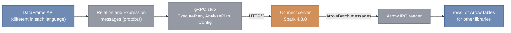
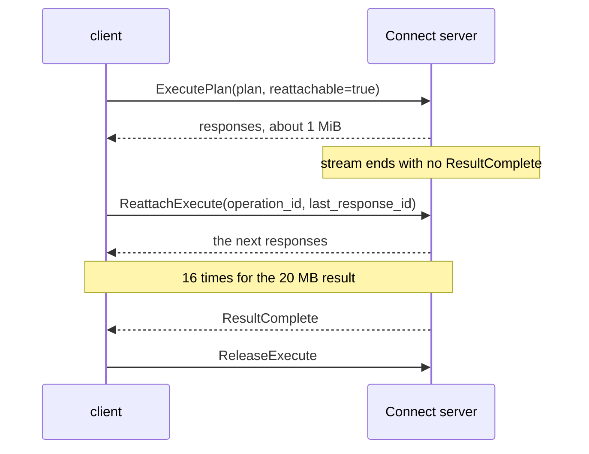
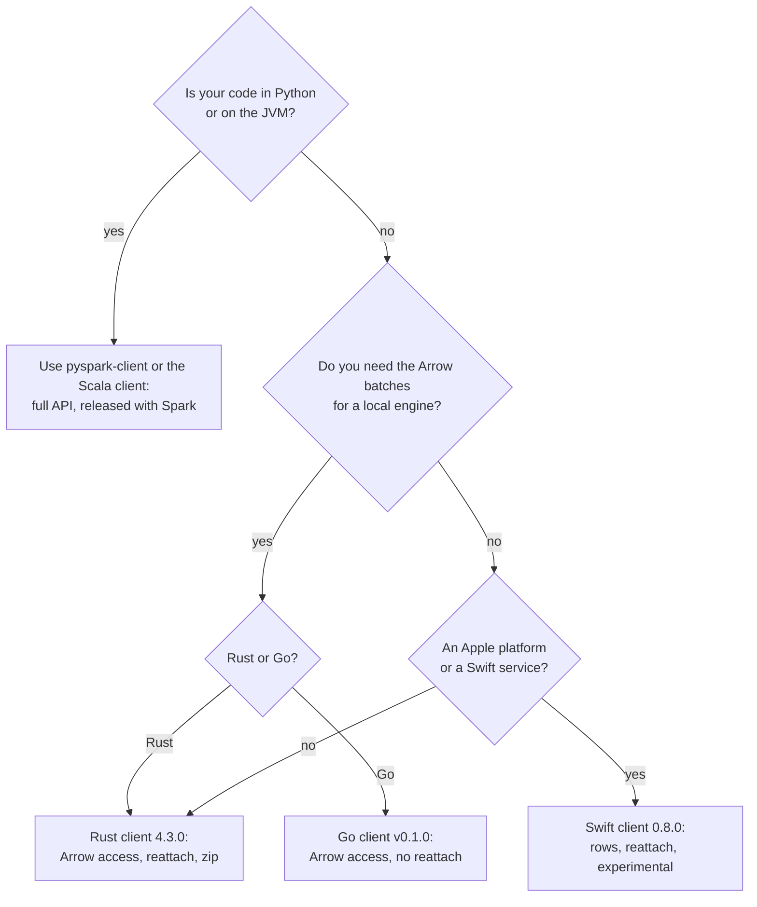

# Chapter 27: Spark Connect clients beyond Python

[Chapter 24](ch24-spark-connect.md) used Spark Connect from Python. [Chapter 25](ch25-connect-protocol.md) opened the protocol. It showed that a request is protobuf and that the rows come back as Arrow. If these two formats are the full contract, then a client in a different language must give the same result as PySpark. This chapter does a test of that claim. It runs one taxi query from five clients against the same Spark 4.3.0 server: Python, Scala, Go, Rust and Swift.

**A Spark Connect client is three parts: a gRPC stub, a set of protobuf messages and an Arrow reader. The DataFrame API is a layer on top of these parts. Thus the Scala, Go, Rust and Swift clients send the same plan as PySpark and get the same rows back. The clients are different in other areas: the release, the installation, the API that they implement and the parts of the protocol that they use. Examples of these parts are reattach and direct access to the Arrow batches.**

The code is in [`code/ch27`](https://github.com/open-lakehouse/spark-masterclass/tree/main/code/ch27). The server is pyspark 4.3.0 on OpenJDK 17, on a 16-core Linux machine. This chapter installs nothing on the host. Each client program compiles and runs in a Docker image:

- Rust: `rust:bookworm`, with Rust 1.99.1
- Go: `golang:latest`, with Go 1.27.4
- Swift: `swift:latest`, with Swift 6.4.3
- Scala: `virtuslab/scala-cli` (Scala CLI 1.19.0), with Java 17

<figure markdown>
  <video autoplay loop muted playsinline controls width="1280" height="720" poster="../../media/clips/ch27-anim-clients.webp">
    <source src="../../media/clips/ch27-anim-clients.mp4" type="video/mp4">
  </video>
  <figcaption>Five clients send the same plan to one server, and each client gets the same rows back as Arrow batches. The rows come from the outputs of this chapter. The times are schematic.</figcaption>
</figure>

## The clients in this chapter

<figure markdown>


<figcaption>The five clients and the libraries in each one. The versions come from the build files of the programs in <code>code/ch27</code>. The Python and Scala clients are part of the Spark repository. The Go, Rust and Swift clients have their own Apache Spark repositories and releases.</figcaption>
</figure>

Each client uses the gRPC, protobuf and Arrow libraries of its language. Spark does not supply a C library that the clients wrap. Each client compiles the same `.proto` files from the Spark source and reads the same Arrow IPC format. That is why the clients can be independent projects.



Only the two blue boxes are different from one language to the next. The grey boxes follow the protocol. If a client implements them correctly, the server cannot see which language sent the plan.

## Step 1: The server and the reference query

`code/ch27/server.sh` starts a Connect server from the pip install. It uses port 15106 for gRPC and port 4146 for the UI. The server listens on all interfaces, so a client in a Docker container with `--network host` can connect to it:

```bash
"$SPARK_HOME/sbin/start-connect-server.sh" \
  --driver-memory 8g \
  --conf spark.driver.maxResultSize=4g \
  --conf spark.connect.grpc.binding.port=$PORT \
  --conf spark.ui.port=$UI
```

The reference query finds the five busiest pickup zones in June 2026, with the number of trips and the average fare. Here it is in PySpark (`taxi_python.py`):

```python
with SparkSession.builder.remote(remote).getOrCreate() as spark:
    top = (spark.read.parquet(str(TRIPS))
           .where((F.col("tpep_pickup_datetime") >= "2026-06-01") &
                  (F.col("tpep_pickup_datetime") < "2026-07-01"))
           .groupBy("PULocationID")
           .agg(F.count("*").alias("trips"), F.round(F.avg("fare_amount"), 2).alias("avg_fare"))
           .orderBy(F.desc("trips"))
           .limit(5))
    top.show()
```

```text
pyspark 4.3.0 -> server 4.3.0 at sc://localhost:15106
+------------+------+--------+
|PULocationID| trips|avg_fare|
+------------+------+--------+
|         237|177610|   14.15|
|         161|161198|   18.47|
|         236|157113|   15.02|
|         132|148169|   60.84|
|         162|119615|   17.39|
+------------+------+--------+
```

The path is a string in the plan. The server reads the files, not the client. Each client program in this chapter gets the path from the `TRIPS` environment variable, and the path is correct on the server. The clients in Docker do not mount the data at all.

## Step 2: The Scala client

The Scala client is part of the Spark repository, and each Spark release publishes it to Maven Central. The coordinates are `org.apache.spark:spark-connect-client-jvm_2.13:4.3.0`. The client version is the Spark version. Java code can use the same JAR.

The fastest method to run a Scala program without a build file is Scala CLI. The `//> using` lines at the top of the file declare the Scala version, the dependency and a JVM option:

```scala
//> using scala 2.13.17
//> using dep org.apache.spark::spark-connect-client-jvm:4.3.0
//> using javaOpt --add-opens=java.base/java.nio=ALL-UNNAMED
import org.apache.spark.sql.SparkSession
import org.apache.spark.sql.functions._

    val spark = SparkSession.builder().remote(remote).getOrCreate()
    val pickup = col("tpep_pickup_datetime")
    val top = spark.read.parquet(sys.env("TRIPS"))
      .where(pickup >= "2026-06-01" && pickup < "2026-07-01")
      .groupBy("PULocationID")
      .agg(count(lit(1)).as("trips"), round(avg("fare_amount"), 2).as("avg_fare"))
      .orderBy(desc("trips"))
      .limit(5)
    top.show()
```

```bash
docker run --rm --network host -e TRIPS=... -v $PWD/scala:/app -w /app \
  virtuslab/scala-cli:latest run --server=false --jvm 17 Taxi.scala
```

```text
spark-connect-client-jvm 4.3.0 -> server 4.3.0 at sc://localhost:15106
+------------+------+--------+
|PULocationID| trips|avg_fare|
+------------+------+--------+
|         237|177610|   14.15|
|         161|161198|   18.47|
|         236|157113|   15.02|
|         132|148169|   60.84|
|         162|119615|   17.39|
+------------+------+--------+
```

The `--add-opens` option is necessary on Java 17. Without it, the first result fails in Arrow Java, which the client uses to read the batches (`scala-without-add-opens.txt`):

```text
Exception in thread "main" java.lang.UnsupportedOperationException: sun.misc.Unsafe or java.nio.DirectByteBuffer.<init>(long, int) not available
```

The Scala code is almost the same as the Scala code for Classic Spark. That is the purpose of this client: it gives the `Dataset` API of Spark, without a driver in your process.

## Step 3: The Go client

The Go client is in [`apache/spark-connect-go`](https://github.com/apache/spark-connect-go). Its release is v0.1.0, from 2025-06-17. The repository has no later release or tag. The module path has a major version suffix, `github.com/apache/spark-connect-go/v40`, and the release tag is `v0.1.0`. The Go tools do not accept this pair (`go_install.sh`):

```text
go version go1.27.4 linux/amd64
$ go get github.com/apache/spark-connect-go/v40@v0.1.0
go: github.com/apache/spark-connect-go/v40@v0.1.0: invalid version: module path includes a major version suffix, so major version must match
$ go get github.com/apache/spark-connect-go/v40@defb8525
go: added github.com/apache/spark-connect-go/v40 v40.0.0-20250609164624-defb85250881
```

Thus, to get the v0.1.0 release, use its commit. The tag `v0.1.0` points to the commit `defb8525`, and Go records it as a pseudo-version. The project's quick start tells you to use `master`. That gives you a different commit on each new download, so the commit is the better choice.

The Go API puts a `context.Context` in each call that can go to the server, and it returns an error from each call:

```go
trips, err := spark.Read().Format("parquet").Load(os.Getenv("TRIPS"))
must(err)
pickup := F.Col("tpep_pickup_datetime")
// The Column type has no And(), so the two bounds are two filters.
june, err := trips.Filter(ctx, pickup.Ge(F.StringLit("2026-06-01")))
must(err)
june, err = june.Filter(ctx, pickup.Lt(F.StringLit("2026-07-01")))
must(err)
byZone, err := june.GroupBy(F.Col("PULocationID")).Agg(ctx,
    F.Count(F.Int64Lit(1)).Alias("trips"),
    F.Round(F.Avg(F.Col("fare_amount")), 2).Alias("avg_fare"))
must(err)
top, err := byZone.OrderBy(ctx, F.Col("trips").Desc())
must(err)
must(top.Limit(ctx, 5).Show(ctx, 5, false))
```

```text
spark-connect-go v0.1.0 -> server 4.3.0 at sc://localhost:15106
+------------+------+--------+
|PULocationID|trips |avg_fare|
+------------+------+--------+
|237         |177610|14.15   |
|161         |161198|18.47   |
|236         |157113|15.02   |
|132         |148169|60.84   |
|162         |119615|17.39   |
+------------+------+--------+
```

The rows are the same. `Show` aligns the table to the left because the program sets `truncate` to `false`. Four gaps in v0.1.0 appeared in this chapter. Each one has a simple workaround:

| Gap in v0.1.0 | Workaround in this chapter |
|---|---|
| `Column` has no `And` method. | Two `Filter` calls. Catalyst combines them into one filter. |
| `SparkSession` has no `Version` method. | `spark.Sql(ctx, "SELECT version()")`. |
| `CreateDataFrame` panics on an `int64` value for a `LONG` column. It takes a Go `int` only. | Use `int` values. |
| `ToArrow` returns `*arrow.Table`, a pointer to an interface. | Dereference it: `tbl := *ptr`. |

## Step 4: The Rust client

The Rust client is in [`apache/spark-connect-rust`](https://github.com/apache/spark-connect-rust). Its first release was 4.2.0, and the 4.3.0 release went to crates.io on 2026-11-16. The version follows the Spark version that the client targets. The crate is `apache-spark-connect`, and its library name is `spark_connect`:

```toml
[dependencies]
# The Apache Spark Connect client for Rust. The library name is `spark_connect`.
spark-connect = { package = "apache-spark-connect", version = "=4.3.0" }
```

The crate compiles the Spark Connect `.proto` files when you build it, so the build needs `protoc`. On Debian, `protobuf-compiler` alone is not sufficient. The build failed with `google/protobuf/any.proto: File not found` until the image also had `libprotobuf-dev`, which supplies the standard `.proto` files. `code/ch27/docker/rust.Dockerfile` adds the two packages to `rust:bookworm`.

The API is synchronous, and it is close to PySpark:

```rust
let spark = SparkSession::builder().remote(&remote).get_or_create()?;
let pickup = || col("tpep_pickup_datetime");
let top = spark
    .read()
    .parquet(&trips_path)
    .filter(pickup().ge(lit_string("2026-06-01"))
        .and(pickup().lt(lit_string("2026-07-01"))))
    .group_by([col("PULocationID")])
    .agg([
        count(lit(1)).alias("trips"),
        round_scale(avg(col("fare_amount")), lit(2)).alias("avg_fare"),
    ])
    .order_by([col("trips").desc()])
    .limit(5);
top.show(5)?;
```

```text
apache-spark-connect 4.3.0 -> server 4.3.0 at sc://localhost:15106
+------------+------+--------+
|PULocationID| trips|avg_fare|
+------------+------+--------+
|         237|177610|   14.15|
|         161|161198|   18.47|
|         236|157113|   15.02|
|         132|148169|   60.84|
|         162|119615|   17.39|
+------------+------+--------+
```

<figure markdown>
  <video autoplay loop muted playsinline controls width="1280" height="720" poster="../../media/clips/ch27-rust.webp">
    <source src="../../media/clips/ch27-rust.mp4" type="video/mp4">
  </video>
  <figcaption>The Rust program shows its query, then runs in a Docker container against the 4.3.0 server. The server reads the taxi files. The container has no copy of them.</figcaption>
</figure>

Rust has no default arguments, so a function with an optional argument has a second name. For example, `round(col)` has one argument and `round_scale(col, scale)` has two. The project also publishes `pyspark-client-rust` on PyPI. Its README calls it a replacement for `pyspark-client` with a Rust core. This chapter uses only the Rust crate. [Chapter 28](ch28-connect-application.md) builds an application on it.

## Step 5: The Swift client

The Swift client is in [`apache/spark-connect-swift`](https://github.com/apache/spark-connect-swift). Its release is 0.8.0, from 2026-11-13, and its release notes call it "still experimental". The package needs Swift tools 6.4.0. Add it to `Package.swift` with the release tag:

```swift
dependencies: [
  .package(url: "https://github.com/apache/spark-connect-swift.git", exact: "0.8.0")
],
```

The API uses `async` and `await`. Comparisons and `&&` are Swift operators on `Column`:

```swift
let spark = try await SparkSession.builder.remote(remote).getOrCreate()
let pickup = col("tpep_pickup_datetime")
let top = await spark.read.parquet(env["TRIPS"]!)
  .filter(pickup >= lit("2026-06-01") && pickup < lit("2026-07-01"))
  .groupBy("PULocationID")
  .agg(count(lit(1)).alias("trips"), round(avg(col("fare_amount")), 2).alias("avg_fare"))
  .orderBy(col("trips").desc())
  .limit(5)
try await top.show()
```

```text
spark-connect-swift 0.8.0 -> server 4.3.0 at sc://localhost:15106
+------------+------+--------+
|PULocationID| trips|avg_fare|
+------------+------+--------+
|         237|177610|   14.15|
|         161|161198|   18.47|
|         236|157113|   15.02|
|         132|148169|   60.84|
|         162|119615|   17.39|
+------------+------+--------+
```

<figure markdown>
  <video autoplay loop muted playsinline controls width="1280" height="720" poster="../../media/clips/ch27-swift.webp">
    <source src="../../media/clips/ch27-swift.mp4" type="video/mp4">
  </video>
  <figcaption>The same query in Swift. The program connects, sends the plan and prints the five rows.</figcaption>
</figure>

The Swift client has its own Arrow reader. The files `Sources/SparkConnect/Arrow*.swift` follow the Apache Arrow Swift project, but the client does not depend on a published Arrow package. The reader is internal: `collect()` returns `Row` values, and no public method returns the Arrow batches.

## Step 6: The same probe in every client

The taxi query shows that the five clients agree on one plan. To see what each client can do, `code/ch27` has one probe program for each language. Each program does the same checks against the same server, and it prints one line for each check:

| Check | What the program does |
|---|---|
| `sql` | `SELECT 1 AS x, 'a' AS y`, then collect |
| `schema` | The columns of the taxi files, through `AnalyzePlan` |
| `local_data` | A DataFrame from two rows in the client (a `LocalRelation`) |
| `temp_view` | `range(5)` as a temporary view, then SQL over it |
| `write_read` | Write `range(10)` as Parquet, then read it back |
| `config` | Set `spark.sql.shuffle.partitions`, then get it |
| `error` | Select a column that does not exist. Find the error class and the SQLSTATE in the error. |
| `arrow` | Get the result as Arrow data, not as rows |
| `explain` | Get the physical plan |
| `zip` | `DataFrame.zip`, new in Spark 4.3 |
| `big_result` | Collect 200,000 rows of about 100 bytes each |

The Go probe is in the clip below. Its output is typical:

```text
go (spark-connect-go v0.1.0) -> server 4.3.0
sql          works   [1 a]
schema       works   21 columns, first VendorID
local_data   works   count 2
temp_view    works   [5]
write_read   works   read back 10 rows
config       works   "7"
error        works   UNRESOLVED_COLUMN, SQLSTATE 42703
arrow        works   arrow.Table, 16 chunk(s), 1000 rows
explain      works   *(1) Range (0, 3, step=1, splits=16)
zip          n/o     the DataFrame interface has no Zip method
big_result   works   200000 rows
```

<figure markdown>
  <video autoplay loop muted playsinline controls width="1280" height="720" poster="../../media/clips/ch27-probe.webp">
    <source src="../../media/clips/ch27-probe.mp4" type="video/mp4">
  </video>
  <figcaption>The Go probe runs the checks against the 4.3.0 server. The client has no method for <code>zip</code>, so that line shows "n/o" (not offered).</figcaption>
</figure>

<figure markdown>


<figcaption>The results of the probe for each client, from <code>code/ch27/output/*-probe-default.txt</code> and <code>reattach-small-streams.txt</code>. A dashed cell is an API that the client does not have. No check failed.</figcaption>
</figure>

No check failed. The gaps are all APIs that a client does not have:

- **Arrow access.** Python (`toArrow()`), Go (`ToArrow`) and Rust (`collect_record_batches()`, `to_arrow()`) give you the Arrow data. The Scala and Swift clients decode the batches into rows, and they do not give you the batches.
- **`zip`.** This method is new in Spark 4.3. The Python, Scala and Rust clients have it. The Go and Swift clients do not.

The `arrow` line also shows a property of the server, not of the client. `range(1000)` came back in 16 batches, one for each of the 16 partitions of the range. The server sends a batch for each partition, and it does not combine small batches.

## Step 7: Large results and reattach

A result can be larger than one response stream. The server ends a reattachable stream after 2 minutes or after 1 GB (`spark.connect.execute.reattachable.senderMaxStreamDuration` and `senderMaxStreamSize`). Then the client must call `ReattachExecute` and continue from the last response that it got. [Chapter 25](ch25-connect-protocol.md) shows this stream from PySpark.

To make every client reattach, `server.sh small-streams` starts the server with `senderMaxStreamSize=1m`. A 20 MB result then needs about 20 streams. `reattach_check.sh` runs each probe and counts, in the server log, the streams of each client:

```text
client   big_result             reattachable   not reattachable ReattachExecute calls
python   works 200000 rows      13             0               16
scala    works 200000 rows      12             0               16
rust     works 200000 rows      13             0               16
go       works 200000 rows      0              16              0
swift    works 200000 rows      8              0               16
```



The Python, Scala, Rust and Swift clients send their executions as reattachable. Each one called `ReattachExecute` 16 times and got all 200,000 rows. The Go client sends its executions as not reattachable. The default of its `ReattachExecution` option is `false` (`spark/client/options/options.go` at v0.1.0). The server applies the stream limits only to reattachable executions. Thus the Go client got all the rows in one stream.

Thus the Go client does not need to reattach on this server. But it also cannot continue after a broken connection. You can set `ReattachExecution` to `true`. Then, when a stream ends early, the response reader of v0.1.0 returns the error "the result is not complete" (`spark/client/client.go`). It does not call `ReattachExecute`. This difference is important for a long query on a network that can fail.

[Chapter 72](ch72-determinism-retries.md) cuts a connection during a query and shows the recovery in PySpark.

## Step 8: The compatibility matrix

The probe is small. A larger set of tests is in spark-connect-matrix, the author's test harness that runs the same cases through each client. The harness has adapters for the Python and Scala clients. It has no adapter for Go, Rust or Swift, so Step 6 is the only measurement for those clients.

The harness is in a private repository. Its run files are in `code/ch27/output/matrix/`. `matrix.sh` runs the harness for the 4.3.0 Python and Scala clients against this chapter's server:

```text
pyspark-client 4.3.0 on 4.3.0: 43 pass, 0 fail, 2 skipped
  skip  config.python_worker_env.reserved_name: server 4.3.0 lacks ['python_worker_env_validation']
  skip  skew.capabilities_reported: server 4.3.0 lacks ['server_capabilities']
spark-connect-scala 4.3.0 on 4.3.0: 39 pass, 2 fail, 4 skipped
  fail  api.jvm_attribute.rdd: error_class 'UNSUPPORTED_CONNECT_FEATURE.RDD' != 'JVM_ATTRIBUTE_NOT_SU
  skip  config.python_worker_env.reserved_name: server 4.3.0 lacks ['python_worker_env_validation']
  fail  error.session_not_same: error_class 'CONNECT.SESSION_NOT_SAME' != 'SESSION_NOT_SAME'
  skip  skew.capabilities_reported: server 4.3.0 lacks ['server_capabilities']
  skip  udf.python.default_needs_pyarrow: client lacks ['python_udf']
  skip  udf.python.use_arrow_false: client lacks ['python_udf']
```

The two failures of the Scala client are not wrong results. In each case, the error occurs as the case expects, but the error class has a different name from the name that PySpark uses. Code that compares error classes as strings must know this difference. Two cases need server features that 4.3.0 does not have, so the harness skips them. The Scala client also has no Python UDFs, which is correct.

## Step 9: Build, size and time

For a team that ships a program, the build and the program are also part of the choice. `build_facts.sh` does one clean release build of each compiled client. The dependency downloads were in the cache, so the times are compile times only:

```text
client clean build (s)    binary (MB)
rust   62                 20
go     25                 28
swift  215                101
```

`time_taxi.sh` runs each taxi program six times and prints the median of the last five runs. The time starts at the first line of `main` and stops after `show()`. Thus it includes the connection, the session and the server work. The run took the book's benchmark lock:

```text
client   median wall time of 5 runs (s), after one warmup
python   1.27   (runs: 1.27 1.34 1.44 0.87 0.83)
scala    1.91   (runs: 1.91 1.70 2.04 2.06 1.36)
rust     0.26   (runs: 0.25 0.25 0.26 0.26 0.26)
go       0.34   (runs: 0.33 0.34 0.37 0.32 0.42)
swift    0.34   (runs: 0.29 0.33 0.34 0.42 0.39)
```

<figure markdown>


<figcaption>Left: the time from <code>main</code> to the five rows, the median of five runs (<code>taxi-timings.txt</code>). Right: the size of each compiled program after one release build (<code>build-facts.txt</code>).</figcaption>
</figure>

The server work is the same in each run. The difference is in the client.

The compiled clients connected and printed the rows in about 0.3 s. The Python and Scala clients took between 0.8 s and 2.1 s, and the Python times varied more from run to run. Their time also excludes the start of the interpreter or the JVM, which occurs before `main`. For a command-line tool that runs one query, this difference is the full cost. For a service that keeps one session open, the difference occurs only once.

## The comparison

| | Python | Scala | Go | Rust | Swift |
|---|---|---|---|---|---|
| Repository | `apache/spark` | `apache/spark` | `apache/spark-connect-go` | `apache/spark-connect-rust` | `apache/spark-connect-swift` |
| Release used | 4.3.0 | 4.3.0 | v0.1.0 (2025-06-17) | 4.3.0 (2026-11-16) | 0.8.0 (2026-11-13) |
| Coordinates | `pyspark-client==4.3.0` | `org.apache.spark:spark-connect-client-jvm_2.13:4.3.0` | `github.com/apache/spark-connect-go/v40@defb8525` | `apache-spark-connect = "=4.3.0"` | `spark-connect-swift`, `exact: "0.8.0"` |
| Build needs | Python 3.11 or later | Java 17 or later, `--add-opens` | Go | Rust, `protoc`, `libprotobuf-dev` | Swift 6.4 |
| Taxi query (Steps 1 to 5) | same rows | same rows | same rows | same rows | same rows |
| Probe checks (Step 6) | all | all except Arrow access | all except `zip` | all | all except Arrow access and `zip` |
| Arrow access | `toArrow()` | no | `ToArrow` | `collect_record_batches()`, `to_arrow()` | no |
| Reattach (Step 7) | yes | yes | no, executions not reattachable | yes | yes |
| Matrix (Step 8) | 43 of 45 pass, 2 skipped | 39 pass, 2 error names differ | no adapter | no adapter | no adapter |
| Time to result (Step 9) | 1.27 s | 1.91 s | 0.34 s | 0.26 s | 0.34 s |
| Program size | a package | JAR files | 28 MB | 20 MB | 101 MB |

The table has only what this chapter measured or read in the source. The clients have more APIs than the probe tests. For example, the Rust client also has streaming, a catalog and Rust UDFs through WebAssembly, and the Swift client has streaming and Java UDF registration. The probe did not test them, so the table does not include them.

## How to choose



| If you need | Use |
|---|---|
| The full DataFrame API, Python UDFs, pandas | `pyspark-client` |
| The `Dataset` API on the JVM, Java or Scala code | `spark-connect-client-jvm` |
| A small native program that hands Arrow data to Polars, DuckDB or DataFusion | the Rust client ([Chapter 28](ch28-connect-application.md)) |
| A Go service that runs SQL and short queries | the Go client, with the four workarounds of Step 3 |
| A Swift program on Linux or macOS | the Swift client, and a test of each API that you use |
| A language with no client | your own client ([Chapter 29](ch29-writing-a-connect-client.md)) |

Before you put a client into production, do a test of each method that you use against your server version. A client can have a method that your server does not have. For example, a client can have `zip` and the server can be older than 4.3. The plan then fails on the server, not in the compiler.

## The whole chapter, on one page

```bash
cd code
ch27/server.sh start                         # Connect server: sc://localhost:15106, UI 4146
ch27/run_probes.sh default                   # build Rust, Go, Swift in Docker; run every taxi query and probe
uv run python ch27/taxi_python.py            # the reference query
ch27/client.sh rust taxi                     # one client, prebuilt
ch27/go_install.sh                           # the v0.1.0 tag against the commit
ch27/server.sh small-streams                 # each response stream ends after 1 MiB
ch27/reattach_check.sh                       # who reattaches, from the server log
ch27/server.sh start
MATRIX=/path/to/spark-connect-matrix ch27/matrix.sh
ch27/build_facts.sh                          # clean build times and program sizes
flock $BOOK_DATA/.bench.lock ch27/time_taxi.sh
ch27/server.sh stop
```

- **A client is a gRPC stub, protobuf messages and an Arrow reader.** The DataFrame API on top is the only part that changes with the language.
- **Five clients, one plan, the same five rows.** Python, Scala, Go, Rust and Swift all returned the same result from the 4.3.0 server.
- **The releases are different.** Python and Scala come with each Spark release. Rust follows the Spark version (4.3.0). Swift is at 0.8.0 and experimental. Go is at v0.1.0, and you must use its commit, not its tag.
- **The gaps are APIs that a client does not have. No result was wrong.** Scala and Swift do not give you the Arrow batches. Go and Swift have no `zip`. Go does not reattach.
- **The compiled clients start fast.** About 0.3 s from `main` to the rows, against 1.3 s and 1.9 s for Python and Scala on this machine.

## Further reading

- [Spark Connect overview](https://spark.apache.org/docs/4.3.0/spark-connect-overview.html), with the list of client languages.
- [apache/spark-connect-go](https://github.com/apache/spark-connect-go), [apache/spark-connect-rust](https://github.com/apache/spark-connect-rust) (documentation at [apache.github.io/spark-connect-rust](https://apache.github.io/spark-connect-rust/)), [apache/spark-connect-swift](https://github.com/apache/spark-connect-swift) (documentation on the [Swift Package Index](https://swiftpackageindex.com/apache/spark-connect-swift)).
- [An Idiot's Guide to Spark Connect Clients](https://systemsnull.net/posts/data-engineering-ai/idiots-guide-spark-connect-clients), the author's tour of the clients, with more opinions.
- [Spark Connect from Rust, with DuckDB and Polars](https://systemsnull.net/posts/data-engineering-ai/spark-connect-rust-duckdb-polars), the post that [Chapter 28](ch28-connect-application.md) starts from.
