# Chapter 27: Real-time Mode

The micro-batch engine of [Chapter 24](ch24-structured-streaming.md) has a floor on latency. For each batch, the driver plans a job, starts new tasks, waits for the tasks to complete, and writes the commit log. A record that arrives just after a batch starts waits for the next batch. For a dashboard, a delay of a few hundred milliseconds is not a problem. For fraud detection, an alert or a price, it can be too slow.

Spark 4.1 added **Real-time Mode** to remove that floor. Spark 4.3 extended it from stateless queries to the first stateful queries: aggregations, deduplication and the JVM `transformWithState`. The query code does not change. Only the trigger changes.

**In Real-time Mode, the trigger duration is the checkpoint interval, not the latency. Each task runs for the full batch and sends each record through the plan when the record arrives. Spark 4.3 runs a stateful query this way too. It runs both sides of the shuffle at the same time, and it sends the shuffle data over the network. The latency then depends on each part of the path, and one Python step on that path can add seconds.**

This chapter turns Real-time Mode on and finds its limits. Then it looks at a stateful query while it runs, and it measures the latency of the same queries in both engines.

The scripts are in [`code/ch27`](https://github.com/lisancao/spark-masterclass/tree/main/code/ch27), and each number in the chapter comes from their saved output in `code/ch27/output/`. Real-time Mode reads only from Kafka. Thus, all scripts use the Kafka broker of [Chapter 24](ch24-structured-streaming.md), `apache/kafka:4.0.0` in Docker, and the connector `org.apache.spark:spark-sql-kafka-0-10_2.13:4.3.0`.

## The setup: a broker and a paced producer

The broker is one Kafka node in KRaft mode. `ch24/kafka.sh` starts it on port 29055 and creates topics:

```bash
ch24/kafka.sh start
ch24/kafka.sh topic rtm_in 4
```

The latency measurements need input at a steady rate. `producer.py` sends records without a Python Kafka client. It writes lines into the `kafka-console-producer.sh` tool of the broker, inside the container, at a fixed rate:

```python
def produce(topic, rate, seconds, users=40, start_id=0):
    """Send rate records a second for seconds, keys u0..u{users-1}, values = a running id."""
```

The producer sets `linger.ms=0`, so it sends each record immediately. Kafka gives each record a `CreateTime` timestamp when the producer sends it. The Spark Kafka sink also gives a `CreateTime` to each output record. The broker, the producer and Spark run on one machine, so the two timestamps come from one clock. The difference is the end-to-end latency of the record.

## Step 1: Turn it on, and see what it accepts

Real-time Mode is a trigger. Everything else in the query stays the same:

```python
df.writeStream.format("console").outputMode("update").trigger(realTime="5 seconds").start()
```

The output mode must be `update`, and the duration must be 5 seconds or more. `r1_rules.py` starts a set of queries with `trigger(realTime="5 seconds")`. Each query runs for up to 12 seconds, and the script prints whether it ran or the error condition:

```text
Each probe runs for up to 12 s with trigger(realTime='5 seconds'):
  Kafka -> console, stateless            ran
  Kafka -> console, groupBy count        ran
  Kafka -> console, dropDuplicates       ran
  Kafka -> memory sink                   STREAMING_REAL_TIME_MODE.OPERATOR_OR_SINK_NOT_IN_ALLOWLIST
  Kafka -> console, append mode          STREAMING_REAL_TIME_MODE.OUTPUT_MODE_NOT_SUPPORTED
  rate source -> console                 STREAMING_REAL_TIME_MODE.INPUT_STREAM_NOT_SUPPORTED  (from the running query)
  Kafka -> foreachBatch                  STREAMING_REAL_TIME_MODE.OPERATOR_OR_SINK_NOT_IN_ALLOWLIST
  Kafka -> Python UDF -> console         STREAMING_REAL_TIME_MODE.OPERATOR_OR_SINK_NOT_IN_ALLOWLIST  (from the running query)
  Kafka -> PySpark transformWithState    STDS_FAILED_TO_READ_OPERATOR_METADATA  (from the running query)
  Kafka -> repartitionByRange            STREAMING_REAL_TIME_MODE.OPERATOR_OR_SINK_NOT_IN_ALLOWLIST  (from the running query)
  stream-stream join                     STREAMING_REAL_TIME_MODE.OPERATOR_OR_SINK_NOT_IN_ALLOWLIST  (from the running query)
The trigger and the configuration:
  trigger(realTime='1 second')           INVALID_STREAMING_REAL_TIME_MODE_TRIGGER_INTERVAL
  HDFS state store set explicitly        STREAMING_REAL_TIME_MODE.SQL_CONFIGURATION_NOT_SUPPORTED
  checkpointFormatVersion=1              STREAMING_REAL_TIME_MODE.SQL_CONFIGURATION_NOT_SUPPORTED
```

The results give the rules of Real-time Mode in Spark 4.3.0:

- **Stateless queries run.** A projection and a filter on Kafka into the console ran.
- **New in 4.3: aggregations and deduplication run.** `groupBy("k").count()` and `dropDuplicates(["v"])` ran. In Spark 4.2, the allowlist rejected `HashAggregateExec` and `ShuffleExchangeExec`, so these queries failed.
- **The output mode must be `update`.** Append mode fails at `start()`.
- **The source must be Kafka.** The `rate` source fails, but only when the query runs.
- **The sink must be Kafka, console or `foreach`.** `foreachBatch` fails, because it works on a full batch, not on single records. The `memory` sink fails too.
- **A Python UDF fails.** The Python evaluation operator is not in the allowlist. Only expressions that Spark runs in the JVM can be on the path.
- **Range partitioning and stream-stream joins fail.** A range shuffle needs a job that takes samples before the query, and that job cannot complete while the source still sends data.
- **Spark checks the trigger and the state configuration.** A duration under `spark.sql.streaming.realTimeMode.minBatchDuration` (5000 ms) fails. An explicit HDFS state store or state checkpoint format 1 also fails.

## Step 2: When each error comes

Some errors come from `start()`. Others come from the query after it starts, and `start()` returns with no error. The difference comes from the time of each check:

- **At `start()`**, Spark checks the output mode, the trigger, the sink and the state configuration. It needs no plan for these checks.
- **When Spark plans the first batch**, it checks the source and each operator of the physical plan against `RealTimeModeAllowlist`. The query is already active, so the error goes to `q.exception()` and to `awaitTermination()`.

Thus, a test of a Real-time query must wait for the first batch. A test that only calls `start()` does not see an unsupported source or operator.

Two results do not agree with the documentation, and the part notes record them as open items:

- **The memory sink.** The 4.3.0 Real-time Mode guide lists the console and memory sinks as supported. But `format("memory")` fails with `The sink(s): org.apache.spark.sql.execution.streaming.sources.MemorySink is not in the sink allowlist`. The allowlist in the source has only `ContinuousMemorySink`, an internal class.
- **PySpark `transformWithState`.** The guide says that the PySpark API is not supported in Real-time Mode. The query does fail, but with `STDS_FAILED_TO_READ_OPERATOR_METADATA`, an error about a metadata file that is not there. The message does not say that the cause is Real-time Mode.

## Step 3: A stateful query while it runs

`r4_pipeline.py` runs `groupBy("user").count()` on a topic with 4 partitions and 3 shuffle partitions. The trigger is `realTime="10 seconds"`. While the second batch runs, the script prints the physical plan of the query. It also prints the stages of the application from the REST API of the Spark UI:

```text
Real-time Mode, the physical plan (expression ids removed):
  WriteToDataSourceV2 MicroBatchWrite[epoch: 1, writer: ConsoleWriter[numRows=20, truncate=true]]
  +- ProjectAggregationBuffer Vector(_groupingexpression), 3, [_groupingexpression], [count(1)], [count(1)], 1, [_grouping
     +- StatefulStreamlineAggregate Vector(_groupingexpression), 3, [_groupingexpression], [merge_count(1)], [count(1)], 1
        +- Exchange hashpartitioning(_groupingexpression, 3), REQUIRED_BY_STATEFUL_OPERATOR, isPipelined=true, [plan_id=10
           +- ProjectAggregationBuffer 3, [_groupingexpression], [partial_count(1)], [count(1)], 0, [_groupingexpression, 
              +- *(1) Project [cast(key as string) AS _groupingexpression]
                 +- RealTimeStreamScan[...] class org.apache.spark.sql.kafka010.KafkaSourceProvider$KafkaScan [batchDurati
```

The plan differs from a micro-batch aggregation in three places:

- **`RealTimeStreamScan`** reads Kafka. Each task reads one Kafka partition for the full batch.
- **`Exchange ... isPipelined=true`** is the shuffle. A pipelined shuffle does not write shuffle files for a later stage. It sends each row to the task that owns its key, over the network, while both stages run.
- **`StatefulStreamlineAggregate`** replaces the usual pair of `StateStoreRestore` and `StateStoreSave`. For each input row, it merges the row into the state of its key and emits the new result immediately. The source calls this loop "read-process-output" for each input.

The stages show the pipelined shuffle at work:

```text
Real-time Mode, 4 s into the second 10 s batch: stages in the REST API (status, tasks: active/complete)
  stage   0  COMPLETE  tasks 0/4 of 4  start at NativeMethodAccessorImpl.java:0
  stage   1  COMPLETE  tasks 0/3 of 3  start at NativeMethodAccessorImpl.java:0
  stage   2  ACTIVE    tasks 4/0 of 4  start at NativeMethodAccessorImpl.java:0
  stage   3  ACTIVE    tasks 3/0 of 3  start at NativeMethodAccessorImpl.java:0
Micro-batch, after a few batches: stages in the REST API (status, tasks: active/complete)
  stage  14  COMPLETE  tasks 0/4 of 4  start at NativeMethodAccessorImpl.java:0
  stage  15  COMPLETE  tasks 0/3 of 3  start at NativeMethodAccessorImpl.java:0
  stage  16  COMPLETE  tasks 0/4 of 4  start at NativeMethodAccessorImpl.java:0
  stage  17  COMPLETE  tasks 0/3 of 3  start at NativeMethodAccessorImpl.java:0
```

In Real-time Mode, stages 0 and 1 are the first batch, and they are complete. Stages 2 and 3 are the second batch: the scan (4 tasks) and the aggregation (3 tasks). Both stages are active at the same time, and no task of them is complete. In micro-batch mode, each batch runs its two stages one after the other, and each stage completes. The difference is easy to see on a timeline:

```mermaid
gantt
  title One key, two engines (schematic)
  dateFormat  s
  axisFormat %S s
  section Micro-batch
  plan batch 1          :a1, 0, 1s
  stage 0 scan          :a2, after a1, 1s
  stage 1 aggregate     :a3, after a2, 1s
  commit                :a4, after a3, 1s
  plan batch 2          :a5, after a4, 1s
  section Real-time Mode
  stage 0 scan (whole batch)       :b1, 0, 10s
  stage 1 aggregate (whole batch)  :b2, 0, 10s
  commit                           :b3, after b1, 1s
```



The diagram is schematic, not measured. It shows the shape: micro-batch stages run in sequence for each batch, and Real-time stages run side by side for the full batch.

This design has a cost in cores. Each task holds its core for the full batch. The query above needs 4 cores for the scan and 3 cores for the aggregation, 7 in total, for as long as it runs. If the cluster has fewer free cores, the query cannot make progress. Run one Real-time query on a cluster, and size the cluster for the sum of the source partitions and the shuffle partitions.

The checkpoint of the query shows the state configuration that Real-time Mode applied:

```text
What the Real-time checkpoint recorded (offsets/0, conf):
  ...stateStore.providerClass = org.apache.spark.sql.execution.streaming.state.RocksDBStateStoreProvider
  ...stateStore.rocksdb.changelogCheckpointing.enabled = (not recorded)
  ...stateStore.checkpointFormatVersion = (not recorded)
  state/0/0: ['1_<id>.changelog']
```

The session did not set a state store provider, but the checkpoint records RocksDB. The other two configurations are not in `offsets/0`, but the state file shows them. A `.changelog` file means changelog checkpointing, and the unique ID in its name means state checkpoint format 2. Real-time Mode set these three values as **soft defaults** when the query started. [Chapter 28](ch28-checkpoints-and-state-store.md) explains each one. A value that you set yourself stays, except for a value that Real-time Mode cannot use. Step 1 showed that an explicit HDFS provider or format 1 fails at `start()`.

## Step 4: Latency, measured from Kafka to Kafka

`r2_latency.py` runs four queries, one at a time. Each query reads its own input topic (4 partitions) and writes its own output topic:

```python
def stateless(df):
    """Pass each record through; the output value carries the input CreateTime in ms."""
    return df.select("key", F.concat_ws(",", F.unix_millis("timestamp").cast("string"),
                                        F.col("value").cast("string")).alias("value")))


def stateful(df):
    """A running count per user; the output carries the newest input CreateTime behind the update."""
    return (df.groupBy("key").agg(F.count("*").alias("n"), F.max("timestamp").alias("newest"))
            .select("key", F.concat_ws(",", F.unix_millis("newest").cast("string"),
                                       F.col("n").cast("string")).alias("value")))
```

Each output record carries the `CreateTime` of an input record. The latency of the output record is its own `CreateTime` minus that input time. For the count, the input time is the newest input of the key in the update. The script runs each shape twice:

- in micro-batch mode with `trigger(processingTime="0 seconds")`, which starts the next batch as soon as the last one completes
- in Real-time Mode with `trigger(realTime="10 seconds")`

The producer sends 200 records a second for 30 seconds, to 40 keys. The script leaves out the first 10 seconds of each run, and it computes the percentiles over the rest. It ran three times under the book's benchmark lock, on `local[*]` with 16 cores:

R2_OUT

R2_TEXT

## Step 5: Measured inside a Python sink

The Kafka-to-Kafka path stays in the JVM. `r3_foreach.py` puts Python on the path. It runs a stateless Real-time query into a Python `foreach` writer, and the writer records the time when its `process()` method gets each row. The producer sends one record a second for 10 seconds, and the batch is 20 seconds:

R3_DEFAULT

The engine read each record within milliseconds, but the Python writer got the records much later. The cause is in the path from the JVM to the Python worker:

- `PythonForeachWriter` pickles rows with `AutoBatchedPickler`. Its batch size starts at 1 and doubles while the batches stay small.
- The writer thread of the Python runner fills a buffer of `spark.buffer.size` bytes (default 65536) before it sends data to the worker. A slow flow of small rows does not fill the buffer.

The same run with `spark.buffer.size=64`:

R3_64

R3_TEXT

!!! caution "Keep Python off a Real-time path"
    Do not put a Python `foreach` writer on the path of a Real-time query that needs low latency. The rows wait in buffers before Python gets them. Keep the query in the JVM from source to sink, and do the Python work after the sink.

## Step 6: What the batch duration controls

The trigger duration of Real-time Mode does not delay the output. It controls the other work of the query:

- **The checkpoint.** At the end of each batch, Spark writes `commits/N` and starts the next long batch with new offsets. A short duration writes the checkpoint more often, so a restart has less work to do again. But the query does not process data while it commits, so many short batches add gaps.
- **The watermark.** The watermark advances only between batches. A window closes, and its state goes away, at the batch boundary.
- **Timers on idle partitions.** In the JVM `transformWithState`, a processing-time timer fires when a row arrives or when the batch ends. On a partition with no input, the timer waits for the end of the batch.

The default duration is 5 minutes. The minimum is 5 seconds.

The guarantees are the same as in micro-batch mode: each record changes the state exactly one time, also after a failure. The delivery to the sink is a different matter. Spark writes `commits/N` after the sink got the records of the batch, so a failure inside a batch sends those records again on the restart. The Kafka sink gives at-least-once delivery in both engines. If the result must have no duplicates, make the consumer of the topic idempotent, for example with the key of each record.

## Choose an engine

| Question | Micro-batch | Real-time Mode |
|---|---|---|
| Latency in this chapter (p50, count) | R2_MB_P50 | R2_RTM_P50 |
| Sources | all | Kafka |
| Sinks | all | Kafka, console, `foreach` |
| Stateful operators | all | aggregation, `dropDuplicates`, JVM `transformWithState` (new in 4.3) |
| Python on the path | Python UDFs, `foreachBatch`, PySpark `transformWithState` | not allowed, or slow (`foreach`) |
| Cores | tasks share cores between batches | each task holds a core for the full batch |
| Output modes | append, update, complete | update |

Use Real-time Mode when three conditions are true:

- The latency of the micro-batch engine is the problem.
- The path is Kafka to Kafka, or Kafka to a JVM `foreach` writer.
- Each operator of the query is in the allowlist.

 Use micro-batch mode for everything else. Its latency is often good enough, and it accepts every operator and sink.

## The whole chapter, on one page

- **`trigger(realTime="...")` turns on Real-time Mode.** The output mode must be `update`, and the duration must be 5 seconds or more.
- **The duration is a checkpoint interval.** Records go through the plan when they arrive. The watermark and the commit wait for the end of the batch.
- **Spark 4.3 runs stateful queries in Real-time Mode**: aggregations, `dropDuplicates` and the Scala/Java `transformWithState`. A pipelined shuffle runs both stages at the same time and sends rows over the network.
- **The allowlist is strict.** Kafka source, Kafka/console/`foreach` sinks, no Python UDF, no `foreachBatch`, no stream-stream join. Some checks come at `start()`, and others when the first batch runs.
- **Real-time Mode sets the state store soft defaults**: RocksDB, changelog checkpointing, checkpoint format 2.
- **Each task holds a core for the full batch.** Size the cluster for source partitions plus shuffle partitions.
- **Measure the whole path.** Kafka to Kafka, the latency was milliseconds. A Python `foreach` writer added seconds.

The full code of this chapter:

```bash
cd code
ch24/kafka.sh start && ch24/kafka.sh topic rtm_in 4
uv run python ch27/r1_rules.py        # Steps 1-2: what Real-time Mode accepts
uv run python ch27/r4_pipeline.py     # Step 3: the plan, the stages and the soft defaults
uv run python ch27/r2_latency.py      # Step 4: latency, Kafka to Kafka, both engines
uv run python ch27/r3_foreach.py      # Step 5: latency at a Python foreach writer
uv run python ch27/r3_foreach.py 64   #         the same with spark.buffer.size=64
ch24/kafka.sh stop
```

## Further reading

- [Real-time Mode](https://spark.apache.org/docs/4.3.0/streaming/real-time-mode.html), the guide in the 4.3.0 documentation, with the allowlist and the state store defaults.
- [SPARK-57228](https://issues.apache.org/jira/browse/SPARK-57228), `transformWithState` in Real-time Mode.
- In the Spark source: `RealTimeModeAllowlist.scala`, `StatefulStreamlineAggregateExec.scala` and the classes in `core/src/main/scala/org/apache/spark/shuffle/streaming/`.
