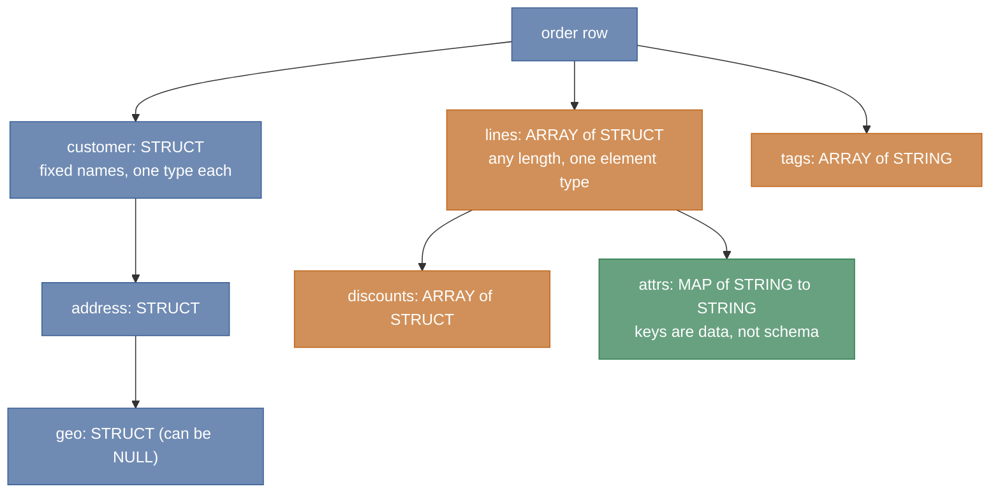
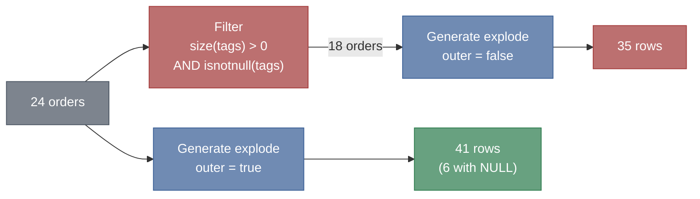
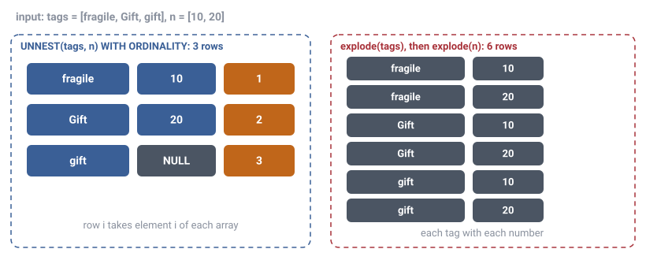
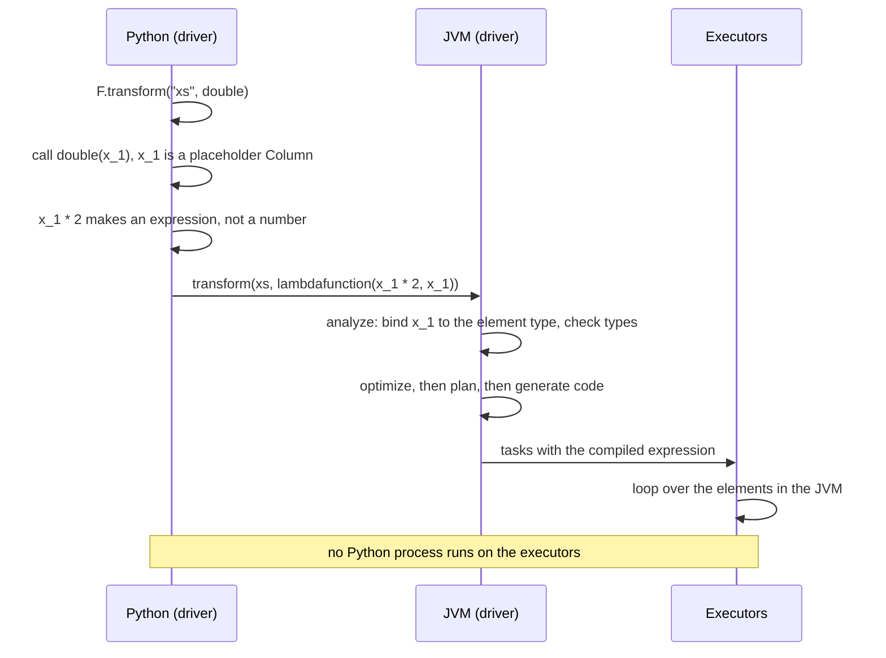

# Chapter 28: Structs, arrays, maps and higher-order functions

[Chapter 27](ch27-json.md) read JSON into columns. Many of those columns are not flat. A `user` field is an object, and `items` is a list of objects. A field such as `attrs` holds keys that change from one record to the next. Spark keeps these values as three nested types: `STRUCT`, `ARRAY` and `MAP`.

A common first plan is to flatten everything at once: `explode` each array, then select each field. This plan changes the number of rows, and it loses the records with empty lists. The next step must then be a join that puts the rows together again. Spark has a better tool for most of this work. A higher-order function, such as `transform` or `aggregate`, works on the elements of an array inside one row.

**A nested value in Spark is a typed value, and Spark checks each operation on it in the analyzer, before a task starts. A Python lambda in a higher-order function is not Python code that runs on the data. PySpark calls it one time on the driver, and the result is a Catalyst expression. Most of the rules and errors in this chapter follow from these two facts.** In Spark 4.3, the array higher-order functions also take part in whole-stage code generation, and SQL has a standard `UNNEST` clause.

The data is SparkTutor's `nested/orders.json` in [`code/data/messy`](https://github.com/lisancao/spark-masterclass/tree/main/code/data/messy): 24 web orders. Each order has a `customer` struct with an address, an array of order `lines`, `tags`, `payments` and a `status_history`.

SparkTutor put problems into the data on purpose. Some tags have different letter case. Some arrays are empty, and some are not there. One quantity is `NULL`, one `geo` struct is not there, and some status entries are not in time order.

The scripts are [`code/ch28/nested.py`](https://github.com/lisancao/spark-masterclass/tree/main/code/ch28), `lambdas.py` and `unnest.py`. All output is from `code/ch28/output/`, on Spark 4.3.0 with `spark.sql.session.timeZone=UTC`.

## Three nested types



- A **struct** has a fixed list of named fields. Each field has its own type. A struct is like a row inside a row.
- An **array** has any number of elements, and all the elements have one type.
- A **map** has keys and values. All keys have one type, and all values have one type. The keys are data, not part of the schema.

The schema of the orders in DDL form shows all three:

```python
ORDER_SCHEMA = """
    order_id STRING,
    placed_at TIMESTAMP,
    customer STRUCT<id: STRING, name: STRING, email: STRING,
                    address: STRUCT<city: STRING, country: STRING,
                                    geo: STRUCT<lat: DOUBLE, lon: DOUBLE>>>,
    lines ARRAY<STRUCT<sku: STRING, qty: INT, unit_price: DOUBLE,
                       discounts: ARRAY<STRUCT<code: STRING, pct: INT>>,
                       attrs: MAP<STRING, STRING>>>,
    tags ARRAY<STRING>,
    payments ARRAY<STRUCT<method: STRING, amount: DOUBLE>>,
    status_history ARRAY<STRUCT<status: STRING, at: TIMESTAMP>>
"""
```

## Step 1: Inference never gives a map

A JSON object can become a struct or a map. Schema inference always selects a struct:

```text
== inference never gives a map ==
inferred attrs: struct<color:string,engraving:string,gift_wrap:string,size:string,warranty_years:string>
declared attrs: map<string,string>
orders: 24
```

Inference found five different keys in `attrs` in all the orders, and it made a struct with five fields. Each order has `NULL` in the fields that it does not use. If a new order adds a key such as `monogram`, the next inference gives a struct with six fields. The schema changes because the data changed.

Declare an open set of keys as a `MAP`. A map keeps each key that the record has, and the schema stays the same. Declare a fixed set of fields as a `STRUCT`. A struct gives a type to each field, and the analyzer can check each field name.

## Step 2: Access the fields of a struct

There are several ways to get a field from a struct. They give the same values, but the names of the output columns are different:

```python
df = orders.select("customer.name", F.col("customer.address.city"), F.col("customer")["id"],
                   F.col("customer").getField("email"), F.col("customer.address.geo.lat"))
```

```text
== struct access and the names of the output columns ==
['name', 'city', 'customer.id', 'customer.email', 'lat']
customer.* -> ['id', 'name', 'email', 'address']
  select('customer.phone')                     -> FIELD_NOT_FOUND
  select('a.b') on a column named a.b          -> UNRESOLVED_COLUMN.WITH_SUGGESTION
  select('`a.b`')                              -> 1
```

- A dot path gives the last part of the path as the column name: `name`, `city`, `lat`.
- An index or `getField` gives the full expression as the name: `customer.id`. Add an `alias` if a later step uses the name.
- `customer.*` changes each field of the struct into a top-level column.
- A field that is not in the struct is an analysis error, `FIELD_NOT_FOUND`. Spark finds the error before it reads data.
- A dot in a column name looks like a path. Put the name in backticks: `` `a.b` ``.

## Step 3: A NULL struct is not a struct of NULLs

The order `O-1011` has no `geo` object in its JSON. Its `geo` value is a `NULL` struct, and each field of a `NULL` struct is also `NULL`:

```text
== a NULL struct is not a struct of NULLs ==
+--------+------------------+-----------+---------------+
|order_id|geo               |geo IS NULL|geo.lat IS NULL|
+--------+------------------+-----------+---------------+
|O-1001  |{47.8056, 10.9042}|false      |false          |
|O-1011  |NULL              |true       |true           |
+--------+------------------+-----------+---------------+

+-----------+--------------+-------+
|null_struct|struct_of_null|is_null|
+-----------+--------------+-------+
|NULL       |{NULL}        |false  |
+-----------+--------------+-------+
```

A struct whose fields are all `NULL` is a different value. It shows as `{NULL}`, and `IS NULL` on it is `false`. A JSON record with `"geo": {}` gives this second value, and a record with no `geo` key gives the first. A test for missing data must check the struct and its fields separately.

## Step 4: Build and compare structs

`struct` makes a struct from columns. `named_struct` in SQL makes a struct from name and value pairs:

```text
== build structs: struct, named_struct, and the order of comparison ==
+--------------+
|s             |
+--------------+
|{O-1001, 2, 1}|
+--------------+

struct<order_id:string,col2:int,col3:int>
+-------------------+
|first_field_decides|
+-------------------+
|true               |
+-------------------+
```

`struct` keeps the name of a plain column (`order_id`). An expression with no alias gets a position name: `col2`, `col3`. Give each expression an alias.

Spark compares two structs field by field, from the first field to the last. The first field that is different decides the result. Here `a` is 1 in the left struct and 2 in the right, so the left struct is smaller, although its `b` is larger. Step 17 uses this rule to find the latest entry in an array.

## Step 5: Edit a struct in place with `withField` and `dropFields`

To change one field of a deep struct, you do not have to rebuild the full struct. `withField` adds or replaces a field, and `dropFields` removes fields. Both accept a dot path:

```python
red = orders.withColumn("customer", F.col("customer").dropFields("email")
                        .withField("address.country", F.upper("customer.address.country")))
```

```text
== edit a struct in place: withField and dropFields ==
struct<id:string,name:string,address:struct<city:string,country:string,geo:struct<lat:double,lon:double>>>
+--------+-------+
|order_id|country|
+--------+-------+
|O-1001  |CA     |
|O-1002  |CA     |
|O-1003  |VN     |
+--------+-------+
only showing top 3 rows
+--------------------------+
|withField on a NULL struct|
+--------------------------+
|NULL                      |
+--------------------------+

  dropFields of every field                    -> DATATYPE_MISMATCH.CANNOT_DROP_ALL_FIELDS
  withField on an array of structs             -> DATATYPE_MISMATCH.UNEXPECTED_INPUT_TYPE
+-----------------------------+
|lines                        |
+-----------------------------+
|[{P6, 4, 30.0}, {P5, 2, 2.5}]|
+-----------------------------+
```

The `email` field is gone, and the country codes are now in upper case. This is a good method to remove personal data before you write a table. Three rules apply:

- `withField` on a `NULL` struct gives `NULL`. It does not make a new struct.
- A struct must keep at least one field. `dropFields` of all fields is an error.
- `withField` and `dropFields` work on a struct, not on an array of structs. To edit each element of an array, use `transform` (Step 12) with `dropFields` inside the lambda. The last table shows this: each line lost `attrs` and `discounts`.

These two methods are in the DataFrame API only. SQL has no function for them.

## Step 6: A dot path goes through one array level

A dot path on an array of structs gives an array of the field values. `lines.sku` gives the SKU of each line, in an array:

```text
== a dot path goes through one array level ==
+--------+---------+
|order_id|lines.sku|
+--------+---------+
|O-1001  |[P6, P5] |
|O-1002  |[P6]     |
|O-1003  |[P3]     |
+--------+---------+
only showing top 3 rows
  lines.discounts.code (two levels)            -> DATATYPE_MISMATCH.UNEXPECTED_INPUT_TYPE
+--------+--------------+
|order_id|codes         |
+--------+--------------+
|O-1001  |[VIP5]        |
|O-1004  |[FALL10, VIP5]|
|O-1005  |[FALL10]      |
+--------+--------------+
```

The path does not go through a second array level. `lines.discounts` is an array of arrays, and `.code` on it is a type error. Use `transform` to go into each line, and `flatten` to join the inner arrays:

```python
codes = F.flatten(F.transform("lines", lambda l: l.discounts.code))
```

## Step 7: The array functions, and what each one does with NULL

Spark has many array functions. Most of them are clear from their names. Their behavior with `NULL` elements is not always clear. The script calls each function on `a = ['b', NULL, 'a', 'b']` and `n = [3, 1, NULL, 2]`:

```text
== the array toolbox, and what each function does with NULL ==
  array_distinct(a)            ['b', None, 'a']
  array_compact(a)             ['b', 'a', 'b']
  sort_array(n)                [None, 1, 2, 3]
  sort_array(n, asc=False)     [3, 2, 1, None]
  array_sort(n)                [1, 2, 3, None]
  array_join(a, '-')           b-a-b
  array_join(a, '-', '?')      b-?-a-b
  array_position(a, 'a')       3
  array_remove(a, 'b')         [None, 'a']
  array_contains(a, 'a')       True
  array_contains(a, 'z')       None
  array_insert(n, 1, 0)        [0, 3, 1, None, 2]
  array_append(n, 9)           [3, 1, None, 2, 9]
  slice(n, 2, 2)               [1, None]
  array_union(n, array(5))     [3, 1, None, 2, 5]
  array_except(n, array(1))    [3, None, 2]
  arrays_zip(a, n)[0]          Row(a='b', n=3)
  sequence(1, 7, 3)            [1, 4, 7]
  size(NULL) under ANSI: None
  size(NULL), legacy.sizeOfNull=true, ANSI on:  None
  size(NULL), legacy.sizeOfNull=true, ANSI off: -1
```

The rows that need attention:

- **`array_distinct` keeps one `NULL`.** `array_compact` removes all `NULL` elements and keeps the duplicates. To get the distinct values without `NULL`, use the two functions together.
- **`sort_array` and `array_sort` put `NULL` in different positions.** `sort_array` puts `NULL` first when it sorts from low to high, and last when it sorts from high to low. `array_sort` always puts `NULL` last.
- **`array_join` drops `NULL` elements**, unless you give a replacement string as the third argument.
- **Positions start at 1.** `array_position` gives 3 for `'a'`, and `array_insert(n, 1, 0)` puts the new value first.
- **`array_contains` uses three-valued logic.** If the value is not in the array and the array has a `NULL`, the result is `NULL`, not `false`. The `NULL` element can be the value that you look for. A filter that uses this result drops the row, because `NULL` is not `true`.
- **`size(NULL)` is `NULL`.** The legacy result `-1` comes back only with `spark.sql.legacy.sizeOfNull=true` and ANSI mode off. ANSI mode is on by default in Spark 4.

## Step 8: Index into an array under ANSI mode

ANSI mode also changes array and map access. An index outside the array is an error, not a `NULL`:

```text
== ANSI indexing ==
  a[10]                                        -> INVALID_ARRAY_INDEX
  element_at(a, 10)                            -> INVALID_ARRAY_INDEX_IN_ELEMENT_AT
  element_at(a, 0)                             -> INVALID_INDEX_OF_ZERO
  element_at(a, -1)                            -> 3
  try_element_at(a, 10)                        -> None
  get(a, 10)                                   -> None
  a[0] (zero-based)                            -> 1
  slice(a, 0, 1)                               -> INVALID_PARAMETER_VALUE.START
  m['missing']                                 -> None
  element_at(m, 'missing')                     -> None
```

| Access | Base | Index outside the array | Negative index |
|---|---|---|---|
| `a[i]` | 0 | error | error |
| `element_at(a, i)` | 1 | error | counts from the end |
| `try_element_at(a, i)` | 1 | `NULL` | counts from the end |
| `get(a, i)` | 0 | `NULL` | `NULL` |

`a[i]` starts at 0, and `element_at` starts at 1. This difference causes many errors when code moves between the two forms. `element_at(a, 0)` is always an error. On messy data, an array is often shorter than you expect. Use `try_element_at` or `get` when a short array is normal, and use `a[i]` when a short array is a bug that must stop the job.

A key that is not in a map gives `NULL` with all three forms.

## Step 9: Generators make rows from arrays and maps

A **generator** makes zero or more output rows from one input row. `explode` makes one row for each element of an array, or one row for each key and value of a map. `posexplode` also gives the position. `inline` changes an array of structs into rows with one column for each field.

```text
== generators: rows from arrays and maps ==
posexplode_outer rows: 44  orders: 24
+--------+-------+---+---+
|order_id|line_no|sku|qty|
+--------+-------+---+---+
|O-1001  |1      |P6 |4  |
|O-1001  |2      |P5 |2  |
|O-1002  |1      |P6 |5  |
|O-1003  |1      |P3 |3  |
+--------+-------+---+---+
only showing top 4 rows
+--------------+---+------------------+
|key           |n  |values            |
+--------------+---+------------------+
|color         |16 |[black, blue, red]|
|engraving     |17 |[Happy 30th, L.T.]|
|gift_wrap     |6  |[yes]             |
|size          |14 |[L, M, S]         |
|warranty_years|12 |[1, 2]            |
+--------------+---+------------------+
```

The second table is a key profile of the `attrs` map. The script explodes the lines, then explodes the map of each line into `key` and `value` columns, and then groups by key. This profile shows which keys the producer uses. It is the first step before you promote a key to a column of its own.

The generator has several forms in SQL and in the DataFrame API:

```text
LATERAL VIEW OUTER explode: 41 rows
LATERAL explode in FROM: 35 rows
DataFrame.lateralJoin(spark.tvf.explode_outer(tags.outer())): 41 rows
  explode inside an expression                 -> UNSUPPORTED_GENERATOR.NESTED_IN_EXPRESSIONS
  two generators in one select                 -> 46
  sum over orders of size(tags) * size(lines): 46
  generator with an aggregate                  -> MISSING_GROUP_BY
two explodes, one after the other: 70 rows from 35 tags x 2
```

- The orders have 35 tags in total. The `OUTER` forms give 41 rows, because they also keep the six orders that have no tags. These orders get one row with a `NULL` tag. The plain forms drop them.
- `DataFrame.lateralJoin` with a table-valued function is the DataFrame form of SQL `LATERAL`. The column from the outer DataFrame must have `.outer()`.
- A generator must be a top-level expression in the select. `upper(explode(tags))` is an error. Explode first, and then call `upper` on the new column.
- Two generators in one select give the product of the two arrays for each row. The script proves the count: 46 rows, which is the sum of `size(tags) * size(lines)`. This is almost never the result that you want.

### Why `explode` drops rows: the plan

The plan shows how the plain form loses the rows with no elements:

```text
== the plan of explode: Spark adds a filter before Generate ==
explode(tags)
  *(1) Generate explode(tags), [order_id], false, [col]
  +- *(1) Filter ((size(tags, false) > 0) AND isnotnull(tags))
     +- InMemoryTableScan [order_id, tags], [(size(tags, false) > 0), isnotnull(tags)]
           +- InMemoryRelation [order_id, placed_at, customer, lines, tags, payments, stat
                 +- FileScan json [order_id,placed_at,customer,lines,tags,payments,status_
explode_outer(tags)
  *(1) Generate explode(tags), [order_id], true, [col]
  +- InMemoryTableScan [order_id, tags]
        +- InMemoryRelation [order_id, placed_at, customer, lines, tags, payments, status_
              +- FileScan json [order_id,placed_at,customer,lines,tags,payments,status_his
```

The optimizer knows that a row with a `NULL` or empty array cannot give an output row from `explode`. It adds `Filter ((size(tags, false) > 0) AND isnotnull(tags))` before the `Generate` node, and it pushes that filter as far down as it can. For `explode_outer`, the `true` flag in `Generate` means "outer", and there is no filter.

<figure markdown>


<figcaption>The tags of the 24 orders through the two generators, from the output above. The plain generator drops the 6 orders with no tags. The outer generator keeps them with a NULL tag.</figcaption>
</figure>




## Step 10: New in 4.3: the UNNEST clause

Spark 4.3.0 adds `UNNEST`, the ANSI SQL form of a generator in the `FROM` clause (SPARK-58419). It makes a table from one or more arrays, with one row for each element. The syntax, from the 4.3.0 docs page "UNNEST Clause":

```sql
UNNEST ( expression [ , ... ] ) [ WITH ORDINALITY ] [ table_alias ]
```

The script is `code/ch28/unnest.py`. The first query unnests a literal array:

```text
== UNNEST of a literal array, WITH ORDINALITY ==
+---+---+
|tag|pos|
+---+---+
|a  |1  |
|b  |2  |
|c  |3  |
+---+---+

default column names: ['col0', 'col1', 'ordinality'] | one array: ['col']
```

`WITH ORDINALITY` adds a `BIGINT` column with the position of each element. The position starts at 1, as in PostgreSQL and Trino. `posexplode` starts at 0. Without a column list in the alias, one array gives the column `col`, the same name that `explode` gives. Several arrays give `col0`, `col1` and more.

### Several arrays in parallel

With two or more arrays, `UNNEST` takes element 1 of each array for row 1, element 2 for row 2, and so on. The number of rows is the length of the longest array. A shorter array gives `NULL` after its last element:

```sql
SELECT * FROM UNNEST(array('fragile', 'Gift', 'gift'), array(10, 20)) WITH ORDINALITY AS t(tag, n, pos)
```

```text
== several arrays in parallel: padded with NULL, not a cross product ==
+-------+----+---+
|tag    |n   |pos|
+-------+----+---+
|fragile|10  |1  |
|Gift   |20  |2  |
|gift   |NULL|3  |
+-------+----+---+

two explodes, one after the other: 6 rows
arrays_zip + inline gives the same rows: True
a NULL array counts as empty: [Row(a=1, b=None), Row(a=2, b=None)]
```

Two generators, one after the other, give each element of the first array with each element of the second array (Step 9). `UNNEST` gives the elements side by side. Before 4.3, `inline(arrays_zip(...))` gave the same rows. A `NULL` array counts as an empty array. It adds no elements, but the other arrays still give their rows.

<figure markdown>

<figcaption>The same two arrays through <code>UNNEST</code> and through two generators, from <code>unnest.txt</code>. <code>UNNEST</code> pairs the elements by position and fills the short array with <code>NULL</code>. Two generators give each pair.</figcaption>
</figure>

### UNNEST of a column: LATERAL

`UNNEST` of a column of another table in the `FROM` clause needs `LATERAL`, as `explode` does in Step 9. This query is the same as `LATERAL VIEW posexplode`:

```sql
SELECT o.order_id, t.tag, t.pos
FROM orders o, LATERAL UNNEST(o.tags) WITH ORDINALITY AS t(tag, pos)
ORDER BY o.order_id, t.pos
```

```text
UNNEST rows: 35  LATERAL VIEW posexplode rows: 35  same rows: True
posexplode position starts at: 0 | WITH ORDINALITY starts at: 1

== LEFT JOIN LATERAL keeps the orders with no tags ==
LEFT JOIN LATERAL UNNEST rows: 41  LATERAL VIEW OUTER explode rows: 41  same rows: True
rows with a NULL tag: 7 (6 orders with no tags, 1 NULL element)
```

The comma form drops the six orders with no tags, as `explode` does. `LEFT JOIN LATERAL UNNEST(...) ON true` keeps them, with a `NULL` tag. It gives the same 41 rows as `LATERAL VIEW OUTER explode`.

An array of structs stays one column of structs. `UNNEST` does not make a column for each field, as `inline` does:

```text
UNNEST columns: ['line']
inline columns: ['sku', 'qty', 'unit_price', 'discounts', 'attrs']
t.line.* columns: ['sku', 'qty', 'unit_price', 'discounts', 'attrs']
```

Use `t.line.sku` to get a field, or `t.line.*` to get all fields. Two arrays of the same row work in parallel too. Order O-1001 has two tags and one payment, and order O-1004 has no tags and one payment:

```text
== two arrays of one order, side by side ==
+--------+-------+------+------+---+
|order_id|tag    |method|amount|i  |
+--------+-------+------+------+---+
|O-1001  |fragile|card  |125.0 |1  |
|O-1001  |Gift   |NULL  |NULL  |2  |
|O-1004  |NULL   |card  |168.0 |1  |
+--------+-------+------+------+---+
```

### The plans

The parser changes `UNNEST` into a `Generate` node with the `Unnest` generator. The physical plans of the three forms are different:

```text
== the plans: Generate in each case, and whole-stage code ==
LATERAL UNNEST
  +- Generate unnest(tags), [order_id], false, [col]
LEFT JOIN LATERAL UNNEST
  +- *(4) BroadcastHashJoin [coalesce(tags, []), isnull(tags)], [coalesce(tags, []), isnull(ta
  +- Generate unnest(tags), [tags], false, [col]
  +- BroadcastHashJoin [coalesce(tags, []), isnull(tags)], [coalesce(tags, []), isnull(tags)],
  +- Generate unnest(tags), [tags], false, [col]
LATERAL VIEW explode
  *(1) Generate explode(tags), [order_id], false, [tag]

== the optimized plan of LEFT JOIN LATERAL UNNEST ==
  Project [order_id, tag]
  +- Join LeftOuter, (tags <=> tags)
     :- Project [order_id, tags]
     :  +- Relation [order_id,placed_at,customer,lines,tags,payments,status_history] json
     +- Project [col AS tag, tags]
        +- Generate unnest(tags), false, [col]
           +- Aggregate [tags], [tags AS tags]
              +- Project [tags]
                 +- Relation [order_id,placed_at,customer,lines,tags,payments,status_history]
```

- **`explode` runs in whole-stage code** (`*(1) Generate`). The `Generate` of `unnest` has no `*`. The 4.3.0 source of `Unnest` extends `CodegenFallback`, so it uses interpreted evaluation.
- **`LEFT JOIN LATERAL UNNEST` is not a `Generate` with `outer = true`.** The optimizer removes the correlation. It finds the distinct arrays with an `Aggregate`, and it unnests each distinct array one time. Then a left outer join on the array value (`<=>`) joins the result to the orders. The physical plan has the join two times, as the final plan and the initial plan of AQE.

`unnest_bench.py` runs the three forms on 3,837,248 taxi trips, with the array `array(PULocationID, DOLocationID)` for each trip (32,129 distinct arrays). It uses a cache, 5 runs after a warmup and the bench lock:

```text
rows: 3837248 | distinct arrays: 32129
  LATERAL VIEW OUTER explode   median  1.166 s  operators: ['Generate']
  LATERAL UNNEST               median  1.391 s  operators: ['Generate']
  LEFT JOIN LATERAL UNNEST     median  1.390 s  operators: ['SortMergeJoin', 'Exchange', 'Exchange', 'Generate', 'HashAggregate', 'Exchange', 'HashAggregate']
```

On this table, the left lateral join adds an aggregate, three shuffles and a sort-merge join. An earlier locked run on the same machine gave 0.518 s, 0.832 s and 1.911 s. Other work used the machine at the same time. Thus the timings are not stable enough for a ratio. The plans are stable.

If a table is large and has few repeated arrays, the left lateral join must shuffle the table and the distinct arrays. `LATERAL VIEW OUTER explode` or `explode_outer` does the same work in one `Generate`.

<figure markdown>
  <video autoplay loop muted playsinline controls width="1280" height="720" poster="../../media/clips/ch28-unnest.webp">
    <source src="../../media/clips/ch28-unnest.mp4" type="video/mp4">
  </video>
  <figcaption><code>unnest.py</code> runs against Spark 4.3.0. <code>UNNEST</code> of two arrays gives three rows, not six. The plan of <code>LEFT JOIN LATERAL UNNEST</code> has a join, and the <code>Generate</code> of <code>unnest</code> has no whole-stage code.</figcaption>
</figure>

| Need | Before 4.3 | With `UNNEST` (4.3) |
|---|---|---|
| One row for each element | `explode`, `LATERAL VIEW explode` | `LATERAL UNNEST(arr)` |
| The position too | `posexplode` (from 0) | `WITH ORDINALITY` (from 1) |
| Keep rows with an empty or `NULL` array | `explode_outer`, `LATERAL VIEW OUTER` | `LEFT JOIN LATERAL UNNEST(arr) ON true` (a join in the plan) |
| Several arrays by position | `inline(arrays_zip(a, b))` | `UNNEST(a, b)` |
| One column for each struct field | `inline` | not done: use `t.col.*` |
| A map | `explode` gives `key` and `value` | not supported: `UNNEST` takes arrays only |

`UNNEST` is a non-reserved keyword. A table or a column can still have the name `unnest`. The arguments must be arrays:

```text
== UNNEST is a non-reserved keyword ==
a column and a view named unnest: [Row(unnest=1)]
  SELECT * FROM UNNEST(42)   -> [DATATYPE_MISMATCH.UNEXPECTED_INPUT_TYPE] Cannot resolve "unnest(42)" due to dat
  SELECT * FROM UNNEST()     -> [UNRESOLVABLE_TABLE_VALUED_FUNCTION] Could not resolve `UNNEST` to a table-value
```

[Chapter 13](ch13-spark-sql-in-depth.md) shows `UNNEST` in pipe syntax.

## Step 11: Put rows together again in the correct order

After an `explode`, a `groupBy` with `collect_list` makes an array again. But `collect_list` does not keep an order. The order of the elements depends on the order in which the tasks send their rows. To keep the original order, collect the position together with the value, sort, and then take the value:

```python
long = orders.select("order_id", F.posexplode("lines").alias("pos", "line"))
back = (long.groupBy("order_id")
        .agg(F.array_sort(F.collect_list(F.struct("pos", "line.sku"))).alias("pairs"))
        .select("order_id", F.col("pairs.sku").alias("skus")))
```

```text
== collect_list keeps no order: sort by position ==
+--------+--------+
|order_id|skus    |
+--------+--------+
|O-1001  |[P6, P5]|
|O-1002  |[P6]    |
|O-1003  |[P3]    |
+--------+--------+
only showing top 3 rows
+------------+-------------+
|default_list|respect_nulls|
+------------+-------------+
|[1, 2]      |[1, NULL, 2] |
+------------+-------------+

+------+--------+--------+
|max_by|max_by_2|min_by_2|
+------+--------+--------+
|b     |[b, c]  |[a, c]  |
+------+--------+--------+
```

`array_sort` sorts the structs by `pos` first, because of the comparison rule in Step 4. Two more aggregate details:

- `collect_list` drops `NULL` values. Since Spark 4.2, `RESPECT NULLS` keeps them.
- `max_by(x, y)` gives the `x` of the row with the largest `y`. Since Spark 4.2, a third argument `k` gives the top `k` values as an array.

But the best solution is often to not explode at all. The next steps do the work inside each row.

## Step 12: Higher-order functions work inside the row

A **higher-order function** takes an array (or a map) and a lambda function. It calls the lambda for each element, and it gives one result in the same row. There is no `Generate` node, no shuffle and no join to put the rows together again.

| Function | Lambda | Result |
|---|---|---|
| `transform(a, x -> ...)` | one value for each element | array of the same length |
| `filter(a, x -> ...)` | a boolean for each element | array of the elements where it is `true` |
| `exists(a, x -> ...)`, `forall(a, x -> ...)` | a boolean for each element | one boolean |
| `aggregate(a, zero, (acc, x) -> ..., acc -> ...)` | merge of an element into the accumulator | one value |
| `array_sort(a, (l, r) -> ...)` | a comparator that gives an `INT` | sorted array |
| `zip_with(a, b, (x, y) -> ...)` | one value for each pair | array |
| `transform_keys`, `transform_values`, `map_filter`, `map_zip_with` | key and value | map |

The same functions are in SQL, with the arrow syntax `x -> x * 2`. In Python, the lambda is a Python `lambda`. The next step shows that the Python form is only a different way to write the SQL form.

## Step 13: How PySpark traces a lambda into Catalyst

This script counts the calls to the Python function that it gives to `transform`:

```python
calls = []


def double(x):
    calls.append(repr(x))
    return x * 2


col = F.transform("xs", double)
print("calls after building the Column:", len(calls))
print("argument:", calls[0])
rows = df.select(col.alias("doubled")).collect()
df.select(col.alias("doubled")).collect()
print("calls after two actions:", len(calls), " result:", rows[0].doubled)
print("the expression:", str(col)[:88])
```

```text
== the lambda runs once, on the driver, with a placeholder Column ==
calls after building the Column: 1
argument: Column<'x_1'>
calls after two actions: 1  result: [2, 4, 6, None]
the expression: Column<'transform(xs, x_1 -> *(x_1, 2))'>
```

The function ran one time, when the script made the `Column`. It did not run for each element, and it did not run again for the two actions. Its argument was not a number.

The argument was a placeholder `Column` with the name `x_1`. `x * 2` on a `Column` does not multiply. It makes a new expression, `x_1 * 2`. PySpark puts that expression into a lambda function node, and it sends the tree to the JVM. The analyzed plan contains no Python:

```text
== the analyzed plan holds a lambda function, not Python ==
Project [transform(xs#0, lambdafunction((lambda x_2#7 * 2), lambda x_2#7, false)) AS d#6]
[2, 4]
```

<figure markdown>
  <video autoplay loop muted playsinline controls width="1280" height="720" poster="../../media/clips/ch28-lambda.webp">
    <source src="../../media/clips/ch28-lambda.mp4" type="video/mp4">
  </video>
  <figcaption><code>lambdas.py</code> on Spark 4.3.0. The Python function runs one time, on the driver, with a placeholder <code>Column</code>, and the analyzed plan holds a lambda function.</figcaption>
</figure>



This book uses the name **tracing** for this process. The SQL form `transform(xs, x -> x * 2)` gives the same tree, and the result `[2, 4]` comes from it. The Python lambda is only a builder for a Catalyst expression.

The executors loop over the elements in the JVM. No Python worker starts, and no data goes through Arrow or pickle. For this reason, a higher-order function is much cheaper than a Python UDF that does the same work.

<figure markdown>
  <video autoplay loop muted playsinline controls width="1280" height="720" poster="../../media/clips/ch28-anim-tracing.webp">
    <source src="../../media/clips/ch28-anim-tracing.mp4" type="video/mp4">
  </video>
  <figcaption>Animation: PySpark calls the Python function one time, with a placeholder <code>Column</code>. The call builds an expression tree. The executors run the loop in the JVM. The values are from <code>lambdas.py</code>.</figcaption>
</figure>


## Step 14: The errors that show the tracing

If you know that the lambda runs one time on a placeholder, the errors make sense:

```text
== errors that show the lambda is traced, not run ==
  Python if on a Column                          -> CANNOT_CONVERT_COLUMN_INTO_BOOL
  lambda returns a Python int                    -> HIGHER_ORDER_FUNCTION_SHOULD_RETURN_COLUMN
  call the Column as a function                  -> TypeError: 'Column' object is not callable
  lambda with *args                              -> UNSUPPORTED_PARAM_TYPE_FOR_HIGHER_ORDER_FUNCTION
  SQL lambda with the wrong arity                -> INVALID_LAMBDA_FUNCTION_CALL.NUM_ARGS_MISMATCH
  a Python UDF inside the lambda                 -> UNSUPPORTED_FEATURE.LAMBDA_FUNCTION_WITH_PYTHON_UDF
+------------+
|when, not if|
+------------+
|[0, 1, 1, 0]|
+------------+
```

- **A Python `if` needs a Python boolean.** `x > 1` is a `Column`, and Python cannot decide if a `Column` is true. Use `F.when(x > 1, 1).otherwise(0)`. It makes a `CASE WHEN` expression, as the last table shows.
- **The lambda must return a `Column`.** `lambda x: 1` returns a Python `int`, which is not an expression. Use `F.lit(1)`.
- **PySpark reads the number of parameters from the function signature.** It must know if the lambda takes `x`, or `x` and an index. A lambda with `*args` has no fixed number, so PySpark refuses it.
- **A Python UDF cannot go inside a lambda.** The lambda must be a Catalyst expression that the JVM loops over. A Python UDF needs a separate Python process. To use Python on each element, give the full array to the UDF.

The index form takes a second parameter, the position from 0:

```text
== the index argument ==
+---------------+--------------+
|i:s            |even positions|
+---------------+--------------+
|[0:a, 1:B, 2:c]|[1, 3]        |
+---------------+--------------+
```

### New in 4.3: a transpiled UDF is still a UDF inside a lambda

Spark 4.3 adds an experimental feature, `spark.sql.experimental.optimizer.transpilePyUDFs`. When it is `true` and ANSI mode is on, PySpark tries to change a simple Python UDF into a Catalyst expression. The conversion occurs when you make the UDF. It applies only to the plain Python UDF (`useArrow=False`), not to an Arrow UDF. The script makes a UDF that multiplies by 3:

```text
== new in 4.3: Python UDF transpilation, and a UDF inside a lambda ==
  plan of py_triple(x): *(1) Project [(cast(id#126L as int) * 3) AS t#128]
  transform(xs, x -> py_triple(x)), transpiled   -> UNSUPPORTED_FEATURE.LAMBDA_FUNCTION_WITH_PYTHON_UDF
```

In a plain `select`, the plan contains `cast(id as int) * 3`, with no `BatchEvalPython` node. The transpilation worked. But inside a lambda, Spark still refuses the UDF with the same error as before. Thus, in Spark 4.3.0, write the lambda with Spark functions. [Chapter 34](ch34-python-udfs-arrow.md) explains UDF transpilation in full.

## Step 15: `aggregate`: the type of the zero is the type of the result

`aggregate` folds an array into one value. It takes a zero value, a merge function and an optional finish function. The type of the zero value sets the type of the accumulator, and the merge function must return that type:

```text
== aggregate: the type of the zero is the type of the result ==
  aggregate(xs, lit(0), acc + x)                 -> None
  aggregate(xs, lit(0), acc + coalesce(x, 0))    -> 6
  aggregate(p, lit(0), acc + p)  (int zero)      -> DATATYPE_MISMATCH.UNEXPECTED_INPUT_TYPE
  aggregate(p, lit(0.0), acc + p)                -> 3.75
  SQL: aggregate(p, 0.0, ...)  (0.0 is DECIMAL)  -> DATATYPE_MISMATCH.UNEXPECTED_INPUT_TYPE
  SQL typeof(0.0): decimal(1,1)  typeof(0D): double
  SQL: aggregate(p, 0D, ...)                     -> 3.75
  aggregate with a finish function (mean)        -> 2.5
```

There are three traps:

| Trap | Cause | Fix |
|---|---|---|
| One `NULL` element makes the sum `NULL`. | `acc + NULL` is `NULL`, and all later steps keep the `NULL`. | Use `coalesce(x, 0)` in the merge. |
| An `INT` zero cannot hold a `DOUBLE` sum. | `lit(0)` is an `INT`, and `acc + x` with a `DOUBLE` element gives a `DOUBLE`. The analyzer refuses the merge. | Use `lit(0.0)` in Python. |
| In SQL, `0.0` is not a `DOUBLE`. | A SQL literal with a decimal point is a `DECIMAL`, here `decimal(1,1)`. | Use `0D` for a `DOUBLE` zero. |

The finish function changes the accumulator into the result. The mean example keeps a struct with a sum and a count, and the finish function divides them. This is the method that Spark itself uses for `avg` ([Chapter 5](ch05-how-spark-runs.md), Step 1).

## Step 16: `exists` and `forall` use three-valued logic

`exists` and `forall` follow the SQL rules for `NULL`:

```text
== exists and forall use three-valued logic ==
  array(1, 2)      exists(x > 3)=False forall(x > 0)=True  array_contains(5)=False
  array(1, NULL)   exists(x > 3)=None  forall(x > 0)=None  array_contains(5)=None
  array(5, NULL)   exists(x > 3)=True  forall(x > 0)=None  array_contains(5)=True
  array()          exists(x > 3)=False forall(x > 0)=True  array_contains(5)=False
  legacy.followThreeValuedLogicInArrayExists=false, exists(array(1, NULL), x -> x > 3): False
```

For `array(1, NULL)`, `exists(x > 3)` is `NULL`, not `false`. The `NULL` element can be larger than 3, so Spark cannot say "no". If one element matches, the answer is `true`, whatever the other elements are. `forall` on an empty array is `true`.

<figure markdown>


<figcaption>The results from the output above. A NULL element can be the match, so the answer can be NULL.</figcaption>
</figure>


The internal configuration `spark.sql.legacy.followThreeValuedLogicInArrayExists=false` gives the old two-valued result. Do not use it in new code. Use `coalesce(exists(...), false)` if a `NULL` must count as "no".

## Step 17: Sort with a comparator, or with a struct

The status history of an order is not always in time order. `array_sort` with a comparator sorts it by the `at` field:

```python
by_time = F.array_sort("h", lambda a, b: F.when(a.at < b.at, -1).when(a.at > b.at, 1).otherwise(0))
```

```text
== array_sort with a comparator, and the struct trick ==
+-----------------------+-------+-------------------------+
|by comparator          |latest |array_max of (at, status)|
+-----------------------+-------+-------------------------+
|[placed, paid, shipped]|shipped|shipped                  |
+-----------------------+-------+-------------------------+

== a comparator must return INT ==
  array_sort(xs, (a, b) -> b - a) on BIGINT      -> DATATYPE_MISMATCH.UNEXPECTED_RETURN_TYPE
  the same with .cast('int')                     -> [2, 0]
```

The comparator must return an `INT`: negative, zero or positive. `b - a` on `BIGINT` elements gives a `BIGINT`, and the analyzer refuses it. Cast the result to `int`, or use the `when` form.

To get only the latest entry, a shorter method uses the struct comparison from Step 4. `transform` makes a struct `(at, status)` for each entry. `array_max` gives the largest struct, which is the one with the latest `at`. Then `.status` takes the status. The result is the same, and you do not have to write a comparator.

## Step 18: `zip_with` and `arrays_zip` pair two arrays

```text
== zip_with and arrays_zip ==
+--------------+-----------------------------+
|zip_with(+)   |arrays_zip                   |
+--------------+-----------------------------+
|[11, 22, NULL]|[{1, 10}, {2, 20}, {3, NULL}]|
+--------------+-----------------------------+
```

Both functions pair the elements by position. If one array is shorter, they add `NULL` to it. `zip_with` calls a lambda on each pair, and `arrays_zip` makes an array of structs. These functions pair arrays inside one row. `DataFrame.zip` in Spark 4.3 pairs the rows of two DataFrames, which is a different operation ([Chapter 9](ch09-dataframes-columns-schemas.md)).

## Step 19: Maps, and their rules

The map functions follow the same pattern as the array functions. Most of them take a lambda with two parameters, the key and the value:

```text
== maps ==
  cast(m as string)              {b -> 2, a -> 1}
  m collected to Python          {'a': 1, 'b': 2}
  map_keys(m)                    ['b', 'a']
  element_at(m, 'a')             1
  map_contains_key(m, 'z')       False
  map_filter(v > 1)              {'b': 2}
  transform_values(v * 10)       {'a': 10, 'b': 20}
  transform_keys(upper)          {'A': 1, 'B': 2}
  map_zip_with(m, m, v1 + v2)    {'a': 2, 'b': 4}
  map_from_arrays                {'x': 1}
  str_to_map('a:1,b:2')          {'a': '1', 'b': '2'}
  transform_keys(lower) makes a duplicate key  -> DUPLICATED_MAP_KEY
    the same with mapKeyDedupPolicy=LAST_WIN   -> {'gift': 2}
  map(NULL, 1)                                 -> NULL_MAP_KEY
  ORDER BY a map                               -> DATATYPE_MISMATCH.INVALID_ORDERING_TYPE
  INTERSECT on maps                            -> UNSUPPORTED_FEATURE.SET_OPERATION_ON_MAP_TYPE
  GROUP BY a map                               -> [Row(m={'a': 1}, count(1)=2)]
  COUNT(DISTINCT m), keys in two orders (4.3)  -> 1
```

- **A map keeps the order in which the keys went in.** `cast(m as string)` and `map_keys` show `b` first. A Python `dict` from `collect()` can show a different order. Do not depend on the key order.
- **Keys must be unique.** `transform_keys` with `lower` makes `Gift` and `gift` into one key, and that is an error, `DUPLICATED_MAP_KEY`. This is a real trap on messy data, because the case of the keys is often not consistent. `spark.sql.mapKeyDedupPolicy=LAST_WIN` keeps the last value. Use it only if you accept that one value is lost.
- **A key cannot be `NULL`.** A value can be `NULL`.
- **Maps have no order.** You cannot sort by a map or use it in `INTERSECT`. `GROUP BY` on a map works since Spark 4.0.
- **New in 4.3: `COUNT(DISTINCT m)` normalizes the maps.** Two maps with the same keys and values in a different order now count as one value (SPARK-58420).

## Step 20: New in 4.3: which higher-order functions get generated code

Before Spark 4.3, each higher-order function ran as an interpreted expression. Whole-stage code generation compiles the operators of a stage into one Java function ([Chapter 32](ch32-query-plans.md)). A `Project` with a higher-order function could not take part in it. Spark 4.3 adds code generation for the array functions (SPARK-37019). The `*(n)` before an operator in the physical plan shows that the operator is in a code generation stage:

```text
== new in 4.3: which higher-order functions take part in whole-stage codegen ==
  transform                      *(n) Project: in codegen
  filter                         *(n) Project: in codegen
  exists                         *(n) Project: in codegen
  forall                         *(n) Project: in codegen
  aggregate                      *(n) Project: in codegen
  array_sort with a comparator   Project: interpreted
  zip_with                       Project: interpreted
  transform_values               Project: interpreted
  map_filter                     Project: interpreted
*(1) Project [order_id#167, aggregate(lines#166, 0.0, lambdafunction((lambda x_44#173 + (c
generated Java loop: /* 058 */         for (int project_i_0 = 0; project_i_0 < project_numElements_0; project_i_0++) {
```

<figure markdown>
  <video autoplay loop muted playsinline controls width="1280" height="720" poster="../../media/clips/ch28-codegen.webp">
    <source src="../../media/clips/ch28-codegen.mp4" type="video/mp4">
  </video>
  <figcaption><code>lambdas.py</code> on Spark 4.3.0. The array higher-order functions take part in whole-stage code generation, and the others stay interpreted.</figcaption>
</figure>

| In whole-stage codegen in 4.3 (`*(n) Project`) | Interpreted (`CodegenFallback`) |
|---|---|
| `transform`, `filter`, `exists`, `forall`, `aggregate` | `array_sort` with a comparator, `zip_with`, `transform_values`, `map_filter` |

`transform`, `filter`, `exists`, `forall` and `aggregate` now compile to a Java `for` loop over the array. The last line is from the generated code of the `aggregate` on the order lines. `array_sort` with a comparator, `zip_with` and the map functions still use the interpreted path (`CodegenFallback` in `higherOrderFunctions.scala`). Their `Project` has no `*(n)`. The query gives the same result in the two cases. Only the speed is different.

## Step 21: Nested schema pruning

Parquet keeps each leaf field of a nested type as a separate column ([Chapter 36](ch36-parquet-inside.md)). Thus, a query that reads one field of a struct does not have to read the other fields. The script writes the orders to Parquet and prints the `ReadSchema` of four queries:

```text
== nested schema pruning: what each query reads from Parquet ==
  select lines.sku                 struct<lines:array<struct<sku:string>>>
  transform(lines, l -> l.sku)     struct<lines:array<struct<sku:string>>>
  explode(lines), then line.sku    struct<lines:array<struct<sku:string>>>
  select customer.address.city     struct<customer:struct<address:struct<city:string>>>
```

All four queries read only the leaf that they use. The `transform` lambda uses only `l.sku`, and the scan reads only `lines.sku`. On Spark 4.3.0, pruning goes through the lambda and through the generator. The configuration is `spark.sql.optimizer.nestedSchemaPruning.enabled`, and it is `true` by default.

## Step 22: JSON in, JSON out, and a flat table

`to_json` changes a struct into JSON text, and `from_json` with the same type changes it back:

```text
== to_json and back ==
{"id":"C2","name":"Linh Tran","email":"user0@example.com","address":{"city":"Toronto","country":"ca","geo":{"lat":47.8056,"lon":10.9042}}}
from_json(to_json(customer)) == customer: True
```

Some consumers, such as a CSV export or a BI tool, need flat columns. A small recursive function walks `df.schema` and makes one column for each leaf of each struct. It quotes each part of the path with backticks, so a field name with a dot does not break it:

```python
def flatten_structs(df):
    def columns(schema, prefix):
        out = []
        for field in schema.fields:
            path = prefix + [field.name]
            if isinstance(field.dataType, StructType):
                out += columns(field.dataType, path)
            else:
                out.append(F.col(".".join(f"`{p}`" for p in path)).alias("_".join(path)))
        return out
    return df.select(columns(df.schema, []))
```

```text
== flatten every struct into columns a_b_c ==
['order_id', 'placed_at', 'customer_id', 'customer_name', 'customer_email', 'customer_address_city', 'customer_address_country', 'customer_address_geo_lat', 'customer_address_geo_lon', 'lines', 'tags', 'payments', 'status_history']
```

The function flattens structs only. It keeps the arrays as they are, because an array has no fixed number of columns. If two paths give the same name (for example `a_b.c` and `a.b_c`), the result has two columns with one name. Check the names before you write the table.

## When structs are not the correct tool

A struct needs a schema that you know before the read. The orders have a stable shape, so structs, arrays and maps work well. The events of [Chapter 27](ch27-json.md) change their shape each day. A struct schema for them must declare each shape that ever occurred.

[Chapter 29](ch29-variant.md) reads the same events into `VARIANT`, a type that keeps the structure of each record without a schema.

## The whole chapter, on one page

```python
from pyspark.sql import functions as F

orders = spark.read.schema(ORDER_SCHEMA).json("nested/orders.json")   # declare MAP for open keys

summary = orders.select(
    "order_id",
    F.size("lines").alias("n_lines"),                                   # NULL for a NULL array (ANSI)
    F.aggregate("lines", F.lit(0.0),                                    # DOUBLE zero, NULL-safe merge
                lambda acc, l: acc + F.coalesce(l.qty, F.lit(0)) * l.unit_price).alias("gross"),
    F.col("lines.sku").alias("skus"),                                   # a dot path through one array level
    F.array_distinct(F.array_compact(F.transform("tags", lambda t: F.lower(F.trim(t))))).alias("tags"),
    F.array_max(F.transform("status_history",                           # struct comparison: latest first field
                            lambda e: F.struct(e.at, e.status))).status.alias("latest_status"),
    F.coalesce(F.exists("lines", lambda l: F.map_contains_key(l.attrs, F.lit("engraving"))),
               F.lit(False)).alias("has_engraving"))                    # three-valued logic made two-valued

redacted = orders.withColumn("customer", F.col("customer").dropFields("email"))
lines_long = orders.select("order_id", F.posexplode_outer("lines").alias("pos", "line"))
attr_profile = (orders.select(F.explode("lines").alias("l"))
                .select(F.explode("l.attrs").alias("key", "value"))
                .groupBy("key").agg(F.count("*").alias("n")))
```

- **Declare `MAP` for open keys.** Inference always gives a struct, and the struct changes when the producer adds a key.
- **A `NULL` struct is not a struct of `NULL` fields.** Check both.
- **`withField` and `dropFields` edit a struct.** Use `transform` to edit each struct of an array.
- **Array positions start at 1 in functions and at 0 in `a[i]`.** Under ANSI mode, an index outside the array is an error. Use `try_element_at` or `get` for short arrays.
- **`explode` drops rows with a `NULL` or empty array**, because the optimizer adds a filter. Use the `_outer` forms to keep them.
- **New in 4.3: `UNNEST` is the standard form of a generator.** `WITH ORDINALITY` counts from 1, several arrays go side by side, and `LEFT JOIN LATERAL UNNEST` keeps empty arrays with a join in the plan.
- **`collect_list` keeps no order.** Collect the position too, and sort.
- **PySpark traces a Python lambda one time on the driver** into a Catalyst expression. Use `F.when`, not `if`. Return a `Column`. Do not put a Python UDF inside it, even a transpiled one.
- **The zero of `aggregate` sets the result type.** Use `lit(0.0)` in Python and `0D` in SQL, and `coalesce` the elements.
- **`exists`, `forall` and `array_contains` can give `NULL`.**
- **Map keys must be unique and not `NULL`,** and you cannot sort by a map.
- **New in 4.3:** `transform`, `filter`, `exists`, `forall` and `aggregate` take part in whole-stage code generation. `COUNT(DISTINCT)` on maps ignores the key order.

## Further reading

- [Built-in functions: collection and lambda functions](https://spark.apache.org/docs/4.3.0/sql-ref-functions-builtin.html), the SQL reference.
- [`higherOrderFunctions.scala`](https://github.com/apache/spark/blob/v4.3.0/sql/catalyst/src/main/scala/org/apache/spark/sql/catalyst/expressions/higherOrderFunctions.scala), the lambda and higher-order function expressions, and their generated code.
- [`pyspark/sql/functions/builtin.py`](https://github.com/apache/spark/blob/v4.3.0/python/pyspark/sql/functions/builtin.py), `_create_lambda` and `_invoke_higher_order_function`, where PySpark traces the lambda.
- [SPARK-37019](https://issues.apache.org/jira/browse/SPARK-37019), code generation for the array higher-order functions.
