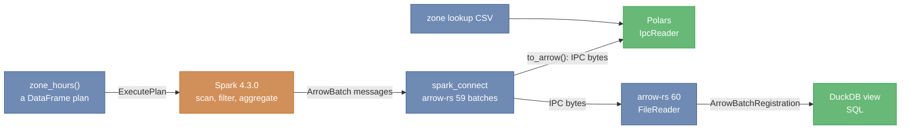
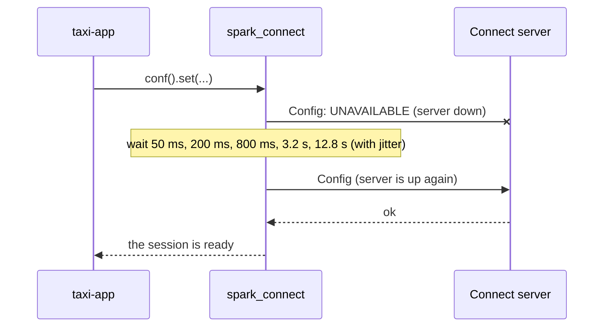

# Chapter 28: Building an application on a Connect client

[Chapter 27](ch27-connect-clients.md) ran one query from five clients. A real application does more than one query. It asks a heavy question, then many small questions about the answer, and it must survive a server that restarts. This chapter builds such an application in Rust. It starts from the author's demo of the Rust client with DuckDB and Polars, and it makes the demo into a small taxi application.

**A Connect client lets an application put each part of its work in the correct place. Spark gets the heavy work as a plan and returns a small result as Arrow batches. Polars and DuckDB read these batches as they are, without a row conversion, and they answer the follow-up questions in milliseconds. You can measure where the work must go. Pull the rows when the follow-up questions pay for the pull. Send a plan when they do not.**

The code is in [`code/ch28`](https://github.com/lisancao/spark-masterclass/tree/main/code/ch28). The application compiles and runs in the Rust image of [Chapter 27](ch27-connect-clients.md) (`rust:bookworm`, Rust 1.99.1, with `protoc`). It uses the Connect server of [Chapter 27](ch27-connect-clients.md) (`code/ch27/server.sh`, Spark 4.3.0 on port 15106). The data is six months of taxi trips, January to June 2026 (`yellow-h1`, 22,836,515 trips). The server and the application run on the same 16-core Linux machine.

<figure markdown>
  <video autoplay loop muted playsinline controls width="1280" height="720" poster="../../media/clips/ch28-anim-batches.webp">
    <source src="../../media/clips/ch28-anim-batches.mp4" type="video/mp4">
  </video>
  <figcaption>Spark writes the result of each task as an Arrow record batch. The batches go to the application over gRPC, and Polars takes the column buffers as they are. The totals come from <code>app.txt</code>. The number of tasks and batches is schematic.</figcaption>
</figure>

## The architecture

<figure markdown>


<figcaption>The taxi application. Spark reads six months of Parquet and returns 6,145 rows of aggregates as 145.4 KiB of Arrow. Polars and DuckDB use the same Arrow data for the follow-up questions. The sizes come from <code>app.txt</code>.</figcaption>
</figure>

The application is one Rust binary with three parts:

| Part | Crate | Job |
|---|---|---|
| Plan builder and transport | `apache-spark-connect` 4.3.0 | Builds plans, sends them, retries, reattaches, decodes errors |
| Local data frames | `polars` 0.55.2 | Joins and aggregates on the results, and reads the small zone lookup file |
| Local SQL | `duckdb` 1.20000.2 (DuckDB 2.0) | SQL with window functions on the same Arrow data |

The three crates use three different Arrow implementations. The Rust client uses arrow-rs 59. DuckDB 2.0 uses arrow-rs 60. Polars uses its own implementation, `polars-arrow`. Each implementation has its own `RecordBatch` type. Thus the application cannot give the batches of the client to DuckDB directly.

All three can read the Arrow IPC format. Thus the hand-off between them is a buffer of IPC bytes. The readers take the column buffers from those bytes, and no value goes through a row type.



## Step 1: The project

`Cargo.toml` pins each crate. The features of `polars` and `duckdb` are the ones that the build and the first run needed:

```toml
[dependencies]
# The Spark Connect client (library name `spark_connect`). It uses arrow-rs 59 inside.
spark-connect = { package = "apache-spark-connect", version = "=4.3.0" }
# arrow-rs at DuckDB 2.0's major (60). Results cross from the client's arrow 59 as Arrow IPC bytes.
arrow = { version = "60", features = ["prettyprint"] }
# DuckDB 2.0 (crate 1.20000.x), built from source. `vtab-arrow` registers RecordBatches as a table.
duckdb = { version = "=1.20000.2", features = ["bundled", "vtab-arrow"] }
# Polars has its own Arrow implementation (polars-arrow) and reads the same IPC bytes.
# `parquet` is there only to work around pola-rs/polars#27898 (a compile error without it).
polars = { version = "=0.55.2", features = ["lazy", "ipc", "csv", "dtype-full", "fmt", "round_series", "strings", "temporal", "parquet"] }
```

The client crate also has a `polars` feature with a `to_polars()` method. That method uses polars 0.54, and a frame from it is a different type from a frame of polars 0.55. The method does the same IPC hand-off inside the client. This application does the hand-off itself, so it can select its own Polars version. The `bundled` feature compiles DuckDB from its C++ source, so the image needs `cmake` and a C++ compiler. The first build of the application takes several minutes.

`run.sh build` compiles three programs from one library (`src/lib.rs`):

- `taxi-app`, the application
- `crossover`, the measurement of Step 6
- `resilience`, the failure tests of Step 7

## Step 2: Configuration from the application

The application gets its connection from the environment and sets up its session in one function:

```rust
pub fn connect() -> spark_connect::Result<SparkSession> {
    let remote = std::env::var("SPARK_REMOTE").unwrap_or_else(|_| "sc://localhost:15106/;user_id=taxi-app".into());
    let spark = SparkSession::builder().remote(&remote).get_or_create()?;
    // Session settings that this app depends on. They live in the server session, not in the binary.
    spark.conf().set("spark.sql.shuffle.partitions", "16")?;
    spark.conf().set("spark.sql.session.timeZone", "UTC")?;
    // Every operation of this process carries the tag: the server UI, the REST API and
    // spark.interrupt_tag() can all find them by it.
    spark.add_tag("taxi-app")?;
    Ok(spark)
}
```

The configuration has three levels. Each level has a different owner:

| Level | Example | Where it goes |
|---|---|---|
| Connection string | `sc://host:15002/;user_id=taxi-app;token=...;use_ssl=true` | The client: the channel, TLS, the user in each request |
| Session configuration | `spark.conf().set("spark.sql.shuffle.partitions", "16")` | The server session, through the `Config` RPC. It applies to all queries of this session. |
| Server configuration | `spark.driver.maxResultSize`, the stream limits of Step 7 | The command that starts the server. The application cannot change it. |

The Rust client reads `SPARK_CONNECT_AUTHENTICATE_TOKEN` for the token and `SPARK_CONNECT_USER_AGENT` for the client type, as PySpark does. It does not read `SPARK_REMOTE` itself, so the application reads it. The result of the user and the tag is visible on the server. `rest_tags.py` finds the operations of the application in the REST API of the server by the tag:

```text
operations with the tag taxi-app: 4
{"userId": "taxi-app", "sparkSessionTags": ["taxi-app"], "state": "CLOSED", "statement": "common {\n  plan_id: 5\n}\naggregate {\n  input {\n    commo
```

[Chapter 26](ch26-connect-observability.md) uses these fields to follow and stop the operations of a client.

## Step 3: The heavy question goes to Spark as a plan

The heavy question is the number of trips and the average fare for each pickup zone and each hour, over six months. The application builds it with the DataFrame API. Nothing runs when the function returns. It is only a plan:

```rust
pub fn zone_hours(spark: &SparkSession, from: &str, to: &str) -> DataFrame {
    let pickup = || col("tpep_pickup_datetime");
    spark
        .read()
        .parquet(&trips_path())
        .filter(pickup().ge(lit_string(from)).and(pickup().lt(lit_string(to))))
        .group_by([col("PULocationID"), hour(pickup()).alias("hour")])
        .agg([count(lit(1)).alias("trips"), round_scale(avg(col("fare_amount")), lit(2)).alias("avg_fare")])
}
```

The hand-off to Polars is three lines. `to_arrow()` sends the plan, collects the Arrow batches, and returns them as the bytes of an Arrow IPC file. Polars reads the bytes:

```rust
pub fn to_polars(df: &DataFrame) -> Result<(PlDataFrame, usize), Box<dyn std::error::Error>> {
    let ipc = df.to_arrow()?;
    let n = ipc.len();
    Ok((IpcReader::new(Cursor::new(ipc)).finish()?, n))
}
```

```text
== 1. Connect, and set the session up from the app
server 4.3.0 | session b6bb53c5-e06c-4e18-93a2-bdfb575f716f
spark.sql.shuffle.partitions = Some("16")

== 2. Local: the zone lookup in Polars (Spark is not involved)
265 zones read in 8.5 ms

== 3. Heavy: six months of trips, aggregated by Spark, back as Arrow
Spark -> Arrow IPC (145.4 KiB) -> Polars: 6145 rows x 4 columns in 2966 ms
schema: Schema { fields: {"PULocationID": Int32, "hour": Int32, "trips": Int64, "avg_fare": Float64}, metadata: () }
```

<figure markdown>
  <video autoplay loop muted playsinline controls width="1280" height="720" poster="../../media/clips/ch28-heavy.webp">
    <source src="../../media/clips/ch28-heavy.mp4" type="video/mp4">
  </video>
  <figcaption>The application connects, reads the zone lookup in Polars, and sends the heavy question to Spark. The answer comes back as 145.4 KiB of Arrow, and Polars reads it.</figcaption>
</figure>

Spark read 22,836,515 trips. The application got 6,145 rows: one row for each pair of zone and hour. The types came through without a change: `PULocationID` is `Int32` in the Parquet files, in Spark and in Polars. The time in this run, 2966 ms, was the first query after a server start. Thus it includes the first file list and the first run of the JVM code. Step 6 gives the warm times.

## Step 4: The small questions stay local

After the pull, each follow-up question is a Polars query on 6,145 rows. The first question joins the zone lookup, which only the application has, and computes the share of each borough:

```rust
let by_borough = hours
    .clone()
    .lazy()
    .join(zones.clone().lazy(), [col_pl("PULocationID")], [col_pl("LocationID")], JoinArgs::new(JoinType::Left))
    .group_by([col_pl("Borough")])
    .agg([col_pl("trips").sum().alias("trips")])
    .with_columns([(col_pl("trips").cast(DataType::Float64) * lit_pl(100.0) / col_pl("trips").sum())
        .round(1, RoundMode::HalfToEven)
        .alias("pct")])
    .sort(["trips"], SortMultipleOptions::default().with_order_descending(true))
    .collect()?;
```

```text
== 4. Interactive: follow-up questions answered in Polars, no round trip
shape: (8, 3)
┌───────────────┬──────────┬──────┐
│ Borough       ┆ trips    ┆ pct  │
│ ---           ┆ ---      ┆ ---  │
│ str           ┆ i64      ┆ f64  │
╞═══════════════╪══════════╪══════╡
│ Manhattan     ┆ 19716556 ┆ 86.3 │
│ Queens        ┆ 2009046  ┆ 8.8  │
│ Brooklyn      ┆ 871224   ┆ 3.8  │
│ Bronx         ┆ 198172   ┆ 0.9  │
│ Unknown       ┆ 26129    ┆ 0.1  │
│ N/A           ┆ 10158    ┆ 0.0  │
│ EWR           ┆ 2962     ┆ 0.0  │
│ Staten Island ┆ 2268     ┆ 0.0  │
└───────────────┴──────────┴──────┘
question 1 in 6.0 ms
```

The sum of the borough column is 22,836,515, the same as the number of trips that Spark read. Manhattan has 86.3% of the pickups of the yellow cabs. The second question, the three busiest hours, took 1.3 ms (18:00, 17:00 and 19:00). These two times are single runs, but they are a thousand times less than one round trip to Spark.

DuckDB gets the same result through the arrow-rs 60 reader. `ArrowBatchRegistration` registers the batch as a table function, and DuckDB scans its buffers without a copy:

```rust
let batches = ipc_to_batches(&plan.to_arrow()?)?;
let batch = arrow::compute::concat_batches(&batches[0].schema(), &batches)?;
let db = Connection::open_in_memory()?;
db.register_table_function::<ArrowVTab>("arrow")?;
// The registration keeps the batch alive while the view uses it. DuckDB scans the Arrow buffers.
let reg = ArrowBatchRegistration::new(batch);
db.execute("SET VARIABLE zone_hours_batch = ?", [&reg])?;
db.execute_batch("CREATE VIEW zone_hours AS SELECT * FROM arrow(getvariable('zone_hours_batch'))")?;
```

```text
busiest zone of each hour, top 5:
+--------------+------+-------+----------+
| PULocationID | hour | trips | avg_fare |
+--------------+------+-------+----------+
| 161          | 18   | 83918 | 16.87    |
| 237          | 17   | 81580 | 14.47    |
| 237          | 14   | 80616 | 14.24    |
| 237          | 15   | 80541 | 14.38    |
| 237          | 16   | 77492 | 14.52    |
+--------------+------+-------+----------+
```

<figure markdown>
  <video autoplay loop muted playsinline controls width="1280" height="720" poster="../../media/clips/ch28-local.webp">
    <source src="../../media/clips/ch28-local.mp4" type="video/mp4">
  </video>
  <figcaption>The follow-up questions. Polars joins the zone lookup and computes the borough shares. DuckDB finds the busiest zone of each hour with <code>QUALIFY</code>. Spark is not involved.</figcaption>
</figure>

Zone 161 (Midtown Center) is the busiest zone at 18:00, and zone 237 (Upper East Side South) is the busiest at most other hours. This is a SQL question with a window function, and DuckDB is a good tool for it. Polars could answer it too. The two engines share the data, so the application can use the engine that suits each question.

## Step 5: Errors

The server analyzes the plan, so an error in a plan comes back from the server. The Rust client returns it as a `SparkError` with the fields of the server error:

```rust
match plan.select([col("revenue")]).count() {
    Ok(_) => println!("no error?"),
    Err(e) => {
        println!("condition: {:?}", e.get_condition());
        println!("sqlstate:  {:?}", e.get_sql_state());
        println!("operation: {:?}", e.operation_id);
```

```text
== 6. Errors: what the app gets when the server rejects a plan
condition: Some("UNRESOLVED_COLUMN.WITH_SUGGESTION")
sqlstate:  Some("42703")
operation: Some("a6219ca5-31f3-4320-bbef-a591ad44f663")
message:   [UNRESOLVED_COLUMN.WITH_SUGGESTION] A column, variable, or function parameter with name
```

An application must make a decision for each error: show it to the user, retry, or stop. Use the condition and the SQLSTATE for this decision, not the message text:

| SQLSTATE class | Example | What the application does |
|---|---|---|
| `42` | `42703` UNRESOLVED_COLUMN | An error in the plan. Retry cannot help. Show the error and the suggestion. |
| `22` | division by zero with ANSI mode | An error in the data. Show the row or the query. |
| gRPC `UNAVAILABLE` | the server is down or restarts | The client retries it automatically (Step 7). |

The operation ID is the link to the server. The same ID is in the REST API of the server and in its log ([Chapter 26](ch26-connect-observability.md)). Log it with the error.

## Step 6: Where is the crossover?

Steps 3 and 4 sent the aggregation to Spark and kept the small result. There is a second method. The application can pull the raw rows of the window once, and then answer each question in Polars. Which method is faster depends on the size of the window and on the number of questions.

`crossover` measures the three costs for windows from one day to six months. Each number is the median of three runs after a warmup run, and the run took the book's benchmark lock:

- **spark**: send the aggregation as a plan, and get the 6,145 or fewer rows back (one question).
- **pull**: get the raw rows of the window (three columns) as Arrow into Polars (once).
- **local**: the same aggregation in Polars on the pulled rows (each later question).

```rust
fn local_agg(raw: &DataFrame) -> PolarsResult<DataFrame> {
    raw.clone()
        .lazy()
        .group_by([col("PULocationID"), col("tpep_pickup_datetime").dt().hour().alias("hour")])
        .agg([len().alias("trips"), col("fare_amount").mean().round(2, RoundMode::HalfToEven).alias("avg_fare")])
        .collect()
}
```

```text
window          rows  pull MiB  spark ms   pull ms  local ms  break-even
1 day         114466       2.2       334       274       5.9       0.8 q
3 days        323152       6.2       324       269      12.5       0.9 q
1 week        734281      14.0       252       275      20.5       1.2 q
2 weeks      1605573      30.7       302       325      33.0       1.2 q
1 month      3724894      71.1       390       630     102.6       2.2 q
2 months     7124760     136.1       393       725     171.7       3.3 q
3 months    11077203     211.6       367      1216     319.0      25.5 q
6 months    22836515     436.2       514      1811     637.2       never
```

<figure markdown>


<figcaption>The cost of one question on Spark, of one pull, and of one question in Polars after the pull, from <code>crossover.txt</code>. Spark and the application ran on the same 16-core machine.</figcaption>
</figure>

After a pull, `q` questions cost `pull + q × local` in the application, and `q × spark` on Spark. The two are equal at `q = pull / (spark − local)`. This is the break-even column:

- **Up to two weeks (1.6 million rows, 31 MiB):** the pull pays after one or two questions. A Polars question costs 6 to 33 ms, against 252 to 334 ms for a round trip. For interactive work on a window of this size, pull the rows.
- **One and two months (3.7 and 7.1 million rows):** the pull pays after 2.2 and 3.3 questions. If the user asks more than a few questions, pull.
- **Three months (11 million rows, 212 MiB):** the pull pays only after 25 questions.
- **Six months (23 million rows, 436 MiB):** never. Polars took 637 ms for one question, and Spark took 514 ms. Spark used 16 cores on the Parquet files and read only the three columns that it needed. Polars aggregated all the pulled rows on the client side. Send the plan.

The Spark cost hardly changes with the window. Most of it is the fixed cost of one query: the round trip, the analysis, the task schedule and the file list. The pull cost and the local cost grow with the rows.

Thus, for this workload on this machine, the crossover occurs between two and three months of data. That is about 7 to 11 million rows, or 140 to 210 MiB of Arrow. On a real cluster, with a network between the client and the server, the pull costs more and Spark has more cores. Both changes move the crossover to smaller windows. Measure it again on your own setup with `crossover`.

!!! note "This is not a contest between engines"
    The application did not use Polars or DuckDB to read the Parquet files. In a real deployment, the data is in object storage that the server can read, and the application often cannot. The measurement answers a question of the application: when to move rows to the client, and when to move the question to the data.

## Step 7: Retries and reattach

Two failures are normal for a long-lived application. The server can end a stream early, or the server can stop for a short time. The client handles the two, and `resilience.sh` shows each one from the application.

**A stream that ends early.** The server ends a reattachable stream after a maximum time or a maximum size ([Chapter 27](ch27-connect-clients.md), Step 7). The script starts the server with a stream limit of 1 MiB and pulls one month of raw rows, 71 MiB of Arrow:

```text
== 1. server.sh small-streams: each response stream ends after 1 MiB
[  0.2 s] session f148d202-36b9-43f4-9830-16142f0d36aa
[  4.0 s] 3724894 rows, 71.1 MiB of Arrow IPC
server log: 62 ReattachExecute calls for this pull
```

The application code did not change. The client called `ReattachExecute` 62 times, and each call continued from the last response that the client had. The application only saw the full result.

**A server that is not there.** The script stops the server, starts the application, and starts the server again 8 s later:

```text
== 2. the server is down when the app starts
[  8.0 s] server.sh start
[ 18.1 s] session ec90c3cd-a4b8-40e4-89a9-d97cac4859aa
[ 19.5 s] query done, count() = 1000
```

<figure markdown>
  <video autoplay loop muted playsinline controls width="1280" height="720" poster="../../media/clips/ch28-retry.webp">
    <source src="../../media/clips/ch28-retry.mp4" type="video/mp4">
  </video>
  <figcaption>The server is down when the application starts. The client retries with a longer wait each time. The server comes up after about 10 s, and the next retry connects.</figcaption>
</figure>



The application saw no error. The client got `UNAVAILABLE` for each try and waited longer each time. The default retry policy of the Rust client has the values of the default policy of PySpark (`crates/spark-connect-core/src/retries.rs` at v4.3.0):

- an initial wait of 50 ms
- a multiplier of 4
- a maximum wait of 60 s
- a maximum of 15 retries
- a random jitter The server needed about 10 s to start. The retry after it came up connected, at 18.1 s.

Two consequences for the application:

- **A long wait is not a hang.** With 15 retries and a maximum wait of 60 s, an application can wait for many minutes before it gets an error. If a user waits for the result, show the state, or put a time limit on the call.
- **Retries are safe for a query, not always for a command.** The client retries an RPC that did not reach the server. The server does not run an operation two times with the same operation ID. A write with a new operation ID is a new operation. [Chapter 72](ch72-determinism-retries.md) explains operation IDs and idempotent writes.

## The whole chapter, on one page

```bash
cd code
ch27/server.sh start                  # the Connect server of Chapter 27: sc://localhost:15106
ch28/run.sh build                     # taxi-app, crossover, resilience (Rust image, DuckDB from source)
ch28/run.sh app                       # Steps 2 to 5
uv run python ch28/rest_tags.py       # the operations of the app, by tag, in the REST API
ch28/run.sh crossover                 # Step 6, under the benchmark lock
ch28/run.sh resilience                # Step 7: reattach, then a server that comes back
ch27/server.sh stop
```

- **Put the work where it is cheap.** A plan goes to Spark for the work over the full data. The small result comes back as Arrow, and the follow-up questions stay in the process.
- **The hand-off is Arrow IPC bytes.** The client, DuckDB and Polars use three Arrow implementations. They all read the IPC format, and no value goes through a row type.
- **The crossover is measurable.** For this workload, the pull of the raw rows paid after one or two questions, up to two weeks of data. Above three months, the plan to Spark was faster for each question.
- **The client handles the normal failures.** It reattached 62 times for one pull, and it waited for a server that came back after 10 s. The application code did not change.
- **Configuration has three owners.** The connection string belongs to the client, `spark.conf()` belongs to the session, and the server settings belong to the server start command.

## Further reading

- [Spark Connect from Rust, with DuckDB 2.0 and Polars](https://systemsnull.net/posts/data-engineering-ai/spark-connect-rust-duckdb-polars), the author's post that this chapter starts from. It has a table of each Spark type in arrow-rs, DuckDB and Polars.
- [The Rust client documentation](https://apache.github.io/spark-connect-rust/): configuration, data sources and the architecture of the crates.
- [Arrow IPC format](https://arrow.apache.org/docs/format/Columnar.html#serialization-and-interprocess-communication-ipc), the format of the hand-off.
- [DuckDB Rust client](https://duckdb.org/docs/stable/clients/rust), with the Arrow table function.
