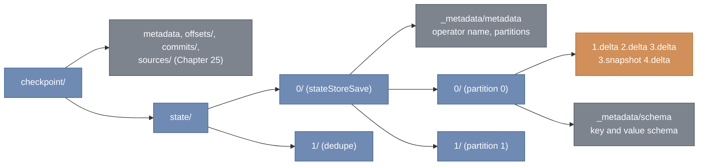
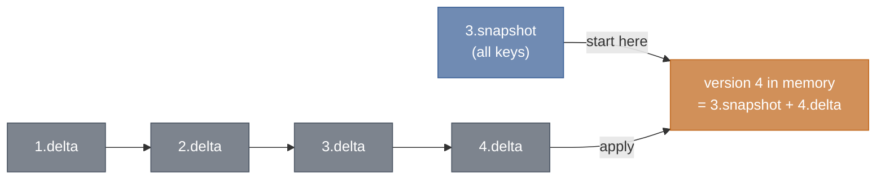
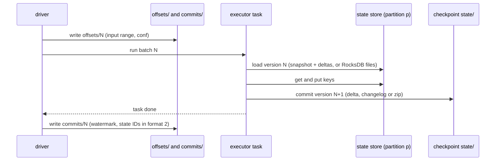

# Chapter 29: Inside a checkpoint and the state store

[Chapter 25](ch25-structured-streaming.md) opened the logs of a checkpoint: `offsets/N` before a batch, `commits/N` after it. Those logs tell Spark which input each batch read. They do not hold the result of a stateful operator. A count, the seen IDs of `dropDuplicates` and the sessions of [Chapter 27](ch27-transform-with-state.md) are in the `state/` folder. That folder is usually the largest part of a checkpoint, and it is the part that limits what you can change in a query.

This chapter opens `state/` file by file. It decodes a state file with the Python standard library, and it reads the same state with the state data source. Then it compares the two state store providers. At the end, it changes the number of state partitions of a stopped query, and the schema of a state variable.

**The state store is a versioned key-value store for each partition of each stateful operator. Batch N reads version N and writes version N+1. On disk, each version is a small file of changes, and from time to time a full snapshot. The provider decides the format of these files. The checkpoint fixes the provider, the number of partitions and the state schema at the first batch. Each limit on a change to a stateful query comes from these three facts.**

The scripts are in [`code/ch29`](https://github.com/lisancao/spark-masterclass/tree/main/code/ch29), and each number in the chapter comes from their saved output in `code/ch29/output/`. They use the checkout drops of Chapter 27 and the file source on Spark 4.3.0.

## The query: a count of distinct events per user

`c1_hdfs.py` removes re-sent events and counts the events of each user:

```python
counts = (spark.readStream.schema(SCHEMA).option("maxFilesPerTrigger", 1).json(str(inbox))
          .dropDuplicates(["event_id"]).groupBy("user").count())
```

The query has two stateful operators. The streaming query progress names them:

```text
batches (id, input rows): [(0, 10), (1, 9), (2, 8), (3, 4)]
operators: ['stateStoreSave', 'dedupe']
```

Spark gives each stateful operator a number in the plan. Here the aggregation is operator 0 (`stateStoreSave`), and the deduplication is operator 1 (`dedupe`). Each operator has its own folder under `state/`. The session uses 2 shuffle partitions, so each operator has 2 state partitions:



## Step 1: The files of one operator

The HDFS-backed provider is the default. It keeps the state of each partition in a hash map in executor memory. At each commit, it writes the changes of the batch to a **delta file**. The script sets `minDeltasForSnapshot` to 2 (default 10) and `maintenanceInterval` to 1 second (default 60 seconds), so a short run also writes a snapshot:

```text
The state of operator 0 (the count), .crc files left out:
0/1.delta  (104 B)
0/2.delta  (98 B)
0/3.delta  (119 B)
0/3.snapshot  (119 B)
0/4.delta  (105 B)
0/_metadata/schema  (195 B)
1/1.delta  (91 B)
1/2.delta  (101 B)
1/3.delta  (97 B)
1/3.snapshot  (118 B)
1/4.delta  (82 B)
_metadata/metadata  (150 B)
```

The four batches (0 to 3) wrote versions 1 to 4. Thus, the file `N.delta` holds the changes of batch N-1. The `.crc` files that are not in the list are checksums from the local Hadoop file system. On object storage, you do not see them.

Two metadata files describe the operator. `_metadata/metadata` names the operator and the number of partitions. `_metadata/schema` holds the key schema and the value schema as JSON, after a version line:

```text
--- state/0/_metadata/metadata
v1
{"operatorInfo":{"operatorId":0,"operatorName":"stateStoreSave"},"stateStoreInfo":[{"storeName":"default","numColsPrefixKey":0,"numPartitions":2}]}
--- state/0/0/_metadata/schema (printable text only: a version, the key schema, the value schema)
v2
Z{"type":"struct","fields":[{"name":"user","type":"string","nullable":true,"metadata":{}}]}
Y{"type":"struct","fields":[{"name":"count","type":"long","nullable":true,"metadata":{}}]}
```

The `Z` and `Y` are not part of the JSON. They are the second byte of the length prefix that Java's `writeUTF` puts before each string (90 and 89 bytes). At each restart, Spark compares the schema of the new query with this file. Step 8 shows that check.

## Step 2: A delta file, byte by byte

A delta file is small, so you can read it byte by byte:

```text
$ xxd state/0/0/1.delta
00000000: 4c5a 3442 6c6f 636b 253e 0000 0064 0000  LZ4Block%>...d..
00000010: 0027 48e9 0d53 0000 0018 0001 00a3 0200  .'H..S..........
00000020: 0000 1000 0000 7531 1100 020f 0001 0200  ......u1........
00000030: 1103 0600 0102 000e 3000 1134 1800 0002  ........0..4....
00000040: 0000 3f00 0102 0000 4c00 8000 0000 00ff  ..?.....L.......
00000050: ffff ff4c 5a34 426c 6f63 6b15 0000 0000  ...LZ4Block.....
00000060: 0000 0000 0000 0000                      ........
```

The provider compresses the file with the codec in `spark.sql.streaming.stateStore.compression.codec` (default `lz4`). The `LZ4Block` text is the frame of `LZ4BlockOutputStream` from the lz4-java library. Each frame has five parts:

1. The magic text `LZ4Block` (8 bytes).
2. A token byte. `0x25` means the LZ4 method (`0x20`) at level 5.
3. The compressed length, as a little-endian int: `0x3e` is 62 bytes.
4. The original length: `0x64` is 100 bytes.
5. A checksum (4 bytes), and then the compressed block.

The file ends with an empty frame. Its token `0x15` means "raw" (`0x10`), and its lengths are 0. Inside, the data is a sequence of records. `HDFSBackedStateStoreProvider` writes them with Java's `DataOutputStream`, so the ints are big-endian:

```text
int keySize, key bytes, int valueSize, value bytes     (an update)
int keySize, key bytes, int -1                         (a removal)
int -1                                                 (the end of the file)
```

The key and the value are `UnsafeRow` bytes, the binary row format of Spark. An `UnsafeRow` starts with a null bitset in 8-byte words. Then it has one 8-byte slot for each field. A fixed-length field (such as a `LONG`) is in its slot. A string slot holds the offset and the length of the bytes in a variable-length region at the end of the row.

`lz4delta.py` decodes all of this with the standard library: the LZ4 block format, the lz4-java frame, the records and the two field types. It has 90 lines and no dependencies. For the file above, the arithmetic agrees with the 100 bytes in the header. Each key (a row with one string) is 24 bytes. Each value (a row with one `LONG`) is 16 bytes. Two records of 4 + 24 + 4 + 16 bytes, plus the 4-byte end marker, are 100 bytes.

## Step 3: Versions, deltas and snapshots

The script decodes every delta and snapshot of the count:

```text
Each delta and snapshot of the count, decoded (key: user, value: count):
  0/1.delta      100 bytes  [('u1', 3), ('u4', 2)]
  0/2.delta      100 bytes  [('u5', 2), ('u4', 3)]
  0/3.delta      148 bytes  [('u5', 4), ('u4', 4), ('u1', 5)]
  0/3.snapshot   148 bytes  [('u5', 4), ('u4', 4), ('u1', 5)]
  0/4.delta      100 bytes  [('u1', 6), ('u7', 1)]
  1/1.delta      100 bytes  [('u2', 3), ('u3', 2)]
  1/2.delta      100 bytes  [('u3', 5), ('u2', 4)]
  1/3.delta      100 bytes  [('u6', 1), ('u2', 5)]
  1/3.snapshot   148 bytes  [('u6', 1), ('u2', 5), ('u3', 5)]
  1/4.delta       52 bytes  [('u6', 3)]
```

<figure markdown>
  <video autoplay loop muted playsinline controls width="1280" height="720" poster="../../media/clips/ch29-decode.webp">
    <source src="../../media/clips/ch29-decode.mp4" type="video/mp4">
  </video>
  <figcaption><code>c1_hdfs.py</code> on Spark 4.3.0. The count runs on the HDFS state store, and <code>lz4delta.py</code> decodes each delta file and snapshot with the Python standard library.</figcaption>
</figure>

The decoded files show how the provider works:

- **A delta holds only the keys that changed.** `u1` is in versions 1, 3 and 4 of partition 0, but not in version 2, because `u1` had no new event in batch 1.
- **A delta holds the new value, not the increment.** Version 4 has `('u1', 6)`, not `('u1', 1)`. Thus, a key needs only its last record.
- **A snapshot holds all keys of a version.** `1/3.snapshot` has `u3`, which did not change in version 3. A background maintenance task wrote the snapshot from the map in memory.
- **The partition of a key comes from a hash of the key.** `u1`, `u4`, `u5` and `u7` are in partition 0. `u2`, `u3` and `u6` are in partition 1.

To load version N after a restart, the provider reads the latest snapshot at or before N. Then it applies each later delta in sequence:



Without snapshots, a restart must apply each delta since the first batch. The maintenance task controls this cost with three settings:

| Setting | Default | Effect |
|---|---|---|
| `spark.sql.streaming.stateStore.minDeltasForSnapshot` | 10 | Write a snapshot after this number of deltas. |
| `spark.sql.streaming.stateStore.maintenanceInterval` | 60 s | How often the maintenance task runs. |
| `spark.sql.streaming.minBatchesToRetain` | 100 | Keep the files of this number of recent versions. The task deletes older files. |

The third configuration is the limit for the state data source in the next step. You can read only the versions that the checkpoint still has.

!!! note "New in 4.3: decoupled state store maintenance"
    In Spark 4.3, snapshots and cleanup are separate operations (SPARK-56498). Each one has its own thread pool. A slow cleanup cannot stop a snapshot. A close of a provider waits for its maintenance. The internal configuration `spark.sql.streaming.stateStore.numStateStoreMaintenanceThreads` is now the total of both pools, with a minimum of 2. The new internal configuration `spark.sql.streaming.stateStore.snapshotToCleanupThreadRatio` (default 0.5) divides the threads.

## Step 4: The same state through the state data source

Decoded bytes show the format. For daily work, use the **state data source**. It reads a checkpoint as a batch DataFrame, and the query does not have to run:

```python
spark.read.format("statestore").option("operatorId", 0).load(str(ck)) \
    .selectExpr("key.user", "value.count", "partition_id").orderBy("user").show()
```

```text
+----+-----+------------+
|user|count|partition_id|
+----+-----+------------+
|  u1|    6|           0|
|  u2|    5|           1|
|  u3|    5|           1|
|  u4|    4|           0|
|  u5|    4|           0|
|  u6|    3|           1|
|  u7|    1|           0|
+----+-----+------------+
```

The values agree with the decoded files: `u1` is 6 from `0/4.delta`, and `u3` is 5 from `1/3.snapshot`. Three options make the source a tool to find problems:

- **`batchId`** reads the state after an older batch. With `batchId` 1, `u1` is 3 and `u7` is not there yet.
- **`readChangeFeed`** with `changeStartBatchId` gives one row for each change, with the batch that made it. This is the content of the delta files, with the batch ID added.
- **`operatorId`** selects one operator when a query has more than one. Without it, the source reads operator 0.

```text
The change feed of partition 0:
+--------+-----------+----+-----+
|batch_id|change_type|user|count|
+--------+-----------+----+-----+
|       0|     update|  u1|    3|
|       0|     update|  u4|    2|
|       1|     update|  u4|    3|
|       1|     update|  u5|    2|
|       2|     update|  u1|    5|
|       2|     update|  u4|    4|
|       2|     update|  u5|    4|
|       3|     update|  u1|    6|
|       3|     update|  u7|    1|
+--------+-----------+----+-----+
```

Each row of the change feed is one record of a delta file: batch 2 wrote `3.delta`, and that file has `u5`, `u4` and `u1`. The `state-metadata` source lists the operators, their partitions and the batches that the checkpoint can still give:

```text
+----------+--------------+-------------+----------+----------+
|operatorId|operatorName  |numPartitions|minBatchId|maxBatchId|
+----------+--------------+-------------+----------+----------+
|0         |stateStoreSave|2            |0         |3         |
|1         |dedupe        |2            |0         |3         |
+----------+--------------+-------------+----------+----------+
```

Other options of the `statestore` source are for special cases:

| Option | Use |
|---|---|
| `storeName`, `joinSide` | the stores of a stream-stream join (`left` or `right`) |
| `stateVarName`, `readRegisteredTimers`, `flattenCollectionTypes` | the variables and timers of `transformWithState` ([Chapter 27](ch27-transform-with-state.md)) |
| `snapshotStartBatchId`, `snapshotPartitionId` | rebuild one partition from a given snapshot, when a later file is damaged |
| `changeEndBatchId` | the last batch of a change feed |

## Step 5: The RocksDB state store on disk

The HDFS-backed provider keeps all state in executor memory, so the state of a query must fit in the memory of the executors. `RocksDBStateStoreProvider` keeps a RocksDB database for each partition on the local disk of the executor. At each commit, it copies the new files of the database to the checkpoint. `c2_rocksdb.py` runs the same count on RocksDB three times, with three settings.

**First, with the default settings.** Each version is a zip file, and the data files of RocksDB (SST files) go to a shared `SSTs/` folder:

```text
1. spark.sql.streaming.stateStore.rocksdb.changelogCheckpointing.enabled = false (default)
1.zip  (3775 B)
2.zip  (3870 B)
3.zip  (3954 B)
4.zip  (4038 B)
SSTs/000008-26f213a0-e61b-465e-b354-499a8f2b92d4.sst  (1249 B)
SSTs/000009-e39b7904-e766-4a5c-9f5a-91902fe12822.sst  (1251 B)
SSTs/000010-ef6c6f2f-d414-4f14-832d-365f8e250b03.sst  (1264 B)
SSTs/000011-f687fba3-fefd-4cb3-bed5-d3032748d7e2.sst  (1251 B)
_metadata/schema  (195 B)

4.zip holds: ['000004.log', 'CURRENT', 'MANIFEST-000005', 'OPTIONS-000007', 'metadata']
its metadata file: v1
  numKeys 4, columnFamilyMapping {}, sstFiles:
    000008.sst -> SSTs/000008-26f213a0-e61b-465e-b354-499a8f2b92d4.sst  (1249 B)
    000009.sst -> SSTs/000009-e39b7904-e766-4a5c-9f5a-91902fe12822.sst  (1251 B)
    000010.sst -> SSTs/000010-ef6c6f2f-d414-4f14-832d-365f8e250b03.sst  (1264 B)
    000011.sst -> SSTs/000011-f687fba3-fefd-4cb3-bed5-d3032748d7e2.sst  (1251 B)
```

The zip holds the small files of RocksDB: `CURRENT`, the `MANIFEST`, the `OPTIONS` and the write-ahead log (`000004.log`). It also holds a `metadata` file that lists the SST files of the version. The SST files are not in the zip. Each one has a name with a unique ID, and each version lists the SST files that it uses. Many versions can use a file that did not change. Thus, a commit copies only the new SST files.

**Second, with changelog checkpointing.** With `spark.sql.streaming.stateStore.rocksdb.changelogCheckpointing.enabled=true`, a commit writes only the changed keys to a `.changelog` file, like a delta of the HDFS provider:

```text
2. spark.sql.streaming.stateStore.rocksdb.changelogCheckpointing.enabled = true
1.changelog  (95 B)
2.changelog  (95 B)
3.changelog  (95 B)
4.changelog  (96 B)
_metadata/schema  (195 B)
```

A commit is now faster, because it writes one small file. The maintenance task uploads a full snapshot zip from time to time, and a restart applies the changelogs after the last snapshot. The default in Spark 4.3.0 is `false` for micro-batch queries. Real-time Mode sets it to `true` for its queries ([Chapter 28](ch28-real-time-mode.md)).

**Third, with state checkpoint format version 2.** `spark.sql.streaming.stateStore.checkpointFormatVersion=2` gives each version of each partition a unique ID:

```text
3. spark.sql.streaming.stateStore.rocksdb.changelogCheckpointing.enabled = true and spark.sql.streaming.stateStore.checkpointFormatVersion = 2
1_05b26bf2-acf6-4fdd-a735-accf5547ad66.changelog  (103 B)
2_6402497a-3820-4b4a-a4a8-830dcaeebad7.changelog  (186 B)
3_3355fc5a-61fa-4459-8a89-20ae7331c76a.changelog  (225 B)
4_84e140b0-d1e9-4c9c-bb6f-2bdee7ef839f.changelog  (271 B)
_metadata/schema  (195 B)
commits/3: v2 | {"nextBatchWatermarkMs":0,"stateUniqueIds":{"0":[["84e140b0-d1e9-4c9c-bb6f-2bdee7ef839f"],["7ed6b745-eb47-404c-af72-b6935ce548b1"]]}}
```

The file names now have the form `<version>_<unique ID>.changelog`, and `commits/N` records the unique ID of each partition. If Spark runs a batch again after a failure, the second run writes files with new IDs. Thus, the second run cannot read a stale file of the first run. The changelogs become larger with each version, because format 2 writes the lineage of earlier IDs into each changelog (`StateStoreChangelog.scala`). Real-time Mode requires format 2.

| Provider and configuration | Files for each version | Where the state lives |
|---|---|---|
| HDFS (default) | `N.delta`, sometimes `N.snapshot` | executor memory |
| RocksDB | `N.zip` and new files in `SSTs/` | executor local disk |
| RocksDB with changelog | `N.changelog`, sometimes `N.zip` | executor local disk |
| RocksDB, format 2 | `N_<id>.changelog` (or `.zip`), IDs in `commits/` | executor local disk |

!!! caution "Do not move a query to another provider on the same checkpoint"
    Do not change `spark.sql.streaming.stateStore.providerClass` for a query that has a checkpoint. The checkpoint records the provider in `offsets/N`, and Spark uses the recorded value. To change the provider, start a new checkpoint.

## Step 6: transformWithState in RocksDB: column families

A `groupBy` keeps one value for each key. A `transformWithState` processor keeps many state variables for each key, and timers. RocksDB keeps them apart in **column families**. The script reads the latest zip of the `Sessionizer` checkpoint from Chapter 27:

```text
4. The transformWithState checkpoint of Chapter 27 (t2_sessions.py), partition 0:
  5.zip: numKeys 4
  columnFamilyMapping: {"$eventTimers_keyToTimestamp": 4, "$eventTimers_timestampToKey": 5, "default": 1, "seen": 3, "session": 2}
  operator files outside the partitions:
    state/0/_metadata/v2/0  (713 B)
    state/0/_stateSchema/default/0_4902d7e8-dcc3-4b55-9e1b-f72b606f6414  (2049 B)
  _metadata/v2/0: timeMode EventTime, outputMode Append
    session                        ValueState  ttl False
    $eventTimers_keyToTimestamp    TimerState  ttl False
    seen                           MapState    ttl False
    schema file: 0/_stateSchema/default/0_4902d7e8-dcc3-4b55-9e1b-f72b606f6414
```

The `Sessionizer` declared two variables, `session` and `seen`, and each one has a column family. Spark adds two column families for event-time timers:

- `$eventTimers_keyToTimestamp` holds the timers in the order of the key. Spark uses it to list or delete the timers of one key.
- `$eventTimers_timestampToKey` holds the same timers in the order of time. To find the expired timers, Spark scans this column family from the start to the watermark. It stops at the first timer that is later.

This design is the reason for the error `STORE_BACKEND_NOT_SUPPORTED_FOR_TWS` in Chapter 27. The HDFS provider has one hash map for each partition, with no column families and no scan in key order.

The operator metadata of `transformWithState` is version 2. It lists the time mode, the output mode and each state variable. It also points to a file in `_stateSchema/` with the schema of each variable. Step 8 changes one of those schemas.

## Step 7: Change the number of state partitions offline

The number of state partitions is `spark.sql.shuffle.partitions` at the first start of the query. The checkpoint keeps this number. [Chapter 25](ch25-structured-streaming.md) showed that a new value in the session has no effect. Spark 4.2 added an offline method to change the number. It is experimental, and it is only in Spark Classic. `c3_repartition.py` counts two drops on 2 partitions, and then it calls the method on the stopped query:

```python
spark._streamingCheckpointManager.repartition(str(ck), 4)
```

```text
1. two drops on 2 partitions. batches: [(0, 10), (1, 9)]
   state: u1=3@p0 u2=4@p1 u3=5@p1 u4=3@p0 u5=2@p0
   state/0 folders: ['0', '1']

2. repartition the stopped query to 4 partitions
   offsets and commits now: ['0', '1', '2'] ['0', '1', '2']
   state/0 folders: ['0', '1', '2', '3']
   state: u1=3@p2 u2=4@p3 u3=5@p1 u4=3@p2 u5=2@p2

3. restart with the last two drops; the session still says 2 partitions
   batches: [(3, 8), (4, 4)]
   state: u1=6@p2 u2=5@p3 u3=5@p1 u4=4@p2 u5=4@p2 u6=3@p3 u7=1@p0
```

The method wrote a new batch, batch 2. That batch read no input. It read the state of batch 1 and wrote it again into 4 partitions. Each key moved to the partition that its hash gives for 4 partitions. Then the restarted query continued at batch 3 on 4 partitions, although the session still had 2. The final counts are the same as in Step 4, so no event was lost or counted two times.

<figure markdown>
  <video autoplay loop muted playsinline controls width="1280" height="720" poster="../../media/clips/ch29-repartition.webp">
    <source src="../../media/clips/ch29-repartition.mp4" type="video/mp4">
  </video>
  <figcaption><code>c3_repartition.py</code>. The repartition writes batch 2 with no input. The keys move to new partitions, and the restarted query continues on 4 partitions.</figcaption>
</figure>

The method needs RocksDB. On the HDFS provider, it fails:

```text
  [STATE_REPARTITION_INVALID_CHECKPOINT.UNSUPPORTED_PROVIDER] The provided checkpoint
  location '.../ck' is in an invalid state.
  org.apache.spark.sql.execution.streaming.state.HDFSBackedStateStoreProvider is not
  supported SQLSTATE: 55019
```

!!! caution "Repartition a copy of the checkpoint"
    Stop the query before you call `repartition`. Do the operation on a copy of the checkpoint first. The API is experimental, and its documentation says that a call while the query runs can damage the checkpoint.

## Step 8: Change the schema of a state variable

At each restart, Spark compares the state schema of the new query with the schema in the checkpoint. The rules depend on the state encoding, `spark.sql.streaming.stateStore.encodingFormat`. The checkpoint also fixes this configuration at the first batch. `c4_evolution.py` stores `n=1` for one key in a `transformWithState` value. Then it restarts the query with a changed value schema and reads the value back:

```text
change                 unsaferow                                    avro
no change              read (1,)                                    read (1,)
rename n to count      read (1,)                                    read (None,)
add a field            STATE_STORE_VALUE_SCHEMA_NOT_COMPATIBLE      read (1, None)
widen INT to BIGINT    STATE_STORE_VALUE_SCHEMA_NOT_COMPATIBLE      read (1,)
drop a field           STATE_STORE_VALUE_SCHEMA_NOT_COMPATIBLE      read (1,)
narrow BIGINT to INT   STATE_STORE_VALUE_SCHEMA_NOT_COMPATIBLE      STATE_STORE_INVALID_VALUE_SCHEMA_EVOLUTION
```

The two encodings use opposite rules:

- **`unsaferow` (the default) reads fields by position.** The types must be the same, in the same positions. The names are not important, so a rename works. Each other change fails at the restart.
- **`avro` reads fields by name**, with the resolution rules of Avro. You can add a field, remove a field or widen a type. A narrower type fails.
- **A rename under `avro` loses the value with no error.** Avro sees a field `n` that the new schema does not have, and a new field `count` with no value. The query runs, and the old value is `None`.

The 4.3.0 documentation says that `avro` does not support a rename. But Spark did not reject the rename in this test, and it gave no warning. The part notes record this as an open item.

!!! caution "Do not rename a state field under avro"
    Do not rename a field of a state variable when the query uses `encodingFormat=avro`. Spark accepts the new schema, and the old values of the field become `None` for each key.

The key schema cannot change on either encoding. The 4.3.0 source has the error `STATE_STORE_KEY_SCHEMA_NOT_COMPATIBLE` for this case, but this chapter did not test it. If you expect the state of a query to change, start the query with `avro`, add fields or widen types, and never rename a field.

## How the pieces fit together



The logs of Chapter 25 and the state of this chapter work together. Spark writes `offsets/N`, then each task commits state version N+1, and then Spark writes `commits/N`. If the driver stops before `commits/N`, the restart runs batch N again from state version N. The files of version N+1 from the failed run are not a problem, because the second run writes them again. Format 2 also gives them new names.

## The whole chapter, on one page

- **`state/<operator>/<partition>/` holds one versioned store for each partition.** Batch N reads version N and writes version N+1.
- **The HDFS provider writes `N.delta` files** of changed keys with their new values, and a `N.snapshot` with all keys after `minDeltasForSnapshot` deltas. A restart loads the last snapshot and applies the later deltas.
- **A delta file is LZ4 frames of `UnsafeRow` records.** The Python standard library can decode it.
- **The state data source reads any retained version** (`batchId`), the changes between versions (`readChangeFeed`), and the operators (`state-metadata`).
- **RocksDB writes a zip and shared SST files for each version**, or a changelog when changelog checkpointing is on. Format version 2 adds a unique ID to each file and to `commits/N`.
- **`transformWithState` needs RocksDB** because it keeps each variable and the timers in separate column families.
- **The checkpoint fixes the provider, the partitions and the state schema.** Offline `repartition` (experimental, RocksDB only) changes the partitions. A new checkpoint changes the provider.
- **`unsaferow` reads state by position, `avro` by name.** Under `avro`, a rename loses the value with no error.

The full code of this chapter:

```bash
cd code
uv run python ch29/c1_hdfs.py         # Steps 1-4: HDFS state files and the state data source
uv run python ch29/c2_rocksdb.py      # Steps 5-6: RocksDB layouts (run ch27/t2_sessions.py first)
uv run python ch29/c3_repartition.py  # Step 7: offline repartition
uv run python ch29/c4_evolution.py    # Step 8: state schema changes
```

## Further reading

- [State Data Source Integration Guide](https://spark.apache.org/docs/4.3.0/streaming/structured-streaming-state-data-source.html), with all options of `statestore` and `state-metadata`.
- [Structured Streaming: transformWithState](https://spark.apache.org/docs/4.3.0/streaming/structured-streaming-transform-with-state.html), the section on schema evolution.
- [APIs on DataFrames and Datasets: State Store](https://spark.apache.org/docs/4.3.0/streaming/apis-on-dataframes-and-datasets.html#state-store), with the settings of both providers and of changelog checkpointing.
- In the Spark source: `HDFSBackedStateStoreProvider.scala`, `RocksDBFileManager.scala` and `StateStoreChangelog.scala` under `sql/core/src/main/scala/org/apache/spark/sql/execution/streaming/state/`.
