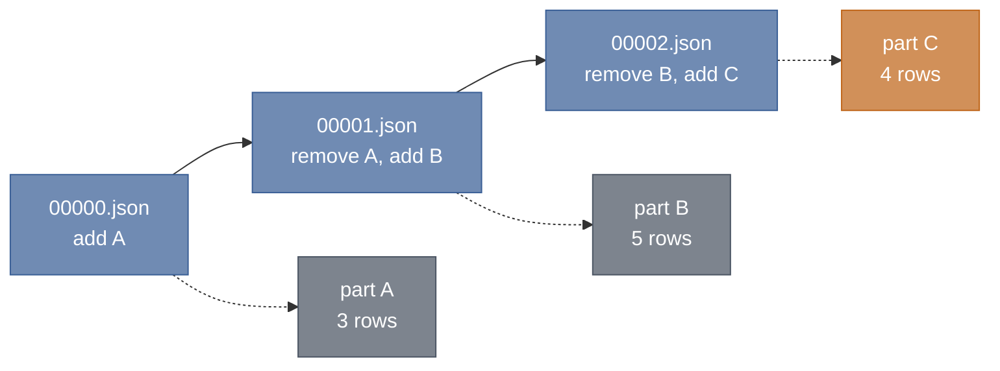
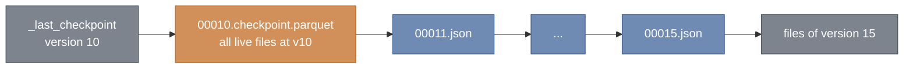
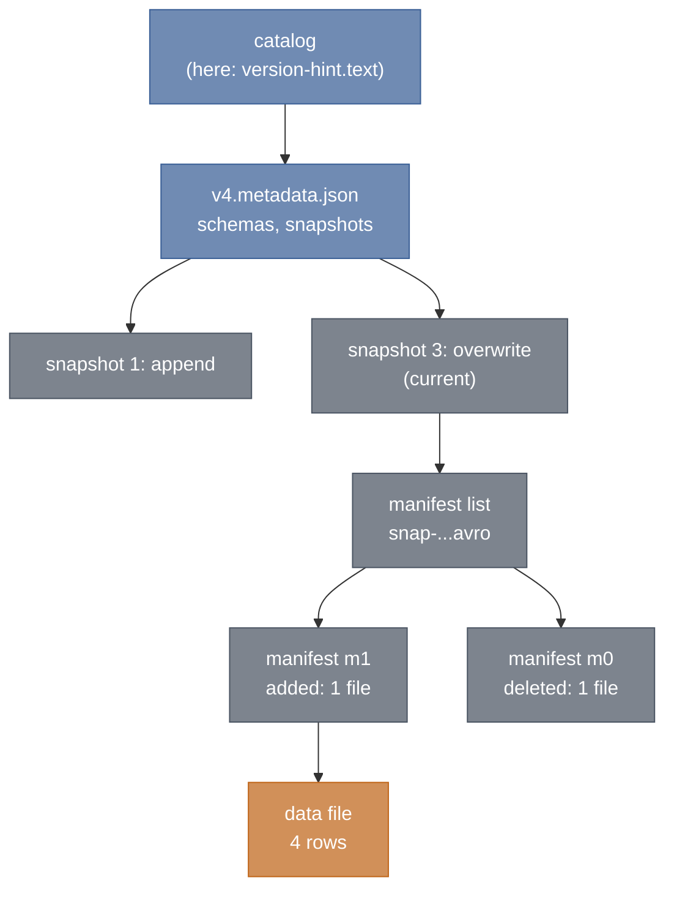
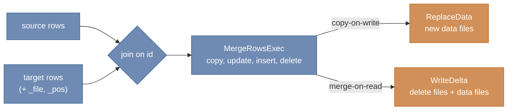
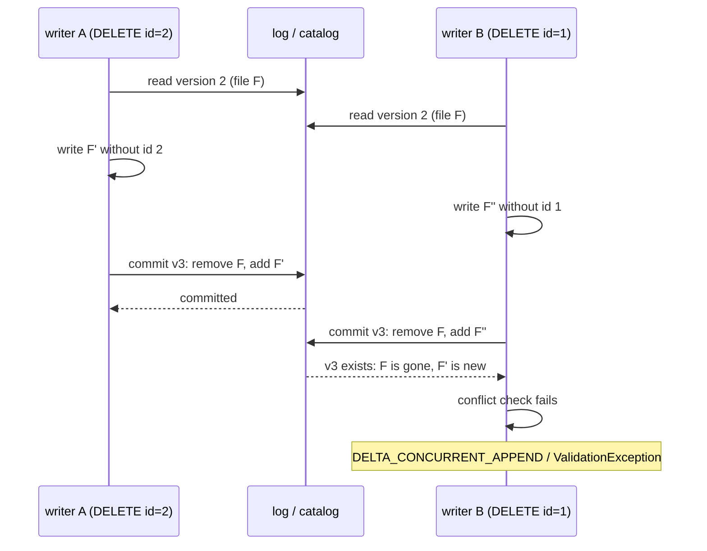

# Chapter 29: Tables: Delta and Iceberg, MERGE and time travel

Up to this part of the book, each write went to a folder of Parquet files. A folder is easy to make, and Spark reads it fast. But a folder does not know which files belong to it. It does not know the schema that its files must have. It cannot replace a file without a moment where a reader sees half of the change. And when a file is gone, the folder has no record of it.

Delta Lake and Apache Iceberg add the part that a folder does not have. They do not change the data files, which stay Parquet. They add a log next to the files.

**A table format is a log of commits. Each commit lists the exact data files that make one version of the table. A writer commits a version with one atomic operation on the log, and a reader reads only the files that its version lists. MERGE, time travel, schema enforcement and safe concurrent writers all come from this one mechanism.** This chapter opens the log of each format on disk. Then it follows the log through a MERGE, a DELETE, a time-travel query and two concurrent writers.

The code is in [`code/ch29`](https://github.com/lisancao/spark-masterclass/tree/main/code/ch29). Each output block comes from `code/ch29/output/`. Deep Iceberg topics (catalog types, REST catalogs, procedures and table maintenance) are in Chapter 31. This chapter keeps to the log on disk and to what Spark does with it.

!!! note "Versions: no Delta or Iceberg release supports Spark 4.3.0 yet"

    On the date of this chapter, Maven Central has no Delta Lake or Iceberg build for Spark 4.3:

    - **Delta Lake 4.4.1** (`io.delta:delta-spark_4.2_2.13:4.4.1`) is the newest release. Its PyPI package requires `pyspark<=4.2.0`. On Spark 4.3.0, its first write fails (Step 2). Thus, the Delta examples run on **Spark 4.2.0 with Delta 4.4.1**, the closest supported pair.
    - **Apache Iceberg 1.12.0** has runtimes for Spark 3.4 to 4.1 only. The Iceberg examples run on **Spark 4.3.0** with an unreleased runtime built from apache/iceberg pull request #18749 (commit `b1eab64`, "Spark: Initial support for 4.3.0"). The part notes record the build and its checksum.

    When the formats release builds for Spark 4.3, change only the coordinates. The log formats and the SQL in this chapter do not depend on the Spark version.

## Step 1: A folder of Parquet files is not a table

`parquet_folder.py` writes two rows to a folder. On the next day, the producer sends `amount` as a string, and the script appends that row to the same folder:

```python
spark.createDataFrame([("e1", 12.5), ("e2", 3.0)], "event STRING, amount DOUBLE") \
    .coalesce(1).write.parquet(str(folder))
# Day 2: the producer now sends amount as a string. Nothing checks it on write.
spark.createDataFrame([("e3", "12.00")], "event STRING, amount STRING") \
    .coalesce(1).write.mode("append").parquet(str(folder))
```

```text
day 1 written: 2 rows
day 2 appended with amount as a string: no error
files: ['part-00000-58401c7c-...', 'part-00000-c3aea5a1-...']
read: Py4JJavaError, conditions in the message: ['FAILED_READ_FILE.PARQUET_COLUMN_DATA_TYPE_MISMATCH']
read with mergeSchema: Py4JJavaError, conditions in the message: ['CANNOT_MERGE_SCHEMAS', 'CANNOT_MERGE_INCOMPATIBLE_DATA_TYPE']
after overwrite: ['part-00000-c9e80cac-...']
no version history, so the two earlier days are gone for good
```

The bad append succeeds, because a Parquet write examines only the DataFrame that it writes. It does not read the files that are already in the folder. The error occurs later, in the reader. The reader takes the schema from one file footer and then finds a `BINARY` column where it expects `double`. `mergeSchema` does not help, because no common type exists for the two columns.

The last line shows a second problem. `mode("overwrite")` deletes the old files and then writes new files. Between these two operations, a reader sees an empty or a partial folder. After the overwrite, the old data is gone, and nothing records that it existed.

These are the three gaps that a table format closes:

- **No schema on write.** Nothing stops a file with a different schema.
- **No atomic change.** A change to many files is many separate operations.
- **No history.** The folder holds only the files that exist now.

## Step 2: Install the formats on Spark 4.3, and see what fails

A table format is a set of jars: a Spark catalog, a data source and SQL extensions. The jar name includes the Spark version and the Scala version, because each format calls internal Spark APIs that change between Spark releases.

`delta_on_43.py` loads the Delta 4.4.1 jars (built for Spark 4.2) into Spark 4.3.0 and writes three rows:

```text
Spark 4.3.0 + io.delta:delta-spark_4.2_2.13:4.4.1
write failed: : java.lang.NoSuchMethodError: 'void org.apache.spark.sql.execution.LogicalRDD.<init>(scala.collection.immutable.Seq, org.apache.spark.rdd.RDD, org.apache.spark.sql.catalyst.plans.physical.Partitionin
```

The session starts, and the extensions load. The failure occurs at the first write. Delta calls a constructor of the internal class `LogicalRDD`, and the signature of that constructor changed in Spark 4.3. A `NoSuchMethodError` is the usual result when a jar for one Spark release runs on a different release. Thus, use the jar whose name has your Spark version.

The Delta examples use the closest supported pair. The script starts with `configure_spark_with_delta_pip`, which adds the Delta package to `spark.jars.packages`:

```python
builder = (SparkSession.builder.master("local[4]").appName("ch29-delta")
           .config("spark.sql.extensions", "io.delta.sql.DeltaSparkSessionExtension")
           .config("spark.sql.catalog.spark_catalog", "org.apache.spark.sql.delta.catalog.DeltaCatalog")
           .config("spark.sql.session.timeZone", "UTC")
           .config("spark.driver.extraJavaOptions", "-Duser.timezone=UTC")   # Delta reads TIMESTAMP AS OF in the JVM zone
           ...)
spark = configure_spark_with_delta_pip(builder).getOrCreate()
```

Run it in its own environment, so that it does not change the Spark 4.3.0 environment of the book:

```bash
uv run --no-project --with pyspark==4.2.0 --with delta-spark==4.4.1 python ch29/delta_log.py
```

The Iceberg examples use the helper `common/lake.py`. It adds the runtime jar and a catalog called `lake`. The catalog type is `hadoop`, which keeps all metadata as files in a local folder:

```python
"spark.jars": str(ICEBERG_JAR),
"spark.sql.extensions": "org.apache.iceberg.spark.extensions.IcebergSparkSessionExtensions",
"spark.sql.catalog.lake": "org.apache.iceberg.spark.SparkCatalog",
"spark.sql.catalog.lake.type": "hadoop",
"spark.sql.catalog.lake.warehouse": f"file://{warehouse}",
```

A Hadoop catalog is good for a laptop, because it needs no service. It is not a good choice for production, because it depends on an atomic rename in the file system. Chapter 31 compares it with the REST, JDBC and Hive catalogs.

## Step 3: The Delta transaction log on disk

`delta_log.py` writes three employees as a Delta table. It turns on the change data feed, which Step 6 uses. Then it lists the folder and prints each line of the first commit file, shortened to the fields that are important:

```text
== version 0: write three rows, with the change data feed on
data files: ['part-00000-3fafd84...']
_delta_log: ['00000000000000000000.crc', '00000000000000000000.json']
  commitInfo {"operation": "WRITE", "operationParameters": {"mode": "ErrorIfExists", "partitionBy": "[]"}, "operationMetrics": {"numFiles": "1", "numOutputRows": "3", "numOutputBytes": "1286"}}
  metaData   {"schema": ["id:integer", "name:string", "department:string", "salary:double"], "configuration": {"delta.enableChangeDataFeed": "true"}}
  protocol   {"minReaderVersion": 1, "minWriterVersion": 7, "writerFeatures": ["changeDataFeed", "invariants", "appendOnly"]}
  add        {"path": "part-00000-3fafd84...", "dataChange": true, "stats": {"numRecords": 3, "minValues": {"id": 1, "name": "Alice", "department": "Engineering", "salary": 55000.0}, "maxValues": {"id": 3, "name": "Charlie", "department": "Sales", "salary": 85000.0}}}
```

The table is a normal Parquet file plus a `_delta_log` folder. The log has one JSON file for each version, with the version number in 20 digits. The `.crc` file next to it holds a checksum and summary counts for that version. Each line of the JSON file is one **action**:

- `commitInfo` records the operation, its parameters and its metrics. Readers do not need it to read the table.
- `metaData` holds the schema and the table properties. The schema in the log is the schema of the table. Step 7 shows that writes must agree with it.
- `protocol` names the reader and writer versions, and the table features that a client must support. A client that does not know a feature in the list must not write to the table.
- `add` names a data file that is now part of the table. It also holds statistics: the row count and the minimum and maximum of each column. A reader uses these statistics to skip files, in the same way that Parquet uses row-group statistics ([Chapter 22](../roadmap.md)).

To commit version N, a writer creates the file `N.json`. The file system must make this operation "create only if the file does not exist". Then only one writer can create version N. Step 10 shows what occurs to the writer that loses.



## Step 4: MERGE and DELETE are new commits, not changes in place

The script then merges three rows. Bob gets a raise, and Diana and Eve are new. After that, it deletes Charlie:

```python
spark.sql(f"""MERGE INTO {T} t USING updates s ON t.id = s.id
              WHEN MATCHED THEN UPDATE SET * WHEN NOT MATCHED THEN INSERT *""")
spark.sql(f"DELETE FROM {T} WHERE id = 3")
```

```text
== version 1: MERGE a raise for Bob and two new hires
  commitInfo {"operation": "MERGE", ... "numTargetRowsCopied": "2", ... "numTargetRowsUpdated": "1", ... "numTargetRowsInserted": "2", ... "numTargetFilesRemoved": "1"}}
  add        {"path": "part-00000-66fcbc5...", "dataChange": true, "stats": {"numRecords": 5, ...}}
  cdc        {"path": "_change_data/cdc-00000-2e77be5d-2a6f-40da-ab90-0bbe27f1e5cf.c000.snappy.parquet", "partitionValues": {}, "size": 1909, "dataChange": false}
  remove     {"path": "part-00000-3fafd84...", "dataChange": true, "stats": {"numRecords": 3, "minValues": null, "maxValues": null}}

== version 2: DELETE Charlie
  commitInfo {"operation": "DELETE", ... "numCopiedRows": "4", ... "numDeletedRows": "1", ...}}
  remove     {"path": "part-00000-66fcbc5...", "dataChange": true}
  add        {"path": "part-00000-2ff2851...", "dataChange": true, "stats": {"numRecords": 4, ...}}
  cdc        {"path": "_change_data/cdc-00000-c42e0f0c-37a7-4004-beb3-37540118a686.c000.snappy.parquet", "partitionValues": {}, "size": 1732, "dataChange": false}
```

Parquet files are immutable. Thus, a MERGE that changes one row writes a new file and removes the old file. The metrics show the cost.

To update one row and insert two rows, the MERGE copied the two other rows into the new file (`numTargetRowsCopied: 2`). The DELETE copied four rows to remove one row. This method is **copy-on-write**. A small change to a large file rewrites the whole file. Step 9 shows the other method, merge-on-read, in Iceberg.

A `remove` action does not delete the file. The file stays on disk, and the log marks it as no longer part of the current version. Thus, a reader that does not read the log sees too much:

```text
rows read as delta:   4
rows read as parquet: 12 (every file still on disk: 3)
```

!!! warning "Caution: read a Delta table only as `delta`"

    Do not read a Delta folder with `spark.read.parquet(path)` or with `load(path)` and no format. The Parquet reader reads every file in the folder, also the files that the log removed. Here it returned 12 rows for a table of 4 rows, and it gave no error.

The `cdc` action is the change data feed. When `delta.enableChangeDataFeed` is on, each commit that changes rows also writes the changed rows to `_change_data/`. Step 6 reads them.

## Step 5: Time travel, history, VACUUM and checkpoints

Because no commit deletes a file, each old version is still complete on disk. A reader can ask for one:

```python
spark.read.format("delta").option("versionAsOf", 0).load(path)
spark.sql(f"SELECT * FROM {T} TIMESTAMP AS OF '{ts}'")
spark.sql(f"SELECT * FROM {T} VERSION AS OF 99")
```

```text
+---+-------+-----------+-------+
| id|   name| department| salary|
+---+-------+-----------+-------+
|  1|  Alice|Engineering|85000.0|
|  2|    Bob|  Marketing|65000.0|
|  3|Charlie|      Sales|55000.0|
+---+-------+-----------+-------+

TIMESTAMP AS OF '2026-11-22 09:31:31.373642' -> [(1, 85000.0), (2, 72000.0), (3, 55000.0), (4, 92000.0), (5, 70000.0)]
VERSION AS OF 99 -> DELTA_VERSION_NOT_FOUND Cannot time travel Delta table to version 99. Available versions: [0, 2].
```

Version 0 has Bob at 65,000 and still has Charlie. The timestamp was taken just after the MERGE, so the timestamp query returns version 1. To find the version for a timestamp, Delta finds the last commit at or before that time.

!!! note "Time zones in TIMESTAMP AS OF"

    The script sets the session time zone and the JVM time zone (`-Duser.timezone`) to UTC. Then the string in `TIMESTAMP AS OF` cannot have two interpretations. If the two zones are different, check which zone your format uses for this string, or the query can select a different version.

`DESCRIBE HISTORY` reads the `commitInfo` action of each commit:

```text
+-------+---------+----------------------------------------------------------------------------------------+
|version|operation|                                                                        operationMetrics|
+-------+---------+----------------------------------------------------------------------------------------+
|      0|    WRITE|                            {"numFiles":"1","numOutputRows":"3","numOutputBytes":"1286"}|
|      1|    MERGE|{"numTargetRowsCopied":"2","numTargetRowsDeleted":"0","numTargetBytesRemoved":"1286",...|
|      2|   DELETE|{"numRemovedFiles":"1","numRemovedBytes":"1788","numCopiedRows":"4","numDeletionVecto...|
+-------+---------+----------------------------------------------------------------------------------------+
```

Old files cost disk space, so a table needs a way to delete them. `VACUUM` deletes the files that no version inside the retention period uses. `RESTORE` makes an old version current again, with a new commit:

```text
== RESTORE and VACUUM
  after RESTORE to version 1: [1, 2, 3, 4, 5]
  files on disk before VACUUM: 7
  files on disk after VACUUM RETAIN 0 HOURS: 1
  version 0 after VACUUM -> FAILED_READ_FILE.FILE_NOT_EXIST
```

After `VACUUM ... RETAIN 0 HOURS`, only the file of the current version is on disk. The log still lists version 0, but its file is gone, so time travel to version 0 fails. The default retention is 7 days (168 hours). Delta refuses a shorter period unless you set `spark.databricks.delta.retentionDurationCheck.enabled` to `false`, as the script does.

!!! warning "Caution: do not VACUUM with a short retention on a table that other jobs read"

    A reader or a streaming query that started on an older version still needs the files of that version. If VACUUM deletes them, that job fails with `FILE_NOT_EXIST`. Keep the default retention unless no other job reads the table.

A log of many JSON files is slow to read. Thus, Delta writes a **checkpoint**: one Parquet file that holds the full state of the table at one version. The script commits until the log writes one:

```text
== checkpoints: commit until the log writes one
  commits: 16  checkpoints: ['00000000000000000010.checkpoint.parquet', '_last_checkpoint']
  _last_checkpoint: {"version":10,"size":24,"sizeInBytes":22068,"numOfAddFiles":15,"checkpointSchema
```

The checkpoint is at version 10, the default interval. `_last_checkpoint` tells a reader where it is. To get version 15, a reader reads the checkpoint at version 10 and then only the five JSON files after it.



## Step 6: The change data feed

The `cdc` actions from Step 4 let a reader ask what changed, not only what the table holds now:

```python
spark.read.format("delta").option("readChangeFeed", "true").option("startingVersion", 1).load(path)
```

```text
+---+-------+-------+----------------+---------------+
| id|   name| salary|    _change_type|_commit_version|
+---+-------+-------+----------------+---------------+
|  2|    Bob|72000.0|update_postimage|              1|
|  2|    Bob|65000.0| update_preimage|              1|
|  4|  Diana|92000.0|          insert|              1|
|  5|    Eve|70000.0|          insert|              1|
|  3|Charlie|55000.0|          delete|              2|
+---+-------+-------+----------------+---------------+
```

An update gives two rows: the row before (`update_preimage`) and the row after (`update_postimage`). The two rows that the MERGE only copied are not in the feed. They are in the new data file, but they did not change. This difference is the reason for the separate `_change_data/` files. Without these files, a reader must compare the removed files with the added files. Then it sees Alice and Charlie as deleted and inserted again.

!!! warning "Caution: keep `format(\"delta\")` when you read the change feed by path"
    `spark.read.option("readChangeFeed", "true").load(path)` with no format uses the default Parquet source. It ignores the option, reads all files in the folder and returns no `_change_type` column.

[Change data capture](ch32-change-data-capture.md) uses this feed as a source, and it shows the engine-level `CHANGES` clause of Spark 4.x.

## Step 7: Schema enforcement and constraints

The schema in the `metaData` action is a contract. `delta_log.py` tries five appends that do not match it, and records the result and the table version after each:

```text
== schema enforcement on appends
  an extra column                    DELTA_METADATA_MISMATCH, still version 2
  an extra column, mergeSchema       OK, version 3
  salary as a string, mergeSchema    DELTA_FAILED_TO_MERGE_FIELDS, still version 3
  id as BIGINT into the INT column   DELTA_FAILED_TO_MERGE_FIELDS, still version 3
  only id and name                   OK, version 4
  columns now: ['id', 'name', 'department', 'salary', 'country']
```

Each failed write leaves the version as it was. The write did not commit, so no reader sees its files. The results show the rules:

- **A new column fails by default.** With `mergeSchema`, Delta adds the column to the schema in the same commit. Schema drift is what the producer does. Schema evolution is what you decide to accept.
- **A changed type fails, also with `mergeSchema`.** Delta does not change `double` to `string`. It also does not widen `int` to `bigint` on an append.
- **Delta accepts an append without a column.** It writes `NULL` for `department` and `salary` (and `country`), because these columns are nullable.

Constraints go further than types. Delta keeps them as table properties and checks each row on write:

```text
== constraints
  insert ('o-1', 2)   OK
  insert ('o-2', -2)  DELTA_VIOLATE_CONSTRAINT_WITH_VALUES
  insert ('o-3', NULL) DELTA_VIOLATE_CONSTRAINT_WITH_VALUES
  insert (NULL, 1)    DELTA_NOT_NULL_CONSTRAINT_VIOLATED
  SET NOT NULL later -> AnalysisException Cannot change nullable column to non-nullable: quantity.; li
  stored as a table property: {'delta.constraints.quantity_positive': 'quantity > 0'}
```

The third row is different from the SQL standard. In standard SQL, `CHECK (quantity > 0)` accepts `NULL`, because `NULL > 0` is unknown, not false. Delta rejects the row. If a column can be `NULL`, write the check as `quantity IS NULL OR quantity > 0`. Also, Delta adds `NOT NULL` only when it creates a column. You cannot add it to a nullable column later.

MERGE has two more traps:

```text
== MERGE: two source rows for one target row, and new source columns
  two source rows match one target row -> DELTA_MULTIPLE_SOURCE_ROW_MATCHING_TARGET_ROW_IN_MERGE
    [DELTA_MULTIPLE_SOURCE_ROW_MATCHING_TARGET_ROW_IN_MERGE] Cannot perform Merge as multiple source rows matched and attemp
  INSERT * without evolution -> ['event_id', 'amount'] 3 rows
+--------+------+-------+
|event_id|amount|country|
+--------+------+-------+
|       a|   1.0|   NULL|
|       b|   2.0|   NULL|
|       c|   3.0|   NULL|
|       d|   4.0|     VN|
+--------+------+-------+
```

- **MERGE does not remove duplicates from its source.** If two source rows match one target row, MERGE does not choose one. It fails. Remove duplicates from the source first, for example with `row_number()` over the key.
- **`INSERT *` ignores new source columns.** The source had a `country` column, and MERGE inserted row `c` without it and without an error. `MERGE WITH SCHEMA EVOLUTION` (Spark 4.0) adds the column. Row `d` came in with `VN`, and the older rows show `NULL`.

## Step 8: Idempotent writes and compaction

A pipeline runs again after a failure. If the second run adds the same rows again, the table has duplicates. The log gives four tools to make a write idempotent, so that a second run changes nothing:

```text
== idempotent writes
  the same MERGE again (nothing new to insert) adds commits: 0
  replaceWhere, attempt 1: 6 rows
  replaceWhere, attempt 2: 6 rows
  append with txnVersion 7, attempt 1: 12 rows
  append with txnVersion 7, attempt 2: 12 rows
+-------+---------+----------------------------------+
|version|operation|userMetadata                      |
+-------+---------+----------------------------------+
|0      |WRITE    |NULL                              |
|1      |WRITE    |NULL                              |
|2      |WRITE    |NULL                              |
|3      |DELETE   |{"file": "day2", "quarantined": 0}|
+-------+---------+----------------------------------+
```

- **An insert-only MERGE on a business key.** The second MERGE found no new rows, and it wrote no commit.
- **`replaceWhere`.** An overwrite with `replaceWhere` replaces only the rows that match the condition, in one commit. Here the condition is one source file, so a second load of that file replaces its rows and does not add more.
- **`txnAppId` and `txnVersion`.** The writer records the pair in the log. If a later write has the same `txnAppId` and a `txnVersion` that is not larger, Delta skips it. A streaming `foreachBatch` can use the batch ID as `txnVersion`.
- **`userMetadata`.** The session configuration `spark.databricks.delta.commitInfo.userMetadata` adds a string to each commit. Here it records the source file and a count, so that `DESCRIBE HISTORY` shows why each commit occurred. Unset it after the write, or every later commit gets the same string.

Many small appends make many small files. Each file costs one open and one footer read, as [Chapter 1](ch01-how-spark-runs.md) showed. `OPTIMIZE` merges them:

```text
== OPTIMIZE: many small files become one
  data files after six appends: 6
  OPTIMIZE: numFilesAdded=1 numFilesRemoved=6
  files the current version reads: 1   files on disk: 7
  last commit: OPTIMIZE dataChange in its add actions: [False]
```

`OPTIMIZE` is also a commit. It removes six files and adds one file, and the six old files stay on disk until `VACUUM`. Its `add` actions have `dataChange: false`. This flag tells streaming readers and the change data feed that the rows did not change. Thus, they do not read the same rows a second time.

## Step 9: The Iceberg metadata tree

Iceberg solves the same problem with a different structure. `iceberg_log.py` runs on Spark 4.3.0. It creates the same table in the `lake` catalog, writes the same three rows and lists the table folder:

```text
== create, then insert three rows
  metadata/
    fd887a18-fe10-4015-b2a9-f42741cfd7fc-m0.avro
    snap-5330835054228856905-1-f...5-b2a9-f42741cfd7fc.avro
    v1.metadata.json
    v2.metadata.json
    version-hint.text
  data/
    00000-0-e65c9c54-fff8-4a1b-b...0c8c5eec-0-00001.parquet

== the current metadata file (the root of the tree)
  version-hint.text -> 2, so the table is v2.metadata.json
  format-version: 2  current-snapshot-id: 5330835054228856905
  snapshot 5330835054228856905 append manifest-list: snap-5330835054228856905-1-fd8...
  schema fields: ['1:id:int', '2:name:string', '3:department:string', '4:salary:double']
```

Delta keeps a sequence of changes. Iceberg keeps a tree for each version:

- A **metadata file** (`v2.metadata.json`) is the root. It holds the schemas, the partition specs, the properties and the list of all snapshots. `CREATE TABLE` wrote `v1`, and the insert wrote `v2`.
- A **snapshot** is one version of the table. It points to one **manifest list** (`snap-*.avro`).
- A manifest list names the **manifests** (`*-m0.avro`) of the snapshot, with partition summaries for each manifest.
- A manifest names data files, with per-file statistics, partition values and a status for each file: `ADDED`, `EXISTING` or `DELETED`.



The commit operation is different too. To commit, an Iceberg writer writes a new metadata file. Then it asks the **catalog** to point to the new metadata file. The catalog does this only if its pointer still names the old file. This compare-and-swap is the atomic step.

In a Hadoop catalog, the pointer is `version-hint.text` together with an atomic rename. In a REST or Hive catalog, a service holds the pointer (Chapter 31).

Field IDs are also different. Each column has a number (`1:id`, `2:name`). Iceberg finds columns in data files by number, not by name. Thus, a rename or a drop followed by an add of a column with the same name cannot read the wrong data.

After the same MERGE and DELETE as in Delta, the metadata tables show the tree through SQL:

```text
+-------------------+-------------------+---------+-----------+-------------+-------+
|snapshot_id        |parent_id          |operation|added_files|deleted_files|records|
+-------------------+-------------------+---------+-----------+-------------+-------+
|5330835054228856905|NULL               |append   |1          |NULL         |3      |
|7646067053904263467|5330835054228856905|overwrite|1          |1            |5      |
|673678695532081050 |7646067053904263467|overwrite|1          |1            |4      |
+-------------------+-------------------+---------+-----------+-------------+-------+

+--------------------------------------------+-----+--------+-------+
|manifest                                    |added|existing|deleted|
+--------------------------------------------+-----+--------+-------+
|e17ed247-2f53-4a33-a6a7-5b7e476f1e3c-m1.avro|1    |0       |0      |
|e17ed247-2f53-4a33-a6a7-5b7e476f1e3c-m0.avro|0    |0       |1      |
+--------------------------------------------+-----+--------+-------+
```

The MERGE and the DELETE are each an `overwrite` snapshot with one file added and one file deleted. This result is the same copy-on-write behavior as in Delta. The current snapshot has two manifests. One adds the new file, and one marks the old file as deleted.

Time travel uses the snapshot ID or a timestamp. Spark 4.3 adds a short form, `table@v<id>`, for the version (SPARK-57421) and a similar form for timestamps (SPARK-58012):

```text
VERSION AS OF 5330835054228856905: [(1, 85000.0), (2, 65000.0), (3, 55000.0)]
TIMESTAMP AS OF '2026-11-22 09:31:39.732': [(1, 85000.0), (2, 72000.0), (3, 55000.0), (4, 92000.0), (5, 70000.0)]
new in 4.3, employees@v5330835054228856905: [1, 2, 3]
option snapshot-id -> Time travel option `snapshot-id` is no longer supported, use Spark built-in `versionAsOf` instead
option versionAsOf: 3 rows
VERSION AS OF 99 -> IllegalArgumentException Cannot find snapshot with ID 99
```

The Iceberg read option `snapshot-id` does not work on this build. Use the Spark option `versionAsOf`, which works for Delta and Iceberg in the same way.

## Step 10: MERGE in Iceberg, and how Spark plans it

Iceberg can do a row-level change in two ways, and a table property selects the way. The script changes the table to **merge-on-read** and deletes Eve:

```text
== copy-on-write versus merge-on-read
+-------+-------------------------------------------------------------------+------------+
|content|file                                                               |record_count|
+-------+-------------------------------------------------------------------+------------+
|0      |00000-42-c4008e07-090a-4bec-b28b-35b5007425b0-0-00001.parquet      |4           |
|1      |00000-56-f6987e03-d2c8-43b6-a376-d2f5f84eba0b-00001-deletes.parquet|1           |
+-------+-------------------------------------------------------------------+------------+
```

The data file is the same file as before, and it still holds four rows. The DELETE wrote a second, small file with content type 1: a **position delete file**. It records the file path and the row position of each deleted row. A reader reads the data file and skips the positions in the delete file. Merge-on-read makes writes fast and reads a little slower. Compaction later writes the deletes into new data files (Chapter 31).

Spark plans both methods with the same row-level operators. The script prints the physical plan of one MERGE in each mode:

```text
  copy-on-write:
    ReplaceData lake.hr.employees IcebergWrite(table=lake.hr.employees, format=PARQUET)
    +- MergeRowsExec[__row_operation#841, id#842, name#843, department#844, salary#845, country#846,
    +- SortMergeJoin [id#827], [id#813], FullOuter
    :        +- BatchScan lake.hr.employees[id#827, name#828, department#829, salary#830, country#83
    :                                +- SortMergeJoin [id#926], [id#855], LeftSemi
    :                                   :        +- BatchScan lake.hr.employees[id#926, _file#931] I
  merge-on-read:
    WriteDelta lake.hr.employees org.apache.iceberg.spark.source.SparkPositionDeltaWrite@6e57d5db
    +- MergeRowsExec[__row_operation#968, id#969, name#970, department#971, salary#972, country#973,
    +- SortMergeJoin [id#950], [id#813], RightOuter
    :           +- BatchScan lake.hr.employees[id#950, _file#957, _pos#958L, _spec_id#955, _partitio
```

Read the plans from the bottom to the top:

- **Copy-on-write** first finds the files to rewrite. The lower `LeftSemi` join reads only `id` and the metadata column `_file`, and it keeps the files that contain a key from the source. Then the scan reads all rows of those files and joins them to the source with a **full outer** join. The join must keep the target rows that do not match, because they go into the new files. `MergeRowsExec` gives each row an operation (copy, update or insert). `ReplaceData` writes new files that replace the old files.
- **Merge-on-read** needs only the target rows that match, plus the source rows to insert. Thus, the join is a **right outer** join. The scan reads `_file` and `_pos`, so that `WriteDelta` can write position deletes for the old rows and data files for the new rows.



These operators are part of Spark, not of Iceberg. Iceberg implements the DSv2 interface `SupportsRowLevelOperations`. Spark plans `MERGE`, `UPDATE` and `DELETE` for each connector that implements it.

The chapter [Change data capture](ch32-change-data-capture.md) shows why this interface is important. Auto CDC accepts only targets that implement it.

The same script runs the other row-level SQL of Spark 4.x on the Iceberg table:

```text
== WHEN NOT MATCHED BY SOURCE: a full sync in one statement
  roster now: [(2, 'Bob'), (3, 'Charles'), (4, 'Diana')]

== replace a slice: INSERT ... REPLACE WHERE, and the 4.2 REPLACE USING grammar
  REPLACE WHERE, attempt 1: [('2026-10-01', 1), ('2026-10-02', 20), ('2026-10-02', 21)]
  REPLACE WHERE, attempt 2: [('2026-10-01', 1), ('2026-10-02', 20), ('2026-10-02', 21)]
  REPLACE USING -> UNSUPPORTED_FEATURE.TABLE_OPERATION

== schema evolution, and the 4.x SQL that asks for it
INSERT INTO with an extra column -> INSERT_COLUMN_ARITY_MISMATCH.TOO_MANY_DATA_COLUMNS
INSERT WITH SCHEMA EVOLUTION -> columns ['id', 'name', 'department', 'salary', 'country']
  field ids: ['1:id', '2:name', '3:department', '4:salary', '5:country']
```

- **`WHEN NOT MATCHED BY SOURCE THEN DELETE`** removes target rows that are not in the source. The roster had Alice, Bob and Charlie. The feed had Bob, Charles (a new name for id 3) and Diana. One MERGE updated id 3, inserted Diana and deleted Alice.
- **`INSERT INTO ... REPLACE WHERE`** is the SQL form of `replaceWhere`. Two runs give the same rows.
- **`REPLACE USING`** is a grammar that Spark 4.2 added. Spark parses it, but this Iceberg build does not implement it, so Spark raises `UNSUPPORTED_FEATURE.TABLE_OPERATION`.
- **`INSERT WITH SCHEMA EVOLUTION`** adds the new column. The plain `INSERT INTO` fails, because SQL inserts match columns by position. The new column gets field ID 5.

`DataFrame.mergeInto` (Spark 4.0) builds the same MERGE from Python. Note that the condition must name the target table in full, because `mergeInto` does not let you give the target an alias:

```python
(spark.createDataFrame([(1, "Alice", "Engineering", 90000.0, "CA")], SCHEMA + ", country STRING").alias("s")
 .mergeInto("lake.hr.employees", F.expr("lake.hr.employees.id = s.id"))
 .whenMatched().updateAll().whenNotMatched().insertAll().merge())
```

## Step 11: Two writers at once

The log makes a commit atomic. But two writers can start from the same version. Both formats use **optimistic concurrency**: each writer does its work without a lock, and checks for a conflict only at commit time. Each script runs two statements at the same time in two threads. First it runs two appends. Then it runs two deletes of different rows in the same file:

In `delta_log.py`:

```text
== two writers at once: optimistic concurrency
  two appends: ['committed', 'committed'], version 0 -> 2
  two deletes on the same file: ['DELTA_CONCURRENT_APPEND.WITHOUT_HINT', 'committed'], version 2 -> 3
```

In `iceberg_log.py`:

```text
== two writers at once: optimistic concurrency
  two appends: snapshots 1 -> 3
    committed
    committed
  two deletes on the same file: snapshots 3 -> 4
    org.apache.iceberg.exceptions.ValidationException: Found conflicting files that can contain records matching ref(name="id") == 1: [.../00000-149-d286eb92-c339-4b2b-b64c-a22c191246c8-0-00001.parquet]
    committed
  rows now: [1, 3, 4, 5, 6, 7, 8]
```

The two appends both commit, one after the other. The loser of the race finds that the version it wanted exists. It reads the new commit, sees only new files and no removed files, and tries again with the next version number.

The two deletes do not both commit. Each delete read the same file and wrote a new copy without its row. The second writer finds that the first writer removed that file and added a new file in the range that the second writer read. If the second writer committed, its copy would bring back the row that the first writer deleted. Thus, the format refuses the commit.

Delta raises `DELTA_CONCURRENT_APPEND`. Iceberg raises a `ValidationException`, with the name of the file. The row of the failed delete is still in the table (id 1 above). Thus, the job must run that delete again.



Which writer wins changes from run to run. In this Delta run the second statement won, and in this Iceberg run the second statement won too. The result is always that exactly one of the two deletes commits. Smaller files, partitions that separate the writers, or merge-on-read (which does not remove data files) make these conflicts less frequent.

## Delta and Iceberg, side by side

| | Delta Lake 4.4.1 | Apache Iceberg (b1eab64) |
|---|---|---|
| Spark 4.3.0 release | none (4.4.1 is for Spark 4.2) | none (unreleased build used here) |
| Log | `_delta_log/N.json`, one file per commit, checkpoints in Parquet | metadata file, manifest list, manifests (Avro) |
| Atomic step | create `N.json` only if it does not exist | catalog compare-and-swap of the metadata pointer |
| Columns found by | name (field IDs with column mapping) | field ID |
| Row-level changes | copy-on-write (deletion vectors are a table feature) | copy-on-write or merge-on-read, per operation |
| Time travel | `versionAsOf`, `timestampAsOf`, `VERSION AS OF` | the same, plus `@v<id>` in Spark 4.3 |
| Change feed | `readChangeFeed`, `_change_data/` files | `create_changelog_view` procedure |
| Compaction, cleanup | `OPTIMIZE`, `VACUUM` | `rewrite_data_files`, `expire_snapshots` (Chapter 31) |

Apache Hudi and Apache Paimon are two other table formats. This chapter did not test them.

## The whole chapter, on one page

- **A folder is not a table.** A Parquet folder accepts a file with any schema, changes many files in many steps and keeps no history.
- **A table format adds a log.** Each commit lists the files of one version. A writer makes a commit atomic with one "create if absent" (Delta) or one compare-and-swap in the catalog (Iceberg).
- **Changes are new files.** MERGE, UPDATE and DELETE write new files and mark old files as removed. Copy-on-write rewrites whole files. Merge-on-read writes delete files.
- **Old versions stay readable** until `VACUUM` or snapshot expiry deletes their files. Read a Delta folder only as `delta`, never as Parquet.
- **The log is a contract.** Appends with a new column or a new type fail unless you ask for evolution. Constraints reject rows, and Delta rejects `NULL` in a `CHECK`.
- **Idempotent writes** come from the log: a no-op MERGE writes no commit, `replaceWhere` replaces a slice, and `txnVersion` skips a repeated append.
- **Spark plans row-level SQL** with `MergeRowsExec`, `ReplaceData` and `WriteDelta` for any DSv2 connector that implements `SupportsRowLevelOperations`.
- **Concurrent writers conflict only when they touch the same files.** Two appends both commit. Two rewrites of one file give one commit and one error.

The next chapter starts Spark Declarative Pipelines. A pipeline writes tables like these and keeps them current. The chapter [Change data capture](ch32-change-data-capture.md) comes back to the change data feed and to `SupportsRowLevelOperations`.

## Further reading

- [Delta Lake transaction protocol](https://github.com/delta-io/delta/blob/master/PROTOCOL.md), the specification of the actions in Step 3.
- [Iceberg table specification](https://iceberg.apache.org/spec/), the metadata tree, manifests and delete files.
- [Delta Lake releases](https://github.com/delta-io/delta/releases) and [Iceberg releases](https://iceberg.apache.org/releases/), to find the first builds for Spark 4.3.
- [Spark SQL `MERGE INTO`](https://spark.apache.org/docs/4.3.0/sql-ref-syntax-dml-merge-into.html), the statement as Spark parses it.
