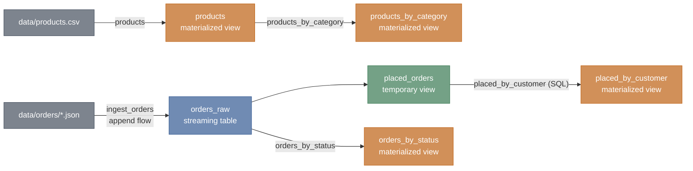
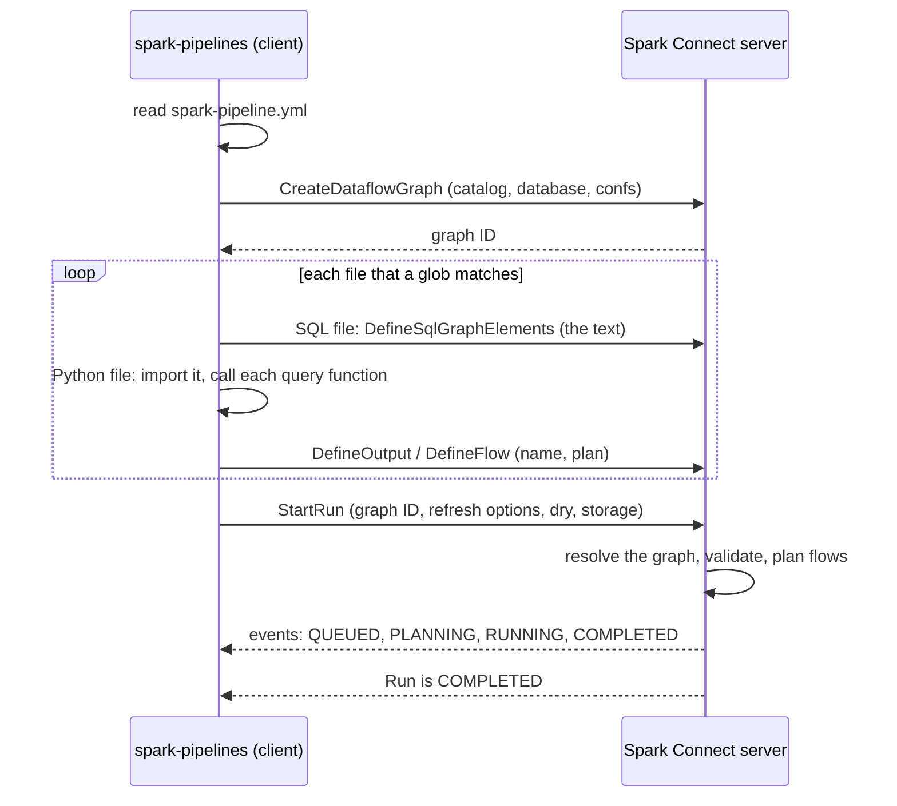
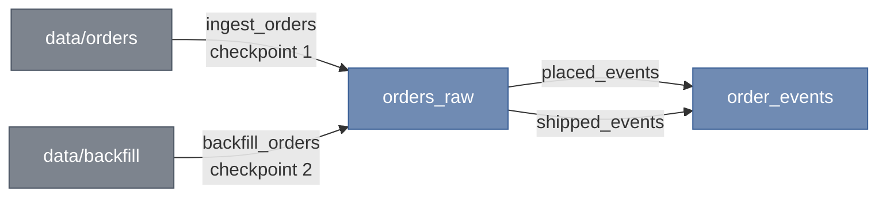

# Chapter 32: Declarative Pipelines: the model and the CLI

A batch job that builds two tables is easy to write. The job reads a file, writes a table, reads that table and writes a second table.

The hard part comes later. You must run the steps in the correct order. You must select a write mode for each table. A streaming step needs a checkpoint, and somebody must remember where it is. When the job runs a second time, each of these decisions must still be correct.

Spark Declarative Pipelines (SDP) moves these decisions out of your code. SDP came into Apache Spark in 4.1. Spark 4.2 added Auto CDC, and Spark 4.3 added history tables to Auto CDC ([Chapter 34](ch34-change-data-capture.md)).

**A pipeline is a graph of datasets. Your Python and SQL files only declare the datasets and the flows that fill them. The `spark-pipelines` CLI sends these declarations to a Spark Connect server. The server finds the dependencies and does a check of the full graph. Then it selects the order, the write mode and the checkpoint of each flow.** This chapter shows each part of that sentence with a real project: its files, its spec, its errors and its runs.

The code is in [`code/ch32`](https://github.com/lisancao/spark-masterclass/tree/main/code/ch32). Each output block comes from `code/ch32/output/`. All runs use `pyspark==4.3.0`. The script `code/common/pipeline.sh` copies a project to a work folder and runs `spark-pipelines` there (Step 4 shows what it does).

## Step 1: The imperative job, and its second run

`imperative.py` builds two tables in a Classic session. The first table holds the product list. The second table holds a summary for each category:

```python
def build():
    # The order is ours to get right: products first, then the summary that reads it.
    (spark.read.option("header", True)
     .schema("product_id STRING, name STRING, category STRING, list_price DECIMAL(10,2)")
     .csv(products_csv)
     .write.saveAsTable("products"))
    (spark.table("products").groupBy("category")
     .agg(F.count("*").alias("products"), F.avg("list_price").alias("avg_list_price"))
     .write.saveAsTable("products_by_category"))


build()
spark.table("products_by_category").orderBy("category").show()
try:
    build()   # the second run of the same job
except Exception as e:
    print("second run:", e.getCondition())
```

```text
+--------+--------+--------------+
|category|products|avg_list_price|
+--------+--------+--------------+
|hardware|       2|     17.245000|
|   merch|       2|     61.625000|
+--------+--------+--------------+

second run: TABLE_OR_VIEW_ALREADY_EXISTS
```

The first run is correct. The second run fails, because the default save mode of `saveAsTable` is `errorifexists`.

To make the job safe for a second run, you must select a mode for each table. If one step reads a stream, you must also keep a checkpoint path for it. If you add a third table, you must put it in the correct position in the code. The code that controls these decisions grows with each table. It does not hold any of the business logic.

## Step 2: The same tables, declared

`retail/transformations/products.py` declares the same two tables:

```python
from pyspark import pipelines as dp
from pyspark.sql import DataFrame
from pyspark.sql import functions as F

PRODUCT_SCHEMA = "product_id STRING, name STRING, category STRING, list_price DECIMAL(10,2)"


@dp.materialized_view(comment="The product list, read in full on every run")
def products() -> DataFrame:
    return spark.read.option("header", True).schema(PRODUCT_SCHEMA).csv("data/products.csv")


@dp.materialized_view
def products_by_category() -> DataFrame:
    print("query function products_by_category: called")   # shows when SDP calls it
    return (spark.table("products").groupBy("category")
            .agg(F.count("*").alias("products"), F.avg("list_price").alias("avg_list_price")))
```

Each function returns a DataFrame and does nothing more. It does not write, and it does not select a mode. The name of the function is the name of the table. The `print` line is there only to show when SDP calls the function (Step 4).

SDP has three concepts:

- **A dataset** is an object that the pipeline makes and that a query can read. There are three types: a *materialized view*, a *streaming table* and a *temporary view*. Step 6 compares them.
- **A flow** is a query that reads one or more sources and writes to one dataset. `@dp.materialized_view` makes a dataset and its flow together. A streaming table can have more than one flow (Step 7).
- **A pipeline** is the unit that you run. It is a spec file, `spark-pipeline.yml`, and the source files that the spec names.

The full retail project has three source files. `orders.py` adds a streaming table of orders, a temporary view of the placed orders and a count by status. `placed_by_customer.sql` adds a materialized view in SQL that reads the temporary view from Python. Python files and SQL files make one graph:



The boxes are datasets, and the labels on the arrows are flows. Nothing in the code gives this order. SDP finds it from the tables that each query reads.

## Step 3: The project and its spec

`spark-pipelines init` makes an empty project. `init.sh` runs it and prints each file:

```text
$ spark-pipelines init --name retail_demo
Pipeline project 'retail_demo' created successfully. To run your pipeline:
cd 'retail_demo'
spark-pipelines run

$ find retail_demo -type f
retail_demo/spark-pipeline.yml
retail_demo/transformations/example_python_materialized_view.py
retail_demo/transformations/example_sql_materialized_view.sql

$ cat retail_demo/spark-pipeline.yml

name: retail_demo
storage: file://~/spark-masterclass/data/work/part06/ch32-init/retail_demo/pipeline-storage
libraries:
  - glob:
      include: transformations/**

$ cat retail_demo/transformations/example_python_materialized_view.py
from pyspark import pipelines as dp
from pyspark.sql import DataFrame

@dp.materialized_view
def example_python_materialized_view() -> DataFrame:
    return spark.range(10)

$ cat retail_demo/transformations/example_sql_materialized_view.sql
CREATE MATERIALIZED VIEW example_sql_materialized_view AS
SELECT id FROM example_python_materialized_view
WHERE id % 2 = 0
```

The spec is the only file that the CLI must find. Without `--spec`, the CLI looks for `spark-pipeline.yml` or `spark-pipeline.yaml` in the current folder and then in each parent folder. The CLI accepts these keys (`unpack_pipeline_spec` in `python/pyspark/pipelines/cli.py`):

| Key | Required | What it does |
|---|---|---|
| `name` | yes | The name of the pipeline. |
| `storage` | yes | The root folder for pipeline metadata. Streaming checkpoints go here (Step 9). |
| `libraries` | no | A list of `glob: include:` patterns. Each `.py` and `.sql` file that matches is loaded. Another file type is an error. |
| `catalog` | no | The default catalog for dataset names. It must be a catalog that the session knows. |
| `database` | no | The default database (namespace) for dataset names. `schema` is another name for the same key. |
| `configuration` | no | Spark configurations for the pipeline session, as string keys and string values. |

The glob patterns are relative to the folder of the spec. The CLI also changes the current folder to the folder of the spec while it loads the files. Thus, a relative path in a query, such as `data/products.csv`, starts from the project folder.

`spec_errors.sh` gives the CLI three bad specs:

```text
== an unknown key
name: retail_demo
owner: data-team
...
pyspark.errors.exceptions.base.PySparkException: [PIPELINE_SPEC_UNEXPECTED_FIELD] Pipeline spec field `owner` is unexpected.

== no storage
...
pyspark.errors.exceptions.base.PySparkException: [PIPELINE_SPEC_MISSING_REQUIRED_FIELD] Pipeline spec missing required field `storage`.

== no libraries
...
pyspark.errors.exceptions.connect.AnalysisException: [RUN_EMPTY_PIPELINE] Pipelines are expected to have at least one non-temporary dataset defined (tables, persisted views) but no non-temporary datasets were found in your pipeline.
```

The first two errors come from the client, in `base.PySparkException`, before the CLI connects to a server. The third error comes from the server (`connect.AnalysisException`).

The spec is correct, but the graph that the server got has no dataset to write.

## Step 4: What occurs in a run

`spark-pipelines` is a shell script. It calls `spark-class` with the class `org.apache.spark.deploy.SparkPipelines` and the path of the Python CLI. `SparkPipelines` sorts the arguments into two lists, one for `spark-submit` and one for the Python CLI (`core/src/main/scala/org/apache/spark/deploy/SparkPipelines.scala`):

- `run`, `dry-run`, `init` and their options go to the Python CLI.
- All other `spark-submit` options, for example `--jars`, `--conf` and `--driver-memory`, go to `spark-submit`. Their position on the command line is not important.
- `--class` is an error. A `--conf spark.api.mode` with a value other than `connect` is also an error.
- The wrapper always adds `--conf spark.api.mode=connect` and `--remote`. The value of `--remote` is `local` if you do not give one. Then `spark-submit` starts a local Spark Connect server, and the CLI is its client.

A pipeline always runs on Spark Connect. The book scripts start their own Connect server on a port that no other job uses, and give the CLI `--remote sc://localhost:<port>`. The default local server always uses port 15002, so two pipelines on one machine can collide.

The CLI then does these steps. Each step prints one line of the log:

```text
2026-11-22 02:17:25: Loading pipeline spec from ~/spark-masterclass/data/work/part06/ch32-retail/spark-pipeline.yml...
2026-11-22 02:17:25: Creating Spark session...
2026-11-22 02:17:26: Creating dataflow graph...
2026-11-22 02:17:28: Registering graph elements...
2026-11-22 02:17:28: Loading definitions. Root directory: '~/spark-masterclass/data/work/part06/ch32-retail'.
2026-11-22 02:17:28: Found 3 files matching glob 'transformations/**/*'
2026-11-22 02:17:28: Registering SQL file ~/spark-masterclass/data/work/part06/ch32-retail/transformations/placed_by_customer.sql...
2026-11-22 02:17:28: Importing ~/spark-masterclass/data/work/part06/ch32-retail/transformations/products.py...
query function products_by_category: called
2026-11-22 02:17:30: Importing ~/spark-masterclass/data/work/part06/ch32-retail/transformations/orders.py...
2026-11-22 02:17:30: Starting run...
2026-11-22 10:17:31: Flow spark_catalog.default.orders_by_status is QUEUED.
2026-11-22 10:17:31: Flow spark_catalog.default.ingest_orders is QUEUED.
2026-11-22 10:17:31: Flow spark_catalog.default.products is QUEUED.
2026-11-22 10:17:31: Flow spark_catalog.default.placed_by_customer is QUEUED.
2026-11-22 10:17:31: Flow spark_catalog.default.products_by_category is QUEUED.
2026-11-22 10:17:31: Flow spark_catalog.default.products is PLANNING.
2026-11-22 10:17:31: Flow spark_catalog.default.products is STARTING.
2026-11-22 10:17:31: Flow spark_catalog.default.products is RUNNING.
2026-11-22 10:17:31: Flow spark_catalog.default.ingest_orders is STARTING.
2026-11-22 10:17:32: Flow spark_catalog.default.ingest_orders is RUNNING.
2026-11-22 10:17:36: Flow spark_catalog.default.products has COMPLETED.
2026-11-22 10:17:36: Flow spark_catalog.default.ingest_orders has COMPLETED.
2026-11-22 10:17:37: Flow spark_catalog.default.products_by_category is PLANNING.
2026-11-22 10:17:37: Flow spark_catalog.default.products_by_category is STARTING.
2026-11-22 10:17:37: Flow spark_catalog.default.products_by_category is RUNNING.
2026-11-22 10:17:37: Flow spark_catalog.default.placed_by_customer is PLANNING.
2026-11-22 10:17:37: Flow spark_catalog.default.placed_by_customer is STARTING.
2026-11-22 10:17:37: Flow spark_catalog.default.placed_by_customer is RUNNING.
2026-11-22 10:17:37: Flow spark_catalog.default.orders_by_status is PLANNING.
2026-11-22 10:17:37: Flow spark_catalog.default.orders_by_status is STARTING.
2026-11-22 10:17:37: Flow spark_catalog.default.orders_by_status is RUNNING.
2026-11-22 10:17:41: Flow spark_catalog.default.orders_by_status has COMPLETED.
2026-11-22 10:17:41: Flow spark_catalog.default.products_by_category has COMPLETED.
2026-11-22 10:17:41: Flow spark_catalog.default.placed_by_customer has COMPLETED.
2026-11-22 10:17:42: Run is COMPLETED.
```

Read the log in three parts:

1. **Registration, in the client.** The CLI creates a session, and asks the server to create an empty dataflow graph. Then it loads each file. It sends a SQL file to the server as text. It imports a Python file as a module. Before the import, it puts the session into the module as the name `spark`. Thus, the file needs no `SparkSession.builder` line. The annotation `spark: SparkSession` is optional and only helps your editor.
2. **The query function runs once, at registration.** The line `query function products_by_category: called` comes between two imports. The decorator calls the function at once, takes the plan of the DataFrame that it returns, and sends the plan to the server. The function does not run again in the run. SDP does not promise this number of calls, so a query function must not have side effects.
3. **The run, on the server.** After `Starting run...`, each line is an event that the server sends back over the same connection. Each flow goes through `QUEUED`, `PLANNING`, `STARTING`, `RUNNING` and `COMPLETED`. The server starts a flow only when its inputs are complete. Thus, `products_by_category` waits for `products`, but `products` and `ingest_orders` run at the same time.

<figure markdown>
  <video autoplay loop muted playsinline controls width="1280" height="720" poster="../../media/clips/ch32-run.webp">
    <source src="../../media/clips/ch32-run.mp4" type="video/mp4">
  </video>
  <figcaption>A run of the retail pipeline with a Hive metastore. <code>products</code> and <code>ingest_orders</code> run at the same time. Each summary starts only when its input is complete.</figcaption>
</figure>

The events have the time of the server, and the server in this book uses UTC. The lines before `Starting run...` have the local time of the client. This difference is why the clock moves by eight hours in the middle of the log.



Chapter 36 follows these commands into the server source.

## Step 5: What pipeline code must not do

The pipeline owns the session. `session_rules.sh` adds one extra file at a time to a small project, and runs `dry-run` each time:

```text
== variants/conf_set.py
  | spark.conf.set("spark.sql.shuffle.partitions", "8")   # at module scope
pyspark.errors.exceptions.base.PySparkException: [SESSION_MUTATION_IN_DECLARATIVE_PIPELINE.SET_RUNTIME_CONF] Session 
mutation 'RuntimeConf.set' is not allowed in declarative pipelines. Instead set configuration via the pipeline spec or 
use the 'spark_conf' argument in various decorators.

== variants/temp_view.py
  | spark.range(3).createOrReplaceTempView("ids")   # at module scope
pyspark.errors.exceptions.base.PySparkException: [SESSION_MUTATION_IN_DECLARATIVE_PIPELINE.CREATE_OR_REPLACE_TEMP_VIEW] 
Session mutation 'DataFrame.createOrReplaceTempView' is not allowed in declarative pipelines. Instead use the 
@temporary_view decorator to define temporary views.

== variants/builder.py
  | from pyspark.sql import SparkSession
  | mine = SparkSession.builder.config("spark.sql.shuffle.partitions", "3").getOrCreate()
  | print("builder returned the pipeline session:", mine is spark,
  |       "| shuffle.partitions =", spark.conf.get("spark.sql.shuffle.partitions"))
2026-11-22 02:42:48: Importing ~/spark-masterclass/data/work/part06/ch32-session/transformations/variant_builder.py...
builder returned the pipeline session: True | shuffle.partitions = 3
2026-11-22 10:42:50: Run is COMPLETED.

== variants/count.py
  | from pyspark import pipelines as dp
  | 
  | @dp.materialized_view
  | def product_count():
  |     n = spark.table("products").count()     # an action inside a query function
  |     return spark.range(1).selectExpr(f"{n} AS products")
pyspark.errors.exceptions.connect.AnalysisException: [ATTEMPT_ANALYSIS_IN_PIPELINE_QUERY_FUNCTION] Operations that 
trigger DataFrame analysis or execution are not allowed in pipeline query functions. Move code outside of the pipeline 
query function. SQLSTATE: 0A000

== variants/called.py
  | from pyspark import pipelines as dp
  | print("module scope: runs once, when the CLI imports the file")
  | 
  | @dp.materialized_view
  | def products_by_category():
  |     print("query function: called")
  |     return spark.table("products").groupBy("category").count()
module scope: runs once, when the CLI imports the file
query function: called
2026-11-22 10:43:07: Run is COMPLETED.
```

The results give four rules:

- **Do not change the session.** `spark.conf.set` fails with `SESSION_MUTATION_IN_DECLARATIVE_PIPELINE.SET_RUNTIME_CONF`. `createOrReplaceTempView` fails in the same way. The CLI blocks these calls while it imports your files. Other blocked calls are `setCurrentCatalog`, `setCurrentDatabase`, `dropTempView` and the registration of UDFs. Put configurations in the `configuration` key of the spec, or in the `spark_conf` argument of a decorator.
- **Do not use `SparkSession.builder` in a pipeline file.** It gives no error, but `getOrCreate()` returns the session of the pipeline and applies your configuration to it. Here, `spark.sql.shuffle.partitions` changed to 3 for all the flows of the pipeline.
- **Do not call an action in a query function.** `count()` fails with `ATTEMPT_ANALYSIS_IN_PIPELINE_QUERY_FUNCTION`. The same rule applies to `collect()`, `toPandas()`, `save()`, `saveAsTable()`, `start()` and to each operation that analyzes the DataFrame.
- **Module code runs once, when the CLI imports the file.** The same is true for the query function, as Step 4 showed.

!!! warning "Caution: do not put side effects in pipeline files"

    Do not write files, send messages or call external services at module scope or in a query function. The CLI runs this code at registration, also for a `dry-run`, and other SDP implementations can call a query function more than one time.

## Step 6: Three types of dataset

The type of a dataset tells SDP how to update it in each run:

| Type | Python | SQL | Stored | What a run does |
|---|---|---|---|---|
| Materialized view | `@dp.materialized_view` | `CREATE MATERIALIZED VIEW` | yes | runs the query again on all the input, and replaces the data |
| Streaming table | `@dp.table`, or `dp.create_streaming_table` and flows | `CREATE STREAMING TABLE` | yes | reads only the input that is new since the last run, and appends it |
| Temporary view | `@dp.temporary_view` | `CREATE TEMPORARY VIEW` | no | nothing: other datasets of the same run read it as a view |

To select a type, ask how the input grows:

- If the input is a source that only gets new rows (files that arrive, a Kafka topic), use a streaming table. The flow uses `spark.readStream`, and a checkpoint records what it read.
- If the result can change for old rows (an aggregate, a join with a table that changes), use a materialized view. In open source Spark 4.3, a materialized view has no incremental refresh. Each run computes it again from all of its input.
- If the result is a step that only other datasets need, use a temporary view. It costs nothing to store, and the catalog does not show it.

`orders.py` declares a streaming table with an explicit flow, a temporary view and a materialized view:

```python
dp.create_streaming_table("orders_raw", comment="Every order event, as it arrived")


@dp.append_flow(target="orders_raw")
def ingest_orders() -> DataFrame:
    return spark.readStream.schema(ORDER_SCHEMA).json("data/orders")


@dp.temporary_view
def placed_orders() -> DataFrame:
    return spark.table("orders_raw").where(F.col("status") == "placed")


@dp.materialized_view
def orders_by_status() -> DataFrame:
    return spark.table("orders_raw").groupBy("status").agg(F.count("*").alias("order_count"))
```

`spark.table("orders_raw")` in a query function is a batch read of the full table. `spark.readStream.table("orders_raw")` is a streaming read of the rows that are new since the last run. The SQL forms are `FROM orders_raw` and `FROM STREAM orders_raw`. The SQL file of the project reads the temporary view of the Python file:

```sql
CREATE MATERIALIZED VIEW placed_by_customer
COMMENT 'Placed orders per customer'
AS SELECT customer_id, count(*) AS placed
FROM placed_orders
GROUP BY customer_id;
```

The decorators accept these options (`python/pyspark/pipelines/api.py`):

| Option | `materialized_view`, `table` | `create_streaming_table` | `temporary_view` | `append_flow` |
|---|---|---|---|---|
| `name` | yes | yes (required, first argument) | yes | yes |
| `comment` | yes | yes | yes | no |
| `spark_conf` | yes | no | yes | yes |
| `table_properties` | yes | yes | no | no |
| `partition_cols` or `cluster_by` | yes (not both) | yes (not both) | no | no |
| `schema` | yes | yes | no | no |
| `format` | yes | yes | no | no |
| `target` | no | no | no | yes (required) |

`name` is useful when one function makes many datasets in a loop ([Chapter 33](ch33-medallion.md)). `format` selects the table format in a catalog that accepts more than one format. `spark_conf` sets configurations for the flow of that dataset only.

## Step 7: Flows, and two flows into one table

A streaming table can get rows from more than one flow. Each flow has its own source and its own checkpoint. You can add a flow later, and the other flows continue from their checkpoints. The `flows` project has two Python flows into `orders_raw`, and a SQL file with two flows into a second streaming table:

```python
@dp.append_flow(target="orders_raw")
def ingest_orders() -> DataFrame:
    return spark.readStream.schema(ORDER_SCHEMA).json("data/orders")


@dp.append_flow(target="orders_raw")
def backfill_orders() -> DataFrame:
    return spark.readStream.schema(ORDER_SCHEMA).json("data/backfill")
```

```sql
-- A streaming table with no query of its own, and two SQL flows into it.
CREATE STREAMING TABLE order_events
COMMENT 'One row for each placed or shipped order';

CREATE FLOW placed_events AS INSERT INTO order_events BY NAME
SELECT order_id, 'placed' AS event, order_ts FROM STREAM orders_raw WHERE status = 'placed';

CREATE FLOW shipped_events AS INSERT INTO order_events BY NAME
SELECT order_id, 'shipped' AS event, order_ts FROM STREAM orders_raw WHERE status = 'shipped';
```

`BY NAME` is necessary in a SQL flow. The flow matches columns by name, not by position.



The input has 11 orders in `data/orders` and 2 orders in `data/backfill`. Thus, `orders_raw` must have 13 rows, and `order_events` must have 12 rows (9 placed, 3 shipped). `flows.sh` runs the project in three ways:

```text
== 1. default catalog (Parquet tables), flows run at the same time
2026-11-22 10:06:19: Flow 'spark_catalog.default.backfill_orders' has FAILED.
  Error: [STREAM_FAILED] Query [id = a6e28ccb-42c7-48e3-b357-3f1263a9c2eb, runId = b267e0d0-677b-4689-9273-10d2376d44c7] terminated with exception: Multiple streaming queries are concurrently using file:~/spark-masterclass/data/work/part06...
2026-11-22 10:06:27: Run is COMPLETED.
orders_raw: 11 rows
order_events: 8 rows
  Parquet files on disk in orders_raw: 3

== 2. default catalog, spark.sql.pipelines.execution.maxConcurrentFlows = 1
2026-11-22 10:07:12: Run is COMPLETED.
orders_raw: 11 rows
order_events: 2 rows

== 3. Iceberg catalog, flows run at the same time
namespace lake.retail is ready
2026-11-22 10:08:05: Run is COMPLETED.
orders_raw: 13 rows
order_events: 12 rows
```

Only the Iceberg run is correct. The two runs in the default catalog lose rows:

- **Run 1.** Both flows wrote batch 0 at the same time. One flow failed, SDP tried it again, and the run ended as `COMPLETED`. But `orders_raw` has 11 rows, not 13. The three Parquet files on disk hold all 13 rows. The rows of one flow are in a file that the table does not list.
- **Run 2.** With one flow at a time, no flow failed. But the table has 11 rows again, and `order_events` has only 2 rows. This time, nothing in the log shows a problem.

The cause is the table of the default catalog. A streaming table there is a folder of Parquet files that the file sink of Structured Streaming writes.

The file sink keeps one log of batches, `_spark_metadata`, for the folder. Each flow counts its batches from 0. The second flow then writes its batch 0. The sink finds that batch 0 is already in the log, and skips the write (`FileStreamSink.addBatch`: `if (batchId <= fileLog.getLatestBatchId()...) logInfo("Skipping already committed batch ...")`). An Iceberg table has no shared batch log. Each flow commits a snapshot, so the two flows do not interfere.

!!! warning "Caution: do not write two flows into one streaming table of the default catalog"

    Use one flow for each streaming table in the default catalog, or keep the table in a format such as Iceberg. With two flows, the file sink skips a batch of one flow, and the run ends as `COMPLETED`. The part notes record this result as an open problem.

## Step 8: Find errors with a dry run

`spark-pipelines dry-run` registers the graph and does all the checks of a run. Then it stops before any flow starts. `broken/transformations/revenue.py` has three bugs: a cycle, a wrong table name and a wrong column. `dry_run_errors.sh` runs a dry run, fixes one bug, and runs again:

```text
== dry run 1
pyspark.errors.exceptions.connect.AnalysisException: The downstream table 'spark_catalog.default.top_customers' is 
referenced when creating the upstream table or view 'spark_catalog.default.revenue_by_customer'. Circular dependencies 
are not supported in a pipeline. Please remove the dependency between 'spark_catalog.default.revenue_by_customer' and 
'spark_catalog.default.top_customers'.

== fix 1: revenue_by_customer reads orders_enriched. dry run 2
2026-11-22 10:00:47: Failed to resolve flow due to upstream failure: 'spark_catalog.default.top_customers'.
Error: Failed to read dataset 'spark_catalog.default.revenue_by_customer'. Dataset is defined in the pipeline but could 
not be resolved.
2026-11-22 10:00:47: Failed to resolve flow due to upstream failure: 'spark_catalog.default.revenue_by_customer'.
Error: Failed to read dataset 'spark_catalog.default.orders_enriched'. Dataset is defined in the pipeline but could not 
be resolved.
2026-11-22 10:00:47: Failed to resolve flow due to upstream failure: 'spark_catalog.default.revenue_by_city'.
Error: Failed to read dataset 'spark_catalog.default.orders_enriched'. Dataset is defined in the pipeline but could not 
be resolved.
2026-11-22 10:00:47: Failed to resolve flow: 'spark_catalog.default.orders_enriched'.
Error: [TABLE_OR_VIEW_NOT_FOUND] The table or view `spark_catalog`.`default`.`orders_bronz` cannot be found. Verify the 
spelling and correctness of the schema and catalog.
Search path: [`system`.`builtin`, `system`.`session`, `spark_catalog`.`default`].
If you did not qualify the name with a schema, verify the current_schema() output, or qualify the name with the correct 
schema and catalog.
To tolerate the error on drop use DROP VIEW IF EXISTS or DROP TABLE IF EXISTS. SQLSTATE: 42P01;
'UnresolvedRelation [spark_catalog, default, orders_bronz], [], false
pyspark.errors.exceptions.connect.AnalysisException: 
Failed to resolve flows in the pipeline.
A flow can fail to resolve because the flow itself contains errors or because it reads
from an upstream flow which failed to resolve.
Flows with errors: spark_catalog.default.orders_enriched
Flows that failed due to upstream errors: spark_catalog.default.revenue_by_city, 
spark_catalog.default.revenue_by_customer, spark_catalog.default.top_customers
To view the exceptions that were raised while resolving these flows, look for flow
failures that precede this log.

== fix 2: orders_bronz -> orders_bronze. dry run 3
2026-11-22 10:01:20: Failed to resolve flow: 'spark_catalog.default.revenue_by_city'.
Error: [UNRESOLVED_COLUMN.WITH_SUGGESTION] A column, variable, or function parameter with name `region` cannot be 
resolved. Did you mean one of the following? [`email`, `city`, `name`, `order_id`, `order_ts`]. SQLSTATE: 42703;
'Aggregate ['region], ['region, sum(line_total#65) AS revenue#22]
+- SubqueryAlias spark_catalog.default.orders_enriched
   +- LocalRelation <empty>, [customer_id#54, order_id#55, product_id#56, quantity#57, unit_price#58, status#59, 
order_ts#60, name#61, email#62, city#63, signup_date#64, line_total#65]
pyspark.errors.exceptions.connect.AnalysisException: 
Failed to resolve flows in the pipeline.
A flow can fail to resolve because the flow itself contains errors or because it reads
from an upstream flow which failed to resolve.
Flows with errors: spark_catalog.default.revenue_by_city
Flows that failed due to upstream errors: 
To view the exceptions that were raised while resolving these flows, look for flow
failures that precede this log.

== fix 3: region -> city. dry run 4
2026-11-22 10:02:02: Run is COMPLETED.

== what the dry run wrote
files under spark-warehouse/ and pipeline-storage/: 0
```

<figure markdown>
  <video autoplay loop muted playsinline controls width="1280" height="720" poster="../../media/clips/ch32-dryrun.webp">
    <source src="../../media/clips/ch32-dryrun.mp4" type="video/mp4">
  </video>
  <figcaption>A dry run of the broken pipeline reports the cycle. After the fix, the next dry run reports the wrong table name. The dry runs write nothing.</figcaption>
</figure>

The errors come in a fixed order, because the server does its checks in a fixed order (`DataflowGraph.validate` and `GraphValidations.validateSuccessfulFlowAnalysis`):

1. **The cycle.** `revenue_by_customer` reads `top_customers`, and `top_customers` reads `revenue_by_customer`. Neither flow can resolve, because each needs the schema of the other. Before the server reports the flows that failed, it looks for a cycle among them. It finds one, and reports only the cycle.
2. **The names.** `orders_bronz` does not exist. Read the log from the bottom: the summary lists one flow with errors and three flows that failed only because of it. The only line that says `Failed to resolve flow:` without `upstream failure` names the real problem, and the `TABLE_OR_VIEW_NOT_FOUND` error follows it.
3. **The columns.** `revenue_by_city` groups by `region`, which `orders_enriched` does not have. The analyzer suggests `city`. The plan in the error shows a `LocalRelation <empty>`: the dry run analyzes each query against the schema of its inputs, with no data.

After the last fix, the dry run completes, and it wrote no file. A dry run does not read data. Thus, it cannot find a value that fails at run time, for example `unit_price` with the value `N/A` in a cast.

Use a dry run in two places. Run it after each change while you write the pipeline. Also run it in continuous integration, before a change goes to production. It needs a Spark Connect server and the catalogs that the spec names, but no data.

## Step 9: Run it, and run it again

A pipeline must run many times. The first run creates the tables. Each run after that updates them. `run_retail.sh` runs the retail project twice in the default session catalog:

```text
== run 2, in-memory catalog
2026-11-22 02:18:00: Starting run...
pyspark.errors.exceptions.connect.UnknownException: (org.apache.spark.sql.pipelines.graph.DatasetManager$TableMaterializationException) org.apache.spark.SparkRuntimeException: [LOCATION_ALREADY_EXISTS] Cannot name the managed table as `spark_catalog`.`default`.`products`, as its associated location 'file:~/spark-masterclass/data/work/part06/ch32-retail/spark-warehouse/products' already exists. Please pick a different table...
```

The second run fails with `LOCATION_ALREADY_EXISTS`. The default catalog of a local session is `in-memory`. It forgets its tables when the server stops, but the folders of the tables stay in `spark-warehouse/`. In the second run, the catalog does not know `products`. Thus, SDP tries to create it, and the folder is in the way.

A real pipeline uses a catalog that keeps its tables. Examples are a Hive metastore and the Iceberg catalog of [Chapter 30](ch30-tables-delta-iceberg.md). For a local project, the Hive metastore is the smallest change. Start the server with `spark.sql.catalogImplementation=hive`. The server then keeps a Derby database in `metastore_db/`, in its current folder:

```bash
spark-pipelines run --conf spark.sql.catalogImplementation=hive
```

The configuration is static. Thus, it must go to the server when the server starts, not in the `configuration` key of the spec. With the Hive metastore, the same project runs twice:

```text
== run 2, Hive metastore
10:18:51: Flow spark_catalog.default.orders_by_status is QUEUED.
10:18:51: Flow spark_catalog.default.products_by_category is QUEUED.
10:18:51: Flow spark_catalog.default.products is QUEUED.
10:18:51: Flow spark_catalog.default.placed_by_customer is QUEUED.
10:18:51: Flow spark_catalog.default.ingest_orders is QUEUED.
10:18:51: Flow spark_catalog.default.products is PLANNING.
10:18:51: Flow spark_catalog.default.products is STARTING.
10:18:51: Flow spark_catalog.default.products is RUNNING.
10:18:51: Flow spark_catalog.default.ingest_orders is STARTING.
10:18:52: Flow spark_catalog.default.ingest_orders is RUNNING.
10:18:52: Flow spark_catalog.default.ingest_orders has COMPLETED.
10:18:53: Flow spark_catalog.default.placed_by_customer is PLANNING.
10:18:53: Flow spark_catalog.default.placed_by_customer is STARTING.
10:18:53: Flow spark_catalog.default.placed_by_customer is RUNNING.
10:18:53: Flow spark_catalog.default.orders_by_status is PLANNING.
10:18:53: Flow spark_catalog.default.orders_by_status is STARTING.
10:18:53: Flow spark_catalog.default.orders_by_status is RUNNING.
10:18:54: Flow spark_catalog.default.products has COMPLETED.
10:18:54: Flow spark_catalog.default.products_by_category is PLANNING.
10:18:54: Flow spark_catalog.default.products_by_category is STARTING.
10:18:54: Flow spark_catalog.default.products_by_category is RUNNING.
10:18:56: Flow spark_catalog.default.orders_by_status has COMPLETED.
10:18:56: Flow spark_catalog.default.placed_by_customer has COMPLETED.
10:18:56: Flow spark_catalog.default.products_by_category has COMPLETED.
10:18:57: Run is COMPLETED.

tables: ['orders_by_status', 'orders_raw', 'placed_by_customer', 'products', 'products_by_category']
orders_raw: 11 rows
tables: ['orders_by_status', 'orders_raw', 'placed_by_customer', 'products', 'products_by_category']
orders_by_status: 3 rows
+---------+-----------+
|status   |order_count|
+---------+-----------+
|shipped  |2          |
|placed   |8          |
|cancelled|1          |
+---------+-----------+

placed_by_customer: 6 rows
+-----------+------+
|customer_id|placed|
+-----------+------+
|c-01       |2     |
|c-02       |2     |
|c-04       |1     |
|c-05       |1     |
|c-99       |1     |
|c-03       |1     |
+-----------+------+

products_by_category: 2 rows
+--------+--------+--------------+
|category|products|avg_list_price|
+--------+--------+--------------+
|hardware|2       |17.245000     |
|merch   |2       |61.625000     |
+--------+--------+--------------+
```

The second run completes. `orders_raw` still has 11 rows, because the streaming flow found no new file. The flows of the materialized views read all of their input again.

The `storage` folder holds the checkpoint of each streaming flow, in the path `_checkpoints/<catalog>/<database>/<table>/<flow>/<n>`:

```text
$ find pipeline-storage | sort
pipeline-storage
pipeline-storage/_checkpoints
pipeline-storage/_checkpoints/spark_catalog
pipeline-storage/_checkpoints/spark_catalog/default
pipeline-storage/_checkpoints/spark_catalog/default/orders_raw
pipeline-storage/_checkpoints/spark_catalog/default/orders_raw/ingest_orders
pipeline-storage/_checkpoints/spark_catalog/default/orders_raw/ingest_orders/0
pipeline-storage/_checkpoints/spark_catalog/default/orders_raw/ingest_orders/0/commits
pipeline-storage/_checkpoints/spark_catalog/default/orders_raw/ingest_orders/0/commits/0
pipeline-storage/_checkpoints/spark_catalog/default/orders_raw/ingest_orders/0/commits/.0.crc
pipeline-storage/_checkpoints/spark_catalog/default/orders_raw/ingest_orders/0/metadata
pipeline-storage/_checkpoints/spark_catalog/default/orders_raw/ingest_orders/0/.metadata.crc
pipeline-storage/_checkpoints/spark_catalog/default/orders_raw/ingest_orders/0/offsets
pipeline-storage/_checkpoints/spark_catalog/default/orders_raw/ingest_orders/0/offsets/0
pipeline-storage/_checkpoints/spark_catalog/default/orders_raw/ingest_orders/0/offsets/.0.crc
pipeline-storage/_checkpoints/spark_catalog/default/orders_raw/ingest_orders/0/sources
pipeline-storage/_checkpoints/spark_catalog/default/orders_raw/ingest_orders/0/sources/0
pipeline-storage/_checkpoints/spark_catalog/default/orders_raw/ingest_orders/0/sources/0/0
pipeline-storage/_checkpoints/spark_catalog/default/orders_raw/ingest_orders/0/sources/0/.0.crc

$ ls spark-warehouse spark-warehouse/orders_raw
orders_by_status
orders_raw
placed_by_customer
products
products_by_category
part-00000-84f81e1e-4b06-466f-9012-7047c4aa10c9-c000.snappy.parquet
part-00001-79bb151a-987d-42b7-b3be-aea6d762efdd-c000.snappy.parquet
_spark_metadata

$ cat pipeline-storage/_checkpoints/.../ingest_orders/0/offsets/0
v1
{"batchWatermarkMs":0,"batchTimestampMs":1795342705712,"conf":{"spark.sql.streaming.stateStore.providerClass":
{"logOffset":0}

$ cat pipeline-storage/_checkpoints/.../ingest_orders/0/sources/0/0
v1
{"path":"file://~/spark-masterclass/data/work/part06/ch32-retail-hive/data/orders/orders_2026-10-01.json","timestamp":1795342681202,"batchId":0}
{"path":"file://~/spark-masterclass/data/work/part06/ch32-retail-hive/data/orders/orders_2026-10-02.json","timestamp":1795342681202,"batchId":0}
```

The checkpoint is the normal checkpoint of Structured Streaming:

- `offsets/0` records what batch 0 planned to read. For the file source, the offset is a position in the list of files.
- `commits/0` records that batch 0 finished.
- `sources/0/0` lists each file that the file source read, with the batch that read it.

The second run found no new file. Thus, it wrote no batch, and the folder has only batch 0. The last folder level, `0`, is a version number. A full refresh starts a new version (Step 10). A materialized view has no checkpoint, because each run reads all of its input again.

!!! warning "Caution: do not delete or move the storage folder"

    If the checkpoints are gone, each streaming flow reads all of its source again in the next run. Then it appends rows that the table already holds. Also, a flow finds its checkpoint by the name of the flow. If you rename a flow, the new name starts with no checkpoint. After such a change, run `--full-refresh` for the table.

## Step 10: Select what a run updates

With no option, `run` updates all datasets: streaming tables read new input, and SDP computes materialized views again. Three options select a smaller part of the graph:

- `--refresh a,b` updates only the datasets `a` and `b`, in the normal way.
- `--full-refresh a,b` deletes the data and the checkpoints of `a` and `b`, and computes them again from all of their input.
- `--full-refresh-all` does a full refresh of all datasets.

`run_retail.sh` tries each option on the Hive project:

```text
== run --refresh products_by_category
10:19:43: Flow spark_catalog.default.products_by_category is QUEUED.
10:19:43: Flow 'spark_catalog.default.ingest_orders' is EXCLUDED.
10:19:43: Flow 'spark_catalog.default.orders_by_status' is EXCLUDED.
10:19:43: Flow 'spark_catalog.default.products' is EXCLUDED.
10:19:43: Flow 'spark_catalog.default.placed_by_customer' is EXCLUDED.
10:19:43: Flow spark_catalog.default.products_by_category is PLANNING.
10:19:43: Flow spark_catalog.default.products_by_category is STARTING.
10:19:43: Flow spark_catalog.default.products_by_category is RUNNING.
10:19:45: Flow spark_catalog.default.products_by_category has COMPLETED.
10:19:47: Run is COMPLETED.

== run --full-refresh orders_raw
10:20:01: Flow spark_catalog.default.ingest_orders is QUEUED.
10:20:01: Flow 'spark_catalog.default.products_by_category' is EXCLUDED.
10:20:01: Flow 'spark_catalog.default.products' is EXCLUDED.
10:20:01: Flow 'spark_catalog.default.orders_by_status' is EXCLUDED.
10:20:01: Flow 'spark_catalog.default.placed_by_customer' is EXCLUDED.
10:20:01: Flow spark_catalog.default.ingest_orders is STARTING.
10:20:02: Flow spark_catalog.default.ingest_orders is RUNNING.
10:20:03: Flow spark_catalog.default.ingest_orders has COMPLETED.
10:20:05: Run is COMPLETED.
orders_raw: 11 rows
checkpoint folders of ingest_orders: 0 1

== run --full-refresh-all --refresh products
pyspark.errors.exceptions.base.PySparkException: [CONFLICTING_PIPELINE_REFRESH_OPTIONS] --full-refresh-all option conflicts with --refresh
The --full-refresh-all option performs a full refresh of all datasets, 
so specifying individual datasets with --refresh is not allowed.
```

The event stream shows the selection. Each flow that is not in the selection is `EXCLUDED`:

- `--refresh products_by_category` ran one flow. Its input, `products`, is a table from an earlier run, so the flow read it from the catalog.
- `--full-refresh orders_raw` cleared the table, and read the two files again. The table still has 11 rows, not 22. The flow did not delete its old checkpoint. It started a new checkpoint version, `1`, next to version `0` (`getLatestCheckpointDir` with `createNewCheckpointDir` in `SystemMetadata.scala`).
- The CLI refuses `--full-refresh-all` together with one of the other options (`CONFLICTING_PIPELINE_REFRESH_OPTIONS`). You can use `--refresh` and `--full-refresh` together, for different datasets.

Use `--full-refresh` for a streaming table after you change its query. An incremental run applies the new query only to new input. The old rows stay as the old query wrote them.

## The whole chapter, on one page

```bash
spark-pipelines init --name retail                     # a spec and two example files
cd retail
spark-pipelines dry-run                                # check the graph, write nothing
spark-pipelines run --conf spark.sql.catalogImplementation=hive        # first run
spark-pipelines run --conf spark.sql.catalogImplementation=hive        # incremental run
spark-pipelines run --refresh daily_revenue            # update some datasets
spark-pipelines run --full-refresh orders_raw          # clear and compute again
spark-pipelines run --remote sc://host:15002           # use a Connect server you started
```

- **Declare, do not order.** A query function returns a DataFrame. SDP finds the order from the tables that each query reads.
- **A project is a spec and source files.** The spec must have `name` and `storage`. Python and SQL files make one graph.
- **The CLI is a Connect client.** It registers the graph, and the server runs it and sends events back.
- **The pipeline owns the session.** Do not change configurations, create temporary views or call actions in pipeline code.
- **Select the dataset type by how the input grows.** Streaming tables append new input. Materialized views compute everything again. Temporary views are not stored.
- **One streaming table in the default catalog takes one flow.** Two flows lose rows there. Iceberg tables take many flows.
- **Dry-run in the edit loop and in CI.** It finds cycles, wrong names and wrong columns, in that order, and reads no data.
- **Use a catalog that keeps tables**, and keep the `storage` folder.

[Chapter 33](ch33-medallion.md) builds a larger pipeline in layers, and shows what a second run reads when new files arrive.

## Further reading

- [Spark Declarative Pipelines guide](https://spark.apache.org/docs/4.3.0/declarative-pipelines-programming-guide.html), the official guide for Spark 4.3.
- `python/pyspark/pipelines/cli.py` and `api.py` in the Spark source (tag `v4.3.0`), the spec keys and the decorator options of this chapter.
- `core/src/main/scala/org/apache/spark/deploy/SparkPipelines.scala`, the argument rules of Step 4.
