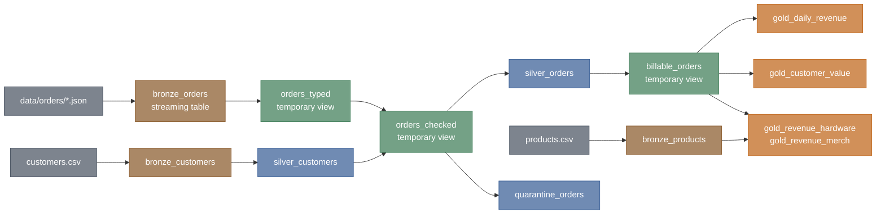
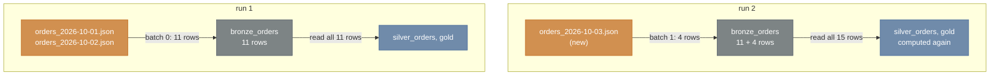
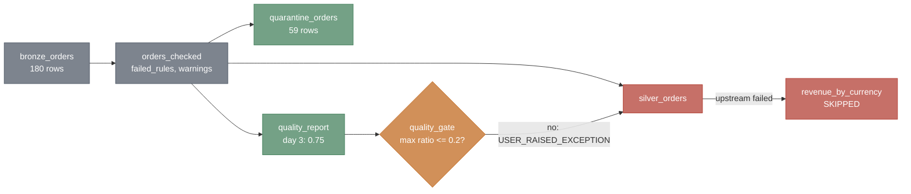

# Chapter 33: Medallion in practice: bronze, silver, gold and quality

[Chapter 32](ch32-declarative-pipelines.md) showed the parts of a pipeline. This chapter builds a full pipeline from raw files to business tables, and runs it more than one time. The common name for this layout is the *medallion* architecture: a bronze layer, a silver layer and a gold layer.

The names are not important. The contracts are important. Each layer makes a promise to the layer after it, and each promise is a reason for a design decision in the code.

**In a medallion pipeline, each layer has one contract. Bronze keeps each input row as it arrived. Silver holds only rows that obey the rules, and puts each other row in a quarantine. Gold answers the questions of the business.**

**In SDP, only the streaming tables are incremental, and open source Spark 4.3 has no expectations. Thus, you build the quality checks from datasets, and a check stops bad data only when it is in the path of the data.** This chapter shows each part of that sentence with two pipelines, two runs of each, and the event logs of the runs.

The code is in [`code/ch33`](https://github.com/lisancao/spark-masterclass/tree/main/code/ch33). Each output block comes from `code/ch33/output/`. The pipelines run on `pyspark==4.3.0` with a Hive metastore, as in Step 9 of Chapter 32.

## Step 1: Three layers, three contracts

The `shop` pipeline reads the small retail data of Chapter 32: two days of order files, a customer file and a product file. The data has defects on purpose. It has an order that arrives two times, a price of `N/A`, a negative quantity and a customer that does not exist. Each defect tests one rule of a later layer.



The source is in four files, one for each layer and one for the checks: `bronze.py`, `silver.py`, `gold.py` and `checks.py`. SDP reads all the files into one graph. The split into files is only for the people who read the code.

The table shows the contract of each layer, and the dataset type that the `shop` pipeline uses for it:

| Layer | Contract | Dataset type | What a run reads |
|---|---|---|---|
| Bronze | Keep each row as it arrived, and record its source | Streaming table (`@dp.table`) | Only the new files |
| Silver | Correct types, one row for each order, failed rows in the quarantine | Materialized view | All of bronze |
| Gold | Answer one question of the business | Materialized view | All of `billable_orders` |

## Step 2: Bronze keeps each row as it arrived

The bronze contract has three parts. Bronze is append-only. It does not change or remove a row. It records where each row came from.

```python
# Prices and times stay STRING here: under ANSI mode a bad value in a cast fails the run.
ORDER_SCHEMA = ("order_id STRING, customer_id STRING, product_id STRING, quantity INT, "
                "unit_price STRING, status STRING, order_ts STRING")


@dp.table(comment="Raw order events, append-only", table_properties={"quality": "bronze"})
def bronze_orders() -> DataFrame:
    return (spark.readStream.schema(ORDER_SCHEMA).json("data/orders")
            .select("*",
                    F.col("_metadata.file_name").alias("_source_file"),
                    F.col("_metadata.file_modification_time").alias("_file_mtime"),
                    F.current_timestamp().alias("_ingested_at")))
```

Each decision in this function comes from the contract:

- **A streaming table.** New files arrive, and old files do not change. Thus, a streaming read reads each file one time, and the checkpoint records which files it read.
- **An explicit schema.** A streaming file source does not infer a schema by default. Also, with an explicit schema, a new field in a file does not change the table.
- **Strings for values that can be bad.** Since Spark 4.0, ANSI mode is on by default. A cast of `N/A` to a decimal then fails the query, and a failed bronze flow stops the pipeline. Bronze keeps the text, and silver does the cast with `try_cast`.
- **Lineage columns.** Each file source has a hidden `_metadata` column, a struct with `file_path`, `file_name`, `file_size`, `file_block_start`, `file_block_length` and `file_modification_time`. Bronze copies the fields that it needs into normal columns. `_metadata` replaces `input_file_name()`, and it also works for sources that split a file into more than one task.

The file source has options that control what one run reads:

| Option | What it does |
|---|---|
| `maxFilesPerTrigger` | Limits the number of files in one micro-batch. A pipeline run reads all new files in one or more batches, and then the flow stops. |
| `pathGlobFilter` | Reads only file names that match a pattern, for example `*.json`. |
| `recursiveFileLookup` | Reads files in subfolders too. |

The file source knows each file by its path. If a producer writes a file again with the same path, the source does not read it again.

!!! note "Kafka as a bronze source"

    A bronze table from Kafka has the same form. Read with `spark.readStream.format("kafka")`, with the options `kafka.bootstrap.servers`, `subscribe` and `startingOffsets`. Keep `value` as a string (or as binary), and keep `topic`, `partition` and `offset` as lineage columns. Parse the JSON in silver. Add the Kafka connector with `--jars` (the `spark-sql-kafka-0-10_2.13` jar for Spark 4.3.0 and its dependencies). This chapter does not run Kafka.

!!! note "New in 4.3: files in archives"

    Spark 4.3 can read files inside archives, for example zip, tar and 7z files (SPARK-58110, SPARK-58246 and related changes in the 4.3 release). A bronze table can then read a daily archive without a step that unpacks it. This chapter does not test this feature.

## Step 3: Silver holds only rows that obey the rules

The silver contract has three parts. Each row has the correct types. Each order is there one time. Each order that fails a rule is in the quarantine. Silver has two temporary views and two tables:

```python
@dp.temporary_view
def orders_typed() -> DataFrame:
    # The first copy of an order wins. A file that sends an order again changes nothing.
    first_seen = Window.partitionBy("order_id").orderBy("_ingested_at", "_source_file")
    return (spark.table("bronze_orders")
            .select("*", F.row_number().over(first_seen).alias("_rn"))
            .where("_rn = 1")
            .select("order_id", "customer_id", "product_id", "quantity", "status", "_source_file",
                    F.col("unit_price").try_cast("decimal(10,2)").alias("unit_price"),
                    F.try_to_timestamp("order_ts").alias("order_ts")))


@dp.temporary_view
def orders_checked() -> DataFrame:
    # One reason for each order, computed once. Silver and quarantine both read it.
    known = spark.table("silver_customers").select("customer_id", "city")
    return (spark.table("orders_typed").join(known, "customer_id", "left")
            .select("*", F.when(F.col("unit_price").isNull(), "invalid_price")
                          .when(F.col("quantity") <= 0, "invalid_quantity")
                          .when(F.col("city").isNull(), "unknown_customer")
                          .alias("_reason")))


@dp.materialized_view(comment="Valid orders, typed and unique", table_properties={"quality": "silver"})
def silver_orders() -> DataFrame:
    return (spark.table("orders_checked").where("_reason IS NULL")
            .select(*ORDER_COLUMNS, "city", "_source_file",
                    (F.col("quantity") * F.col("unit_price")).alias("line_total")))


@dp.materialized_view(comment="Orders that failed a rule, with the reason")
def quarantine_orders() -> DataFrame:
    return spark.table("orders_checked").where("_reason IS NOT NULL").select(*ORDER_COLUMNS, "_reason")
```

Four patterns are in this code:

- **`try_cast` and `try_to_timestamp`.** They return `NULL` for a value that they cannot convert, and the query continues. A `NULL` from `try_cast` where the input was not `NULL` marks a bad value. `orders_checked` uses that signal for the reason `invalid_price`.
- **Remove duplicates with a window.** `row_number()` over the business key keeps the first copy of each order, in the order of arrival. The rule is explicit: the first copy wins. `dropDuplicates` keeps one row too, but it does not say which row.
- **Compute the reason once.** Silver and quarantine both read `orders_checked`. Thus, the two tables cannot use different rules.
- **Conservation.** Each unique order in bronze is in silver or in quarantine, and never in both. Step 5 makes this rule a check.

The first run puts the three bad orders in the quarantine, each with its reason:

```text
+--------+-----------+--------+----------+----------------+
|order_id|customer_id|quantity|unit_price|_reason         |
+--------+-----------+--------+----------+----------------+
|o-1005  |c-04       |3       |NULL      |invalid_price   |
|o-1008  |c-03       |-2      |3.25      |invalid_quantity|
|o-1009  |c-99       |1       |9.99      |unknown_customer|
+--------+-----------+--------+----------+----------------+
```

`o-1002` came two times in the first file. It is in silver one time, and it is not in the quarantine.

The figure shows each of the 11 rows of run 1, and the table that it goes to:

<figure markdown>
  

  

  <figcaption>Run 1. Seven orders go to <code>silver_orders</code>, and three go to <code>quarantine_orders</code> with a reason. The second copy of <code>o-1002</code> is not kept. Bronze has 10 unique orders, and 7 plus 3 is 10.</figcaption>
</figure>

<figure markdown>
  <video autoplay loop muted playsinline controls width="1280" height="720" poster="../../media/clips/ch33-anim-routing.webp">
    <source src="../../media/clips/ch33-anim-routing.mp4" type="video/mp4">
  </video>
  <figcaption>Each bronze row of run 1 moves to silver, to the quarantine, or out of the result. Bronze keeps all 11 rows.</figcaption>
</figure>

The SparkTutor course found two problems in Spark 4.2.0 here. First, `dropDuplicates` and `drop` on a pipeline dataset failed at registration. Second, `withColumn` on a pipeline dataset lost the dependency in the second run (SPARK-59663). `variants.sh` replaces `orders_typed` with each form, runs the pipeline, adds the third day of orders and runs it again:

```text
== variants/dedupe.py
pyspark.errors.exceptions.connect.AnalysisException: [TABLE_OR_VIEW_NOT_FOUND] The table or view `bronze_orders` cannot be found. Verify the spelling and correctness of the schema and catalog.
pyspark.errors.exceptions.connect.AnalysisException: [TABLE_OR_VIEW_NOT_FOUND] The table or view `bronze_orders` cannot be found. Verify the spelling and correctness of the schema and catalog.

== variants/with_column.py
10:46:09: Run is COMPLETED.
  run 1: bronze_orders: 11 rows
  run 1: silver_orders: 7 rows
Error: [USER_RAISED_EXCEPTION] each unique bronze order must be in silver_orders or in quarantine_orders SQLSTATE: P0001
Error: [USER_RAISED_EXCEPTION] each unique bronze order must be in silver_orders or in quarantine_orders SQLSTATE: P0001
Error: [USER_RAISED_EXCEPTION] each unique bronze order must be in silver_orders or in quarantine_orders SQLSTATE: P0001
pyspark.errors.exceptions.connect.SparkRuntimeException: [USER_RAISED_EXCEPTION] each unique bronze order must be in silver_orders or in quarantine_orders SQLSTATE: P0001
  run 2: bronze_orders: 15 rows
  run 2: silver_orders: 7 rows
```

Both problems are still in Spark 4.3.0:

- **`dropDuplicates(["order_id"])` and `drop(...)` fail at registration.** The error is `TABLE_OR_VIEW_NOT_FOUND` for `bronze_orders`, a dataset that the pipeline defines. On Spark Connect, these two methods need the schema of their input. Thus, the client asks the server to analyze the plan while the CLI imports the file. At that moment, `bronze_orders` exists only as a name in the graph, not in the catalog. The fix is the code of this chapter: a window with `row_number()`, and an explicit `select`.
- **`withColumn` loses the dependency in the second run.** Run 1 is correct. In run 2, bronze has 15 rows, but silver still has 7 rows, so the flow of silver did not read the new bronze rows. The check `check_orders_accounted_for` found the difference and failed the run, three times with the retries. Without the check, the run would show stale silver data with no error. Use `select("*", expr.alias(...))` in place of `withColumn` on a dataset of the pipeline, as all the code of this chapter does.

The part notes record both results as open problems, with a reproduction.

## Step 4: Gold answers questions

A gold table exists because somebody asks a question. Thus, the shape of a gold table comes from the question, not from the silver table. The questions here are revenue for each day, the value of each customer, and revenue for each product category.

The rule "which orders count as revenue" is in one place, a temporary view. Each gold table reads that view, so the gold tables cannot disagree:

```python
@dp.temporary_view
def billable_orders() -> DataFrame:
    """The one place that says which orders count as revenue."""
    return spark.table("silver_orders").where("status <> 'cancelled'")


@dp.materialized_view(comment="Revenue per day, with a running total", table_properties={"quality": "gold"})
def gold_daily_revenue() -> DataFrame:
    running = Window.orderBy("order_date").rowsBetween(Window.unboundedPreceding, Window.currentRow)
    daily = (spark.table("billable_orders")
             .groupBy(F.to_date("order_ts").alias("order_date"))
             .agg(F.sum("line_total").alias("revenue"), F.count("*").alias("orders"),
                  F.round(F.avg("line_total"), 2).alias("avg_order_value")))
    return daily.select("*", F.sum("revenue").over(running).alias("cumulative_revenue"))


@dp.materialized_view(comment="Revenue per customer, ranked", table_properties={"quality": "gold"})
def gold_customer_value() -> DataFrame:
    by_revenue = Window.orderBy(F.col("revenue").desc())
    everyone = Window.partitionBy()
    per_customer = (spark.table("billable_orders").groupBy("customer_id", "city")
                    .agg(F.sum("line_total").alias("revenue"), F.count("*").alias("orders")))
    return per_customer.select(
        "*", F.dense_rank().over(by_revenue).alias("revenue_rank"),
        F.round(F.col("revenue") / F.sum("revenue").over(everyone), 4).alias("revenue_share"))
```

```text
+----------+-------+------+---------------+------------------+
|order_date|revenue|orders|avg_order_value|cumulative_revenue|
+----------+-------+------+---------------+------------------+
|2026-10-01|214.43 |4     |53.61          |214.43            |
|2026-10-02|133.00 |2     |66.50          |347.43            |
+----------+-------+------+---------------+------------------+

+-----------+---------+-------+------+------------+-------------+
|customer_id|city     |revenue|orders|revenue_rank|revenue_share|
+-----------+---------+-------+------+------------+-------------+
|c-02       |Vancouver|144.50 |2     |1           |0.4159       |
|c-01       |Toronto  |139.98 |2     |2           |0.4029       |
|c-03       |Montreal |49.95  |1     |3           |0.1438       |
|c-05       |Calgary  |13.00  |1     |4           |0.0374       |
+-----------+---------+-------+------+------------+-------------+
```

The window functions do three jobs:

- **A running total.** The frame `rowsBetween(unboundedPreceding, currentRow)` adds each day to the days before it.
- **A rank.** `dense_rank` gives equal values the same rank, and leaves no gap after them. `rank` leaves a gap, and `row_number` gives each row a different number.
- **A share of the total.** `Window.partitionBy()` with no column is one window over all rows.

A window with no partition column puts all rows in one partition, and one task computes it. Here the windows run after the aggregation, on one row for each day or each customer. Thus, the single task is small. Do the aggregation first, and then the window, when the input is large.

The category tables come from one loop:

```python
CATEGORIES = ["hardware", "merch"]   # add to this list, never remove from it

for category in CATEGORIES:
    @dp.materialized_view(name=f"gold_revenue_{category}", table_properties={"quality": "gold"})
    def revenue_for_category(category: str = category) -> DataFrame:
        products = (spark.table("bronze_products").where(F.col("category") == category)
                    .select("product_id", F.col("name").alias("product")))
        return (spark.table("billable_orders").join(products, "product_id")
                .groupBy("product_id", "product").agg(F.sum("line_total").alias("revenue")))
```

Two details make the loop correct:

- **`name=`** gives each dataset its own name. Without it, each loop iteration declares a dataset with the name `revenue_for_category`, and the second declaration is an error.
- **`category: str = category`** binds the value of the loop variable when Python defines the function. Open source Spark 4.3 calls the function at once, in the same loop iteration (Chapter 32, Step 4). Thus, the late lookup of names in Python closures does not change the result here. Other SDP implementations can call the function later, after the loop ends. Then, without the default argument, each function reads the last value of `category`.

!!! warning "Caution: do not remove a name from a list that makes datasets"

    If you remove `merch` from `CATEGORIES`, the pipeline stops to declare `gold_revenue_merch`. The table stays in the catalog with its old data, and no run updates it again. A reader of that table gets old numbers and no error. Drop the table yourself when you remove the dataset.

Do not compute the list of a loop with an action at module scope, for example with `collect()` on a table. Module code runs at registration, also for a dry run. Then the shape of the graph depends on the data at that moment.

## Step 5: Checks that compare the layers

Open source Spark 4.3 has no expectations. The public API of `pyspark.pipelines` contains seven names: `append_flow`, `create_auto_cdc_flow`, `create_streaming_table`, `materialized_view`, `table`, `temporary_view` and `create_sink`. There is no `expect` decorator. A check is a dataset that fails when a rule is false:

```python
def expect(df: DataFrame, condition: str, message: str) -> DataFrame:
    # Aggregate first, so the check always gives exactly one row, also for an empty input.
    return df.agg(F.expr(condition).alias("ok")).select(F.assert_true("ok", message).alias("ok"))


@dp.materialized_view
def check_orders_accounted_for() -> DataFrame:
    counts = (spark.table("bronze_orders").agg(F.countDistinct("order_id").alias("bronze"))
              .crossJoin(spark.table("silver_orders").agg(F.count("*").alias("silver")))
              .crossJoin(spark.table("quarantine_orders").agg(F.count("*").alias("quarantined"))))
    return expect(counts, "first(silver) + first(quarantined) = first(bronze)",
                  "each unique bronze order must be in silver_orders or in quarantine_orders")


@dp.materialized_view
def check_gold_reconciles() -> DataFrame:
    sums = (spark.table("billable_orders").agg(F.sum("line_total").alias("silver"))
            .crossJoin(spark.table("gold_daily_revenue").agg(F.sum("revenue").alias("daily")))
            .crossJoin(spark.table("gold_customer_value").agg(F.sum("revenue").alias("customers"))))
    return expect(sums, "first(daily) = first(silver) AND first(customers) = first(silver)",
                  "the gold tables must add up to the billable silver revenue")
```

The checks do not compare a table with a fixed number. They compare the layers with each other. Thus, they stay correct when new data arrives. `assert_true` raises `USER_RAISED_EXCEPTION` when its argument is false, and the flow of the check fails. The aggregation comes first, because a check on an empty input must still give one row and evaluate the condition. Without the aggregation, a filter that removes all rows also removes the check.

Both checks completed in both runs of Step 6. Step 10 shows a gate that fails, and what it leaves behind.

## Step 6: The second run reads only the new file

`two_runs.sh` runs the pipeline, copies the third day of orders into `data/orders`, and runs it again:

```text
== run 1: orders_2026-10-01.json and orders_2026-10-02.json
10:26:15: Flow bronze_products has COMPLETED.
10:26:15: Flow bronze_customers has COMPLETED.
10:26:15: Flow bronze_orders has COMPLETED.
10:26:16: Flow silver_customers has COMPLETED.
10:26:18: Flow quarantine_orders has COMPLETED.
10:26:18: Flow silver_orders has COMPLETED.
10:26:20: Flow gold_revenue_hardware has COMPLETED.
10:26:20: Flow gold_revenue_merch has COMPLETED.
10:26:20: Flow check_orders_accounted_for has COMPLETED.
10:26:20: Flow gold_customer_value has COMPLETED.
10:26:20: Flow gold_daily_revenue has COMPLETED.
10:26:21: Flow check_gold_reconciles has COMPLETED.
10:26:22: Run is COMPLETED.
bronze_orders: 11 rows
silver_orders: 7 rows
quarantine_orders: 3 rows
gold_daily_revenue: 2 rows

== orders_2026-10-03.json arrives
orders_2026-10-01.json
orders_2026-10-02.json
orders_2026-10-03.json

== run 2
10:27:08: Flow bronze_customers has COMPLETED.
10:27:08: Flow bronze_products has COMPLETED.
10:27:08: Flow bronze_orders has COMPLETED.
10:27:09: Flow silver_customers has COMPLETED.
10:27:11: Flow quarantine_orders has COMPLETED.
10:27:11: Flow silver_orders has COMPLETED.
10:27:12: Flow check_orders_accounted_for has COMPLETED.
10:27:12: Flow gold_revenue_hardware has COMPLETED.
10:27:12: Flow gold_revenue_merch has COMPLETED.
10:27:12: Flow gold_customer_value has COMPLETED.
10:27:12: Flow gold_daily_revenue has COMPLETED.
10:27:13: Flow check_gold_reconciles has COMPLETED.
10:27:15: Run is COMPLETED.
bronze_orders: 15 rows
silver_orders: 10 rows
quarantine_orders: 3 rows
gold_daily_revenue: 3 rows
+----------------------+----+-----------+
|_source_file          |rows|ingested_at|
+----------------------+----+-----------+
|orders_2026-10-01.json|6   |02:26:14   |
|orders_2026-10-02.json|5   |02:26:14   |
|orders_2026-10-03.json|4   |02:27:06   |
+----------------------+----+-----------+

+--------+-----------+--------+----------+----------------+
|order_id|customer_id|quantity|unit_price|_reason         |
+--------+-----------+--------+----------+----------------+
|o-1005  |c-04       |3       |NULL      |invalid_price   |
|o-1008  |c-03       |-2      |3.25      |invalid_quantity|
|o-1009  |c-99       |1       |9.99      |unknown_customer|
+--------+-----------+--------+----------+----------------+

+----------+-------+------+---------------+------------------+
|order_date|revenue|orders|avg_order_value|cumulative_revenue|
+----------+-------+------+---------------+------------------+
|2026-10-01|214.43 |4     |53.61          |214.43            |
|2026-10-02|133.00 |2     |66.50          |347.43            |
|2026-10-03|189.69 |3     |63.23          |537.12            |
+----------+-------+------+---------------+------------------+

+-----------+---------+-------+------+------------+-------------+
|customer_id|city     |revenue|orders|revenue_rank|revenue_share|
+-----------+---------+-------+------+------------+-------------+
|c-02       |Vancouver|204.44 |3     |1           |0.3806       |
|c-01       |Toronto  |149.73 |3     |2           |0.2788       |
|c-05       |Calgary  |133.00 |2     |3           |0.2476       |
|c-03       |Montreal |49.95  |1     |4           |0.0930       |
+-----------+---------+-------+------+------------+-------------+
```

The second run is incremental in bronze only:

- **`bronze_orders` read one file.** The table now has 15 rows. The four new rows have a new `_ingested_at`, and the old rows kept their old value. The new file sent `o-1007` again, so bronze has two copies of `o-1007`. That is correct for bronze.
- **Silver and gold read all of their input again.** Each materialized view reads its full input in each run. `silver_orders` has 10 rows, because the copy of `o-1007` did not get in. The daily revenue has a third day, and the running total continues.
- **The checks passed again.** The conservation rule now counts 13 unique orders: 10 in silver and 3 in quarantine.



In open source Spark 4.3, a materialized view has no incremental refresh. For a small silver table, this cost is not important. For a large table, the cost grows with the size of the table, not with the size of the new data. Two designs keep the cost small:

- Make silver a streaming table that reads bronze with `spark.readStream.table("bronze_orders")`. Then each run reads only new bronze rows. Duplicates across runs then need state, for example `dropDuplicatesWithinWatermark`, and a late correction of an old row needs change data capture (Chapter 34).
- Keep the materialized views small. Aggregate early, and put only the columns that a question needs into gold.

## Step 7: The event log of a run

Each run has two logs.

The first log is the event stream that the CLI prints. Each line is an event that the server sent: a flow changed state, or the run ended. Chapter 32 showed all states (`QUEUED`, `PLANNING`, `STARTING`, `RUNNING`, `COMPLETED`, `FAILED`, `SKIPPED`, `EXCLUDED`).

The CLI shows each event as one line with a time and a message. The protocol of Spark 4.3 sends only these two fields (the `PipelineEvent` message in `pipelines.proto` has `timestamp` and `message`). Open source SDP does not keep the events in a table. If you need the events after the run, save the output of the CLI.

The second log is the Spark event log of the server. Each streaming flow is a streaming query, and each micro-batch posts a `QueryProgressEvent` to the listener bus. With `spark.eventLog.enabled` set to `true`, the server writes these events to a file. `progress.py` reads the event logs of the two runs:

```text
run 1:
  started   spark_catalog.default.bronze_orders
  progress  spark_catalog.default.bronze_orders  batch 0  input rows 11  offsets None -> {"logOffset":0}
  stopped   420ad4d3...  exception: None
run 2:
  started   spark_catalog.default.bronze_orders
  progress  spark_catalog.default.bronze_orders  batch 1  input rows 4  offsets {"logOffset":0} -> {"logOffset":1}
  stopped   420ad4d3...  exception: None
```

<figure markdown>
  <video autoplay loop muted playsinline controls width="1280" height="720" poster="../../media/clips/ch33-incremental.webp">
    <source src="../../media/clips/ch33-incremental.mp4" type="video/mp4">
  </video>
  <figcaption>The streaming progress of <code>bronze_orders</code> in the Spark event log of each run. Batch 0 read 11 rows. Batch 1 read only the 4 new rows.</figcaption>
</figure>

The query name is the full name of the table. Run 1 read 11 rows in batch 0. Run 2 started the same query (the same ID) from its checkpoint, and read only 4 rows in batch 1. The offsets are positions in the list of files that the file source keeps in its checkpoint (`sources/0/0` in Chapter 32). The materialized views are batch queries, and they post no streaming progress.

Spark 4.3 writes the event log in a folder (`eventlog_v2_<app>`), and compresses it with zstd. Use the Spark history server to see the same runs in the UI, with the SQL plan of each flow.

## Step 8: Look at the data before you write rules

The second pipeline of this chapter is about quality. Its data is a larger order export: two daily CSV files with 60 rows each, a customer file and a rules file. The data has many defects. Before you write rules for data, look at it. `quality_rules.py` reads the files in a Classic session, with all columns as strings:

```text
== 1. summary() on string columns
+-------+--------+----------+
|summary|quantity|unit_price|
+-------+--------+----------+
|  count|     119|       119|
|    min|      -2|  1,299.00|
|    max|     two|       N/A|
+-------+--------+----------+

== 2. a profile in one aggregation: missing, distinct (approximate), most frequent
+-----------+----+-------+--------+-------------------+
|column     |rows|missing|distinct|top                |
+-----------+----+-------+--------+-------------------+
|order_id   |120 |0      |117     |O0006              |
|customer_id|120 |2      |40      |C003               |
|order_ts   |120 |0      |117     |2026-10-01 08:35:00|
|quantity   |120 |1      |8       |3                  |
|unit_price |120 |1      |115     |115.10             |
|status     |120 |0      |6       |placed             |
|currency   |120 |0      |3       |CAD                |
+-----------+----+-------+--------+-------------------+

== 3. approximate means approximate
  exact distinct customer_id:       40
  approx_count_distinct, rsd 0.05:  37
  approx_count_distinct, rsd 0.01:  40
  hll_sketch_estimate:              40
  percentile_approx(quantity, 0.5): 3
```

The three blocks show three tools, and one trap:

- **`summary()` on string columns is a trap.** It compares strings, not numbers. The minimum price is `1,299.00`, because `1` sorts before the other digits, and the maximum quantity is `two`. Do not read `min` and `max` of a string column as numbers.
- **One aggregation gives a profile of all columns.** For each column, the aggregation computes three values:

    - `count_if` counts the empty values (`NULL` or blank).
    - `approx_count_distinct` estimates the distinct values.
    - `mode(c, true)` gives the most frequent value. If two values have the same count, it gives the smaller value.

    Then `inline` turns the one wide row into one row for each column. The profile shows defects at once: `order_id` has 117 distinct values in 120 rows (duplicates), `currency` has 3 values, and `status` has 6.
- **Approximate means approximate.** With the relative error `rsd` set to 0.05, `approx_count_distinct` gave 37 for 40 customers. With 0.01, it gave 40. `hll_sketch_agg` keeps a sketch that you can store and merge later, and `hll_sketch_estimate` reads the estimate from it.

## Step 9: Rules as data

The rules are in `rules.json`, not in the code. Each rule has a name, a severity and a SQL condition that is true for a good row:

```text
== 4. rules as data
   {'name': 'order_id_present', 'severity': 'error', 'check': "order_id IS NOT NULL AND trim(order_id) <> ''"}
   {'name': 'customer_id_present', 'severity': 'error', 'check': "customer_id IS NOT NULL AND trim(customer_id) <> ''"}
   {'name': 'quantity_is_integer', 'severity': 'error', 'check': 'try_cast(quantity AS INT) IS NOT NULL'}
   ... 11 rules
+--------+--------+----------+----------------------------------------+
|order_id|quantity|unit_price|failed_rules                            |
+--------+--------+----------+----------------------------------------+
|O0004   |4       |45.84     |[customer_id_present, customer_known]   |
|O0012   |3       |26.65     |[customer_known]                        |
|O0019   |0       |16.47     |[quantity_positive]                     |
|O0026   |3       |N/A       |[unit_price_is_number]                  |
|O0041   |NULL    |39.39     |[quantity_is_integer, quantity_positive]|
|O0048   |5       |108.86    |[currency_allowed]                      |
+--------+--------+----------+----------------------------------------+
only showing top 6 rows
```

One function turns all the rules of one severity into one column:

```python
def failed(severity: str):
    """The names of the rules of one severity that a row breaks. A NULL check counts as broken."""
    return F.array_compact(F.array(*[
        F.when(~F.coalesce(F.expr(r["check"]), F.lit(False)), F.lit(r["name"]))
        for r in RULES if r["severity"] == severity]))
```

For each rule, `when` gives the name of the rule if the row breaks it, and `NULL` if not. `array_compact` removes the `NULL` values. The result is a list of the names of the broken rules, computed in one projection. The quarantine then shows why each row is there.

The `coalesce` is necessary because of the three values of SQL logic:

```text
== 5. the NULL trap: a check that is NULL is not a failure unless you say so
+--------+-----+---------+------+
|quantity|check|not check|failed|
+--------+-----+---------+------+
|       3| true|    false| false|
|      -1|false|     true|  true|
|        | NULL|     NULL|  true|
|    NULL| NULL|     NULL|  true|
+--------+-----+---------+------+

  rows that fail quantity_positive, with coalesce:    4
  rows that fail quantity_positive, without coalesce: 2
```

For a blank or a `NULL` quantity, the check `try_cast(q AS INT) > 0` is `NULL`, not `false`. `NOT NULL` is `NULL` too, and `when(NULL)` does not select the rule. Without `coalesce`, the rule `quantity_positive` finds two bad rows. With `coalesce`, it finds all four.

`DataFrame.observe` computes metrics in the same job as a write. The metrics come back in an `Observation` after the action:

```text
== 6. metrics while you write: DataFrame.observe and Observation
  observed in the same job as the write: {'rows': 120, 'quarantined': 14, 'warned': 1}
  get before an action -> PySparkAssertionError [NO_OBSERVE_BEFORE_GET] Should observe by calling `DataFrame.observe` before `ge
```

The write of the quarantine and the three counts used one pass over the data. `Observation.get` before an action raises `NO_OBSERVE_BEFORE_GET`. In a streaming query, give `observe` a string name instead, and read the metrics from `StreamingQueryProgress.observedMetrics`.

## Step 10: A gate stops bad data only when it is in the path of the data

A quality gate stops a load when the data is too bad. The gate here is a ratio: if more than a limit of the rows of a file break a rule, the load must stop. `assert_true` raises the error. But the place of the gate in the query is important:

```text
== 7. a gate that never ran
  gate never used: 106 rows, no error
  the gate in the plan: ['HashAggregate(keys=[], functions=[])', 'HashAggregate(keys=[], functions=[])']
  gate in a filter -> USER_RAISED_EXCEPTION [USER_RAISED_EXCEPTION] quality gate failed SQLSTATE: P0001
```

The first query cross-joins the gate, and then never uses its column. The optimizer removes the column, and then it removes the expression that computes it. What stays in the plan is `HashAggregate(keys=[], functions=[])`: an aggregation with no function, which only makes one row for the cross join. The `assert_true` is gone, so the gate never ran, and the query returned 106 rows. The second query filters on `_gate IS NULL`. Now the optimizer must compute `_gate`, and the gate fails the query with `USER_RAISED_EXCEPTION`.

The quality pipeline puts this pattern into datasets. `quality_report` holds the ratio of each file, `quality_gate` is a temporary view with the `assert_true`, and `silver_orders` filters on the gate column:

```python
@dp.temporary_view
def quality_gate() -> DataFrame:
    return spark.table("quality_report").agg(
        F.assert_true(F.max("error_ratio") <= MAX_ERROR_RATIO,
                      f"quality gate: a file has more than {MAX_ERROR_RATIO:.0%} bad rows")
        .alias("_gate"))


@dp.materialized_view(comment="Valid orders, typed, one row per order_id")
def silver_orders() -> DataFrame:
    first_seen = Window.partitionBy("order_id").orderBy("_file_date")
    return (spark.table("orders_checked")
            .crossJoin(spark.table("quality_gate")).where(F.col("_gate").isNull())  # the gate
            ...
```

`gate.sh` runs the pipeline on the two good days. Then a broken export for the third day arrives, with 45 bad rows in 60, and the pipeline runs again. Then it does the same two runs with Iceberg tables:

```text
== run 1: two days of orders
10:30:03: Flow customers_dim has COMPLETED.
10:30:03: Flow bronze_orders has COMPLETED.
10:30:04: Flow quarantine_orders has COMPLETED.
10:30:04: Flow quality_report has COMPLETED.
10:30:06: Flow silver_orders has COMPLETED.
10:30:06: Flow revenue_by_currency has COMPLETED.
10:30:08: Run is COMPLETED.
bronze_orders: 120 rows
quarantine_orders: 14 rows
silver_orders: 103 rows
revenue_by_currency: 2 rows
+---------------------+----+-----------+------+-----------+
|_source_file         |rows|quarantined|warned|error_ratio|
+---------------------+----+-----------+------+-----------+
|orders_2026-10-02.csv|60  |8          |0     |0.1333     |
|orders_2026-10-01.csv|60  |6          |1     |0.1        |
+---------------------+----+-----------+------+-----------+

+---------------------------+----+
|rule                       |rows|
+---------------------------+----+
|customer_known             |4   |
|quantity_positive          |4   |
|unit_price_is_number       |3   |
|customer_id_present        |2   |
|quantity_is_integer        |2   |
|currency_allowed           |1   |
|order_ts_not_after_file_day|1   |
|status_allowed             |1   |
+---------------------------+----+

+--------+-----------+--------+----------+---------+--------+----------------------------------------+
|order_id|customer_id|quantity|unit_price|status   |currency|failed_rules                            |
+--------+-----------+--------+----------+---------+--------+----------------------------------------+
|O0004   |NULL       |4       |45.84     |placed   |CAD     |[customer_id_present, customer_known]   |
|O0012   |C099       |3       |26.65     |placed   |CAD     |[customer_known]                        |
|O0019   |C035       |0       |16.47     |cancelled|USD     |[quantity_positive]                     |
|O0026   |C023       |3       |N/A       |shipped  |USD     |[unit_price_is_number]                  |
|O0041   |C021       |NULL    |39.39     |shipped  |CAD     |[quantity_is_integer, quantity_positive]|
+--------+-----------+--------+----------+---------+--------+----------------------------------------+
only showing top 5 rows
== orders_2026-10-03.csv arrives (a broken export)
== run 2
10:30:40: Flow customers_dim has COMPLETED.
10:30:40: Flow bronze_orders has COMPLETED.
10:30:41: Flow quarantine_orders has COMPLETED.
10:30:41: Flow quality_report has COMPLETED.
10:30:43: Flow 'silver_orders' has FAILED.
Error: [USER_RAISED_EXCEPTION] quality gate: a file has more than 20% bad rows SQLSTATE: P0001
10:30:49: Flow 'silver_orders' has FAILED.
Error: [USER_RAISED_EXCEPTION] quality gate: a file has more than 20% bad rows SQLSTATE: P0001
10:31:00: Flow 'silver_orders' has FAILED.
Error: [USER_RAISED_EXCEPTION] quality gate: a file has more than 20% bad rows SQLSTATE: P0001
10:31:01: Flow 'revenue_by_currency' SKIPPED due to upstream failure(s).
pyspark.errors.exceptions.connect.SparkRuntimeException: [USER_RAISED_EXCEPTION] quality gate: a file has more than 20% bad rows SQLSTATE: P0001
bronze_orders: 180 rows
quarantine_orders: 59 rows
silver_orders: 0 rows
revenue_by_currency: 0 rows
+---------------------+----+-----------+------+-----------+
|_source_file         |rows|quarantined|warned|error_ratio|
+---------------------+----+-----------+------+-----------+
|orders_2026-10-02.csv|60  |8          |0     |0.1333     |
|orders_2026-10-01.csv|60  |6          |1     |0.1        |
|orders_2026-10-03.csv|60  |45         |0     |0.75       |
+---------------------+----+-----------+------+-----------+


== the same two runs with Iceberg tables
10:32:45: Run is COMPLETED.
  run 1: silver_orders: 103 rows
  run 1: revenue_by_currency: 2 rows
10:33:43: Flow 'silver_orders' has FAILED.
10:33:49: Flow 'silver_orders' has FAILED.
10:34:00: Flow 'silver_orders' has FAILED.
10:34:01: Flow 'revenue_by_currency' SKIPPED due to upstream failure(s).
  run 2: silver_orders: 0 rows
  run 2: revenue_by_currency: 0 rows

== Iceberg snapshots of silver_orders
+-------------------+---------+-----+-------+-----+
|snapshot_id        |operation|added|deleted|total|
+-------------------+---------+-----+-------+-----+
|4406669090842068835|append   |103  |NULL   |103  |
|6970610185732106983|delete   |NULL |103    |0    |
+-------------------+---------+-----+-------+-----+

rows now: 0   rows in the last good snapshot: 103
```

Run 1 is correct: 120 rows in bronze, 14 in quarantine and 103 unique valid orders in silver. Each file has a ratio below the limit of 0.2. The quarantine counts each broken rule, and a row can break more than one rule.

<figure markdown>
  

  

  <figcaption>The rule counts of the quarantine after run 1. The counts add up to more than 14, because a row can break more than one rule.</figcaption>
</figure>

Run 2 shows what the gate does, and one thing that it does not do:

- **The gate stopped silver.** The third file has a ratio of 0.75. `silver_orders` failed with `USER_RAISED_EXCEPTION`. SDP tried the flow again two times, because `spark.sql.pipelines.maxFlowRetryAttempts` is 2 by default. A data error fails each time, so the retries only add time.
- **Bronze, quarantine and the report completed.** They are not downstream of the gate. Thus, the bad rows are in the quarantine and the report shows which file is bad.
- **The gold table was `SKIPPED`.** SDP does not run a flow when an input failed. The run then ended with the error of the gate, and the CLI exited with an error.
- **But silver is empty, and so is gold.** `silver_orders` had 103 rows after run 1, and it has 0 rows now. `revenue_by_currency` did not run, and it has 0 rows too.

The cause is in `DatasetManager.materializeTable`. Before any flow runs, SDP prepares each table of the graph. SDP computes a materialized view from scratch in each run. Thus, if the table exists, SDP runs `TRUNCATE TABLE` on it at that point. The flow then appends the new result. If the flow fails or does not run, the table stays empty.

The timeline shows the tables of run 2 in order:

<figure markdown>
  

  

  <figcaption>Run 2 of the quality pipeline. SDP truncates <code>silver_orders</code> and <code>revenue_by_currency</code> before the flows run. The gate fails each of the three attempts, and both tables stay empty.</figcaption>
</figure>

The Iceberg run shows that a table format does not change this. Silver and gold are empty there too. But Iceberg keeps the history: the `TRUNCATE` is a `delete` snapshot, and the snapshot before it still has the 103 rows. A reader can use time travel to read the last good version, and `CALL lake.system.rollback_to_snapshot` can make it current again (Chapter 30 shows time travel).

!!! warning "Caution: a failed run of a materialized view leaves the table empty"

    Do not let a gate inside the pipeline protect a table that other jobs read. In Spark 4.3, SDP truncates each materialized view at the start of the run. Thus, a gate failure leaves an empty table, and its readers get no error. Put the gate before the pipeline, and run the checks on the new files first. Or keep the table in a format with history, and roll back after a failure. The part notes record this behavior as an open problem.

<figure markdown>
  <video autoplay loop muted playsinline controls width="1280" height="720" poster="../../media/clips/ch33-gate.webp">
    <source src="../../media/clips/ch33-gate.mp4" type="video/mp4">
  </video>
  <figcaption>After the gate failed on day 3, the report shows a ratio of 0.75 for the new file, and <code>silver_orders</code> is empty.</figcaption>
</figure>



## The whole chapter, on one page

```python
# bronze: append-only, strings for bad values, lineage from _metadata
@dp.table
def bronze_orders():
    return (spark.readStream.schema(ORDER_SCHEMA).json("data/orders")
            .select("*", F.col("_metadata.file_name").alias("_source_file"),
                    F.current_timestamp().alias("_ingested_at")))

# silver: try_cast, first copy wins, one reason, silver + quarantine = bronze
@dp.temporary_view
def orders_checked(): ...          # computes _reason once
@dp.materialized_view
def silver_orders(): return spark.table("orders_checked").where("_reason IS NULL")
@dp.materialized_view
def quarantine_orders(): return spark.table("orders_checked").where("_reason IS NOT NULL")

# gold: one view for the business rule, windows after the aggregation
@dp.temporary_view
def billable_orders(): return spark.table("silver_orders").where("status <> 'cancelled'")

# checks and gates: aggregate, then assert_true; filter on the gate column
@dp.temporary_view
def quality_gate(): return spark.table("quality_report").agg(F.assert_true(...).alias("_gate"))
```

- **Bronze is a streaming table.** It reads each file one time, keeps the text, and records the file and the time.
- **Silver has types and unique rows.** Each unique order is in silver or in quarantine. Compute the reason once.
- **Gold comes from questions.** Put a business rule in one temporary view. A dataset loop needs `name=` and a list that only grows.
- **Only streaming tables are incremental.** The second run read one new file into bronze, and computed the materialized views again.
- **The logs.** The CLI prints the events. The Spark event log has the progress of each micro-batch.
- **Profile first, then write rules as data.** Use `coalesce` in each rule, because a `NULL` check is not `false`.
- **A gate must be in the path of the data.** The optimizer removes a gate column that no query uses.
- **A failed run leaves a materialized view empty.** SDP truncates it before the flow runs, in each table format. Put the gate before the pipeline, or roll back with the history of the table format.

[Chapter 34](ch34-change-data-capture.md) applies change events to tables, with Auto CDC.

## Further reading

- [Spark Declarative Pipelines guide](https://spark.apache.org/docs/4.3.0/declarative-pipelines-programming-guide.html).
- [File metadata column](https://spark.apache.org/docs/4.3.0/sql-data-sources-file-metadata.html) and the [file source options](https://spark.apache.org/docs/4.3.0/sql-data-sources-generic-options.html).
- `sql/pipelines/src/main/scala/org/apache/spark/sql/pipelines/graph/` in the Spark source (tag `v4.3.0`), for the flow states and the retries of Step 10.
