# Chapter 33: Partitions, caching, memory and spill

[Chapter 32](ch32-query-plans.md) showed what Spark decides. This chapter shows what those decisions cost when they run. A plan can be correct and still slow.

For example, 16 tasks read a file with 4 row groups, and twelve tasks do nothing. One task does all the work because of a `coalesce(1)` at the end. A sort writes almost 1 GiB to the disk because each task got a small part of a small heap. A cache makes a query slower than the Parquet files that it replaced.

**Three numbers set the cost of most Spark jobs. They are the number of partitions in each stage, the memory that each task gets, and the bytes that move between stages. You can predict the first number from the input files before you run anything. You can read the second number from the memory settings. You can measure the third number in the Spark UI. Caching and repartitioning are tools that change these numbers, and each of them has a cost.**

The scripts are in [`code/ch33`](https://github.com/lisancao/spark-masterclass/tree/main/code/ch33), and each output block comes from `code/ch33/output/`. The data is six months of yellow-taxi trips, January to June 2026, plus the June file alone from [Chapter 5](ch05-how-spark-runs.md). The six months are six Parquet files of 372.6 MB, with 21,828,310 rows after the cleaning in Step 5. All runs use Spark 4.3.0 in `local[*]` mode on a machine with 16 cores, except Step 12, which needs two executors and uses `local-cluster` mode.

Each timing is a median after a warm-up run, measured while no other benchmark ran on the machine, unless the step says otherwise. Steps 10 and 11 use small Scala jobs in `spark-shell`. Serializers and the garbage collector act on JVM objects, and a PySpark DataFrame job makes few of them.

## Step 1: Which settings you can change, and when

Spark has two kinds of settings. **Runtime settings** are SQL settings. You can change them in a session at any time with `spark.conf.set`, and the next query uses the new value. **Static settings** configure the JVM, the memory manager and the scheduler. Spark reads them one time, when the application starts. `config.py` asks the session which settings it can change:

```python
for k in KEYS:
    print(f"{k:<46}{spark.conf.get(k, '(not set)'):>12}  {spark.conf.isModifiable(k)}")
```

```text
key                                                  value  isModifiable
spark.sql.shuffle.partitions                           200  True
spark.sql.files.maxPartitionBytes               134217728b  True
spark.sql.adaptive.enabled                            true  True
spark.sql.autoBroadcastJoinThreshold             10485760b  True
spark.sql.execution.arrow.maxRecordsPerBatch         10000  True
spark.executor.memory                            (not set)  False
spark.driver.memory                                     4g  False
spark.memory.fraction                            (not set)  False
spark.default.parallelism                        (not set)  False
spark.serializer                                 (not set)  False
spark.python.worker.reuse                        (not set)  False

set spark.sql.shuffle.partitions=64 -> 64
set spark.memory.fraction=0.8 -> [CANNOT_MODIFY_CONFIG] Cannot modify the value of the Spark config: "spark.memory.fraction".
set spark.executor.memory=8g -> [CANNOT_MODIFY_CONFIG] Cannot modify the value of the Spark config: "spark.executor.memory".
```

All `spark.sql.*` settings in this list are runtime settings. The memory settings, the default parallelism, the serializer and the Python worker settings are static. If you try to change a static setting in a session that runs, Spark gives the error `CANNOT_MODIFY_CONFIG`. To change a static setting, give it to `SparkSession.builder.config(...)` before the first session starts, or to `spark-submit --conf`. The **Environment** tab of the Spark UI shows the values that the application started with.

`(not set)` means that the application did not set a value, and Spark uses the default in its code. In local mode, `spark.driver.memory` is the only memory setting that matters, because the driver and the executor are one JVM. The scripts that read six months of data set it to `4g`. The reason is in Step 6.

## Step 2: How many partitions a file read makes

A scan stage has one task for each **input partition**. Spark calculates the input partitions on the driver, before it reads any data, from the list of files and their sizes. The calculation is in `FilePartition.scala`:

1. Add the size of each file, plus `spark.sql.files.openCostInBytes` (4 MB) for each file. The open cost is the estimated cost to open a file, written as bytes.
2. Divide this total by the default parallelism (16 here), or by `spark.sql.files.minPartitionNum` if you set it. The result is the bytes for each core.
3. The maximum split size is `min(maxPartitionBytes, max(openCostInBytes, bytesPerCore))`. `maxPartitionBytes` is 128 MB by default.
4. Cut each splittable file into pieces of the maximum split size. A file that Spark cannot split stays as one piece.
5. Sort the pieces from the largest to the smallest. Put them into partitions in that sequence, and start a new partition when the next piece does not fit. Each piece also adds the open cost to its partition.
6. If there are more partitions than `spark.sql.files.maxPartitionNum`, do the packing again with a larger split size. The new split size is the total divided by `maxPartitionNum`.

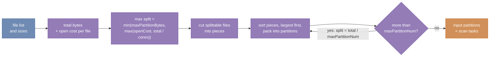

`file_partitions.py` does this calculation in Python for each input, and then it compares the prediction with `df.rdd.getNumPartitions()`:

```text
local[*] with 16 cores; defaults: maxPartitionBytes 128MB, openCostInBytes 4MB

input                                  files      MB  max split  predicted  actual
June: 1 Parquet file                       1    62.4       4.2M         16      16
June, maxPartitionBytes 2MB                1    62.4       2.0M         32      32
January to June: 6 files                   6   372.6      24.8M         17      17
January to June, minPartitionNum 64        6   372.6       6.2M         62      62
June as 200 small files                  200    98.4      56.2M         16      16
200 small files, openCostInBytes 1       200    98.4       6.2M         17      17
200 small files, maxPartitionNum 4       200    98.4     224.6M          4       4
CSV, 500,000 rows                          1    55.1       4.0M         14      14
the same CSV, gzip                         1     9.7       4.0M          1       1
the same CSV, bzip2                        1     5.1       4.0M          2       2
```

The prediction is correct in each case. Some rows need an explanation:

- **The split size follows the data, not the 128 MB default.** For less than 2 GB of input on 16 cores, the bytes for each core are smaller than 128 MB. Thus, Spark makes about one partition for each core. The 128 MB limit applies only to large inputs.
- **Six files make 17 partitions, not 16.** The pieces do not divide exactly into 16 groups, so the packing needs one more partition.
- **Small files cost an open cost each.** June as 200 small files is 98.4 MB on the disk, but the packing counts 200 × 4 MB of open cost more. The partitions are full sooner. With `openCostInBytes` at 1, the same files pack into 17 partitions of real data.
- **`maxPartitionNum` is a ceiling.** Spark packs the files again with a split of 224.6 MB, and it ignores `maxPartitionBytes`. Spark logs a warning when it does this.
- **gzip cannot split.** A gzip stream has no points where a reader can start in the middle. Thus, the 9.7 MB file is one piece and one task, regardless of its size. bzip2 has block boundaries, and Hadoop's `BZip2Codec` implements `SplittableCompressionCodec`. Thus, the 5.1 MB bzip2 file splits into two pieces.

Other inputs that do not split: a JSON or CSV file with `multiLine=true`, a `wholetext` text read, and each file of a `binaryFile` read. One large gzip file makes one task for the whole scan stage. If a job reads such a file, `repartition` after the read is the only method to spread the next steps over the cores.

### A partition is not the same as a task with work

The split rule counts bytes. Parquet decodes **row groups**, as [Chapter 5](ch05-how-spark-runs.md) showed. A Parquet split reads a row group only if the split contains the midpoint of that row group:

```text
row groups: June 4 | January to June 24
June: 16 partitions, 4 of them return rows
January to June: 17 partitions, 17 of them return rows
```

The June file gives 16 partitions, but only 4 of them return rows. The six months have 24 row groups in 17 partitions, so each partition gets at least one row group. For a scan, the worst case is a small file with a few large row groups. A writer sets the size of the row groups, as [Chapter 36](ch36-parquet-inside.md) shows.

<figure markdown>
  
  
  <figcaption>The June file has 16 splits and 4 row groups. A split reads a row group only if it holds the midpoint of that row group. Thus, 4 tasks return rows. The row-group sizes in the figure are schematic.</figcaption>
</figure>

!!! note "Project Feather changes the June row"
    Spark 4.3 can read a single small file in one task. If `spark.sql.optimizer.singleTaskExecution.enabled` is `true`, the June file is one input partition, not 16. The conditions are in [Chapter 37](ch37-project-feather.md). All the numbers in this chapter use the default, `false`.

## Step 3: repartition, coalesce and the cost of `coalesce(1)`

After the scan, two methods change the number of partitions. `repartition` adds a shuffle. `coalesce` merges partitions that are next to each other, without a shuffle. `repartition.py` applies each variant to the six months and prints the top operator of the plan:

```text
input partitions: 17

call                                   partitions  top of the plan
repartition(8)                                  8  Exchange RoundRobinPartitioning(8), REPARTITION_BY_NUM, [plan_
repartition(8, 'PULocationID')                  8  Exchange hashpartitioning(PULocationID#7, 8), REPARTITION_BY_N
repartition('PULocationID')                    22  Exchange hashpartitioning(PULocationID#7, 200), REPARTITION_BY
repartitionByRange(4, 'fare_amount')            4  Exchange rangepartitioning(fare_amount#10 ASC NULLS FIRST, 4),
coalesce(4)                                     4  Coalesce 4
coalesce(100)                                  17  Coalesce 100

non-empty partitions after repartition('PULocationID'): 8
```

Each call has a different effect on the plan:

- **`repartition(n)`** adds an `Exchange` with round-robin partitioning. The rows go to the `n` partitions in turn, so the partitions have almost equal sizes. The rows with one key do not stay together.
- **`repartition(n, col)`** adds an `Exchange` with hash partitioning on the column. All the rows with one value go to the same partition. A later `groupBy` or join on that column does not need a new shuffle.
- **`repartition(col)` without a number** uses `spark.sql.shuffle.partitions` (200). AQE can coalesce these partitions. Here, `getNumPartitions()` gave 22 after the coalesce. A second query on the same DataFrame found rows in only 8 partitions. That query selected only `spark_partition_id()`, so its shuffle had less data, and AQE made fewer partitions from it. The number of partitions after a shuffle with AQE is a result of the run, not a fixed property of the DataFrame.
- **`repartitionByRange(n, col)`** samples the column, and then it sends each range of values to one partition. Partition 0 gets the lowest fares. Spark uses this method for a global sort.
- **`coalesce(n)`** has no `Exchange`. It merges partitions that are next to each other inside one stage. It can only decrease the number of partitions. `coalesce(100)` on 17 partitions keeps 17.

The `spark_partition_id()` count also works over Spark Connect, where `df.rdd` does not exist. It counts only partitions that hold rows.

### The cost of `coalesce(1)`

`coalesce` has no shuffle. Thus, it has no stage boundary. The operators before `coalesce(1)` are in the same stage as the `coalesce`, and that stage now has one task. All the work before it runs in that one task. `repartition(1)` adds a shuffle. The work before the shuffle keeps all its tasks, and only the write after the shuffle runs in one task.

The script calculates a SHA-256 hash of each row of the six months, which is an expensive step. Then it writes the result to the `noop` sink, which runs the query and discards the rows:

```python
expensive = trips.select(F.sha2(F.concat_ws("|", *trips.columns), 256).alias("h"))
timed("no change", expensive)
timed("coalesce(1)", expensive.coalesce(1))
timed("repartition(1)", expensive.repartition(1))
```

```text
SHA-256 of every row of 22,836,530 trips, written to the noop sink, 5 runs after a warm-up:
  no change                  median 17.70 s  (task counts per stage: [17])
  coalesce(1)                median 67.99 s  (task counts per stage: [1])
  repartition(1)             median 19.81 s  (task counts per stage: [1, 17])
```

<figure markdown>
  
  
  <figcaption>The medians from <code>repartition.txt</code>. With <code>coalesce(1)</code>, one task does all the work.</figcaption>
</figure>

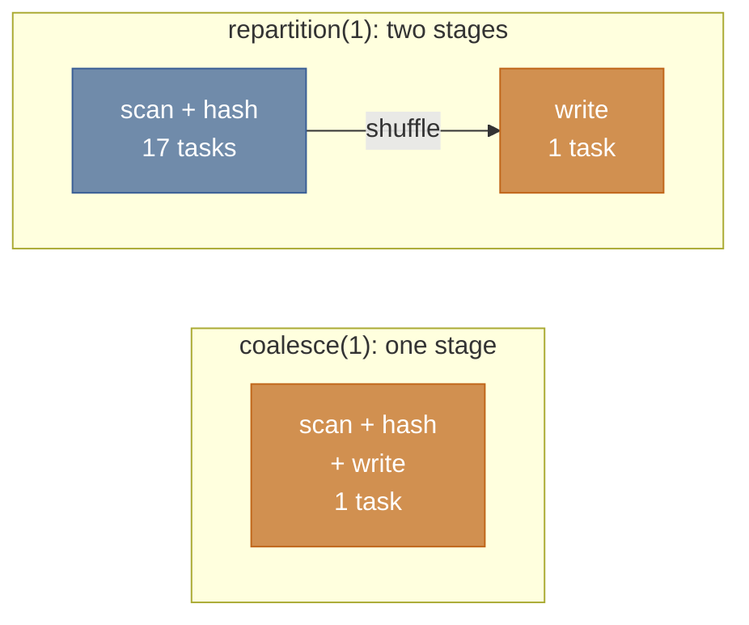

With `coalesce(1)`, the hash of 22.8 million rows ran in one task, and the job took 3.8 times as long. With `repartition(1)`, the hash ran in 17 tasks, and the job took only 12% more time than the job with no change. The extra time is the cost of the shuffle.

Use `coalesce(n)` only to decrease a large number of small partitions to a number that is still large enough for the cores. If you must write one file, use `repartition(1)`. Then the work before the write keeps its parallelism.

## Step 4: Write a layout that later queries can skip

A layout on disk sets the partitions of each later read. `partitionBy` on a write puts the rows into one folder for each value of a column, such as `day=2026-06-15/`. A filter on that column then removes whole folders before Spark lists a file in them. This is **partition pruning**. `layout.py` writes the June trips by pickup day in four ways:

```python
WAYS = [
    ("plain write", lambda d: d.write),
    ("repartition(16) first", lambda d: d.repartition(16).write),
    ("repartition('day') first", lambda d: d.repartition("day").write),
    ("repartition('day'), maxRecordsPerFile 50000",
     lambda d: d.repartition("day").write.option("maxRecordsPerFile", 50000)),
]
```

```text
input partitions: 16

how                                            folders  files  min/folder  max/folder
plain write                                         30     63           2           3
repartition(16) first                               30    480          16          16
repartition('day') first                            30     30           1           1
repartition('day'), maxRecordsPerFile 50000         30     92           3           4
```

Each write task writes one file into each folder for which it has rows. Thus, the number of files is the number of tasks multiplied by the number of days that each task holds:

- **The plain write** made 63 files. The input has four row groups in time sequence, so each task holds only a few days.
- **`repartition(16)`** spreads each day over all 16 tasks. The result is 16 files in each of 30 folders, 480 small files in total. This is the most frequent cause of the small-file problem.
- **`repartition("day")`** puts each day into one task, so each folder gets one file.
- **`maxRecordsPerFile`** starts a new file after 50,000 rows. Thus, a large day does not become one very large file.

A filter on the folder column shows in the plan as `PartitionFilters`. The SQL tab of the UI records how many files the scan read:

```text
schema read back: cbd_congestion_fee:double, request_source:string, day:date
  day = 2026-06-15                             files read    3   PartitionFilters: [isnotnull(day#44), (day#44 = 2026-06-15)]
  day >= 2026-06-25                            files read   18   PartitionFilters: [isnotnull(day#44), (day#44 >= 2026-06-25)]
  to_date(pickup) = 2026-06-15                 files read   92   PartitionFilters: []
  dayofweek(day) = 1 (Sunday)                  files read   12   PartitionFilters: [isnotnull(day#44), (dayofweek(day#44) = 1)]
```

A filter prunes folders only if it uses the folder column. The filter `to_date(tpep_pickup_datetime) = '2026-06-15'` gives the same rows as `day = '2026-06-15'`. But Spark cannot know that, so it reads all 92 files. A function of the folder column is a different case. `dayofweek(day) = 1` is still a partition filter, because Spark can calculate it from the folder names alone.

Folder names are text, and Spark guesses a type for them when it reads them back:

```text
folders: ['code=001', 'code=010', 'code=100']
read back: [(1, 1), (2, 10), (3, 100)] struct<n:int,code:int>
with a schema: [(1, '001'), (2, '010'), (3, '100')]
one folder alone: ['n'] | with basePath: ['n', 'code']
```

The codes `001`, `010` and `100` came back as the integers 1, 10 and 100. Spark removes the zeros at the start. To keep the values as text, give a schema, or set `spark.sql.sources.partitionColumnTypeInference.enabled` to `false`. If you read one folder alone, the folder column is not in the result. Give the option `basePath` to keep it.

## Step 5: What `cache()` does

`cache()` keeps the result of a DataFrame in memory, so that later queries do not calculate it again. `caching.py` cleans the six months of trips and caches the result:

```python
clean = cleaned()
print("before cache():", clean.storageLevel, "| is_cached", clean.is_cached)
clean.cache()
print("after cache(): ", clean.storageLevel, "| is_cached", clean.is_cached)
print("cache() is lazy: storage entries now:", len(ui_api("storage/rdd")))
```

```text
before cache(): Serialized 1x Replicated | is_cached False
after cache():  Disk Memory Deserialized 1x Replicated | is_cached True
cache() is lazy: storage entries now: 0

the plan of a query on the cached DataFrame:
  +- InMemoryTableScan [PULocationID#7, fare_amount#10], [isnotnull(PULocationID#7), (PULocationID#7 = 132)]
  +- InMemoryRelation [tpep_pickup_datetime#1, PULocationID#7, DOLocationID#8, fare_amount#10, tip_amount#13, trip_distance#4, payment_type#9L], Storage
  +- FileScan parquet [tpep_pickup_datetime#1,trip_distance#4,PULocationID#7,DOLocationID#8,payment_type#9L,fare_amount#10,tip_amount#13] Batched: true,

first action fills the cache: 21,828,310 rows in 8.2 s
Storage tab: '*(1) Project [tpep_pickup_datetime#1, PULocationID#7, DOLoca...'
  17/17 partitions cached, memory 747 MiB, disk 0 MiB, level 'Disk Memory Deserialized 1x Replicated'
```

The output shows four facts:

- **`cache()` is lazy.** It only marks the DataFrame. The Storage tab has no entry until an action runs. The first action read the files, cleaned 21,828,310 rows, and filled the cache in 8.2 s.
- **The default level for a DataFrame is `MEMORY_AND_DISK_DESER`.** The level string is `Disk Memory Deserialized`. If a partition does not fit in memory, Spark writes it to the disk.
- **The cache is columnar and compressed.** The seven columns of 21.8 million rows used 747 MiB of memory.
- **Spark finds the cache by plan.** `InMemoryTableScan` replaces the scan. Spark applies the filter on `PULocationID` to the cached batches.

### When a cache helps, and when it does not

A cache costs time to fill and memory to hold. It helps only if the work that it saves is more than that cost:

```text
a cheap aggregate, median of 7 runs after a warm-up:
  from the cache                450 ms
  a new DataFrame, same plan    480 ms   (cache matched by plan)
  a different plan              531 ms   (reads the Parquet files)
  same plan, InMemoryTableScan: True | different plan: False

an expensive step (a shuffle into 8,951,369 route-hours), then a small query on it:
  recomputed each time         3283 ms
  the same DataFrame object, collect() again     27 ms   (skipped stages: 2)
  from a cache of the step      518 ms   (InMemoryTableScan: True)
```

For a cheap aggregate, the cache saved only 81 ms compared to a read of the Parquet files. Parquet is already columnar and compressed, and a scan of 372.6 MB on 16 cores is fast. To fill this cache took 8.2 s. Thus, the cache pays for itself only after about 100 such queries.

The second test has an expensive step: a shuffle of all trips into 8,951,369 rows, one for each route and hour. A query that calculates the step again took 3,283 ms. A cache of the step decreased this time to 518 ms.

The line in the middle is a trap. A second `collect()` on the same DataFrame object took 27 ms, because the scheduler skipped the two stages that wrote the shuffle files. The shuffle files of the first run are still on the disk, and the same DataFrame reuses them. A new DataFrame with the same plan does not reuse them. Thus, a benchmark that collects one DataFrame in a loop measures only its last stage. [Chapter 37](ch37-project-feather.md) shows the same trap in a Feather benchmark.

A cache is also a match for a new DataFrame that has the same plan. The second line ("a new DataFrame, same plan") read from the cache. Spark compares the analyzed plans, not the Python objects.

### Levels, SQL and the end of a cache

```text
after persist(DISK_ONLY) on the cached DataFrame: Disk Memory Deserialized 1x Replicated
after unpersist(): Serialized 1x Replicated | storage entries: 0

CACHE LAZY TABLE: storage entries 0 | cached partitions 0
CACHE TABLE took 4.3 s: storage entries 1 | name In-memory table clean_trips
after clearCache(): 0 entries
```

- A second `persist()` with a different level does nothing. Call `unpersist()` first.
- In SQL, `CACHE TABLE` is eager. It fills the cache before the statement returns. `CACHE LAZY TABLE` waits for the first query, like `cache()`.
- `unpersist()` removes one entry. `spark.catalog.clearCache()` removes all entries.

PySpark has fewer storage levels than Scala. There is no `MEMORY_ONLY_SER`, because Python stores its objects as serialized bytes in all cases:

```text
PySpark storage levels:
  DISK_ONLY                disk=True  memory=False offHeap=False deserialized=False replicas=1
  MEMORY_AND_DISK          disk=True  memory=True  offHeap=False deserialized=False replicas=1
  MEMORY_AND_DISK_DESER    disk=True  memory=True  offHeap=False deserialized=True  replicas=1
  MEMORY_ONLY              disk=False memory=True  offHeap=False deserialized=False replicas=1
  OFF_HEAP                 disk=True  memory=True  offHeap=True  deserialized=False replicas=1
  ...
```

### A DataFrame keeps its file list

A file DataFrame lists its files when you create it. It does not see files that arrive later:

```text
a file arrives after read.parquet():
  old DataFrame counts 3,724,889 rows; a new read counts 7,124,755
  after refreshByPath: old DataFrame counts 3,724,889
  a listed file is deleted: FAILED_READ_FILE.FILE_NOT_EXIST
```

`spark.catalog.refreshByPath` did not change the old DataFrame. It only clears cached data and metadata for the path, so that a new read sees the new files. If you delete a file that the DataFrame listed, the next action fails with `FAILED_READ_FILE.FILE_NOT_EXIST`. Thus, read the files again each time that a job runs. Do not keep a file DataFrame for a long time in a service.

!!! note "New in 4.3: an Arrow format for the cache"
    Spark 4.3 can keep the cache as Arrow batches. The static setting `spark.sql.cache.serializer=org.apache.spark.sql.execution.columnar.ArrowCachedBatchSerializer` turns it on. It is a part of Project Feather, and [Chapter 37](ch37-project-feather.md) measures it.

## Step 6: The memory of an executor

An executor is one JVM. Spark divides its heap into regions, and only one region holds cached blocks and the memory that tasks use for their work. The division is in `UnifiedMemoryManager.scala`:

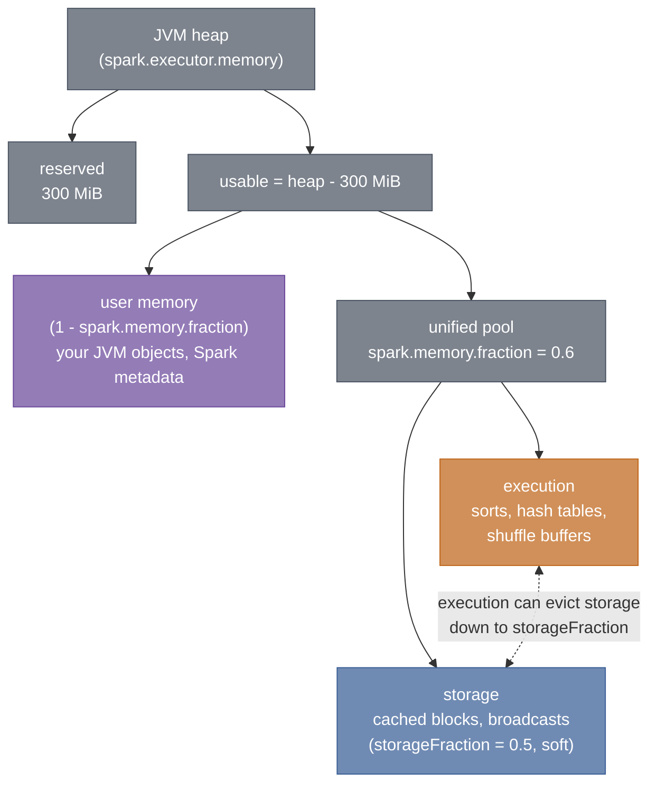

- **Reserved memory** is 300 MiB, for Spark itself.
- **The unified pool** is `spark.memory.fraction` (0.6) of the rest. Execution and storage share it. `spark.memory.storageFraction` (0.5) is a soft limit. Execution can take memory from storage and evict cached blocks, but only until storage has 0.5 of the pool. Storage can never evict execution memory.
- **User memory** is the other 0.4. Spark does not manage it. Objects that your code makes on the JVM heap use it.
- **Each task** can get between 1/(2N) and 1/N of the execution memory, if N tasks run at the same time (`ExecutionMemoryPool.scala`). If a task cannot get its minimum, it spills, or it waits.

The figure shows these regions for the default heap of 1024 MiB, with 16 tasks:

<figure markdown>
  
  
  <figcaption>The regions of the default heap. The sizes come from the formula and agree with <code>memory.txt</code>. The line between execution and storage is soft.</figcaption>
</figure>

`memory.py` starts a new JVM for each configuration, because a JVM cannot change its heap size after it starts. Then it reads the pool sizes from the executors endpoint of the REST API:

```text
configuration                   heap  (heap-300)*f  on-heap pool  off-heap  maxMemory   (MiB)
defaults                        1024         434.4         434.4         0      434.4
driver 2g                       2048        1048.8        1048.8         0     1048.8
driver 2g, off-heap 256m        2048        1048.8        1048.8       256     1304.8
driver 4g, fraction 0.8         4096        3036.8        3036.8         0     3036.8
driver 400m                   fails: [INVALID_DRIVER_MEMORY.SYSTEM_MEMORY] Insufficient driver memory: System memory 419430400 must be at least 471859200.
```

The formula agrees with the measured pool in each row. The JVM reports a heap that is a little smaller than the setting, so the formula uses the measured heap. These are the important numbers:

- **The default 1 GiB heap gives 434 MiB** to execution and storage together. In local mode, 16 tasks share it. A task can get between 13.6 MiB and 27 MiB. This is why a sort of a few hundred megabytes spills in Step 7.
- **Off-heap memory adds a second pool.** With `spark.memory.offHeap.enabled` and a size, `maxMemory` includes the off-heap pool. Spark manages this memory outside the garbage collector.
- **A heap below 450 MiB fails at start-up.** Spark requires 1.5 times the reserved memory, which is 471,859,200 bytes.

In local mode, the driver is also the executor. Thus, `spark.driver.memory` sets the size of all these pools, and `spark.executor.memory` has no effect. The scripts that cache six months of trips set `spark_driver_memory="4g"`. With the default 1 GiB heap, the cache of six months failed with `OutOfMemoryError` in one run.

## Step 7: Spill

A task **spills** when it needs more execution memory than it can get. A sort writes its sorted run to a file on the local disk, frees the memory, and continues. At the end, it merges the runs from the disk. An aggregate or a join can spill in the same way. The query gives the correct result, but it does more I/O.

`spill.py` keeps the default 1 GiB heap. It sorts all June trips by distance and writes the result to the `noop` sink. It changes the number of shuffle partitions and AQE, and it reads the spill metrics of the sort stage from the REST API:

```python
for parts, aqe in CASES:
    spark.conf.set("spark.sql.shuffle.partitions", parts)
    spark.conf.set("spark.sql.adaptive.enabled", aqe)
    ...
        trips.orderBy("trip_distance").write.format("noop").mode("overwrite").save()
    ...
    sort = max(stages, key=lambda s: s["shuffleReadBytes"])           # the stage after the shuffle
```

```text
heap: 1024 MiB; storage+execution pool: 434 MiB

sort all June trips by trip_distance, write to noop; median of 3 runs after a warm-up

shuffle.partitions   AQE  sort tasks  memory spilled  disk spilled  shuffle write    time
                 2 false           2         370 MiB        98 MiB        197 MiB    5.4s
                16 false          16         391 MiB       104 MiB        188 MiB    3.8s
               200 false         200           0 MiB         0 MiB        184 MiB    3.7s
                 2  true           2         555 MiB       148 MiB        197 MiB    4.7s
               200  true          17         368 MiB        98 MiB        184 MiB    3.8s
```

<figure markdown>
  
  
  <figcaption>The spill metrics of the sort stage from <code>spill.txt</code>. Only the run with 200 small partitions does not spill.</figcaption>
</figure>

There are two spill metrics, and they measure different things:

- **Memory spilled** (`memoryBytesSpilled`) is the size of the spilled data in memory, before Spark writes it.
- **Disk spilled** (`diskBytesSpilled`) is the size of the same data on the disk, after serialization and compression.

The numbers show how the partition count controls spill:

- **2 partitions:** each sort task holds about half of the shuffle (197 MiB written). The pool is 434 MiB, and a task can get at most half of it while the other task runs. The tasks spilled 370 MiB.
- **16 partitions:** each task holds less data, but each task also gets less memory, between 1/32 and 1/16 of the pool. The tasks still spilled.
- **200 partitions:** each task holds about 1 MiB, which fits. Nothing spilled.
- **200 partitions with AQE:** AQE coalesced the 200 partitions into 17, because each partition was much smaller than the advisory size of 64 MB. The larger partitions spilled again, 368 MiB.

The last row is important. AQE coalescing selects partition sizes from `advisoryPartitionSizeInBytes`, not from the memory of each task. On executors with little memory for each core, a coalesced partition of 64 MB can spill. If a stage spills after a coalesce, decrease `spark.sql.adaptive.advisoryPartitionSizeInBytes`, or give each task more memory (more heap, or fewer cores for each executor).

The time cost of the spill was small here, because the local disk is fast and the page cache holds the spill files. The sort with 2 tasks took 5.4 s, and the sort with 200 tasks took 3.7 s. Most of the difference is parallelism, not spill. On a cluster with slow disks, spill costs more.

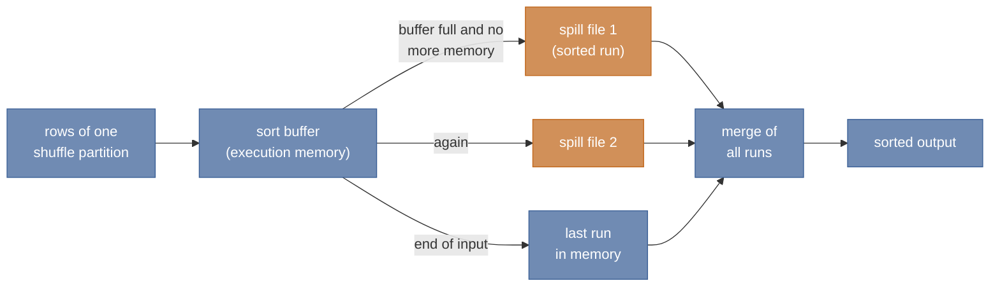

<figure markdown>
  <video autoplay loop muted playsinline controls width="1280" height="720" poster="../../media/clips/ch33-anim-spill.webp">
    <source src="../../media/clips/ch33-anim-spill.mp4" type="video/mp4">
  </video>
  <figcaption>Animation: a sort task fills its buffer, writes sorted runs to the disk, and merges the runs at the end. The totals come from <code>spill.txt</code>. The buffer size and the number of spill files are schematic.</figcaption>
</figure>

## Step 8: Very large files

The memory model has a hard consequence for large binary files. The `binaryFile` source reads each file as one row, with the bytes in a `content` column. Spark cannot split a binary file, and it reads the whole file into one value. `blobs.py` makes a sparse file of 2.5 GB, which uses no disk blocks, and reads it:

```text
huge.bin: apparent size 2,500,000,000 bytes, blocks on disk 0
schema: struct<path:string,modificationTime:timestamp,length:bigint,content:binary>
select(path, length): [('huge.bin', 2500000000)]
count(): 1
select(content): [FAILED_READ_FILE.NO_HINT] Caused by: org.apache.spark.SparkException: The length of file:huge.bin is 2500000000, which exceeds the max length allowed: 2147483647.
with maxLength 200 MiB, f300.bin: The length of f300.bin is 314572800, which exceeds the max length allowed: 209715200.
```

The metadata columns are cheap. `select(path, length)` and `count()` succeeded, because `BinaryFileFormat` reads the file content only when the query needs the `content` column. `select(content)` failed. A Spark binary value holds at most 2,147,483,647 bytes (2 GiB minus one byte), and `spark.sql.sources.binaryFile.maxLength` has that value by default. A lower `maxLength` makes the read fail early, with a clear message, for a file above your own limit.

The real limit is much lower, and it comes from the memory model of Step 6:

```text
a fresh driver with the default 1g heap, one file each:
  f100.bin (100 MiB): exit code 0; read 104,857,600 bytes
  f300.bin (300 MiB): exit code 1; java.lang.OutOfMemoryError: Java heap space
      at org.apache.spark.sql.catalyst.expressions.codegen.BufferHolder.grow(BufferHolder.java:85)
      at org.apache.spark.sql.execution.datasources.binaryfile.BinaryFileFormat$.$anonfun$parse$2(BinaryFileFormat.s
      at org.apache.spark.sql.execution.datasources.binaryfile.BinaryFileFormat$.$anonfun$parse$2$adapted(BinaryFile
```

A driver with the default 1 GiB heap read a 100 MiB file. It failed with `OutOfMemoryError` on a 300 MiB file.

The stack trace shows where: `BufferHolder.grow` makes the row buffer larger when the value does not fit. A larger buffer is a new array, and the old array stays until the copy is complete. Thus, one 300 MiB value needs several times its size for a short time. All of this memory is user memory, outside the unified pool. The 16 task slots also share the same heap.

Rules for large files:

- Select only the metadata columns (`path`, `length`, `modificationTime`) to make an inventory. That costs almost nothing.
- Do not put a file that is larger than a small fraction of the executor heap into one row. Split it at the source, or read it in parts with your own reader. [Part XIII](ch65-python-data-sources-readers.md) builds such a reader as a Python data source.
- Spark 4.3 can read entries inside zip and tar archives as separate files. [Chapter 25](ch25-files-as-files.md) shows it.

## Step 9: The Spark UI, tab by tab

The REST API gave all the numbers in this chapter. The web UI shows the same data, and it is the faster tool when you do not know yet where to look. `ui_tour.py` runs three labelled actions on the default 1 GiB heap, and then it keeps the application alive. `film/ch33_ui.py` records a browser while it visits the UI pages. The workload:

```python
sc.setJobDescription("1. sort six months by distance, 2 partitions, AQE off")
spark.conf.set("spark.sql.shuffle.partitions", "2")
spark.conf.set("spark.sql.adaptive.enabled", "false")
spark.read.parquet(str(TAXI / "yellow-h1")).orderBy("trip_distance").write.format("noop").mode("overwrite").save()
...
sc.setJobDescription("2. cache the cleaned June trips")
...
sc.setJobDescription("3. tips by pickup zone, from the cache")
```

What the REST API reported for the same run:

```text
UI on port 4138
  job  0  SUCCEEDED  stages 1  tasks   1  1. sort six months by distance, 2 partitions, AQE 
  job  1  SUCCEEDED  stages 1  tasks  17  1. sort six months by distance, 2 partitions, AQE 
  job  2  SUCCEEDED  stages 2  tasks  19  1. sort six months by distance, 2 partitions, AQE 
  job  3  SUCCEEDED  stages 1  tasks   1  2. cache the cleaned June trips
  job  4  SUCCEEDED  stages 1  tasks  16  2. cache the cleaned June trips
  job  5  SUCCEEDED  stages 1  tasks  16  2. cache the cleaned June trips
  job  6  SUCCEEDED  stages 2  tasks  17  2. cache the cleaned June trips
  job  7  SUCCEEDED  stages 1  tasks  16  3. tips by pickup zone, from the cache
  job  8  SUCCEEDED  stages 2  tasks  17  3. tips by pickup zone, from the cache
  stage  0  tasks   1  spill memory      0 MiB  disk     0 MiB  1. sort six months by distance, 2 partit
  stage  1  tasks  17  spill memory      0 MiB  disk     0 MiB  1. sort six months by distance, 2 partit
  stage  2  tasks  17  spill memory      0 MiB  disk     0 MiB  1. sort six months by distance, 2 partit
  stage  3  tasks   2  spill memory  3,520 MiB  disk   971 MiB  1. sort six months by distance, 2 partit
  stage  4  tasks   1  spill memory      0 MiB  disk     0 MiB  2. cache the cleaned June trips
  stage  5  tasks  16  spill memory      0 MiB  disk     0 MiB  2. cache the cleaned June trips
  stage  6  tasks  16  spill memory      0 MiB  disk     0 MiB  2. cache the cleaned June trips
  stage  8  tasks   1  spill memory      0 MiB  disk     0 MiB  2. cache the cleaned June trips
  stage  9  tasks  16  spill memory      0 MiB  disk     0 MiB  3. tips by pickup zone, from the cache
  stage 11  tasks   1  spill memory      0 MiB  disk     0 MiB  3. tips by pickup zone, from the cache
the stage that spilled: 3, 2 tasks, spill memory 3,520 MiB, disk 971 MiB
storage: 16/16 partitions, 95 MiB in memory, level Disk Memory Deserialized 1x Replicated
SQL execution 2 ('3. tips by pickup zone, from the cache'), jobs [7, 8]
```

### Jobs, and a stage that spilled

<figure markdown>
  <video autoplay loop muted playsinline controls width="1280" height="720" poster="../../media/clips/ch33-ui-stages.webp">
    <source src="../../media/clips/ch33-ui-stages.mp4" type="video/mp4">
  </video>
  <figcaption>The Jobs tab, then the detail page of the sort stage. The summary metrics show the spill of each of the two tasks.</figcaption>
</figure>

- **The Jobs tab** lists each job with its description, so `setJobDescription` is the easiest way to find your own work in a busy application. Each action made more than one job, as [Chapter 5](ch05-how-spark-runs.md) explained.
- **The stage detail page** has the totals at the top: `Spill (Memory)` and `Spill (Disk)`. The two sort tasks spilled 3.4 GiB in memory, which was 971 MiB on the disk. The **Summary Metrics** table gives the minimum, the quartiles and the maximum of each metric over the tasks. Use it to find skew. If the maximum duration is much larger than the median, one task did much more work than the others.

### Storage and the plan of a query

<figure markdown>
  <video autoplay loop muted playsinline controls width="1280" height="720" poster="../../media/clips/ch33-ui-storage-sql.webp">
    <source src="../../media/clips/ch33-ui-storage-sql.mp4" type="video/mp4">
  </video>
  <figcaption>The Storage tab with the cached June trips, then the plan graph of the query that read the cache.</figcaption>
</figure>

- **The Storage tab** shows each cache: its plan, its storage level, how many partitions it holds, and their size in memory and on the disk. A fraction cached below 100% means that some partitions did not fit and Spark must calculate them again.
- **The SQL / DataFrame tab** shows each query as a graph of physical operators, with metrics on each node. This query starts at `InMemoryTableScan`, so it read the cache and not the files. The graph shows the final plan after AQE, and it is the easiest way to see what AQE did ([Chapter 32](ch32-query-plans.md), Step 7).

### The tabs, one by one

`ui_tabs.py` runs one application that fills every tab: a batch query, a cache, a sort that spills, a streaming query, and a Spark Connect session. The Connect server runs as a plugin in the same application (`spark.plugins=org.apache.spark.sql.connect.SparkConnectPlugin`), and a client in another process connects to it. `film/ch33_ui_tabs.py` takes a screenshot of each tab with a headless browser. The orange boxes mark the parts that the text explains. What the REST API reported for the same run:

```text
connect: 499999500000 3837248
UI on port 4154 (default 1g heap, so that the sort spills)
  jobs 23, stages 37
  storage: *(1) Project [PULocationID#7, tip_amount#13, fare_amount#10], 16/16 partitions, 64.5 MiB
  executors: 1 (driver), cores 16, max memory 434.4 MiB
  environment: 21 Spark properties, Java 17.0.21.1 (U
  SQL executions: 26
  streaming query: rate_windows, id d6d98093-4ae0-4d58-ad7c-ea5c1a016d7f, batches so far 9
```

| Tab | URL | REST endpoint | Use it to find |
|---|---|---|---|
| Jobs | `/jobs/` | `/applications/{id}/jobs` | which action made which jobs, and the event timeline |
| Stages | `/stages/` | `/applications/{id}/stages` | skew, spill, shuffle bytes, locality, GC time for each task |
| Storage | `/storage/` | `/applications/{id}/storage/rdd` | the caches, their storage level and the fraction cached |
| Environment | `/environment/` | `/applications/{id}/environment` | the settings that the application really used |
| Executors | `/executors/` | `/applications/{id}/executors` | memory, cores, GC time, shuffle bytes and failures of each executor |
| SQL / DataFrame | `/SQL/` | `/applications/{id}/sql` | the final physical plan with metrics on each node |
| Structured Streaming | `/StreamingQuery/` | (listener events, [Chapter 61](ch61-observability.md)) | input rate, process rate, batch duration and state of each query |
| Connect | `/connect/` | (none in 4.3.0; Connect has its own REST endpoints, [Chapter 20](ch20-connect-observability.md)) | Connect sessions, users and the requests of each one |

**Jobs.** Each row is a job, with its description, its stages and its tasks. `setJobDescription` puts your own text in the **Description** column. **Event Timeline** shows when executors joined and when each job ran. A gap between jobs is time that the driver spent on something else, for example Python code or planning.

<figure markdown>
  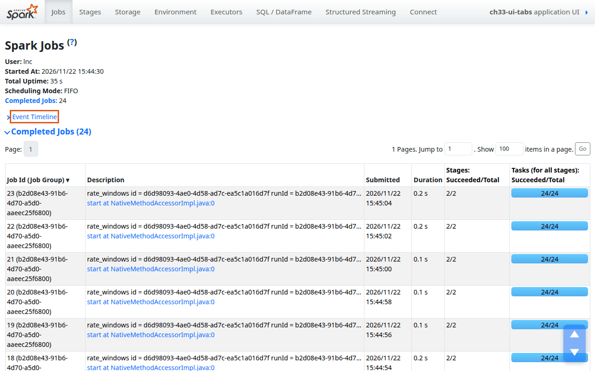
  <figcaption markdown="span">The Jobs tab. The streaming query adds one job for each micro-batch, with the query name as the description.</figcaption>
</figure>

**Stages.** The list shows each stage with its input, output, shuffle read and shuffle write. The detail page of one stage has the numbers of Steps 7 and 12.

It shows the **Locality Level Summary**, the spill totals and the **Summary Metrics**. The summary metrics are the minimum, the quartiles and the maximum of each task metric. A maximum that is much larger than the median is skew. Below it, the task table has one row for each task, with its executor, locality level, GC time and errors.

<figure markdown>
  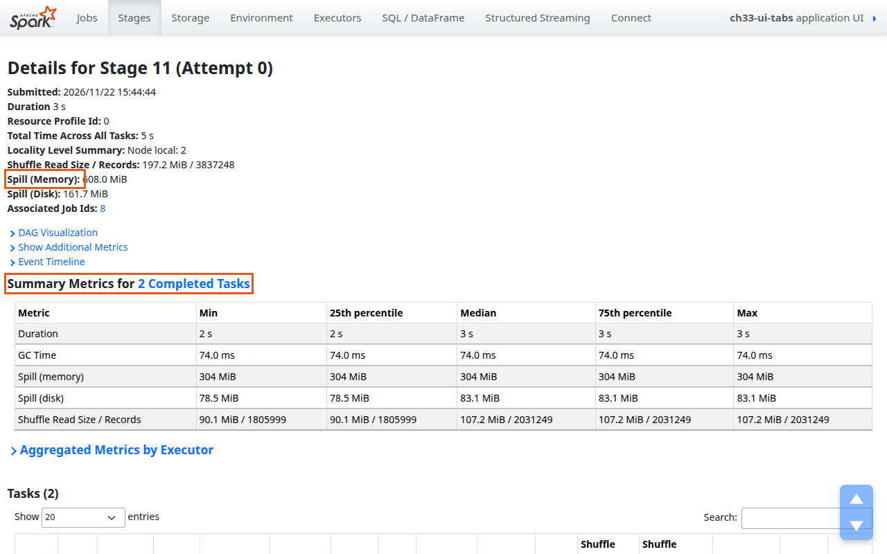
  <figcaption markdown="span">The detail page of the sort stage. Its 2 tasks spilled 608 MiB in memory, 161.7 MiB on the disk.</figcaption>
</figure>

**Storage.** The tab has one row for each cached RDD or DataFrame. Each row shows the storage level, the cached partitions against all partitions, and the size in memory and on the disk. The name of a DataFrame cache is its plan. A fraction below 100% means that Spark must calculate the partitions that are not in the cache again.

<figure markdown>
  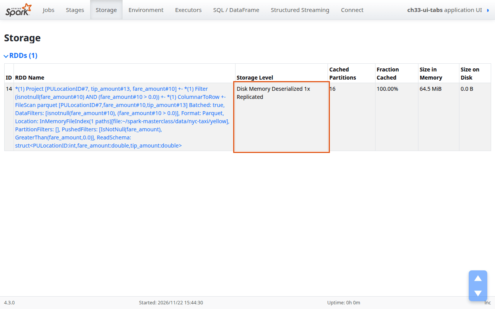
  <figcaption markdown="span">The Storage tab with the cached June tips at the level `Disk Memory Deserialized 1x Replicated`.</figcaption>
</figure>

**Environment.** The runtime (Java and Scala versions), every Spark property, the Hadoop properties, the system properties and the class path. This is the only place that shows the value that the application really used, after all the sources of [Chapter 8](ch08-setting-configurations.md). The **Spark Properties** table has a **Default Value** column, and it marks each property that is not at its default value. Spark redacts values whose keys match `spark.redaction.regex`, for example passwords.

<figure markdown>
  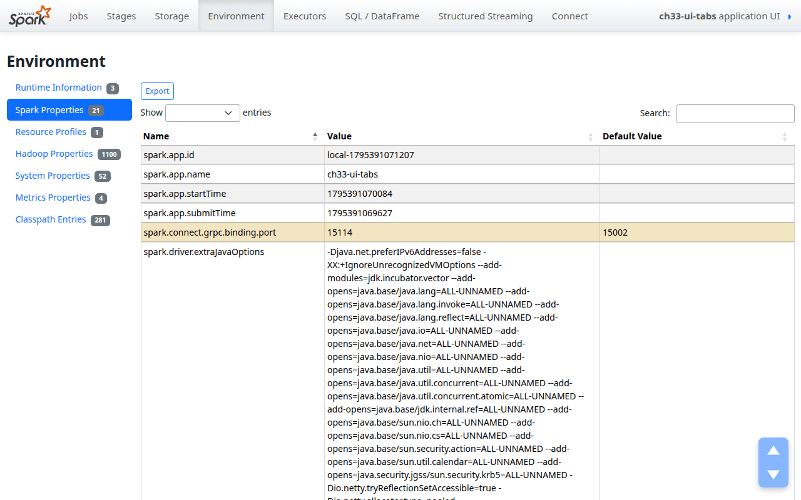
  <figcaption markdown="span">The Spark properties. The Connect port 15114 is not the default 15002, so the page marks its row.</figcaption>
</figure>

**Executors.** The tab has one row for each executor and for the driver. Each row shows the storage memory in use against the storage pool of Step 6, the disk in use, the cores and the tasks. It also shows **Task Time (GC Time)**, the input bytes and the shuffle bytes. A GC time that is a large part of the task time is the sign of Step 11. On a cluster, **Thread Dump** shows what each thread of a slow executor does now, and **Heap Histogram** counts the objects in its heap.

<figure markdown>
  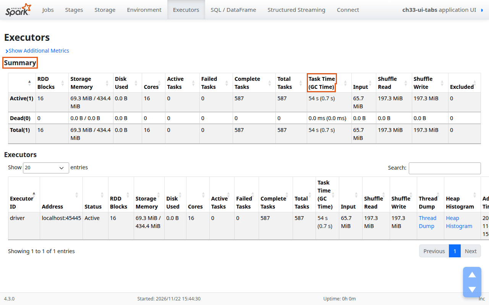
  <figcaption markdown="span">The Executors tab. In local mode, the driver is the only executor.</figcaption>
</figure>

**SQL / DataFrame.** One row for each query, with its jobs. The detail page draws the final plan as a graph, with the rows between the nodes and the metrics of each node. The graph shows what AQE changed ([Chapter 32](ch32-query-plans.md), Step 7). It is also the place to count the rows that a scan returned ([Chapter 36](ch36-parquet-inside.md), Step 4).

<figure markdown>
  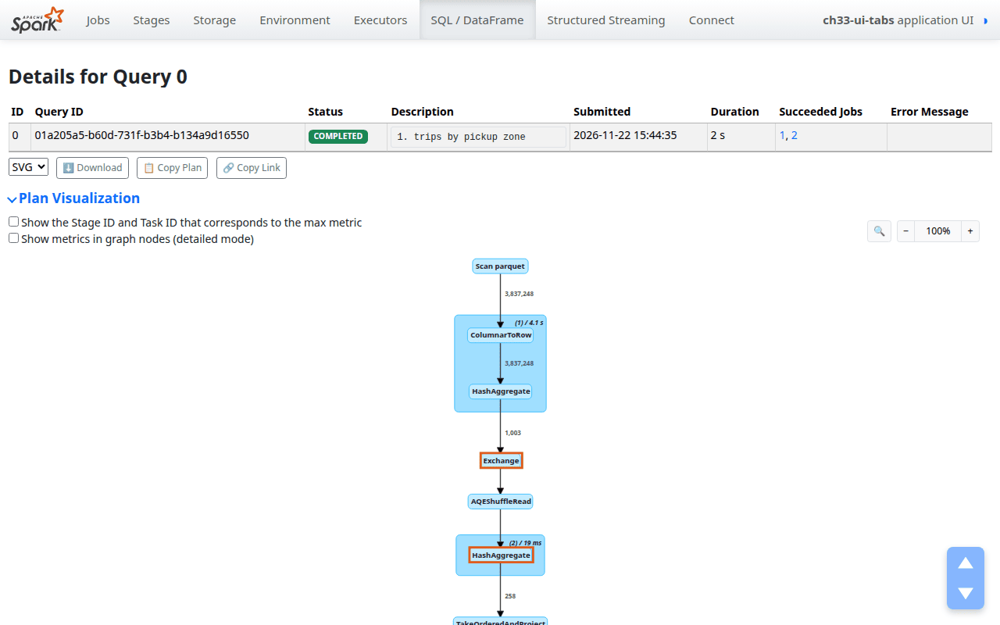
  <figcaption markdown="span">The plan of `1. trips by pickup zone`. The scan returned 3,837,248 rows. The partial aggregate sent 1,003 rows to the `Exchange`.</figcaption>
</figure>

**Structured Streaming.** One row for each streaming query, active or completed. The statistics page of a query plots each metric over time, with a histogram. The metrics include the input rate, the process rate, the input rows, the batch duration and the state of each stateful operator. If the process rate stays below the input rate, the query falls behind ([Chapter 39](ch39-structured-streaming.md)).

<figure markdown>
  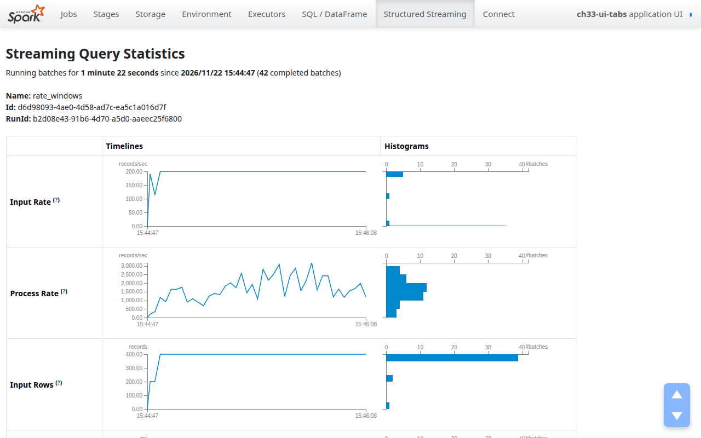
  <figcaption markdown="span">The statistics page of `rate_windows`. The input rate is the 200 rows each second of the rate source.</figcaption>
</figure>

**Connect.** This tab exists only when the Connect server runs in the application. It lists the Connect sessions with their user and start time. It also lists each request with its jobs, its SQL query, its duration and the start of the plan. The user is the `user_id` from the connection string. The tab and the Connect REST endpoints help you find and stop the work of one client ([Chapter 20](ch20-connect-observability.md)).

<figure markdown>
  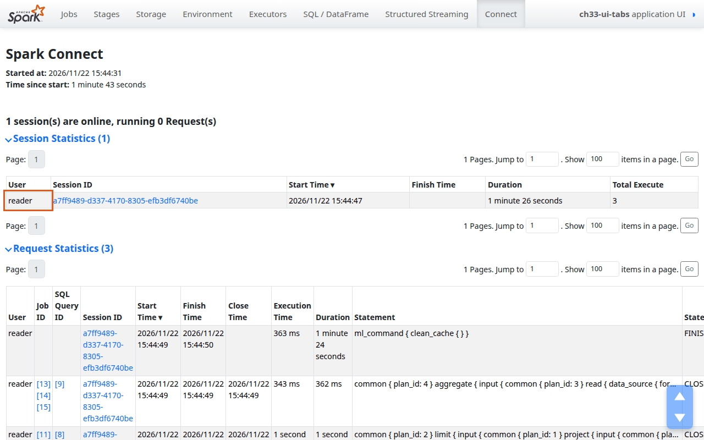
  <figcaption markdown="span">The Connect tab with the session of the user `reader` and its requests.</figcaption>
</figure>

## Step 10: Serialization: Java and Kryo

Spark turns objects into bytes for three purposes: to send them over the network, to write shuffle files and to keep a serialized cache. `spark.serializer` selects the library for this:

- **Java serialization** (`org.apache.spark.serializer.JavaSerializer`) is the default. It works with each class that implements `java.io.Serializable`.
- **Kryo** (`org.apache.spark.serializer.KryoSerializer`) is a separate library. Spark 4.3.0 ships Kryo 4 (`kryo-shaded-4.0.3.jar`). The tuning guide says that it is often faster and more compact. To get the best result, you register your classes with it.

Spark reads `spark.serializer` one time, when the application starts. Thus, `serialization.sh` starts a new `spark-shell` for each setting and runs the same Scala job, `serialization.scala`. The job makes 2,000,000 objects of a small Java class, `book.Trip`, with a `long`, an `int`, a `double` and a 3-character `String`. Then it measures four things:

```scala
val de = trips.persist(StorageLevel.MEMORY_ONLY); de.count()          // 1. objects in the heap
val ser = trips.persist(StorageLevel.MEMORY_ONLY_SER); ser.count()    // 2. a serialized cache
trips.map(t => (t.zone, t)).groupByKey(16).mapValues(_.size).count()  // 3. an RDD shuffle of the objects
trips.map(t => (t.id, t.zone, t.distance, t.vendor)).toDF(...)        // 4. the same rows as a DataFrame
  .groupBy("zone").count().count()
```

```text
java (default)              objects   83.9 MiB | MEMORY_ONLY_SER  25.8 MiB 0.29 s | RDD shuffle  32.7 MiB 0.38 s | DataFrame shuffle 149.4 KiB
kryo, not registered        objects   83.9 MiB | MEMORY_ONLY_SER  30.1 MiB 0.30 s | RDD shuffle  24.4 MiB 0.50 s | DataFrame shuffle 149.4 KiB
kryo, registered            objects   83.9 MiB | MEMORY_ONLY_SER  28.3 MiB 0.45 s | RDD shuffle  22.6 MiB 0.61 s | DataFrame shuffle 149.4 KiB
kryo, required, none        FAILED: IllegalArgumentException: Class is not registered: book.Trip
kryo, required, registered  objects   83.9 MiB | MEMORY_ONLY_SER  28.3 MiB 0.28 s | RDD shuffle  22.6 MiB 0.49 s | DataFrame shuffle 149.4 KiB
```

<figure markdown>
  
  
  <figcaption markdown="span">The sizes from `serialization.txt`. Each serialized form is about one third of the objects in the heap. The serializers differ by less than that.</figcaption>
</figure>

The results do not all agree with the general advice:

- **Any serialized form is much smaller than the objects.** The 2,000,000 objects use 83.9 MiB of heap. A serialized cache uses 25.8 to 30.1 MiB. Step 11 shows where the extra bytes of an object come from.
- **For the serialized cache, Java serialization was the smallest here.** A cached partition is one stream. Java serialization writes the description of the class one time for each stream, and it writes a short reference for each repeated `String` object. Kryo without registration writes the full class name with each object, so its cache was the largest, 30.1 MiB. Registration made it 28.3 MiB.
- **For the shuffle, Kryo was smaller**: 22.6 MiB registered, against 32.7 MiB for Java. Spark compresses shuffle files (`spark.shuffle.compress`, LZ4 by default), and the Kryo output became smaller after compression.
- **The times do not show a difference.** The two runs with the same Kryo settings took 0.45 s and 0.28 s for the cache. At this size, the run-to-run noise is larger than the effect. Do not expect a large speed-up from a change of serializer without a measurement on your own job.
- **The DataFrame shuffle did not change at all**: 149.4 KiB with each serializer. DataFrame operators exchange Tungsten binary rows through their own `UnsafeRowSerializer`. `spark.serializer` does not apply to them.
- **With `spark.kryo.registrationRequired=true`, a class without a registration causes an error.** The job fails with `Class is not registered: book.Trip`. Use this setting in tests to find each class that Kryo writes with its full name.

This is the important part for most readers of this book. `spark.serializer` applies to JVM objects: RDDs of JVM objects, a serialized cache of them, broadcast variables, and accumulators. It does not apply to DataFrames. In PySpark, an RDD holds pickled Python objects, which the JVM sees as byte arrays. Spark also selects Kryo by itself for an RDD shuffle of primitive types, arrays of primitive types and strings (`SerializerManager.canUseKryo`).

How to use Kryo, if your job has JVM objects:

=== "Python (PySpark)"

    ```python
    spark = (SparkSession.builder
             .config("spark.serializer", "org.apache.spark.serializer.KryoSerializer")
             .config("spark.kryo.classesToRegister", "book.Trip,book.Zone")
             .config("spark.kryo.registrationRequired", "true")     # in tests: fail on a class that is not registered
             .getOrCreate())
    ```

=== "Scala"

    ```scala
    val conf = new SparkConf()
      .set("spark.serializer", "org.apache.spark.serializer.KryoSerializer")
      .registerKryoClasses(Array(classOf[Trip], classOf[Zone]))
    ```

| Setting | Default | What it does |
|---|---|---|
| `spark.serializer` | `JavaSerializer` | the serializer for shuffles, serialized caches and broadcasts of JVM objects |
| `spark.kryo.classesToRegister` | (none) | classes to register, separated by commas |
| `spark.kryo.registrator` | (none) | classes that register classes and custom serializers in code |
| `spark.kryo.registrationRequired` | false | fail if Kryo must write a class that is not registered |
| `spark.kryo.referenceTracking` | true | write a reference for an object that occurs again in the same stream |
| `spark.kryoserializer.buffer.max` | 64m | the largest serialized object; a larger object fails with a buffer overflow |

## Step 11: Object size, garbage collection and memory tuning

Step 6 showed how Spark divides the heap. This step is about what lives in the heap: JVM objects, and the garbage collector (GC) that removes them. These numbers matter most for RDDs of JVM objects, for user-defined code that builds collections, and for broadcast variables. DataFrame operators keep their data in Tungsten binary rows and in off-heap or byte-array pages, so they make far fewer objects.

### How large is an object?

The tuning guide names `SizeEstimator.estimate` as the tool to measure an object. `sizes.scala` measures some common structures:

```text
SizeEstimator.estimate on Java 17.0.21.1, heap 1g (compressed object pointers on)
  one Trip (long, int, double, 3-char String)        raw data           23 B   on the heap           88 B     3.8x
  a 10-character String                              raw data           10 B   on the heap           56 B     5.6x
  Array[Int] of 1,000,000                            raw data    4,000,000 B   on the heap    4,000,016 B     1.0x
  java.util.ArrayList[Integer] of 1,000,000          raw data    4,000,000 B   on the heap   20,000,040 B     5.0x
  Scala List[Int] of 1,000,000                       raw data    4,000,000 B   on the heap   40,000,016 B    10.0x
  java.util.HashMap[Integer,Integer] of 1,000,000    raw data    8,000,000 B   on the heap   78,180,224 B     9.8x
  Array[Trip] of 1,000,000 (one shared String)       raw data   23,000,000 B   on the heap   44,000,064 B     1.9x
```

- **Each object has a header**, and each `String` is an object with a byte array inside it. 23 bytes of fields became 88 bytes. A 10-character string uses 56 bytes.
- **A primitive array has no overhead for each element.** An `Array[Int]` of a million values is 4 MB.
- **A collection of boxed values multiplies the size.** The same million `Int` values are 20 MB in an `ArrayList[Integer]` and 40 MB in a Scala `List`. A `HashMap` of a million pairs is 78 MB.
- **Shared objects count once.** The `Array[Trip]` is 44 MB, not 88 MB, because all million objects point to the same `"CMT"` string.

The rules from the tuning guide follow from these numbers. Use arrays of primitive types instead of collections of objects. Use numeric IDs instead of strings for keys. Keep compressed object pointers (`-XX:+UseCompressedOops`, the JVM default for heaps below 32 GB). Store a large cache in serialized form.

### What GC costs, and how to see it

`gc.sh` caches 4,000,000 `Trip` objects in a 2 GB heap. Then it runs five passes of a `reduceByKey` over the cache, and writes a GC log with `-Xlog:gc`. It does this for two storage levels and two collectors. The task metric `jvmGCTime` (the **GC Time** column of the Stages and Executors pages) is the GC time that the tasks saw:

```text
G1, MEMORY_ONLY (objects)          cached  167.8 MiB (16/16) | 5 passes  2.11 s | task GC time  2.33 s of  16.49 s task time
                                   GC log: 30 pauses (20 young, 0 full), 280 ms in pauses
G1, MEMORY_ONLY_SER (Kryo)         cached   56.6 MiB (16/16) | 5 passes  4.30 s | task GC time  1.54 s of  42.32 s task time
                                   GC log: 36 pauses (26 young, 0 full), 287 ms in pauses
Parallel, MEMORY_ONLY (objects)    cached  167.8 MiB (16/16) | 5 passes  1.31 s | task GC time  2.20 s of  11.29 s task time
                                   GC log: 16 pauses (12 young, 4 full), 525 ms in pauses
Parallel, MEMORY_ONLY_SER (Kryo)   cached   56.6 MiB (16/16) | 5 passes  3.11 s | task GC time  2.03 s of  35.34 s task time
                                   GC log: 19 pauses (15 young, 4 full), 328 ms in pauses

the first lines of one GC log (-Xlog:gc):
  [0.003s][info][gc] Using G1
  [1.276s][info][gc] GC(0) Pause Young (Concurrent Start) (Metadata GC Threshold) 102M->30M(2048M) 14.113ms
  [1.277s][info][gc] GC(1) Concurrent Mark Cycle
  [1.288s][info][gc] GC(1) Pause Remark 31M->31M(110M) 7.192ms
  [1.290s][info][gc] GC(1) Pause Cleanup 31M->31M(110M) 0.082ms
  [1.291s][info][gc] GC(1) Concurrent Mark Cycle 14.161ms
```

- **The serialized cache is three times smaller**: 56.6 MiB against 167.8 MiB for the same objects. It is one byte array for each partition, so the collector has 16 objects to trace instead of 4 million.
- **The serialized cache cost CPU in each pass.** Each pass must deserialize all objects again. The task time grew from 16.49 s to 42.32 s with G1, and the passes were slower. A serialized cache is the right choice when the objects do not fit, or when GC time is a large part of the task time. In this run, GC was about 14% of the task time with objects, so the serialized cache did not pay.
- **G1 made no full collections.** The parallel collector made 4 full collections in each run, and its pauses added up to more time. G1 is the default collector of Java 17 and later, which Spark 4.x requires.
- **The times are single runs on a shared machine.** Two runs of `gc.sh` gave different times for the same setting. In both runs, the cache sizes and the full collections were the same, and the serialized cache needed more than twice the task time.

These results come from a small heap with one cache. On an executor with a large cache and many short-lived objects, GC can be most of the task time. The **GC Time** column shows it, and it is the first number to look at.

!!! warning "The GC flags in the 4.3.0 tuning guide do not work on Java 17"
    Do not copy `-XX:+PrintGCTimeStamps` from the tuning guide. Java 17 rejects it, and the executor JVM does not start: `Unrecognized VM option 'PrintGCTimeStamps'`. Use the unified logging flag `-Xlog:gc*` instead. With `-XX:+PrintGCDetails`, the JVM still starts, and it writes a warning.

To tune the collector, give the flags to the executors with `spark.executor.extraJavaOptions`. In local mode, the driver is the executor, so use `spark.driver.extraJavaOptions` or `--driver-java-options`. The guide's method, in short:

| Symptom in the GC log | Action |
|---|---|
| Full collections before a task completes | The tasks need more memory. Use more partitions, or more memory for each core. |
| Many young collections, few full collections | Make the young generation larger (`-Xmn`, about 4/3 of the memory that the tasks need for each executor). |
| The old generation is almost full | Cache less: lower `spark.memory.fraction`, or use a serialized storage level. |
| Large heaps with G1 | Increase the region size with `-XX:G1HeapRegionSize`. |

```python
spark = (SparkSession.builder
         .config("spark.executor.extraJavaOptions", "-Xlog:gc*:file=/tmp/gc-%p.log -XX:G1HeapRegionSize=16m")
         .getOrCreate())
```

The GC log goes to the file of each executor JVM (`%p` is its process ID), not to the driver.

## Step 12: Data locality and `spark.locality.wait`

A task is fastest when its data is in the same JVM. The task scheduler gives each task a list of preferred locations: the executors that cache its partition, or the hosts that store its file block. It then tries to run the task at the best **locality level** that it can get:

| Level | The data is | Example |
|---|---|---|
| `PROCESS_LOCAL` | in the same executor JVM | a cached block in this executor |
| `NODE_LOCAL` | on the same host, in another process | a cached block in another executor on the host, a local HDFS block |
| `NO_PREF` | equally near from all places | a table in a database |
| `RACK_LOCAL` | on another host in the same rack | an HDFS block on a neighbour |
| `ANY` | somewhere else | data on another rack |

Sometimes an executor is free, but no task prefers it. Then the scheduler can wait for a better executor, or it can run a task at a lower level at once. This is **delay scheduling**. `spark.locality.wait` (3s) is how long the scheduler waits at one level before it goes down to the next. `spark.locality.wait.process`, `.node` and `.rack` set each level separately.

In `local[*]` mode, there is only one executor, so all cached data is `PROCESS_LOCAL`. `locality.py` uses `local-cluster[2,1,1024]` instead. This mode starts a real standalone master and worker in the driver JVM, and two executor JVMs with one core each.

Job 1 caches 8 partitions. Partition 1 takes 6 seconds, so the other executor computes and caches all of partitions 2 to 7. Job 2 then runs a 1-second task on each cached partition. Each setting needs a new application. The time of job 2 is one run, under the bench lock:

```text
local-cluster[2,1,1024]: two executor JVMs with one core each, on one host

spark.locality.wait=3s (default): job 2 took 6.7 s; cached blocks per executor {'0': 1, '1': 7}; task locality {'PROCESS_LOCAL': 7, 'NODE_LOCAL': 1}
    + 0.0 s  executor 1  partition 0  PROCESS_LOCAL
    + 0.0 s  executor 0  partition 1  PROCESS_LOCAL
    + 1.4 s  executor 1  partition 2  PROCESS_LOCAL
    + 2.4 s  executor 1  partition 3  PROCESS_LOCAL
    + 3.5 s  executor 1  partition 4  PROCESS_LOCAL
    + 3.5 s  executor 0  partition 5  NODE_LOCAL
    + 4.5 s  executor 1  partition 6  PROCESS_LOCAL
    + 5.5 s  executor 1  partition 7  PROCESS_LOCAL

spark.locality.wait=0: job 2 took 5.4 s; cached blocks per executor {'0': 1, '1': 7}; task locality {'PROCESS_LOCAL': 5, 'NODE_LOCAL': 3}
    + 0.0 s  executor 1  partition 0  PROCESS_LOCAL
    + 0.0 s  executor 0  partition 1  PROCESS_LOCAL
    + 1.7 s  executor 0  partition 2  NODE_LOCAL
    + 1.8 s  executor 1  partition 3  PROCESS_LOCAL
    + 2.9 s  executor 1  partition 4  PROCESS_LOCAL
    + 2.9 s  executor 0  partition 5  NODE_LOCAL
    + 4.0 s  executor 1  partition 6  PROCESS_LOCAL
    + 4.1 s  executor 0  partition 7  NODE_LOCAL

spark.locality.wait=10s: job 2 took 7.3 s; cached blocks per executor {'0': 7, '1': 1}; task locality {'PROCESS_LOCAL': 8}
...
3s, legacyResetOnTaskLaunch=true: job 2 took 7.3 s; cached blocks per executor {'0': 1, '1': 7}; task locality {'PROCESS_LOCAL': 8}
...
```

<figure markdown>
  
  
  <figcaption markdown="span">Launch times from `locality.txt`. Executor A cached 7 partitions. Bar lengths are schematic.</figcaption>
</figure>

- **With the default 3 s**, executor B finished its own partition at about 1 s and then had no local work. It waited until the locality timer expired, and at 3.5 s it ran partition 5 at `NODE_LOCAL`: it read the cached block from executor A. Then executor A had the rest again.
- **With 0 s**, executor B took a `NODE_LOCAL` task each time it was free. The job took 5.4 s instead of 6.7 s.
- **With 10 s**, executor B never got a second task. Executor A ran all 7 of its partitions in sequence, and the job took 7.3 s.
- **With the legacy timer**, the result was the same as with 10 s. Before Spark 3.1, the scheduler reset the timer each time it launched a task at the current level. Executor A launched a local task each second, so the 3 s timer never expired. Since Spark 3.1, the scheduler resets the timer only if it did not refuse a free executor because of locality (`spark.locality.wait.legacyResetOnTaskLaunch`, false by default).

<figure markdown>
  <video autoplay loop muted playsinline controls width="1280" height="720" poster="../../media/clips/ch33-anim-locality.webp">
    <source src="../../media/clips/ch33-anim-locality.mp4" type="video/mp4">
  </video>
  <figcaption markdown="span">Animation: delay scheduling with the default 3 s wait. The launch times come from `locality.txt`. The task lengths are schematic.</figcaption>
</figure>

The trade-off is the cost of a move against the cost of a wait. Here a move cost almost nothing, because the two executors were on one host and the blocks were small. On a real cluster, a `NODE_LOCAL` or `ANY` task can read hundreds of megabytes over the network.

- If the Stages page shows many `ANY` tasks and slow reads, increase `spark.locality.wait`. The **Locality Level Summary** on the stage page counts the tasks at each level.
- If executors are idle while one executor has a queue of local tasks, decrease it. Short tasks on small cached blocks usually do better with a short wait.
- Data in object storage, such as S3, has no locality at all. The tasks are `NO_PREF` or `ANY`, and the wait does not apply.

## Step 13: Hardware provisioning

The page [Hardware provisioning](https://spark.apache.org/docs/4.3.0/hardware-provisioning.html) of the 4.3.0 docs gives these recommendations for each machine of a cluster. The numbers in this table come from that page. This book did not measure them, because they are about clusters and not about one machine.

| Resource | Recommendation in the docs | Why | Where this chapter shows it |
|---|---|---|---|
| Storage | Run Spark near the storage system: on the same nodes as HDFS, or in the same local network. For low-latency stores such as HBase, other nodes can be better. | Most jobs start with a read of external data. | Step 12: locality levels |
| Local disks | 4 to 8 disks for each node, without RAID, as separate mount points. Mount them with `noatime`. List them in `spark.local.dir`, separated by commas. | Spill and shuffle files go to local disks. | Step 7: spill |
| Memory | 8 GiB to hundreds of gigabytes for each machine. Give at most 75% of it to Spark. Above about 200 GiB, run more than one executor on each machine. | The operating system and its buffer cache need the rest. Large JVM heaps do not always behave well. | Steps 6 and 11 |
| Network | 10 Gb or faster. | When the data is in memory, many applications wait for the network, mostly in shuffles. | Step 9: shuffle bytes on the Stages tab |
| CPU cores | At least 8 to 16 cores for each machine. | Spark scales to tens of cores, because tasks share little. | Step 2: tasks for each core |

The docs also give a method to find the memory that you need. Cache a part of the data, read its size on the Storage tab, and scale it. Step 5 did this for the June trips. Step 11 shows that the storage level and the data structures can change the result by a factor of three or more.

In `local[*]` mode, as in this book, all of these resources belong to one JVM on one machine. `spark.local.dir` is still important: it is `/tmp` by default, and a large spill can fill a small `/tmp` partition. In local mode, `SPARK_LOCAL_DIRS` or `spark.local.dir` sets the spill folder. On a cluster manager, the manager can set it instead (for example `LOCAL_DIRS` on YARN, or volumes on Kubernetes, [Chapter 62](ch62-kubernetes-operator.md)).

## The whole chapter, on one page

```python
# Partitions: predict them, then check.
df = spark.read.parquet(path)
df.rdd.getNumPartitions()                                   # Classic
df.select(F.spark_partition_id()).distinct().count()        # Classic and Connect: partitions with rows

# Change them.
df.repartition(200, "key")          # shuffle, hash on key
df.repartitionByRange(8, "ts")      # shuffle, sorted ranges
df.coalesce(8)                      # no shuffle: merges partitions, and the work before it
df.repartition(1).write.parquet(out)   # one file, without one task for all the work

# Layout on disk.
df.repartition("day").write.partitionBy("day").option("maxRecordsPerFile", 1_000_000).parquet(out)

# Cache only what is expensive and used again; remove it after.
heavy = expensive_step(df).cache(); heavy.count()
...
heavy.unpersist()

# Static settings go to the builder, before the first session starts.
SparkSession.builder.config("spark.driver.memory", "4g").config("spark.memory.fraction", "0.6")

# JVM objects: Kryo with registration, a GC log for each executor, a locality wait for short tasks.
(SparkSession.builder
   .config("spark.serializer", "org.apache.spark.serializer.KryoSerializer")
   .config("spark.kryo.classesToRegister", "book.Trip")
   .config("spark.executor.extraJavaOptions", "-Xlog:gc*:file=/tmp/gc-%p.log")
   .config("spark.locality.wait", "1s"))
```

- **Scan partitions come from the file sizes**, through `maxPartitionBytes`, `openCostInBytes` and the default parallelism. Parquet tasks only do work if they hold the midpoint of a row group. gzip files do not split.
- **`coalesce(1)` puts the work before it into one task.** `repartition(1)` keeps that work parallel and costs one shuffle.
- **A layout on disk sets later reads.** `partitionBy` lets a filter on the folder column skip folders. `repartition` on the same column first keeps the file count low.
- **A cache helps only for expensive work used again.** It is lazy, Spark finds it by plan, and a second action on the same DataFrame can reuse shuffle files without any cache.
- **Execution and storage share `(heap - 300 MiB) x 0.6`.** Each of N tasks gets between 1/(2N) and 1/N of the execution memory.
- **Spill is the sign of too little memory for each task.** More partitions, a smaller advisory size for AQE, or more memory for each core removes it.
- **A binary value must fit in the heap several times.** Read metadata columns for an inventory, and keep large files out of single rows.
- **The UI shows all of it.** The stage page shows spill, skew and locality. The Storage tab shows caches, and the Environment tab shows settings.
- **The other tabs**: GC time on the Executors tab, the final plan on the SQL tab, and streams and Connect sessions on their own tabs.
- **`spark.serializer` applies to JVM objects, not to DataFrames.** Any serialized form was about one third of the objects. Kryo made smaller shuffle files, and Java serialization made a smaller cache of this class.
- **JVM objects cost 2 to 10 times their raw data.** Arrays of primitive types cost nothing extra. A serialized cache is one object for each partition for the collector, and it costs CPU in each read.
- **Delay scheduling trades a wait for locality.** With the default 3 s, an idle executor waited 3 s before it took a task of another executor. Look at the locality levels before you change `spark.locality.wait`.
- **The docs give hardware rules.** Put storage near the compute. Use 4 to 8 local disks without RAID, and give at most 75% of the memory to Spark. Use a 10 Gb network and 8 to 16 cores or more.

## Further reading

- [Tuning Spark](https://spark.apache.org/docs/4.3.0/tuning.html), with the memory management overview.
- [Performance tuning for Spark SQL](https://spark.apache.org/docs/4.3.0/sql-performance-tuning.html): caching, partition hints, AQE.
- [The Web UI guide](https://spark.apache.org/docs/4.3.0/web-ui.html), page by page.
- [Hardware provisioning](https://spark.apache.org/docs/4.3.0/hardware-provisioning.html) and the scheduling settings (`spark.locality.*`) in the [configuration guide](https://spark.apache.org/docs/4.3.0/configuration.html#scheduling).
- [Kryo](https://github.com/EsotericSoftware/kryo), the serializer library, and [Java 17 GC tuning](https://docs.oracle.com/en/java/javase/17/gctuning/introduction-garbage-collection-tuning.html).
- The 4.3.0 source: `FilePartition.scala` (split sizes), `UnifiedMemoryManager.scala` and `ExecutionMemoryPool.scala` (the pools), `BinaryFileFormat.scala` (the binary reader), `SerializerManager.scala` and `KryoSerializer.scala` (serializers), `TaskSetManager.scala` (delay scheduling), `SizeEstimator.scala`.
