# Chapter 34: Change data capture: reading changes and Auto CDC

A source system changes its rows. A customer moves to a new city. A user cancels an order. An application deletes a record. Change data capture (CDC) sends each of these changes as an event. Then another system can keep a copy of the data.

The copy is current only if that system applies each event correctly.

Spark has two halves of CDC. The read half asks a table which rows changed between two versions. The apply half takes a stream of change events and keeps a target table in sync with them. Spark 4.2 added an engine-level API for the read half, and Auto CDC in Declarative Pipelines for the apply half.

Spark 4.3 adds history tables (SCD Type 2) to Auto CDC, and a SQL syntax for it.

**A change feed is a list of instructions, not a list of rows. Apply each event by its key and in the order of its sequence number, and not in the order of arrival. Auto CDC does this for you. It merges each micro-batch into the target. It also keeps a small state table, so that a late event goes into its correct position. In Spark 4.3, it can keep only the latest row (SCD Type 1) or the full history (SCD Type 2).**

This chapter shows each part of that sentence with the same change events for three customers who live in Toronto, Ottawa and Hanoi.

The code is in [`code/ch34`](https://github.com/lisancao/spark-masterclass/tree/main/code/ch34). Each output block comes from `code/ch34/output/`. The pipelines write Iceberg tables with the Iceberg runtime for Spark 4.3 that Chapter 30 describes, an unreleased build.

## Step 1: Apply changes, do not append them

The change events of this chapter are JSON lines. Each event has a key (`customer_id`), the new values, an operation (`UPSERT` or `DELETE`) and a sequence number (`seq`) that the source gave it. The first file has four events:

```json
{"customer_id": "c-01", "name": "Ada Nguyen", "city": "Toronto", "op": "UPSERT", "seq": 1}
{"customer_id": "c-02", "name": "Bao Tran", "city": "Vancouver", "op": "UPSERT", "seq": 2}
{"customer_id": "c-03", "name": "Chloe Martin", "city": "Montreal", "op": "UPSERT", "seq": 3}
{"customer_id": "c-01", "name": "Ada Nguyen", "city": "Hanoi", "op": "UPSERT", "seq": 5}
```

The second file comes later. It has the event with `seq` 4, which was late, a delete, a new customer and a repeat of `c-03` with no change:

```json
{"customer_id": "c-02", "name": "Bao Tran", "city": "Vancouver", "op": "DELETE", "seq": 6}
{"customer_id": "c-01", "name": "Ada Nguyen", "city": "Ottawa", "op": "UPSERT", "seq": 4}
{"customer_id": "c-04", "name": "Dev Patel", "city": "Toronto", "op": "UPSERT", "seq": 7}
{"customer_id": "c-03", "name": "Chloe Martin", "city": "Montreal", "op": "UPSERT", "seq": 8}
```

If a pipeline appends these events to a table, the table has nine rows and three of them are for `c-01`. If it applies them in the order of arrival, `c-01` ends in Ottawa, because the event with `seq` 4 arrived last. Both results are wrong. Ada moved from Toronto to Ottawa and then to Hanoi, and Hanoi is her current city. The source deleted Bao.

| Event | Arrival | Correct effect on the current table |
|---|---|---|
| `c-01` Toronto, `seq` 1 | file 1 | insert `c-01` |
| `c-01` Hanoi, `seq` 5 | file 1 | update `c-01` to Hanoi |
| `c-02` delete, `seq` 6 | file 2 | delete `c-02` |
| `c-01` Ottawa, `seq` 4 | file 2 | nothing: `seq` 4 is older than `seq` 5 |
| `c-03` Montreal, `seq` 8 | file 2 | no change in the values |

The correct rule is: for each key, the event with the highest sequence number wins. A delete is also an event with a sequence number. A history table needs more. The event with `seq` 4 must go into the history between `seq` 1 and `seq` 5, although it arrived after both.

## Step 2: Read changes from a table

The read half of CDC asks a table for its changes. Spark 4.2 added an engine-level form for this (SPARK-55668):

```sql
SELECT * FROM t CHANGES FROM VERSION 1 TO VERSION 3
SELECT * FROM t CHANGES FROM TIMESTAMP '2026-10-01' EXCLUSIVE
SELECT * FROM STREAM t CHANGES FROM VERSION 1          -- a streaming read
```

```python
spark.read.option("startingVersion", "1").changes("t")
```

The result has the columns of the table and three metadata columns: `_change_type` (`insert`, `delete`, `update_preimage` or `update_postimage`), `_commit_version` and `_commit_timestamp`. Options control the steps that Spark applies after the read:

- `deduplicationMode` set to `dropCarryovers` removes carry-over rows. A copy-on-write change (Chapter 30, Step 4) deletes and inserts rows that did not change. These pairs are carry-overs.
- `deduplicationMode` set to `netChanges` gives one net change for each row in the range.
- `deduplicationMode` set to `none` gives the rows as the connector sends them.
- `computeUpdates` turns a delete and an insert of the same row identity in one commit into `update_preimage` and `update_postimage`.

`read_changes.py` tries the API on Spark 4.3.0:

```text
snapshots, oldest first: [1544377441169591065, 1874908785575929893, 3857426869715506986] 

1. The engine-level CDC surface (CHANGES, DataFrameReader.changes):
  CHANGES on a Parquet table:
    UNSUPPORTED_FEATURE.CHANGE_DATA_CAPTURE: The feature is not supported: Catalog spark_catalog does not support Change Data Capture (CDC).
  CHANGES on an Iceberg table:
    UNSUPPORTED_FEATURE.CHANGE_DATA_CAPTURE: The feature is not supported: Catalog lake does not support Change Data Capture (CDC).
  read.changes() on an Iceberg table:
    UNSUPPORTED_FEATURE.CHANGE_DATA_CAPTURE: The feature is not supported: Catalog lake does not support Change Data Capture (CDC).
```

The API exists, but no catalog that this book uses implements it. Spark asks the catalog for a changelog through `TableCatalog.loadChangelog()`. The default implementation raises `UNSUPPORTED_FEATURE.CHANGE_DATA_CAPTURE`. The session catalog does not override it, and the Iceberg build for Spark 4.3 does not override it either. In the Spark 4.3.0 source, only test catalogs implement it. Thus, CDC reads work only after a table format implements this interface for Spark 4.3.

The interface (`sql/catalyst/src/main/java/org/apache/spark/sql/connector/catalog/Changelog.java`) also documents three rules that apply when a connector exists:

- **Spark pushes down fewer filters.** When Spark applies these steps, Spark pushes to the connector only filters on `_commit_version`, `_commit_timestamp` and the row ID columns. A filter on `_change_type` or on a data column stays above the scan. If Spark pushed it, it could remove one half of a delete and insert pair. Then the steps after the read would give a wrong result.
- **A streaming read is one commit late.** In a streaming read, these steps use `_commit_timestamp` as the event time with a watermark of zero delay. Spark keeps the rows of a commit in state, and writes them out only when a later batch moves the watermark past that commit. The last commit comes out when the source stops.
- **Streaming `netChanges` merges only changes that it holds together in state.** For the net change of a full range, use a batch read.

## Step 3: What you can read today

Two table formats have their own change feeds, and both work now. Chapter 30, Step 6, read the change data feed of Delta Lake with `readChangeFeed`. Iceberg has a stored procedure, `create_changelog_view`, that makes a temporary view of the changes between snapshots:

```python
spark.sql("""CALL lake.system.create_changelog_view(
               table => 'shop.inventory', changelog_view => 'inventory_changes',
               compute_updates => true, identifier_columns => array('sku'))""")
```

```text
2. Iceberg's own changelog view (a stored procedure):
+------+---+-------------+---------------+-------------------+
|   sku|qty| _change_type|_change_ordinal|_commit_snapshot_id|
+------+---+-------------+---------------+-------------------+
|gadget| 50|       INSERT|              0|1544377441169591065|
|   mug|  7|       INSERT|              0|1544377441169591065|
|widget|100|       INSERT|              0|1544377441169591065|
|widget|100|UPDATE_BEFORE|              1|1874908785575929893|
|widget| 90| UPDATE_AFTER|              1|1874908785575929893|
|gadget| 50|       DELETE|              2|3857426869715506986|
+------+---+-------------+---------------+-------------------+
```

The script inserted three rows, updated `widget` and deleted `gadget`. Each change has its snapshot. With `compute_updates` and an identifier column, the update is a pair of `UPDATE_BEFORE` and `UPDATE_AFTER` rows, not a delete and an insert.

Without a change feed, you can compute the changes between two versions with time travel and a full outer join:

```python
before = spark.sql(f"SELECT * FROM lake.shop.inventory VERSION AS OF {snaps[0]}").alias("b")
after = spark.sql(f"SELECT * FROM lake.shop.inventory VERSION AS OF {snaps[-1]}").alias("a")
diff = (before.join(after, F.col("b.sku") == F.col("a.sku"), "full_outer")
        .select(F.coalesce("a.sku", "b.sku").alias("sku"),
                F.col("b.qty").alias("qty_before"), F.col("a.qty").alias("qty_after"),
                F.when(F.col("b.sku").isNull(), "insert")
                 .when(F.col("a.sku").isNull(), "delete")
                 .when(~F.col("a.qty").eqNullSafe(F.col("b.qty")), "update")
                 .alias("_change_type"))
        .where("_change_type IS NOT NULL"))
```

```text
3. The same changes from two snapshots, with time travel and a full outer join:
+------+----------+---------+------------+
|   sku|qty_before|qty_after|_change_type|
+------+----------+---------+------------+
|gadget|        50|     NULL|      delete|
|widget|       100|       90|      update|
+------+----------+---------+------------+
```

The difference gives the net change between two versions: `widget` changed from 100 to 90, and the script deleted `gadget`. It does not show each step between the two versions. `eqNullSafe` is necessary because `NULL = NULL` is `NULL` in SQL, and an unchanged `NULL` value must not count as an update. The diff reads both versions in full, so it costs much more than a change feed on a large table.

## Step 4: Auto CDC needs a target that supports MERGE

The apply half is `dp.create_auto_cdc_flow` in Python, or `AUTO CDC` in SQL. An Auto CDC flow writes to a streaming table. In each micro-batch, it merges the new events into the target. Thus, the target must support row-level changes. `parquet_target/` tries an Auto CDC flow into a table of the default catalog:

```text
    handle_pipeline_events(result_iter)
    for result in iter:
pyspark.errors.exceptions.connect.UnknownException: (org.apache.spark.sql.pipelines.graph.DatasetManager$TableMaterializationException) org.apache.spark.sql.AnalysisException: [AUTOCDC_TARGET_DOES_NOT_SUPPORT_MERGE] Cannot start AutoCDC flow: the target table `spark_catalog`.`default`.`customers_current` (format: parquet) does not support row-level operations. AutoCDC requires a target backed by a connector that supports MERGE. SQLSTATE: 0A000
```

Spark checks that the catalog of the target implements the DSv2 interface `SupportsRowLevelOperations`, the same interface that plans `MERGE` in Chapter 30, Step 10. A Parquet table of the session catalog does not implement it, so the run fails with `AUTOCDC_TARGET_DOES_NOT_SUPPORT_MERGE`. The Iceberg runtime implements it. Delta Lake has its own `MERGE` command through a SQL extension, and Delta 4.4.1 does not run on Spark 4.3 (Chapter 30). The `crm` pipeline of this chapter therefore writes to the Iceberg catalog `lake`:

```yaml
name: crm
storage: file://@WORK@/pipeline-storage
catalog: lake
database: crm
libraries:
  - glob:
      include: transformations/**
configuration:
  spark.sql.catalog.lake: org.apache.iceberg.spark.SparkCatalog
  spark.sql.catalog.lake.type: hadoop
  spark.sql.catalog.lake.warehouse: file://@WORK@/lake-warehouse
  spark.sql.shuffle.partitions: "4"
  spark.sql.session.timeZone: UTC
```

The database `crm` must exist before the run, because the CLI resolves the default database when it creates the graph. `common/lake.py` creates it.

## Step 5: One feed, two targets

`crm/transformations/customers.py` reads the change files into a bronze streaming table, and applies the same events to two targets:

```python
from pyspark import pipelines as dp
from pyspark.sql import functions as F

CHANGE_SCHEMA = "customer_id STRING, name STRING, city STRING, op STRING, seq INT"


@dp.table(comment="Customer change events as they arrived")
def customer_changes():
    return (spark.readStream.schema(CHANGE_SCHEMA).json("data/landing")
            .select("*", F.col("_metadata.file_name").alias("_source_file")))


dp.create_streaming_table("customers_current", comment="SCD Type 1: the latest row per customer")

dp.create_auto_cdc_flow(
    target="customers_current",
    source="customer_changes",
    keys=["customer_id"],
    sequence_by="seq",
    apply_as_deletes=F.expr("op = 'DELETE'"),
    except_column_list=["op", "seq", "_source_file"],
    stored_as_scd_type=1,
)

dp.create_streaming_table("customers_history", comment="SCD Type 2: every version of every customer")

dp.create_auto_cdc_flow(
    target="customers_history",
    source="customer_changes",
    keys=["customer_id"],
    sequence_by="seq",
    apply_as_deletes=F.expr("op = 'DELETE'"),
    except_column_list=["op", "seq", "_source_file"],
    stored_as_scd_type=2,
)
```

The arguments of `create_auto_cdc_flow` (`python/pyspark/pipelines/api.py` in Spark 4.3.0):

| Argument | What it does |
|---|---|
| `target` | The streaming table to write. Create it first with `dp.create_streaming_table`. |
| `source` | The dataset of change events. The flow reads it as a stream. |
| `keys` | The columns that identify a row. They are part of the state of the flow. To change them, do a full refresh of the target. |
| `sequence_by` | The order of the events. For each key, the highest value wins. |
| `apply_as_deletes` | A condition that marks an event as a delete. |
| `column_list`, `except_column_list` | The columns of the target. Use one or the other. |
| `stored_as_scd_type` | `1`: keep the latest row. `2` (new in 4.3): keep the history. |
| `track_history_column_list`, `track_history_except_column_list` | SCD Type 2 only: the columns whose change starts a new version (new in 4.3). |
| `name` | The name of the flow. The default is the name of the target. |

The same flow in SQL is new in Spark 4.3 (SPARK-56249 for SCD Type 1, SPARK-58261 for SCD Type 2). `cities.sql` keeps a history that tracks only `city`:

```sql
-- The same SCD Type 2 flow in SQL (new in Spark 4.3), tracking history on city only.
CREATE STREAMING TABLE customers_city_history
FLOW AUTO CDC
FROM STREAM customer_changes
KEYS (customer_id)
APPLY AS DELETE WHEN op = 'DELETE'
SEQUENCE BY seq
COLUMNS * EXCEPT (op, seq, _source_file)
STORED AS SCD TYPE 2
TRACK HISTORY ON (city);
```

`CREATE STREAMING TABLE ... FLOW AUTO CDC` declares the target and its flow together. The other form, `CREATE FLOW f AS AUTO CDC INTO t FROM ...`, adds a flow to a target that exists. The clauses after `KEYS` can come in any order (SPARK-58271).

## Step 6: The first file

`drops.sh` copies one file at a time into the folder `data/landing` and runs the pipeline after each file. After the first file:

```text
== drop 1 lands
namespace lake.crm is ready
2026-11-22 10:50:41: Flow lake.crm.customer_changes has COMPLETED.
2026-11-22 10:51:04: Flow lake.crm.customers_current has COMPLETED.
2026-11-22 10:51:49: Flow lake.crm.customers_history has COMPLETED.
2026-11-22 10:51:50: Flow lake.crm.customers_city_history has COMPLETED.
2026-11-22 10:51:51: Run is COMPLETED.
customer_changes (bronze), by file:
+----------------+------+-------+-------+
|_source_file    |events|min_seq|max_seq|
+----------------+------+-------+-------+
|changes_001.json|4     |1      |5      |
+----------------+------+-------+-------+

customers_current (SCD Type 1):
+-----------+------------+---------+------------------------+
|customer_id|name        |city     |__spark_autocdc_metadata|
+-----------+------------+---------+------------------------+
|c-01       |Ada Nguyen  |Hanoi    |{NULL, 5}               |
|c-02       |Bao Tran    |Vancouver|{NULL, 2}               |
|c-03       |Chloe Martin|Montreal |{NULL, 3}               |
+-----------+------------+---------+------------------------+

customers_history (SCD Type 2):
+-----------+------------+---------+----------+--------+
|customer_id|name        |city     |__START_AT|__END_AT|
+-----------+------------+---------+----------+--------+
|c-01       |Ada Nguyen  |Toronto  |1         |5       |
|c-01       |Ada Nguyen  |Hanoi    |5         |NULL    |
|c-02       |Bao Tran    |Vancouver|2         |NULL    |
|c-03       |Chloe Martin|Montreal |3         |NULL    |
+-----------+------------+---------+----------+--------+

customers_city_history (SQL, TRACK HISTORY ON (city)):
+-----------+------------+---------+----------+--------+
|customer_id|name        |city     |__START_AT|__END_AT|
+-----------+------------+---------+----------+--------+
|c-01       |Ada Nguyen  |Toronto  |1         |5       |
|c-01       |Ada Nguyen  |Hanoi    |5         |NULL    |
|c-02       |Bao Tran    |Vancouver|2         |NULL    |
|c-03       |Chloe Martin|Montreal |3         |NULL    |
+-----------+------------+---------+----------+--------+

```

The SCD Type 1 target has one row for each customer, with the values of the event that has the highest `seq`. Ada is in Hanoi. The column `__spark_autocdc_metadata` is a reserved column. It holds the sequence value of the last event for the row. Auto CDC uses it to decide if a later event is newer.

The SCD Type 2 target has a row for each version. `__START_AT` and `__END_AT` hold the sequence values where the version starts and ends. The current version has `__END_AT` set to `NULL`. Ada has two versions: Toronto from `seq` 1 to `seq` 5, and Hanoi from `seq` 5.

## Step 7: The second file: a late event, a delete and a repeat

```text
== drop 2 lands
2026-11-22 10:53:24: Flow lake.crm.customer_changes has COMPLETED.
2026-11-22 10:53:42: Flow lake.crm.customers_current has COMPLETED.
2026-11-22 10:53:59: Flow lake.crm.customers_history has COMPLETED.
2026-11-22 10:53:59: Flow lake.crm.customers_city_history has COMPLETED.
2026-11-22 10:54:01: Run is COMPLETED.
customer_changes (bronze), by file:
+----------------+------+-------+-------+
|_source_file    |events|min_seq|max_seq|
+----------------+------+-------+-------+
|changes_001.json|4     |1      |5      |
|changes_002.json|4     |4      |8      |
+----------------+------+-------+-------+

customers_current (SCD Type 1):
+-----------+------------+--------+------------------------+
|customer_id|name        |city    |__spark_autocdc_metadata|
+-----------+------------+--------+------------------------+
|c-01       |Ada Nguyen  |Hanoi   |{NULL, 5}               |
|c-03       |Chloe Martin|Montreal|{NULL, 8}               |
|c-04       |Dev Patel   |Toronto |{NULL, 7}               |
+-----------+------------+--------+------------------------+

customers_history (SCD Type 2):
+-----------+------------+---------+----------+--------+
|customer_id|name        |city     |__START_AT|__END_AT|
+-----------+------------+---------+----------+--------+
|c-01       |Ada Nguyen  |Toronto  |1         |4       |
|c-01       |Ada Nguyen  |Ottawa   |4         |5       |
|c-01       |Ada Nguyen  |Hanoi    |5         |NULL    |
|c-02       |Bao Tran    |Vancouver|2         |6       |
|c-03       |Chloe Martin|Montreal |3         |NULL    |
|c-04       |Dev Patel   |Toronto  |7         |NULL    |
+-----------+------------+---------+----------+--------+

customers_city_history (SQL, TRACK HISTORY ON (city)):
+-----------+------------+---------+----------+--------+
|customer_id|name        |city     |__START_AT|__END_AT|
+-----------+------------+---------+----------+--------+
|c-01       |Ada Nguyen  |Toronto  |1         |4       |
|c-01       |Ada Nguyen  |Ottawa   |4         |5       |
|c-01       |Ada Nguyen  |Hanoi    |5         |NULL    |
|c-02       |Bao Tran    |Vancouver|2         |6       |
|c-03       |Chloe Martin|Montreal |3         |NULL    |
|c-04       |Dev Patel   |Toronto  |7         |NULL    |
+-----------+------------+---------+----------+--------+
```

<figure markdown>
  <video autoplay loop muted playsinline controls width="1280" height="720" poster="../../media/clips/ch34-history.webp">
    <source src="../../media/clips/ch34-history.mp4" type="video/mp4">
  </video>
  <figcaption>The SCD Type 2 history after the three files. The late Ottawa event is between Toronto and Hanoi, and the delete closes the history of <code>c-02</code>.</figcaption>
</figure>

Each target applied the events by `seq`, not by arrival:

- **The late event.** In SCD Type 1, the Ottawa event with `seq` 4 changed nothing, because the row for `c-01` already has `seq` 5. In SCD Type 2, the Ottawa version went into the history between Toronto and Hanoi. Auto CDC closed the Toronto version at `seq` 4 and opened Ottawa from `seq` 4 to `seq` 5.
- **The delete.** In SCD Type 1, `c-02` is gone. In SCD Type 2, the last version of `c-02` ends at `seq` 6, and no version follows it.
- **The repeat.** `c-03` came again with the same values and `seq` 8. In SCD Type 1, the metadata column now holds 8. In SCD Type 2, no new version started, because no value changed. The Montreal version still starts at 3.
- **The new customer.** `c-04` came in with one version.

```mermaid
gantt
  title c-01 in customers_history, by sequence number
  dateFormat X
  axisFormat %s
  section after file 1
  Toronto :t1, 1, 5
  Hanoi (current) :h1, 5, 9
  section after file 2
  Toronto :t2, 1, 4
  Ottawa (late event) :crit, o2, 4, 5
  Hanoi (current) :h2, 5, 9
```



## Step 8: The third file: which columns start a new version

The third file changes the name of `c-03`, and moves `c-04` to Hanoi:

```json
{"customer_id": "c-03", "name": "Chloe Martin-Roy", "city": "Montreal", "op": "UPSERT", "seq": 9}
{"customer_id": "c-04", "name": "Dev Patel", "city": "Hanoi", "op": "UPSERT", "seq": 10}
```

```text
== drop 3 lands
2026-11-22 10:55:00: Flow lake.crm.customer_changes has COMPLETED.
2026-11-22 10:55:16: Flow lake.crm.customers_current has COMPLETED.
2026-11-22 10:55:34: Flow lake.crm.customers_history has COMPLETED.
2026-11-22 10:55:34: Flow lake.crm.customers_city_history has COMPLETED.
2026-11-22 10:55:35: Run is COMPLETED.
customer_changes (bronze), by file:
+----------------+------+-------+-------+
|_source_file    |events|min_seq|max_seq|
+----------------+------+-------+-------+
|changes_001.json|4     |1      |5      |
|changes_002.json|4     |4      |8      |
|changes_003.json|2     |9      |10     |
+----------------+------+-------+-------+

customers_current (SCD Type 1):
+-----------+----------------+--------+------------------------+
|customer_id|name            |city    |__spark_autocdc_metadata|
+-----------+----------------+--------+------------------------+
|c-01       |Ada Nguyen      |Hanoi   |{NULL, 5}               |
|c-03       |Chloe Martin-Roy|Montreal|{NULL, 9}               |
|c-04       |Dev Patel       |Hanoi   |{NULL, 10}              |
+-----------+----------------+--------+------------------------+

customers_history (SCD Type 2):
+-----------+----------------+---------+----------+--------+
|customer_id|name            |city     |__START_AT|__END_AT|
+-----------+----------------+---------+----------+--------+
|c-01       |Ada Nguyen      |Toronto  |1         |4       |
|c-01       |Ada Nguyen      |Ottawa   |4         |5       |
|c-01       |Ada Nguyen      |Hanoi    |5         |NULL    |
|c-02       |Bao Tran        |Vancouver|2         |6       |
|c-03       |Chloe Martin    |Montreal |3         |9       |
|c-03       |Chloe Martin-Roy|Montreal |9         |NULL    |
|c-04       |Dev Patel       |Toronto  |7         |10      |
|c-04       |Dev Patel       |Hanoi    |10        |NULL    |
+-----------+----------------+---------+----------+--------+

customers_city_history (SQL, TRACK HISTORY ON (city)):
+-----------+----------------+---------+----------+--------+
|customer_id|name            |city     |__START_AT|__END_AT|
+-----------+----------------+---------+----------+--------+
|c-01       |Ada Nguyen      |Toronto  |1         |4       |
|c-01       |Ada Nguyen      |Ottawa   |4         |5       |
|c-01       |Ada Nguyen      |Hanoi    |5         |NULL    |
|c-02       |Bao Tran        |Vancouver|2         |6       |
|c-03       |Chloe Martin-Roy|Montreal |3         |NULL    |
|c-04       |Dev Patel       |Toronto  |7         |10      |
|c-04       |Dev Patel       |Hanoi    |10        |NULL    |
+-----------+----------------+---------+----------+--------+
```

The two history tables now differ:

- `customers_history` tracks all columns. The new name started a new version of `c-03` at `seq` 9.
- `customers_city_history` tracks only `city`. The name changed but the city did not, so no new version started. The current version of `c-03` has the new name, and it still starts at `seq` 3. The source code calls this a *run* (`Scd2BatchProcessor.scala`). Consecutive events with the same tracked values join one version. The visible row has the values of the last event of the run.
- Both tables started a new version of `c-04` at `seq` 10, because `city` changed.

Select the tracked columns carefully. Do not track a column that changes often, for example a counter or a time of the last login. Each event then makes a new version.

## Step 9: What Auto CDC keeps next to the target

`internals.py` lists the tables in the database after the three runs:

```text
tables in lake.crm:
+------------------------------------------------+
|tableName                                       |
+------------------------------------------------+
|customer_changes                                |
|customers_city_history                          |
|__spark_autocdc_aux_state_customers_city_history|
|customers_current                               |
|customers_history                               |
|__spark_autocdc_aux_state_customers_current     |
|__spark_autocdc_aux_state_customers_history     |
+------------------------------------------------+

the SCD Type 2 auxiliary state table:
struct<customer_id:string,name:string,city:string,__START_AT:int,__END_AT:int,__spark_autocdc_metadata:struct<__RECORD_START_AT:int>,__spark_autocdc_deleted_by_batch_id:bigint>
+-----------+------------+--------+----------+--------+------------------------+-----------------------------------+
|customer_id|name        |city    |__START_AT|__END_AT|__spark_autocdc_metadata|__spark_autocdc_deleted_by_batch_id|
+-----------+------------+--------+----------+--------+------------------------+-----------------------------------+
|c-03       |Chloe Martin|Montreal|3         |NULL    |{3}                     |NULL                               |
+-----------+------------+--------+----------+--------+------------------------+-----------------------------------+

the SCD Type 1 auxiliary state table (tombstones):
+-----------+------------------------+
|customer_id|__spark_autocdc_metadata|
+-----------+------------------------+
|c-02       |{6, NULL}               |
+-----------+------------------------+

commits on customers_history (Iceberg snapshots):
+-------------------+---------+-----+-------+-----+
|snapshot_id        |operation|added|deleted|total|
+-------------------+---------+-----+-------+-----+
|5598794503198815902|append   |4    |NULL   |4    |
|384384789072390072 |overwrite|6    |4      |6    |
|639404348969494771 |overwrite|8    |6      |8    |
+-------------------+---------+-----+-------+-----+

table properties on customers_history:
  current-snapshot-id = 639404348969494771
  format = iceberg/parquet
  format-version = 2
  write.parquet.compression-codec = zstd
```

Each Auto CDC target has an auxiliary table with the name `__spark_autocdc_aux_state_<target>` (`AutoCdcAuxiliaryTable.identifier`):

- **For SCD Type 1, it holds tombstones.** The row for `c-02` records that a delete with `seq` 6 occurred. If an older upsert for `c-02` arrives later, Auto CDC compares it with the tombstone and does not bring the customer back.
- **For SCD Type 2, it holds the hidden events of a run.** In `customers_history`, `c-03` had two events with the same values, `seq` 3 and `seq` 8. They are one run. The target shows one row for the run: it starts at 3 and has the values of the last event. The auxiliary table keeps the first event of the run (`seq` 3, `__RECORD_START_AT` 3). If a late event arrives inside a run, Auto CDC needs the hidden events to split the run correctly.

The table properties of the auxiliary table record the key columns and the tracked columns. Auto CDC compares them in each run. A change of the keys or of the tracked columns needs a full refresh of the target. Such a change gives a different sense to the history that is already there.

Each run is one or more Iceberg commits on the target. The SCD Type 2 target got an `append` for the first file and an `overwrite` (a `MERGE`) for each file after it.

!!! warning "Caution: do not change the auxiliary table or the reserved columns"

    Do not write to `__spark_autocdc_aux_state_*` tables, and do not remove the column `__spark_autocdc_metadata` from a target. Auto CDC reads them in each run to put late events in the correct position. Keep the auxiliary table in a catalog that keeps tables between runs.

## Step 10: Change sources, and a wrong sequence column

The bronze table in this chapter reads JSON files. Real change events come from other sources:

- **The change data feed of a Delta table.** Read it with `spark.readStream.format("delta").option("readChangeFeed", "true").load(path)` (keep `format("delta")`, as Chapter 30 shows). Remove the `update_preimage` rows, map `_change_type = 'delete'` to `apply_as_deletes`, and use `_commit_version` as `sequence_by`. This book does not run this source, because no Delta release runs on Spark 4.3.0.
- **A Kafka topic with Debezium or similar events.** Parse `value` with `from_json`. Use the sequence number or the time of the change in the source system as `sequence_by`, not the Kafka offset. Offsets give the order in one partition only, and a producer can send the same change again with a new offset.

A dry run checks the sequence column before any event is read:

```text
$ grep -n sequence_by transformations/customers.py
20:    sequence_by="sequence",
32:    sequence_by="sequence",
pyspark.errors.exceptions.connect.AnalysisException: [UNRESOLVED_COLUMN.WITH_SUGGESTION] A column, variable, or function parameter with name `sequence` cannot be resolved. Did you mean one of the foll
```

## The whole chapter, on one page

```python
dp.create_streaming_table("customers_history")
dp.create_auto_cdc_flow(
    target="customers_history", source="customer_changes",
    keys=["customer_id"], sequence_by="seq",
    apply_as_deletes=F.expr("op = 'DELETE'"),
    except_column_list=["op", "seq", "_source_file"],
    stored_as_scd_type=2,     # new in 4.3; 1 keeps only the latest row
)
```

```sql
CREATE STREAMING TABLE customers_city_history
FLOW AUTO CDC FROM STREAM customer_changes
KEYS (customer_id) APPLY AS DELETE WHEN op = 'DELETE' SEQUENCE BY seq
COLUMNS * EXCEPT (op, seq, _source_file)
STORED AS SCD TYPE 2 TRACK HISTORY ON (city);
```

- **Apply by key and sequence.** The highest sequence wins, and a delete is an event too.
- **The read API exists, the connectors do not yet.** `CHANGES` and `DataFrameReader.changes` need a catalog that implements `loadChangelog()`. Use the Delta change data feed, Iceberg `create_changelog_view`, or a diff of two versions.
- **Auto CDC needs a target that supports MERGE** (`SupportsRowLevelOperations`). A Parquet table of the session catalog fails.
- **SCD Type 1 keeps the latest row. SCD Type 2 keeps the history**, and puts a late event into its correct position.
- **Tracked columns decide what a version is.** Other columns change the current version and do not start a new one.
- **The auxiliary table** holds tombstones (SCD Type 1) and hidden events (SCD Type 2). Keys and tracked columns stay the same until a full refresh.

## Further reading

- [Spark Declarative Pipelines guide](https://spark.apache.org/docs/4.3.0/declarative-pipelines-programming-guide.html), with its Auto CDC section.
- `sql/pipelines/src/main/scala/org/apache/spark/sql/pipelines/autocdc/` in the Spark source (tag `v4.3.0`): `Scd1BatchProcessor.scala` and `Scd2BatchProcessor.scala`.
- `Changelog.java` and `TableCatalog.java` in `sql/catalyst/src/main/java/org/apache/spark/sql/connector/catalog/`, the connector contract of Step 2.
- [Iceberg Spark procedures](https://iceberg.apache.org/docs/latest/spark-procedures/), for `create_changelog_view`.
