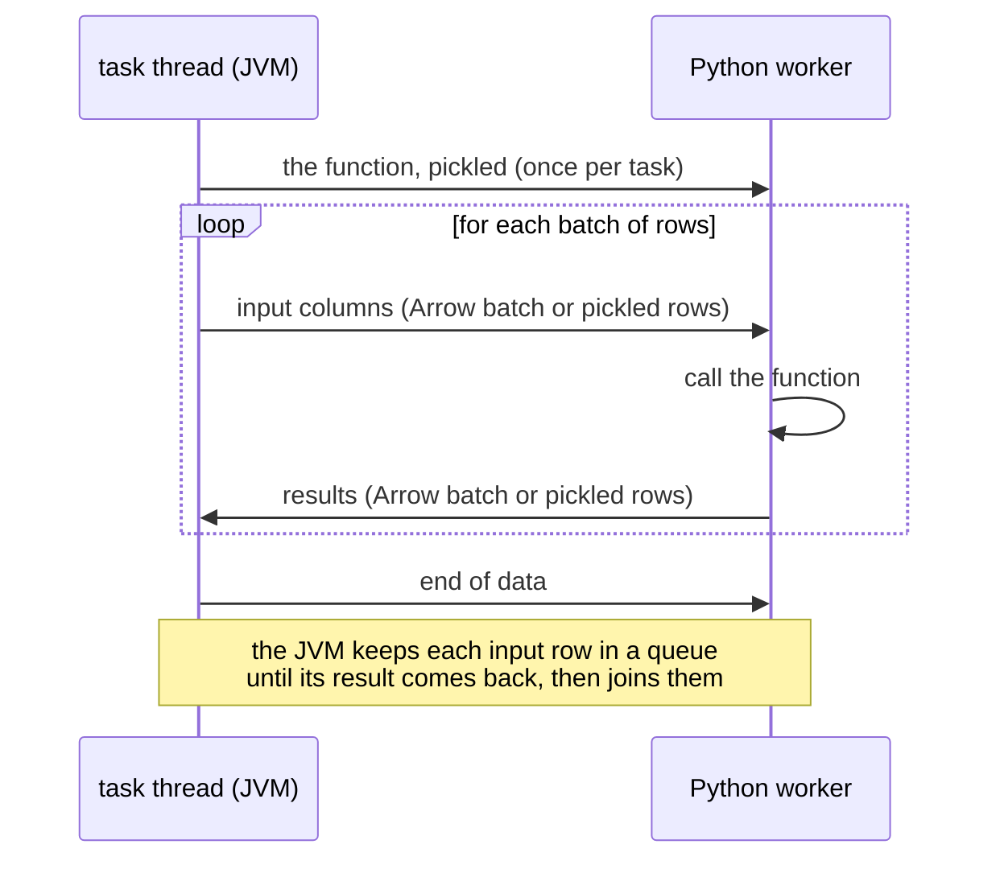
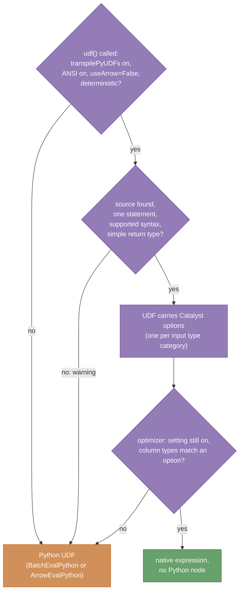

# Chapter 34: Python on Spark: UDFs, pandas UDFs and Arrow

A DataFrame query that uses only built-in functions runs completely in the JVM. Your Python code builds the plan, and then it waits. A query that calls a Python function on its rows is different. The executor must send the rows to a Python process, wait for Python to calculate the results, and read the results back. That boundary is the largest single cost in most slow PySpark jobs, and the plan shows exactly where it is.

**Each Python function in a query is a node in the physical plan. Each node is a process boundary that the rows must cross two times. The type of node sets how the rows cross: one row at a time, or in Arrow batches. The fastest Python UDF is one that Spark does not run in Python. In Spark 4.3, the UDF transpiler can change some simple UDFs into native expressions. But it has strict limits, and only the plan shows if it applied.**

The scripts are in [`code/ch34`](https://github.com/lisancao/spark-masterclass/tree/main/code/ch34), and each output block comes from `code/ch34/output/`. The data is the June 2026 yellow-taxi file (3,837,248 rows). All runs use Spark 4.3.0 in `local[*]` mode on 16 cores, with Python 3.12.3, pandas 2.3.3 and PyArrow 26.0.1. Each timing is a median after a warm-up run, measured while no other benchmark ran on the machine.

## Step 1: Where Python runs

[Chapter 5](ch05-how-spark-runs.md), Step 6, showed the processes. Each executor starts a `pyspark.daemon` when a task first needs Python. The daemon forks one Python worker for each task that runs at the same time. The executor sends the input columns of the UDF to the worker over a local socket. The worker calls your function and sends the results back.



Three costs come from this design:

- **Serialization in two directions.** Spark converts each value from its internal row format to Arrow or to a pickled Python object, and back again.
- **The process boundary.** The data goes through a socket, and the JVM keeps a copy of each input row in a queue until its result arrives.
- **The speed of Python.** A plain `@udf` calls your function one time for each row.

The rest of this chapter measures each cost and shows how to remove it.

## Step 2: How each kind of Python looks in a plan

`plan_nodes.py` writes the same kind of logic in each form that PySpark supports, and prints the Python nodes of each physical plan:

```python
@F.udf("string")
def band_udf(fare):
    if fare is None or fare <= 0:
        return "invalid"
    return "under $10" if fare < 10 else "$10 to $30" if fare < 30 else "over $30"

band_pickled = F.udf(band_udf.func, "string", useArrow=False)
```

```text
spark.sql.ansi.enabled = true
spark.sql.execution.pythonUDF.arrow.enabled = true

built-in when():
   (no Python node: the JVM evaluates it)

@udf (Arrow by default):
   ArrowEvalPython [band_udf(fare_amount#10)#23], [pythonUDF0#48], 101

@udf(useArrow=False):
   BatchEvalPython [band_udf(fare_amount#10)#25], [pythonUDF0#49]

@pandas_udf, scalar:
   ArrowEvalPython [band_pandas(fare_amount#10)#27], [pythonUDF0#50], 200

@arrow_udf, scalar:
   ArrowEvalPython [tip_share(tip_amount#13, fare_amount#10)#29], [pythonUDF0#51], 250

mapInPandas:
   MapInPandas <lambda>(PULocationID#7, fare_amount#10, tip_amount#13)#31, [PULocationID#32, fare_amoun

mapInArrow:
   MapInArrow <lambda>(PULocationID#7, fare_amount#10, tip_amount#13)#35, [PULocationID#36, fare_amount

groupBy().applyInPandas:
   FlatMapGroupsInPandas [PULocationID#7], per_zone(PULocationID#7, fare_amount#10, tip_amount#13)#39, 
   Sort [PULocationID#7 ASC NULLS FIRST], false, 0
   Exchange hashpartitioning(PULocationID#7, 200), ENSURE_REQUIREMENTS, [plan_id=110]

two @udf, nested:
   ArrowEvalPython [band_udf(band_udf(fare_amount#10)#42)#43], [pythonUDF0#52], 101

@udf inside @pandas_udf:
   ArrowEvalPython [band_pandas(length(pythonUDF0#53))#46], [pythonUDF0#54], 200
   ArrowEvalPython [band_udf(fare_amount#10)#45], [pythonUDF0#53], 101
```

| Plan node | Made by | Eval type | Data to Python |
|---|---|---|---|
| no node | built-in functions, and a transpiled UDF (Step 4) | | none |
| `ArrowEvalPython ..., 101` | `@udf` (Arrow is the default since 4.2) | `SQL_ARROW_BATCHED_UDF` | Arrow batches, function called once per row |
| `BatchEvalPython` | `@udf(useArrow=False)` | `SQL_BATCHED_UDF` (100) | pickled rows, function called once per row |
| `ArrowEvalPython ..., 200` | `@pandas_udf` with `Series -> Series` | `SQL_SCALAR_PANDAS_UDF` | Arrow batches, function called once per batch |
| `ArrowEvalPython ..., 250` | `@arrow_udf` (4.1 and later) | `SQL_SCALAR_ARROW_UDF` | Arrow batches as `pyarrow.Array`, no pandas |
| `MapInPandas`, `MapInArrow` | `mapInPandas`, `mapInArrow` | 205, 207 | an iterator of batches for the whole partition |
| `FlatMapGroupsInPandas` | `groupBy().applyInPandas` | 201 | one pandas DataFrame per group, after a shuffle and a sort |

The eval type numbers are from `PythonEvalType` in `pyspark/util.py`. The last number on an `ArrowEvalPython` line is that type. Three more facts come from the output:

- **UDFs of the same kind fuse.** `band_udf(band_udf(fare))` is one `ArrowEvalPython` node. The worker calls the two functions in sequence, and the data crosses the boundary only once.
- **UDFs of different kinds chain.** A `@udf` inside a `@pandas_udf` makes two nodes, and the data crosses the boundary two times. The inner node's output (`pythonUDF0#53`) is the input of the outer node.
- **`applyInPandas` adds a shuffle and a sort.** All rows of a group must be in one task, so the plan has an `Exchange` on the key and a `Sort` before `FlatMapGroupsInPandas`. Step 9 shows the cost when one group is very large.

## Step 3: One rule, five ways, timed

`bench.py` calculates the fare band of each June trip and writes the result to the `noop` sink. It uses the same rule in five forms. The forms are built-in functions, a transpiled UDF, a pandas UDF, an Arrow `@udf` and a pickled `@udf`:

```python
def band(fare):
    if fare is None or fare <= 0:
        return "invalid"
    else:
        return "under $10" if fare < 10 else "$10 to $30" if fare < 30 else "over $30"

band_arrow = F.udf(band, "string")                     # (1)!
band_pickled = F.udf(band, "string", useArrow=False)   # (2)!
spark.conf.set("spark.sql.experimental.optimizer.transpilePyUDFs", "true")
band_transpiled = F.udf(band, "string", useArrow=False)   # (3)!
```

1. Arrow by default in 4.3. The plan node is `ArrowEvalPython`.
2. Rows pickled to the worker. The plan node is `BatchEvalPython`.
3. PySpark reads the source and lowers it to Catalyst expressions when it creates the UDF. The setting must be on before this line.

```text
3,837,248 trips, 16 cores; noop write; median of 5 runs after a warm-up

variant                 Python node in the plan    seconds  vs built-in
built-in when()         none                          0.31         1.0x
@udf, transpiled        none                          0.27         0.9x
@pandas_udf             ArrowEvalPython               0.70         2.3x
@udf, Arrow             ArrowEvalPython               0.91         3.0x
@udf, useArrow=False    BatchEvalPython               0.65         2.1x

all variants give the same bands and counts: True
```

<figure markdown>
  
  
  <figcaption>The medians from <code>bench.txt</code>. The two forms without a Python node take about 0.3 s. The three forms with a Python node take 2.1 to 3.0 times as long.</figcaption>
</figure>

All five variants gave the same bands and the same counts. The times split into two groups:

- **No Python node: about 0.3 s.** The built-in `when()` chain and the transpiled UDF both ran in the JVM. The transpiled UDF has no Python node in its plan, so the "Python" UDF cost the same as the built-in expression.
- **A Python node: 2.1 to 3.0 times as long.** The pandas UDF, the Arrow UDF and the pickled UDF all sent 3.8 million values to Python and back. For this rule, the differences between these three are small compared to the variation from run to run on a shared machine. Do not choose between them on these numbers.

The rule is cheap, so the cost of the boundary is most of the run time. For a function that does real work in Python (a parser, a model call), the work itself costs more, and the order can change. A pandas UDF has the largest advantage when the function can work on a whole `Series` with pandas or NumPy operations. Then Python runs once for each batch, not once for each row.

## Step 4: New in 4.3: the UDF transpiler

Spark 4.3 adds an experimental transpiler for Python UDFs ([SPARK-55206](https://issues.apache.org/jira/browse/SPARK-55206)). When you create a UDF, PySpark reads the source code of the function and parses it with Python's `ast` module. Then it tries to write the same logic as Catalyst expressions. If it succeeds, the UDF carries the expressions to the JVM, and the optimizer uses them instead of a Python worker. The code is in `pyspark/sql/udf.py` (the conditions) and `pyspark/sql/transpile.py` (the translation).

The conditions, from the 4.3 source:

- `spark.sql.experimental.optimizer.transpilePyUDFs` is `true` **when you create the UDF**, and it is still `true` when the optimizer runs. A UDF that you created before you set it stays Python.
- `spark.sql.ansi.enabled` is `true`. ANSI mode is the default in Spark 4. The generated expressions follow ANSI semantics, so an overflow or a division by zero raises an error. Without ANSI mode, PySpark does not transpile, and it gives a warning.
- The UDF is a plain batched UDF: `useArrow=False`, deterministic, and not a pandas or Arrow UDF.
- Classic PySpark. The Spark Connect client in 4.3 has no transpiler.
- The return type is numeric, string, boolean or binary.



`transpile.py` creates a set of UDFs with the setting on. It records which ones lost their Python node, and the warning for each one that did not:

```python
def band_one_statement(fare: float) -> str:
    if fare is None or fare <= 0:
        return "invalid"
    else:
        return "under $10" if fare < 10 else "over $10"
```

```text
UDF body                          Python node       reason given (warning)
if, then a second return          BatchEvalPython   functions with more than one top-level statement are not suppo
if/else, one statement            none              
tip / fare                        BatchEvalPython   binary operator Div is not supported by the transpiler
tip + fare, no type hints         none              
s.upper()                         BatchEvalPython   a numeric-typed lowering does not match the declared return ty
len(s)                            none              
fare is not None and fare > 20    none              
a lambda bound to a name          none              
a lambda inside udf()             BatchEvalPython   the source read for this lambda does not define it as a statem
array return type                 BatchEvalPython   return type array<double> is not supported by the transpiler (
useArrow=True                     ArrowEvalPython   
```

<figure markdown>
  <video autoplay loop muted playsinline controls width="1280" height="720" poster="../../media/clips/ch34-transpile.webp">
    <source src="../../media/clips/ch34-transpile.mp4" type="video/mp4">
  </video>
  <figcaption><code>transpile.py</code> creates UDFs with the transpiler on. A UDF with no Python node in its plan ran as a native expression.</figcaption>
</figure>

The transpiler accepts a small part of Python:

- constants and parameters,
- `+`, `-`, `*`, `%`, unary `-` and the comparisons,
- `is None`, `and`, `or` and `not`,
- `if`/`else` as a statement or an expression, and `return`,
- `len()` on a string.

The function body must be one statement. A function with an `if` block and then a second `return` is two statements, so the transpiler refuses it. The transpiler accepts the same logic as one `if`/`else` statement. Division, method calls such as `s.upper()`, loops, imports and calls to other functions stay Python.

A lambda is a special case. The transpiler reads the source of the line, so it must find the lambda as a statement of its own. The transpiler accepts `named_lambda = lambda fare: fare * 2`. It does not accept `F.udf(lambda fare: fare * 2, ...)`, because the source line does not show which lambda is the UDF.

Type hints help. Python's `+` adds numbers and also joins strings. For a parameter without a type hint, the transpiler makes one version for numbers and one for strings. The JVM selects the version that matches the column type. With a hint such as `fare: float`, it makes one version.

### What the transpiled UDF becomes

```text
the Project of the transpiled band_one_statement (first 300 characters):
  *(1) Project [CASE WHEN coalesce((isnull(fare_amount#10) OR CASE WHEN isnull(fare_amount#10) THEN cast(raise_error(USER_RAISED_EXCEPTION, map(keys: [errorMessage], values: [Python UDF transpiler: cannot compare NULL with operator `<=`; Python would raise TypeError here. Add an `is not None` guard or
```

The result is a `CASE WHEN` expression. It also has `raise_error` branches. These branches keep the behavior of Python.

In Python, `None <= 0` raises a `TypeError`. Spark's `<=` returns NULL for a NULL input. To give the same result as Python, the transpiler adds a branch that raises an error when the input is NULL and Python would fail. The `is None` test in the body runs first, so for this function the error branch never runs:

```text
len(None) in the transpiled UDF -> USER_RAISED_EXCEPTION | [USER_RAISED_EXCEPTION] Python UDF transpiler: cannot call len() on NULL; Python would rai
```

`len(None)` raises a `TypeError` in Python. The transpiled `len` raises `USER_RAISED_EXCEPTION` with a message that names the cause. Thus, a transpiled UDF can fail on a row where a built-in function returns NULL. The goal is the same result as the Python function, not the result of the nearest built-in function.

The optimizer also reads the setting. If you turn the setting off after you create the UDF, the UDF runs in Python again:

```text
created with the setting on; BatchEvalPython in the plan: setting on False, setting turned off later True
```

Thus, set the transpiler setting at the start of the session and keep it on. Then examine the plan of each query that uses the UDF.

### Without ANSI mode

```text
with spark.sql.ansi.enabled=false: True | warning: Python UDF transpilation (spark.sql.experimental.optimizer.transpilePy
```

!!! caution "The transpiler is experimental in 4.3"
    The setting has `experimental` in its name. The PySpark test suite compares transpiled and Python results on generated inputs (`test_udf_transpile_hypothesis.py`), and the comments in that file call the transpiler intentionally minimal. Make sure that the plan has no Python node. Then compare the results with the Python UDF on your own data before you depend on it.

## Step 5: Python runs more often than you think

A UDF can run more times than there are rows, or zero times. `calls.py` counts the calls with an accumulator. The UDF adds 1 to the accumulator on the worker, and Spark adds the values from all tasks on the driver:

```python
calls = sc.accumulator(0)

def counted(fare):
    calls.add(1)                  # a side effect on the worker, summed on the driver
    return fare is not None and fare > 20

is_big = F.udf(counted, "boolean")
```

```text
calls to a counting @udf on 1,000 rows:
  select(udf(fare)).collect()                           1000
  withColumn(udf), then filter on that column           1410
  same, with asNondeterministic()                       1000
  two actions on one DataFrame                          2000
  cache(), then two actions                             1000
  count() on a DataFrame with a UDF column                 0
```

<figure markdown>
  <video autoplay loop muted playsinline controls width="1280" height="720" poster="../../media/clips/ch34-calls.webp">
    <source src="../../media/clips/ch34-calls.mp4" type="video/mp4">
  </video>
  <figcaption><code>calls.py</code> counts the calls of a UDF with an accumulator. A filter on the UDF column calls it 1,410 times for 1,000 rows.</figcaption>
</figure>

Each line has a cause:

- **A filter on a UDF column calls the UDF two times.** The optimizer pushes the filter below the projection, and it copies the UDF expression into the filter. The plan has two `ArrowEvalPython` nodes. The first evaluates the UDF for all 1,000 rows to filter them. The second evaluates it again for the 410 rows that passed, to make the `big` column. The total is 1,410 calls:

```text
the physical plan of the filter case:
  *(2) Project [fare_amount#10, pythonUDF0#4109 AS big#3897]
  +- ArrowEvalPython [counted(fare_amount#10)#3896], [pythonUDF0#4109], 101
  +- *(1) Project [fare_amount#10]
  +- *(1) Filter pythonUDF0#4108: boolean
  +- ArrowEvalPython [counted(fare_amount#10)#3896], [pythonUDF0#4108], 101
  +- FileScan parquet [VendorID#0,tpep_pickup_datetime#1,tpep_dropoff_datetime#2,passenger_count#3L,trip_distanc
```

<figure markdown>
  
  
  <figcaption>The plan of the filter case from <code>calls.txt</code>. The lower node calls the UDF for each of the 1,000 rows. The upper node calls it again for the 410 rows that pass.</figcaption>
</figure>

- **`asNondeterministic()` stops the copy.** The optimizer does not duplicate or move a nondeterministic expression, so the UDF runs once for each row. Use it for a UDF that is expensive or that has side effects. It also blocks other optimizations, so use it only when the double call costs more than they save.
- **Each action runs the UDF again.** Two `collect()` calls on one DataFrame make 2,000 calls. A `cache()` between them makes 1,000 calls, because the second action reads the cache.
- **`count()` can skip the UDF.** A count does not need the `big` column, so column pruning removes the UDF from the plan. The UDF never runs. A UDF with a side effect, such as a call to a web service, is not a safe way to make that side effect occur.

### A Python filter does not go into the scan

```text
PushedFilters of the scan:
  built-in  fare_amount > 20:   [IsNotNull(fare_amount), GreaterThan(fare_amount,20.0)]
  Python    is_big(fare_amount): (none)
  transpiled over_20(fare_amount): [IsNotNull(fare_amount)]
  the transpiled filter: *(1) Filter (isnotnull(fare_amount#4225) AND CASE WHEN isnull(fare_amount#4225) THEN cast(raise_error(USER_RAISED_EXCEPTION, map(keys: [errorMessage],
  a Python node in that plan: False
```

A built-in filter becomes `GreaterThan(fare_amount,20.0)` in `PushedFilters`, and the Parquet reader can skip row groups with it ([Chapter 36](ch36-parquet-inside.md)). A Python filter is opaque to Spark, so nothing goes to the reader, and Spark reads all rows into Python to test them.

A transpiled filter is a third case. It is a Catalyst expression, so the plan has no Python node, and the `IsNotNull` part goes into the scan. But the comparison is inside a `CASE WHEN` with a `raise_error` branch, and Spark cannot change that expression into a data source filter. Thus, the row group statistics of `fare_amount` cannot skip anything. For a filter, a built-in expression is still the best form.

## Step 6: The Arrow batches that a worker gets

An Arrow UDF gets its input in batches. The size of a batch sets how many calls a pandas UDF gets, and how much memory each call needs. `arrow_batches.py` uses a pandas UDF that returns the length of its input batch, and counts the batches of each size:

```python
@F.pandas_udf("long")
def batch_rows(fare: pd.Series) -> pd.Series:
    return pd.Series([len(fare)] * len(fare))          # every row carries the size of its batch
```

```text
Arrow batches into a pandas UDF, June trips (fare_amount only):
  defaults                                              937 batches; sizes: 4,096 x936, 3,392 x1
  maxRecords=50000                                      937 batches; sizes: 4,096 x936, 3,392 x1
  columnarReaderBatchSize=20000                         194 batches; sizes: 20,000 x190, 11,520 x1
  columnarInput=false                                   385 batches; sizes: 10,000 x381, 8,576 x3
  columnarInput=false, maxRecords=50000                  77 batches; sizes: 50,000 x73, 48,576 x3
  columnarInput=false, maxRecords=0, maxBytes=1048576    33 batches; sizes: 129,056 x29, 46,240 x1
  maxRecordsPerBatch=-1: java.lang.NegativeArraySizeException: -1
defaults: {'maxRecordsPerBatch': '10000', 'maxBytesPerBatch': '67108864b', 'columnarInput.enabled': 'true', 'columnarReaderBatchSize': '4096'}
```

<figure markdown>
  
  
  <figcaption>The batch sizes from <code>arrow_batches.txt</code>. With columnar input, the Parquet batch size sets the size. Without it, <code>maxRecordsPerBatch</code> and <code>maxBytesPerBatch</code> set the size. The last batch of each run is smaller.</figcaption>
</figure>

The documented batch size, `spark.sql.execution.arrow.maxRecordsPerBatch` (10,000), did not apply. The batches had 4,096 rows, and a change to `maxRecordsPerBatch` had no effect. The reason is a newer path in the executor:

- `spark.sql.execution.arrow.pythonUDF.columnarInput.enabled` (new in 4.2, default `true`) lets `ArrowEvalPythonExec` take columnar batches directly from the operator below it (`ArrowEvalPythonExec.supportsColumnar`).
- The vectorized Parquet reader gives batches of `spark.sql.parquet.columnarReaderBatchSize` rows, 4,096 by default.
- In `ColumnarArrowEvalPythonEvaluatorFactory`, each input batch goes to Python as one Arrow batch when the UDF arguments are plain columns. Thus, the Parquet batch size sets the Python batch size.

The output proves each part. With `columnarReaderBatchSize=20000`, the batches had 20,000 rows. With columnar input off, the batches had 10,000 rows, which is the `maxRecordsPerBatch` default, and `maxRecordsPerBatch=50000` then gave 50,000 rows. `maxBytesPerBatch` sets a limit in bytes. With `maxRecordsPerBatch=0` (no limit by records) and 1 MiB, the batches of one `double` column had 129,056 rows.

<figure markdown>
  <video autoplay loop muted playsinline controls width="1280" height="720" poster="../../media/clips/ch34-anim-arrow-batches.webp">
    <source src="../../media/clips/ch34-anim-arrow-batches.mp4" type="video/mp4">
  </video>
  <figcaption>Animation: the Parquet reader gives the task batches of 4,096 rows. Each batch goes to the Python worker as one Arrow batch, and the pandas UDF runs one time for each batch. The batch counts come from <code>arrow_batches.txt</code>. The timing is schematic.</figcaption>
</figure>

`maxRecordsPerBatch=-1` failed with `NegativeArraySizeException` on this columnar path. The documentation of the setting says that a negative value means no limit. Use `0` for no limit.

A pandas UDF can need large batches, for example to call a model one time for each batch. For this, set the batch size of the source, or turn off columnar input. If it needs small batches to fit in memory, decrease `maxBytesPerBatch`, and also turn off columnar input.

## Step 7: What a returned value becomes

A UDF declares a return type, and Python returns any value. The conversion of that value is different for Arrow UDFs and pickled UDFs. `arrow_batches.py` returns one value from a UDF, with Arrow and without it:

```text
declared  returned        Arrow (default)                   useArrow=False
int       7.9             7                                 None
int       '7'             7                                 None
int       True            error ArrowTypeError              None
int       1099511627776   error ArrowInvalid                0
double    3               3.0                               None
string    42              '42'                              '42'
boolean   1               True                              None
date      '2026-06-01'    error ArrowTypeError              error AttributeError
```

The two paths do not agree:

- **The pickled path returns NULL when the type does not match.** `7.9` for an `int` column becomes NULL, and so do `'7'`, `True`, `3` for a `double` and `1` for a `boolean`. A large integer that does not fit an `int` became `0`. No error tells you that a value was lost.
- **The Arrow path converts what it can, and fails on the rest.** `7.9` becomes `7` (the fraction is lost), and `'7'` becomes `7`. `True` and a value larger than an `int` fail with an Arrow error. A string for a `date` fails on both paths.

Thus, a change from pickled to Arrow UDFs can change results. A UDF that returned NULL can start to return values, or start to fail. Return the declared Python type, and test a UDF with values that do not fit.

### The worker's time zone

A `timestamp` value is an instant. A naive Python `datetime` has no zone. A UDF can return a naive `datetime` for a `timestamp` column. Then the worker reads it in the time zone of the worker process, not in `spark.sql.session.timeZone`:

```text
naive datetime(2026, 6, 1, 8, 0) returned as timestamp and as timestamp_ntz; session zone UTC
worker TZ             timestamp               timestamp_ntz
UTC                   2026-06-01 08:00:00     2026-06-01 08:00:00
America/Los_Angeles   2026-06-01 15:00:00     2026-06-01 08:00:00
Asia/Ho_Chi_Minh      2026-06-01 01:00:00     2026-06-01 08:00:00
```

The session zone was UTC in all three runs. The UDF returned 08:00 each time. A worker in Los Angeles made it 15:00 UTC, and a worker in Ho Chi Minh City made it 01:00 UTC. On a cluster, the zone of each executor host decides the answer. Two fixes work:

- Return a `datetime` with a zone (`datetime(..., tzinfo=timezone.utc)`).
- If the value is a wall-clock time, declare `timestamp_ntz`. The last column shows that `timestamp_ntz` kept 08:00 in all three zones.

## Step 8: Find the slow line with the UDF profiler

When a UDF must stay in Python, the next question is which line is slow. Spark 4.0 added a profiler for UDFs. Set `spark.sql.pyspark.udf.profiler` to `perf` (cProfile) or `memory` (memory_profiler). Each worker profiles the UDF, and the driver collects the results:

```python
spark.conf.set("spark.sql.pyspark.udf.profiler", "perf")

@F.udf("boolean")
def private_ip(n):
    return ipaddress.ip_address(f"10.{n % 256}.{n // 256 % 256}.1").is_private

spark.range(200_000).select(private_ip("id")).write.format("noop").mode("overwrite").save()
spark.profile.show(type="perf")
```

```text
spark.profile.show(type='perf'), the first lines:
  ============================================================
  Profile of UDF<id=4242>
  ============================================================
           9400000 function calls in 21.497 seconds
  
     Ordered by: internal time, cumulative time
  
     ncalls  tottime  percall  cumtime  percall filename:lineno(function)
     200000    7.947    0.000    7.947    0.000 {method 'disable' of '_lsprof.Profiler' objects}
     800000    2.273    0.000    2.947    0.000 ipaddress.py:1213(_parse_octet)
     200000    1.631    0.000   13.090    0.000 calls.py:80(private_ip)
     200000    1.436    0.000    5.332    0.000 ipaddress.py:1187(_ip_int_from_string)
     200000    1.147    0.000    3.822    0.000 ipaddress.py:1337(is_private)
     200000    0.982    0.000    6.447    0.000 ipaddress.py:1286(__init__)
     800000    0.918    0.000    1.192    0.000 ipaddress.py:739(__contains__)
     200000    0.715    0.000    3.663    0.000 {built-in method from_bytes}
```

The profile adds the calls from all workers. Read the `tottime` column. Most of the time is in `ipaddress`: `_parse_octet`, `_ip_int_from_string`, `is_private` and `__init__`. The UDF body itself took a small part.

The first line, `disable` of `_lsprof.Profiler`, is the cost of the profiler, so a profiled run is slower than a normal run. Use the profiler to find the slow call, then turn it off. `spark.profile.dump(path)` writes the profiles to files, and `spark.profile.clear()` removes them.

A transpiled UDF has no Python to profile. When the profiler is on, PySpark builds the call without the transpiled form (`udf.py`, the profiler branch of `__call__`). Thus, with the profiler on, a transpiled UDF runs in Python, and the profile shows the Python function.

## Step 9: A skewed `applyInPandas`, and the salt that fixes it

`groupBy().applyInPandas` sends all rows of one key to one Python call, as one pandas DataFrame. Pickup zones are very uneven ([Chapter 32](ch32-query-plans.md), Step 6), so one call gets the 177,610 trips of the largest zone. AQE splits skewed partitions only in sort-merge joins. It does not split a group, because the function must see all rows of the group in one call.

A **salt** spreads a large group over several calls, if you can combine the results of the function. Add a random salt column, group by the key and the salt, calculate partial results, and then combine the partial results by the key. `salting.py` calculates the count and the sums for each zone in this way:

```python
def partial(pdf: pd.DataFrame) -> pd.DataFrame:
    """Sums that can be added again later, plus the size of the group that this call got."""
    return pd.DataFrame({"PULocationID": [pdf.PULocationID.iloc[0]], "rows": [len(pdf)],
                         "fares": [pdf.fare_amount.sum()], "tips": [pdf.tip_amount.sum()]})

salted = lambda: (trips.withColumn("salt", F.floor(F.rand(7) * SALT))
                  .groupBy("PULocationID", "salt").applyInPandas(partial, schema)
                  .groupBy("PULocationID").agg(F.sum("rows").alias("rows"), F.sum("fares").alias("fares"),
                                               F.sum("tips").alias("tips")))
```

```text
largest group that one Python call gets: plain 177,610; salted (16 salts) 11,279
same totals per zone: True
noop write, median of 5 after a warm-up: plain 0.84 s, salted 2.63 s
```

The salt did what it must do. The largest pandas DataFrame that one call got went from 177,610 rows to 11,279, and the totals for each zone did not change. But the salted query took about three times as long. It runs many more Python calls, and it adds a second aggregation.

Thus, a salt is a tool for two cases. One case is a group that is too large for the memory of one Python worker. The other case is one call that makes the stage continue long after the other tasks stop. If neither case applies, the salt only adds cost.

To find which case you have, use the stage page of the Spark UI ([Chapter 33](ch33-partitions-caching-memory.md), Step 9). Compare the maximum task duration with the median. You cannot use a salt for a function whose results you cannot combine, such as an exact median.

## Step 10: The settings for Python

These settings change how Python runs. Some are SQL settings that you can change in a session. Others, such as `spark.python.*`, are static, and Spark reads them once when it starts ([Chapter 33](ch33-partitions-caching-memory.md), Step 1). The defaults are from the 4.3.0 source.

| Setting | Default | Kind | What it does |
|---|---|---|---|
| `spark.sql.execution.pythonUDF.arrow.enabled` | `true` (since 4.2) | session | Arrow for plain `@udf`. `false` gives `BatchEvalPython`. |
| `spark.sql.execution.pythonUDTF.arrow.enabled` | `true` (since 4.2) | session | the same for UDTFs, read when `udtf()` runs ([Chapter 35](ch35-python-udtfs.md)) |
| `spark.sql.experimental.optimizer.transpilePyUDFs` | `false` | session | the UDF transpiler (Step 4) |
| `spark.sql.execution.arrow.maxRecordsPerBatch` | `10000` | session | rows in each Arrow batch, when columnar input does not apply |
| `spark.sql.execution.arrow.maxBytesPerBatch` | `64MB` | session (internal) | bytes in each Arrow batch |
| `spark.sql.execution.arrow.pythonUDF.columnarInput.enabled` | `true` | session | pass columnar batches straight to Arrow UDFs (Step 6) |
| `spark.sql.parquet.columnarReaderBatchSize` | `4096` | session | Parquet batch size, and with columnar input the Python batch size |
| `spark.sql.execution.pandas.convertToArrowArraySafely` | `true` (since 4.1) | session | fail, not truncate, in pandas UDF results (Step 7) |
| `spark.sql.pyspark.udf.profiler` | not set | session | `perf` or `memory` (Step 8) |
| `spark.python.worker.reuse` | `true` | static | keep Python workers between tasks |
| `spark.executor.pyspark.memory` | not set | static | a memory limit for the Python workers of each executor |

Check a setting in your own session with `spark.conf.get(key)`. A setting that you cannot change at run time gives `CANNOT_MODIFY_CONFIG`.

## The whole chapter, on one page

```python
# Find Python in a plan
df.explain()   # ArrowEvalPython (Arrow), BatchEvalPython (pickled), MapInPandas, FlatMapGroupsInPandas ...

# Best: no Python. Second: Python on whole batches.
df.select(F.when(F.col("fare") <= 0, "invalid").otherwise("ok"))        # built-in

@F.pandas_udf("double")
def tip_share(tip: pd.Series, fare: pd.Series) -> pd.Series:          # one call per batch
    return tip / fare

# 4.3: let the transpiler remove simple UDFs (classic, ANSI on, useArrow=False, one statement)
spark.conf.set("spark.sql.experimental.optimizer.transpilePyUDFs", "true")
band = F.udf(band_fn, "string", useArrow=False)     # then check: no Python node in df.explain()

# Count calls, find slow lines
spark.conf.set("spark.sql.pyspark.udf.profiler", "perf"); ...; spark.profile.show(type="perf")
```

- **Each Python node in a plan is a boundary that rows cross two times.** Built-in functions have no such node.
- **Arrow nodes send batches.** A pandas or Arrow UDF also calls your function once for each batch, which is the fastest Python form here.
- **The 4.3 transpiler removes the node for simple UDFs**, but only under strict conditions. The plan is the proof.
- **A UDF can run two times for each row, or zero times.** Filters copy it, `count()` prunes it, and each action runs it again.
- **A Python filter does not go into the scan.**
- **Batch size comes from the Parquet reader** when columnar input applies, not from `maxRecordsPerBatch`.
- **Arrow and pickled UDFs convert return values in different ways**, and a naive `datetime` is read in the worker's time zone.
- **A skewed group in `applyInPandas` is one large Python call.** Salt the key if you can combine the results.

## Further reading

- [Python user-defined functions](https://spark.apache.org/docs/4.3.0/api/python/user_guide/sql/python_udf.html) and [Arrow in PySpark](https://spark.apache.org/docs/4.3.0/api/python/user_guide/sql/arrow_pandas.html) in the PySpark user guide.
- [The PySpark guide to find errors](https://spark.apache.org/docs/4.3.0/api/python/development/debugging.html), with the UDF profiler.
- The 4.3.0 source: `python/pyspark/sql/udf.py`, `python/pyspark/sql/transpile.py`, and `sql/core/src/main/scala/org/apache/spark/sql/execution/python/`.
- [Chapter 74](ch74-catalyst-plans-python.md) shows how Catalyst plans Python, and [Chapter 75](ch75-python-worker-protocol.md) shows the Python worker protocol on the wire.
