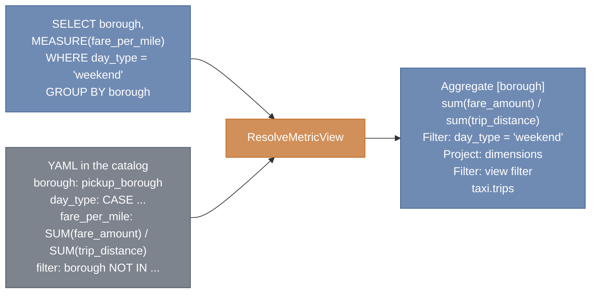

# Chapter 35: Metric views: a semantic layer in Spark SQL

A gold table answers the questions that somebody asked when the team wrote the pipeline (Chapter 33). The next question needs a different grain: by hour, not by day, or by borough and payment type. Then somebody writes a new query, and the formula of each number goes into one more place.

Some numbers are easy to compute again. You can add the counts or the sums of groups. You cannot add other numbers. A ratio of two sums is not the average of the ratios of its groups. A count of distinct values is not the sum of the counts of its groups. Both wrong queries run, and both give a number that looks correct.

Spark 4.2 added metric views (SPARK-54119), and Spark 4.3 adds them to DSv2 catalogs. **A metric view stores the formula of each measure in the catalog, next to the dimensions that a query can group by. The function `MEASURE()` puts the formula into the query, at the grain that the query asks for. Thus, a ratio or a distinct count is correct at each grain, from one definition. A metric view does not stop a query that aggregates the results of `MEASURE()` again.** This chapter shows each part of that sentence on one month of New York taxi trips.

The code is in [`code/ch35`](https://github.com/lisancao/spark-masterclass/tree/main/code/ch35). Each output block comes from `code/ch35/output/`. The scripts use a Classic session on `pyspark==4.3.0` with a Hive metastore. Thus, a metric view that one script creates is there for the next script.

## Step 1: Two errors that run without an error

`prepare.py` makes a table `taxi.trips` from the June 2026 trips. The table has one row for each trip with a distance between 0 and 100 miles and a positive fare. It adds the pickup borough from the zone list.

```text
taxi.trips: 3694387 rows
+--------------+-------+
|pickup_borough|  trips|
+--------------+-------+
|     Manhattan|3266362|
|        Queens| 309265|
|      Brooklyn|  99965|
|         Bronx|  13816|
|       Unknown|   3656|
|           N/A|    983|
| Staten Island|    209|
|           EWR|    131|
+--------------+-------+
```

`two_errors.py` asks two simple questions in two ways:

```text
== 1. fare per mile: the average of borough ratios, and the ratio of the totals
+--------------+-------+-------------+
|pickup_borough|  trips|fare_per_mile|
+--------------+-------+-------------+
|     Manhattan|3266362|       7.0777|
|        Queens| 309265|       4.5503|
|      Brooklyn|  99965|       6.1579|
|         Bronx|  13816|        5.138|
|       Unknown|   3656|       5.3713|
|           N/A|    983|      12.6907|
| Staten Island|    209|       4.1866|
|           EWR|    131|      42.1885|
+--------------+-------+-------------+

+-------------------------+---------------+
|average_of_borough_ratios|ratio_of_totals|
+-------------------------+---------------+
|                  10.9201|         6.3158|
+-------------------------+---------------+

== 2. active pickup zones: the sum of daily distinct counts, and the distinct count
+-------------------+-----------+----------------+
|sum_of_daily_counts|average_day|distinct_in_june|
+-------------------+-----------+----------------+
|               7083|      236.1|             258|
+-------------------+-----------+----------------+
```

Both answers on the left are wrong:

- **The average of ratios.** The fare per mile of the month is the total fare divided by the total distance: 6.3158. The average of the eight borough ratios is 10.9201. Each borough counts the same in an average. Thus, EWR, with 131 trips and a ratio of 42.19, has the same weight as Manhattan, with more than three million trips.
- **The sum of distinct counts.** A zone that has pickups on 30 days is in 30 daily counts. The sum of the daily counts is 7083, but only 258 zones had a pickup in June.

<figure markdown>
  

  

  <figcaption>The fare per mile of each borough, and the two answers of Step 1. The average of the eight ratios gives EWR the same weight as Manhattan.</figcaption>
</figure>

Neither query has a bug that Spark can find. The SQL is correct. The error is in the sense of the numbers: these measures are *non-additive*. A count and a sum are additive, so the sum of the group values is the total. A ratio of sums and a distinct count are not. To get them at a new grain, you must compute them again from the rows, with the original formula.

## Step 2: Define the metric view

A metric view is a view with a YAML body. `define.py` creates one:

```sql
CREATE VIEW taxi.trip_metrics WITH METRICS LANGUAGE YAML AS $$
version: 0.1
source: taxi.trips
filter: pickup_borough NOT IN ('Unknown', 'N/A')
dimensions:
  - name: borough
    expr: pickup_borough
  - name: pickup_date
    expr: pickup_date
  - name: pickup_hour
    expr: hour(pickup_ts)
  - name: day_type
    expr: CASE WHEN dayofweek(pickup_date) IN (1, 7) THEN 'weekend' ELSE 'weekday' END
  - name: payment
    expr: CASE payment_type WHEN 1 THEN 'card' WHEN 2 THEN 'cash' ELSE 'other' END
measures:
  - name: trips
    expr: COUNT(1)
  - name: revenue
    expr: SUM(total_amount)
  - name: fare_per_mile
    expr: SUM(fare_amount) / SUM(trip_distance)
  - name: tip_rate
    expr: SUM(tip_amount) / SUM(fare_amount)
  - name: active_zones
    expr: COUNT(DISTINCT pickup_zone_id)
$$
```

The YAML has five keys, all in version `0.1`:

| Key | What it holds |
|---|---|
| `version` | Must be there. Spark 4.3 accepts only `0.1`. |
| `source` | A table or view name, or a SQL query. Spark tries to parse the text as a name first, and as a query if that fails (`Source.apply` in `MetricViewCanonical.scala`). |
| `filter` | A condition that Spark applies to the source in each query of the view. |
| `dimensions` | The columns that a query can group by and filter on. Each has a name and an expression on the source. |
| `measures` | The aggregates. Each has a name and an expression that must aggregate the source rows. |

The view hides the source columns. A query sees only the dimensions and the measures.

## Step 3: What Spark stores

```text
created taxi.trip_metrics

== DESCRIBE TABLE EXTENDED taxi.trip_metrics (selected rows)
  borough              string
  pickup_hour          int
  trips                bigint
  fare_per_mile        double
  active_zones         bigint
  Type                 METRIC_VIEW
  View Text            version: 0.1 ... (25 lines)
  Table Properties     [metric_view.from.name=taxi.trips, metric_view.from.type=ASSET, metric_view.where=pickup_borough NOT IN ('Unknown', 'N/A'), transient_lastDdlTime=1795344057]

== the column metadata that marks dimensions and measures
  borough        string   {'metric_view.expr': 'pickup_borough', 'metric_view.type': 'dimension'}
  pickup_date    date     {'metric_view.expr': 'pickup_date', 'metric_view.type': 'dimension'}
  pickup_hour    int      {'metric_view.expr': 'hour(pickup_ts)', 'metric_view.type': 'dimension'}
  day_type       string   {'metric_view.expr': "CASE WHEN dayofweek(pickup_date) IN (1, 7) THEN 'weekend' ELSE 'weekday' END", 'metric_view.type': 'dimension'}
  payment        string   {'metric_view.expr': "CASE payment_type WHEN 1 THEN 'card' WHEN 2 THEN 'cash' ELSE 'other' END", 'metric_view.type': 'dimension'}
  trips          bigint   {'metric_view.expr': 'COUNT(1)', 'metric_view.type': 'measure'}
  revenue        double   {'metric_view.expr': 'SUM(total_amount)', 'metric_view.type': 'measure'}
  fare_per_mile  double   {'metric_view.expr': 'SUM(fare_amount) / SUM(trip_distance)', 'metric_view.type': 'measure'}
  tip_rate       double   {'metric_view.expr': 'SUM(tip_amount) / SUM(fare_amount)', 'metric_view.type': 'measure'}
  active_zones   bigint   {'metric_view.expr': 'COUNT(DISTINCT pickup_zone_id)', 'metric_view.type': 'measure'}
```

The catalog keeps the full YAML as the view text, and the type `METRIC_VIEW`. The table properties `metric_view.from.*` and `metric_view.where` describe the source and the filter for catalog browsers. Each column also has metadata: `metric_view.type` says `dimension` or `measure`, and `metric_view.expr` holds the expression. The type of each measure comes from the analyzer. When you create the view, the analyzer resolves the expressions against the source. `COUNT(1)` is a `bigint`, and the ratio of two sums of doubles is a `double`.

<figure markdown>
  

  

  <figcaption>The YAML (in a short form) and what the catalog keeps from it. Each column has a type and a <code>metric_view.type</code>. The table properties describe the source and the filter.</figcaption>
</figure>

This metadata is the semantic layer. A BI tool, a notebook user or an agent can read `DESCRIBE TABLE EXTENDED` and find what "fare per mile" means, without the code of a dashboard.

## Step 4: One definition at each grain

`grains.py` reads the metric view at different grains. Each query names the measures with `MEASURE()`, and groups by dimensions:

```text
== the month
+-------+-------------+------------+
|  trips|fare_per_mile|active_zones|
+-------+-------------+------------+
|3689748|       6.3138|         256|
+-------+-------------+------------+

== by borough
+-------------+-------+-------------+------------+
|      borough|  trips|fare_per_mile|active_zones|
+-------------+-------+-------------+------------+
|    Manhattan|3266362|       7.0777|          66|
|       Queens| 309265|       4.5503|          69|
|     Brooklyn|  99965|       6.1579|          61|
|        Bronx|  13816|        5.138|          43|
|Staten Island|    209|       4.1866|          16|
|          EWR|    131|      42.1885|           1|
+-------------+-------+-------------+------------+

== by day type and payment, with a filter on a dimension
+--------+-------+-------+--------+
|day_type|payment|  trips|tip_rate|
+--------+-------+-------+--------+
| weekday|   card|1831225|  0.2337|
| weekday|   cash| 254890|     0.0|
| weekend|   card| 575316|  0.2221|
| weekend|   cash|  88715|     0.0|
+--------+-------+-------+--------+

== the busiest pickup hours in Manhattan, ordered by a measure
+-----------+------+---------+
|pickup_hour| trips|  revenue|
+-----------+------+---------+
|         18|213882|5570525.0|
|         17|203760|5545057.0|
|         21|196962|5171867.0|
+-----------+------+---------+

== the same question from the DataFrame API
+--------+------+-------------+
|day_type| trips|fare_per_mile|
+--------+------+-------------+
| weekday|221452|       4.5585|
| weekend| 87813|       4.5283|
+--------+------+-------------+
```

<figure markdown>
  <video autoplay loop muted playsinline controls width="1280" height="720" poster="../../media/clips/ch35-measure.webp">
    <source src="../../media/clips/ch35-measure.mp4" type="video/mp4">
  </video>
  <figcaption>The average of the borough ratios, then the same measure from the metric view, at the month and by borough.</figcaption>
</figure>

The measures are correct at each grain:

- **The month.** `fare_per_mile` is 6.3138, the ratio of the totals after the filter (the `Unknown` and `N/A` boroughs are out). `active_zones` is 256, a real distinct count.
- **By borough.** The ratio for each borough is the same as in Step 1. Here the distinct zones of the boroughs add up to 256, because each zone is in one borough. That is a property of this data. Step 6 shows a grain where the sum is wrong.
- **By day type and payment, with a filter.** A `WHERE` on a dimension filters the source rows before the aggregation. In this data, each cash trip has a tip of 0, so the tip rate of cash trips is 0.
- **Ordered by a measure.** An alias of a `MEASURE()` column works in `ORDER BY`.
- **The DataFrame API.** `pyspark.sql.functions` has no `measure` function in 4.3. Use `F.expr("measure(trips)")` in `agg`.

## Step 5: How `MEASURE()` becomes a plan

The last query of `grains.py` asks for the weekend fare per mile by borough. Its plans show the rewrite:

```text
== how MEASURE() becomes a plan
== Analyzed Logical Plan ==
  borough: string, fare_per_mile: double
  Aggregate [borough#375], [borough#375, (sum(fare_amount#391) / sum(trip_distance#390)) AS fare_per_mile#374]
  +- Filter (day_type#378 = weekend)
     +- ResolvedMetricView `spark_catalog`.`taxi`.`trip_metrics`
        +- Project [pickup_ts#13 AS pickup_ts#386, pickup_zone_id#15 AS pickup_zone_id#387, pickup_borough#16 AS pickup_borough#388, payment_type#17L AS
           +- Filter NOT pickup_borough#16 IN (Unknown,N/A)
              +- SubqueryAlias spark_catalog.taxi.trips
                 +- Relation spark_catalog.taxi.trips[pickup_ts#13,pickup_date#14,pickup_zone_id#15,pickup_borough#16,payment_type#17L,trip_distance#18,
== Optimized Logical Plan ==
  Aggregate [borough#375], [borough#375, (sum(fare_amount#19) / sum(trip_distance#18)) AS fare_per_mile#374]
  +- Project [trip_distance#18, fare_amount#19, pickup_borough#16 AS borough#375]
     +- Filter (NOT pickup_borough#16 IN (Unknown,N/A) AND (dayofweek(pickup_date#14) IN (1,7) <=> true))
        +- Relation spark_catalog.taxi.trips[pickup_ts#13,pickup_date#14,pickup_zone_id#15,pickup_borough#16,payment_type#17L,trip_distance#18,fare_amou
== Physical Plan ==
  == Physical Plan ==
  AdaptiveSparkPlan (7)
  +- HashAggregate (6)
     +- Exchange (5)
        +- HashAggregate (4)
           +- Project (3)
              +- Filter (2)
                 +- Scan parquet spark_catalog.taxi.trips (1)
```

`ResolveMetricView` (`sql/core/src/main/scala/org/apache/spark/sql/catalyst/analysis/ResolveMetricView.scala`) does the rewrite in the analyzer:

1. It finds the metric view in the query. It builds a `Project` over the source that computes each dimension, and puts the `filter` of the view under it.
2. It replaces each `MEASURE(name)` with the expression of that measure. `MEASURE(fare_per_mile)` becomes `sum(fare_amount) / sum(trip_distance)`.
3. The `GROUP BY` and `WHERE` of the query stay as they are, and refer to the dimension columns.

After the rewrite, the query is a normal aggregate on the source. The optimizer then works as usual.

The optimizer removed the columns that the query does not use. It put the filter of the view and the filter of the query together. It also changed `day_type = 'weekend'` into a condition on `dayofweek(pickup_date)`. The physical plan is a normal two-stage `HashAggregate` over a Parquet scan. A metric view adds no cost of its own at run time.



<figure markdown>
  <video autoplay loop muted playsinline controls width="1280" height="720" poster="../../media/clips/ch35-anim-measure.webp">
    <source src="../../media/clips/ch35-anim-measure.mp4" type="video/mp4">
  </video>
  <figcaption>The analyzer replaces <code>MEASURE(fare_per_mile)</code> with the formula from the catalog. Each grain computes the ratio from the rows. An average of the borough rows gives 11.5498, not 6.3138.</figcaption>
</figure>

## Step 6: What a metric view does not prevent

A metric view makes the correct query easy. It does not make the wrong query impossible. The end of `grains.py` aggregates the results of `MEASURE()` a second time:

```text
== what a metric view does not prevent: aggregate MEASURE() results again
+---------------------------+
|average_of_borough_measures|
+---------------------------+
|                    11.5498|
+---------------------------+

+---------------------+
|sum_of_daily_measures|
+---------------------+
|                 7023|
+---------------------+
```

The inner queries are correct at their grain. The outer queries average the borough ratios (11.5498, not 6.3138) and add the daily distinct counts (7023, not 256). Spark runs them as normal SQL on the result of a subquery, and it cannot know that the outer aggregate is wrong for these numbers. To get a measure at a coarser grain, ask the metric view for that grain. Do not aggregate the finer result.

## Step 7: What Spark checks, and what it does not

`rules.py` tries definitions and queries that are near the edges of what Spark 4.3 accepts:

```text
== definitions
  accepted  the base definition
  rejected  version: 1.0
            INVALID_METRIC_VIEW_YAML: Failed to parse metric view YAML: Invalid YAML version: 1.0 SQLSTATE: 42K0L
  accepted  no measures and no dimensions
  accepted    ... and a query of it
            3694387
  rejected  a joins key
            INVALID_METRIC_VIEW_YAML: Failed to parse metric view YAML: Failed to parse YAML: Unrecognized field "joins" (class org.apache
  accepted  a query as the source
  rejected  a temporary view as the source
            UNRESOLVED_COLUMN.WITH_SUGGESTION: A column, variable, or function parameter with name `pickup_borough` cannot be resolved. Did you mea
  rejected  a measure with no aggregate function
            MISSING_AGGREGATION: The non-aggregating expression "fare_amount" is based on columns which are not participating in the 
  rejected  a dimension with an aggregate function
            GROUP_BY_AGGREGATE: Aggregate functions are not allowed in GROUP BY, but found max(spark_catalog.taxi.trips.pickup_borou
  rejected  a column that the source does not have
            UNRESOLVED_COLUMN.WITH_SUGGESTION: A column, variable, or function parameter with name `tolls` cannot be resolved. Did you mean one of 
  rejected  two columns with one name
            COLUMN_ALREADY_EXISTS: The column `borough` already exists. Choose another name or rename the existing column. SQLSTATE: 42
  rejected  CREATE TEMPORARY VIEW ... WITH METRICS
            PARSE_SYNTAX_ERROR: 
  accepted  a column list on the view

== queries
  rejected  SELECT *
            org.apache.spark.SparkException: [INTERNAL_ERROR] The Spark SQL phase planning failed with an internal error. You hit a bug in Spark 
  rejected  a measure without MEASURE()
            MISSING_AGGREGATION: The non-aggregating expression "trips" is based on columns which are not participating in the GROUP 
  rejected  a dimension and a measure without GROUP BY
            MISSING_GROUP_BY: The query does not include a GROUP BY clause. Add GROUP BY or turn it into the window functions usin
  rejected  a source column that is not a dimension
            UNRESOLVED_COLUMN.WITH_SUGGESTION: A column, variable, or function parameter with name `payment_type` cannot be resolved. Did you mean 
  rejected  MEASURE() of a dimension
            java.util.NoSuchElementException: key not found: ExprId(90,45a9d151-0b73-4ff0-968a-1d7d4ff8a0a5)
  rejected  MEASURE() in ORDER BY
            UNRESOLVED_COLUMN.WITH_SUGGESTION: A column, variable, or function parameter with name `trips` cannot be resolved. Did you mean one of 
  rejected  MEASURE() in HAVING
            UNRESOLVED_COLUMN.WITH_SUGGESTION: A column, variable, or function parameter with name `trips` cannot be resolved. Did you mean one of 
  accepted  MEASURE() in a window
            Manhattan | 3266362 | 3694387
            Queens | 309265 | 3694387
  accepted  the alias of a measure in ORDER BY
            Manhattan | 3266362
  rejected  a join of the metric view to a table
            org.apache.spark.SparkException: [INTERNAL_ERROR] UnevaluableAggregateFunc.aggBufferAttributes should not be called. SQLSTATE: XX000
```

The definitions:

- **The checks come from the analyzer.** A measure without an aggregate fails with `MISSING_AGGREGATION`. A dimension with an aggregate fails with `GROUP_BY_AGGREGATE`. A column that the source does not have fails with `UNRESOLVED_COLUMN`. Spark builds an `Aggregate` over the source from the YAML when you create the view, only to analyze it.
- **The YAML is strict.** Version `1.0` and an unknown key such as `joins` fail with `INVALID_METRIC_VIEW_YAML`. Spark 4.3 has no joins in the YAML. To use more than one table, put the join in a SQL `source`, or in a view.
- **A temporary view is not a source.** The source must be a catalog object. Here, `zones_temp` did not have the column, so the error is `UNRESOLVED_COLUMN`. But the rule is the same as for normal views: a persistent view cannot refer to a temporary view.
- **Metric views are persistent.** `CREATE TEMPORARY VIEW ... WITH METRICS` is a syntax error.
- **Two edges that Spark accepts.** Spark accepts a metric view with no dimensions and no measures, and a query of it reads the source. Spark also accepts a column list after the view name.

The queries:

- **A measure needs `MEASURE()`**, and a dimension with a measure needs `GROUP BY`. A source column that is not a dimension is not visible.
- **`MEASURE()` works in a window function**, after the aggregation. **It does not work in `ORDER BY` or `HAVING`.** The error says that the analyzer cannot resolve the column `trips`. Use the alias of the measure in `ORDER BY`, or filter in an outer query.
- **Three queries fail with an internal error**, not with a clear error condition. They are `SELECT *`, `MEASURE()` of a dimension, and a join of the metric view to a table. The part notes record them as open findings. Spark 4.3 does not support these queries. Avoid them, and read the error as "not supported".

## Step 8: Change, rename and drop a metric view

`lifecycle.py` changes a metric view in the ways that a team changes a definition over time:

```text
== create, then replace with one more measure
  accepted  CREATE VIEW taxi.lifecycle
  rejected  CREATE VIEW taxi.lifecycle again
            TABLE_OR_VIEW_ALREADY_EXISTS: Cannot create table or view `taxi`.`lifecycle` because it already exists.
  rejected  CREATE OR REPLACE VIEW, with revenue
            TABLE_OR_VIEW_ALREADY_EXISTS: Cannot create table or view `taxi`.`lifecycle` because it already exists.
  accepted  DROP VIEW, then CREATE VIEW with revenue
  accepted  SELECT MEASURE(revenue)
            112897667.0

== inspect
  rejected  SHOW CREATE TABLE
            UNSUPPORTED_SHOW_CREATE_TABLE.ON_METRIC_VIEW: Unsupported a SHOW CREATE TABLE command. The command is not supported on a metric view `lifecycle`. 
  accepted  SHOW VIEWS IN taxi
            taxi | lifecycle | False
            taxi | trip_metrics | False

== rename, change, drop
  accepted  ALTER VIEW ... RENAME TO taxi.lifecycle_v2
  accepted  SELECT MEASURE(trips) FROM taxi.lifecycle_v2
            3694387
  accepted  ALTER VIEW ... AS SELECT
  rejected  SELECT MEASURE(trips) after ALTER VIEW ... AS
            INVALID_METRIC_VIEW_YAML: Failed to parse metric view YAML: Failed to parse YAML: Cannot construct instance of `org.apache.spa
  accepted  DROP TABLE on a metric view
  rejected  DROP VIEW
            TABLE_OR_VIEW_NOT_FOUND: The table or view `spark_catalog`.`taxi`.`lifecycle_v2` cannot be found. Verify the spelling and cor
```

The results give the commands that work in Spark 4.3:

| Command | Result in Spark 4.3 | What to do |
|---|---|---|
| `CREATE OR REPLACE VIEW ... WITH METRICS` | Fails with `TABLE_OR_VIEW_ALREADY_EXISTS`. The same statement fails in the same way on Spark 4.2.0 and 4.2.1 (part notes). | To change a definition, drop the view and create it again. Readers of the view see an error between the `DROP` and the `CREATE`. |
| `SHOW CREATE TABLE` | Not supported on a metric view (`UNSUPPORTED_SHOW_CREATE_TABLE.ON_METRIC_VIEW`). | Read the YAML from `DESCRIBE TABLE EXTENDED`, in the `View Text` row (Step 3). |
| `ALTER VIEW ... RENAME TO` | Works, and the measures still work after it. | |
| `ALTER VIEW ... AS SELECT` | Breaks the view. Spark accepts the statement and replaces the YAML with the SQL text. Then each query fails with `INVALID_METRIC_VIEW_YAML`. | Do not use it on a metric view. |
| `DROP TABLE` | Removed the metric view in this Hive catalog, and the `DROP VIEW` after it found nothing. | Use `DROP VIEW` for metric views, so that the command says what it removes. |

## Step 9: Qualify the source name

The last part of `lifecycle.py` creates a metric view with an unqualified source, `source: trips`, while the current database is `taxi`. Then it reads the view from two current databases:

```text
== an unqualified source, read from another current database
  accepted  CREATE VIEW taxi.unqualified with source: trips
  accepted  USE taxi; SELECT MEASURE(trips)
            3694387
  accepted  USE default; SELECT MEASURE(trips)
            5
```

With `USE taxi`, the view reads `taxi.trips` and counts 3,694,387 trips. With `USE default`, the same view reads a different table, `default.trips`, and counts 5. A normal view resolves its names in the database where you created it. In Spark 4.3.0, a metric view resolves an unqualified source in the current database of the query. An upstream change proposes a fix as SPARK-60206 ("Resolve metric view sources in the namespace they were created in"). It is not in Spark 4.3.0.

!!! warning "Caution: always qualify the source of a metric view"

    Write `source: taxi.trips`, not `source: trips`. In Spark 4.3.0, an unqualified source resolves in the current database of each query. A user with a different current database then gets numbers from a different table, or from a temporary view, with no error.

## Step 10: Metric views and pipelines

A metric view fits on top of the gold layer of a pipeline. But a pipeline cannot declare one. `in_pipeline.sh` adds a SQL file with `CREATE VIEW ... WITH METRICS` to a small pipeline and runs a dry run:

```text
2026-11-22 02:56:56: Registering SQL file 
~/spark-masterclass/data/work/part06/ch35-pipeline/transformations/product_metrics.sql...
pyspark.errors.exceptions.connect.AnalysisException: [PIPELINE_SQL_GRAPH_ELEMENT_REGISTRATION_ERROR] 
Unsupported plan CreateMetricView parsed from SQL query
```

The SQL registration of a pipeline does not know the plan `CreateMetricView`, so the dry run fails with `PIPELINE_SQL_GRAPH_ELEMENT_REGISTRATION_ERROR`. A pipeline SQL file accepts only the statements of a pipeline: materialized views, streaming tables, temporary views and flows. Thus, create the metric view outside the pipeline, after its first run, on a table that the pipeline keeps. The view does not need a refresh. It reads the current data of its source in each query, so each pipeline run changes the numbers of the view at once.

## The whole chapter, on one page

```sql
CREATE VIEW taxi.trip_metrics WITH METRICS LANGUAGE YAML AS $$
version: 0.1
source: taxi.trips                      # qualify the source
filter: pickup_borough NOT IN ('Unknown', 'N/A')
dimensions:
  - name: borough
    expr: pickup_borough
measures:
  - name: fare_per_mile
    expr: SUM(fare_amount) / SUM(trip_distance)
  - name: active_zones
    expr: COUNT(DISTINCT pickup_zone_id)
$$;

SELECT borough, MEASURE(fare_per_mile) AS fpm, MEASURE(active_zones) AS zones
FROM taxi.trip_metrics GROUP BY borough ORDER BY fpm DESC;
```

- **Ratios and distinct counts are not additive.** The average of ratios and the sum of distinct counts run, and are wrong.
- **A metric view stores the formula.** The catalog keeps the YAML, the type `METRIC_VIEW`, and the type and expression of each column.
- **`MEASURE()` is a rewrite in the analyzer.** The query becomes a normal aggregate on the source, at the grain of the `GROUP BY`.
- **It does not stop a second aggregation** of `MEASURE()` results. Ask the view for the grain that you need.
- **Spark 4.3 has edges.** No joins in the YAML, no `MEASURE()` in `ORDER BY` or `HAVING`, no `CREATE OR REPLACE`, no `SHOW CREATE TABLE`, and internal errors for `SELECT *` and joins.
- **Qualify the source.** An unqualified source resolves in the current database of the query in 4.3.0.
- **Pipelines cannot declare metric views.** Create them on the tables that a pipeline keeps.

## Further reading

- [SPARK-54119](https://issues.apache.org/jira/browse/SPARK-54119), the metric view proposal and its sub-tasks.
- `sql/catalyst/src/main/scala/org/apache/spark/sql/metricview/` and `ResolveMetricView.scala` in the Spark source (tag `v4.3.0`).
- `MetricViewSuite.scala` in `sql/core/src/test/scala/org/apache/spark/sql/execution/`, the tests that define what Spark supports.
