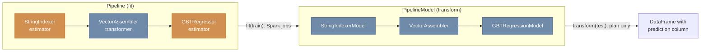
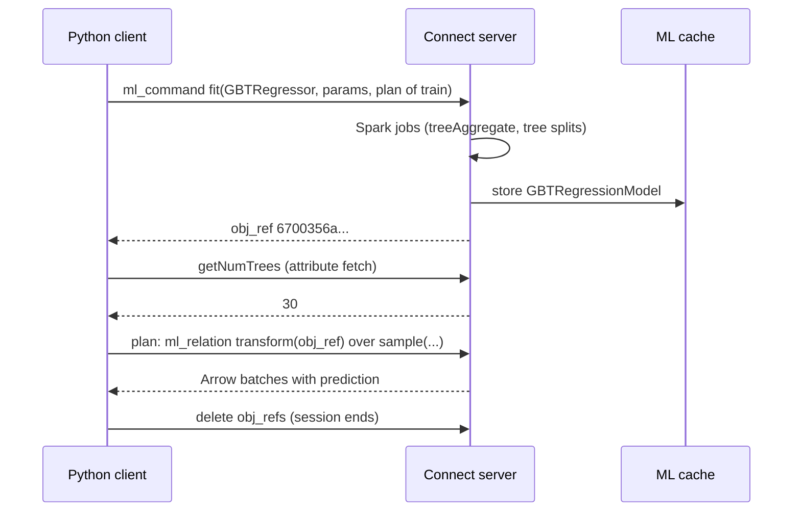
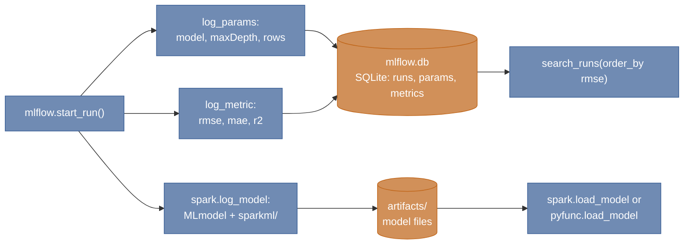

# Chapter 35: ML pipelines with MLlib, tracked in MLflow

A taxi dispatcher wants to show the fare before the trip starts. When the trip starts, the dispatcher knows the distance, the time, the pickup zone, the dropoff zone and the rate code. The fare is in the June 2026 trip records. This is a regression problem with 3.8 million rows, and the data is already in Spark.

**MLlib is a set of DataFrame transformations with a fit step. An estimator reads the data and returns a transformer, and a fitted pipeline is a list of transformers that adds columns to a plan. Thus, the rules of the earlier chapters apply. Training is a sequence of Spark jobs. A fitted model is a part of a query plan. Over Spark Connect, the model stays on the server.**

**MLflow then records which model came from which data and which settings.**

This chapter builds a fare model from the taxi data with MLlib. It shows what `fit()` runs, how categorical features become vectors, and how to read a model's feature importances. Then it runs the same pipeline over Spark Connect and tracks the runs in open source MLflow. The scripts are in [`code/ch35`](https://github.com/lisancao/spark-masterclass/tree/main/code/ch35). They ran on `pyspark==4.3.0`, and MLflow is `mlflow==3.18.0`. Each output block comes from `code/ch35/output/`.

## Step 1: The training table

Each script builds the same table from `fares.py`. It keeps clean trips, takes a 10% sample, and selects the features that the dispatcher knows at the start:

```python
def fare_table(spark, fraction=0.1, seed=7):
    trips = spark.read.parquet(str(TRIPS))
    clean = trips.where(
        (F.col("tpep_pickup_datetime") >= MONTH_START) &
        (F.col("tpep_pickup_datetime") < MONTH_END) &
        F.col("fare_amount").between(0.01, 500) &
        F.col("trip_distance").between(0.1, 100))
    return (clean.sample(fraction=fraction, seed=seed)
            .select(F.col("trip_distance"),
                    F.hour("tpep_pickup_datetime").cast("double").alias("hour"),
                    F.dayofweek("tpep_pickup_datetime").cast("double").alias("weekday"),
                    F.col("PULocationID").cast("string").alias("pickup_zone"),
                    F.col("DOLocationID").cast("string").alias("dropoff_zone"),
                    F.col("RatecodeID").cast("string").alias("rate_code"),   # NULL for 26% of trips
                    F.col("RatecodeID").alias("rate_code_raw"),
                    F.col(LABEL)))
```

```text
rows: 366,249 (train 293,200, test 73,049)
```

The zones and the rate code are categories, not quantities. Zone 161 is not "more" than zone 100. Thus, the table keeps them as strings, and the pipeline encodes them. The rate code is NULL for about a quarter of the trips. The next steps show what each stage does with a NULL value.

`randomSplit([0.8, 0.2], seed=42)` gives the training set and the test set. The split is the same in each run only if the input has the same partitions and order. The script caches the table, so the split stays the same within one script.

## Step 2: Estimators and transformers

MLlib has two kinds of stages. A **transformer** has a `transform()` method that adds columns to a DataFrame. An **estimator** has a `fit()` method that reads a DataFrame and returns a transformer. The transformer that `fit()` returns is a **model**:

```text
== estimator and transformer
StringIndexer is an Estimator: True, a Transformer: False
fit() returned StringIndexerModel, a Transformer: True
```

A `Pipeline` is a list of stages. `Pipeline.fit()` goes through the list in sequence. It fits each estimator on the output of the stages before it, and it keeps each transformer as it is. The result is a `PipelineModel`, which has only transformers.



The package for this API is `pyspark.ml`. The older `pyspark.mllib` package uses RDDs. It is in maintenance mode, and it does not work over Spark Connect.

## Step 3: Categories become numbers

**`StringIndexer`** gives each distinct value an index. The most frequent value gets index 0:

```text
== StringIndexer: labels by frequency
  index 0  rate_code 1     263,438 rows
  index 1  rate_code 2       8,927 rows
  index 2  rate_code 5       1,772 rows
  index 3  rate_code 3       1,098 rows
  index 4  rate_code 4         849 rows
  index 5  rate_code 99         98 rows
  NULL rate_code: 90,067 rows, not in labels
  handleInvalid=error -> error: Unseen label: 7. To handle unseen labels, set Param handleIn
  handleInvalid=skip  -> [('1', 0.0), ('2', 1.0)]
  handleInvalid=keep  -> [('1', 0.0), ('2', 1.0), ('7', 6.0), (None, 6.0)]
```

The fitted model has six labels. NULL is not a label. The parameter `handleInvalid` controls a value that the model did not see in the training data, and a NULL value:

- **`error`** (the default) stops the job. Here, the value "7" is not a label.
- **`skip`** removes the row. Here, two of the four test rows disappear without a message. Do not use `skip` in a job that must score every row.
- **`keep`** gives all unknown values and NULL one extra index, here 6.

**`OneHotEncoder`** changes an index into a vector with one slot for each category:

```text
== OneHotEncoder
  dropLast=True  size 6, rate_code '2' -> (6,[1],[1.0])
  dropLast=False size 7, rate_code '2' -> (7,[1],[1.0])
```

With `dropLast=True` (the default), the last category has no slot. It is the row with all zeros. A linear model needs one-hot vectors. Without them, a linear model reads the index as a quantity and fits one weight to "zone number". A tree model does not need one-hot vectors. A tree can split an indexed category into any two groups.

**`VectorAssembler`** joins columns into the one vector column that an estimator reads. The vector has one slot for each number and one slot for each one-hot position:

```text
== slots of an assembled vector
  2 input columns -> 7 slots: ['trip_distance', 'rate_vec_1', 'rate_vec_2', 'rate_vec_5', 'rate_vec_3', 'rate_vec_4', 'rate_vec_99']
```

The names come from the metadata of the vector column (`schema["features"].metadata["ml_attr"]`). Step 6 uses them to read feature importances. `VectorAssembler` also has `handleInvalid`, and its default is `error`. The raw rate code has NULL values, so the assembler stops the job:

```text
assembler over rate_code_raw -> Encountered null while assembling a row with handleInvalid = "error". Consider
```

## Step 4: What fit() runs

`fit()` is not one operation. It is a sequence of Spark jobs. `estimators.py` gives each fit a job description and counts its jobs in the REST API of the Spark UI:

```python
for name, est in (("LinearRegression normal", LinearRegression(labelCol=LABEL, solver="normal")),
                  ("LinearRegression l-bfgs", LinearRegression(labelCol=LABEL, solver="l-bfgs",
                                                               regParam=0.1, elasticNetParam=0.5))):
    sc.setJobDescription(name)
    m = est.fit(feats)
```

```text
== what fit() runs
  LinearRegression normal    2 jobs in 1.6 s, iterations   0, by kind {'treeAggregate': 2}
  LinearRegression l-bfgs   11 jobs in 3.5 s, iterations   6, by kind {'treeAggregate': 11}
```

All jobs are `treeAggregate`. Each job sends the current coefficients to the executors. Each task calculates partial sums (the loss and the gradient) over its partition. The partial sums come back to the driver in a tree of merges. The driver then takes one step of the optimizer.

- **The `normal` solver** solves the normal equations directly. It needs two passes over the data and no iterations.
- **The `l-bfgs` solver** with elastic-net regularization needs one pass for each iteration. It ran 6 iterations and 11 jobs, because the line search of the optimizer can need more than one pass for an iteration.

Each pass reads the input DataFrame again. If the input is not cached, each pass computes the whole input plan again, from the Parquet scan:

```text
== the same fit, input cached or not (median of 3 after a warmup)
  cached      median 1.28 s  [1.32, 1.28, 1.25]
  not cached  median 1.98 s  [1.98, 2.31, 1.45]
```

These are medians of three fits after a warm-up, under the book's benchmark lock. With the cached input, the fit took 1.28 s. Without the cache, it took 1.98 s. The difference grows with the number of iterations and with the cost of the input plan. Cache the training DataFrame before an iterative fit, and remove it from the cache after the fit.

## Step 5: Two models for the fare

`fare_pipeline.py` fits two pipelines on the same training set. The linear pipeline uses one-hot vectors for the three categories. The boosted-tree pipeline uses the indexes directly:

```python
indexers = [StringIndexer(inputCol=c, outputCol=c + "_idx", handleInvalid="keep") for c in FEATURES_CATEGORICAL]
onehot = OneHotEncoder(inputCols=[c + "_idx" for c in FEATURES_CATEGORICAL],
                       outputCols=[c + "_vec" for c in FEATURES_CATEGORICAL])
linear = Pipeline(stages=indexers + [onehot,
    VectorAssembler(inputCols=FEATURES_NUMERIC + [c + "_vec" for c in FEATURES_CATEGORICAL], outputCol="features"),
    LinearRegression(featuresCol="features", labelCol=LABEL)])
tree_features = VectorAssembler(inputCols=FEATURES_NUMERIC + [c + "_idx" for c in FEATURES_CATEGORICAL],
                                outputCol="features")
gbt = GBTRegressor(featuresCol="features", labelCol=LABEL, maxIter=30, maxDepth=6, seed=42)
```

The first fit of the tree pipeline failed:

```text
GBT with default maxBins -> DecisionTree requires maxBins (= 32) to be at least as large as the number of values in each categorical feature, but categorical feature 4 has 256 values. Consider removing this and other categorical features with a lar
```

`StringIndexer` writes metadata that marks its output as a category with a known number of values. The tree algorithm reads that metadata and treats the column as a category. A categorical feature needs one bin for each value, and the dropoff zone has 256 values (with the `keep` index). The default `maxBins` is 32. The script sets `maxBins` to 300.

```text
model                   fit s    rmse     mae      r2
mean of train             0.0   17.36   11.97  -0.000
linear regression         4.2    6.99    4.14   0.838
gradient-boosted trees   34.3    8.12    3.49   0.781
```

The first row is the baseline: a prediction of the mean fare for each trip. Both models are much better than the baseline. The fit times are single runs on a shared machine. They show the order of size only.

The two models are good at different things. The linear model has the lower root mean square error (RMSE). The boosted trees have the lower mean absolute error (MAE). RMSE gives a large weight to large errors, and MAE gives the same weight to each error. The table by rate code shows where the large errors are:

```text
mean absolute error by rate code (test set):
+---------+-----+------+-----+
|rate_code|trips|linear|  gbt|
+---------+-----+------+-----+
|        1|52463|   3.0| 2.33|
|     NULL|18106|  6.81| 6.29|
|        2| 1732|  5.91| 1.38|
|        5|  346| 19.79|24.19|
|        3|  225|  6.16|16.31|
|        4|  161| 22.29|25.46|
|       99|   16|  4.04| 4.73|
+---------+-----+------+-----+
```

Rate code 2 is the flat fare to JFK airport. The fare does not depend on the distance. The trees learn this rule (MAE 1.38), but the linear model cannot (MAE 5.91).

For the rare rate codes 3, 4 and 5 (Newark, out of the city, and negotiated fares), the trees are worse. They have few examples, and a tree of depth 6 cannot give them their own leaves. A few very large errors on these trips increase the RMSE of the trees. Thus, one summary number does not choose the model. Look at the errors by segment.

## Step 6: Feature importances, read through the metadata

A tree model has `featureImportances`, one value for each slot of the feature vector. The vector does not carry the names, so the script reads them from the metadata of the assembled column:

```python
attrs = scored.schema["features"].metadata["ml_attr"]["attrs"]
names = {a["idx"]: a["name"] for kind in attrs.values() for a in kind}
imp = model.stages[-1].featureImportances
```

```text
feature importances:
  trip_distance     0.590
  dropoff_zone_idx  0.144
  pickup_zone_idx   0.117
  rate_code_idx     0.075
  hour              0.049
  weekday           0.026
```

Distance is most of the model. Here, each category is one slot, because the tree pipeline uses indexes. With one-hot vectors, a category has many slots, and its importance spreads over them. To get the importance of a category, add its slots together. Do not compare the importance of one slot with the importance of a numeric column.

## Step 7: A fitted pipeline is a part of a plan

`transform()` runs nothing. It adds columns to the plan, as each DataFrame method does. The physical plan of `model.transform(test)` shows each stage as an expression:

```text
== Physical Plan ==
AdaptiveSparkPlan isFinalPlan=false
+- Project [UDF(features#7641) AS prediction#7645]
   +- Project [UDF(struct(trip_distance, trip_distance#4, hour, hour#22, weekday, weekday#23, pickup_zone_idx, pickup_zone_idx#7622, dropoff_zone_idx, dropoff_zone_idx#7629, rate_code_idx, rate_code_idx#7636)) AS features#7641]
      +- Project [trip_distance#4, hour#22, weekday#23, pickup_zone_idx#7622, dropoff_zone_idx#7629, UDF(rate_code#26) AS rate_code_idx#7636]
         +- Project [trip_distance#4, hour#22, weekday#23, rate_code#26, pickup_zone_idx#7622, UDF(dropoff_zone#25) AS dropoff_zone_idx#7629]
            +- Project [trip_distance#4, hour#22, weekday#23, dropoff_zone#25, rate_code#26, UDF(pickup_zone#24) AS pickup_zone_idx#7622]
```

Each stage is a `Project` with a `UDF`. These UDFs are Scala functions in the JVM, not Python UDFs. Thus, there is no `ArrowEvalPython` and no Python worker. Scoring with an MLlib model is as fast as other JVM expressions.

The pipeline also handles a zone that the training data did not have:

```text
unseen zone '999' -> Row(pickup_zone_idx=251.0, round(prediction, 2)=43.38)
```

The `keep` index (251) is the "unknown" category. The model still gives a prediction.

## Step 8: Save, load and tune

A fitted pipeline saves to a folder, with one subfolder for each stage:

```text
saved model:
   metadata
   stages/0_StringIndexer_95f6bfe3b067
   stages/1_StringIndexer_25e503ed8817
   stages/2_StringIndexer_c24e2619f1bf
   stages/3_VectorAssembler_d784aaba5372
   stages/4_GBTRegressor_18be136a3c4b
loaded model predicts the same: True (73,049 rows)
```

The format is the same for Scala, Java and Python. Thus, a model that Python saves can load in a Scala job.

**Tuning** fits the pipeline with different parameters and keeps the best result on data that the fit did not see. `TrainValidationSplit` splits the training data one time:

```text
TrainValidationSplit: 4 settings, 89 s
   {'maxDepth': 4, 'maxIter': 20} validation rmse 8.767
   {'maxDepth': 4, 'maxIter': 40} validation rmse 8.548
   {'maxDepth': 6, 'maxIter': 20} validation rmse 8.937
   {'maxDepth': 6, 'maxIter': 40} validation rmse 9.023
best: {'maxDepth': 4, 'maxIter': 40} test rmse 8.062
```

`CrossValidator` splits the data into `k` folds, and it fits each setting `k` times. For 4 settings and 3 folds, it fits 12 models. Then it fits the best setting one more time on all the data, so the total is 13 fits. `parallelism` lets Spark fit several settings at the same time.

The parameter grid has a trap. `estimators.py` counts the fits and the settings that `_fit` received. It builds the same grid two times: with the parameters of the class `LinearRegression`, and with the parameters of the estimator instance:

```text
== CrossValidator: 4 settings x 3 folds
  grid keys from the class attribute: 13 fits, settings seen by _fit [(0.0, 0.0)]
     avgMetrics (rmse): [8.318, 8.318, 8.318, 8.318]
  grid keys from the instance: 13 fits, settings seen by _fit [(0.0, 0.0), (0.0, 1.0), (1.0, 0.0), (1.0, 1.0)]
     avgMetrics (rmse): [8.318, 8.318, 8.359, 8.382]
```

With the class attributes, all 13 fits used the default parameters. The four metrics are equal, and Spark gave no error. A `Param` belongs to the object that made it. `ParamGridBuilder` keys from another object do not apply to this estimator. Always build the grid from the parameters of the estimator that you tune, for example `lr.regParam`.

The classification estimators work in the same way. `estimators.py` predicts if a card trip has a tip:

```text
== classification: tip or no tip (card trips)
  120,500 card trips, 94.9% with a tip
  LogisticRegression       AUC 0.557  accuracy 0.947
  RandomForestClassifier   AUC 0.597  accuracy 0.947
  columns a classifier adds: ['rawPrediction', 'probability', 'prediction']
```

The accuracy of 0.947 is not a good result. 94.9% of the trips have a tip, so a model that always says "tip" has the same accuracy. The area under the ROC curve (AUC) shows that the features carry little information about tips. Use AUC or a per-class measure when one class is much larger than the other.

**New in 4.3:** tree classifiers have a `pruneTree` parameter (SPARK-34591). Before 4.3, Spark always merged leaves of a tree that gave the same prediction. That merge removes the leaf probabilities, which some users need. `pruneTree=True` is the default and keeps the old behavior:

```text
== pruneTree (new in 4.3)
  pruneTree=True   3,334 nodes in 20 trees, AUC 0.597
  pruneTree=False  7,202 nodes in 20 trees, AUC 0.605
```

Without the merge, the forest has 7,202 nodes instead of 3,334. The AUC is a little higher, because the unmerged leaves keep different probabilities.

## Step 9: The same pipeline over Spark Connect

Since Spark 4.0, `pyspark.ml` works over Spark Connect (SPARK-49907). The client code does not change. But the location of each part changes. `connect_ml.py` runs the boosted pipeline against a Connect server and shows what the client holds:

```python
with SparkSession.builder.remote(url).getOrCreate() as spark:
    data = fare_table(spark)
    train, test = data.randomSplit([0.8, 0.2], seed=42)
    model = pipe.fit(train)                     # every estimator is fitted on the server
    for s in model.stages:
        print(f"  {type(s).__name__:<22} _java_obj = {s._java_obj!s:.60}")
```

```text
stages in the client's PipelineModel:
  StringIndexerModel     _java_obj = b912f6e4-a79b-4230-9aa8-f79d141fa1ff
  StringIndexerModel     _java_obj = fb5e6074-172a-4f40-b78f-8cbc3556857b
  StringIndexerModel     _java_obj = dbccf4a3-2b4a-4278-a45c-0ae230c22b56
  VectorAssembler        _java_obj = org.apache.spark.ml.feature.VectorAssembler
  GBTRegressionModel     _java_obj = 6700356a-7f25-455e-b292-6fb8c4530949

server ML cache for this session:
  DecisionTreeRegressionModel   30 entries    5,181,144 bytes
  GBTRegressionModel             1 entries    5,000,952 bytes
  StringIndexerModel             3 entries       47,864 bytes
```

<figure markdown>
  <video autoplay loop muted playsinline controls width="1280" height="720" poster="../../media/clips/ch35-connect.webp">
    <source src="../../media/clips/ch35-connect.mp4" type="video/mp4">
  </video>
  <figcaption>The fare pipeline over Spark Connect. The client's fitted models are references, and the server's ML cache holds the models.</figcaption>
</figure>

Each fitted model in the client is a reference: an id of an object in the server's **ML cache**. `VectorAssembler` is a transformer with no fitted state, so the client keeps only its class name and parameters. The cache holds the three indexers, the boosted model and its 30 trees, each with an estimated size.



Three behaviors follow from this design:

- **The client fetches attributes from the server.** `getNumTrees` and `featureImportances` are each one round trip:

  ```text
  getNumTrees = 30, featureImportances has 6 entries (each attribute is one round trip to the server)
  ```

- **`transform()` sends a plan node that names the model.** The client builds an `ml_relation` node for each stage. The fitted stages carry an `obj_ref`, and the assembler carries its class name:

  ```text
  the plan the client sends for model.transform(test), outermost nodes:
    ml_relation: obj_ref 6700356a...
      ml_relation: transformer org.apache.spark.ml.feature.VectorAssembler
        ml_relation: obj_ref dbccf4a3...
          ml_relation: obj_ref fb5e6074...
            ml_relation: obj_ref b912f6e4...
              sample
  ```

- **`save()` writes on the server's file system**, not the client's. The path must be a path that the server can write:

  ```text
  test rmse 8.12  (evaluated on the server as well)
  saved by the server to ~/spark-masterclass/data/ch35/fare_gbt_connect
  ```

The test RMSE is 8.12, the same as in Classic. The RDD-based API is not available:

```text
pyspark.mllib needs a SparkContext: PySparkAttributeError [JVM_ATTRIBUTE_NOT_SUPPORTED] Attribute `sparkContext` is not supporte
```

The ML cache uses server memory. Spark 4.1 added limits under `spark.connect.session.connectML.mlCache.memoryControl.*`. Many commits in 4.3.0 improved the size estimates that these limits use (for example SPARK-58281 for `PipelineModel` and SPARK-57521 for the parent copy). When a session ends, the client deletes its references, and the server removes the models.

A small script with a GBT of 5 trees showed 6 cache entries directly after `fit()`, one for the ensemble and one for each tree. The cause of the separate entries for the trees is not verified, and the part notes record it.

## Step 10: Track the runs in MLflow

A model is a result of code, data and parameters. Without a record, a team cannot say which model came from which settings. **MLflow** is an open source tool for this record. `mlflow_tracking.py` uses a local SQLite file as the tracking store, with no server:

```python
mlflow.set_tracking_uri(f"sqlite:///{store}/mlflow.db")
exp = mlflow.create_experiment("taxi-fares", artifact_location=(store / "artifacts").as_uri())

for kind, params, pipe in candidates:
    with mlflow.start_run(run_name=f"{kind} {params}".strip()) as run:
        mlflow.log_params({"model": kind, "sample_fraction": 0.1, "train_rows": train.count(), **params})
        model = pipe.fit(train)
        preds = model.transform(test)
        for m in ("rmse", "mae", "r2"):
            mlflow.log_metric(m, ev.setMetricName(m).evaluate(preds))
        signature = infer_signature(example, model.transform(spark.createDataFrame(example)).select("prediction").toPandas())
        mlflow.spark.log_model(model, "model", signature=signature, input_example=example)
```

```text
mlflow 3.18.0 | tracking store: sqlite:///~/spark-masterclass/data/ch35/mlflow/mlflow.db
logged run cf91a6bc  linear {}
logged run 15f78af9  gbt    {'maxDepth': 4, 'maxIter': 40}
logged run 80101491  gbt    {'maxDepth': 6, 'maxIter': 30}

  run_id params.model params.maxDepth params.maxIter  metrics.rmse  metrics.mae  metrics.r2
cf91a6bc       linear            None           None         6.988        4.144       0.838
15f78af9          gbt               4             40         8.062        3.571       0.784
80101491          gbt               6             30         8.120        3.490       0.781
```



`mlflow.search_runs` reads the comparison from the store, not from the memory of the script. A later session can read the same table.

A logged Spark model is a folder with an `MLmodel` file and the saved pipeline in `sparkml/`:

```text
artifacts of the best run (cf91a6bc):
   MLmodel
   conda.yaml
   input_example.json
   python_env.yaml
   requirements.txt
   serving_input_example.json
   sparkml/
   sparkml/metadata/
   sparkml/stages/

MLmodel flavors: ['python_function', 'spark'] | spark flavor: {'model_class': 'pyspark.ml.pipeline.PipelineModel', 'model_data': 'sparkml', 'pyspark_version': '4.3.0'}
signature inputs: [('trip_distance', 'DataType.double'), ('hour', 'DataType.double'), ('weekday', 'DataType.double'), ('pickup_zone', 'DataType.string'), ('dropoff_zone', 'DataType.string'), ('rate_code', 'DataType.string')]
mlflow.spark.load_model -> PipelineModel with 6 stages
mlflow.pyfunc.load_model(...).predict(5 rows) -> [9.64, 25.95, 8.32, 10.54, 10.71]
```

The model has two **flavors**. The `spark` flavor loads it back as a `PipelineModel`. The `python_function` flavor wraps it in a generic `predict()` that takes a pandas DataFrame. The signature records the input columns and their types, so a later caller can check its input. The flavor also records `pyspark_version: 4.3.0`.

## Step 11: MLflow and a Connect session

`mlflow.spark.log_model` saves the model through the local JVM. A Connect client has no local JVM:

```text
log_model from a Connect session ->
  AttributeError: 'NoneType' object has no attribute 'jvm'
workaround: server save + log_artifacts -> 3 stages logged: ['0_StringIndexer_0b6f5fa87bfc', '1_VectorAssembler_9e7449887018', '2_LinearRegression_5df2aff5fe1f']
```

With `mlflow==3.18.0` and `pyspark==4.3.0`, `log_model` fails for a model that a Connect session fitted. The script uses a workaround:

1. Save the model with `model.write().overwrite().save(path)`. The server writes it.
2. Log the folder with `mlflow.log_artifacts(path, artifact_path="sparkml")`. The client reads it.

This works only if the client and the server can both read the path, for example a shared file system or object storage. The logged folder is a plain Spark model, not an MLflow model with flavors. Thus, `mlflow.spark.load_model` cannot load it, but `PipelineModel.load` on a cluster can.

## The whole chapter, on one page

- **Estimators fit, transformers transform.** `Pipeline.fit()` returns a `PipelineModel` of transformers.
- **Encode categories.** `StringIndexer` with `handleInvalid="keep"` for unknown values and NULL. One-hot vectors for linear models. Indexes and enough `maxBins` for trees.
- **`fit()` is a sequence of `treeAggregate` jobs.** Cache the training data before an iterative fit.
- **Compare models by segment**, not only by one metric. Here, the trees learned the JFK flat fare, and the linear model did not.
- **Read importances through the vector metadata**, and add one-hot slots together.
- **Build parameter grids from the estimator instance.** Keys from another object have no effect and give no error.
- **Over Connect, models stay on the server.** The client holds references, attributes are round trips, and `save()` writes on the server.
- **Track runs in MLflow** with a SQLite store. From a Connect session in 4.3.0, save on the server and use `log_artifacts`.

```python
from pyspark.ml import Pipeline
from pyspark.ml.feature import StringIndexer, VectorAssembler
from pyspark.ml.regression import GBTRegressor
from pyspark.ml.evaluation import RegressionEvaluator
import mlflow, mlflow.spark

cats = ["pickup_zone", "dropoff_zone", "rate_code"]
pipe = Pipeline(stages=[StringIndexer(inputCol=c, outputCol=c + "_idx", handleInvalid="keep") for c in cats] + [
    VectorAssembler(inputCols=["trip_distance", "hour", "weekday"] + [c + "_idx" for c in cats], outputCol="features"),
    GBTRegressor(labelCol="fare_amount", maxDepth=4, maxIter=40, maxBins=300, seed=42)])

mlflow.set_tracking_uri("sqlite:///mlflow.db")
with mlflow.start_run():
    train, test = fare_table(spark).cache().randomSplit([0.8, 0.2], seed=42)
    model = pipe.fit(train)
    mlflow.log_metric("rmse", RegressionEvaluator(labelCol="fare_amount").evaluate(model.transform(test)))
    mlflow.spark.log_model(model, "model")          # Classic; over Connect, save on the server + log_artifacts
```

## Further reading

- [MLlib main guide](https://spark.apache.org/docs/4.3.0/ml-guide.html) and [ML pipelines](https://spark.apache.org/docs/4.3.0/ml-pipeline.html).
- [Spark Connect overview](https://spark.apache.org/docs/4.3.0/spark-connect-overview.html), and SPARK-49907 for MLlib over Connect.
- [MLflow tracking](https://mlflow.org/docs/latest/ml/tracking/) and the [Spark flavor](https://mlflow.org/docs/latest/api_reference/python_api/mlflow.spark.html).
- [SPARK-34591](https://issues.apache.org/jira/browse/SPARK-34591), the `pruneTree` parameter.
