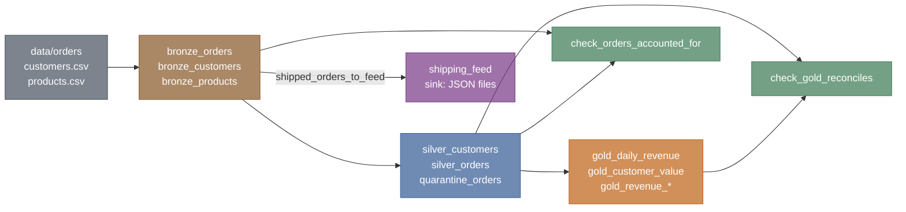
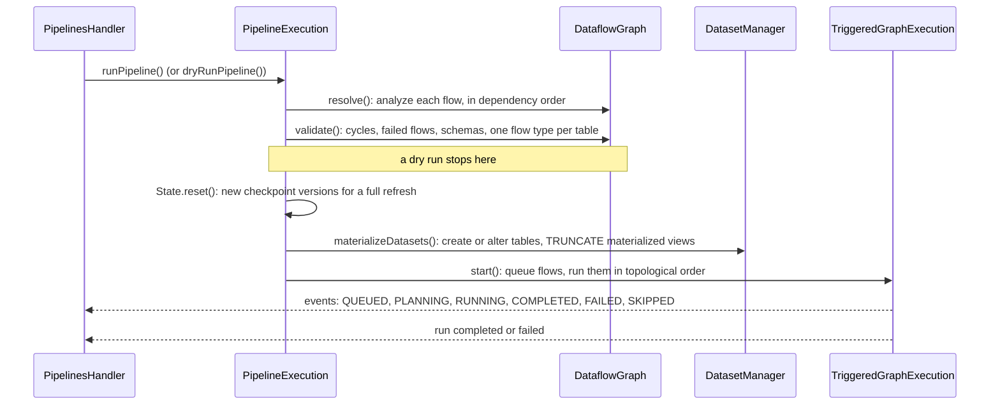
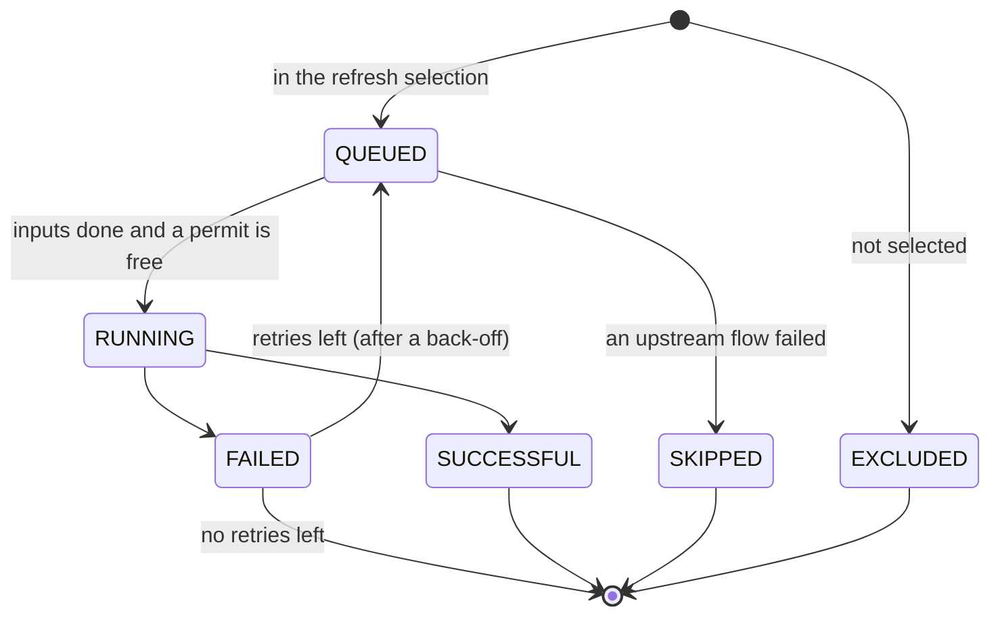

# Chapter 36: A pipeline end to end, and how SDP runs it

The chapters before this one showed what a pipeline does. They showed the errors of a dry run and the checkpoints of a second run. They also showed the empty table after a failed gate and the history of Auto CDC. This chapter puts the parts together into one reference pipeline. It runs the pipeline the way a production system runs it. Then it follows one run through the Spark source.

**The `spark-pipelines` CLI is only a client. It sends one command for each dataset and flow, and one command to start the run. The Spark Connect server then does five steps in a fixed order. Each behavior of Chapters 32 to 35 comes from one of these five steps.**

The server resolves each flow and does a check of the graph. It resets what a full refresh selected. It prepares each table. Then it runs the flows in topological order, as Structured Streaming queries and batch writes. The source paths in this chapter are for the tag `v4.3.0` of apache/spark.

The code is in [`code/ch36`](https://github.com/lisancao/spark-masterclass/tree/main/code/ch36). Each output block comes from `code/ch36/output/`. The pipeline runs on `pyspark==4.3.0` with a Hive metastore.

## Step 1: The reference pipeline

`ch36/shop` is the shop pipeline of [Chapter 33](ch33-medallion.md), with one more file. Its graph has bronze, silver and gold layers, two checks, and a sink that sends the shipped orders to a feed outside the pipeline:



The sink is in `sinks.py`:

```python
dp.create_sink(name="shipping_feed", format="json", options={"path": "exports/shipping_feed"})


@dp.append_flow(target="shipping_feed")
def shipped_orders_to_feed() -> DataFrame:
    return (spark.readStream.table("bronze_orders").where("status = 'shipped'")
            .select("order_id", "customer_id", "product_id", "quantity", "order_ts"))
```

A sink is a destination outside the catalog: a Kafka topic, a folder of files, or a format that a data source writes. Three rules apply to sinks:

- **Only a streaming append flow can write to a sink.** A sink is not a dataset. No other dataset can read it.
- **Only Python can declare a sink.** `create_sink` has no SQL form in Spark 4.3.
- **The pipeline does not own the data in a sink.** The rows go to a system that the pipeline does not manage.

## Step 2: Run it as production runs it

On a laptop, `spark-pipelines` starts its own local Connect server. In production, an operator runs one long-lived Spark Connect server on the cluster, for example with `sbin/start-connect-server.sh`. Then a scheduler runs the CLI with `--remote` for each run. `end_to_end.sh` does the same on one machine. It starts a server with a Hive metastore, runs the CLI three times against it, and stops the server:

```bash
"$SPARK_HOME/bin/spark-submit" --class org.apache.spark.sql.connect.service.SparkConnectServer \
  --master "local[4]" --conf spark.connect.grpc.binding.port=$PORT \
  --conf spark.ui.port=${SPARK_UI_PORT:-4126} --conf spark.sql.catalogImplementation=hive \
  --conf spark.sql.session.timeZone=UTC spark-internal >> server.log 2>&1 &
...
spark-pipelines --remote "sc://localhost:$PORT" run --spec "$W/spark-pipeline.yml"
```

```text
== run 1
11:00:48: Flow bronze_products has COMPLETED.
11:00:48: Flow bronze_customers has COMPLETED.
11:00:48: Flow bronze_orders has COMPLETED.
11:00:49: Flow silver_customers has COMPLETED.
11:00:50: Flow shipped_orders_to_feed has COMPLETED.
11:00:51: Flow silver_orders has COMPLETED.
11:00:51: Flow quarantine_orders has COMPLETED.
11:00:53: Flow check_orders_accounted_for has COMPLETED.
11:00:53: Flow gold_revenue_hardware has COMPLETED.
11:00:53: Flow gold_revenue_merch has COMPLETED.
11:00:53: Flow gold_daily_revenue has COMPLETED.
11:00:53: Flow gold_customer_value has COMPLETED.
11:00:55: Flow check_gold_reconciles has COMPLETED.
11:00:56: Run is COMPLETED.
part-00000-c6725a08-0b60-4fb9-be4a-cb5aabb3c597-c000.json
part-00001-04032bc8-d888-4a92-8bcc-b7f3ef3c90a9-c000.json
rows in the feed: 2

== run 2, after orders_2026-10-03.json arrived
11:01:03: Flow bronze_customers has COMPLETED.
11:01:04: Flow bronze_products has COMPLETED.
11:01:04: Flow bronze_orders has COMPLETED.
11:01:04: Flow silver_customers has COMPLETED.
11:01:05: Flow shipped_orders_to_feed has COMPLETED.
11:01:07: Flow silver_orders has COMPLETED.
11:01:07: Flow quarantine_orders has COMPLETED.
11:01:09: Flow check_orders_accounted_for has COMPLETED.
11:01:09: Flow gold_customer_value has COMPLETED.
11:01:09: Flow gold_revenue_hardware has COMPLETED.
11:01:09: Flow gold_revenue_merch has COMPLETED.
11:01:10: Flow gold_daily_revenue has COMPLETED.
11:01:12: Flow check_gold_reconciles has COMPLETED.
11:01:13: Run is COMPLETED.
rows in the feed: 3

== run --full-refresh-all
11:01:23: Flow bronze_customers has COMPLETED.
11:01:23: Flow bronze_products has COMPLETED.
11:01:24: Flow bronze_orders has COMPLETED.
11:01:24: Flow silver_customers has COMPLETED.
11:01:25: Flow shipped_orders_to_feed has COMPLETED.
11:01:26: Flow quarantine_orders has COMPLETED.
11:01:26: Flow silver_orders has COMPLETED.
11:01:27: Flow check_orders_accounted_for has COMPLETED.
11:01:27: Flow gold_revenue_merch has COMPLETED.
11:01:27: Flow gold_revenue_hardware has COMPLETED.
11:01:27: Flow gold_customer_value has COMPLETED.
11:01:28: Flow gold_daily_revenue has COMPLETED.
11:01:29: Flow check_gold_reconciles has COMPLETED.
11:01:30: Run is COMPLETED.
rows in the feed: 3
checkpoint versions of the sink flow: 0 1
batches in the sink log exports/shipping_feed/_spark_metadata: 0 1
bronze_orders: 15 rows
silver_orders: 10 rows
```

The three runs show how a sink behaves:

- **Run 1** sent the two shipped orders of the first two files.
- **Run 2** read one new bronze row with the status `shipped`, and sent only that row. The sink flow has its own checkpoint, as each streaming flow has.
- **The full refresh** cleared all tables and computed them again. Bronze and silver have the same rows as before. The sink flow got a new checkpoint version (`0 1`), so it read all shipped orders from bronze again. But the feed still has 3 rows. A JSON sink is a file sink, and a file sink keeps its own log of batches in `_spark_metadata`. The new checkpoint started again at batch 0, the log already had batches 0 and 1, and the file sink skipped them. This is the mechanism of the lost rows in Chapter 32, Step 7.

!!! warning "Caution: a full refresh does not undo what a sink sent"

    Do not use a full refresh to correct the data in a sink. The rows that the sink sent stay in the target system. For a file sink, the new run also skips the batch IDs that its log already has, so the corrected rows do not arrive. Correct the data in the target system, or write to a new sink path.

A production setup adds three parts around these commands:

- **A scheduler.** Cron, Airflow or a Kubernetes CronJob runs `spark-pipelines run --remote sc://host:15002 --spec ...` on a schedule. Each run is a triggered run: it reads all new data, and stops.
- **A dry run in continuous integration.** `spark-pipelines dry-run` against a test server catches cycles, wrong names and wrong columns before a change goes to production (Chapter 32, Step 8).
- **A persistent catalog and storage.** The catalog keeps the tables between runs, and the `storage` folder keeps the checkpoints. Both must survive a restart of the server.

## Step 3: What the CLI sends

`trace_cli.py` wraps the two methods of the Spark Connect client that send commands. It prints one line for each pipeline command, and then calls the real CLI with a dry run:

```text
$ SPARK_REMOTE=sc://localhost:10260 python ch36/trace_cli.py spark-pipeline.yml dry-run
  -> create_dataflow_graph(default_catalog=None, default_database=None)
  -> define_output(bronze_orders, TABLE)
  -> define_flow(bronze_orders -> bronze_orders, relation_flow_details, plan root: project)
  -> define_output(bronze_customers, MATERIALIZED_VIEW)
  -> define_flow(bronze_customers -> bronze_customers, relation_flow_details, plan root: read)
  -> define_output(bronze_products, MATERIALIZED_VIEW)
  -> define_flow(bronze_products -> bronze_products, relation_flow_details, plan root: read)
  -> define_output(check_orders_accounted_for, MATERIALIZED_VIEW)
  -> define_flow(check_orders_accounted_for -> check_orders_accounted_for, relation_flow_details, plan root: project)
  -> define_output(check_gold_reconciles, MATERIALIZED_VIEW)
  -> define_flow(check_gold_reconciles -> check_gold_reconciles, relation_flow_details, plan root: project)
  -> define_output(silver_customers, MATERIALIZED_VIEW)
  -> define_flow(silver_customers -> silver_customers, relation_flow_details, plan root: project)
  -> define_output(orders_typed, TEMPORARY_VIEW)
  -> define_flow(orders_typed -> orders_typed, relation_flow_details, plan root: project)
  -> define_output(orders_checked, TEMPORARY_VIEW)
  -> define_flow(orders_checked -> orders_checked, relation_flow_details, plan root: project)
  -> define_output(silver_orders, MATERIALIZED_VIEW)
  -> define_flow(silver_orders -> silver_orders, relation_flow_details, plan root: project)
  -> define_output(quarantine_orders, MATERIALIZED_VIEW)
  -> define_flow(quarantine_orders -> quarantine_orders, relation_flow_details, plan root: project)
  -> define_output(shipping_feed, SINK)
  -> define_flow(shipped_orders_to_feed -> shipping_feed, relation_flow_details, plan root: project)
  -> define_output(billable_orders, TEMPORARY_VIEW)
  -> define_flow(billable_orders -> billable_orders, relation_flow_details, plan root: filter)
  -> define_output(gold_daily_revenue, MATERIALIZED_VIEW)
  -> define_flow(gold_daily_revenue -> gold_daily_revenue, relation_flow_details, plan root: project)
  -> define_output(gold_customer_value, MATERIALIZED_VIEW)
  -> define_flow(gold_customer_value -> gold_customer_value, relation_flow_details, plan root: project)
  -> define_output(gold_revenue_hardware, MATERIALIZED_VIEW)
  -> define_flow(gold_revenue_hardware -> gold_revenue_hardware, relation_flow_details, plan root: aggregate)
  -> define_output(gold_revenue_merch, MATERIALIZED_VIEW)
  -> define_flow(gold_revenue_merch -> gold_revenue_merch, relation_flow_details, plan root: aggregate)
Starting run...
  -> start_run(dry=True, full_refresh_all=False, storage=.../pipeline-storage)
Run is COMPLETED.
```

<figure markdown>
  <video autoplay loop muted playsinline controls width="1280" height="720" poster="../../media/clips/ch36-trace.webp">
    <source src="../../media/clips/ch36-trace.mp4" type="video/mp4">
  </video>
  <figcaption>The pipeline commands of a dry run, as the CLI sent them. There is one graph, one output and one flow for each dataset and the sink, and the start of the run.</figcaption>
</figure>

The CLI sends four types of command (the `PipelineCommand` message in `sql/connect/common/src/main/protobuf/spark/connect/pipelines.proto`):

- **`CreateDataflowGraph`** creates an empty graph on the server with the default catalog, the default database and the configurations of the spec. The server returns a graph ID, and each later command names it.
- **`DefineOutput`** declares a dataset or a sink. It sends the name and the type: `TABLE` for a streaming table, `MATERIALIZED_VIEW`, `TEMPORARY_VIEW` or `SINK`. It also sends details, such as table properties, partitions, a schema or the options of a sink.
- **`DefineFlow`** declares a flow: its name, its target and the unresolved plan of its query (`relation_flow_details`). The plan root is the last operation of the query function: `read` for a plain file read, `project` after a `select`, `filter` after a `where`. An Auto CDC flow sends `auto_cdc_flow_details` instead, with the keys, the sequence expression and the SCD type. A SQL file goes as one `DefineSqlGraphElements` command with its text. This project has no SQL file.
- **`StartRun`** starts a run with the refresh selection, the `dry` flag and the `storage` path.

The plans are not analyzed on the client. Each `DefineFlow` holds the same unresolved plan that a Spark Connect client sends for a normal query. The server resolves them later, all together.

## Step 4: The server registers the graph

`PipelinesHandler` (`sql/connect/server/src/main/scala/org/apache/spark/sql/connect/pipelines/PipelinesHandler.scala`) receives each command. `CreateDataflowGraph` makes a `GraphRegistrationContext` and keeps it in the `DataflowGraphRegistry` of the session. Each `DefineOutput` and `DefineFlow` adds a `Table`, `TemporaryView`, `Sink` or `Flow` object to it. `DefineSqlGraphElements` parses the SQL with `SqlGraphRegistrationContext` and adds the same objects. A SQL statement that is not a pipeline statement fails here. That is the error of Chapter 35, Step 10: `PIPELINE_SQL_GRAPH_ELEMENT_REGISTRATION_ERROR` for the plan `CreateMetricView`.

Nothing in the catalog changes during registration. The graph is only a set of objects in the memory of the server, for this session.

## Step 5: `StartRun`, in five steps

`StartRun` builds a `PipelineUpdateContextImpl` with the graph, the refresh selection and the storage path. Then it calls `PipelineExecution.runPipeline()`, or `dryRunPipeline()` for a dry run (`sql/pipelines/src/main/scala/org/apache/spark/sql/pipelines/graph/PipelineExecution.scala`):



1. **Resolve.** `DataflowGraph.resolve` analyzes each flow with the schemas of its inputs. An input in the same graph gives its schema from its own resolved flow, so the order of resolution follows the dependencies. A flow that reads a name or a column that does not exist fails to resolve.
2. **Validate.** `DataflowGraph.validate` runs a list of checks (`GraphValidations.scala`). The first check, `validateSuccessfulFlowAnalysis`, collects the flows that failed to resolve. It looks for a cycle among them first. Then it separates the flows with their own errors from the flows that failed only because of an upstream flow. This order is why a dry run reports a cycle first (Chapter 32, Step 8). The other checks make sure of these rules:

    - User schemas agree with the queries.
    - The graph has a topological order.
    - A table does not get both streaming and batch flows.
    - Persisted views read no temporary views.
    - Each dataset has a flow.

   
3. **Reset.** For a full refresh, `State.reset` gives each selected streaming flow, and each flow into a selected sink, a new checkpoint folder with the next number. It does not delete the old folder (Chapter 32, Step 10).
4. **Materialize.** `DatasetManager.materializeDatasets` creates each table that does not exist and changes the schema of each table that does. For each materialized view, and for each table in a full refresh, it runs `TRUNCATE TABLE` first (`materializeTable`). Only a streaming table in an incremental run keeps its data. This is the step that left silver empty in Chapter 33, Step 10: the truncate occurs here, before any flow runs.
5. **Execute.** `TriggeredGraphExecution` runs the flows.

A dry run calls only steps 1 and 2. That is why it writes nothing, and why it cannot find an error that occurs in steps 4 or 5.

## Step 6: How the flows run

The server log of run 2 shows step 4 and step 5 in order:

```text
INFO DatasetManager: Materializing metadata for table `bronze_products`.
INFO DatasetManager: Materializing metadata for table `bronze_customers`.
INFO DatasetManager: Materializing metadata for table `bronze_orders`.
INFO DatasetManager: Materializing metadata for table `silver_customers`.
INFO DatasetManager: Materializing metadata for table `silver_orders`.
INFO DatasetManager: Materializing metadata for table `quarantine_orders`.
INFO DatasetManager: Materializing metadata for table `gold_revenue_hardware`.
INFO DatasetManager: Materializing metadata for table `gold_daily_revenue`.
INFO DatasetManager: Materializing metadata for table `gold_revenue_merch`.
INFO DatasetManager: Materializing metadata for table `gold_customer_value`.
INFO DatasetManager: Materializing metadata for table `check_orders_accounted_for`.
INFO DatasetManager: Materializing metadata for table `check_gold_reconciles`.
INFO TriggeredGraphExecution: Starting flow `bronze_customers`
INFO TriggeredGraphExecution: Starting flow `bronze_orders`
INFO FlowSystemMetadata: Flow bronze_orders using checkpoint directory: pipeline-storage/_checkpoi
INFO TriggeredGraphExecution: Starting flow `bronze_products`
INFO TriggeredGraphExecution: Starting flow `silver_customers`
INFO TriggeredGraphExecution: Starting flow `shipped_orders_to_feed`
INFO FlowSystemMetadata: Flow shipped_orders_to_feed using checkpoint directory: pipeline-storage/
INFO TriggeredGraphExecution: Starting flow `silver_orders`
INFO TriggeredGraphExecution: Starting flow `quarantine_orders`
INFO TriggeredGraphExecution: Starting flow `gold_customer_value`
INFO TriggeredGraphExecution: Starting flow `check_orders_accounted_for`
INFO TriggeredGraphExecution: Starting flow `gold_revenue_hardware`
INFO TriggeredGraphExecution: Starting flow `gold_revenue_merch`
INFO TriggeredGraphExecution: Starting flow `gold_daily_revenue`
INFO TriggeredGraphExecution: Starting flow `check_gold_reconciles`
```

<figure markdown>
  <video autoplay loop muted playsinline controls width="1280" height="720" poster="../../media/clips/ch36-server.webp">
    <source src="../../media/clips/ch36-server.mp4" type="video/mp4">
  </video>
  <figcaption>The server log of run 2: <code>DatasetManager</code> prepares each table first, and then <code>TriggeredGraphExecution</code> starts the flows.</figcaption>
</figure>

SDP prepares all tables first. Then the flows start. `TriggeredGraphExecution` (`TriggeredGraphExecution.scala`) runs a control thread with a loop:

- At the start, each flow in the refresh selection is `QUEUED`, and each other flow is `EXCLUDED`.
- In each turn of the loop, a queued flow can start when each upstream flow is `SUCCESSFUL`, `EXCLUDED` or `IDLE`.
- A semaphore limits the flows that run at the same time to `spark.sql.pipelines.execution.maxConcurrentFlows` (default 16).
- A flow that fails goes back to the queue for a retry after a wait, up to `spark.sql.pipelines.maxFlowRetryAttempts` times (default 2). The wait grows exponentially, from `spark.sql.pipelines.execution.watchdog.minRetryTime` (default 5 seconds) up to `...maxRetryTime` (default 3600 seconds). These are the retries of the gate in Chapter 33.
- When a flow cannot retry again, each flow downstream of it becomes `SKIPPED`.
- The run ends when the queue is empty, no flow runs and no flow waits for a retry.



`FlowPlanner` turns each flow into a `FlowExecution` of one of five types (`FlowExecution.scala`):

| Flow | Execution | What it does |
|---|---|---|
| materialized view | `BatchTableWrite` | `df.write.mode("append").saveAsTable(...)`, after the truncate of step 4 |
| streaming table | `StreamingTableWrite` | `writeStream` with `checkpointLocation`, into the table |
| sink | `SinkWrite` | `writeStream` with `checkpointLocation`, to the format and options of the sink |
| Auto CDC, SCD Type 1 | `Scd1MergeStreamingWrite` | `writeStream` with `foreachBatch`, a `MERGE` for each micro-batch |
| Auto CDC, SCD Type 2 | `Scd2MergeStreamingWrite` | the same, with the history logic of `Scd2BatchProcessor` |

Each streaming execution uses `Trigger.AvailableNow()` (`TriggeredGraphExecution.streamTrigger`). The query reads all data that is available when it starts, in one or more micro-batches, and then stops. Thus, a pipeline run ends, and a scheduler can start the next one. The query name is the name of the table, which is why the Spark event log of Chapter 33 shows `spark_catalog.default.bronze_orders`.

## Step 7: How the events come back

Each change of state goes to `FlowProgressEventLogger`, which builds a `PipelineEvent` with an origin, a level, a message and details. `PipelinesHandler` passes the events to `PipelineEventSender`, which writes them to the gRPC stream of the `StartRun` command:

- The sender keeps a queue of `spark.sql.pipelines.event.queue.capacity` events (default 1000). When the queue is full, it drops events of flow progress that are not terminal, and writes a warning at most once a minute. Terminal events always go to the client.
- The event of a failed run does not go to the client as an event. The handler keeps it and throws its exception at the end of `startRun`. That exception is the traceback that the CLI prints after a failed run.
- The proto message that reaches the client has only a time and a message (Chapter 33, Step 7). The level, the origin and the details stay on the server.

## Step 8: Each behavior, and where it comes from

| What the book showed | Step | Source |
|---|---|---|
| The query function runs once, when the CLI imports the file | client registration | `cli.py` `register_definitions`, the decorators in `api.py` |
| `SESSION_MUTATION_IN_DECLARATIVE_PIPELINE` | client registration | `block_session_mutations.py` |
| `dropDuplicates` and `drop` fail with `TABLE_OR_VIEW_NOT_FOUND` | client registration (the Connect client asks for a schema) | Chapter 33, Step 3 |
| A dry run reports the cycle first | validate | `GraphValidations.validateSuccessfulFlowAnalysis` |
| `RUN_EMPTY_PIPELINE`, `PIPELINE_DATASET_WITHOUT_FLOW` | validate | `GraphValidations.scala`, `DataflowGraph.validate` |
| A full refresh makes a new checkpoint version | reset | `State.reset`, `SystemMetadata.getLatestCheckpointDir` |
| `LOCATION_ALREADY_EXISTS` in the second run with the in-memory catalog | materialize | `DatasetManager.materializeTable` creates a table that the catalog forgot |
| A failed or skipped materialized view is empty | materialize | `TRUNCATE TABLE` in `DatasetManager.materializeTable` |
| `AUTOCDC_TARGET_DOES_NOT_SUPPORT_MERGE` | materialize | `DatasetManager` checks the target of an Auto CDC flow |
| Flows wait for their inputs, run in parallel up to 16 | execute | `TriggeredGraphExecution.topologicalExecution` |
| Three attempts of a failed flow, then `SKIPPED` downstream | execute | `maxFlowRetryAttempts`, `ExponentialBackoffStrategy` |
| A streaming flow reads only new input and stops | execute | `Trigger.AvailableNow()`, the checkpoint of each flow |
| Two flows into one Parquet table lose rows; a file sink does not send again after a full refresh | execute | `FileStreamSink.addBatch` skips batch IDs that its log has |
| The traceback after a failed run | events | `PipelinesHandler.startRun` throws the failure event |

## The whole chapter, on one page

```bash
# once: a long-lived Connect server with a persistent catalog
$SPARK_HOME/sbin/start-connect-server.sh --conf spark.sql.catalogImplementation=hive
# in CI: check the graph, write nothing
spark-pipelines dry-run --remote sc://host:15002 --spec pipeline/spark-pipeline.yml
# on a schedule: one triggered run
spark-pipelines run --remote sc://host:15002 --spec pipeline/spark-pipeline.yml
```

- **The CLI is a client.** It sends `CreateDataflowGraph`, a `DefineOutput` and a `DefineFlow` for each element, and `StartRun`. The server resolves the plans.
- **The server runs five steps:** resolve, validate, reset, materialize, execute. A dry run does only the first two.
- **Materialize truncates materialized views** before the flows run. A failed flow leaves its table empty.
- **Execute runs flows in topological order**, at most 16 at a time, with retries and back-off, and skips the flows downstream of a failure.
- **Each streaming flow is an available-now streaming query** with its own checkpoint. A pipeline run ends when all flows end.
- **A sink is outside the pipeline.** A full refresh does not undo what it sent.

## Further reading

- `sql/pipelines/src/main/scala/org/apache/spark/sql/pipelines/graph/` (tag `v4.3.0`): `PipelineExecution.scala`, `DataflowGraph.scala`, `GraphValidations.scala`, `DatasetManager.scala`, `TriggeredGraphExecution.scala`, `FlowPlanner.scala`, `FlowExecution.scala`.
- `sql/connect/server/src/main/scala/org/apache/spark/sql/connect/pipelines/`: `PipelinesHandler.scala`, `PipelineEventSender.scala`.
- `sql/connect/common/src/main/protobuf/spark/connect/pipelines.proto`, the commands of Step 3.
- [Spark Declarative Pipelines guide](https://spark.apache.org/docs/4.3.0/declarative-pipelines-programming-guide.html).
