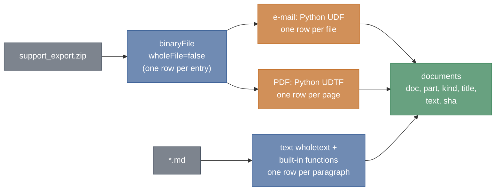
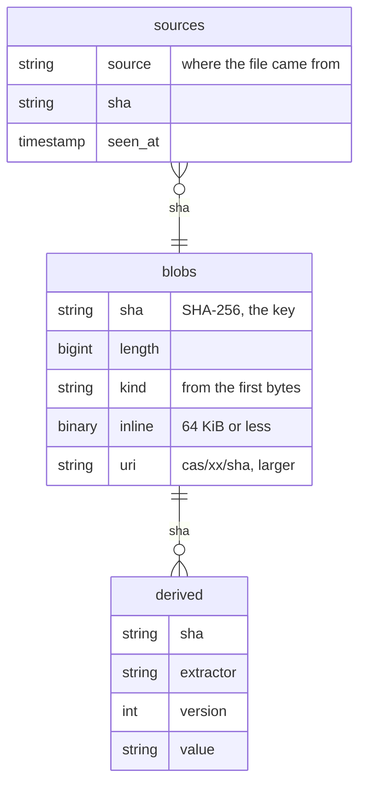
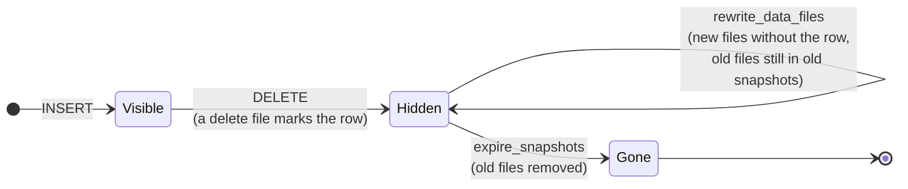

# Chapter 37: Documents, images, audio and tables for blobs

The files of the earlier chapters have records inside them. An e-mail, a PDF, a scan or a recording is different. The file itself is the record, and its bytes have a structure that no Spark reader understands. Spark cannot read an e-mail, but Python can. Spark cannot store a 10 MB scan well in a table, but it can store the address of the scan.

This chapter starts where such data often arrives: in an archive. Then it changes three kinds of document into rows, reads images and audio, and designs the tables that keep the bytes.

**For unstructured files, Spark is the engine that moves bytes and runs your parser in parallel. The parser is plain Python in a UDF or a UDTF. The important decision is the grain of the row: one file, one page or one paragraph. Each row must keep its provenance (the file and its hash). Large bytes do not belong inline in a Parquet table: keep them in a content-addressed store, and keep their hash and address in the table. A delete from a table format does not remove the bytes from the disk until you rewrite the files and expire the old snapshots.**

The data is SparkTutor's sample set in [`code/data/messy`](https://github.com/lisancao/spark-masterclass/tree/main/code/data/messy). It has four support e-mails, two generated PDF invoices and four Markdown policy pages. It also has six images (one is not valid) and three WAV recordings.

The scripts are [`code/ch37/documents.py`](https://github.com/lisancao/spark-masterclass/tree/main/code/ch37), `media.py` and `blobs.py`. All output is from `code/ch37/output/`, on Spark 4.3.0 with `spark.sql.session.timeZone=UTC`. The last part uses Apache Iceberg. Iceberg has no release for Spark 4.3 yet, so `blobs.py` uses a runtime built from an open Iceberg pull request (see Step 13).



## Step 1: The export arrives as a zip

A support system exports its tickets as one zip file. The zip holds e-mails, PDF invoices and one note.

[Chapter 31](ch31-files-as-files.md), Step 12, introduced the archive reader of Spark 4.3. With `spark.sql.files.archive.reader.enabled` set to `true` and the `binaryFile` option `wholeFile` set to `false`, each entry of the archive is one row:

```python
spark.conf.set("spark.sql.files.archive.reader.enabled", "true")
entries = (spark.read.format("binaryFile").option("wholeFile", "false").load(str(export))
           .select(F.regexp_replace("path", r"^.*/", "").alias("name"),
                   F.regexp_extract("path", r"!/(.*)$", 1).alias("entry"), "length", "content"))
```

```text
== the export: a zip of e-mails and invoices ==
+---------------------------+------+-------------+
|entry                      |length|first 5 bytes|
+---------------------------+------+-------------+
|export/mail/notes.txt      |14    |6E6F742061   |
|export/mail/ticket_0.eml   |250   |46726F6D3A   |
|export/mail/ticket_1.eml   |250   |46726F6D3A   |
|export/mail/ticket_2.eml   |257   |46726F6D3A   |
|export/mail/ticket_3.eml   |250   |46726F6D3A   |
|export/pdf/invoice_1001.pdf|878   |255044462D   |
|export/pdf/invoice_1002.pdf|603   |255044462D   |
+---------------------------+------+-------------+

Python type of content: bytes
```

The `path` of each row is the archive path, then `!/`, then the entry name. The entry name is the provenance of each row, so the script keeps it as `entry`. The first bytes show the kind of each file: `From:` for an e-mail, `%PDF-` for a PDF. In Python, a `binary` value is `bytes`.

The rest of this part works on these entries. No step unpacks the zip to a disk.

## Step 2: Parse e-mail in plain Python, then wrap it in a UDF

Python has a full e-mail parser in its standard library. The parser is plain Python, so you can test it without Spark. It must never raise an exception: one file that is not an e-mail must not stop the job. It returns an `error` field instead:

```python
EMAIL_TYPE = "struct<sender:string, subject:string, sent:timestamp, body:string, error:string>"


def parse_eml(content):
    """(sender, subject, sent, body, error) from the bytes of one e-mail. Never raises."""
    from email import policy
    from email.parser import BytesParser
    try:
        msg = BytesParser(policy=policy.default).parsebytes(content)
        if msg["From"] is None:
            return (None, None, None, None, "no From header")
        date = msg["Date"]
        body = msg.get_body(preferencelist=("plain",))
        return (str(msg["From"]), str(msg["Subject"]), date.datetime if date else None,
                body.get_content().strip() if body else None, None)
    except Exception as e:                       # one odd file must not fail the job
        return (None, None, None, None, f"{type(e).__name__}: {e}")


parse = F.udf(parse_eml, EMAIL_TYPE)
```

The imports are inside the function, because the function runs in Python worker processes on the executors. A struct return type gives several columns from one call:

```text
== e-mail: a plain Python parser, then a UDF ==
+------------------------+---------------------+------------------+----------------+--------+--------------+
|entry                   |sender               |subject           |sent_utc        |order_id|error         |
+------------------------+---------------------+------------------+----------------+--------+--------------+
|export/mail/notes.txt   |NULL                 |NULL              |NULL            |NULL    |no From header|
|export/mail/ticket_0.eml|customer0@example.com|Broken item       |2026-10-01 09:00|1000    |NULL          |
|export/mail/ticket_1.eml|customer1@example.com|Broken item       |2026-10-02 09:00|1001    |NULL          |
|export/mail/ticket_2.eml|customer2@example.com|Where is my order?|2026-10-03 09:00|1002    |NULL          |
|export/mail/ticket_3.eml|customer3@example.com|Broken item       |2026-10-04 09:00|1003    |NULL          |
+------------------------+---------------------+------------------+----------------+--------+--------------+

collect() gives sent as a naive datetime in the driver's zone: 2026-10-03 02:00:00
plan: Project <- ArrowEvalPython <- Filter
pythonUDF.arrow.enabled=false, a new UDF: Project <- BatchEvalPython <- Project
```

- **The note is a row with an error, not a failed job.** A later step sends the rows with an error to a quarantine.
- **`order_id` comes from a built-in function, not from Python.** `regexp_extract` and `try_cast` run in the JVM. Keep in Python only the work that needs Python.
- **`sent` is a `timestamp`, and its zone matters.** The parser gives a datetime with a zone. Spark stores it as an instant. In SQL, it shows in the session zone (UTC here): 09:00. `collect()` gives a Python datetime without a zone, in the local zone of the driver (here 02:00, in America/Los_Angeles). Format timestamps in Spark when the zone matters.
- **The UDF runs through Arrow by default.** The plan has `ArrowEvalPython`. Since Spark 4.2, `spark.sql.execution.pythonUDF.arrow.enabled` is `true` by default. With it set to `false`, a new UDF gets `BatchEvalPython`, which uses pickle. [Chapter 43](ch43-python-udfs-arrow.md) explains the two paths.

## Step 3: PDF pages from a Python UDTF

A PDF has many pages, so one file must give many rows. A Python UDF gives one value for each input row. A **Python UDTF** (user-defined table function) gives any number of rows. Its `eval` method yields one tuple for each output row.

The sample PDFs are simple. SparkTutor generated them with uncompressed content streams, and each page draws its text with one `BT ... (text) Tj ET` command:

```text
== PDF: one row per page, from a Python UDTF ==
PDF header: b'%PDF-1.4'  page objects: 2
one content stream: b'BT /F1 12 Tf 72 720 Td (Invoice 1001 total 42.50 CAD) Tj ET\n'
```

For these files, a regular expression finds the text:

```python
class PdfPages:
    """One row (page, text) for each page of the sample PDFs: each page draws BT ... (text) Tj ET."""
    def eval(self, content):
        import re
        if content is None:
            return
        for n, raw in enumerate(re.findall(rb"BT .*?\((.*?)\) Tj ET", content, re.S), start=1):
            yield n, raw.decode("latin-1")


pages_udtf = F.udtf(PdfPages, returnType="page int, text string")
pages = pdf_raw.select("entry", "content").lateralJoin(pages_udtf(F.col("content").outer())).drop("content")
```

```text
+---------------------------+----+----------------------------+
|entry                      |page|text                        |
+---------------------------+----+----------------------------+
|export/pdf/invoice_1001.pdf|1   |Invoice 1001 total 42.50 CAD|
|export/pdf/invoice_1001.pdf|2   |Thank you for shopping      |
|export/pdf/invoice_1002.pdf|1   |Invoice 1002 total 17.00 CAD|
+---------------------------+----+----------------------------+

plan: ArrowEvalPythonUDTF <- Project <- Filter <- FileScan
  lateralJoin without .outer()                 -> UNRESOLVED_COLUMN.WITHOUT_SUGGESTION
SQL LATERAL pdf_pages(content): 3 rows
```

!!! caution
    The regular expression works only for these generated files. A real PDF compresses its content streams, splits text into many commands, and encodes fonts in many ways. For real PDFs, use a PDF library such as `pypdf` inside the same UDTF. The UDTF, the `lateralJoin` and the row grain stay the same.

`DataFrame.lateralJoin` calls the UDTF for each row of the left DataFrame. The column from the left side must have `.outer()`. Without it, Spark looks for `content` inside the UDTF, and the analysis fails. In SQL, register the UDTF and use `LATERAL`. The plan node is `ArrowEvalPythonUDTF`, because Python UDTFs also use Arrow by default since Spark 4.2.

### A file that gives no rows

A PDF with no text gives no rows from the UDTF. An inner lateral join then drops the file, and nobody knows that it was there. A left lateral join must keep it:

```text
== a UDTF that gives no rows: the inner and the left lateral join ==
inner lateralJoin:                 2 of 3 files
lateralJoin(how='left'):           2 of 3 files
lateralJoin(on=lit(True), 'left'): 3 of 3 files
SQL LEFT JOIN LATERAL ... ON true: 3 of 3 files
```

!!! warning
    In PySpark 4.3.0, `lateralJoin(..., how="left")` without an `on` argument still drops the rows that give no output. Give `on=F.lit(True)` too. In SQL, write `LEFT JOIN LATERAL ... ON true`.

The part notes record this behavior as an open finding.

## Step 4: Markdown chunks with built-in functions

Markdown needs no Python at all. `text` with `wholetext=True` gives one row for each file. Then `split`, the higher-order function `filter` ([Chapter 34](ch34-complex-types.md)) and `posexplode` make one row for each paragraph:

```python
ws = F.lit(" \t\r\n")
docs = spark.read.text(str(MESSY / "docs" / "*.md"), wholetext=True)
paragraphs = F.filter(F.split("value", r"\n\s*\n"), lambda p: (F.trim(p, ws) != "") & ~F.trim(p, ws).startswith("#"))
chunks = (docs.select(F.col("_metadata.file_name").alias("file"),
                      F.regexp_extract("value", r"(?m)^# (.+)$", 1).alias("title"),
                      F.posexplode(paragraphs).alias("pos", "text"))
          .select("file", "title", (F.col("pos") + 1).alias("chunk"), F.trim("text", ws).alias("text")))
```

```text
== Markdown: chunks with built-in functions only ==
+----------+--------------+-----+------------------------------------------------+
|file      |title         |chunk|text                                            |
+----------+--------------+-----+------------------------------------------------+
|privacy.md|Privacy policy|1    |We store order history for seven years. Customer|
|privacy.md|Privacy policy|2    |We store order history for seven years. Customer|
|privacy.md|Privacy policy|3    |We store order history for seven years. Customer|
|returns.md|Returns policy|1    |Customers can return unopened items within 30 da|
|returns.md|Returns policy|2    |Customers can return unopened items within 30 da|
|returns.md|Returns policy|3    |Customers can return unopened items within 30 da|
+----------+--------------+-----+------------------------------------------------+
only showing top 6 rows
plan has a Python node: False
```

- `(?m)` makes `^` and `$` match at each line, so the regular expression finds the `# ` title line.
- `trim` with a second argument removes the characters that you name. Plain `trim` removes only spaces, not line breaks.
- The plan has no Python node, so the work stays in the JVM.

Each policy page in the sample repeats its paragraph three times. Real documents also repeat text: signatures, legal footers, quoted replies. The next step finds the repeats.

## Step 5: One document table, with a hash

The three results have different columns. A common shape makes them one table for search or for a model. Each row keeps its document and its part, and gets a hash of its normalized text:

```python
documents = (emails.where("error IS NULL").select(F.col("entry").alias("doc"), F.lit(1).alias("part"),
                                                  F.lit("email").alias("kind"), F.col("subject").alias("title"),
                                                  F.col("body").alias("text"))
             .unionByName(pages.select(F.col("entry").alias("doc"), F.col("page").alias("part"),
                                       F.lit("pdf").alias("kind"), F.lit(None).cast("string").alias("title"), "text"))
             .unionByName(chunks.select(F.col("file").alias("doc"), F.col("chunk").alias("part"),
                                        F.lit("markdown").alias("kind"), "title", "text"))
             .withColumn("sha", F.sha2(F.lower(F.trim("text")), 256)))
```

```text
== one document table, with provenance and a content hash ==
+--------+----+--------------+
|kind    |rows|distinct texts|
+--------+----+--------------+
|email   |4   |4             |
|markdown|12  |4             |
|pdf     |3   |3             |
+--------+----+--------------+

all rows: 19  distinct texts: 11
```

The 12 Markdown chunks have only 4 distinct texts. The hash finds exact repeats with no Python and no comparison of pairs. The PDF `title` is a typed `NULL` (`lit(None).cast("string")`), because `unionByName` needs the same type in each input. [Chapter 65](ch65-text-analytics.md) finds near-duplicates, which a hash cannot find.

## Step 6: The image source

Spark has a built-in `image` source. It decodes PNG, JPEG, GIF and BMP files with Java ImageIO, and gives one row with a struct for each file:

```text
== the image source ==
root
 |-- image: struct (nullable = true)
 |    |-- origin: string (nullable = true)
 |    |-- height: integer (nullable = true)
 |    |-- width: integer (nullable = true)
 |    |-- nChannels: integer (nullable = true)
 |    |-- mode: integer (nullable = true)
 |    |-- data: binary (nullable = true)

+----------------------------+------+-----+---------+----+----------+
|origin                      |height|width|nChannels|mode|data_bytes|
+----------------------------+------+-----+---------+----+----------+
|products/gradient_32x32.png |32    |32   |3        |16  |3072      |
|products/logo_rgba_12x12.png|12    |12   |4        |24  |576       |
|products/red_16x8.png       |8     |16   |3        |16  |384       |
|scans/corrupt.png           |-1    |-1   |-1       |-1  |0         |
|scans/gray_20x10.png        |10    |20   |1        |0   |200       |
|scans/readme.txt            |-1    |-1   |-1       |-1  |0         |
+----------------------------+------+-----+---------+----+----------+

count without dropInvalid: 6  with dropInvalid: 4
mode is an OpenCV type code: 0 = CV_8UC1 (gray), 16 = CV_8UC3, 24 = CV_8UC4
```

- **A file that does not decode is a row with `-1` values**, not an error. `corrupt.png` and `readme.txt` are such rows. The option `dropInvalid` removes them. Without it, filter on `nChannels > 0`.
- **`data` holds the decoded pixels, not the file.** A 32 by 32 image with three channels has 3072 bytes. A compressed JPEG of 300 KB can decode to many megabytes. Thus the image source uses much more memory than `binaryFile` on the same files.
- **`mode` is an OpenCV type code.**

The source is read-only. Spark has no image writer.

## Step 7: Pixels are B, G, R

The script reads a red image and an RGBA logo whose color it knows:

```text
== pixel bytes are B, G, R (and A) ==
red_16x8.png, first pixel bytes: 00 00 ff  (blue, green, red)
logo_rgba_12x12.png, first pixel: ff 00 00 ff  (B, G, R, A)
```

A pure red pixel is `00 00 ff`. The image source keeps the bytes in the OpenCV order: blue, green, red, then alpha. A library that expects RGB order (Pillow, most models) sees a blue image. Reverse the channels before you give the pixels to such a library.

<figure markdown>


<figcaption>The first pixel of <code>red_16x8.png</code>, from the output above. In B, G, R order, the pixel shows red. A library that reads R, G, B shows blue. The swatches show the true colours in both themes.</figcaption>
</figure>


## Step 8: `origin` and `path` are different strings

To join the image rows to the file sizes from `binaryFile`, the obvious key is the path. It does not work:

```text
== origin and path are not the same string ==
image.origin:    file://~/spark-masterclass-parts/part03/code/data/messy/images/products/red_16x8.png
binaryFile.path: file:~/spark-masterclass-parts/part03/code/data/messy/images/products/red_16x8.png
join on origin = path: 0 rows
join on _metadata.file_path: 6 rows
```

`image.origin` starts with `file://` (here `file:///home` before the home folder became `~`), and `binaryFile.path` starts with `file:/`. The join finds no rows, and there is no error. The hidden column `_metadata.file_path` has the same form in all file sources. Use it as the join key.

## Step 9: An Arrow UDF over the pixels

An Arrow UDF (`F.arrow_udf`) receives each column as a PyArrow array, one batch at a time. The script computes the mean color of each image with NumPy. It reverses B and R:

```python
@F.arrow_udf("struct<r:double, g:double, b:double>")
def rgb_means(data: pa.Array, channels: pa.Array) -> pa.Array:
    import numpy as np
    out = []
    for d, c in zip(data.to_pylist(), channels.to_pylist()):
        if not d or c < 1:
            out.append(None)
            continue
        px = np.frombuffer(d, dtype=np.uint8).reshape(-1, c).astype(float)
        out.append({"r": px[:, 0].mean(), "g": px[:, 0].mean(), "b": px[:, 0].mean()} if c == 1 else
                   {"r": px[:, 2].mean(), "g": px[:, 1].mean(), "b": px[:, 0].mean()})
    return pa.array(out, type=COLOR)
```

```text
== an Arrow UDF over the pixels ==
+-------------------+-----+-----+-----+
|file               |r    |g    |b    |
+-------------------+-----+-----+-----+
|gradient_32x32.png |124.0|124.0|128.0|
|gray_20x10.png     |114.0|114.0|114.0|
|logo_rgba_12x12.png|0.0  |0.0  |255.0|
|red_16x8.png       |255.0|0.0  |0.0  |
+-------------------+-----+-----+-----+

plan: +- ArrowEvalPython [rgb_means(image#0.data, image#0.nChannels)#129], [
```

The red image gives `r = 255`, so the channel order is correct. A struct return type needs an explicit PyArrow struct type in `pa.array`.

## Step 10: WAV files with the standard library

A WAV file has a `RIFF` header and then the samples. The Python `wave` module reads the header, and NumPy reads the 16-bit samples:

```python
def wav_info(content):
    import io
    import wave
    import numpy as np
    with wave.open(io.BytesIO(content)) as w:
        rate, ch, n = w.getframerate(), w.getnchannels(), w.getnframes()
        s = np.frombuffer(w.readframes(n), dtype="<i2").astype(float)
    return (rate, ch, n / rate, float(np.sqrt((s ** 2).mean()) / 32768) if len(s) else 0.0)
```

```text
== WAV files with the standard library ==
RIFF header of tone_440.wav: b'RIFF\xc4\x0f\x00\x00WAVEfmt '
+------------------+----+--------+-------+------+
|file              |rate|channels|seconds|rms   |
+------------------+----+--------+-------+------+
|silence.wav       |8000|1       |0.5    |0.0   |
|tone_440.wav      |8000|1       |0.25   |0.3535|
|tone_880_quiet.wav|8000|1       |0.25   |0.0353|
+------------------+----+--------+-------+------+
```

The RMS level (0 to 1) of `tone_440.wav` is 0.3535. A sine wave with a peak of 0.5 has an RMS of 0.5 divided by the square root of 2, which is 0.3535. Thus the decode is correct. The level of the quiet tone is one tenth of that level.

## Step 11: `mapInArrow`: one file in, many rows out

To split each recording into 50 ms windows, one file must give many rows, as for the PDF pages. `mapInArrow` gives a function the full Arrow batches of a partition, and the function yields new batches with any number of rows:

```text
== mapInArrow: one file in, one row for each 50 ms window out ==
+------------------+-------+--------+
|file              |windows|max_peak|
+------------------+-------+--------+
|silence.wav       |10     |0.0     |
|tone_440.wav      |5      |0.5     |
|tone_880_quiet.wav|5      |0.05    |
+------------------+-------+--------+

  the same, with int64 for an int column       -> UNSUPPORTED_CALL.WITHOUT_SUGGESTION
```

The 0.5 s silence gives 10 windows, and each 0.25 s tone gives 5. The peak of the loud tone is 0.5.

The output schema declares `window int`. The Arrow array must then be `int32`. Python integers become `int64` by default in `pa.array`, and Spark does not convert them. The error, `UNSUPPORTED_CALL.WITHOUT_SUGGESTION`, does not name the column or the types. If you see it after `mapInArrow`, compare each Arrow type with the declared schema.

A stream of new files works the same way, with `readStream.format("binaryFile")`. A streaming file source needs an explicit schema (`IllegalArgumentException: Schema must be specified ...` without one). [Chapter 48](ch48-structured-streaming.md) explains streams.

## Step 12: Large blobs inline in Parquet

The next question is where to keep the bytes. The simplest design keeps them inline, in a `binary` column of a Parquet table. The script writes 40 random blobs of 1 MB each, with a name and a shelf number. Random bytes do not compress, like the bytes of a JPEG, an MP3 or a zip file:

```text
== 40 blobs of 1 MB, inline in Parquet ==
file 41.9 MB, row groups: 1, rows: 40
  name        0.000 MB compressed,    0.001 MB raw, min/max: yes
  content    41.945 MB compressed,   41.943 MB raw, min/max: no
  shelf       0.000 MB compressed,    0.000 MB raw, min/max: yes
scan tasks: 11  tasks that got rows: 1  rows in that task: [40]
ReadSchema of a query on name and shelf: struct<name:string,shelf:int>
```

The footer shows four problems with this design:

- **All 40 rows are in one row group.** The default row group size of Parquet is 128 MB, and the file is smaller.
- **The `content` column is almost all of the file**, and compression does nothing for it.
- **The `content` column has no minimum and maximum statistics**, so a filter cannot skip row groups by content.
- **A row group is the unit of parallelism.** Spark planned 11 scan tasks for the 42 MB file. But one row group cannot split, so one task got all 40 rows, and ten tasks did nothing. A table of blobs has few rows and large row groups, so it reads with little parallelism.

One point is good: column pruning works. A query on `name` and `shelf` reads only those columns, and it does not read the 42 MB of `content`. Metadata queries stay cheap.

<figure markdown>


<figcaption>The footer and the scan from the output above. The <code>content</code> column is almost all of the file. One task reads the one row group.</figcaption>
</figure>


## Step 13: A content-addressed store, with an inline limit

A better design keeps small files inline and puts large files into a **content-addressed store**. The address of a file in the store is the SHA-256 hash of its bytes: `cas/<first two hex digits>/<hash>`. The table keeps the hash and the address. The script uses 64 KiB as the limit:

```python
def put(rows):
    import os
    for r in rows:
        if r.length > INLINE_MAX:
            d = CAS / r.sha[:2]
            d.mkdir(parents=True, exist_ok=True)
            target = d / r.sha
            if not target.exists():
                tmp = d / f".{r.sha}.{os.getpid()}"
                tmp.write_bytes(r.content)
                os.replace(tmp, target)         # atomic: a reader never sees half a blob


files.where(F.col("length") > INLINE_MAX).dropDuplicates(["sha"]).foreachPartition(put)
```

```text
== a content-addressed store: hash the bytes, keep large blobs as files ==
files in: 17  distinct hashes: 16  blobs in the store: 2
  cas/41/41314f34ffb37a18e... 200000 bytes
  cas/46/465f69fde3a5fe5d3... 200000 bytes
```

The input has the sample files, a copy of `red_16x8.png` with a different name, and two random files of 200,000 bytes. Content addressing gives four useful properties:

- **Duplicates store one time.** The copy of the PNG has the same hash as the original, so 17 files give 16 hashes.
- **A write is idempotent.** If a task runs again after a failure, it finds the file already there and does nothing. The temporary name and `os.replace` make sure that a reader never sees a part of a file.
- **The hash is a stable key** for each derived result.
- **The hash checks the bytes.** A reader can hash the file again and compare.

This store is on a local disk, which all executors share in local mode. On a cluster, the store is an object store such as S3, and `put` writes with the client of that store.

## Step 14: Three tables, and two `MERGE` traps

The design uses three tables:



- `sources` has one row for each file that arrived, with its origin. Two sources can have the same hash.
- `blobs` has one row for each distinct hash, with the bytes inline or an address in the store.
- `derived` has the results of each extractor (text, a page count, an embedding), with the extractor name and version as part of the key.

The script makes the tables in Apache Iceberg, with merge-on-read deletes.

!!! note
    Apache Iceberg 1.12.0, the newest release, has no runtime for Spark 4.3. Delta Lake 4.4.1 is built for Spark 4.2, and it does not work on Spark 4.3.0 ([Chapter 54](ch54-tables-delta-iceberg.md)). `blobs.py` uses `iceberg-spark-runtime-4.3_2.13`, built from apache/iceberg pull request #18749 (commit `b1eab64`). It is not a release. The table design does not depend on the format.

The load uses `MERGE`, so that a file that arrives again does not make a second row. Two traps occur with a batch that has duplicates:

```text
== three tables: sources, blobs, derived ==
  MERGE with two source rows for one hash      -> MERGE_CARDINALITY_VIOLATION
insert-only MERGE with duplicates in the source: rows 17  distinct hashes 16
after dropDuplicates on the hash: blobs 16  sources 17
+-----+-----+------+--------+------+
|kind |blobs|bytes |in_store|inline|
+-----+-----+------+--------+------+
|email|4    |1007  |0       |4     |
|other|2    |400000|2       |0     |
|pdf  |2    |1481  |0       |2     |
|png  |5    |2066  |0       |5     |
|wav  |3    |16132 |0       |3     |
+-----+-----+------+--------+------+

+------------------------------+------------+
|source                        |sha         |
+------------------------------+------------+
|file:/incoming/copy_of_red.png|de806669504e|
|images/products/red_16x8.png  |de806669504e|
+------------------------------+------------+
```

- **A `MERGE` with `WHEN MATCHED` fails when two source rows match one target row**, `MERGE_CARDINALITY_VIOLATION`. The table already had the PNG, and the batch had it twice.
- **An insert-only `MERGE` does not check duplicates in the source.** Both copies are new to the target, so both get inserted, and the table has 17 rows for 16 hashes. The `MERGE` did not protect the key.

The fix is to make the source unique on the key first (`GROUP BY sha`, or `dropDuplicates(["sha"])`). Then `blobs` has 16 rows, and `sources` keeps all 17 origins. The last table shows the two sources of one blob.

Derived results use the same key. An anti join finds the blobs that an extractor version has not processed yet:

```text
== derived rows, keyed by hash and extractor version ==
work for extractor kind v1, first run: 16
work for extractor kind v1, second run: 0
```

The second run has no work. A new file with a known hash also gives no work. A new extractor version processes all blobs again.

## Step 15: A delete does not remove the bytes

A customer asks you to delete their data. The e-mail `ticket_2.eml` must go. The script deletes its hash from the three tables, and then looks for the text of the e-mail in the Parquet files of the warehouse:

```text
== forget one file: a delete leaves the bytes on disk ==
data files that hold the e-mail text before the delete: 1
rows with the hash after DELETE: 0
data files that still hold the text: 1
delete files in the table: 1
time travel to the snapshot before the delete still finds it: 1
after rewrite_data_files, files that hold the text: 1
after expire_snapshots, files that hold the text: 0
  time travel to the snapshot before the delete -> IllegalArgumentException: Cannot find snapshot with ID 4500859435678070813
the blob in the store is a separate file: remove it too, with the hash: cas/f1/f162c9a6dd8b... (this e-mail is small, so it was inline)
```

<figure markdown>
  <video autoplay loop muted playsinline controls width="1280" height="720" poster="../../media/clips/ch37-forget.webp">
    <source src="../../media/clips/ch37-forget.mp4" type="video/mp4">
  </video>
  <figcaption><code>blobs.py</code> on Spark 4.3.0 with an Iceberg runtime from a pull request build. The delete hides the row at once, and the bytes leave the disk only after a rewrite and an expire.</figcaption>
</figure>



| After | A query finds the row | Data files that hold the text | Time travel to the old snapshot | Why |
|---|---|---|---|---|
| `DELETE` | no | 1 | finds the row | A merge-on-read delete writes a small delete file that marks the row. The data file does not change. |
| `rewrite_data_files` | no | 1 | finds the row | It writes new data files without the row. The old file is still on the disk, because old snapshots refer to it. |
| `expire_snapshots` | no | 0 | fails | It removes the old snapshots and the files that only they use. |

The animation shows the same sequence with the snapshots and the files.

<figure markdown>
  <video autoplay loop muted playsinline controls width="1280" height="720" poster="../../media/clips/ch37-anim-forget.webp">
    <source src="../../media/clips/ch37-anim-forget.mp4" type="video/mp4">
  </video>
  <figcaption>Animation: the <code>DELETE</code> adds a delete file, and data file A stays. Then the rewrite adds data file B, and snapshot 1 keeps file A. Then the expire removes file A. The counts are from <code>blobs.py</code>.</figcaption>
</figure>


A real delete of personal data is thus a sequence of four operations. Delete the rows, rewrite the files, expire the snapshots, and delete the file in the content-addressed store. Copies outside the table (exports, caches, logs) are separate work. Delta Lake has the same behavior with deletion vectors: `REORG TABLE ... APPLY (PURGE)` rewrites the files, and `VACUUM` removes them after the retention period.

## The whole chapter, on one page

```python
from pyspark.sql import functions as F

spark.conf.set("spark.sql.files.archive.reader.enabled", "true")            # 4.3: entries of a zip
entries = (spark.read.format("binaryFile").option("wholeFile", "false").load("support_export.zip")
           .withColumn("entry", F.regexp_extract("path", r"!/(.*)$", 1)))

parse = F.udf(parse_eml, EMAIL_TYPE)                                        # plain Python, never raises
emails = entries.where(F.col("entry").endswith(".eml")).select("entry", parse("content").alias("m"))

pages_udtf = F.udtf(PdfPages, returnType="page int, text string")           # one file, many rows
pages = (entries.where(F.col("entry").endswith(".pdf"))
         .lateralJoin(pages_udtf(F.col("content").outer()), on=F.lit(True), how="left"))   # keep empty files

images = (spark.read.format("image").option("dropInvalid", "true").load("images/")
          .withColumn("fp", F.col("_metadata.file_path")))                  # join key: not origin, not path
# pixels are B, G, R(, A): reverse before Pillow or a model

blobs = (spark.read.format("binaryFile").load("incoming/")
         .withColumn("sha", F.sha2("content", 256))
         .dropDuplicates(["sha"]))                                          # unique source before MERGE
# > 64 KiB: write to cas/<sha[:2]>/<sha> (temp name + os.replace), keep sha and uri in the table
# forget: DELETE, rewrite_data_files, expire_snapshots, delete the cas file
```

- **The archive reader (4.3) gives one row for each entry** with `binaryFile` and `wholeFile=false`. Keep the entry name as provenance.
- **Write the parser in plain Python, test it alone, and never let it raise.** Return an error field.
- **A UDTF gives many rows from one file.** Use `.outer()` in `lateralJoin`, and `on=F.lit(True)` for a left join.
- **Keep Python for the work that needs Python.** Regular expressions, splits and hashes are built-in functions.
- **The image source gives decoded pixels in B, G, R order, and `-1` rows for invalid files.** Join on `_metadata.file_path`.
- **Arrow types must match the declared schema exactly in `mapInArrow`.**
- **Large blobs inline in Parquet give one large row group and little parallelism.** Use a content-addressed store above a size limit.
- **Make the source unique on the key before `MERGE`.**
- **A delete hides rows. Rewrite and expire to remove the bytes.**

## Further reading

- [Binary file data source](https://spark.apache.org/docs/4.3.0/sql-data-sources-binaryFile.html) and [image data source](https://spark.apache.org/docs/4.3.0/ml-datasource.html).
- [Python user-defined table functions](https://spark.apache.org/docs/4.3.0/api/python/user_guide/sql/python_udtf.html).
- [Python `email` package](https://docs.python.org/3/library/email.html) and [`wave` module](https://docs.python.org/3/library/wave.html).
- [Iceberg maintenance procedures](https://iceberg.apache.org/docs/latest/spark-procedures/): `rewrite_data_files` and `expire_snapshots`.
